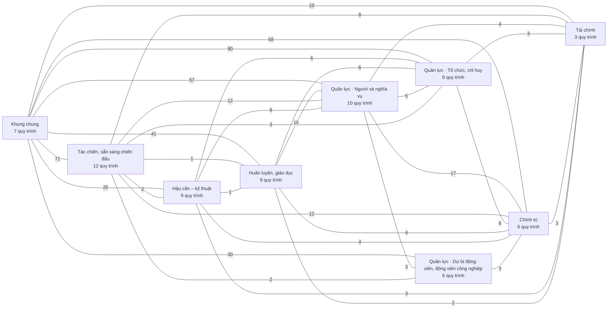

# Tổng thể — các khối nghiệp vụ của hệ

<!-- máy sinh: tom-tat -->
> **116 tài liệu quy trình** (70 quy trình, còn lại là hồ sơ phụ) xếp vào **9 khối** · 1338 bước.
>
> 650 khớp nối giữa các quy trình khác mã: 121 nằm gọn trong một khối, 525 chạy giữa hai khối, 4 tới sổ ngày công.
>
> **Nguồn:** cộng từ các tài liệu quy trình (sổ nghiệp vụ + khai báo của app) và bảng kê khớp nối. Chín khối chia theo mặt công tác.
<!-- hết: tom-tat -->

<!-- viết tay: dien-giai -->
## Diễn giải

*Phần này viết tay, diễn giải lại điều các bảng bên dưới và chín tài liệu khối ghi.*

### Hệ này quản lý việc gì

Hệ theo dõi **hồ sơ**. Mỗi quy trình là đường đi của một loại hồ sơ: mở ra ở một bước, qua các chặng, tới chặng kết thúc; mỗi bước do một người giữ một vai làm, hoặc hệ tự làm. Bộ tài liệu có 102 tài liệu quy trình cho 67 quy trình và các hồ sơ phụ của chúng, tổng cộng 1.044 bước.

Các hồ sơ không đứng rời. Bảng kê khớp nối đếm được 267 mối nối giữa hồ sơ của hai quy trình khác mã: hồ sơ này mở ra có nối tới hồ sơ kia, hoặc hai hồ sơ gắn nhau ở một bước giữa chừng. Trong đó 189 mối chạy giữa hai khối — nhiều gấp hơn hai lần số nằm gọn trong một khối (74). Vì vậy đọc một khối phải đọc kèm mục "Nhận gì từ khối khác, để lại gì cho khối khác" của nó.

### Chín khối và việc của từng khối

Chín khối chia theo mặt công tác. Việc của từng khối, theo phần diễn giải của tài liệu khối:

- [Khung chung](khoi-khung-chung.html) — nhiệm vụ trên giao kèm văn bản đến, văn bản đi; kế hoạch, văn kiện cùng chỉ tiêu và mốc thời gian; bản giao chỉ tiêu xuống cấp dưới và kết quả trả lên; báo cáo định kỳ, đột xuất; cuộc thanh tra, kiểm tra; hồ sơ lưu trữ của từng việc.
- [Tác chiến, sẵn sàng chiến đấu](khoi-tac-chien.html) — tin cảnh báo, vụ việc ứng phó (kèm tài sản mượn của dân và cấp độ phòng thủ dân sự), lệnh điều động khi bình thường và trong tình trạng đặc biệt, lực lượng đóng trên địa bàn, đợt huy động lực lượng dự bị động viên, đợt mở rộng lực lượng, trạng thái sẵn sàng chiến đấu của địa bàn, công trình và đất quốc phòng, vụ tàu bay không người lái.
- [Hậu cần – kỹ thuật](khoi-hau-can.html) — trang bị, vật chất, trang phục: đưa hàng về kho; giữ sổ từng khoản trang bị, kiểm kê, thu hồi thanh lý; cấp cho người, cho đợt và xử lý mất, hỏng.
- [Huấn luyện, giáo dục](khoi-huan-luyen.html) — đợt tập trung (huấn luyện, tập huấn, hội thi, hội thao, diễn tập) và việc cử người đi; khoá bồi dưỡng kiến thức QP&AN và giấy chứng nhận; đợt học liên kết ở trung tâm GDQP&AN; học viên đào tạo chức danh Ban chỉ huy quân sự cấp xã; trình độ cán bộ; hồ sơ chương trình, giáo trình.
- [Quân lực · Người và nghĩa vụ](khoi-nguoi-nghia-vu.html) — hồ sơ gắn với từng người: dòng Sổ nghĩa vụ của một công dân, lần tham gia dân quân tự vệ, các dòng quyết định ghi cho người đó, hồ sơ chế độ và bồi thường; cùng các đợt lập cho nhiều người: kỳ tuyển chọn, đợt hoàn thành nghĩa vụ, đợt tuyển quân, tiếp nhận quân nhân xuất ngũ, sơ tuyển vào trường Quân đội.
- [Quân lực · Dự bị động viên, động viên công nghiệp](khoi-du-bi-dong-vien.html) — sổ phương tiện chung, bản sắp xếp đơn vị dự bị động viên của xã theo năm, đợt gọi quân nhân dự bị; sổ cơ sở động viên công nghiệp và dây chuyền, hồ sơ thực hành động viên công nghiệp.
- [Quân lực · Tổ chức, chỉ huy](khoi-to-chuc.html) — hồ sơ thành lập tổ chức và đơn vị dân quân tự vệ; Ban chỉ huy quân sự cấp xã; chức vụ chỉ huy, chức danh và bảng chi trả phụ cấp chức vụ tháng; đợt công nhận xã trọng điểm về quốc phòng; đợt khởi tạo hiện trạng; danh mục người của đơn vị.
- [Chính trị](khoi-chinh-tri.html) — phong trào thi đua, hồ sơ khen thưởng, vụ việc vi phạm hành chính, đợt tuyên truyền, lá đơn (khiếu nại, tố cáo, kiến nghị, phản ánh), vụ việc kỷ luật.
- [Tài chính](khoi-tai-chinh.html) — dự toán ngân sách năm của xã và của tỉnh, đề nghị cấp kinh phí cho từng việc, phiếu chi, bảng thanh toán trợ cấp, và danh mục hai mức tiền theo tỉnh.

Ba khối mang tên "Quân lực · …" cộng lại có 21 quy trình.

### Hồ sơ chảy giữa các khối thế nào

**Khung chung là nơi mọi khối nối về.** Khối này có 104 khớp nối với khối khác — hơn một nửa số mối nối giữa các khối — và nối với cả tám khối còn lại (mục 3). Theo tài liệu khối, phần lớn là chiều để lại: hồ sơ của khối khác mở ra có nối về nhiệm vụ trên giao, kế hoạch hoặc chỉ tiêu, và gắn tờ trình, quyết định vào văn bản đi. Quy trình [1](qt-1.html) nối với 33 quy trình khác, [2](qt-2.html) với 21 (mục 4).

**Sổ người là đầu mối thứ hai.** Quy trình [16](qt-16.html) nối với 31 quy trình; hồ sơ của 19 quy trình khác mở ra có nối về nó. Khối Người và nghĩa vụ có 63 khớp nối với khối khác, nhiều nhất với Khung chung (14), Huấn luyện (13) và Tác chiến (10): chiến sĩ được điều động, được triệu tập huấn luyện, được cấp trang phục, được khen, bị kỷ luật đều là hồ sơ nối về chiến sĩ trong sổ.

**Đơn vị là đầu mối thứ ba.** Quy trình [29](qt-29.html) nối với 17 quy trình: đợt kiểm kê, trang phục, công trình quốc phòng, đợt tuyên truyền, đăng ký phong trào mở ra có nối tới đơn vị dân quân tự vệ.

**Hoạt động sinh ra chế độ và tiền.** Hồ sơ chế độ ([12b](qt-12b.html)) mở ra từ lệnh điều động (13a), vụ việc ứng phó (20) và đợt huấn luyện (14). Bên khối Tài chính, đề nghị cấp kinh phí được lập cho từng việc cụ thể — một đợt, một lệnh, một hồ sơ nguồn — và gắn với dự toán năm; bảng thanh toán trợ cấp gom các hồ sơ chế độ của một nguồn phát sinh rồi được chuẩn chi và chi trả.

**Hoạt động kéo theo vật chất.** Phiếu cấp phát huấn luyện (D11) mở ra từ đợt huấn luyện (14) hoặc vụ việc ứng phó (20).

**Vi phạm và kỷ luật nhận từ nhiều khối.** Vụ việc vi phạm hành chính (10) gắn với tiếp nhận quân nhân xuất ngũ (27) và với đợt tuyển quân (17). Vụ việc kỷ luật (D15) gắn vào hồ sơ chức vụ (30) ở bước giáng chức, cách chức.

**Hai khối ít nối ra ngoài.** Dự bị động viên chỉ có 8 khớp nối với khối khác, đều của hai quy trình 34 và 35. Hậu cần có 16 khớp nối trong khối, so với 24 với khối khác — tỉ lệ nối trong khối cao nhất trong chín khối.

### Ai dùng hệ

Theo mục 5, người có bước ở nhiều quy trình nhất là **Chỉ huy trưởng Ban CHQS xã** (49 quy trình, có mặt ở cả chín khối), rồi **Trợ lý Quân lực** (30), **Bộ CHQS cấp tỉnh** (24), **Trợ lý Tác huấn** (22), **Nhân viên văn thư** (20). Hệ thống tự làm có bước ở 11 quy trình. Một số người chỉ có bước ở một khối: Nhân viên quân khí kiêm thủ kho (Hậu cần, trừ một quy trình), Chính trị viên (Chính trị), Cán bộ tài chính Bộ CHQS tỉnh (Tài chính). Cấp trên của xã có mặt qua các tên: Bộ CHQS cấp tỉnh, Ban Dân quân tự vệ và Phòng Chính trị của Bộ CHQS cấp tỉnh, Phòng Dân quân tự vệ và Cục Chính trị của quân khu, Tư lệnh quân khu, Cục Dân quân tự vệ.

Tên người làm là tên app đặt cho mã chủ thể của vai. Quy trình chạy ở nhiều cấp thì người làm là người giữ vai ấy ở đơn vị nêu trong tài liệu quy trình.
<!-- hết viết tay -->

## 1. Chín khối nghiệp vụ

<!-- máy sinh: cac-khoi -->
| Khối | Quy trình | Tài liệu | Bước | Khớp nối trong khối | Khớp nối với khối khác | Các quy trình |
|---|---|---|---|---|---|---|
| [Khung chung](khoi-khung-chung.html) | 7 | 14 | 191 | 51 | 392 | [1](qt-1.html), [2](qt-2.html), [3](qt-3.html), [5](qt-5.html), [6](qt-6.html), [9](qt-9.html), [D16](qt-D16.html) |
| [Tác chiến, sẵn sàng chiến đấu](khoi-tac-chien.html) | 12 | 13 | 173 | 8 | 114 | [Lực lượng đóng trên địa bàn](ngoai63.stationed-force.html), [13a](qt-13a.html), [13b](qt-13b.html), [19](qt-19.html), [20](qt-20.html), [21](qt-21.html), [22](qt-22.html), [23](qt-23.html), [38](qt-38.html), [41](qt-41.html), [D5](qt-D5.html), [D6](qt-D6.html) |
| [Hậu cần – kỹ thuật](khoi-hau-can.html) | 9 | 15 | 116 | 17 | 49 | [15](qt-15.html), [D7](qt-D7.html), [D8](qt-D8.html), [D9](qt-D9.html), [D10](qt-D10.html), [D11](qt-D11.html), [D12](qt-D12.html), [D13](qt-D13.html), [D14](qt-D14.html) |
| [Huấn luyện, giáo dục](khoi-huan-luyen.html) | 9 | 12 | 121 | 1 | 70 | [Trình độ đào tạo, bồi dưỡng](ngoai63.cadre-qualification.html), [Chương trình huấn luyện](ngoai63.training-programme.html), [14](qt-14.html), [18](qt-18.html), [G1](qt-G1.html), [G2](qt-G2.html), [G3](qt-G3.html), [G7](qt-G7.html), [G10](qt-G10.html) |
| [Quân lực · Người và nghĩa vụ](khoi-nguoi-nghia-vu.html) | 10 | 22 | 195 | 19 | 122 | [dm.citizen](dm.citizen.html), [12b](qt-12b.html), [16](qt-16.html), [17](qt-17.html), [27](qt-27.html), [36](qt-36.html), [C1](qt-C1.html), [D2](qt-D2.html), [D3](qt-D3.html), [D4](qt-D4.html) |
| [Quân lực · Dự bị động viên, động viên công nghiệp](khoi-du-bi-dong-vien.html) | 6 | 8 | 77 | 3 | 38 | [dm.mobilization-product](dm.mobilization-product.html), [33](qt-33.html), [34](qt-34.html), [35](qt-35.html), [39](qt-39.html), [40](qt-40.html) |
| [Quân lực · Tổ chức, chỉ huy](khoi-to-chuc.html) | 8 | 15 | 221 | 14 | 119 | [dm.militia-unit](dm.militia-unit.html), [dm.org-unit](dm.org-unit.html), [dm.unit-staff](dm.unit-staff.html), [Đợt khởi tạo hiện trạng](ngoai63.system-onboarding.html), [29](qt-29.html), [30](qt-30.html), [31](qt-31.html), [XT](qt-XT.html) |
| [Chính trị](khoi-chinh-tri.html) | 6 | 11 | 185 | 4 | 117 | [7](qt-7.html), [8](qt-8.html), [10](qt-10.html), [11](qt-11.html), [28](qt-28.html), [D15](qt-D15.html) |
| [Tài chính](khoi-tai-chinh.html) | 3 | 6 | 59 | 4 | 33 | [Danh mục, tham số](ngoai63.wage-rate.html), [4](qt-4.html), [12a](qt-12a.html) |
<!-- hết: cac-khoi -->

## 2. Sơ đồ mối nối giữa các khối

<!-- máy sinh: so-do -->

Số trên đường nối là số ô nối giữa hồ sơ của hai khối (theo bảng kê khớp nối). Đường nối không có chiều: chiều của từng mối nối xem ở tài liệu khối.
<!-- hết: so-do -->

## 3. Số khớp nối giữa từng cặp khối

<!-- máy sinh: ma-tran -->
| | Khung chung | Tác chiến | Hậu cần – kỹ thuật | Huấn luyện | Người và nghĩa vụ | Dự bị động viên | Tổ chức | Chính trị | Tài chính |
|---|---|---|---|---|---|---|---|---|---|
| **Khung chung** | **51** | 71 | 25 | 41 | 57 | 30 | 90 | 68 | 10 |
| **Tác chiến** | 71 | **8** | 2 | 1 | 12 | 2 | 3 | 12 | 8 |
| **Hậu cần – kỹ thuật** | 25 | 2 | **17** | 1 | 8 | · | 6 | 4 | 3 |
| **Huấn luyện** | 41 | 1 | 1 | **1** | 15 | · | 6 | 4 | 2 |
| **Người và nghĩa vụ** | 57 | 12 | 8 | 15 | **19** | 3 | 5 | 17 | 4 |
| **Dự bị động viên** | 30 | 2 | · | · | 3 | **3** | · | 3 | · |
| **Tổ chức** | 90 | 3 | 6 | 6 | 5 | · | **14** | 6 | 3 |
| **Chính trị** | 68 | 12 | 4 | 4 | 17 | 3 | 6 | **4** | 3 |
| **Tài chính** | 10 | 8 | 3 | 2 | 4 | · | 3 | 3 | **4** |

Ô đậm trên đường chéo: khớp nối giữa các quy trình trong cùng khối. Bảng đối xứng.
<!-- hết: ma-tran -->

## 4. Quy trình mà nhiều quy trình khác nối vào

<!-- máy sinh: truc -->
Đếm từ bảng kê khớp nối: một quy trình nối với bao nhiêu quy trình khác, và hồ sơ của bao nhiêu quy trình khác được mở ra có nối về nó (bước tạo hồ sơ ghi mối nối).

| Quy trình | Khối | Nối với (số quy trình) | Hồ sơ quy trình khác mở ra có nối về đây (số quy trình) |
|---|---|---|---|
| [1](qt-1.html) · Việc luật giao kèm văn bản đến, đi | Khung chung | 52 | 37 |
| [16](qt-16.html) · Sổ đăng ký người theo diện | Quân lực · Người và nghĩa vụ | 34 | 20 |
| [2](qt-2.html) · Kế hoạch lập → thẩm định → phê chuẩn → rà soát | Khung chung | 22 | 20 |
| [20](qt-20.html) · Vụ việc ứng phó | Tác chiến, sẵn sàng chiến đấu | 19 | 10 |
| [29](qt-29.html) · Thành lập, tổ chức lại tổ chức | Quân lực · Tổ chức, chỉ huy | 18 | 11 |
| [4](qt-4.html) · Ngân sách dự toán → quyết toán | Tài chính | 17 | 2 |
| [D15](qt-D15.html) · Xử lý kỷ luật DQTV | Chính trị | 13 | 2 |
| [12b](qt-12b.html) · Giải quyết chế độ theo hồ sơ từng người | Quân lực · Người và nghĩa vụ | 12 | 3 |
| [D12](qt-D12.html) · Bảo dưỡng, sửa chữa | Hậu cần – kỹ thuật | 12 | 3 |
| [10](qt-10.html) · Xử lý vi phạm hành chính | Chính trị | 11 | 1 |
| [14](qt-14.html) · Đợt tập trung: huấn luyện, diễn tập, tập huấn, hội thi | Huấn luyện, giáo dục | 11 | 6 |
| [13a](qt-13a.html) · Điều động lực lượng khi bình thường | Tác chiến, sẵn sàng chiến đấu | 10 | 5 |
<!-- hết: truc -->

## 5. Ai dùng hệ

<!-- máy sinh: vai-tro -->
Người làm theo tên app đặt cho mã chủ thể của vai, và số quy trình của từng khối mà người ấy có bước.

| Người làm | Khung chung | Tác chiến | Hậu cần – kỹ thuật | Huấn luyện | Người và nghĩa vụ | Dự bị động viên | Tổ chức | Chính trị | Tài chính | Tổng |
|---|---|---|---|---|---|---|---|---|---|---|
| Hệ thống tự làm | 6 | 7 | 5 | 6 | 6 | 5 | 7 | 4 | 1 | 47 |
| Chỉ huy trưởng Ban CHQS xã | 5 | 11 | 8 | 6 | 6 | 1 | 4 | 2 | 2 | 45 |
| Trợ lý Quân lực | 2 | 2 | 4 | 3 | 9 | 3 | 5 | 1 | 1 | 30 |
| Bộ CHQS cấp tỉnh | 1 | 4 | 4 | 3 | 4 | 3 | 3 | · | 2 | 24 |
| Trợ lý Tác huấn | 6 | 8 | · | 4 | 1 | · | · | 2 | · | 21 |
| Nhân viên văn thư | 3 | 2 | 3 | 1 | 3 | · | 3 | 3 | 1 | 19 |
| Ban Dân quân tự vệ, Bộ CHQS cấp tỉnh | 3 | · | 3 | · | · | 2 | 4 | 1 | 1 | 14 |
| Nhân viên tài chính kiêm hậu cần | · | 1 | 1 | 2 | 1 | · | 2 | 1 | 2 | 10 |
| Nhân viên quân khí kiêm thủ kho | · | · | 8 | 1 | · | · | · | · | · | 9 |
| Cục Dân quân tự vệ | 1 | · | · | 2 | · | · | 4 | 1 | · | 8 |
| Chính trị viên | · | · | · | · | · | · | · | 4 | · | 4 |
| Văn thư Bộ CHQS cấp tỉnh | · | · | · | · | · | · | 2 | 1 | 1 | 4 |
| Phòng Dân quân tự vệ, quân khu | · | · | · | · | · | · | 3 | 1 | · | 4 |
| Văn thư quân khu | · | · | · | · | · | · | 2 | 1 | · | 3 |
| Phòng Kế hoạch tổng hợp, Cục Dân quân tự vệ | · | · | · | · | · | · | 3 | · | · | 3 |
| Cán bộ tài chính Bộ CHQS tỉnh | · | · | · | · | · | · | · | · | 2 | 2 |
| Người của cơ sở động viên công nghiệp | · | · | · | · | · | 2 | · | · | · | 2 |
| Tư lệnh quân khu | · | · | · | · | · | · | 1 | 1 | · | 2 |
| Trung tâm giáo dục quốc phòng và an ninh | · | · | · | 2 | · | · | · | · | · | 2 |
| Phó chỉ huy trưởng Ban CHQS cơ quan, tổ chức | · | · | · | · | · | · | 1 | · | · | 1 |
| Văn thư Cục Dân quân tự vệ | · | · | · | · | · | · | 1 | · | · | 1 |
| Phòng Chính trị, Bộ CHQS cấp tỉnh | · | · | · | · | · | · | · | 1 | · | 1 |
<!-- hết: vai-tro -->

## 6. Cách đọc bộ tài liệu

<!-- máy sinh: cach-doc -->
| Tầng | Tệp | Trả lời câu hỏi |
|---|---|---|
| 1 · Tổng thể | trang này | Hệ gồm những khối nào, khối nào nối với khối nào, ai dùng |
| 2 · Khối | `khoi-<tên>.html` — 9 tệp | Trong một khối có những quy trình nào, hồ sơ chảy từ quy trình nào sang quy trình nào, khối nhận gì và để lại gì |
| 3 · Quy trình | `qt-<mã>.html` — 116 tệp, danh mục ở [index.html](index.html) | Một hồ sơ đi qua những chặng nào, ai làm bước nào, điều kiện chặn, dữ liệu, khớp nối |

Mỗi tệp có phần **Diễn giải** viết tay để đọc hiểu, và các bảng máy sinh để đối chiếu. Cả ba tầng chỉ viết điều sổ nghiệp vụ và khai báo của app nói.
<!-- hết: cach-doc -->
