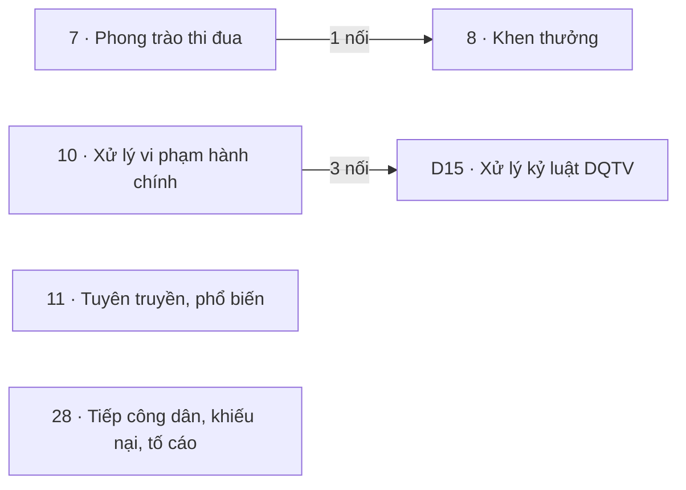

# Khối Chính trị

<!-- máy sinh: tom-tat -->
> **Khối Chính trị** — 6 quy trình, 11 tài liệu (kể cả hồ sơ phụ) · 185 bước.
>
> Khớp nối giữa các quy trình trong khối: 4 · với khối khác: 117.
>
> **Nguồn:** cộng từ các tài liệu quy trình của khối (sổ nghiệp vụ + khai báo của app) và bảng kê khớp nối. Tầng trên: [Tổng thể](00-tong-the.html). Tầng dưới: từng quy trình ở mục 1.
<!-- hết: tom-tat -->

<!-- viết tay: dien-giai -->
## Diễn giải

*Phần này viết tay, diễn giải lại điều các bảng bên dưới và các tài liệu quy trình của khối ghi.*

### Khối này lo việc gì

Khối theo dõi sáu loại hồ sơ: phong trào thi đua, hồ sơ khen thưởng, vụ việc vi phạm hành chính, đợt tuyên truyền, vận động, lá đơn (khiếu nại, tố cáo, kiến nghị, phản ánh) và vụ việc kỷ luật của chiến sĩ dân quân tự vệ. Ba hồ sơ phụ đi kèm: lượt đăng ký tham gia phong trào, thông báo tiếp nhận hồ sơ khen thưởng, hồ sơ Kỷ niệm chương. Mục 3 có hai mối nối giữa các quy trình trong khối, nên phần dưới chia thành hai cụm và hai quy trình đứng riêng.

### Các quy trình nối với nhau thế nào

**Cụm thi đua, khen thưởng** — một hồ sơ khen thưởng có thể phát sinh từ một phong trào thi đua; quan hệ này là tuỳ chọn.

- [7 · Phong trào thi đua](qt-7.html) theo dõi một phong trào từ lúc phát động tới lúc ban hành báo cáo, quyết định tổng kết; kết thúc ở *Đã sơ kết, tổng kết*, để lại danh sách cá nhân, tập thể xuất sắc. Hồ sơ phụ `qt-7.campaign-registration` là một lượt đăng ký tham gia của một cá nhân hoặc một tập thể, mở ra có nối tới phong trào ở bước **Ghi nhận đăng ký tham gia phong trào**, kết thúc ở *Đã duyệt* hoặc *Không duyệt*.
- [8 · Khen thưởng](qt-8.html) theo dõi một hồ sơ khen thưởng của một cá nhân hoặc một tập thể, từ lúc có kết quả bình xét tới lúc chi trả tiền thưởng; kết thúc ở *Đã chi trả tiền thưởng*, *Đã thu hồi hiện vật, tiền thưởng* hoặc *Đã khép, không khen thưởng*. Ở bước mở, **Ghi nhận kết quả bình xét khen thưởng**, hồ sơ nối tới nhiệm vụ trên giao và tới chiến sĩ.
- Hồ sơ phụ `qt-8.bureau-receipt-notice` cho biết cơ quan tiếp nhận đã mở xem hồ sơ trình lên hay chưa. Hồ sơ phụ `qt-8.medal` là hồ sơ đề nghị xét tặng Kỷ niệm chương "Vì sự nghiệp vũ trang quần chúng" cho một cá nhân, có bước lập riêng, kết thúc ở *Đã đóng*.

**Cụm vi phạm, kỷ luật** — một vụ việc vi phạm hành chính được liên kết đối chiếu với vụ việc kỷ luật phát sinh từ cùng hành vi.

- [10 · Xử lý vi phạm hành chính](qt-10.html) theo dõi một vụ việc vi phạm hành chính từ lúc lập biên bản: xác minh, đề xuất mức phạt, trình ký, ghi quyết định xử phạt đã ký, giao quyết định, rồi theo dõi việc thi hành và khiếu nại; kết thúc ở *Đã kết thúc, lưu hồ sơ* hoặc *Đã chuyển cơ quan tố tụng*.
- [D15 · Xử lý kỷ luật DQTV](qt-D15.html) theo dõi một vụ việc kỷ luật của một chiến sĩ, từ lập hồ sơ, xác minh, kết luận, quyết định, công bố tới bàn giao, khiếu nại, công nhận tiến bộ; kết thúc ở *Đình chỉ, không xử lý kỷ luật* hoặc *Đã công nhận tiến bộ (K4)*.
- Hai hồ sơ gắn nhau ở một bước giữa chừng, không hồ sơ nào mở ra từ hồ sơ kia: bước **Liên kết vụ việc kỷ luật để đối chiếu** của 10, làm được ở mọi chặng.

**Đứng riêng trong khối**, không nối với quy trình nào khác của khối:

- [11 · Tuyên truyền, phổ biến](qt-11.html) theo dõi một đợt tuyên truyền, vận động của một đơn vị: lên kế hoạch buổi, rồi ghi kết quả khi đã tổ chức; kết thúc ở *Đã tổ chức* hoặc *Đã huỷ*.
- [28 · Tiếp công dân, khiếu nại, tố cáo](qt-28.html) theo dõi một lá đơn từ lúc nhận; kết thúc ở *Đã trả lời*, *Đã thông báo* hoặc *Đã rút đơn*.

### Nhận gì từ khối khác, để lại gì cho khối khác

- [Khung chung](khoi-khung-chung.html): ngay ở bước mở, phong trào nối tới Kế hoạch, văn kiện (2), hồ sơ khen thưởng nối tới Nhiệm vụ trên giao (1), buổi tuyên truyền nối tới Chỉ tiêu (2). Giữa chừng, hồ sơ khen thưởng gắn Văn bản đi, Văn bản đến (1) ở hai bước gắn văn bản; vụ vi phạm gắn Văn bản đi (1) ở bước **Trình ký tờ trình kèm dự thảo quyết định xử phạt**.
- [Quân lực · Người và nghĩa vụ](khoi-nguoi-nghia-vu.html): lượt đăng ký phong trào, hồ sơ khen thưởng, hồ sơ Kỷ niệm chương và vụ việc kỷ luật mở ra có nối tới Chiến sĩ dân quân tự vệ (16.enlistment). Dòng quyết định cho thôi, đưa ra khỏi danh sách (16.service-exit-decision) mở ra từ vụ việc kỷ luật — hồ sơ duy nhất của khối khác mở ra từ khối này. Vụ vi phạm gắn với Tiếp nhận quân nhân xuất ngũ (27) ở một bước của 27, và với Người trong đợt tuyển quân (17) ở một bước của 17, khi vụ vi phạm lập cho người vắng không lý do ngày giao quân.
- [Quân lực · Tổ chức, chỉ huy](khoi-to-chuc.html): lượt đăng ký phong trào và buổi tuyên truyền mở ra có nối tới Đơn vị dân quân tự vệ (29); vụ việc kỷ luật gắn với Chức vụ chỉ huy (30) ở một bước của 30.
- [Tác chiến, sẵn sàng chiến đấu](khoi-tac-chien.html) và [Quân lực · Dự bị động viên, động viên công nghiệp](khoi-du-bi-dong-vien.html): vụ vi phạm có thể lập cho người vắng không lý do khi huy động (22) hoặc vắng không lý do ngày tập trung (35).
- [Tài chính](khoi-tai-chinh.html): Đề nghị cấp kinh phí (4) có thể phát sinh từ một hồ sơ khen thưởng hoặc từ một buổi tuyên truyền.

### Ai làm

Chính trị viên có bước ở 7, lượt đăng ký phong trào, 8, hồ sơ Kỷ niệm chương, 11 và 28. Chỉ huy trưởng Ban CHQS xã có bước ở 7, lượt đăng ký phong trào, 10 và D15. Trợ lý Tác huấn có bước ở 10 và D15; Nhân viên văn thư ở 10; Nhân viên tài chính kiêm hậu cần ở 8. Phía cấp trên: Cục Dân quân tự vệ có bước ở 8, thông báo tiếp nhận và hồ sơ Kỷ niệm chương; Phòng Chính trị Bộ CHQS cấp tỉnh và Cục Chính trị quân khu ở 8; Bộ CHQS cấp tỉnh và Tư lệnh quân khu ở D15. Vai `operator` có bước ở thông báo tiếp nhận và ở 28. Hệ thống tự làm một bước ở 28: đánh dấu quá hạn.
<!-- hết viết tay -->

## 1. Các quy trình trong khối

<!-- máy sinh: quy-trinh -->
Cột "Để làm gì" trích câu đầu phần Diễn giải của tài liệu quy trình. Cột "Mặt công tác (app)" là chỗ app xếp quy trình ấy.

| Mã | Tên | Để làm gì | Bước | Chặng | Mặt công tác (app) |
|---|---|---|---|---|---|
| [qt-7](qt-7.html) | Phong trào thi đua | Quy trình theo dõi một **phong trào thi đua** từ lúc phát động tới lúc ban hành báo cáo, quyết định tổng kết. | 7 | 4 | Chính trị |
| [qt-8](qt-8.html) | Khen thưởng | Theo dõi một **hồ sơ khen thưởng** của một cá nhân hoặc một tập thể, từ lúc có kết quả bình xét tới lúc chi trả tiền thưởng. | 24 | 14 | Chính trị |
| ↳ [qt-8.medal](qt-8.medal.html) | Khen thưởng — Hồ sơ Kỷ niệm chương "Vì sự nghiệp vũ trang quần chúng" | Đây là hồ sơ phụ của khen thưởng (quy trình 8): một **hồ sơ đề nghị xét tặng Kỷ niệm chương "Vì sự nghiệp vũ trang quần chúng"** cho một cá nhân. | 10 | 5 | Chính trị |
| ↳ [qt-8.revocation](qt-8.revocation.html) | Khen thưởng — Một lượt đề nghị huỷ quyết định khen thưởng, thu hồi |  | 3 | 3 | Chính trị |
| ↳ [qt-8.submission](qt-8.submission.html) | Khen thưởng — Một vòng xử lý hồ sơ khen thưởng ở cấp trên |  | 15 | 6 | Chính trị |
| [qt-10](qt-10.html) | Xử lý vi phạm hành chính | Hồ sơ theo dõi một **vụ việc vi phạm hành chính** từ lúc lập biên bản tới lúc lưu hồ sơ: xác minh, đề xuất mức phạt, trình ký, ghi quyết định xử phạt đã ký, giao quyết định, rồi theo dõi việc thi hành (tự nguyện chấp hành, cưỡng chế, tịch thu tang vật, khắc phục hậu quả), khiếu nại, và việc hủy bỏ hay đính chính quyết… | 30 | 15 | Chính trị |
| [qt-11](qt-11.html) | Tuyên truyền, phổ biến | Chính trị viên theo dõi một **đợt tuyên truyền, vận động** của một đơn vị dân quân tự vệ: lên kế hoạch buổi, rồi ghi kết quả khi đã tổ chức, hoặc huỷ nếu không tổ chức. | 3 | 3 | Chính trị |
| [qt-28](qt-28.html) | Tiếp công dân, khiếu nại, tố cáo | Theo dõi một **lá đơn** gửi tới đơn vị, thuộc một trong bốn loại: khiếu nại, tố cáo, kiến nghị, phản ánh. | 30 | 10 | Chính trị |
| [qt-D15](qt-D15.html) | Xử lý kỷ luật DQTV | Ban CHQS xã theo dõi một **vụ việc kỷ luật** của một chiến sĩ dân quân tự vệ: lập hồ sơ, xác minh, lập kết luận vi phạm theo trình tự nhiều bước, trình và ra quyết định kỷ luật, công bố, rồi phần sau quyết định (bàn giao, khiếu nại, công nhận tiến bộ). | 41 | 16 | Chính trị |
| ↳ [qt-D15.complaint](qt-D15.complaint.html) | Xử lý kỷ luật DQTV — Khiếu nại quyết định kỷ luật |  | 13 | 6 | Chính trị |
| ↳ [qt-D15.submission](qt-D15.submission.html) | Xử lý kỷ luật DQTV — Lượt trình đề nghị kỷ luật lên cấp có thẩm quyền |  | 9 | 4 | Chính trị |
<!-- hết: quy-trinh -->

## 2. Sơ đồ mối nối trong khối

<!-- máy sinh: so-do -->

Có mũi tên: trong các mối nối của cặp ấy có ít nhất một mối do **bước tạo hồ sơ** ghi, mũi tên chỉ về quy trình có hồ sơ được mở ra; các mối còn lại của cặp có thể là gắn giữa chừng — xem từng dòng ở mục 3. Không mũi tên: gắn nhau ở bước giữa chừng. Hồ sơ phụ gộp về quy trình gốc.
<!-- hết: so-do -->

## 3. Khớp nối giữa các quy trình trong khối

<!-- máy sinh: khop-noi-trong -->
| Ô nối | Từ (quy trình · hồ sơ) | Tới | Nội dung (mô tả trong app) | Bước ghi mối nối |
|---|---|---|---|---|
| `awardCaseArisesFromCampaign` | 8 · Hồ sơ khen thưởng | 7 · Phong trào thi đua | Hồ sơ khen thưởng phát sinh từ phong trào thi đua nào — BA E16 mục 7, quan hệ TUỲ CHỌN (không phải mọi hồ sơ… | 8·recordMemberSelection ⊕, 8·recordUnitSelection ⊕ |
| `violationHandlingDisciplinaryCase` | 10 · Vụ việc vi phạm hành chính | D15 · Vụ việc kỷ luật | Hồ sơ kỷ luật mở từ đề nghị trên vụ vi phạm này — người vi phạm là dân quân (Luật DQTV Đ.47) | 10·proposeDisciplineFromViolation |
| `disciplineFromViolation` | D15 · Vụ việc kỷ luật | 10 · Vụ việc vi phạm hành chính | Vụ việc kỷ luật mở từ đề nghị trên vụ vi phạm hành chính (qt-10) — Luật DQTV Đ.47 | D15·openDisciplineFromSource ⊕ |
| `relatedViolationCase` | D15 · Vụ việc kỷ luật | 10 · Vụ việc vi phạm hành chính | Vụ vi phạm hành chính mở cùng lượt đề nghị ở hồ sơ nguồn — cùng một hành vi (Luật DQTV Đ.47) | D15·openDisciplineFromSource ⊕ |

4 khớp nối. ⊕ là bước tạo hồ sơ. Bảng kê mối nối giữa hai mã quy trình khác nhau; mối nối giữa hồ sơ chính và hồ sơ phụ của cùng một mã xem tài liệu quy trình.
<!-- hết: khop-noi-trong -->

## 4. Khớp nối với khối khác

<!-- máy sinh: khop-noi-ngoai -->
| Khối kia | Số khớp nối | Quy trình của khối này ↔ quy trình khối kia |
|---|---|---|
| [Khung chung](khoi-khung-chung.html) | 68 | 7 ↔ 1 (1), 7 ↔ 2 (1), 7 ↔ 6 (1), 8 ↔ 1 (26), 8 ↔ 6 (1), 8 ↔ D16 (2), 10 ↔ 1 (9), 11 ↔ 2 (1), 28 ↔ 1 (8), D15 ↔ 1 (15), D15 ↔ 6 (1), D15 ↔ D16 (2) |
| [Tác chiến, sẵn sàng chiến đấu](khoi-tac-chien.html) | 12 | 8 ↔ 20 (1), 10 ↔ 13a (2), 10 ↔ 20 (2), 10 ↔ 22 (3), D15 ↔ 13a (2), D15 ↔ 20 (2) |
| [Hậu cần – kỹ thuật](khoi-hau-can.html) | 4 | D15 ↔ D12 (2), D15 ↔ D13 (2) |
| [Huấn luyện, giáo dục](khoi-huan-luyen.html) | 4 | 10 ↔ 14 (2), D15 ↔ 14 (2) |
| [Quân lực · Người và nghĩa vụ](khoi-nguoi-nghia-vu.html) | 17 | 7 ↔ 16 (1), 8 ↔ 16 (2), 10 ↔ 16 (3), 10 ↔ 17 (2), 10 ↔ 27 (2), D15 ↔ 12b (1), D15 ↔ 16 (5), D15 ↔ C1 (1) |
| [Quân lực · Dự bị động viên, động viên công nghiệp](khoi-du-bi-dong-vien.html) | 3 | 10 ↔ 33 (1), 10 ↔ 35 (2) |
| [Quân lực · Tổ chức, chỉ huy](khoi-to-chuc.html) | 6 | 7 ↔ 29 (1), 8 ↔ 29 (2), 11 ↔ 29 (1), D15 ↔ 30 (2) |
| [Tài chính](khoi-tai-chinh.html) | 3 | 8 ↔ 4 (1), 8 ↔ 12a (1), 11 ↔ 4 (1) |

117 khớp nối với khối khác. Số trong ngoặc là số ô nối của cặp quy trình. Hồ sơ phụ gộp về quy trình gốc. Từng ô nối và chiều của nó: mục 10 của tài liệu quy trình.
<!-- hết: khop-noi-ngoai -->

## 5. Ai làm

<!-- máy sinh: vai-tro -->
| Người làm | Có bước ở quy trình |
|---|---|
| Hệ thống tự làm | 8, 8.medal, 8.submission, 10, 28, D15, D15.complaint, D15.submission |
| Chính trị viên | 7, 8, 8.medal, 8.revocation, 8.submission, 11, 28 |
| Nhân viên văn thư | 8.submission, 10, D15, D15.complaint, D15.submission |
| Trợ lý Tác huấn | 10, D15, D15.complaint, D15.submission |
| Chỉ huy trưởng Ban CHQS xã | 10, D15, D15.complaint |
| Ban Dân quân tự vệ, Bộ CHQS cấp tỉnh | D15.complaint, D15.submission |
| Cục Dân quân tự vệ | 8.medal, 8.submission |
| Phòng Chính trị, Bộ CHQS cấp tỉnh | 8.revocation, 8.submission |
| Văn thư Bộ CHQS cấp tỉnh | D15.complaint, D15.submission |
| Nhân viên tài chính kiêm hậu cần | 8 |
| Phòng Dân quân tự vệ, quân khu | D15.submission |
| Trợ lý Quân lực | 28 |
| Tư lệnh quân khu | D15.complaint |
| Văn thư quân khu | D15.submission |

*Tên người làm là tên app đặt cho mã chủ thể của vai; vai không có mã chủ thể thì in bằng mã (`…`). Quy trình chạy ở nhiều cấp thì người làm là người giữ vai ấy ở đơn vị nêu trong tài liệu quy trình.*
<!-- hết: vai-tro -->
