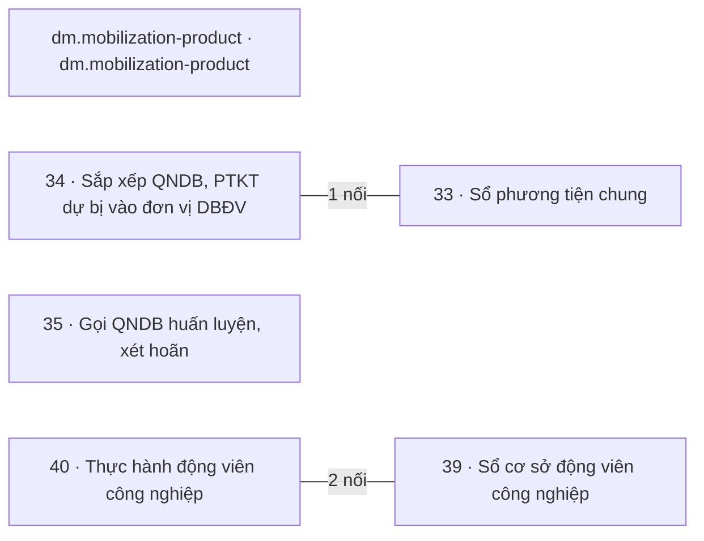

# Khối Quân lực · Dự bị động viên, động viên công nghiệp

<!-- máy sinh: tom-tat -->
> **Khối Quân lực · Dự bị động viên, động viên công nghiệp** — 6 quy trình, 8 tài liệu (kể cả hồ sơ phụ) · 77 bước.
>
> Khớp nối giữa các quy trình trong khối: 3 · với khối khác: 38.
>
> **Nguồn:** cộng từ các tài liệu quy trình của khối (sổ nghiệp vụ + khai báo của app) và bảng kê khớp nối. Tầng trên: [Tổng thể](00-tong-the.html). Tầng dưới: từng quy trình ở mục 1.
<!-- hết: tom-tat -->

<!-- viết tay: dien-giai -->
## Diễn giải

*Phần này viết tay, diễn giải lại điều các bảng bên dưới và các tài liệu quy trình của khối ghi.*

### Khối này lo việc gì

Khối theo dõi sáu loại hồ sơ, gom thành hai cụm việc. Cụm dự bị động viên: từng phương tiện trong sổ phương tiện chung, bản sắp xếp đơn vị dự bị động viên của xã theo năm, và đợt gọi quân nhân dự bị. Cụm động viên công nghiệp: từng doanh nghiệp trong sổ cơ sở động viên công nghiệp (kèm hồ sơ phụ là từng dây chuyền), hồ sơ thực hành động viên công nghiệp của từng cơ sở, và hồ sơ mang mã `dm.mobilization-product`.

### Các quy trình nối với nhau thế nào

Trong khối có một khớp nối, giữa quy trình 34 và 33. Sáu quy trình được kể dưới đây theo hai cụm việc.

**Cụm dự bị động viên — 33, 34, 35.**

- [33 · Sổ phương tiện chung](qt-33.html): mỗi hồ sơ là một phương tiện. Sổ giữ hai loại, mỗi loại một dãy chặng riêng: phương tiện kỹ thuật dự bị (xã khai hoặc tỉnh nhập, Bộ CHQS cấp tỉnh duyệt, đăng ký, cấp giấy chứng nhận) và phương tiện chỉ nằm trong phương án phòng thủ dân sự của xã. Bốn chặng kết thúc: *Đã đăng ký dự bị*, *Không đăng ký*, *Đã xoá đăng ký*, *Đã đưa ra khỏi phương án*.
- [34 · Sắp xếp QNDB, PTKT dự bị vào đơn vị DBĐV](qt-34.html): xã lập bản sắp xếp của một năm cho một đơn vị nhận nguồn, Bộ CHQS cấp tỉnh duyệt trên hệ, xã báo cho người được xếp, ghi biên bản giao nhận rồi khép. Kết thúc ở *Đã khép*.
- [35 · Gọi QNDB huấn luyện, xét hoãn](qt-35.html): xã theo dõi một đợt gọi từ phúc tra, gửi danh sách đề nghị, nhận lệnh gọi, giao lệnh, ghi có mặt ngày tập trung tới bàn giao cho đơn vị nhận quân. Kết thúc ở *Đã bàn giao* hoặc *Đã huỷ*.

Mối nối 34 – 33: ở bước Thêm người, phương tiện (`addArrangementLine`) của quy trình 34, dòng sắp xếp là phương tiện chỉ tới một phương tiện kỹ thuật dự bị trong sổ của quy trình 33. Hai hồ sơ gắn nhau ở bước giữa chừng; không hồ sơ nào mở ra từ hồ sơ kia.

Quy trình 35 đứng riêng trong khối, không nối với quy trình nào khác của khối. Nó được xếp cùng cụm vì 34 và 35 cùng nối tới Chỉ tiêu (quy trình 2) lúc mở và tới Đăng ký quân nhân dự bị (16.reserve-registration) cho từng người.

**Cụm động viên công nghiệp — 39, 40, dm.mobilization-product.**

- [39 · Sổ cơ sở động viên công nghiệp](qt-39.html): mỗi hồ sơ là một doanh nghiệp, được khảo sát rồi đăng ký vào danh mục hoặc không chọn; cơ sở trong danh mục được ghi thay đổi và có thể bị đưa khỏi danh mục. Ba chặng kết thúc: *Đã đăng ký vào danh mục*, *Không chọn*, *Đã đưa khỏi danh mục*. Hồ sơ phụ 39.mobilization-line là từng dây chuyền đặt tại một cơ sở, kết thúc ở *Đã thu hồi*; bước Mở dây chuyền nối dây chuyền tới cơ sở.
- [40 · Thực hành động viên công nghiệp](qt-40.html): mỗi cơ sở một hồ sơ, là thật hoặc diễn tập. Tỉnh thông báo quyết định của Bộ trưởng cho cơ sở, cơ sở xác nhận; cơ sở báo thiếu phương tiện thì tỉnh bố trí, di chuyển xong thì báo; cơ sở báo từng lần bàn giao sản phẩm, báo thay đổi; tỉnh khép khi có quyết định kết thúc. Bốn chặng `NOTIFIED`, `CONFIRMED`, `RELOCATING`, `CLOSED`; kết thúc ở `CLOSED`.
- [dm.mobilization-product](dm.mobilization-product.html): mỗi hồ sơ giữ năm ô `productCode`, `productKind`, `productName`, `unitOfMeasure`, `catalogueBasis`. Có hai bước, đều là bước mở hồ sơ: `addMobilizationProduct` và `seedMobilizationProducts`.

Ba quy trình 39, 40 và `dm.mobilization-product` đứng riêng trong khối, không nối với quy trình nào khác của khối.

### Nhận gì từ khối khác, để lại gì cho khối khác

Trong khối, chỉ quy trình 34 và 35 có khớp nối với khối khác, tới ba khối.

- [Khung chung](khoi-khung-chung.html): bản sắp xếp (34) và đợt gọi (35) mở ra có nối tới một Chỉ tiêu của quy trình 2, ở bước Mở bản sắp xếp và bước Mở đợt gọi. Đợt gọi mở bằng bước Nhận lệnh gọi của cấp trên thì nối tới Văn bản đến (1.incoming-document); mối nối này cũng ghi ở bước Ghi nhận lệnh gọi. Ở bước Gửi danh sách đề nghị, đợt gọi gắn với Văn bản đi (1.outgoing-document).
- [Quân lực · Người và nghĩa vụ](khoi-nguoi-nghia-vu.html): dòng sắp xếp là người (34) chỉ tới Đăng ký quân nhân dự bị của người ấy, ở bước thêm dòng. Đợt gọi (35) nối tới Đăng ký quân nhân dự bị của những người có tên trong lệnh, ở hai bước nhận lệnh; người trong đợt gọi là quân nhân dự bị nào thì ghi ở bước Ghi kết quả phúc tra.
- [Chính trị](khoi-chinh-tri.html): đợt gọi (35) nối tới Vụ việc vi phạm hành chính (quy trình 10), lập cho người vắng không lý do ngày tập trung.

### Ai làm

- **Trợ lý Quân lực** có bước ở cả 33, 34, 35: khai và báo thay đổi phương tiện, lập bản sắp xếp, làm phần lớn các bước của đợt gọi.
- **Bộ CHQS cấp tỉnh** duyệt, từ chối, sửa, xoá đăng ký và nhập phương tiện (33); duyệt hoặc yêu cầu bổ sung bản sắp xếp (34).
- **Chỉ huy trưởng Ban CHQS xã** chỉ có bước ở 35: huỷ đợt gọi và ký biên bản người vắng.
- Ở 39 và 39.mobilization-line có ba người làm: **Người của cơ sở động viên công nghiệp** báo thay đổi; **Ban Dân quân tự vệ, Bộ CHQS cấp tỉnh** và `facilityManager` làm các bước còn lại.
- Quy trình 40 có hai vai `province` (tỉnh) và `facility` (cơ sở).
- `dm.mobilization-product` có vai `ministryStaff` làm bước `addMobilizationProduct` và một bước **Hệ thống tự làm** (`seedMobilizationProducts`).
<!-- hết viết tay -->

## 1. Các quy trình trong khối

<!-- máy sinh: quy-trinh -->
Cột "Để làm gì" trích câu đầu phần Diễn giải của tài liệu quy trình. Cột "Mặt công tác (app)" là chỗ app xếp quy trình ấy.

| Mã | Tên | Để làm gì | Bước | Chặng | Mặt công tác (app) |
|---|---|---|---|---|---|
| [dm.mobilization-product](dm.mobilization-product.html) | dm.mobilization-product | Hồ sơ mang mã `dm.mobilization-product`, có năm ô: `productCode`, `productKind` (nhận `weapon_equipment` hoặc `technical_material`), `productName`, `unitOfMeasure`, `catalogueBasis`. | 2 | 0 |  |
| [qt-33](qt-33.html) | Sổ phương tiện chung | Đây là **sổ phương tiện chung**, mỗi hồ sơ là một phương tiện. | 10 | 6 | Tác chiến |
| [qt-34](qt-34.html) | Sắp xếp QNDB, PTKT dự bị vào đơn vị DBĐV | Xã lập **bản sắp xếp đơn vị dự bị động viên** của một năm, cho một đơn vị nhận nguồn: xếp từng quân nhân dự bị và từng phương tiện kỹ thuật dự bị vào chức danh của đơn vị ấy. | 12 | 4 | Quân lực |
| [qt-35](qt-35.html) | Gọi QNDB huấn luyện, xét hoãn | Xã theo dõi một **đợt gọi quân nhân dự bị** — gọi để huấn luyện, diễn tập, hoặc kiểm tra sẵn sàng động viên, sẵn sàng chiến đấu. | 13 | 7 | Quân lực |
| [qt-39](qt-39.html) | Sổ cơ sở động viên công nghiệp | Đây là **sổ cơ sở động viên công nghiệp**, mỗi hồ sơ là một doanh nghiệp. | 8 | 5 | Hậu cần – kỹ thuật |
| ↳ [qt-39.capacity-catalogue](qt-39.capacity-catalogue.html) | Sổ cơ sở động viên công nghiệp — Năng lực trong danh mục |  | 1 | 1 | Hậu cần – kỹ thuật |
| ↳ [qt-39.mobilization-line](qt-39.mobilization-line.html) | Sổ cơ sở động viên công nghiệp — Dây chuyền động viên công nghiệp | Mỗi hồ sơ là **một dây chuyền động viên công nghiệp** đặt tại một cơ sở trong sổ cơ sở (quy trình 39). | 16 | 7 | Hậu cần – kỹ thuật |
| [qt-40](qt-40.html) | Thực hành động viên công nghiệp | Mỗi cơ sở một hồ sơ thực hành động viên công nghiệp, là thật hoặc diễn tập. | 15 | 6 | Hậu cần – kỹ thuật |
<!-- hết: quy-trinh -->

## 2. Sơ đồ mối nối trong khối

<!-- máy sinh: so-do -->

Có mũi tên: trong các mối nối của cặp ấy có ít nhất một mối do **bước tạo hồ sơ** ghi, mũi tên chỉ về quy trình có hồ sơ được mở ra; các mối còn lại của cặp có thể là gắn giữa chừng — xem từng dòng ở mục 3. Không mũi tên: gắn nhau ở bước giữa chừng. Hồ sơ phụ gộp về quy trình gốc.
<!-- hết: so-do -->

## 3. Khớp nối giữa các quy trình trong khối

<!-- máy sinh: khop-noi-trong -->
| Ô nối | Từ (quy trình · hồ sơ) | Tới | Nội dung (mô tả trong app) | Bước ghi mối nối |
|---|---|---|---|---|
| `reserveVehicle` | 34 · Dòng sắp xếp | 33 · Phương tiện trong sổ | Dòng này xếp phương tiện kỹ thuật dự bị nào | 34·addArrangementLine |
| `executionAtFacility` | 40 · Thực hiện quyết định động viên công nghiệp | 39 · Cơ sở động viên công nghiệp | Quyết định động viên công nghiệp này thực hiện tại cơ sở này — sổ nghiệp vụ qt-40 | — |
| `executionOfLine` | 40 · Thực hiện quyết định động viên công nghiệp | 39.mobilization-line · Dây chuyền động viên công nghiệp | Quyết định động viên công nghiệp này động viên dây chuyền này — sổ nghiệp vụ qt-40 | — |

3 khớp nối. ⊕ là bước tạo hồ sơ. Bảng kê mối nối giữa hai mã quy trình khác nhau; mối nối giữa hồ sơ chính và hồ sơ phụ của cùng một mã xem tài liệu quy trình.
<!-- hết: khop-noi-trong -->

## 4. Khớp nối với khối khác

<!-- máy sinh: khop-noi-ngoai -->
| Khối kia | Số khớp nối | Quy trình của khối này ↔ quy trình khối kia |
|---|---|---|
| [Khung chung](khoi-khung-chung.html) | 30 | 34 ↔ 1 (4), 34 ↔ 2 (1), 35 ↔ 1 (4), 35 ↔ 2 (1), 39 ↔ 1 (15), 40 ↔ 1 (5) |
| [Tác chiến, sẵn sàng chiến đấu](khoi-tac-chien.html) | 2 | 33 ↔ 22 (2) |
| [Quân lực · Người và nghĩa vụ](khoi-nguoi-nghia-vu.html) | 3 | 34 ↔ 16 (1), 35 ↔ 16 (2) |
| [Chính trị](khoi-chinh-tri.html) | 3 | 33 ↔ 10 (1), 35 ↔ 10 (2) |

38 khớp nối với khối khác. Số trong ngoặc là số ô nối của cặp quy trình. Hồ sơ phụ gộp về quy trình gốc. Từng ô nối và chiều của nó: mục 10 của tài liệu quy trình.
<!-- hết: khop-noi-ngoai -->

## 5. Ai làm

<!-- máy sinh: vai-tro -->
| Người làm | Có bước ở quy trình |
|---|---|
| Hệ thống tự làm | 34, 35, 39, 39.mobilization-line, 40, dm.mobilization-product |
| Ban Dân quân tự vệ, Bộ CHQS cấp tỉnh | 39, 39.capacity-catalogue, 39.mobilization-line, 40 |
| Bộ CHQS cấp tỉnh | 33, 34, 40 |
| Người của cơ sở động viên công nghiệp | 39, 39.mobilization-line, 40 |
| Trợ lý Quân lực | 33, 34, 35 |
| Chỉ huy trưởng Ban CHQS xã | 35 |
| `facilityManager` | 39 |
| `ministryStaff` | dm.mobilization-product |

*Tên người làm là tên app đặt cho mã chủ thể của vai; vai không có mã chủ thể thì in bằng mã (`…`). Quy trình chạy ở nhiều cấp thì người làm là người giữ vai ấy ở đơn vị nêu trong tài liệu quy trình.*
<!-- hết: vai-tro -->
