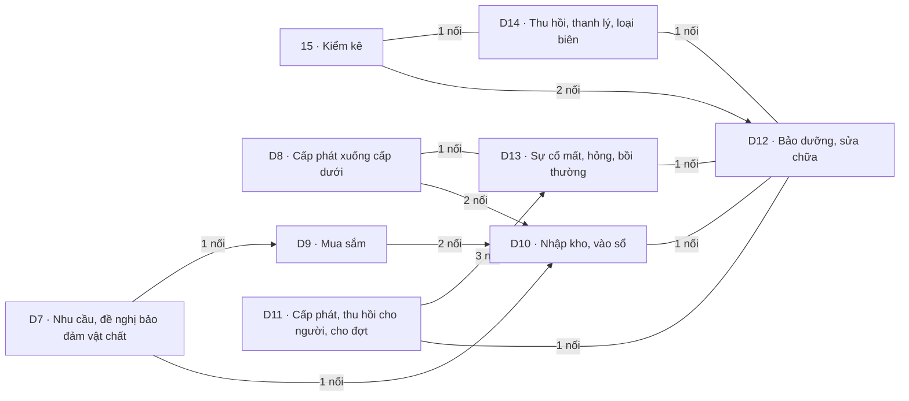

# Khối Hậu cần – kỹ thuật

<!-- máy sinh: tom-tat -->
> **Khối Hậu cần – kỹ thuật** — 9 quy trình, 15 tài liệu (kể cả hồ sơ phụ) · 116 bước.
>
> Khớp nối giữa các quy trình trong khối: 17 · với khối khác: 49.
>
> **Nguồn:** cộng từ các tài liệu quy trình của khối (sổ nghiệp vụ + khai báo của app) và bảng kê khớp nối. Tầng trên: [Tổng thể](00-tong-the.html). Tầng dưới: từng quy trình ở mục 1.
<!-- hết: tom-tat -->

<!-- viết tay: dien-giai -->
## Diễn giải

*Phần này viết tay, diễn giải lại điều các bảng bên dưới và các tài liệu quy trình của khối ghi.*

### Khối này lo việc gì

Khối theo dõi hồ sơ về trang bị, vật chất và trang phục của đơn vị, gồm 9 quy trình với 14 tài liệu. Theo mối nối ở mục 2 và 3, có thể gom thành ba cụm việc: đưa hàng về kho (lập danh mục bảo đảm, đề nghị trang bị, cấp phát từ trên xuống, mua sắm, nhập kho); giữ sổ từng khoản trang bị và soát nó (vòng đời trang bị, kiểm kê, thu hồi thanh lý); cấp cho người, cho đợt và xử lý mất, hỏng (trang phục cá nhân, đợt cấp trang phục, phiếu cấp phát huấn luyện, sự cố). Cả 14 tài liệu nằm ở mặt công tác Hậu cần – kỹ thuật.

### Các quy trình nối với nhau thế nào

Ba cụm dưới đây do người viết gom. Cả ba cùng nối vào hồ sơ Trang bị, phương tiện của quy trình D12; không quy trình gốc nào đứng riêng trong khối.

**Cụm 1 — hàng về kho** (gom theo các mũi tên D7 → D9, và D7, D8, D9 → D10).

- [D7 · Nhu cầu, đề nghị bảo đảm vật chất](qt-D7.html): đơn vị lập danh mục bảo đảm cho một năm ngân sách, kết thúc ở *Đã ký*; ở chặng này còn bước báo lên cấp trên. Hồ sơ phụ [Đề nghị trang bị](qt-D7.provision-request.html) mở ra từ một danh mục bảo đảm, kết thúc ở *Đã nhập kho*.
- [D9 · Mua sắm](qt-D9.html): đợt mua sắm mở ra có nối tới một danh mục bảo đảm đã ký, ở bước Lập đợt mua sắm ⊕; kết thúc ở *Đã thanh toán*.
- [D8 · Cấp phát xuống cấp dưới](qt-D8.html): cấp trên chia hàng theo từng xã nhận, ký lệnh, giao hàng, kết thúc ở *Đã đóng đợt*.
- [D10 · Nhập kho, vào sổ](qt-D10.html): phiếu nhập kho kết thúc ở *Đã ký xác nhận*. Lúc lập ⊕, phiếu có thể nối tới một trong ba nguồn, đều là ô nhập nếu có: đề nghị trang bị đã có quyết định, đợt mua sắm đã nhận hàng, hoặc một dòng đợt cấp phát của D8. Hồ sơ phụ [Phiếu nhập kho trang phục](qt-D10.uniform-stock-in.html) cũng vậy ở bước lập ⊕, với hai nguồn D8 và D9, kết thúc ở *Đã ký, đã cộng tồn*.
- Ở bước Vào sổ đăng ký của D10, mỗi dòng phiếu nhập gắn với bản ghi trang bị của D12 mà nó sinh ra.

**Cụm 2 — sổ trang bị và việc soát sổ** (gom theo các nối 15 – D12, 15 – D14, D14 – D12).

- [D12 · Bảo dưỡng, sửa chữa](qt-D12.html): mỗi hồ sơ là một khoản trang bị, phương tiện, xoay quanh chặng *Khả dụng* (bảo dưỡng, vụ việc, huấn luyện, khoá vì sự cố) và chỉ kết thúc ở *Đã thanh lý, loại biên*.
- [15 · Kiểm kê](qt-15.html): đợt kiểm kê kết thúc ở *Đã duyệt*. Mỗi dòng đếm gắn với khoản trang bị nó soi ở bước Ghi kết quả đếm một khoản. Ở chặng *Đã duyệt*, bước Đề nghị thanh lý gắn đợt kiểm kê với một đợt thu hồi, thanh lý; đây là gắn giữa chừng, không phải bước tạo hồ sơ.
- [D14 · Thu hồi, thanh lý, loại biên](qt-D14.html): đợt thu hồi, thanh lý kết thúc ở *Đã loại biên*. Mỗi khoản của đợt gắn với một khoản trang bị ở bước Thêm khoản vào đợt.

**Cụm 3 — cấp cho người, cho đợt và sự cố** (gom theo các nối D11 – D12, D11 → D13, D13 – D12, D8 – D13).

- [D11 · Cấp phát, thu hồi cho người, cho đợt](qt-D11.html): hồ sơ chính là trang phục cá nhân của từng chiến sĩ, kết thúc ở *Đã cấp đổi* hoặc *Đã thu hồi*. Ba hồ sơ phụ: [Trang phục, sao mũ, phù hiệu](qt-D11.uniform.html) (đợt cấp, kết thúc ở *Đã ký cấp phát* hoặc *Đã huỷ*), [Phiếu xuất kho trang phục](qt-D11.uniform-stock-out.html) (kết thúc ở *Đã chốt chứng từ*) và [Phiếu cấp phát huấn luyện](qt-D11.training-allocation.html) (kết thúc ở *Đã quyết toán*). Trang phục cá nhân và phiếu xuất kho đều nối tới đợt cấp trang phục.
- Dòng vũ khí của phiếu cấp phát huấn luyện gắn với khoản trang bị của D12 ở bước Thêm dòng trang bị.
- [D13 · Sự cố mất, hỏng, bồi thường](qt-D13.html): sự cố trang phục kết thúc ở *Đã cấp lại* hoặc *Phải bồi thường*. Sự cố trang phục mở ra có nối tới đúng bản trang phục cá nhân, ở bước Báo mất, hỏng trang phục ⊕. Khi Chỉ huy trưởng cho cấp lại, bộ mới thuộc một đợt cấp lại riêng của D11.uniform, không dồn vào đợt gốc.
- D13 còn một hồ sơ thứ hai, Sự cố mất, hư hỏng (của trang bị). Hồ sơ này gắn với khoản trang bị của D12 ở hai bước: Khai báo mất, hư hỏng của D12 và Đóng đợt của phiếu cấp phát huấn luyện. Cũng ở bước Đóng đợt, nó gắn với dòng trang bị cấp phát bị thiếu sau đối chiếu. Ở bước Xử lý phần nhận thiếu của D8, phần xã nhận thiếu của đợt cấp phát được chuyển sang hồ sơ này.

### Nhận gì từ khối khác, để lại gì cho khối khác

Khối chủ yếu mở hồ sơ có nối tới hồ sơ của khối khác.

- [Khung chung](khoi-khung-chung.html): đợt kiểm kê, đợt thu hồi thanh lý và phiếu cấp phát huấn luyện mở ra có nối tới Nhiệm vụ trên giao của quy trình 1. D9 gắn văn bản đi đề nghị cấp phép và văn bản đến là giấy phép. Ba hồ sơ có trình tỉnh (15, D14, phiếu cấp phát huấn luyện) gắn với tờ trình là văn bản đi của mỗi lượt trình; D14 còn gắn với văn bản đến mang quyết định thanh lý của đợt.
- [Huấn luyện, giáo dục](khoi-huan-luyen.html) và [Tác chiến, sẵn sàng chiến đấu](khoi-tac-chien.html): phiếu cấp phát huấn luyện mở ra có nối tới đợt huấn luyện của quy trình 14 hoặc vụ việc ứng phó của quy trình 20. Trang bị, phương tiện của D12 đã huy động cho một vụ việc thì nối tới vụ việc ấy.
- [Quân lực · Người và nghĩa vụ](khoi-nguoi-nghia-vu.html): trang phục cá nhân, dòng trang bị cấp phát và sự cố trang phục nối tới Chiến sĩ dân quân tự vệ của quy trình 16. Hồ sơ bồi thường thiệt hại của 12b có thể liên kết tới sự cố trang bị đã kết luận có lỗi cá nhân hoặc sự cố trang phục đã kết luận phải bồi thường.
- [Quân lực · Tổ chức, chỉ huy](khoi-to-chuc.html): đợt kiểm kê và đợt cấp trang phục mở ra có nối tới Đơn vị dân quân tự vệ của quy trình 29. Khoản trang bị của D12 nối tới đơn vị đang giữ nó, ở bước Trang cấp ⊕ và bước Khai báo mất, hư hỏng.
- [Tài chính](khoi-tai-chinh.html): đợt mua sắm gắn với khoản con của dự toán quy trình 4 ở bước Gắn khoản dự toán đã quyết. Đề nghị cấp kinh phí của quy trình 4 có thể phát sinh từ một đợt cấp trang phục hoặc từ một đợt bảo dưỡng, sửa chữa trang bị.

### Ai làm

Nhân viên quân khí kiêm thủ kho có bước ở 13 trên 14 tài liệu (trừ D8), Chỉ huy trưởng Ban CHQS xã ở 11 tài liệu. Trợ lý Quân lực có bước ở D7, đề nghị trang bị, D10, D12 và D13. Bộ CHQS cấp tỉnh có bước ở 15, D8, phiếu cấp phát huấn luyện và D14; Nhân viên văn thư gửi tờ trình ở ba quy trình có trình tỉnh (15, phiếu cấp phát huấn luyện, D14). Ban Dân quân tự vệ, Bộ CHQS cấp tỉnh chỉ có bước ở D8; Nhân viên tài chính kiêm hậu cần chỉ ở D9.
<!-- hết viết tay -->

## 1. Các quy trình trong khối

<!-- máy sinh: quy-trinh -->
Cột "Để làm gì" trích câu đầu phần Diễn giải của tài liệu quy trình. Cột "Mặt công tác (app)" là chỗ app xếp quy trình ấy.

| Mã | Tên | Để làm gì | Bước | Chặng | Mặt công tác (app) |
|---|---|---|---|---|---|
| [qt-15](qt-15.html) | Kiểm kê | Xã mở một **đợt kiểm kê** để đếm trang bị thực có của một đơn vị, đối chiếu với sổ, rồi trình kết quả lên Bộ CHQS tỉnh duyệt. | 6 | 3 | Hậu cần – kỹ thuật |
| ↳ [qt-15.count-line](qt-15.count-line.html) | Kiểm kê — Dòng đếm kiểm kê |  | 3 | 2 | Hậu cần – kỹ thuật |
| [qt-D7](qt-D7.html) | Nhu cầu, đề nghị bảo đảm vật chất | Một đơn vị lập **danh mục bảo đảm** cho một năm ngân sách, mỗi thứ một dòng. | 10 | 4 | Hậu cần – kỹ thuật |
| ↳ [qt-D7.provision-request](qt-D7.provision-request.html) | Nhu cầu, đề nghị bảo đảm vật chất — Đề nghị trang bị | Đơn vị lập một **đề nghị trang bị** từ một danh mục bảo đảm đã có (đơn vị chủ hồ sơ là xã đã lập đề nghị). | 9 | 5 | Hậu cần – kỹ thuật |
| [qt-D8](qt-D8.html) | Cấp phát xuống cấp dưới | Cấp trên theo dõi một **đợt cấp phát xuống dưới**: chia hàng theo từng xã nhận, ký lệnh cấp, giao hàng, rồi đóng đợt khi bên nhận đã vào sổ. | 6 | 4 | Hậu cần – kỹ thuật |
| [qt-D9](qt-D9.html) | Mua sắm | Đơn vị theo dõi một **đợt mua sắm** phần còn thiếu trong danh mục bảo đảm đã ký: kê dòng mua và đơn giá, gắn vào khoản dự toán đã quyết, ghi phê duyệt danh mục mua sắm, xin giấy phép trang bị nếu loại hàng cần, ký hợp đồng, nhận hàng, thanh toán. | 10 | 6 | Hậu cần – kỹ thuật |
| [qt-D10](qt-D10.html) | Nhập kho, vào sổ | Đơn vị ghi nhận hàng về kho bằng một **phiếu nhập kho** và đưa từng món vào sổ đăng ký trang bị. | 7 | 4 | Hậu cần – kỹ thuật |
| ↳ [qt-D10.uniform-stock-in](qt-D10.uniform-stock-in.html) | Nhập kho, vào sổ — Phiếu nhập kho trang phục | Đơn vị ghi nhận trang phục về kho bằng một **phiếu nhập kho trang phục**. | 5 | 2 | Hậu cần – kỹ thuật |
| [qt-D11](qt-D11.html) | Cấp phát, thu hồi cho người, cho đợt | Nhân viên quân khí kiêm thủ kho theo dõi **trang phục cá nhân**: mỗi hồ sơ là một mặt hàng trang phục đã cấp cho một chiến sĩ, kèm ngày cấp, niên hạn và ngày hết niên hạn. | 3 | 3 | Hậu cần – kỹ thuật |
| ↳ [qt-D11.training-allocation](qt-D11.training-allocation.html) | Cấp phát, thu hồi cho người, cho đợt — Phiếu cấp phát huấn luyện | Đơn vị lập một **phiếu cấp phát huấn luyện** để cấp mượn trang bị, vật chất cho một đợt, rồi sau đợt thì quyết toán: đã dùng bao nhiêu, trả lại bao nhiêu, thiếu gì. | 14 | 5 | Hậu cần – kỹ thuật |
| ↳ [qt-D11.uniform](qt-D11.uniform.html) | Cấp phát, thu hồi cho người, cho đợt — Trang phục, sao mũ, phù hiệu | Xã lập và ký một **đợt cấp trang phục, sao mũ, phù hiệu** cho một đơn vị dân quân tự vệ: một loại trang phục, một nhóm đối tượng cấp, bao nhiêu suất. | 5 | 3 | Hậu cần – kỹ thuật |
| ↳ [qt-D11.uniform-stock-out](qt-D11.uniform-stock-out.html) | Cấp phát, thu hồi cho người, cho đợt — Phiếu xuất kho trang phục | Nhân viên quân khí kiêm thủ kho lập **phiếu xuất kho trang phục** làm chứng từ xuất kho cho một đợt cấp trang phục đã có lệnh cấp phát. | 2 | 2 | Hậu cần – kỹ thuật |
| [qt-D12](qt-D12.html) | Bảo dưỡng, sửa chữa | Mỗi hồ sơ là một khoản **trang bị, phương tiện** của đơn vị (xuồng, phao, máy phát, phương tiện, vũ khí, đạn dược…). | 23 | 9 | Hậu cần – kỹ thuật |
| [qt-D13](qt-D13.html) | Sự cố mất, hỏng, bồi thường | Xã xử lý một **sự cố trang phục**: chiến sĩ báo làm mất hoặc làm hỏng một món trang phục đã được cấp. | 6 | 4 | Hậu cần – kỹ thuật |
| [qt-D14](qt-D14.html) | Thu hồi, thanh lý, loại biên | Xã gom các khoản trang bị cần thu hồi, thanh lý vào một **đợt thu hồi, thanh lý**, làm tờ trình đề nghị lên tỉnh, chờ quyết định thanh lý của cấp có thẩm quyền, rồi loại khỏi trang bị cả đợt. | 7 | 5 | Hậu cần – kỹ thuật |
<!-- hết: quy-trinh -->

## 2. Sơ đồ mối nối trong khối

<!-- máy sinh: so-do -->

Có mũi tên: trong các mối nối của cặp ấy có ít nhất một mối do **bước tạo hồ sơ** ghi, mũi tên chỉ về quy trình có hồ sơ được mở ra; các mối còn lại của cặp có thể là gắn giữa chừng — xem từng dòng ở mục 3. Không mũi tên: gắn nhau ở bước giữa chừng. Hồ sơ phụ gộp về quy trình gốc.
<!-- hết: so-do -->

## 3. Khớp nối giữa các quy trình trong khối

<!-- máy sinh: khop-noi-trong -->
| Ô nối | Từ (quy trình · hồ sơ) | Tới | Nội dung (mô tả trong app) | Bước ghi mối nối |
|---|---|---|---|---|
| `inventoryCheckSpawnsDisposal` | 15 · Đợt kiểm kê | D14 · Đợt thu hồi, thanh lý | Đợt thanh lý mà kết quả kiểm kê này đề nghị | — |
| `countOfEquipment` | 15.count-line · Dòng đếm kiểm kê | D12 · Trang bị, phương tiện | Dòng đếm soi khoản trang bị nào — đối chiếu sổ với thực tế | 15.count-line·recordCountLine ⊕ |
| `shortfallIncident` | D8 · Đợt cấp phát xuống dưới | D13 · Sự cố mất, hư hỏng | Sự cố mất, hỏng mà phần xã nhận thiếu của đợt này được chuyển sang — sổ qt-D8 (30/9/2026) | D8·resolveIssueShortfall |
| `procurementFromDemand` | D9 · Đợt mua sắm | D7 · Danh mục bảo đảm | Đợt mua sắm lấy từ danh mục bảo đảm đã ký nào — rẽ đường nhánh MUA (L48 Đ.38 k6) | D9·openProcurement ⊕ |
| `stockInFromRequest` | D10 · Phiếu nhập kho | D7.provision-request · Đề nghị trang bị | Phiếu nhập kho lập từ đề nghị trang bị (QT-2) đã có quyết định nào — truy vết + đối chiếu theo số QĐ | D10·openStockInSlip ⊕ |
| `stockInFromIssue` | D10 · Phiếu nhập kho | D8 · Dòng đợt cấp phát | Phiếu nhập kho của xã nhận theo dòng cấp phát nào của tỉnh (QT-3) — nền của đối chiếu 'đã giao vs đã nhận' | D10·openStockInSlip ⊕ |
| `stockInFromProcurement` | D10 · Phiếu nhập kho | D9 · Đợt mua sắm | Phiếu nhập Sổ trang bị lập từ đợt mua sắm (QT-5) trang bị đã nhận hàng nào — truy vết + đối chiếu 'đã mua vs… | D10·openStockInSlip ⊕ |
| `stockInProducesEquipment` | D10 · Dòng phiếu nhập kho | D12 · Trang bị, phương tiện | Dòng phiếu nhập kho sinh ra bản ghi trang bị nào khi trợ lý quân lực vào sổ — truy vết nguồn nhập | D10·registerFromSlip |
| `uniformStockFromIssue` | D10.uniform-stock-in · Phiếu nhập kho trang phục | D8 · Dòng đợt cấp phát | Phiếu nhập KHO TRANG PHỤC của xã nhận theo dòng cấp phát nào của tỉnh (QT-3) | D10.uniform-stock-in·openUniformStockIn ⊕ |
| `uniformStockFromProcurement` | D10.uniform-stock-in · Phiếu nhập kho trang phục | D9 · Đợt mua sắm | Phiếu nhập kho trang phục lập từ đợt mua sắm (QT-5) đã nhận hàng nào — truy vết + đối chiếu 'đã mua vs đã nhậ… | D10.uniform-stock-in·openUniformStockIn ⊕ |
| `allocatedEquipment` | D11 · Dòng trang bị cấp phát | D12 · Trang bị, phương tiện | Dòng VŨ KHÍ cấp cho huấn luyện trỏ khoản trang bị THẬT trong sổ — giữ chỗ khi duyệt, hoàn/khóa khi quyết toán… | D11.training-allocation·addAllocationLine |
| `followsCountLine` | D12 · Trang bị, phương tiện | 15.count-line · Dòng đếm kiểm kê | Dòng kiểm kê có chênh lệch mà việc này xử lý — sổ qt-D12 link.followsCountLine | D12·registerFromInventory ⊕, D12·reportIncident, D12·retireByDisposal, D12·sendToMaintenance |
| `incidentOfUniform` | D13 · Sự cố trang phục | D11 · Trang phục cá nhân | Sự cố xảy ra với đúng BẢN trang phục cá nhân nào — E09 (nối sự cố vào cấp đổi) | D13·reportUniformIncident ⊕ |
| `lossFromSettlement` | D13 · Sự cố mất, hư hỏng | D11 · Dòng trang bị cấp phát | Khai báo mất phát sinh từ quyết toán đợt huấn luyện — dòng vật chất thiếu sau đối chiếu (UC-10 màn I ③) | D11.training-allocation·closeAllocation |
| `incidentReissueOrder` | D13 · Sự cố trang phục | D11.uniform · Trang phục, sao mũ, phù hiệu | Đợt CẤP LẠI (lệnh xuất) tự sinh khi CHT cho cấp lại — bộ mới thuộc đợt này, không dồn vào đợt gốc (review §5.… | D13·resolveReissue |
| `incidentOfEquipment` | D13 · Sự cố mất, hư hỏng | D12 · Trang bị, phương tiện | Một lần khai báo sự cố mất, hư hỏng của khoản trang bị — UC-09 (TT81/VBHN-BQP Đ.25) | D11.training-allocation·closeAllocation, D12·lockLostInTraining, D12·reportIncident |
| `disposalOfEquipment` | D14 · Khoản trong đợt thu hồi | D12 · Trang bị, phương tiện | Khoản thu hồi soi khoản trang bị nào — loại biên khi đợt hoàn tất | D14·addDisposalLine |

17 khớp nối. ⊕ là bước tạo hồ sơ. Bảng kê mối nối giữa hai mã quy trình khác nhau; mối nối giữa hồ sơ chính và hồ sơ phụ của cùng một mã xem tài liệu quy trình.
<!-- hết: khop-noi-trong -->

## 4. Khớp nối với khối khác

<!-- máy sinh: khop-noi-ngoai -->
| Khối kia | Số khớp nối | Quy trình của khối này ↔ quy trình khối kia |
|---|---|---|
| [Khung chung](khoi-khung-chung.html) | 25 | 15 ↔ 1 (5), D7 ↔ 1 (6), D9 ↔ 1 (3), D11 ↔ 1 (5), D12 ↔ 1 (2), D14 ↔ 1 (4) |
| [Tác chiến, sẵn sàng chiến đấu](khoi-tac-chien.html) | 2 | D11 ↔ 20 (1), D12 ↔ 20 (1) |
| [Huấn luyện, giáo dục](khoi-huan-luyen.html) | 1 | D11 ↔ 14 (1) |
| [Quân lực · Người và nghĩa vụ](khoi-nguoi-nghia-vu.html) | 8 | D11 ↔ 16 (2), D12 ↔ 16 (1), D13 ↔ 12b (2), D13 ↔ 16 (3) |
| [Quân lực · Tổ chức, chỉ huy](khoi-to-chuc.html) | 6 | 15 ↔ 29 (1), D11 ↔ 29 (1), D12 ↔ 29 (3), D12 ↔ 31 (1) |
| [Chính trị](khoi-chinh-tri.html) | 4 | D12 ↔ D15 (2), D13 ↔ D15 (2) |
| [Tài chính](khoi-tai-chinh.html) | 3 | D9 ↔ 4 (1), D11 ↔ 4 (1), D12 ↔ 4 (1) |

49 khớp nối với khối khác. Số trong ngoặc là số ô nối của cặp quy trình. Hồ sơ phụ gộp về quy trình gốc. Từng ô nối và chiều của nó: mục 10 của tài liệu quy trình.
<!-- hết: khop-noi-ngoai -->

## 5. Ai làm

<!-- máy sinh: vai-tro -->
| Người làm | Có bước ở quy trình |
|---|---|
| Nhân viên quân khí kiêm thủ kho | 15, 15.count-line, D7, D7.provision-request, D9, D10, D10.uniform-stock-in, D11, D11.training-allocation, D11.uniform, D11.uniform-stock-out, D12, D13, D14 |
| Chỉ huy trưởng Ban CHQS xã | 15, D7, D7.provision-request, D9, D10, D10.uniform-stock-in, D11.training-allocation, D11.uniform, D12, D13, D14 |
| Hệ thống tự làm | 15, 15.count-line, D7, D7.provision-request, D9, D11.training-allocation, D12 |
| Trợ lý Quân lực | D7, D7.provision-request, D10, D12, D13 |
| Bộ CHQS cấp tỉnh | 15, D8, D11.training-allocation, D14 |
| Ban Dân quân tự vệ, Bộ CHQS cấp tỉnh | 15, D8, D11.training-allocation |
| Nhân viên văn thư | 15, D11.training-allocation, D14 |
| Nhân viên tài chính kiêm hậu cần | D9 |

*Tên người làm là tên app đặt cho mã chủ thể của vai; vai không có mã chủ thể thì in bằng mã (`…`). Quy trình chạy ở nhiều cấp thì người làm là người giữ vai ấy ở đơn vị nêu trong tài liệu quy trình.*
<!-- hết: vai-tro -->
