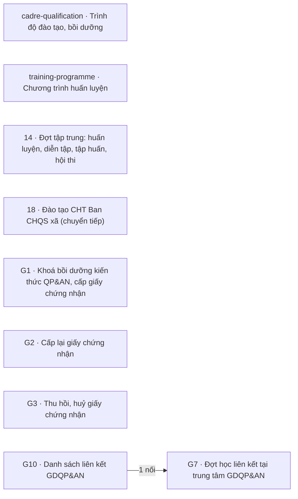

# Khối Huấn luyện, giáo dục

<!-- máy sinh: tom-tat -->
> **Khối Huấn luyện, giáo dục** — 9 quy trình, 12 tài liệu (kể cả hồ sơ phụ) · 121 bước.
>
> Khớp nối giữa các quy trình trong khối: 1 · với khối khác: 70.
>
> **Nguồn:** cộng từ các tài liệu quy trình của khối (sổ nghiệp vụ + khai báo của app) và bảng kê khớp nối. Tầng trên: [Tổng thể](00-tong-the.html). Tầng dưới: từng quy trình ở mục 1.
<!-- hết: tom-tat -->

<!-- viết tay: dien-giai -->
## Diễn giải

*Phần này viết tay, diễn giải lại điều các bảng bên dưới và các tài liệu quy trình của khối ghi.*

### Khối này lo việc gì

Khối gồm 9 quy trình, 12 tài liệu. Các hồ sơ khối theo dõi: đợt tập trung (huấn luyện, tập huấn/bồi dưỡng, hội thi, hội thao, diễn tập) và việc cử người đi đợt do cấp trên tổ chức; khoá bồi dưỡng kiến thức QP&AN và các đề nghị về giấy chứng nhận đã cấp; đợt học liên kết ở trung tâm GDQP&AN và danh sách trường nào học ở trung tâm nào; học viên đào tạo chức danh Ban chỉ huy quân sự cấp xã; trình độ đào tạo, bồi dưỡng của cán bộ; hồ sơ chương trình, giáo trình, tài liệu huấn luyện. Trong khối có một mối nối giữa hai quy trình (mục 3); 38 mối nối đi sang khối khác (mục 4).

### Các quy trình nối với nhau thế nào

Chia ba nhóm: cụm liên kết theo mối nối ở mục 3; cụm bồi dưỡng gồm ba quy trình cùng nối tới giấy chứng nhận của quy trình 16 ở khối khác; còn lại là các quy trình đứng riêng.

**Cụm liên kết GDQP&AN.**

- [G10 · Danh sách liên kết GDQP&AN](qt-G10.html): Cục Dân quân tự vệ theo dõi một đợt điều chỉnh danh sách liên kết; kết thúc ở *Đã cập nhật danh mục* hoặc *Đã huỷ*. Hồ sơ phụ `qt-G10.centre-proposal` là đề nghị của trung tâm, kết thúc ở `CLOSED` hoặc `WITHDRAWN`; đề nghị được nhận vào một đợt điều chỉnh ở bước `acceptIntoLinkageBatch`, và dòng điều chỉnh của đợt ghi lại đề nghị mà nó xuất phát.
- [G7 · Đợt học liên kết tại trung tâm GDQP&AN](qt-G7.html): trung tâm theo dõi một đợt học của một trường, từ ký hợp đồng tới *Đã thanh lý hợp đồng*.
- Mối nối giữa hai quy trình: hồ sơ G7 mở ra ở bước **Ký hợp đồng liên kết** có nối tới *Cơ sở giáo dục liên kết* của G10 — đợt học là của trường nào, trường được giao liên kết với trung tâm.

**Cụm bồi dưỡng kiến thức QP&AN và giấy chứng nhận.**

- [G1 · Khoá bồi dưỡng kiến thức QP&AN, cấp giấy chứng nhận](qt-G1.html): theo dõi một khoá từ lập kế hoạch khoá tới *Đã cấp giấy chứng nhận*, hoặc *Đã huỷ*. Hồ sơ phụ `qt-G1.course-attendance` là dòng tham gia của từng người học, kết thúc ở *Hoàn thành* hoặc *Không hoàn thành*; mỗi dòng thuộc về một khoá.
- [G2 · Cấp lại giấy chứng nhận](qt-G2.html): một đề nghị cấp lại, cấp bản sao hoặc chỉnh sửa giấy đã cấp; kết thúc ở *Đã cấp lại*, *Đã cấp bản sao*, *Đã chỉnh sửa* hoặc *Không giải quyết*.
- [G3 · Thu hồi, huỷ giấy chứng nhận](qt-G3.html): một hồ sơ thu hồi giấy đã cấp; kết thúc ở *Đã thu hồi* hoặc *Không thu hồi*.
- Giấy chứng nhận (`16.gdqp-certificate`) là hồ sơ của quy trình 16 ở khối khác: mỗi giấy ghi nó được cấp theo khoá nào của G1, còn G2 và G3 mở ra có nối tới giấy đã cấp ấy.

**Đứng riêng trong khối**, không nối với quy trình nào khác của khối:

- [14 · Đợt tập trung: huấn luyện, diễn tập, tập huấn, hội thi](qt-14.html): đơn vị tổ chức theo dõi một đợt từ lập kế hoạch tới *Đã báo cáo kết quả*. Hồ sơ phụ `qt-14.training-nomination` ghi việc xã cử một chiến sĩ đi đợt do cấp trên tổ chức, kết thúc ở *Đã nhận kết quả* hoặc *Đã rút*.
- [18 · Đào tạo CHT Ban CHQS xã (chuyển tiếp)](qt-18.html): theo dõi một học viên từ *Đang đào tạo* tới *Đã hoàn thành cam kết* hoặc *Kết thúc sớm*.
- [Trình độ đào tạo, bồi dưỡng](ngoai63.cadre-qualification.html): mỗi dòng một loại trình độ của một cán bộ, kết thúc ở *Đã ghi nhận*.
- [Hồ sơ chương trình, giáo trình, tài liệu huấn luyện](ngoai63.curriculum-dossier.html): từ lập hồ sơ đề nghị biên soạn tới *Đã ban hành (V3)*.

### Nhận gì từ khối khác, để lại gì cho khối khác

- [Khung chung](khoi-khung-chung.html) (16): khối mở hồ sơ từ đây. Đợt 14 mở ra có nối tới Nhiệm vụ trên giao (1) và Chỉ tiêu (2); hồ sơ cử người và học viên 18 mở ra có nối tới Chỉ tiêu; khoá G1 mở ra có nối tới kế hoạch bồi dưỡng năm của quy trình 2. Đợt 14 gắn với Văn bản đi ở bước trình ký tờ trình kế hoạch huấn luyện, và văn bản đi báo cáo kết quả huấn luyện cũng nối về đợt. Quy trình 18 gắn với Văn bản đến ở bước phong quân hàm; đợt điều chỉnh G10 có nối tới Văn bản đến; Cuộc thanh tra, kiểm tra (9) gắn vào đợt điều chỉnh G10 ở một bước của quy trình 9.
- [Quân lực · Người và nghĩa vụ](khoi-nguoi-nghia-vu.html) (13): từ đợt 14 mở ra Hồ sơ chế độ chính sách (12b) cho trợ cấp ngày công và Dòng quyết định về một người (C1) khi lớp tập huấn cấp giấy chứng nhận cho tuyên truyền viên; đợt 14 gắn với Chiến sĩ dân quân tự vệ ở bước Triệu tập chiến sĩ. Hồ sơ cử người, hồ sơ trình độ, G2, G3 mở ra có nối tới hồ sơ của quy trình 16; G2 còn gắn với hồ sơ của quy trình 16 ở bước cấp lại. Giấy chứng nhận của quy trình 16 ghi nó được cấp theo khoá G1 nào.
- [Quân lực · Tổ chức, chỉ huy](khoi-to-chuc.html) (5): quy trình 18 gắn với Nhân sự Ban chỉ huy quân sự cấp xã (30) ở bước bố trí sử dụng. G7 mở ra có nối tới trung tâm (29); G10 gắn với trung tâm ở hai bước.
- [Hậu cần – kỹ thuật](khoi-hau-can.html) (1): Phiếu cấp phát huấn luyện (D11) mở ra từ đợt 14.
- [Tài chính](khoi-tai-chinh.html) (2): Đề nghị cấp kinh phí (4) phát sinh từ một đợt huấn luyện và Bảng thanh toán trợ cấp (12a) lập từ một đợt huấn luyện đều nối về đợt 14.
### Ai làm

Theo mục 5: Trợ lý Tác huấn có bước ở 14, hồ sơ cử người và cả cụm bồi dưỡng. Chỉ huy trưởng Ban CHQS xã có bước ở 14, cụm bồi dưỡng, hồ sơ trình độ và hồ sơ chương trình, giáo trình. Trợ lý Quân lực và Bộ CHQS cấp tỉnh có bước ở 14, 18 và hồ sơ trình độ. Cụm liên kết do Cục Dân quân tự vệ (G10) và Trung tâm giáo dục quốc phòng và an ninh (G7) làm; đề nghị của trung tâm do hai vai `bureau`, `centre` làm; hệ thống tự làm một số bước ở G10 và ở đề nghị của trung tâm. Cục Dân quân tự vệ còn có bước ở hồ sơ chương trình, giáo trình. Nhân viên tài chính kiêm hậu cần có bước ở 14 và 18; Nhân viên văn thư ở 14 và hồ sơ chương trình, giáo trình; Nhân viên quân khí kiêm thủ kho ở 14.
<!-- hết viết tay -->

## 1. Các quy trình trong khối

<!-- máy sinh: quy-trinh -->
Cột "Để làm gì" trích câu đầu phần Diễn giải của tài liệu quy trình. Cột "Mặt công tác (app)" là chỗ app xếp quy trình ấy.

| Mã | Tên | Để làm gì | Bước | Chặng | Mặt công tác (app) |
|---|---|---|---|---|---|
| [ngoai63.cadre-qualification](ngoai63.cadre-qualification.html) | Trình độ đào tạo, bồi dưỡng | Hồ sơ ghi **trình độ đào tạo, bồi dưỡng của cán bộ**: mỗi dòng là một loại trình độ của một người (năm loại: văn hoá, lý luận chính trị, quân sự cơ sở, chuyên môn nghiệp vụ, quản lý nhà nước), kèm mức đạt được, trường, số bằng, ngày cấp, ảnh chụp bằng. | 7 | 3 | Quân lực |
| [ngoai63.training-programme](ngoai63.training-programme.html) | Chương trình huấn luyện |  | 2 | 2 | Quân lực |
| [qt-14](qt-14.html) | Đợt tập trung: huấn luyện, diễn tập, tập huấn, hội thi | Đơn vị tổ chức theo dõi một **đợt tập trung** — có năm loại: huấn luyện, tập huấn/bồi dưỡng, hội thi, hội thao, diễn tập — từ lúc lập kế hoạch tới lúc báo cáo kết quả và chốt ngày công. | 31 | 9 | Huấn luyện, giáo dục |
| ↳ [qt-14.training-nomination](qt-14.training-nomination.html) | Đợt tập trung: huấn luyện, diễn tập, tập huấn, hội thi — Dân quân tham gia huấn luyện do cấp trên tổ chức | Xã ghi lại việc **cử một chiến sĩ đi đợt huấn luyện do cấp trên tổ chức**, và nhận kết quả của người ấy về hồ sơ. | 3 | 3 | Huấn luyện, giáo dục |
| [qt-18](qt-18.html) | Đào tạo CHT Ban CHQS xã (chuyển tiếp) | Ban CHQS xã theo dõi **một học viên đang được đào tạo để giữ chức danh trong Ban chỉ huy quân sự cấp xã**: từ lúc đang học ở nhà trường, qua tốt nghiệp, phong quân hàm, bố trí sử dụng, tới khi đủ thời gian cam kết công tác. | 15 | 5 | Huấn luyện, giáo dục |
| [qt-G1](qt-G1.html) | Khoá bồi dưỡng kiến thức QP&AN, cấp giấy chứng nhận | Theo dõi một **khoá bồi dưỡng kiến thức QP&AN** từ lúc lập kế hoạch khoá tới lúc cấp giấy chứng nhận cho người hoàn thành. | 22 | 10 | Quân lực |
| ↳ [qt-G1.course-attendance](qt-G1.course-attendance.html) | Học viên của khoá bồi dưỡng | Mỗi hồ sơ là **một người học trong một khoá bồi dưỡng** — "dòng tham gia" của từng người được triệu tập: thông tin của khoá nằm ở hồ sơ khoá (qt-G1), còn nhóm đối tượng và kết quả của từng người nằm ở dòng này. | 3 | 3 | Quân lực |
| [qt-G2](qt-G2.html) | Cấp lại giấy chứng nhận | Theo dõi một **đề nghị về giấy chứng nhận** hoàn thành bồi dưỡng kiến thức QP&AN đã cấp: cấp lại, cấp bản sao, hoặc chỉnh sửa nội dung. | 7 | 6 | Quân lực |
| [qt-G3](qt-G3.html) | Thu hồi, huỷ giấy chứng nhận | Theo dõi một **hồ sơ thu hồi, huỷ bỏ giấy chứng nhận** hoàn thành bồi dưỡng kiến thức QP&AN đã cấp. | 3 | 3 | Quân lực |
| [qt-G7](qt-G7.html) | Đợt học liên kết tại trung tâm GDQP&AN | Trung tâm giáo dục quốc phòng và an ninh theo dõi một **đợt học liên kết**: mỗi đợt của một trường là một hồ sơ, từ lúc ký hợp đồng với trường tới lúc thanh lý hợp đồng. | 11 | 6 | Quân lực |
| [qt-G10](qt-G10.html) | Danh sách liên kết GDQP&AN | Cục Dân quân tự vệ theo dõi một **đợt điều chỉnh danh sách liên kết GDQP&AN** — danh sách trường nào học môn GDQP&AN ở trung tâm nào. | 8 | 4 | Quân lực |
| ↳ [qt-G10.centre-proposal](qt-G10.centre-proposal.html) | Đề nghị của trung tâm — Đề nghị điều chỉnh liên kết của trung tâm | Trung tâm đề nghị thêm, bỏ, chuyển trường liên kết; Cục nhận đề nghị vào một đợt điều chỉnh hoặc trả lại. | 9 | 6 | Quân lực |
<!-- hết: quy-trinh -->

## 2. Sơ đồ mối nối trong khối

<!-- máy sinh: so-do -->

Có mũi tên: trong các mối nối của cặp ấy có ít nhất một mối do **bước tạo hồ sơ** ghi, mũi tên chỉ về quy trình có hồ sơ được mở ra; các mối còn lại của cặp có thể là gắn giữa chừng — xem từng dòng ở mục 3. Không mũi tên: gắn nhau ở bước giữa chừng. Hồ sơ phụ gộp về quy trình gốc.
<!-- hết: so-do -->

## 3. Khớp nối giữa các quy trình trong khối

<!-- máy sinh: khop-noi-trong -->
| Ô nối | Từ (quy trình · hồ sơ) | Tới | Nội dung (mô tả trong app) | Bước ghi mối nối |
|---|---|---|---|---|
| `courseForSchool` | G7 · Đợt học liên kết GDQP&AN | G10 · Cơ sở giáo dục liên kết | Đợt học của trường nào — trường được giao liên kết với trung tâm (QĐ10/2025/QĐ-TTg Đ.19 k1) | G7·signLinkageContract ⊕ |

1 khớp nối. ⊕ là bước tạo hồ sơ. Bảng kê mối nối giữa hai mã quy trình khác nhau; mối nối giữa hồ sơ chính và hồ sơ phụ của cùng một mã xem tài liệu quy trình.
<!-- hết: khop-noi-trong -->

## 4. Khớp nối với khối khác

<!-- máy sinh: khop-noi-ngoai -->
| Khối kia | Số khớp nối | Quy trình của khối này ↔ quy trình khối kia |
|---|---|---|
| [Khung chung](khoi-khung-chung.html) | 41 | 14 ↔ 1 (12), 14 ↔ 2 (3), 18 ↔ 1 (1), 18 ↔ 2 (1), G1 ↔ 1 (8), G1 ↔ 2 (3), G1 ↔ D16 (2), G2 ↔ 1 (1), G3 ↔ 1 (1), G10 ↔ 1 (7), G10 ↔ 9 (1), training-programme ↔ 1 (1) |
| [Tác chiến, sẵn sàng chiến đấu](khoi-tac-chien.html) | 1 | 14 ↔ stationed-force (1) |
| [Hậu cần – kỹ thuật](khoi-hau-can.html) | 1 | 14 ↔ D11 (1) |
| [Quân lực · Người và nghĩa vụ](khoi-nguoi-nghia-vu.html) | 15 | 14 ↔ 12b (1), 14 ↔ 16 (4), 14 ↔ C1 (1), 18 ↔ 16 (1), G1 ↔ 16 (4), G2 ↔ 16 (2), G3 ↔ 16 (1), cadre-qualification ↔ 16 (1) |
| [Quân lực · Tổ chức, chỉ huy](khoi-to-chuc.html) | 6 | 18 ↔ 30 (1), G7 ↔ 29 (1), G10 ↔ 29 (4) |
| [Chính trị](khoi-chinh-tri.html) | 4 | 14 ↔ 10 (2), 14 ↔ D15 (2) |
| [Tài chính](khoi-tai-chinh.html) | 2 | 14 ↔ 4 (1), 14 ↔ 12a (1) |

70 khớp nối với khối khác. Số trong ngoặc là số ô nối của cặp quy trình. Hồ sơ phụ gộp về quy trình gốc. Từng ô nối và chiều của nó: mục 10 của tài liệu quy trình.
<!-- hết: khop-noi-ngoai -->

## 5. Ai làm

<!-- máy sinh: vai-tro -->
| Người làm | Có bước ở quy trình |
|---|---|
| Hệ thống tự làm | 14, 18, G1, G2, G10, G10.centre-proposal, cadre-qualification |
| Chỉ huy trưởng Ban CHQS xã | 14, 18, G1, G2, G3, cadre-qualification |
| Trợ lý Tác huấn | 14, 14.training-nomination, G1, G1.course-attendance, G2, G3 |
| Bộ CHQS cấp tỉnh | 14, 18, cadre-qualification |
| Cục Dân quân tự vệ | G10, G10.centre-proposal, training-programme |
| Trợ lý Quân lực | 14.training-nomination, 18, cadre-qualification |
| Nhân viên tài chính kiêm hậu cần | 14, 18 |
| Trung tâm giáo dục quốc phòng và an ninh | G7, G10.centre-proposal |
| Nhân viên quân khí kiêm thủ kho | 14 |
| Nhân viên văn thư | 14 |

*Tên người làm là tên app đặt cho mã chủ thể của vai; vai không có mã chủ thể thì in bằng mã (`…`). Quy trình chạy ở nhiều cấp thì người làm là người giữ vai ấy ở đơn vị nêu trong tài liệu quy trình.*
<!-- hết: vai-tro -->
