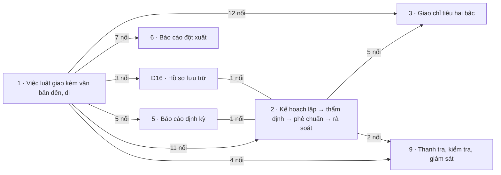

# Khối Khung chung

<!-- máy sinh: tom-tat -->
> **Khối Khung chung** — 7 quy trình, 14 tài liệu (kể cả hồ sơ phụ) · 191 bước.
>
> Khớp nối giữa các quy trình trong khối: 51 · với khối khác: 392.
>
> **Nguồn:** cộng từ các tài liệu quy trình của khối (sổ nghiệp vụ + khai báo của app) và bảng kê khớp nối. Tầng trên: [Tổng thể](00-tong-the.html). Tầng dưới: từng quy trình ở mục 1.
<!-- hết: tom-tat -->

<!-- viết tay: dien-giai -->
## Diễn giải

*Phần này viết tay, diễn giải lại điều các bảng bên dưới và các tài liệu quy trình của khối ghi.*

### Khối này lo việc gì

Khối theo dõi bảy loại hồ sơ gốc: nhiệm vụ trên giao kèm văn bản đến, văn bản đi ([1 · Việc luật giao kèm văn bản đến, đi](qt-1.html)); kế hoạch, văn kiện cùng chỉ tiêu và mốc thời gian ([2 · Kế hoạch lập → thẩm định → phê chuẩn → rà soát](qt-2.html)); bản giao chỉ tiêu, mốc xuống cấp dưới, kết quả trả lên và số đạt đã báo ([3 · Giao chỉ tiêu hai bậc](qt-3.html)); báo cáo ([5 · Báo cáo định kỳ](qt-5.html), [6 · Báo cáo đột xuất](qt-6.html)); cuộc thanh tra, kiểm tra ([9 · Thanh tra, kiểm tra, giám sát](qt-9.html)); và hồ sơ lưu trữ của từng việc ([D16 · Hồ sơ lưu trữ](qt-D16.html)). Phần dưới gom thành bốn cụm theo mối nối ở mục 2 và 3: nhận việc – lập kế hoạch – giao xuống (1, 2, 3); báo cáo (5, 6); kiểm tra (9); lưu trữ (D16).

### Các quy trình nối với nhau thế nào

**Cụm 1 — nhận việc, lập kế hoạch, giao xuống (1, 2, 3)**, gom theo ba cặp nối 2–1, 1–3, 2–3.

- **1** theo dõi một nhiệm vụ trên giao từ *Đã nhận* tới *Đã xong*, rẽ sang *Đã chuyển trả* hoặc *Đã thu hồi theo cấp trên*. Hồ sơ phụ Văn bản đến kết thúc ở *Đã phân phối* hoặc *Đã trả lại nơi gửi*; hồ sơ phụ Văn bản đi kết thúc ở *Đã phát hành* hoặc *Đã huỷ dự thảo*. Bước *Ghi nhận nhiệm vụ được giao* ghi mối nối tới Văn bản đến; hai cửa *Tạo tờ trình ký* và *Nhập văn bản đã ký ngoài hệ* của Văn bản đi ghi mối nối tới nhiệm vụ.
- **2** theo dõi một kế hoạch, văn kiện từ *Dự thảo* tới *Hết hiệu lực* hoặc *Đã bị thay thế*. Kế hoạch gắn vào nhiệm vụ nó đáp ứng ở hai bước nối căn cứ. Chỉ tiêu và mốc thời gian được bóc ra từ nhiệm vụ ở các bước *Thêm chỉ tiêu*, *Bổ chỉ tiêu theo kỳ*, *Thêm mốc thời gian* của quy trình 1. Tờ trình kế hoạch gắn vào một Văn bản đi ở bước *Trình ký tờ trình văn kiện*; bản kế hoạch ban hành gắn vào một Văn bản đi ở bước *Vào sổ, cấp số và ban hành*.
- **3** theo dõi một bản giao từ *Nháp, chờ duyệt* tới *Đã báo xong*, rẽ sang *Đã huỷ nháp*, *Đã trả lại*, *Đã thu hồi*. Bản giao mở ra có nối tới nhiệm vụ của cấp mình ở bước *Đề xuất phần chia* ⊕, và chia xuống một chỉ tiêu hoặc một mốc công việc của quy trình 2. Cấp dưới bấm *Nhận việc cấp trên giao* thì sinh ra một nhiệm vụ ở cấp nhận; chỉ tiêu cấp nhận lập ra để đáp lần giao ấy nối ngược về bản giao. Văn bản giao việc, điều chỉnh, thu hồi là Văn bản đi, gắn ở bước duyệt và hai bước ký.
- Hồ sơ phụ Kết quả trả lên cấp trên tính trên những dòng chỉ tiêu của cấp mình. Hồ sơ phụ Số đạt đã báo mở ra có nối tới dòng chỉ tiêu nó báo, ở bước *Báo số đạt* ⊕.

**Cụm 2 — báo cáo (5, 6)**, gom theo các cặp nối 1–5, 5–2, 1–6. **5** đi từ *Dự thảo* tới *Đã gửi*, *Cấp trên đã tiếp nhận*; hồ sơ mở ra có nối tới các nhiệm vụ báo cáo nói về, ở bước *Lập báo cáo định kỳ* ⊕; mỗi ô số trong báo cáo báo cho một dòng chỉ tiêu của quy trình 2. **6** kết thúc ở *Cấp trên đã tiếp nhận*; hồ sơ mở ra có nối tới văn bản đến yêu cầu báo cáo, ở bước *Lập báo cáo đột xuất* ⊕, và gắn vào việc loại báo cáo đột xuất ở quy trình 1. Hai quy trình 5 và 6 không nối trực tiếp với nhau.

**Cụm 3 — kiểm tra (9)**, gom theo hai cặp nối 2–9, 1–9. **9** đi từ *Đã ban hành quyết định* tới *Đã khắc phục xong, đóng cuộc*. Hồ sơ mở ra có nối tới kế hoạch và chỉ tiêu kiểm tra ở bước *Ban hành quyết định, kế hoạch kiểm tra* ⊕, hoặc tới văn bản kết luận giám sát trong sổ văn bản đến ở bước *Mở hồ sơ theo dõi kết luận giám sát* ⊕.

**Cụm 4 — lưu trữ (D16).** **D16** có hai chặng *Đang lưu trữ* và *Chờ duyệt rút ngắn*. Mỗi việc ở quy trình 1 làm xong để lại một hồ sơ lưu trữ, hệ thống tự mở. Tệp lưu trữ của hồ sơ là bản số hoá của văn bản đến, bản đã ký của văn bản đi và tệp đính kèm của kế hoạch.

### Nhận gì từ khối khác, để lại gì cho khối khác

Phần lớn là chiều để lại: hồ sơ khối khác mở ra có nối về nhiệm vụ, kế hoạch hoặc chỉ tiêu, và gắn tờ trình vào Văn bản đi. Chiều nhận chỉ có báo cáo đột xuất (6) mở ra có nối tới vụ việc ứng phó (20).

- [Tác chiến, sẵn sàng chiến đấu](khoi-tac-chien.html): lệnh điều động (13a) mở từ nhiệm vụ và từ văn bản đến; công trình quốc phòng (23), đợt mở rộng lực lượng (D5) mở từ nhiệm vụ và từ kế hoạch.
- [Hậu cần – kỹ thuật](khoi-hau-can.html): đợt kiểm kê (15), phiếu cấp phát huấn luyện (D11), đợt thu hồi, thanh lý (D14) mở từ nhiệm vụ; tờ trình của chúng gắn vào Văn bản đi.
- [Huấn luyện, giáo dục](khoi-huan-luyen.html): sự kiện huấn luyện (14) mở từ nhiệm vụ và từ dòng chỉ tiêu; khoá bồi dưỡng (G1) mở từ kế hoạch bồi dưỡng năm.
- [Quân lực · Người và nghĩa vụ](khoi-nguoi-nghia-vu.html): chiến sĩ kết nạp (16), đợt tuyển quân (17), kỳ tuyển chọn (D2) mở theo chỉ tiêu; đợt tuyển quân gắn kết quả vào Kết quả trả lên của quy trình 3; hồ sơ chế độ (12b) mở từ nhiệm vụ.
- [Quân lực · Dự bị động viên, động viên công nghiệp](khoi-du-bi-dong-vien.html): đợt gọi quân nhân dự bị (35) mở từ văn bản đến và từ chỉ tiêu, bản sắp xếp (34) mở từ chỉ tiêu.
- [Quân lực · Tổ chức, chỉ huy](khoi-to-chuc.html): chức vụ chỉ huy (30) mở từ nhiệm vụ; đơn vị dân quân tự vệ (29) mở từ nhiệm vụ, kế hoạch, chỉ tiêu.
- [Chính trị](khoi-chinh-tri.html): hồ sơ khen thưởng (8) mở từ nhiệm vụ, đợt tuyên truyền (11) từ chỉ tiêu, phong trào thi đua (7) từ kế hoạch.
- [Tài chính](khoi-tai-chinh.html): dự toán ngân sách năm (4) mở từ nhiệm vụ.

### Ai làm

Theo mục 5, Chỉ huy trưởng Ban CHQS xã có bước ở mọi tài liệu trừ Số đạt đã báo; Trợ lý Tác huấn ở cả bốn cụm, trừ hai hồ sơ văn bản và Số đạt đã báo. Nhân viên văn thư làm ở Văn bản đến, Văn bản đi, quy trình 2 và D16. Ban Dân quân tự vệ, Bộ CHQS cấp tỉnh có bước ở quy trình 3, Kết quả trả lên, 5 và 6; Bộ CHQS cấp tỉnh ở quy trình 2; Cục Dân quân tự vệ ở quy trình 9. Số đạt đã báo do Trợ lý Quân lực và vai `assistant` làm. Hệ thống tự làm một số bước ở quy trình 2 và D16.
<!-- hết viết tay -->

## 1. Các quy trình trong khối

<!-- máy sinh: quy-trinh -->
Cột "Để làm gì" trích câu đầu phần Diễn giải của tài liệu quy trình. Cột "Mặt công tác (app)" là chỗ app xếp quy trình ấy.

| Mã | Tên | Để làm gì | Bước | Chặng | Mặt công tác (app) |
|---|---|---|---|---|---|
| [qt-1](qt-1.html) | Việc luật giao kèm văn bản đến, đi | Đơn vị theo dõi một **nhiệm vụ trên giao**: nhận việc, phân công người cầm việc, bóc việc thành chỉ tiêu và mốc thời gian, rồi đánh dấu xong. | 19 | 6 | Khung chung |
| ↳ [qt-1.incoming-document](qt-1.incoming-document.html) | Việc luật giao kèm văn bản đến, đi — Văn bản đến | Nhân viên văn thư và Chỉ huy trưởng Ban CHQS xã theo dõi một **văn bản đến**: vào sổ, phân cho người xử lý, hoặc trả lại nơi gửi. | 13 | 4 | Khung chung |
| ↳ [qt-1.outgoing-document](qt-1.outgoing-document.html) | Việc luật giao kèm văn bản đến, đi — Văn bản đi | Theo dõi một **văn bản đi** của đơn vị từ tờ trình ký tới lúc phát hành. | 22 | 5 | Khung chung |
| [qt-2](qt-2.html) | Kế hoạch lập → thẩm định → phê chuẩn → rà soát | Đơn vị theo dõi một **kế hoạch, văn kiện** từ lúc soạn tới lúc hết hiệu lực: soạn dự thảo, các bên cùng ký (với loại cần cùng ký), trình ký tờ trình, gửi cấp có thẩm quyền, thẩm định, phê duyệt, ban hành, tổ chức thực hiện, rà soát định kỳ, điều chỉnh. | 40 | 10 | Khung chung |
| ↳ [qt-2.submission](qt-2.submission.html) | Kế hoạch lập → thẩm định → phê chuẩn → rà soát — Kế hoạch, văn kiện |  | 7 | 4 | Khung chung |
| [qt-3](qt-3.html) | Giao chỉ tiêu hai bậc | Cấp trên chia một chỉ tiêu có số, hoặc một mốc công việc, xuống cấp dưới và theo dõi **bản giao** ấy tới lúc cấp dưới báo xong. | 16 | 6 | Khung chung |
| ↳ [qt-3.adjustment](qt-3.adjustment.html) | Giao chỉ tiêu hai bậc — Điều chỉnh, thu hồi bản giao |  | 17 | 9 | Khung chung |
| ↳ [qt-3.assignment-result](qt-3.assignment-result.html) | Giao chỉ tiêu hai bậc — Kết quả trả lên cấp trên | Cấp nhận việc trả **kết quả** của một bản giao lên cấp đã giao: trợ lý soạn con số, trưởng ban duyệt, con số lên cấp trên; cấp trên cần thì yêu cầu bổ sung. | 9 | 7 | Khung chung |
| ↳ [qt-3.target-actual](qt-3.target-actual.html) | Giao chỉ tiêu hai bậc — Số đạt đã báo | Ghi lại **số đạt đã báo** cho một dòng chỉ tiêu trong một kỳ báo cáo, kèm số hiệu văn bản báo cáo mang con số ấy. | 2 | 2 | Khung chung |
| [qt-5](qt-5.html) | Báo cáo định kỳ | Đơn vị lập **báo cáo định kỳ** của một kỳ, chỉ huy duyệt dự thảo, gửi lên cấp trên; cấp trên tiếp nhận, góp ý hoặc trả lại. | 13 | 4 | Khung chung |
| [qt-6](qt-6.html) | Báo cáo đột xuất | Đơn vị lập một **báo cáo đột xuất** về một việc cụ thể, theo một yêu cầu cụ thể: trợ lý soạn, chỉ huy duyệt dự thảo, gửi lên cấp trên trực tiếp; cấp trên tiếp nhận, góp ý hoặc trả lại. | 9 | 4 | Khung chung |
| [qt-9](qt-9.html) | Thanh tra, kiểm tra, giám sát | Theo dõi một **cuộc thanh tra, kiểm tra** từ quyết định kiểm tra tới lúc mọi kiến nghị được khắc phục; cùng hồ sơ này cũng dùng để theo dõi việc thực hiện một kết luận giám sát của Hội đồng nhân dân. | 13 | 7 | Khung chung |
| [qt-D16](qt-D16.html) | Hồ sơ lưu trữ | Mỗi việc làm xong để lại một **hồ sơ lưu trữ** của đơn vị. | 10 | 2 | Khung chung |
| ↳ [qt-D16.archive-file](qt-D16.archive-file.html) | qt-D16.archive-file |  | 1 | 1 |  |
<!-- hết: quy-trinh -->

## 2. Sơ đồ mối nối trong khối

<!-- máy sinh: so-do -->

Có mũi tên: trong các mối nối của cặp ấy có ít nhất một mối do **bước tạo hồ sơ** ghi, mũi tên chỉ về quy trình có hồ sơ được mở ra; các mối còn lại của cặp có thể là gắn giữa chừng — xem từng dòng ở mục 3. Không mũi tên: gắn nhau ở bước giữa chừng. Hồ sơ phụ gộp về quy trình gốc.
<!-- hết: so-do -->

## 3. Khớp nối giữa các quy trình trong khối

<!-- máy sinh: khop-noi-trong -->
| Ô nối | Từ (quy trình · hồ sơ) | Tới | Nội dung (mô tả trong app) | Bước ghi mối nối |
|---|---|---|---|---|
| `answeredBy` | 2 · Kế hoạch, văn kiện | 1 · Nhiệm vụ trên giao | Kế hoạch này đáp ứng nhiệm vụ nào | 2·draftPlan ⊕, 2·linkPlanBasis, 2·linkProvincePlanBasis, 2·openPlanAmendment ⊕ |
| `hasTarget` | 2 · Chỉ tiêu | 1 · Nhiệm vụ trên giao | Chỉ tiêu này bóc ra từ nhiệm vụ nào | 1·addTaskingTarget, 1·splitTargetByPeriod · đòi: 1·editTaskingTarget, 1·splitTargetByPeriod, 1·withdrawTaskingTarget |
| `hasTask` | 2 · Mốc thời gian | 1 · Nhiệm vụ trên giao | Mốc thời gian này thuộc nhiệm vụ nào | 1·addTaskingTask · đòi: 1·editTaskingTask, 1·withdrawTaskingTask |
| `planAppraisalFromIncomingDocument` | 2 · Kế hoạch, văn kiện | 1.incoming-document · Văn bản đến | Văn bản thẩm định kế hoạch của cơ quan có thẩm quyền — chọn trong sổ văn bản đến của đơn vị lập (sổ qt-2 appr… | 2.submission·recordPlanApproval |
| `planApprovedByIncomingDocument` | 2 · Kế hoạch, văn kiện | 1.incoming-document · Văn bản đến | Văn bản phê duyệt kế hoạch của cơ quan có thẩm quyền — chọn trong sổ văn bản đến của đơn vị lập (NĐ30/2020/NĐ… | 2.submission·recordPlanApproval |
| `planIssuedByIncomingDocument` | 2 · Kế hoạch, văn kiện | 1.incoming-document · Văn bản đến | Văn bản Uỷ ban nhân dân ban hành kế hoạch — chọn trong sổ văn bản đến của đơn vị lập (NĐ30/2020/NĐ-CP Đ.3 k6) | 2·recordCommitteeIssuedPlan |
| `planReturnDeliveredAs` | 2 · Kế hoạch, văn kiện | 1.incoming-document · Văn bản đến | Văn bản trả lại kế hoạch ở sổ văn bản đến của xã | 2.submission·returnCommunePlan |
| `submissionDeliveredAs` | 2 · Kế hoạch, văn kiện | 1.incoming-document · Văn bản đến | Tờ trình kế hoạch ở sổ văn bản đến của cấp duyệt trong hệ (NĐ30/2020/NĐ-CP Đ.20–22) | 13a·submitDeployment, 15·submitInventoryCheck, 17·submitCandidateList, 2·submitPlan, 2.submission·openSubmissionRound ⊕, 2.submission·returnPlanByReceiver, 23·proposeInvestment, 23·submitLandProposal, 29·submitUnitProposal, 31·submitDisbandProposal, 34·submitArrangement, 35·sendNominationList, 36·sendDossierToProvince, 5·resubmitReport, 5·sendReport, 6·sendAdHocReport, D11.training-allocation·submitTrainingAllocation, D14·submitDisposalBatch, D15.submission·openSubmissionRound ⊕, D4·recordProposalSubmissionSigned |
| `planDocumentSubmittedByDocument` | 2 · Kế hoạch, văn kiện | 1.outgoing-document · Văn bản đi | Tờ trình đi kèm mỗi lượt trình văn kiện — văn bản đi của Ban CHQS, đã ký và vào sổ (NĐ30/2020/NĐ-CP Điều 18,… | 2·requestPlanSignature · đòi: 2·submitPlan |
| `planIssuedByDocument` | 2 · Kế hoạch, văn kiện | 1.outgoing-document · Văn bản đi | Bản kế hoạch Ban chỉ huy quân sự ban hành — văn thư cấp số, vào sổ văn bản đi (NĐ30/2020/NĐ-CP Điều 18) | 2·issueCommunePlan |
| `returnCommunePlanByDocument` | 2 · Kế hoạch, văn kiện | 1.outgoing-document · Văn bản đi | Văn bản Bộ CHQS tỉnh trả lại kế hoạch của xã — văn bản đi của tỉnh, Chỉ huy tỉnh ký | 2.submission·requestReturnCommunePlanSignature |
| `fulfils` | 2 · Chỉ tiêu | 3 · Bản giao chỉ tiêu, mốc xuống cấp dưới | Chỉ tiêu này lập ra để đáp lần giao nào của cấp trên — rỗng khi cấp mình tự đặt (`selfExecuted`) | 1·addTaskingTarget |
| `hasAssignment` | 3 · Bản giao chỉ tiêu, mốc xuống cấp dưới | 1 · Nhiệm vụ trên giao | Bản giao này bóc ra từ nhiệm vụ nào của cấp mình | 3·draftAssignment ⊕ |
| `raisedTasking` | 3 · Bản giao chỉ tiêu, mốc xuống cấp dưới | 1 · Nhiệm vụ trên giao | Nhiệm vụ ở cấp dưới sinh ra khi cấp ấy nhận bản giao — chỗ vòng khép lại | 3·acceptAssignment |
| `assignmentDeliveredAs` | 3 · Bản giao chỉ tiêu, mốc xuống cấp dưới | 1.incoming-document · Văn bản đến | Văn bản đến ở sổ của cấp nhận, mang văn bản giao việc của bản giao này — NĐ30/2020 Đ.20–23 | 3·approveAssignment |
| `assignmentByDocument` | 3 · Bản giao chỉ tiêu, mốc xuống cấp dưới | 1.outgoing-document · Văn bản đi | Văn bản giao việc của cấp trên — TT77 Đ.7 k2 a; NĐ30/2020 (mọi văn bản đi đều vào sổ) | 3·approveAssignment, 3·requestAssignmentSignature |
| `assignsTarget` | 3 · Bản giao chỉ tiêu, mốc xuống cấp dưới | 2 · Chỉ tiêu | Chỉ tiêu được chia xuống — NĐ168/2018/NĐ-CP Đ.3 k3 (giao chỉ tiêu cho địa phương) | 3·draftAssignment ⊕ |
| `assignsTask` | 3 · Bản giao chỉ tiêu, mốc xuống cấp dưới | 2 · Mốc thời gian | Mốc công việc được giao xuống | 3·draftAssignment ⊕ |
| `adjustmentDeliveredAs` | 3.adjustment · Điều chỉnh, thu hồi bản giao | 1.incoming-document · Văn bản đến | Văn bản đến ở sổ của cấp nhận, mang văn bản điều chỉnh, thu hồi bản giao này | 3.adjustment·issueAssignmentAdjustment, 3.adjustment·issueAssignmentRevocation |
| `adjustmentRejectDeliveredAs` | 3.adjustment · Điều chỉnh, thu hồi bản giao | 1.incoming-document · Văn bản đến | Văn bản không chấp nhận đề nghị ở sổ văn bản đến của cấp nhận | 3.adjustment·rejectAdjustmentRequest |
| `adjustmentRequestDeliveredAs` | 3.adjustment · Điều chỉnh, thu hồi bản giao | 1.incoming-document · Văn bản đến | Văn bản đề nghị điều chỉnh ở sổ văn bản đến của cấp giao — NĐ30/2020 Đ.20–23 | 3.adjustment·submitAdjustmentRequest |
| `adjustmentByDocument` | 3.adjustment · Điều chỉnh, thu hồi bản giao | 1.outgoing-document · Văn bản đi | Văn bản điều chỉnh hoặc thu hồi bản giao — NĐ30/2020/NĐ-CP Đ.18 k3 | 3.adjustment·requestAssignmentAdjustmentSignature, 3.adjustment·requestAssignmentRevocationSignature |
| `adjustmentRejectByDocument` | 3.adjustment · Điều chỉnh, thu hồi bản giao | 1.outgoing-document · Văn bản đi | Văn bản không chấp nhận đề nghị điều chỉnh của cấp giao — NĐ30/2020 (văn bản đi vào sổ) | 3.adjustment·requestRejectAdjustmentRequestSignature |
| `adjustmentRequestByDocument` | 3.adjustment · Điều chỉnh, thu hồi bản giao | 1.outgoing-document · Văn bản đi | Văn bản đề nghị điều chỉnh của cấp nhận gửi cấp giao — NĐ30/2020 (văn bản đi vào sổ) | 3.adjustment·requestAdjustmentRequestSignature |
| `returnDeliveredAs` | 3.assignment-result · Kết quả trả lên cấp trên | 1.incoming-document · Văn bản đến | Văn bản yêu cầu bổ sung ở sổ văn bản đến của cấp báo | 13a·rejectDeployment, 15·rejectInventoryCheck, 17·requestCandidateListSupplement, 23·rejectInvestment, 23·rejectLand, 23·rejectRepair, 23·rejectWithdrawal, 29·returnUnitProposalAfterAcceptanceByMilitaryRegion, 29·returnUnitProposalAfterAcceptanceByProvince, 3.assignment-result·requestResultSupplement, 30·returnAppointmentDossierByCentral, 30·returnAppointmentDossierByCommune, 30·returnAppointmentDossierByMilitaryRegion, 30·returnAppointmentDossierByProvince, 30·returnDismissalDossierByCentral, 30·returnDismissalDossierByCommune, 30·returnDismissalDossierByMilitaryRegion, 30·returnDismissalDossierByProvince, 31·returnDisbandDossier, 34·requestArrangementSupplement, 5·returnSubordinateReport, 6·returnAdHocReport, D11.training-allocation·rejectTrainingAllocation, D4·rejectServiceRecognitionProposal, G10.centre-proposal·returnCentreProposal |
| `requestResultSupplementByDocument` | 3.assignment-result · Kết quả trả lên cấp trên | 1.outgoing-document · Văn bản đi | Văn bản yêu cầu bổ sung kết quả của cấp giao — NĐ30/2020 (văn bản đi vào sổ) | 3.assignment-result·requestRequestResultSupplementSignature |
| `resultCoversTarget` | 3.assignment-result · Kết quả trả lên cấp trên | 2 · Chỉ tiêu | Đầu ra (dòng chỉ tiêu cùng thước của cấp mình) được chọn cho lần trả kết quả này — nhiều nhất một | 3.assignment-result·draftAssignmentResult ⊕, 3.assignment-result·editAssignmentResult |
| `actualUnderTarget` | 3.target-actual · Số đạt đã báo | 2 · Chỉ tiêu | Số đạt này báo cho dòng chỉ tiêu nào — Nghị định 168/2018/NĐ-CP Điều 15 khoản 1 (chế độ báo cáo công tác quốc… | 3.target-actual·reportActual ⊕ |
| `covers` | 5 · Báo cáo định kỳ, đột xuất | 1 · Nhiệm vụ trên giao | Báo cáo này nói về những nhiệm vụ nào — NĐ168/2018/NĐ-CP Đ.15 | 5·prepareRoutineReport ⊕ |
| `periodicReportReturnDeliveredAs` | 5 · Báo cáo định kỳ, đột xuất | 1.incoming-document · Văn bản đến | Văn bản trả lại báo cáo định kỳ ở sổ văn bản đến của đơn vị lập (NĐ30/2020/NĐ-CP Đ.20–22) | — |
| `periodicReportSubmissionDeliveredAs` | 5 · Báo cáo định kỳ, đột xuất | 1.incoming-document · Văn bản đến | Văn bản báo cáo định kỳ ở sổ văn bản đến của cấp trên trực tiếp (NĐ30/2020/NĐ-CP Đ.20–22) | — |
| `returnRoutineReportByDocument` | 5 · Báo cáo định kỳ, đột xuất | 1.outgoing-document · Văn bản đi | Văn bản cấp trên trả lại báo cáo định kỳ — văn bản đi của cấp trên, Chỉ huy cấp trên ký | 5·requestReturnRoutineReportSignature |
| `routineReportByDocument` | 5 · Báo cáo định kỳ, đột xuất | 1.outgoing-document · Văn bản đi | Văn bản đi gửi báo cáo định kỳ lên cấp trên — trợ lý trình, Chỉ huy ký, văn thư phát hành | 5·requestRoutineReportSignature |
| `figureUnderTarget` | 5 · Dòng chỉ tiêu báo cáo | 2 · Chỉ tiêu | Ô số trong báo cáo này báo cho dòng chỉ tiêu nào — không có cạnh thì cấp trên không biết con số ấy thuộc về v… | 5·recordReportFigures |
| `adHocReportForTasking` | 6 · Báo cáo đột xuất | 1 · Nhiệm vụ trên giao | Việc loại báo cáo đột xuất (qt-1) mà báo cáo này gắn vào — gửi xong người làm bấm xong việc | 6·prepareAdHocReport ⊕ |
| `adHocReportReturnDeliveredAs` | 6 · Báo cáo đột xuất | 1.incoming-document · Văn bản đến | Văn bản trả lại báo cáo đột xuất ở sổ văn bản đến của đơn vị lập (NĐ30/2020/NĐ-CP Đ.20–22) | — |
| `adHocReportSubmissionDeliveredAs` | 6 · Báo cáo đột xuất | 1.incoming-document · Văn bản đến | Văn bản báo cáo đột xuất ở sổ văn bản đến của cấp trên trực tiếp (NĐ30/2020/NĐ-CP Đ.20–22) | — |
| `respondsToIncomingDocument` | 6 · Báo cáo đột xuất | 1.incoming-document · Văn bản đến | Văn bản yêu cầu báo cáo của cấp trên (sổ đến) mà báo cáo đột xuất này trả lời | 6·prepareAdHocReport ⊕ |
| `adHocReportByDocument` | 6 · Báo cáo đột xuất | 1.outgoing-document · Văn bản đi | Văn bản đi gửi báo cáo đột xuất lên cấp trên — trợ lý trình, Chỉ huy ký, văn thư phát hành | 6·requestAdHocReportSignature |
| `returnAdHocReportByDocument` | 6 · Báo cáo đột xuất | 1.outgoing-document · Văn bản đi | Văn bản cấp trên trả lại báo cáo đột xuất — văn bản đi của cấp trên, Chỉ huy cấp trên ký | 6·requestReturnAdHocReportSignature |
| `superiorReportRequestForOutgoingDocument` | 6 · Yêu cầu báo cáo cấp trên | 1.outgoing-document · Văn bản đi | Yêu cầu báo cáo cấp trên gắn với văn bản báo cáo (E24) nào, khi đã lập — nối cứng thay linkedReportDocumentRe… | — |
| `conclusionDocument` | 9 · Cuộc thanh tra, kiểm tra | 1.incoming-document · Văn bản đến | Văn bản kết luận giám sát của Hội đồng nhân dân đã vào sổ đến — hồ sơ theo dõi mở từ văn bản này (sổ qt-9) | 9·openFromSupervisionConclusion ⊕ |
| `openInspectionFromIncomingDocument` | 9 · Cuộc thanh tra, kiểm tra | 1.incoming-document · Văn bản đến | Quyết định, kế hoạch kiểm tra — văn bản đến đã vào sổ (L48/2019/QH14 Đ.37) | 9·openInspection ⊕ |
| `recordLinkageReroutingDecisionFromIncomingDocument` | 9 · Cuộc thanh tra, kiểm tra | 1.incoming-document · Văn bản đến | Quyết định điều chỉnh, phân luồng đơn vị liên kết — văn bản đến đã vào sổ (QĐ10/2025/QĐ-TTg Đ.21 k1 e) | 9·recordLinkageReroutingDecision |
| `teachingSuspensionFromIncomingDocument` | 9 · Cuộc thanh tra, kiểm tra | 1.incoming-document · Văn bản đến | Quyết định cho ngừng giảng dạy của Bộ Quốc phòng — văn bản đến đã vào sổ (QĐ10/2025/QĐ-TTg Đ.21 k1 d) | 9·recordTeachingSuspensionDecision |
| `inspectionUnderPlan` | 9 · Cuộc thanh tra, kiểm tra | 2 · Kế hoạch, văn kiện | Đợt kiểm tra này thực hiện kế hoạch kiểm tra công tác quốc phòng — NĐ168/2018/NĐ-CP Đ.16 k2; QĐ704/QĐ-DQ ngày… | 9·openInspection ⊕ |
| `inspectionUnderTarget` | 9 · Cuộc thanh tra, kiểm tra | 2 · Chỉ tiêu | Cuộc kiểm tra này thực hiện theo chỉ tiêu kiểm tra được giao — L48/2019/QH14 Đ.44 k2 g, Đ.41 (kiểm tra việc t… | 9·openInspection ⊕ |
| `dossierOfTasking` | D16 · Hồ sơ lưu trữ | 1 · Nhiệm vụ trên giao | Hồ sơ lưu trữ của việc nào — hệ mở khi việc sang Đã xong | D16·openArchiveFile ⊕ |
| `fileOfIncomingDocument` | D16 · Tệp lưu trữ | 1.incoming-document · Văn bản đến | Tệp là bản số hoá của văn bản đến này — bản chính hoặc phụ lục kèm theo, NĐ30/2020 Điều 22 | D16.archive-file·recordArchiveFile ⊕ |
| `fileOfOutgoingDocument` | D16 · Tệp lưu trữ | 1.outgoing-document · Văn bản đi | Tệp là bản đã ký của văn bản đi này — bản gốc lưu theo NĐ30/2020 Điều 19 | D16.archive-file·recordArchiveFile ⊕ |
| `fileOfPlan` | D16 · Tệp lưu trữ | 2 · Kế hoạch, văn kiện | Tệp đính kèm của kế hoạch — bản đồ, sơ đồ, thuyết minh; khối ⑤ ở docs/91_ | — |

51 khớp nối. ⊕ là bước tạo hồ sơ. Bảng kê mối nối giữa hai mã quy trình khác nhau; mối nối giữa hồ sơ chính và hồ sơ phụ của cùng một mã xem tài liệu quy trình.
<!-- hết: khop-noi-trong -->

## 4. Khớp nối với khối khác

<!-- máy sinh: khop-noi-ngoai -->
| Khối kia | Số khớp nối | Quy trình của khối này ↔ quy trình khối kia |
|---|---|---|
| [Tác chiến, sẵn sàng chiến đấu](khoi-tac-chien.html) | 71 | 1 ↔ 13a (11), 1 ↔ 13b (3), 1 ↔ 20 (5), 1 ↔ 21 (7), 1 ↔ 22 (3), 1 ↔ 23 (14), 1 ↔ 41 (3), 1 ↔ D5 (4), 1 ↔ D6 (7), 2 ↔ 20 (3), 2 ↔ 23 (2), 2 ↔ D5 (1), 2 ↔ stationed-force (4), 6 ↔ 20 (1), D16 ↔ 20 (1), D16 ↔ 23 (2) |
| [Hậu cần – kỹ thuật](khoi-hau-can.html) | 25 | 1 ↔ 15 (5), 1 ↔ D7 (6), 1 ↔ D9 (3), 1 ↔ D11 (5), 1 ↔ D12 (2), 1 ↔ D14 (4) |
| [Huấn luyện, giáo dục](khoi-huan-luyen.html) | 41 | 1 ↔ 14 (12), 1 ↔ 18 (1), 1 ↔ G1 (8), 1 ↔ G2 (1), 1 ↔ G3 (1), 1 ↔ G10 (7), 1 ↔ training-programme (1), 2 ↔ 14 (3), 2 ↔ 18 (1), 2 ↔ G1 (3), 9 ↔ G10 (1), D16 ↔ G1 (2) |
| [Quân lực · Người và nghĩa vụ](khoi-nguoi-nghia-vu.html) | 57 | 1 ↔ 12b (11), 1 ↔ 16 (9), 1 ↔ 17 (10), 1 ↔ 27 (3), 1 ↔ 36 (2), 1 ↔ C1 (2), 1 ↔ D2 (3), 1 ↔ D3 (3), 1 ↔ D4 (6), 2 ↔ 16 (1), 2 ↔ 17 (1), 2 ↔ D2 (1), 3 ↔ 17 (1), 3 ↔ 36 (1), D16 ↔ 12b (2), D16 ↔ 16 (1) |
| [Quân lực · Dự bị động viên, động viên công nghiệp](khoi-du-bi-dong-vien.html) | 30 | 1 ↔ 34 (4), 1 ↔ 35 (4), 1 ↔ 39 (15), 1 ↔ 40 (5), 2 ↔ 34 (1), 2 ↔ 35 (1) |
| [Quân lực · Tổ chức, chỉ huy](khoi-to-chuc.html) | 90 | 1 ↔ 29 (31), 1 ↔ 30 (23), 1 ↔ 31 (16), 1 ↔ XT (12), 2 ↔ 29 (5), 2 ↔ 31 (1), 2 ↔ system-onboarding (1), 3 ↔ 29 (1) |
| [Chính trị](khoi-chinh-tri.html) | 68 | 1 ↔ 7 (1), 1 ↔ 8 (26), 1 ↔ 10 (9), 1 ↔ 28 (8), 1 ↔ D15 (15), 2 ↔ 7 (1), 2 ↔ 11 (1), 6 ↔ 7 (1), 6 ↔ 8 (1), 6 ↔ D15 (1), D16 ↔ 8 (2), D16 ↔ D15 (2) |
| [Tài chính](khoi-tai-chinh.html) | 10 | 1 ↔ 4 (7), 1 ↔ wage-rate (2), 9 ↔ 4 (1) |

392 khớp nối với khối khác. Số trong ngoặc là số ô nối của cặp quy trình. Hồ sơ phụ gộp về quy trình gốc. Từng ô nối và chiều của nó: mục 10 của tài liệu quy trình.
<!-- hết: khop-noi-ngoai -->

## 5. Ai làm

<!-- máy sinh: vai-tro -->
| Người làm | Có bước ở quy trình |
|---|---|
| Hệ thống tự làm | 1, 1.incoming-document, 1.outgoing-document, 2, 2.submission, 3, 3.adjustment, 3.assignment-result, 5, 6, D16, D16.archive-file |
| Trợ lý Tác huấn | 1, 2, 2.submission, 3, 3.adjustment, 3.assignment-result, 5, 6, D16 |
| Chỉ huy trưởng Ban CHQS xã | 1, 1.incoming-document, 1.outgoing-document, 2, 3, 3.assignment-result, 9, D16 |
| Ban Dân quân tự vệ, Bộ CHQS cấp tỉnh | 3, 3.adjustment, 3.assignment-result, 5, 6 |
| Nhân viên văn thư | 1.incoming-document, 1.outgoing-document, 2, D16 |
| Trợ lý Quân lực | 1.outgoing-document, 3.target-actual |
| `AC-CHT/AC-CTV/AC-PCHT/AC-CTVP/AC-TLTH/AC-TLQL/AC-NVQK/AC-NVVT/AC-NVTC/AC-BDQt/AC-PDQqk/AC-PCHTcq/AC-PCHTbn/AC-PKH` | 1.incoming-document, 2 |
| Bộ CHQS cấp tỉnh | 2.submission |
| Cục Dân quân tự vệ | 9 |

*Tên người làm là tên app đặt cho mã chủ thể của vai; vai không có mã chủ thể thì in bằng mã (`…`). Quy trình chạy ở nhiều cấp thì người làm là người giữ vai ấy ở đơn vị nêu trong tài liệu quy trình.*
<!-- hết: vai-tro -->
