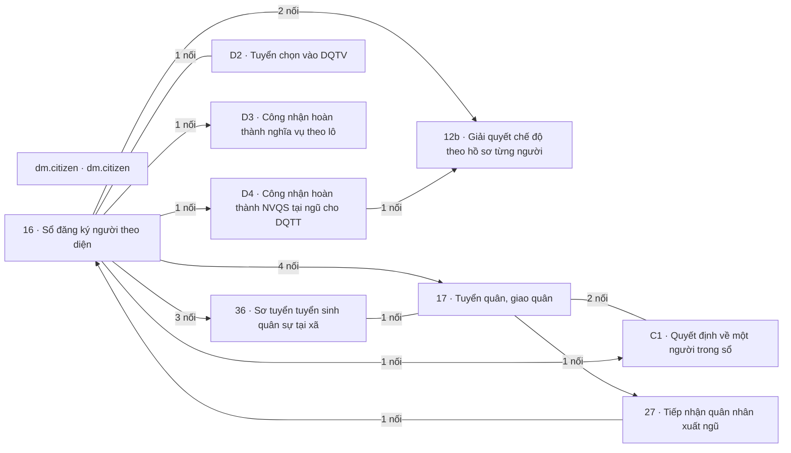

# Khối Quân lực · Người và nghĩa vụ

<!-- máy sinh: tom-tat -->
> **Khối Quân lực · Người và nghĩa vụ** — 10 quy trình, 22 tài liệu (kể cả hồ sơ phụ) · 195 bước.
>
> Khớp nối giữa các quy trình trong khối: 19 · với khối khác: 122.
>
> **Nguồn:** cộng từ các tài liệu quy trình của khối (sổ nghiệp vụ + khai báo của app) và bảng kê khớp nối. Tầng trên: [Tổng thể](00-tong-the.html). Tầng dưới: từng quy trình ở mục 1.
<!-- hết: tom-tat -->

<!-- viết tay: dien-giai -->
## Diễn giải

*Phần này viết tay, diễn giải lại điều các bảng bên dưới và các tài liệu quy trình của khối ghi.*

### Khối này lo việc gì

Khối theo dõi hồ sơ gắn với từng người: dòng Sổ nghĩa vụ của một công dân, lần tham gia dân quân tự vệ của người đó, các dòng quyết định ghi cho người đó, và hồ sơ chế độ, bồi thường của từng chiến sĩ. Bên cạnh đó là các hồ sơ theo đợt mà xã lập cho nhiều người: kỳ tuyển chọn, đợt hoàn thành nghĩa vụ, bản trình đề nghị công nhận hoàn thành nghĩa vụ quân sự tại ngũ, đợt tuyển quân. Khối còn theo dõi quyết định gọi nhập ngũ, việc tiếp nhận quân nhân xuất ngũ và thí sinh sơ tuyển vào trường Quân đội. Khối có 9 quy trình, 19 tài liệu; riêng quy trình 16 có 9 hồ sơ phụ.

### Các quy trình nối với nhau thế nào

Bốn cụm dưới đây là cách gom của phần viết tay, theo các mối nối ở mục 2 và 3. Mọi cụm đều nối về quy trình 16; không quy trình gốc nào đứng riêng trong khối.

**Cụm 1 — Sổ của người và các dòng ghi cho người.** [16 · Sổ đăng ký người theo diện](qt-16.html) giữ Sổ nghĩa vụ, mỗi dòng một công dân; dòng kết thúc ở chặng *Đã rời sổ*. [C1 · Quyết định về một người trong sổ](qt-C1.html) là một dòng quyết định đã ký, qua ba chặng *Đã ghi* → *Đã đối chiếu* → *Hết lý do tạm hoãn*. Dòng C1 mở ra có nối tới Sổ nghĩa vụ ở bước `recordPersonDutyDecision`. `16.registration-decision` là một dòng quyết định tạm hoãn hoặc miễn ghi cho một hồ sơ của 16, qua ba chặng `RECORDED` → `VERIFIED` → `USED`. Bốn hồ sơ phụ `16.military-registration`, `16.service-extension-decision`, `16.gdqp-category`, `16.gdqp-certificate` nối về Sổ nghĩa vụ hoặc Công dân trong độ tuổi, trong cùng mã quy trình 16.

**Cụm 2 — Vào và ra khỏi dân quân tự vệ.** [D2 · Tuyển chọn vào DQTV](qt-D2.html) theo dõi một kỳ tuyển chọn, kết thúc ở *Đã khép kỳ*. Kỳ gắn với Sổ nghĩa vụ ở bước *Đưa vào diện xét tuyển chọn*. `16.enlistment` theo dõi một lần tham gia của một người, mở bằng *Kết nạp từ sổ nghĩa vụ* hoặc *Kết nạp trong đợt mở rộng lực lượng*, khép ở một trong bốn chặng kết thúc. [D3 · Công nhận hoàn thành nghĩa vụ theo lô](qt-D3.html) lập một đợt cho nhiều chiến sĩ, kết thúc ở *Đã hoàn thành*; đợt mở ra có nối tới hồ sơ chiến sĩ ở bước *Lập đợt hoàn thành nghĩa vụ*. [D4 · Công nhận hoàn thành NVQS tại ngũ cho DQTT](qt-D4.html) lập một bản trình cho các chiến sĩ dân quân thường trực, kết thúc ở *Đã công nhận* hoặc *Bị trả lại*; bản trình mở ra có nối tới hồ sơ chiến sĩ ở bước lập. Hai hồ sơ phụ `16.service-exit-decision` và `16.service-extension-decision` là dòng quyết định mà ba bước cho thôi, đưa ra khỏi danh sách, kéo dài của `16.enlistment` đòi phải có.

**Cụm 3 — Chế độ của từng người.** [12b · Giải quyết chế độ theo hồ sơ từng người](qt-12b.html) theo dõi một khoản chế độ của một chiến sĩ, kết thúc ở *Đã chi trả* hoặc *Đã khép, không giải quyết*; hồ sơ phụ `12b.compensation` theo dõi một hồ sơ bồi thường thiệt hại, kết thúc ở *Đã chi trả* hoặc *Đã khép, không chi trả*. Hồ sơ bồi thường mở ra có nối tới chiến sĩ ở bước *Tiếp nhận đơn yêu cầu bồi thường*. Hồ sơ chế độ mở ra có nối tới chiến sĩ ở bước *Nộp đơn đề nghị hưởng chế độ*. Hồ sơ trợ cấp một lần mở ra từ bản trình D4 đã công nhận, ở bước *Lập hồ sơ trợ cấp một lần*.

**Cụm 4 — Nghĩa vụ quân sự: gọi nhập ngũ, xuất ngũ, dự bị, tuyển sinh.** [17 · Tuyển quân, giao quân](qt-17.html) theo dõi một đợt tuyển quân, kết thúc ở *Đã giao quân*, *Đã đóng đợt* hoặc *Đã huỷ đợt*; người trong đợt là một công dân của 16, ghi ở bước *Ghi kết quả sơ tuyển*. Hồ sơ phụ `17.conscription-call` là một quyết định gọi nhập ngũ, mở ra có nối tới công dân, kết thúc ở *Đã xuất ngũ*. Từ quyết định gọi nhập ngũ mở ra hai hồ sơ: dòng `16.service-exit-decision` (cho thôi vì có lệnh gọi nhập ngũ) và hồ sơ [27 · Tiếp nhận quân nhân xuất ngũ](qt-27.html) (ở hai bước mở của 27). Quy trình 27 kết thúc ở *Đã khép* hoặc *Đã huỷ*; từ hồ sơ 27 mở ra dòng `16.reserve-registration` ở bước *Vào sổ quân nhân dự bị từ xuất ngũ*. [36 · Sơ tuyển tuyển sinh quân sự tại xã](qt-36.html) theo dõi một thí sinh, có bốn chặng kết thúc; hồ sơ mở ra có nối tới công dân, và gắn với quyết định gọi nhập ngũ ở bước *Ghi trúng tuyển*. `16.military-registration` theo dõi việc đăng ký nghĩa vụ quân sự của một công dân, kết thúc ở *Đã đưa ra khỏi đăng ký*.

### Nhận gì từ khối khác, để lại gì cho khối khác

- [Khung chung](khoi-khung-chung.html): lần tham gia (`16.enlistment`), đợt tuyển quân (17) và kỳ tuyển chọn (D2) mở ra có nối tới Chỉ tiêu của quy trình 2; 17 gắn Kết quả trả lên cấp trên (3) ở bước đóng đợt, 36 gắn kết quả ấy ở bước gửi tỉnh. 27 mở ra có nối tới Văn bản đến là công văn báo xuất ngũ của đơn vị. Tờ trình của 12b và D2 gắn Văn bản đi ở bước trình ký.
- [Tác chiến, sẵn sàng chiến đấu](khoi-tac-chien.html): hồ sơ chế độ 12b mở ra có nối tới Lệnh điều động (13a) và Vụ việc ứng phó (20); Lệnh điều động (13a) mở ra từ chiến sĩ; lần tham gia mở ra có nối tới Đợt mở rộng lực lượng (D5), dòng Sổ nghĩa vụ gắn vào đợt ấy khi được gọi; Đợt huy động (22) mở ra từ dòng đăng ký quân nhân dự bị.
- [Hậu cần – kỹ thuật](khoi-hau-can.html): Trang phục cá nhân (D11) và Sự cố trang phục (D13) mở ra từ chiến sĩ; chiến sĩ gắn vào Dòng trang bị cấp phát (D11).
- [Huấn luyện, giáo dục](khoi-huan-luyen.html): hồ sơ chế độ mở ra có nối tới đợt huấn luyện (14); chiến sĩ được triệu tập, được cử đi huấn luyện (14); dòng C1 mở ra có nối tới lớp tập huấn (14); hồ sơ G2, G3 mở ra từ giấy chứng nhận, giấy mới cấp lại gắn ở bước cấp lại của G2.
- [Quân lực · Dự bị động viên, động viên công nghiệp](khoi-du-bi-dong-vien.html): dòng đăng ký quân nhân dự bị gắn vào Dòng sắp xếp (34); Đợt gọi (35) mở ra từ dòng ấy, người trong đợt gọi cũng gắn với dòng ấy.
- [Quân lực · Tổ chức, chỉ huy](khoi-to-chuc.html): Nhân sự Ban chỉ huy quân sự cấp xã (30) mở ra từ dòng sổ; lần tham gia mở ra có nối tới Đơn vị dân quân tự vệ (29) mà chiến sĩ được biên chế vào; Chức vụ chỉ huy (30) mở ra từ chiến sĩ.
- [Chính trị](khoi-chinh-tri.html): hồ sơ khen thưởng, Kỷ niệm chương (8), đăng ký phong trào (7), vụ việc kỷ luật (D15) mở ra từ chiến sĩ; 17 và 27 gắn Vụ việc vi phạm hành chính (10).
- [Tài chính](khoi-tai-chinh.html): Đề nghị cấp kinh phí (4) phát sinh từ hồ sơ chế độ (12b) và từ kỳ tuyển chọn (D2); mỗi dòng của Bảng thanh toán trợ cấp (12a) là hồ sơ chế độ của một người.

### Ai làm

Trợ lý Quân lực và Chỉ huy trưởng Ban CHQS xã có bước ở cả bốn cụm. Bộ CHQS cấp tỉnh có bước ở 17, 27, 36, D4. Nhân viên văn thư có bước ở 12b, D2, D3. Nhân viên tài chính kiêm hậu cần có bước ở 12b và `12b.compensation`. Trợ lý Tác huấn có bước ở `16.gdqp-category`, `16.gdqp-certificate`. Hệ thống tự làm có bước ở 16, bốn hồ sơ phụ của 16 (`enlistment`, `gdqp-category`, `gdqp-certificate`, `reserve-registration`) và `17.conscription-call`. `16.registration-decision` có hai vai `operator`, `verifier`.
<!-- hết viết tay -->

## 1. Các quy trình trong khối

<!-- máy sinh: quy-trinh -->
Cột "Để làm gì" trích câu đầu phần Diễn giải của tài liệu quy trình. Cột "Mặt công tác (app)" là chỗ app xếp quy trình ấy.

| Mã | Tên | Để làm gì | Bước | Chặng | Mặt công tác (app) |
|---|---|---|---|---|---|
| [dm.citizen](dm.citizen.html) | dm.citizen |  | 1 | 0 |  |
| [qt-12b](qt-12b.html) | Giải quyết chế độ theo hồ sơ từng người | Quy trình giải quyết **hồ sơ chế độ chính sách của từng người**: mỗi hồ sơ là một khoản chế độ của một chiến sĩ. | 31 | 13 | Quân lực |
| ↳ [qt-12b.closure](qt-12b.closure.html) | Giải quyết chế độ theo hồ sơ từng người — Lần đề nghị khép hồ sơ |  | 4 | 4 | Quân lực |
| ↳ [qt-12b.compensation](qt-12b.compensation.html) | Giải quyết chế độ theo hồ sơ từng người — Hồ sơ bồi thường thiệt hại | Quy trình giải quyết một **hồ sơ bồi thường thiệt hại** gắn với một chiến sĩ dân quân tự vệ: tiếp nhận đơn, kiểm tra tính hợp lệ, lập hồ sơ trình, Chỉ huy trưởng ký quyết định chi trả, rồi chi trả. | 7 | 6 | Quân lực |
| [qt-16](qt-16.html) | Sổ đăng ký người theo diện | Quy trình giữ **Sổ nghĩa vụ**: mỗi dòng là một công dân, kèm diện đăng ký của người đó (bốn diện). | 23 | 7 | Quân lực |
| ↳ [qt-16.enlistment](qt-16.enlistment.html) | Sổ đăng ký người theo diện — Chiến sĩ dân quân tự vệ | Theo dõi **một lần tham gia dân quân tự vệ của một người** (hồ sơ *Chiến sĩ dân quân tự vệ*), từ lúc kết nạp tới lúc lần tham gia ấy khép lại. | 17 | 5 | Quân lực |
| ↳ [qt-16.gdqp-category](qt-16.gdqp-category.html) | Nhóm đối tượng bồi dưỡng của người | Mỗi hồ sơ là **một dòng nhóm đối tượng bồi dưỡng của một người**: người ấy thuộc nhóm đối tượng nào, căn cứ chức vụ gì, theo văn bản nào, từ ngày nào. | 2 | 2 | Quân lực |
| ↳ [qt-16.gdqp-certificate](qt-16.gdqp-certificate.html) | Giấy chứng nhận hoàn thành bồi dưỡng kiến thức QP&AN | Mỗi hồ sơ là **một giấy chứng nhận hoàn thành bồi dưỡng kiến thức QP&AN của một người**: số hiệu, chương trình, ngày cấp. | 6 | 5 | Quân lực |
| ↳ [qt-16.military-registration](qt-16.military-registration.html) | Đăng ký nghĩa vụ quân sự | Ban CHQS xã theo dõi **việc đăng ký nghĩa vụ quân sự của một công dân**: từ lúc có tên trong danh sách công dân đến tuổi đăng ký, được gọi đăng ký, đăng ký và nhận giấy chứng nhận, cho tới khi chuyển đi xã khác hoặc bị đưa ra khỏi đăng ký. | 7 | 5 | Quân lực |
| ↳ [qt-16.position-held](qt-16.position-held.html) | Chức vụ của công dân |  | 9 | 5 | Quân lực |
| ↳ [qt-16.registration-decision](qt-16.registration-decision.html) | Sổ nghĩa vụ | Mỗi hồ sơ là một **dòng quyết định** gắn với một hồ sơ Sổ đăng ký người theo diện (qt-16), gồm ba ô: loại quyết định (`decisionKind`: `deferment` hoặc `exemption`), trường hợp (`decisionGround`) và điểm căn cứ (`decisionBasisPoint`). | 3 | 3 | Quân lực |
| ↳ [qt-16.reserve-registration](qt-16.reserve-registration.html) | Đăng ký quân nhân dự bị | Mỗi hồ sơ là **một dòng đăng ký ngạch dự bị của một người** trong sổ quân nhân dự bị của xã: vào sổ từ đâu, số giấy chứng nhận đăng ký quân nhân dự bị, phiếu quân nhân dự bị, ngày đăng ký. | 7 | 2 | Quân lực |
| ↳ [qt-16.service-exit-decision](qt-16.service-exit-decision.html) | Dòng quyết định cho thôi, đưa ra khỏi danh sách | Mỗi hồ sơ là **một dòng quyết định cho thôi trước thời hạn hoặc đưa ra khỏi danh sách, ghi cho một người**: loại quyết định, trường hợp của người đó, điểm căn cứ, số quyết định của Chủ tịch Uỷ ban nhân dân cấp xã, bản chụp quyết định đã ký và nguồn chứng cứ. | 3 | 3 | Quân lực |
| ↳ [qt-16.service-extension-decision](qt-16.service-extension-decision.html) | Dòng quyết định kéo dài | Mỗi hồ sơ là **một dòng quyết định kéo dài ghi cho một người**: số quyết định của Chủ tịch Uỷ ban nhân dân cấp xã, bản chụp quyết định đã ký, hạn mới của người đó (kéo dài đến hết ngày nào) và nhóm của người đó. | 3 | 3 | Quân lực |
| [qt-17](qt-17.html) | Tuyển quân, giao quân | Ban CHQS xã theo dõi một **đợt tuyển quân** của một năm nhập ngũ, từ lúc mở đợt tới lúc giao quân xong và đóng đợt. | 18 | 9 | Quân lực |
| ↳ [qt-17.conscription-call](qt-17.conscription-call.html) | Tuyển quân, giao quân — Quyết định gọi nhập ngũ | Mỗi hồ sơ là **một quyết định gọi nhập ngũ của một công dân**, do Trợ lý Quân lực ghi. | 6 | 5 | Quân lực |
| [qt-27](qt-27.html) | Tiếp nhận quân nhân xuất ngũ | Theo dõi việc **tiếp nhận một quân nhân xuất ngũ**: tỉnh nhận công văn báo xuất ngũ của đơn vị, ghi nhận bàn giao; xã ghi quân nhân đã về và đăng ký phục vụ trong ngạch dự bị; tỉnh khép hồ sơ. | 10 | 7 | Quân lực |
| [qt-36](qt-36.html) | Sơ tuyển tuyển sinh quân sự tại xã | Xã và Bộ CHQS cấp tỉnh theo dõi **một thí sinh sơ tuyển vào trường Quân đội** — mỗi thí sinh một hồ sơ. | 12 | 8 | Quân lực |
| [qt-C1](qt-C1.html) | Quyết định về một người trong sổ | Mỗi hồ sơ là **một dòng quyết định về một người**, ghi vào hệ sau khi quyết định đã được ký: loại quyết định, số quyết định, ngày ký, bản chụp quyết định đã ký. | 2 | 2 | Quân lực |
| [qt-D2](qt-D2.html) | Tuyển chọn vào DQTV | Ban CHQS xã theo dõi một **kỳ tuyển chọn** vào dân quân tự vệ của một năm: đưa người trong sổ nghĩa vụ vào diện xét, khám sức khoẻ, ghi đơn vị cho từng người, trình Chủ tịch Uỷ ban nhân dân cấp xã ký quyết định, rồi kết nạp và khép kỳ. | 11 | 6 | Quân lực |
| [qt-D3](qt-D3.html) | Công nhận hoàn thành nghĩa vụ theo lô | Ban CHQS xã lập một **đợt hoàn thành nghĩa vụ** cho nhiều chiến sĩ cùng lúc: gom danh sách, làm tờ trình, Chỉ huy trưởng ký, gửi Chủ tịch Uỷ ban nhân dân cấp xã, ghi quyết định công nhận đã ký, rồi đối chiếu và hoàn thành cho cả đợt. | 7 | 4 | Quân lực |
| [qt-D4](qt-D4.html) | Công nhận hoàn thành NVQS tại ngũ cho DQTT | Ban CHQS xã lập một **bản trình đề nghị công nhận hoàn thành nghĩa vụ quân sự tại ngũ** cho các chiến sĩ dân quân thường trực đủ điều kiện, lấy chữ ký đề nghị của Chủ tịch xã (ngoài hệ), gửi Bộ CHQS tỉnh, và nhận kết quả công nhận. | 6 | 4 | Quân lực |
<!-- hết: quy-trinh -->

## 2. Sơ đồ mối nối trong khối

<!-- máy sinh: so-do -->

Có mũi tên: trong các mối nối của cặp ấy có ít nhất một mối do **bước tạo hồ sơ** ghi, mũi tên chỉ về quy trình có hồ sơ được mở ra; các mối còn lại của cặp có thể là gắn giữa chừng — xem từng dòng ở mục 3. Không mũi tên: gắn nhau ở bước giữa chừng. Hồ sơ phụ gộp về quy trình gốc.
<!-- hết: so-do -->

## 3. Khớp nối giữa các quy trình trong khối

<!-- máy sinh: khop-noi-trong -->
| Ô nối | Từ (quy trình · hồ sơ) | Tới | Nội dung (mô tả trong app) | Bước ghi mối nối |
|---|---|---|---|---|
| `claimFor` | 12b · Hồ sơ chế độ chính sách | 16.enlistment · Chiến sĩ dân quân tự vệ | Hồ sơ chế độ của chiến sĩ nào | 12b·raiseAllowanceFromServiceRecognition ⊕, 12b·submitClaim ⊕ |
| `allowanceFromServiceRecognition` | 12b · Hồ sơ chế độ chính sách | D4 · Đề nghị công nhận hoàn thành nghĩa vụ quân sự tại ngũ | Hồ sơ trợ cấp một lần lập từ bản trình đã được công nhận hoàn thành NVQS tại ngũ (L48/2019/QH14 Đ.34 k1 c) | 12b·raiseAllowanceFromServiceRecognition ⊕ |
| `compensationCaseFor` | 12b.compensation · Hồ sơ bồi thường thiệt hại | 16.enlistment · Chiến sĩ dân quân tự vệ | Hồ sơ bồi thường thiệt hại của chiến sĩ nào — TT75/2020/TT-BQP Điều 7 | 12b.compensation·fileCompensation ⊕ |
| `candidateInDrive` | 16 · Sổ nghĩa vụ | D2 · Kỳ tuyển chọn | Dòng sổ nghĩa vụ được xét trong những kỳ tuyển chọn nào | D2·addCandidates |
| `exitDueSourceConscriptionCall` | 16.enlistment · Chiến sĩ dân quân tự vệ | 17.conscription-call · Quyết định gọi nhập ngũ | Cờ chờ quyết định cho thôi — quyết định gọi nhập ngũ của người đã giao quân (Luật Đ.12 k1 d) | — |
| `exitDueSourceAdmission` | 16.enlistment · Chiến sĩ dân quân tự vệ | 36 · Thí sinh sơ tuyển vào trường Quân đội | Cờ chờ quyết định cho thôi — hồ sơ trúng tuyển trường Quân đội hệ quân sự (Luật Đ.12 k1 đ) | — |
| `registeredFromDischarge` | 16.reserve-registration · Đăng ký quân nhân dự bị | 27 · Tiếp nhận quân nhân xuất ngũ | Dòng đăng ký ngạch dự bị sinh từ hồ sơ tiếp nhận xuất ngũ nào (qt-27) | 16.reserve-registration·registerReserveFromDischarge ⊕ |
| `exitCausedByConscriptionCall` | 16.service-exit-decision · Dòng quyết định cho thôi, đưa ra khỏi danh sách | 17.conscription-call · Quyết định gọi nhập ngũ | Cho thôi vì có lệnh gọi nhập ngũ — chứng cứ là quyết định gọi nhập ngũ đã ghi trên hệ (Luật Đ.12 k1 d) | — |
| `exitCausedByAdmission` | 16.service-exit-decision · Dòng quyết định cho thôi, đưa ra khỏi danh sách | 36 · Thí sinh sơ tuyển vào trường Quân đội | Cho thôi vì vào học — chứng cứ là hồ sơ trúng tuyển trường Quân đội trên hệ (Luật Đ.12 k1 đ) | — |
| `driveCitizen` | 17 · Người trong đợt tuyển quân | 16 · Công dân trong độ tuổi | Người trong đợt là công dân nào — chọn từ kho, không gõ tay | 17·preScreenCitizen · đòi: 17·preScreenCitizen |
| `postedRulingDocument` | 17 · Đợt tuyển quân | C1 · Dòng quyết định về một người | Quyết định tạm hoãn, miễn gọi nhập ngũ của đợt mà xã đã niêm yết — sổ qt-17 link.postedRulingDocument | 17·recordDefermentListPosted |
| `callOfCitizen` | 17.conscription-call · Quyết định gọi nhập ngũ | 16 · Công dân trong độ tuổi | Quyết định gọi nhập ngũ gọi công dân nào — chọn từ kho, không gõ tay | 17.conscription-call·openCallFromOnboarding ⊕, 17.conscription-call·recordConscriptionCall ⊕ |
| `intakeCoversServiceRecord` | 27 · Tiếp nhận quân nhân xuất ngũ | 17.conscription-call · Quyết định gọi nhập ngũ | Quyết định gọi nhập ngũ của quân nhân được tiếp nhận (sổ qt-27) | 27·addToDischargeNotice ⊕, 27·receiveDischargeNotice ⊕ |
| `candidateCitizen` | 36 · Thí sinh sơ tuyển vào trường Quân đội | 16 · Công dân trong độ tuổi | Thí sinh là công dân nào | 36·registerCandidate ⊕ |
| `candidateCalledBy` | 36 · Thí sinh sơ tuyển vào trường Quân đội | 17.conscription-call · Quyết định gọi nhập ngũ | Người trúng tuyển hệ quân sự được gọi nhập ngũ theo quyết định nào (qt-17) — "đánh dấu sổ NVQS" của sổ qt-36 | — |
| `personDecisionOfRegistration` | C1 · Dòng quyết định về một người | 16 · Sổ nghĩa vụ | Dòng quyết định về một người thuộc hồ sơ người nào — một người nhiều quyết định trong đời (76_ người làm gốc) | C1·recordPersonDutyDecision ⊕ · đòi: C1·recordPersonDutyDecision |
| `personDecisionOfDrive` | C1 · Dòng quyết định về một người | 17 · Đợt tuyển quân | Dòng quyết định tạm hoãn, miễn gọi nhập ngũ thuộc đợt tuyển quân nào — danh sách xã gửi lên tỉnh của đợt ấy | — |
| `serviceCompletionCoversMember` | D3 · Đợt hoàn thành nghĩa vụ | 16.enlistment · Chiến sĩ dân quân tự vệ | Đồng chí trong đợt — chỉ người đã phục vụ đủ thời hạn (L48/2019/QH14 Đ.8 k2, Đ.13 k1) | D3·gatherServiceCompletionBatch ⊕ |
| `recognitionProposalCovers` | D4 · Đề nghị công nhận hoàn thành nghĩa vụ quân sự tại ngũ | 16.enlistment · Chiến sĩ dân quân tự vệ | Chiến sĩ có tên trong bản trình đề nghị công nhận hoàn thành nghĩa vụ quân sự tại ngũ (L78/2015/QH13 Điều 4 k… | D4·draftServiceRecognitionProposal ⊕ |

19 khớp nối. ⊕ là bước tạo hồ sơ. Bảng kê mối nối giữa hai mã quy trình khác nhau; mối nối giữa hồ sơ chính và hồ sơ phụ của cùng một mã xem tài liệu quy trình.
<!-- hết: khop-noi-trong -->

## 4. Khớp nối với khối khác

<!-- máy sinh: khop-noi-ngoai -->
| Khối kia | Số khớp nối | Quy trình của khối này ↔ quy trình khối kia |
|---|---|---|
| [Khung chung](khoi-khung-chung.html) | 57 | 12b ↔ 1 (11), 12b ↔ D16 (2), 16 ↔ 1 (9), 16 ↔ 2 (1), 16 ↔ D16 (1), 17 ↔ 1 (10), 17 ↔ 2 (1), 17 ↔ 3 (1), 27 ↔ 1 (3), 36 ↔ 1 (2), 36 ↔ 3 (1), C1 ↔ 1 (2), D2 ↔ 1 (3), D2 ↔ 2 (1), D3 ↔ 1 (3), D4 ↔ 1 (6) |
| [Tác chiến, sẵn sàng chiến đấu](khoi-tac-chien.html) | 12 | 12b ↔ 13a (1), 12b ↔ 13b (1), 12b ↔ 20 (1), 16 ↔ 13a (2), 16 ↔ 13b (1), 16 ↔ 20 (2), 16 ↔ 22 (2), 16 ↔ D5 (2) |
| [Hậu cần – kỹ thuật](khoi-hau-can.html) | 8 | 12b ↔ D13 (2), 16 ↔ D11 (2), 16 ↔ D12 (1), 16 ↔ D13 (3) |
| [Huấn luyện, giáo dục](khoi-huan-luyen.html) | 15 | 12b ↔ 14 (1), 16 ↔ 14 (4), 16 ↔ 18 (1), 16 ↔ G1 (4), 16 ↔ G2 (2), 16 ↔ G3 (1), 16 ↔ cadre-qualification (1), C1 ↔ 14 (1) |
| [Quân lực · Dự bị động viên, động viên công nghiệp](khoi-du-bi-dong-vien.html) | 3 | 16 ↔ 34 (1), 16 ↔ 35 (2) |
| [Quân lực · Tổ chức, chỉ huy](khoi-to-chuc.html) | 5 | 16 ↔ 29 (2), 16 ↔ 30 (2), 16 ↔ system-onboarding (1) |
| [Chính trị](khoi-chinh-tri.html) | 17 | 12b ↔ D15 (1), 16 ↔ 7 (1), 16 ↔ 8 (2), 16 ↔ 10 (3), 16 ↔ D15 (5), 17 ↔ 10 (2), 27 ↔ 10 (2), C1 ↔ D15 (1) |
| [Tài chính](khoi-tai-chinh.html) | 4 | 12b ↔ 4 (1), 12b ↔ 12a (2), D2 ↔ 4 (1) |
| sổ ngày công | 1 | 16 ↔ sổ ngày công (1) |

122 khớp nối với khối khác. Số trong ngoặc là số ô nối của cặp quy trình. Hồ sơ phụ gộp về quy trình gốc. Từng ô nối và chiều của nó: mục 10 của tài liệu quy trình.
<!-- hết: khop-noi-ngoai -->

## 5. Ai làm

<!-- máy sinh: vai-tro -->
| Người làm | Có bước ở quy trình |
|---|---|
| Trợ lý Quân lực | 12b, 12b.closure, 16, 16.enlistment, 16.military-registration, 16.position-held, 16.registration-decision, 16.reserve-registration, 16.service-exit-decision, 16.service-extension-decision, 17, 17.conscription-call, 27, 36, C1, D2, D3, D4 |
| Chỉ huy trưởng Ban CHQS xã | 12b, 12b.closure, 12b.compensation, 16, 16.enlistment, 16.gdqp-certificate, 16.military-registration, 16.position-held, 16.registration-decision, 16.service-exit-decision, 16.service-extension-decision, 17, C1, D2, D3 |
| Hệ thống tự làm | 12b, 16, 16.enlistment, 16.gdqp-category, 16.gdqp-certificate, 16.position-held, 16.reserve-registration, 17, 17.conscription-call, 36, D4, dm.citizen |
| Bộ CHQS cấp tỉnh | 17, 27, 36, D4 |
| Nhân viên văn thư | 12b, D2, D3 |
| Nhân viên tài chính kiêm hậu cần | 12b, 12b.compensation |
| Trợ lý Tác huấn | 16.gdqp-category, 16.gdqp-certificate |

*Tên người làm là tên app đặt cho mã chủ thể của vai; vai không có mã chủ thể thì in bằng mã (`…`). Quy trình chạy ở nhiều cấp thì người làm là người giữ vai ấy ở đơn vị nêu trong tài liệu quy trình.*
<!-- hết: vai-tro -->
