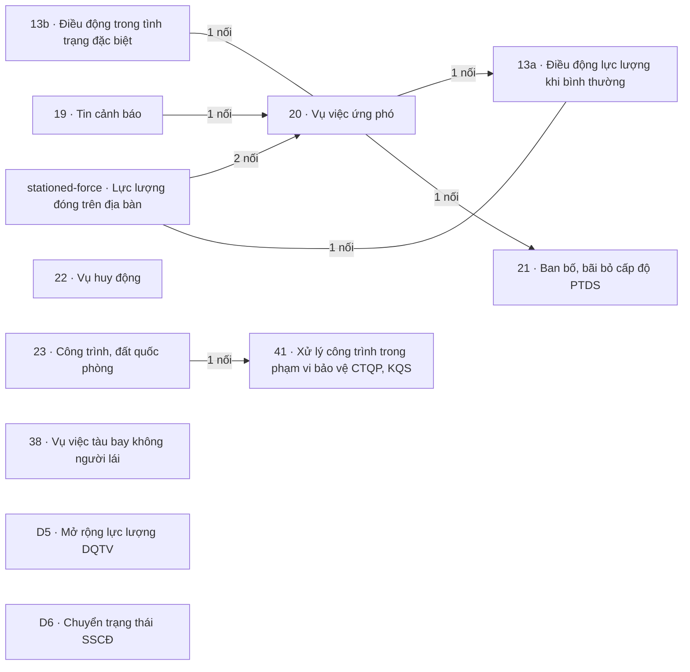

# Khối Tác chiến, sẵn sàng chiến đấu

<!-- máy sinh: tom-tat -->
> **Khối Tác chiến, sẵn sàng chiến đấu** — 12 quy trình, 13 tài liệu (kể cả hồ sơ phụ) · 173 bước.
>
> Khớp nối giữa các quy trình trong khối: 8 · với khối khác: 114.
>
> **Nguồn:** cộng từ các tài liệu quy trình của khối (sổ nghiệp vụ + khai báo của app) và bảng kê khớp nối. Tầng trên: [Tổng thể](00-tong-the.html). Tầng dưới: từng quy trình ở mục 1.
<!-- hết: tom-tat -->

<!-- viết tay: dien-giai -->
## Diễn giải

*Phần này viết tay, diễn giải lại điều các bảng bên dưới và các tài liệu quy trình của khối ghi.*

### Khối này lo việc gì

Khối gồm 12 quy trình, 13 tài liệu. Các hồ sơ nó theo dõi: tin cảnh báo, vụ việc ứng phó (kèm tài sản mượn của dân và cấp độ phòng thủ dân sự của vụ việc), lệnh điều động khi bình thường và trong tình trạng đặc biệt, lực lượng đóng trên địa bàn, đợt huy động lực lượng dự bị động viên, đợt mở rộng lực lượng, trạng thái sẵn sàng chiến đấu của địa bàn, công trình và đất quốc phòng, công trình nằm trong phạm vi bảo vệ, vụ tàu bay không người lái. Theo mục 2 và 3, sáu quy trình nối với nhau, đều quanh hồ sơ vụ việc ứng phó; sáu quy trình còn lại đứng riêng trong khối.

### Các quy trình nối với nhau thế nào

**Cụm quanh vụ việc ứng phó** — gom theo sáu cặp nối ở mục 2, cặp nào cũng có 20 hoặc 13a ở một đầu.

- [19 · Tin cảnh báo](qt-19.html) ghi một tin nhận được và theo tới một trong ba kết luận: có thật, không có căn cứ, đã chuyển cơ quan khác. Tin ở chặng *Đã xác minh, có thật* thì mở được vụ việc ứng phó; vụ việc ghi nó mở từ tin cảnh báo nào.
- [20 · Vụ việc ứng phó](qt-20.html) theo một vụ việc từ lúc mở tới lúc khép và chốt ngày công; kết thúc ở *Đã kết thúc*. Hồ sơ phụ [Tài sản đã huy động của dân](qt-20.mobilized-asset.html) theo từng món tài sản mượn của dân tới khi hoàn trả hoặc bồi thường xong; bước **Kê tài sản đã huy động** nối nó tới vụ việc.
- [21 · Ban bố, bãi bỏ cấp độ PTDS](qt-21.html) theo cấp độ phòng thủ dân sự của một vụ việc, kết thúc ở *Đã bãi bỏ*. Hồ sơ 21 mở ra có nối tới vụ việc ở hai bước tạo hồ sơ: **Đề xuất ban bố cấp độ phòng thủ dân sự** và **Ghi nhận quyết định ban bố theo chỉ đạo của cấp trên**.
- [13b · Điều động trong tình trạng đặc biệt](qt-13b.html) theo một lần điều động theo lệnh cấp có thẩm quyền, tới *Đã kết thúc* rồi khoá ngày công, lập chế độ. Nó gắn vào vụ việc ở một bước giữa chừng, **Gắn vào vụ việc ứng phó**.
- [13a · Điều động lực lượng khi bình thường](qt-13a.html) theo một lệnh điều động: lập dự thảo, xin đủ nhất trí, ký lệnh, cấp số, triển khai, báo cáo kết quả, rồi khoá số ngày và lập trợ cấp ngày công. Hồ sơ mở bằng **Lập lệnh điều động** hoặc **Nhận quyết định điều động của cấp trên**, kết thúc ở *Đã hoàn thành, đã báo cáo* hoặc *Đã huỷ dự thảo*. Lệnh điều động có thể phát sinh từ một vụ việc ứng phó.
- [Lực lượng đóng trên địa bàn](ngoai63.stationed-force.html) ghi một lực lượng trên địa bàn qua các chặng ghi nhận, trao đổi thống nhất, vào quy chế phối hợp, rà soát, tới *Đã rút khỏi địa bàn*. Vụ việc 20 nối tới lực lượng mà nó có hiệp đồng hoặc đã đề nghị huy động, ở bước **Ghi nhận hiệp đồng**, và nối tới bên chủ trì phối hợp trong vụ việc. Lệnh điều động 13a nối tới lực lượng mà nhiệm vụ có phối hợp, hoặc đã đề nghị UBND huy động.

**Sáu quy trình đứng riêng trong khối**, không nối với quy trình nào khác của khối.

- [22 · Vụ huy động](qt-22.html) theo một đợt huy động lực lượng dự bị động viên từ bộ lệnh lập sẵn tới *Đã tiếp nhận lại* hoặc *Đã huỷ*.
- [23 · Công trình, đất quốc phòng](qt-23.html) theo một công trình, mảnh đất: quỹ đất, đầu tư, vào sổ tài sản, quản lý, sửa chữa, thu hồi.
- [38 · Vụ việc tàu bay không người lái](qt-38.html) ghi một vụ từ lúc có tin tới *Đã khép*: kiểm tra phép bay, đình chỉ bay, gây nhiễu – buộc hạ cánh – thu giữ, rồi bàn giao thiết bị.
- [41 · Xử lý công trình trong phạm vi bảo vệ CTQP, KQS](qt-41.html): mỗi công trình nằm trong phạm vi bảo vệ công trình quốc phòng, khu quân sự là một hồ sơ.
- [D5 · Mở rộng lực lượng DQTV](qt-D5.html) theo một đợt mở rộng từ lúc nhận lệnh tới *Đã giải thể* hoặc *Đã huỷ*.
- [D6 · Chuyển trạng thái SSCĐ](qt-D6.html) giữ một hồ sơ cho mỗi địa bàn, chuyển qua lại giữa bốn mức. Điều kiện mở đợt của D5 (mục 7 của D5) đòi một hồ sơ D6 đang ở chặng `high` hoặc `full`.

### Nhận gì từ khối khác, để lại gì cho khối khác

- [Khung chung](khoi-khung-chung.html) (24 khớp nối). 13a, 23, D5 mở ra có nối tới Nhiệm vụ trên giao (1); 23 và D5 còn nối tới Kế hoạch, văn kiện (2). 13a mở ra có nối tới Văn bản đến ở cửa nhận quyết định của cấp trên; 13b gắn Văn bản đến ở bước **Gắn văn bản lệnh cấp trên**, 22 ở bước **Ghi số, phát lệnh**. Văn bản đi gắn vào hồ sơ ở bước trình ký tờ trình — **Trình ký tờ trình điều động** của 13a, **Trình ký tờ trình đầu tư** của 23, **Chốt danh sách, trình ký** của D5 — và ở bước **Báo cáo tình hình lên Bộ CHQS tỉnh** của 13b. Vụ việc 20 gắn tới Kế hoạch, văn kiện ở bước **Lập phương án hiệp đồng**; Báo cáo đột xuất (6) mở ra từ vụ việc 20. Lực lượng đóng trên địa bàn gắn tới văn kiện ở bước **Ghi nhận đã vào quy chế phối hợp**, và tới tình huống dự kiến của kế hoạch.
- [Quân lực · Người và nghĩa vụ](khoi-nguoi-nghia-vu.html) (10). Hồ sơ chế độ chính sách (12b) mở ra từ lệnh điều động 13a và từ vụ việc 20. Lệnh 13a lúc lập có nối tới Chiến sĩ dân quân tự vệ được điều động. Ở D5, dòng sổ nghĩa vụ gắn vào đợt ở bước **Chọn người từ sổ nghĩa vụ**, rồi Lần tham gia của chiến sĩ (16.enlistment) mở ra từ đợt. Bộ lệnh của 22 mở ra có nối tới Đăng ký quân nhân dự bị.
- [Hậu cần – kỹ thuật](khoi-hau-can.html) (2). Phiếu cấp phát huấn luyện (D11) mở ra từ vụ việc 20.
- [Quân lực · Tổ chức, chỉ huy](khoi-to-chuc.html) (3). 23 mở ra có nối tới đơn vị quản lý công trình (29).
- [Tài chính](khoi-tai-chinh.html) (7). Đề nghị cấp kinh phí phát sinh từ lệnh điều động 13a, vụ việc 20, công trình 23, đợt mở rộng D5; bảng thanh toán trợ cấp lập từ lệnh điều động 13a và từ vụ việc 20.
- [Chính trị](khoi-chinh-tri.html) (1): vụ vi phạm lập cho người vắng không lý do khi huy động (22 ↔ 10). [Huấn luyện, giáo dục](khoi-huan-luyen.html) (1): Lực lượng đóng trên địa bàn ↔ 14.
- Sổ ngày công: ngày công của vụ việc 20 ghi vào ở bước **Chốt ngày công của vụ việc**.

### Ai làm

Theo mục 5: Chỉ huy trưởng Ban CHQS xã có bước ở mọi quy trình của cụm vụ việc ứng phó (kể cả hồ sơ tài sản huy động của dân) và ở 22, 23, D5. Trợ lý Tác huấn có bước ở cả cụm ấy và ở 38, D6. Trợ lý Quân lực: 13a, 13b, 20, 22, D5. Nhân viên văn thư: 13a, 13b, 23, D5. Bộ CHQS cấp tỉnh: 13a, 13b, 23. Chủ tịch UBND cấp tỉnh và Nhân viên tài chính kiêm hậu cần: 23. Hệ thống tự làm: 13a, D6. `assistant`: D6. `commune`, `province`: 41.
<!-- hết viết tay -->

## 1. Các quy trình trong khối

<!-- máy sinh: quy-trinh -->
Cột "Để làm gì" trích câu đầu phần Diễn giải của tài liệu quy trình. Cột "Mặt công tác (app)" là chỗ app xếp quy trình ấy.

| Mã | Tên | Để làm gì | Bước | Chặng | Mặt công tác (app) |
|---|---|---|---|---|---|
| [ngoai63.stationed-force](ngoai63.stationed-force.html) | Lực lượng đóng trên địa bàn | Hồ sơ ghi một **lực lượng đóng trên địa bàn** — có chín loại: Công an cùng cấp, Trạm Biên phòng, Đơn vị Quân đội, Ban CHQS cơ quan, tổ chức, Người đứng đầu cơ quan, tổ chức, Kiểm lâm, Chủ rừng, Căn cứ, khu quân sự, Lực lượng khác trên địa bàn — và theo lực lượng ấy qua các chặng: ghi nhận, đã trao đổi thống nhất,… | 8 | 5 |  |
| [qt-13a](qt-13a.html) | Điều động lực lượng khi bình thường | Quy trình theo dõi một **Lệnh điều động** (tên gọi trên hệ: "Chặng 3 — Điều động làm nhiệm vụ"): lập dự thảo, xin đủ nhất trí, ký lệnh, cấp số, triển khai, báo cáo kết quả, rồi khoá số ngày và lập trợ cấp ngày công. | 24 | 8 | Tác chiến |
| [qt-13b](qt-13b.html) | Điều động trong tình trạng đặc biệt | Ban CHQS xã theo dõi một lần **điều động trong tình trạng đặc biệt** theo lệnh của cấp có thẩm quyền: nhận lệnh, Chỉ huy trưởng ra mệnh lệnh điều động, bố trí người, báo cáo tình hình trong lúc làm, nhận người và vũ khí về, rồi khoá ngày công và lập chế độ. | 14 | 6 | Tác chiến |
| [qt-19](qt-19.html) | Tin cảnh báo | Ban CHQS xã ghi lại một **tin cảnh báo, báo động** nhận được và theo nó tới khi có kết luận: tin có thật, tin không có căn cứ, hay tin không thuộc việc của dân quân nên chuyển cơ quan khác. | 5 | 5 | Tác chiến |
| [qt-20](qt-20.html) | Vụ việc ứng phó | Theo dõi một **vụ việc ứng phó** từ lúc mở tới lúc khép: chọn đơn vị và phương tiện, ghi diễn biến, phối hợp với lực lượng khác, đề nghị huy động thêm, thống kê thiệt hại, rồi chốt ngày công. | 19 | 5 | Tác chiến |
| ↳ [qt-20.mobilized-asset](qt-20.mobilized-asset.html) | Vụ việc ứng phó — Tài sản đã huy động của dân | Theo dõi từng **món tài sản mượn của dân khi ứng phó** một vụ việc — ví dụ xuồng máy, xe tải, máy phát điện — cho tới khi trả lại chủ sở hữu hoặc bồi thường xong. | 7 | 4 | Tác chiến |
| [qt-21](qt-21.html) | Ban bố, bãi bỏ cấp độ PTDS | Theo dõi **cấp độ phòng thủ dân sự của một vụ việc ứng phó**: đề xuất ban bố, ghi quyết định ban bố đã ký, công bố và báo cáo cấp trên, đổi thời hạn áp dụng, rồi đề xuất và ghi quyết định bãi bỏ. | 18 | 8 | Tác chiến |
| [qt-22](qt-22.html) | Vụ huy động | Theo dõi một **đợt huy động lực lượng dự bị động viên**: lập sẵn bộ lệnh có tên từng quân nhân dự bị (lệnh để trống số, chờ quyết định huy động của cấp có thẩm quyền), rồi ghi số, phát lệnh, ghi kết quả giao lệnh tới từng người, ghi ai có mặt tại nơi tập trung, bàn giao cho đơn vị nhận quân, và tiếp nhận lại khi lực… | 10 | 7 | Quân lực |
| [qt-23](qt-23.html) | Công trình, đất quốc phòng | Theo dõi một **công trình, mảnh đất quốc phòng**: xin quỹ đất, xin đầu tư xây dựng, ghi vào sổ tài sản, rồi quản lý, sửa chữa và thu hồi. | 34 | 16 | Tác chiến |
| [qt-38](qt-38.html) | Vụ việc tàu bay không người lái | Trợ lý Tác huấn ghi lại một **vụ tàu bay không người lái** từ lúc có tin tới lúc khép: kiểm tra phép bay, đình chỉ bay, gây nhiễu – buộc hạ cánh – thu giữ, rồi bàn giao thiết bị. | 6 | 4 | Tác chiến |
| [qt-41](qt-41.html) | Xử lý công trình trong phạm vi bảo vệ CTQP, KQS | Mỗi công trình nằm trong phạm vi bảo vệ công trình quốc phòng, khu quân sự là một hồ sơ. | 9 | 6 | Tác chiến |
| [qt-D5](qt-D5.html) | Mở rộng lực lượng DQTV | Ban CHQS xã theo dõi một **đợt mở rộng lực lượng** từ lúc nhận lệnh tới lúc lực lượng mở rộng giải thể: mở đợt theo lệnh, chọn người từ sổ nghĩa vụ, trình Chủ tịch Uỷ ban nhân dân cấp xã danh sách, ghi quyết định về, gọi người vào lực lượng, rồi giải thể khi có lệnh bãi bỏ. | 9 | 7 | Tác chiến |
| [qt-D6](qt-D6.html) | Chuyển trạng thái SSCĐ | Mỗi địa bàn (xã, tỉnh, quân khu, toàn quốc) có một hồ sơ ghi **trạng thái sẵn sàng chiến đấu** hiện tại của nó. | 10 | 4 | Tác chiến |
<!-- hết: quy-trinh -->

## 2. Sơ đồ mối nối trong khối

<!-- máy sinh: so-do -->

Có mũi tên: trong các mối nối của cặp ấy có ít nhất một mối do **bước tạo hồ sơ** ghi, mũi tên chỉ về quy trình có hồ sơ được mở ra; các mối còn lại của cặp có thể là gắn giữa chừng — xem từng dòng ở mục 3. Không mũi tên: gắn nhau ở bước giữa chừng. Hồ sơ phụ gộp về quy trình gốc.
<!-- hết: so-do -->

## 3. Khớp nối giữa các quy trình trong khối

<!-- máy sinh: khop-noi-trong -->
| Ô nối | Từ (quy trình · hồ sơ) | Tới | Nội dung (mô tả trong app) | Bước ghi mối nối |
|---|---|---|---|---|
| `arisesFromCase` | 13a · Lệnh điều động | 20 · Vụ việc ứng phó | Lệnh điều động phát sinh từ vụ việc ứng phó — tái dùng luồng điều động của Chặng 3 | 13a·proposeDeployment ⊕ |
| `coordinatesWith` | 13a · Lệnh điều động | stationed-force · Lực lượng đóng trên địa bàn | Nhiệm vụ có phối hợp, hoặc đã đề nghị UBND huy động lực lượng này — NĐ02/2020 Đ.4; Luật PTDS Đ.21 k2 | 13a·recordCoordination, 13a·requestMobilization |
| `specialDeploymentForCase` | 13b · Điều động trong tình trạng đặc biệt | 20 · Vụ việc ứng phó | Điều động gắn vào vụ việc ứng phó qt-20 — người dùng 30/9/2026 phương án (A) | 13b·linkResponseCase |
| `triggeredBy` | 20 · Vụ việc ứng phó | 19 · Tin cảnh báo, báo động | Vụ việc mở từ tin cảnh báo nào | 20·openCase ⊕ |
| `caseCoordinatesWith` | 20 · Vụ việc ứng phó | stationed-force · Lực lượng đóng trên địa bàn | Vụ việc ứng phó có hiệp đồng, hoặc đã đề nghị huy động lực lượng này — NĐ02/2020 Đ.9–Đ.22; L18/2023 Đ.21 k2 | 20·openCase ⊕, 20·recordCaseCoordination, 20·requestCaseMobilizationRequestSignature |
| `caseLedBy` | 20 · Vụ việc ứng phó | stationed-force · Lực lượng đóng trên địa bàn | Bên chủ trì phối hợp trong vụ việc này — NĐ02/2020 Đ.20 k2, Đ.21 k2 (cháy rừng: Kiểm lâm; cháy nổ: Công an) | 20·openCase ⊕ |
| `defenceLevelOfCase` | 21 · Cấp độ phòng thủ dân sự của vụ việc | 20 · Vụ việc ứng phó | Hồ sơ cấp độ phòng thủ dân sự của vụ việc ứng phó nào — NĐ200/2025 Đ.14, Đ.15 | 21·proposeDefenceLevel ⊕, 21·recordDirectedDefenceLevel ⊕ |
| `protectedDefenceWork` | 41 · Công trình trong phạm vi bảo vệ | 23 · Công trình, đất đai quốc phòng | Công trình quốc phòng, khu quân sự có phạm vi bảo vệ mà công trình này nằm trong — sổ qt-41 (L25/2023/QH15 Đ.… | 41·addZoneStructureByProvince ⊕, 41·reportZoneStructure ⊕ |

8 khớp nối. ⊕ là bước tạo hồ sơ. Bảng kê mối nối giữa hai mã quy trình khác nhau; mối nối giữa hồ sơ chính và hồ sơ phụ của cùng một mã xem tài liệu quy trình.
<!-- hết: khop-noi-trong -->

## 4. Khớp nối với khối khác

<!-- máy sinh: khop-noi-ngoai -->
| Khối kia | Số khớp nối | Quy trình của khối này ↔ quy trình khối kia |
|---|---|---|
| [Khung chung](khoi-khung-chung.html) | 71 | 13a ↔ 1 (11), 13b ↔ 1 (3), 20 ↔ 1 (5), 20 ↔ 2 (3), 20 ↔ 6 (1), 20 ↔ D16 (1), 21 ↔ 1 (7), 22 ↔ 1 (3), 23 ↔ 1 (14), 23 ↔ 2 (2), 23 ↔ D16 (2), 41 ↔ 1 (3), D5 ↔ 1 (4), D5 ↔ 2 (1), D6 ↔ 1 (7), stationed-force ↔ 2 (4) |
| [Hậu cần – kỹ thuật](khoi-hau-can.html) | 2 | 20 ↔ D11 (1), 20 ↔ D12 (1) |
| [Huấn luyện, giáo dục](khoi-huan-luyen.html) | 1 | stationed-force ↔ 14 (1) |
| [Quân lực · Người và nghĩa vụ](khoi-nguoi-nghia-vu.html) | 12 | 13a ↔ 12b (1), 13a ↔ 16 (2), 13b ↔ 12b (1), 13b ↔ 16 (1), 20 ↔ 12b (1), 20 ↔ 16 (2), 22 ↔ 16 (2), D5 ↔ 16 (2) |
| [Quân lực · Dự bị động viên, động viên công nghiệp](khoi-du-bi-dong-vien.html) | 2 | 22 ↔ 33 (2) |
| [Quân lực · Tổ chức, chỉ huy](khoi-to-chuc.html) | 3 | 13a ↔ 29 (1), 20 ↔ 29 (1), 23 ↔ 29 (1) |
| [Chính trị](khoi-chinh-tri.html) | 12 | 13a ↔ 10 (2), 13a ↔ D15 (2), 20 ↔ 8 (1), 20 ↔ 10 (2), 20 ↔ D15 (2), 22 ↔ 10 (3) |
| [Tài chính](khoi-tai-chinh.html) | 8 | 13a ↔ 4 (1), 13a ↔ 12a (1), 13b ↔ 4 (1), 20 ↔ 4 (1), 20 ↔ 12a (2), 23 ↔ 4 (1), D5 ↔ 4 (1) |
| sổ ngày công | 3 | 13a ↔ sổ ngày công (1), 13b ↔ sổ ngày công (1), 20 ↔ sổ ngày công (1) |

114 khớp nối với khối khác. Số trong ngoặc là số ô nối của cặp quy trình. Hồ sơ phụ gộp về quy trình gốc. Từng ô nối và chiều của nó: mục 10 của tài liệu quy trình.
<!-- hết: khop-noi-ngoai -->

## 5. Ai làm

<!-- máy sinh: vai-tro -->
| Người làm | Có bước ở quy trình |
|---|---|
| Chỉ huy trưởng Ban CHQS xã | 13a, 13b, 19, 20, 20.mobilized-asset, 21, 22, 23, 41, D5, D6, stationed-force |
| Hệ thống tự làm | 13a, 13b, 20, 20.mobilized-asset, 21, 23, 41, D6 |
| Trợ lý Tác huấn | 13a, 13b, 19, 20, 21, 38, D6, stationed-force |
| Bộ CHQS cấp tỉnh | 13a, 13b, 23, 41 |
| Nhân viên văn thư | 13a, D5 |
| Trợ lý Quân lực | 22, D5 |
| Nhân viên tài chính kiêm hậu cần | 23 |

*Tên người làm là tên app đặt cho mã chủ thể của vai; vai không có mã chủ thể thì in bằng mã (`…`). Quy trình chạy ở nhiều cấp thì người làm là người giữ vai ấy ở đơn vị nêu trong tài liệu quy trình.*
<!-- hết: vai-tro -->
