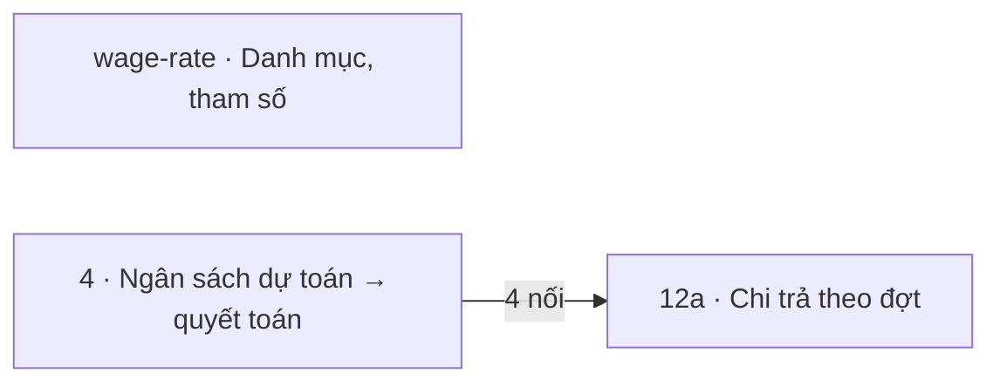

# Khối Tài chính

<!-- máy sinh: tom-tat -->
> **Khối Tài chính** — 3 quy trình, 6 tài liệu (kể cả hồ sơ phụ) · 59 bước.
>
> Khớp nối giữa các quy trình trong khối: 4 · với khối khác: 33.
>
> **Nguồn:** cộng từ các tài liệu quy trình của khối (sổ nghiệp vụ + khai báo của app) và bảng kê khớp nối. Tầng trên: [Tổng thể](00-tong-the.html). Tầng dưới: từng quy trình ở mục 1.
<!-- hết: tom-tat -->

<!-- viết tay: dien-giai -->
## Diễn giải

*Phần này viết tay, diễn giải lại điều các bảng bên dưới và các tài liệu quy trình của khối ghi.*

### Khối này lo việc gì

Khối theo dõi năm loại hồ sơ về tiền và một danh mục mức tiền. Dự toán ngân sách năm được theo dõi từ lúc lập tới lúc quyết toán xong, một quy trình cho cấp xã và một cho cấp tỉnh. Đề nghị cấp kinh phí được lập cho từng việc cụ thể (một đợt, một lệnh, một hồ sơ nguồn) và gắn với một dự toán năm. Phiếu chi ghi từng lần chi thật. Bảng thanh toán trợ cấp gom các hồ sơ chế độ của một nguồn phát sinh rồi được chuẩn chi và chi trả. Danh mục, tham số giữ hai mức tiền theo tỉnh: mức trợ cấp ngày công lao động và mức phụ cấp Thôn đội trưởng.

### Các quy trình nối với nhau thế nào

Trong khối có một cặp quy trình nối nhau: 4 và 12a, qua phiếu chi. Vì vậy khối chia làm một cụm gồm hai quy trình này, và một quy trình đứng riêng.

**Cụm dự toán – đề nghị kinh phí – chi trả.**

- [4 · Ngân sách dự toán → quyết toán](qt-4.html) theo dõi dự toán ngân sách năm ở cấp xã, qua bảy chặng từ *Đang lập dự toán* tới *Đã được duyệt quyết toán*.
- Hồ sơ phụ 4.budget-province theo dõi dự toán năm của cấp tỉnh, cùng bảy chặng.
- Hồ sơ phụ 4.funding-request theo dõi từng đề nghị cấp kinh phí ở xã và ở tỉnh, theo nhánh dự trù hoặc nhánh lập thẳng; kết thúc ở *Đã chi trả* hoặc *Đã huỷ*. Đề nghị mở ra có nối tới Dự toán ngân sách năm và tới Dòng khoản của hồ sơ kinh phí, ở cả bốn bước mở.
- [12a · Chi trả theo đợt](qt-12a.html) theo dõi bảng thanh toán trợ cấp: *Đã lập* → *Đã chuẩn chi* → *Đã chi*, hoặc *Đã huỷ*.
- Hồ sơ phụ 12a.payment-voucher là phiếu chi, có hai chặng *Đã chi* và *Đã huỷ*.

Phiếu chi mở ra có nối tới Dòng khoản của hồ sơ kinh phí (quy trình 4), ở bước Ghi phiếu chi của xã và của tỉnh (`recordCommunePaymentVoucher` ⊕, `recordProvincePaymentVoucher` ⊕): mỗi phiếu chi thuộc một dòng khoản.

**Đứng riêng trong khối:** [Danh mục, tham số](ngoai63.wage-rate.html), không nối với quy trình nào khác của khối. Bản ghi mức đi ba chặng *Chờ duyệt*, *Trả về sửa*, *Đã ghi nhận* và kết thúc ở *Đã ghi nhận*.

### Nhận gì từ khối khác, để lại gì cho khối khác

- [Khung chung](khoi-khung-chung.html): dự toán năm của xã và của tỉnh mở ra có nối tới Nhiệm vụ trên giao (quy trình 1) ở bước lập dự toán ⊕. Tờ trình đề nghị phê duyệt dự toán gắn với Văn bản đi (1.outgoing-document) ở bước Trình ký tờ trình.
- [Hậu cần – kỹ thuật](khoi-hau-can.html): Đợt mua sắm (D9) gắn vào khoản dự toán đã quyết, ở bước `budgetProcurement` của D9.
- [Quân lực · Tổ chức, chỉ huy](khoi-to-chuc.html): Bảng chi trả phụ cấp chức vụ tháng (30.allowance-sheet) gắn với dự toán năm ở bước `submitAllowanceSheet`.
- Đề nghị cấp kinh phí phát sinh từ một hồ sơ nguồn của khối khác: quy trình 13a, 20, 23, D5 của [Tác chiến, sẵn sàng chiến đấu](khoi-tac-chien.html); 14 của [Huấn luyện, giáo dục](khoi-huan-luyen.html); 12b, D2 của [Quân lực · Người và nghĩa vụ](khoi-nguoi-nghia-vu.html); 8, 11 của [Chính trị](khoi-chinh-tri.html); D11, D12 của Hậu cần – kỹ thuật; 9 của Khung chung; 30 của Quân lực · Tổ chức, chỉ huy.
- Bảng thanh toán trợ cấp lập từ Lệnh điều động (13a), đợt huấn luyện (14) hoặc Vụ việc ứng phó (20); mỗi dòng của bảng là một Hồ sơ chế độ chính sách (12b).
- Phiếu chi bồi thường nối tới Tài sản đã huy động của dân (20.mobilized-asset).

### Ai làm

- **Nhân viên tài chính kiêm hậu cần** có bước ở dự toán xã, đề nghị cấp kinh phí, bảng thanh toán (bước Chi trả) và phiếu chi. **Cán bộ tài chính Bộ CHQS tỉnh** có bước ở dự toán tỉnh, đề nghị cấp kinh phí và phiếu chi.
- **Chỉ huy trưởng Ban CHQS xã** ký, duyệt ở dự toán xã, đề nghị cấp kinh phí và bảng thanh toán. **Bộ CHQS cấp tỉnh** ký, duyệt ở dự toán tỉnh, đề nghị cấp kinh phí và Danh mục, tham số.
- **Nhân viên văn thư** có bước ở dự toán hai cấp; **Cơ quan tài chính cấp trên** chỉ ở dự toán xã; **Trợ lý Quân lực** lập bảng thanh toán; **Ban Dân quân tự vệ, Bộ CHQS cấp tỉnh** nhập mức ở Danh mục, tham số.
<!-- hết viết tay -->

## 1. Các quy trình trong khối

<!-- máy sinh: quy-trinh -->
Cột "Để làm gì" trích câu đầu phần Diễn giải của tài liệu quy trình. Cột "Mặt công tác (app)" là chỗ app xếp quy trình ấy.

| Mã | Tên | Để làm gì | Bước | Chặng | Mặt công tác (app) |
|---|---|---|---|---|---|
| [ngoai63.wage-rate](ngoai63.wage-rate.html) | Danh mục, tham số | Ban Dân quân tự vệ, Bộ CHQS cấp tỉnh nhập hai mức tiền theo tỉnh: **mức trợ cấp ngày công lao động** (đồng/ngày) và **mức phụ cấp Thôn đội trưởng** (đồng/tháng). | 5 | 3 |  |
| [qt-4](qt-4.html) | Ngân sách dự toán → quyết toán | Quy trình theo dõi **dự toán ngân sách năm** ở cấp xã từ lúc lập tới lúc quyết toán xong, tên đầy đủ là "E27 — Dự toán, theo dõi ngân sách cấp xã"; mỗi năm ngân sách một hồ sơ, không ghi đè năm cũ. | 17 | 6 | Tài chính |
| ↳ [qt-4.budget-province](qt-4.budget-province.html) | Ngân sách dự toán → quyết toán — Dự toán ngân sách năm | Quy trình theo dõi **dự toán ngân sách năm** của cấp tỉnh từ lúc lập tới lúc quyết toán xong, tên đầy đủ là "E27 — Dự toán, theo dõi ngân sách cấp tỉnh". | 16 | 6 | Tài chính |
| ↳ [qt-4.funding-request](qt-4.funding-request.html) | Ngân sách dự toán → quyết toán — Đề nghị cấp kinh phí | Quy trình theo dõi từng **đề nghị cấp kinh phí** cho một việc cụ thể (một đợt, một lệnh, một hồ sơ nguồn), gắn với một dự toán ngân sách năm, ở cấp xã và cấp tỉnh. | 13 | 6 | Tài chính |
| [qt-12a](qt-12a.html) | Chi trả theo đợt | Quy trình theo dõi một **bảng thanh toán trợ cấp**: bảng gom các hồ sơ chế độ của một nguồn phát sinh — vụ việc ứng phó, đợt huấn luyện hoặc lệnh điều động — rồi được chuẩn chi và chi trả. | 4 | 4 | Tài chính |
| ↳ [qt-12a.payment-voucher](qt-12a.payment-voucher.html) | Chi trả theo đợt — Phiếu chi | Cán bộ tài chính ghi **phiếu chi** cho từng lần chi thật trên một dự trù đã duyệt. | 4 | 2 | Tài chính |
<!-- hết: quy-trinh -->

## 2. Sơ đồ mối nối trong khối

<!-- máy sinh: so-do -->

Có mũi tên: trong các mối nối của cặp ấy có ít nhất một mối do **bước tạo hồ sơ** ghi, mũi tên chỉ về quy trình có hồ sơ được mở ra; các mối còn lại của cặp có thể là gắn giữa chừng — xem từng dòng ở mục 3. Không mũi tên: gắn nhau ở bước giữa chừng. Hồ sơ phụ gộp về quy trình gốc.
<!-- hết: so-do -->

## 3. Khớp nối giữa các quy trình trong khối

<!-- máy sinh: khop-noi-trong -->
| Ô nối | Từ (quy trình · hồ sơ) | Tới | Nội dung (mô tả trong app) | Bước ghi mối nối |
|---|---|---|---|---|
| `voucherOfBudgetLine` | 12a.payment-voucher · Phiếu chi | 4 · Khoản dự toán | Phiếu chi ghi thẳng vào khoản nào của dự toán năm — chốt 15/10/2026, L48/2019 Đ.36 k1 | 12a.payment-voucher·recordCommunePaymentVoucher ⊕, 12a.payment-voucher·recordProvincePaymentVoucher ⊕ |
| `voucherOfLine` | 12a.payment-voucher · Phiếu chi | 4 · Dòng khoản của hồ sơ kinh phí | Phiếu chi này thuộc dòng khoản nào — doc 112 §14, QĐ1126 Đ.16 k2 (chi trong quá trình tổ chức) | 12a.payment-voucher·recordCommunePaymentVoucher ⊕, 12a.payment-voucher·recordProvincePaymentVoucher ⊕ |
| `voucherOfPlan` | 12a.payment-voucher · Phiếu chi | 4 · Dự toán ngân sách năm | Phiếu chi ghi thẳng trừ vào dự toán năm nào — phải đang chấp hành (D3) | 12a.payment-voucher·recordCommunePaymentVoucher ⊕, 12a.payment-voucher·recordProvincePaymentVoucher ⊕ |
| `voucherOfRequest` | 12a.payment-voucher · Phiếu chi | 4.funding-request · Đề nghị cấp kinh phí | NGƯNG DÙNG doc 112 §14 — phiếu chi nay neo về DÒNG KHOẢN (`voucherOfLine`). Giữ để phiếu cũ (nếu có) còn đườn… | — |

4 khớp nối. ⊕ là bước tạo hồ sơ. Bảng kê mối nối giữa hai mã quy trình khác nhau; mối nối giữa hồ sơ chính và hồ sơ phụ của cùng một mã xem tài liệu quy trình.
<!-- hết: khop-noi-trong -->

## 4. Khớp nối với khối khác

<!-- máy sinh: khop-noi-ngoai -->
| Khối kia | Số khớp nối | Quy trình của khối này ↔ quy trình khối kia |
|---|---|---|
| [Khung chung](khoi-khung-chung.html) | 10 | 4 ↔ 1 (7), 4 ↔ 9 (1), wage-rate ↔ 1 (2) |
| [Tác chiến, sẵn sàng chiến đấu](khoi-tac-chien.html) | 8 | 4 ↔ 13a (1), 4 ↔ 13b (1), 4 ↔ 20 (1), 4 ↔ 23 (1), 4 ↔ D5 (1), 12a ↔ 13a (1), 12a ↔ 20 (2) |
| [Hậu cần – kỹ thuật](khoi-hau-can.html) | 3 | 4 ↔ D9 (1), 4 ↔ D11 (1), 4 ↔ D12 (1) |
| [Huấn luyện, giáo dục](khoi-huan-luyen.html) | 2 | 4 ↔ 14 (1), 12a ↔ 14 (1) |
| [Quân lực · Người và nghĩa vụ](khoi-nguoi-nghia-vu.html) | 4 | 4 ↔ 12b (1), 4 ↔ D2 (1), 12a ↔ 12b (2) |
| [Quân lực · Tổ chức, chỉ huy](khoi-to-chuc.html) | 3 | 4 ↔ 30 (2), 12a ↔ 30 (1) |
| [Chính trị](khoi-chinh-tri.html) | 3 | 4 ↔ 8 (1), 4 ↔ 11 (1), 12a ↔ 8 (1) |

33 khớp nối với khối khác. Số trong ngoặc là số ô nối của cặp quy trình. Hồ sơ phụ gộp về quy trình gốc. Từng ô nối và chiều của nó: mục 10 của tài liệu quy trình.
<!-- hết: khop-noi-ngoai -->

## 5. Ai làm

<!-- máy sinh: vai-tro -->
| Người làm | Có bước ở quy trình |
|---|---|
| Nhân viên tài chính kiêm hậu cần | 4, 4.funding-request, 12a, 12a.payment-voucher |
| Bộ CHQS cấp tỉnh | 4.budget-province, 4.funding-request, wage-rate |
| Chỉ huy trưởng Ban CHQS xã | 4, 4.funding-request, 12a |
| Cán bộ tài chính Bộ CHQS tỉnh | 4.budget-province, 4.funding-request, 12a.payment-voucher |
| Hệ thống tự làm | 4, 4.budget-province, 4.funding-request |
| Ban Dân quân tự vệ, Bộ CHQS cấp tỉnh | wage-rate |
| Nhân viên văn thư | 4 |
| Trợ lý Quân lực | 12a |
| Văn thư Bộ CHQS cấp tỉnh | 4.budget-province |

*Tên người làm là tên app đặt cho mã chủ thể của vai; vai không có mã chủ thể thì in bằng mã (`…`). Quy trình chạy ở nhiều cấp thì người làm là người giữ vai ấy ở đơn vị nêu trong tài liệu quy trình.*
<!-- hết: vai-tro -->
