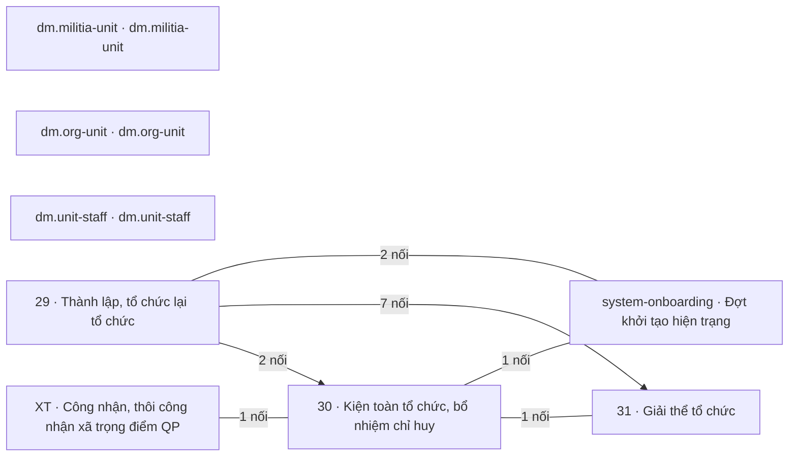

# Khối Quân lực · Tổ chức, chỉ huy

<!-- máy sinh: tom-tat -->
> **Khối Quân lực · Tổ chức, chỉ huy** — 8 quy trình, 15 tài liệu (kể cả hồ sơ phụ) · 221 bước.
>
> Khớp nối giữa các quy trình trong khối: 14 · với khối khác: 119.
>
> **Nguồn:** cộng từ các tài liệu quy trình của khối (sổ nghiệp vụ + khai báo của app) và bảng kê khớp nối. Tầng trên: [Tổng thể](00-tong-the.html). Tầng dưới: từng quy trình ở mục 1.
<!-- hết: tom-tat -->

<!-- viết tay: dien-giai -->
## Diễn giải

*Phần này viết tay, diễn giải lại điều các bảng bên dưới và các tài liệu quy trình của khối ghi.*

### Khối này lo việc gì

Khối theo dõi sáu quy trình, mười một tài liệu. Các hồ sơ chính: hồ sơ thành lập tổ chức và đơn vị dân quân tự vệ; Ban chỉ huy quân sự cấp xã; chức vụ chỉ huy và chức danh trong Ban chỉ huy quân sự cấp xã, kèm bảng chi trả phụ cấp chức vụ tháng; đợt đề nghị công nhận, thôi công nhận xã trọng điểm về quốc phòng; đợt khởi tạo hiện trạng; và danh mục người của đơn vị. Phần dưới gom thành bốn cụm việc và một quy trình đứng riêng.

### Các quy trình nối với nhau thế nào

Các cụm dưới đây gom theo 5 khớp nối trong khối ở mục 3; riêng cụm 1 gom theo việc hai quy trình cùng làm trên hồ sơ *Đơn vị dân quân tự vệ*, như hai tài liệu quy trình mô tả.

**Cụm 1 — thành lập và giải thể tổ chức.** [29 · Thành lập, tổ chức lại tổ chức](qt-29.html) theo dõi một hồ sơ thành lập từ lúc lập đề án (hoặc từ lúc Cục Dân quân tự vệ nhận hồ sơ trung tâm GDQP&AN) tới chặng kết thúc *Đã thành lập*, rồi ghi tiếp các việc sau thành lập. Ở bước *Ghi quyết định thành lập* hệ tạo một *Đơn vị dân quân tự vệ*. Hồ sơ phụ 29.command-board là hồ sơ của một Ban chỉ huy quân sự cấp xã, có một chặng *Đã thành lập*: ghi quyết định thành lập, rồi ghi dần con dấu, tài khoản riêng, trụ sở, thao trường và việc bố trí đủ chức danh. [31 · Giải thể tổ chức](qt-31.html) đưa một đơn vị dân quân tự vệ tới quyết định giải thể — lập tờ trình, ký, gửi, lấy ý kiến, ghi quyết định, rồi khoá tài khoản và thu hồi con dấu — và kết thúc ở *Đã giải thể*.

**Cụm 2 — chức vụ, chức danh và phụ cấp.** [30 · Kiện toàn tổ chức, bổ nhiệm chỉ huy](qt-30.html) theo dõi một chức vụ chỉ huy do một người giữ, từ quy hoạch nguồn tới *Đã thôi giữ chức*. 30.commune-command theo dõi một người giữ một chức danh trong Ban chỉ huy quân sự cấp xã, kết thúc ở *Đã đóng*. 30.allowance-sheet là bảng chi trả phụ cấp chức vụ tháng của xã, kết thúc ở *Đã chi, khoá kỳ*; nó nối sang khối Tài chính. Cụm này nối với cụm 1 ở một chỗ: chức vụ chỉ huy gắn với đơn vị dân quân tự vệ (`tenureOfUnit`) ở bước *Sửa thông tin quy hoạch* của 30. Thêm vào đó, bước *Xác nhận đã bố trí đủ chức danh* của 29.command-board đòi có một hồ sơ 30.commune-command cùng đơn vị chủ hồ sơ ở chặng `APPOINTED` (`hasAppointedStaff`).

**Cụm 3 — xã trọng điểm về quốc phòng.** [XT · Công nhận, thôi công nhận xã trọng điểm QP](qt-XT.html) theo dõi một đợt đề nghị theo năm của tỉnh, qua Quân khu, Cục, tới quyết định của Bộ trưởng, kết thúc ở *Đã áp vào danh mục xã*. XT.commune-proposal là đề nghị của một xã gửi tỉnh; XT.deputy-surplus là việc rà Phó chỉ huy trưởng dư, dừng ở *Đã miễn nhiệm*. Cả hai ghi ô nối tới đợt, ở bước nhận vào đợt và bước mở việc rà. Cụm này nối sang cụm 2 ở bước *Khép việc rà Phó chỉ huy trưởng dư*: việc rà khép bằng quyết định miễn nhiệm ghi trên một hồ sơ 30.commune-command. Quyết định ấy ghi ở bước *Ghi quyết định miễn nhiệm Phó chỉ huy trưởng dư* của 30.commune-command.

**Cụm 4 — khởi tạo hiện trạng.** Ở [Đợt khởi tạo hiện trạng](ngoai63.system-onboarding.html), Trợ lý Quân lực mở đợt và nạp các tệp danh sách vào đợt, rồi Chỉ huy trưởng Ban CHQS xã đưa cả đợt tới chặng kết thúc *Đã xác nhận*. Đơn vị dân quân tự vệ (29), Ban chỉ huy quân sự cấp xã (29.command-board) và chức danh Ban chỉ huy (30.commune-command) vào hệ qua một đợt khởi tạo hiện trạng, căn cứ là quyết định thành lập, quyết định bổ nhiệm trong tệp.

**Đứng riêng.** [dm.unit-staff](dm.unit-staff.html) (danh mục người của đơn vị) có ba bước, đứng riêng trong khối, không nối với quy trình nào khác của khối.

### Nhận gì từ khối khác, để lại gì cho khối khác

- [Khung chung](khoi-khung-chung.html) (19 khớp nối). Hồ sơ chức vụ (30) mở ra có nối tới nhiệm vụ trên giao (quy trình 1), văn bản đi gắn vào ở bước ký quyết định bổ nhiệm và bước miễn nhiệm; tờ trình cũng gắn vào hồ sơ chức vụ. Đợt khởi tạo mở ra có nối tới chỉ tiêu (quy trình 2). Hồ sơ thành lập (29) gắn văn bản đi ở bước báo cáo Thủ tướng. Hồ sơ đơn vị nối tới việc gốc, kế hoạch, chỉ tiêu ở bước lập đề án của 29.
- [Quân lực · Người và nghĩa vụ](khoi-nguoi-nghia-vu.html). Hồ sơ chức danh mở ra có nối tới công dân trong độ tuổi (16). Hồ sơ chức vụ nối tới chiến sĩ dân quân tự vệ (16.enlistment), và chiến sĩ mở ra từ đơn vị khi biên chế.
- [Huấn luyện, giáo dục](khoi-huan-luyen.html). Đợt học liên kết (G7) mở ra từ trung tâm GDQP&AN; G10 có ba mối nối với 29. Học viên đào tạo Chỉ huy trưởng (18) gắn tới hồ sơ chức danh.
- [Chính trị](khoi-chinh-tri.html). Vụ việc kỷ luật (D15) gắn vào hồ sơ chức vụ ở bước giáng chức, cách chức; đợt tuyên truyền (11) và đăng ký phong trào (7) mở ra từ đơn vị.
- [Hậu cần – kỹ thuật](khoi-hau-can.html). Đợt kiểm kê (15), trang phục (D11.uniform) và trang bị (D12) mở ra từ đơn vị.
- [Tác chiến, sẵn sàng chiến đấu](khoi-tac-chien.html). Công trình, đất quốc phòng (23) mở ra từ đơn vị.
- [Tài chính](khoi-tai-chinh.html). Bảng phụ cấp gắn với dự toán năm (4) ở bước trình.

### Ai làm

Bộ CHQS cấp tỉnh, Chỉ huy trưởng Ban CHQS xã và Trợ lý Quân lực có bước ở nhiều tài liệu nhất, chủ yếu ở cụm 1 và 2. Cục Dân quân tự vệ có bước ở 29, 31 và ba tài liệu XT. Nhân viên văn thư có bước ở 29, 29.command-board, 30, 31; Ban Dân quân tự vệ, Bộ CHQS cấp tỉnh ở 29, 30, 31. Nhân viên tài chính kiêm hậu cần có bước ở 29.command-board và 30.allowance-sheet. Phòng Dân quân tự vệ, quân khu và Tư lệnh quân khu chỉ có bước ở XT. Hệ thống tự làm có bước ở ba tài liệu XT và `dm.unit-staff`. Ba vai ghi bằng mã: `accountAdmin` (`dm.unit-staff`), `approver` (30), `org-military-board` (29).
<!-- hết viết tay -->

## 1. Các quy trình trong khối

<!-- máy sinh: quy-trinh -->
Cột "Để làm gì" trích câu đầu phần Diễn giải của tài liệu quy trình. Cột "Mặt công tác (app)" là chỗ app xếp quy trình ấy.

| Mã | Tên | Để làm gì | Bước | Chặng | Mặt công tác (app) |
|---|---|---|---|---|---|
| [dm.militia-unit](dm.militia-unit.html) | dm.militia-unit |  | 2 | 2 |  |
| [dm.org-unit](dm.org-unit.html) | dm.org-unit |  | 1 | 0 |  |
| [dm.unit-staff](dm.unit-staff.html) | dm.unit-staff | Đây là danh mục người của đơn vị. Hai bước ghi các ô `person`, `unitCode`, `unitLevel`, `targetSuperiorUnits`; một bước ghi `successorUnit`, `unitValidTo`, `previousOwnerUnit` và đơn vị chủ hồ sơ. | 3 | 0 |  |
| [ngoai63.system-onboarding](ngoai63.system-onboarding.html) | Đợt khởi tạo hiện trạng | Trợ lý Quân lực mở một **đợt khởi tạo hiện trạng**, nạp các tệp danh sách vào đợt, rồi Chỉ huy trưởng Ban CHQS xã xác nhận cả đợt. | 3 | 2 |  |
| [qt-29](qt-29.html) | Thành lập, tổ chức lại tổ chức | Theo dõi một **hồ sơ thành lập tổ chức** từ lúc lập đề án tới lúc có quyết định thành lập, rồi ghi tiếp các việc sau thành lập (công bố, chỉ huy, quy chế, thành viên Hội đồng, con dấu, tài khoản nhẹ, danh mục trung tâm). | 50 | 7 | Quân lực |
| ↳ [qt-29.appraisal](qt-29.appraisal.html) | Thẩm định hồ sơ ở một cấp (tỉnh, quân khu, Cục) — Hồ sơ thẩm định dùng chung (nhận, kiểm đủ, thẩm định, thông báo) |  | 14 | 7 | Quân lực |
| ↳ [qt-29.board-reorganization](qt-29.board-reorganization.html) | Thành lập, tổ chức lại tổ chức — Hồ sơ tổ chức lại Ban chỉ huy quân sự cấp xã |  | 2 | 2 | Quân lực |
| ↳ [qt-29.command-board](qt-29.command-board.html) | Thành lập, tổ chức lại tổ chức — Ban chỉ huy quân sự cấp xã | Đây là hồ sơ của một **Ban chỉ huy quân sự cấp xã**: ghi quyết định thành lập, rồi ghi dần con dấu, tài khoản riêng, trụ sở, thao trường và việc bố trí đủ chức danh khi từng thứ xong. | 10 | 3 | Quân lực |
| [qt-30](qt-30.html) | Kiện toàn tổ chức, bổ nhiệm chỉ huy | Quy trình theo dõi **một chức vụ chỉ huy dân quân tự vệ do một người giữ**, từ lúc người ấy được đưa vào quy hoạch nguồn, qua xin ý kiến, bổ nhiệm, tới khi thôi giữ chức. | 67 | 9 | Quân lực |
| ↳ [qt-30.allowance-sheet](qt-30.allowance-sheet.html) | Bảng chi trả phụ cấp chức vụ tháng của xã — Bảng chi trả phụ cấp chức vụ tháng | Mỗi kỳ tháng lập một **bảng chi trả phụ cấp chức vụ** cho cả xã. | 7 | 5 | Quân lực |
| ↳ [qt-30.commune-command](qt-30.commune-command.html) | Kiện toàn tổ chức, bổ nhiệm chỉ huy — Nhân sự Ban chỉ huy quân sự cấp xã | Quy trình theo dõi **một người giữ một chức danh trong Ban chỉ huy quân sự cấp xã**: xếp người vào chức danh, ghi quyết định bổ nhiệm, gán vai dùng hệ theo chức trách, rồi tới lúc chuyển công tác hay miễn nhiệm thì bàn giao và đóng hồ sơ. | 8 | 5 | Quân lực |
| [qt-31](qt-31.html) | Giải thể tổ chức | Quy trình đưa một **đơn vị dân quân tự vệ** tới chỗ có quyết định giải thể: lập tờ trình, ký, gửi, lấy ý kiến, ghi quyết định, rồi khoá tài khoản và thu hồi con dấu. | 25 | 8 | Quân lực |
| [qt-XT](qt-XT.html) | Công nhận, thôi công nhận xã trọng điểm QP | Bộ CHQS cấp tỉnh gom các xã đề nghị **công nhận hoặc thôi công nhận xã trọng điểm về quốc phòng** vào một **đợt đề nghị** theo năm. | 15 | 7 | Quân lực |
| ↳ [qt-XT.commune-proposal](qt-XT.commune-proposal.html) | Đề nghị của xã — Đề nghị của xã về xã trọng điểm quốc phòng | Một xã gửi lên Bộ CHQS cấp tỉnh **đề nghị công nhận hoặc thôi công nhận xã mình là xã trọng điểm về quốc phòng**. | 10 | 6 | Quân lực |
| ↳ [qt-XT.deputy-surplus](qt-XT.deputy-surplus.html) | Việc rà Phó chỉ huy trưởng dư sau khi thôi trọng điểm | Khi một xã thôi là xã trọng điểm về quốc phòng mà còn dư Phó chỉ huy trưởng, hệ giữ một **việc rà Phó chỉ huy trưởng dư** để theo dõi cho tới khi có quyết định miễn nhiệm. | 4 | 3 | Quân lực |
<!-- hết: quy-trinh -->

## 2. Sơ đồ mối nối trong khối

<!-- máy sinh: so-do -->

Có mũi tên: trong các mối nối của cặp ấy có ít nhất một mối do **bước tạo hồ sơ** ghi, mũi tên chỉ về quy trình có hồ sơ được mở ra; các mối còn lại của cặp có thể là gắn giữa chừng — xem từng dòng ở mục 3. Không mũi tên: gắn nhau ở bước giữa chừng. Hồ sơ phụ gộp về quy trình gốc.
<!-- hết: so-do -->

## 3. Khớp nối giữa các quy trình trong khối

<!-- máy sinh: khop-noi-trong -->
| Ô nối | Từ (quy trình · hồ sơ) | Tới | Nội dung (mô tả trong app) | Bước ghi mối nối |
|---|---|---|---|---|
| `consentOfDissolution` | 29 · Ý kiến về việc thành lập, giải thể đơn vị | 31 · Hồ sơ giải thể tổ chức | Ý kiến của một bên về việc giải thể — Đ.22 k1 d, k2 | 31·recordDisbandConsent, 31·recordProvinceDisbandConsent |
| `subUnitMovedByDisband` | 29 · Đơn vị dân quân tự vệ | 31 · Hồ sơ giải thể tổ chức | Hồ sơ giải thể đơn vị cấp trên đã chuyển đơn vị con này sang đơn vị khác — L48/2019/QH14 Đ.15, Đ.22 k2 | 29·moveSubUnitOnDisband |
| `unitOnboardedIn` | 29 · Đơn vị dân quân tự vệ | system-onboarding · Đợt khởi tạo hiện trạng | Đơn vị vào hệ qua đợt khởi tạo hiện trạng nào — căn cứ là quyết định thành lập trong tệp | system-onboarding·confirmOnboarding |
| `appraisalOfDissolution` | 29.appraisal · Hồ sơ thẩm định dùng chung (nhận, kiểm đủ, thẩm định, thông báo) | 31 · Hồ sơ giải thể tổ chức | Hồ sơ giải thể tổ chức mà hồ sơ thẩm định này thuộc về (QĐ10/2025/QĐ-TTg Đ.8) | 29.appraisal·openAppraisalOfDissolution ⊕ |
| `boardOnboardedIn` | 29.command-board · Ban chỉ huy quân sự cấp xã | system-onboarding · Đợt khởi tạo hiện trạng | Ban chỉ huy quân sự xã vào hệ qua đợt khởi tạo hiện trạng nào | system-onboarding·confirmOnboarding |
| `tenureOfBoard` | 30 · Chức vụ chỉ huy dân quân tự vệ | 29 · Ban chỉ huy quân sự cơ quan, tổ chức | Chức vụ chỉ huy của Ban chỉ huy quân sự cơ quan, tổ chức nào — Đ.21 k2 | 30·planTenure ⊕ |
| `tenureOfUnit` | 30 · Chức vụ chỉ huy dân quân tự vệ | 29 · Đơn vị dân quân tự vệ | Chức vụ chỉ huy của đơn vị nào — Đ.19 k2 | 30·editTenure, 30·openTenureFromEstablishment ⊕ |
| `commandTenureEndedByDisband` | 30 · Chức vụ chỉ huy dân quân tự vệ | 31 · Hồ sơ giải thể tổ chức | Hồ sơ giải thể mà quyết định của nó làm người giữ chức thôi giữ chức — căn cứ thay đổi tổ chức (L48/2019 Đ.23… | 30·endTenureOnDisband |
| `assignmentOnboardedIn` | 30.commune-command · Nhân sự Ban chỉ huy quân sự cấp xã | system-onboarding · Đợt khởi tạo hiện trạng | Chức danh Ban chỉ huy vào hệ qua đợt khởi tạo hiện trạng nào — căn cứ là quyết định bổ nhiệm | system-onboarding·confirmOnboarding |
| `dissolutionOfBoard` | 31 · Hồ sơ giải thể tổ chức | 29 · Ban chỉ huy quân sự cơ quan, tổ chức | Ban CHQS cơ quan, tổ chức mà hồ sơ đề nghị giải thể — một quyết định có thể giải thể nhiều Ban | 31·requestDisbandSignature ⊕ |
| `dissolutionOfCentre` | 31 · Hồ sơ giải thể tổ chức | 29 · Trung tâm giáo dục quốc phòng và an ninh | Trung tâm GDQP&AN mà hồ sơ đề nghị giải thể | 31·receiveDissolutionDossier ⊕ |
| `dissolutionOfUnit` | 31 · Hồ sơ giải thể tổ chức | 29 · Đơn vị dân quân tự vệ | Đơn vị DQTV mà hồ sơ đề nghị giải thể — một quyết định có thể giải thể nhiều đơn vị; quyết định đặt từng đơn… | 31·requestDisbandSignature ⊕ |
| `dissolutionOfCommandBoard` | 31 · Hồ sơ giải thể tổ chức | 29.command-board · Ban chỉ huy quân sự cấp xã | Ban chỉ huy quân sự cấp xã mà hồ sơ đề nghị giải thể — quyết định phát hành thì hệ đóng Ban (closeBoardOnDisb… | 31·recordBoardDisbandDecision ⊕ |
| `surplusClosedByDismissal` | XT.deputy-surplus · Việc rà Phó chỉ huy trưởng dư sau khi thôi trọng điểm | 30.commune-command · Nhân sự Ban chỉ huy quân sự cấp xã | Khép bằng quyết định miễn nhiệm ghi trên hồ sơ chức vụ nào (qt-30) | XT.deputy-surplus·closeDeputySurplusReview |

14 khớp nối. ⊕ là bước tạo hồ sơ. Bảng kê mối nối giữa hai mã quy trình khác nhau; mối nối giữa hồ sơ chính và hồ sơ phụ của cùng một mã xem tài liệu quy trình.
<!-- hết: khop-noi-trong -->

## 4. Khớp nối với khối khác

<!-- máy sinh: khop-noi-ngoai -->
| Khối kia | Số khớp nối | Quy trình của khối này ↔ quy trình khối kia |
|---|---|---|
| [Khung chung](khoi-khung-chung.html) | 90 | 29 ↔ 1 (31), 29 ↔ 2 (5), 29 ↔ 3 (1), 30 ↔ 1 (23), 31 ↔ 1 (16), 31 ↔ 2 (1), XT ↔ 1 (12), system-onboarding ↔ 2 (1) |
| [Tác chiến, sẵn sàng chiến đấu](khoi-tac-chien.html) | 3 | 29 ↔ 13a (1), 29 ↔ 20 (1), 29 ↔ 23 (1) |
| [Hậu cần – kỹ thuật](khoi-hau-can.html) | 6 | 29 ↔ 15 (1), 29 ↔ D11 (1), 29 ↔ D12 (3), 31 ↔ D12 (1) |
| [Huấn luyện, giáo dục](khoi-huan-luyen.html) | 6 | 29 ↔ G7 (1), 29 ↔ G10 (4), 30 ↔ 18 (1) |
| [Quân lực · Người và nghĩa vụ](khoi-nguoi-nghia-vu.html) | 5 | 29 ↔ 16 (2), 30 ↔ 16 (2), system-onboarding ↔ 16 (1) |
| [Chính trị](khoi-chinh-tri.html) | 6 | 29 ↔ 7 (1), 29 ↔ 8 (2), 29 ↔ 11 (1), 30 ↔ D15 (2) |
| [Tài chính](khoi-tai-chinh.html) | 3 | 30 ↔ 4 (2), 30 ↔ 12a (1) |

119 khớp nối với khối khác. Số trong ngoặc là số ô nối của cặp quy trình. Hồ sơ phụ gộp về quy trình gốc. Từng ô nối và chiều của nó: mục 10 của tài liệu quy trình.
<!-- hết: khop-noi-ngoai -->

## 5. Ai làm

<!-- máy sinh: vai-tro -->
| Người làm | Có bước ở quy trình |
|---|---|
| Hệ thống tự làm | 29, 29.appraisal, 29.command-board, 30, 31, XT, XT.commune-proposal, XT.deputy-surplus, dm.militia-unit, dm.org-unit, dm.unit-staff |
| Ban Dân quân tự vệ, Bộ CHQS cấp tỉnh | 29, 29.board-reorganization, 29.command-board, 30, 30.commune-command, 31, XT.commune-proposal |
| Bộ CHQS cấp tỉnh | 29, 29.board-reorganization, 29.command-board, 30.commune-command, XT, XT.commune-proposal, XT.deputy-surplus |
| Cục Dân quân tự vệ | 29, 29.appraisal, 30, 31, XT, XT.commune-proposal, XT.deputy-surplus |
| Chỉ huy trưởng Ban CHQS xã | 29, 30, 30.allowance-sheet, 30.commune-command, XT.commune-proposal, system-onboarding |
| Trợ lý Quân lực | 29, 29.command-board, 30, 31, XT.commune-proposal, system-onboarding |
| Nhân viên văn thư | 29, 29.command-board, 30, 31 |
| Phòng Dân quân tự vệ, quân khu | 29, 30, XT |
| Phòng Kế hoạch tổng hợp, Cục Dân quân tự vệ | 30, 31, XT |
| Nhân viên tài chính kiêm hậu cần | 29.command-board, 30.allowance-sheet |
| Văn thư Bộ CHQS cấp tỉnh | 29, 30 |
| Văn thư quân khu | 29, 30 |
| Phó chỉ huy trưởng Ban CHQS cơ quan, tổ chức | 29 |
| Tư lệnh quân khu | XT |
| Văn thư Cục Dân quân tự vệ | 30 |
| `accountAdmin` | dm.unit-staff |
| `operator` | XT.commune-proposal |
| `standingBody` | 29 |

*Tên người làm là tên app đặt cho mã chủ thể của vai; vai không có mã chủ thể thì in bằng mã (`…`). Quy trình chạy ở nhiều cấp thì người làm là người giữ vai ấy ở đơn vị nêu trong tài liệu quy trình.*
<!-- hết: vai-tro -->
