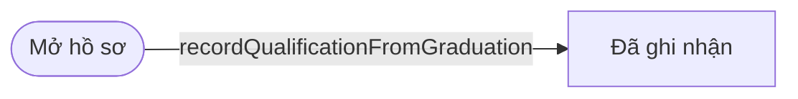
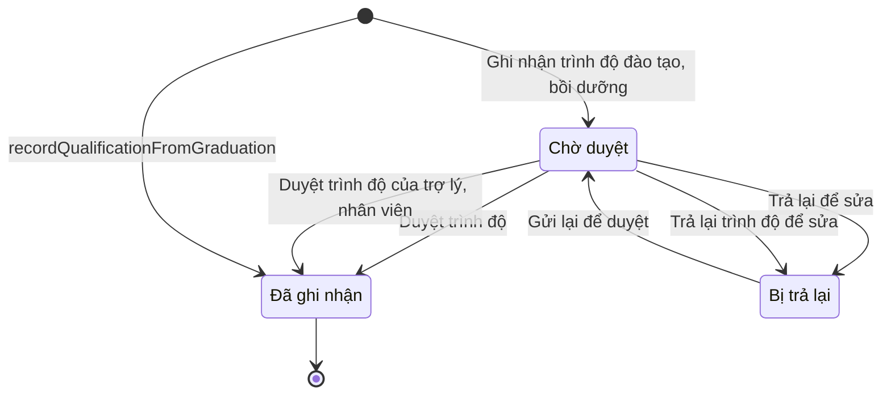

# ngoai63.cadre-qualification · Trình độ đào tạo, bồi dưỡng

<!-- máy sinh: tom-tat -->
> **Hồ sơ:** Trình độ đào tạo, bồi dưỡng (`CadreQualification`)
>
> 7 bước · 3 chặng · 4 vai · 0 bảng quyết định · 0 hạn · 1 khớp nối.
>
> **Nguồn:** sổ nghiệp vụ `ngoai63.cadre-qualification` · khai báo của app: `dqtv-app/core/processes/cadre-qualification/workflow/cadre-qualification.yaml`. Các bảng do máy sinh từ nguồn này.
<!-- hết: tom-tat -->

<!-- viết tay: dien-giai -->
## Diễn giải

*Phần này viết tay, diễn giải lại điều các bảng bên dưới ghi.*

### Quy trình này để làm gì

Hồ sơ ghi **trình độ đào tạo, bồi dưỡng của cán bộ**: mỗi dòng là một loại trình độ của một người (năm loại: văn hoá, lý luận chính trị, quân sự cơ sở, chuyên môn nghiệp vụ, quản lý nhà nước), kèm mức đạt được, trường, số bằng, ngày cấp, ảnh chụp bằng. Một người có nhiều dòng. Dòng phải được duyệt mới có hiệu lực; ba chặng: *Chờ duyệt*, *Bị trả lại*, *Đã ghi nhận*.

### Khi nào bắt đầu

Trợ lý Quân lực bấm **Ghi nhận trình độ đào tạo, bồi dưỡng**; bắt buộc chọn cán bộ, loại trình độ và mức, các ô còn lại nhập nếu có. Hồ sơ mở ra có nối tới công dân trong độ tuổi (quy trình 16) và vào thẳng *Chờ duyệt*.

Bước này đòi điều kiện `personHoldsPosition`: người được ghi phải có hồ sơ Kiện toàn tổ chức, bổ nhiệm chỉ huy (qt-30.commune-command) đang ở chặng `PLANNED` hoặc `APPOINTED`, cùng mã xã với hồ sơ trình độ. Tức là chỉ ghi cho người đang giữ chức trong Ban CHQS xã (đã được bố trí ở qt-30), của chính xã người ghi.

### Diễn ra thế nào

1. **Chờ duyệt.** Ai duyệt chia theo chức danh của người có trình độ:
   - Chức vụ chỉ huy (Chỉ huy trưởng, Phó Chỉ huy trưởng, Chính trị viên, Chính trị viên phó): Bộ CHQS cấp tỉnh bấm **Duyệt trình độ** hoặc **Trả lại để sửa**. Chỉ tỉnh mà xã đó trực thuộc mới được làm: người làm phải là người của đơn vị ở ô mã tỉnh của hồ sơ.
   - Trợ lý và nhân viên: Chỉ huy trưởng Ban CHQS xã, thuộc đơn vị chủ hồ sơ, bấm **Duyệt trình độ của trợ lý, nhân viên** hoặc **Trả lại trình độ để sửa**.

   Duyệt thì hồ sơ sang *Đã ghi nhận*, hệ ghi người duyệt và ngày duyệt. Trả lại thì bắt buộc ghi lý do; hệ ghi thêm người trả lại, ngày trả lại; hồ sơ sang *Bị trả lại*.
2. **Bị trả lại.** Trợ lý Quân lực của đơn vị chủ hồ sơ sửa rồi **Gửi lại để duyệt**; được sửa toàn bộ thông tin, kể cả loại trình độ, vì sẽ được duyệt lại (bắt buộc nhập lại loại trình độ và mức). Hồ sơ về *Chờ duyệt*.

### Kết thúc và để lại gì

Hồ sơ kết thúc ở *Đã ghi nhận*; dòng đã duyệt nằm trên hồ sơ cán bộ, sau khi duyệt thì không đổi loại trình độ nữa. Khớp nối duy nhất là tới công dân trong độ tuổi (quy trình 16) — trình độ này của ai — ghi ở bước mở.

### Điều kiện chặn

- Bấm sai người, sai chặng, thiếu thứ phải có trước thì hệ chặn và báo lý do, hồ sơ giữ nguyên.
- Ghi mới: người được ghi phải đạt `personHoldsPosition` (nêu ở trên).
- Gửi lại: người làm thuộc đơn vị chủ hồ sơ (đơn vị ở ô mã xã).
- Tỉnh duyệt, trả lại: người làm là người của đơn vị ở ô mã tỉnh của hồ sơ (`actorInOwnerProvince`) và người có trình độ là chức vụ chỉ huy (`holderIsCommander`: hồ sơ qt-30 của người ấy có `roleCode` là `AC-CHT`, `AC-PCHT`, `AC-CTV` hoặc `AC-CTVP`).
- Xã duyệt, trả lại: người làm thuộc đơn vị chủ hồ sơ và `holderIsStaff` — điều kiện này đúng khi `holderIsCommander` không đúng.
- Trả lại thiếu lý do thì bị chặn.
<!-- hết viết tay -->

## 1. Đường đi ngắn nhất qua các chặng

<!-- máy sinh: luong-chinh -->
Đường ít bước nhất từ lúc mở hồ sơ tới chặng kết thúc xa nhất. Máy chọn theo số chặng, không theo ý nghĩa nghiệp vụ — trình tự công việc thật xem phần Diễn giải và bảng "Việc làm ở từng chặng" ở mục 6.

| # | Ai làm | Làm gì | Hồ sơ sang chặng |
|---|---|---|---|
| 1 | Hệ thống tự làm | `recordQualificationFromGraduation` | Đã ghi nhận |

<!-- hết: luong-chinh -->

## 2. Hồ sơ và việc nó để lại

<!-- máy sinh: muc-tieu -->
**App gọi quy trình này là:** Trình độ đào tạo, bồi dưỡng của cán bộ.

**Khi mở, hồ sơ này ghi mối nối tới:**
- Công dân trong độ tuổi (16) — bước `recordQualificationFromGraduation`, khớp nối `qualificationOf`
- Công dân trong độ tuổi (16) — bước `recordQualification`, khớp nối `qualificationOf`
<!-- hết: muc-tieu -->

## 3. Khởi phát và kết thúc

<!-- máy sinh: khoi-phat -->
**2 cửa vào** — bước mở hồ sơ:

| Bước mở | Ai mở | Hồ sơ vào chặng | App bắt buộc nhập |
|---|---|---|---|
| Ghi nhận trình độ đào tạo, bồi dưỡng | Trợ lý Quân lực | Chờ duyệt | cán bộ, loại trình độ, mức |
| `recordQualificationFromGraduation` | Hệ thống tự làm | Đã ghi nhận | — |

**Kết thúc:** *Đã ghi nhận* (`recorded`)
<!-- hết: khoi-phat -->

## 4. Vai trò

<!-- máy sinh: vai-tro -->
| Vai trong sổ | Tên trong app | Điều kiện | Làm những bước |
|---|---|---|---|
| `operator` | Trợ lý Quân lực |  | Ghi nhận trình độ đào tạo, bồi dưỡng · Gửi lại để duyệt |
| `provinceApprover` | Bộ CHQS cấp tỉnh |  | Duyệt trình độ · Trả lại để sửa |
| `communeApprover` | Chỉ huy trưởng Ban CHQS xã |  | Duyệt trình độ của trợ lý, nhân viên · Trả lại trình độ để sửa |
| `system` | Hệ thống tự làm |  | `recordQualificationFromGraduation` |

*"Tên trong app" là tên app đặt cho mã chủ thể của vai. Hồ sơ thuộc đơn vị cấp khác thì người làm là người giữ vai ấy ở đơn vị nêu trong cột "Điều kiện" (nếu sổ có ghi) và ở cột "Người làm phải thuộc" của bảng "Theo khai báo của app" (mục 7).*
<!-- hết: vai-tro -->

## 5. Nhánh phụ

<!-- máy sinh: nhanh-phu -->
**Bước khác đưa hồ sơ sang chặng mới** — đường song song, rẽ nhánh hoặc kết thúc sớm:

| Bước | Ai làm | Từ chặng | Sang chặng |
|---|---|---|---|
| Duyệt trình độ | Bộ CHQS cấp tỉnh | Chờ duyệt | Đã ghi nhận |
| Trả lại để sửa | Bộ CHQS cấp tỉnh | Chờ duyệt | Bị trả lại |
| Duyệt trình độ của trợ lý, nhân viên | Chỉ huy trưởng Ban CHQS xã | Chờ duyệt | Đã ghi nhận |
| Trả lại trình độ để sửa | Chỉ huy trưởng Ban CHQS xã | Chờ duyệt | Bị trả lại |

**Quay lại một chặng hồ sơ đã đi qua** (tính theo đường ngắn nhất từ lúc mở):

| Bước | Ai làm | Từ chặng | Về chặng |
|---|---|---|---|
| Gửi lại để duyệt | Trợ lý Quân lực | Bị trả lại | Chờ duyệt |

**Cửa vào khác:** 2 bước cùng mở hồ sơ — xem mục 3.

<!-- hết: nhanh-phu -->

## 6. Các chặng và việc làm ở từng chặng

<!-- máy sinh: chang -->
| Chặng | Tên hiển thị | Vào bằng bước | Kết thúc? |
|---|---|---|---|
| `awaitingApproval` | Chờ duyệt | Ghi nhận trình độ đào tạo, bồi dưỡng · Gửi lại để duyệt |  |
| `recorded` | Đã ghi nhận | Duyệt trình độ · Duyệt trình độ của trợ lý, nhân viên · `recordQualificationFromGraduation` | **kết thúc** |
| `returned` | Bị trả lại | Trả lại để sửa · Trả lại trình độ để sửa |  |

### Việc làm ở từng chặng

Hồ sơ đang ở chặng nào thì làm được những bước nào.

| Hồ sơ đang ở chặng | Bước làm tại chặng (hồ sơ đứng yên) | Bước đưa hồ sơ sang chặng khác |
|---|---|---|
| **Chờ duyệt** | — | Duyệt trình độ — Bộ CHQS cấp tỉnh → *Đã ghi nhận* Trả lại để sửa — Bộ CHQS cấp tỉnh → *Bị trả lại* Duyệt trình độ của trợ lý, nhân viên — Chỉ huy trưởng Ban CHQS xã → *Đã ghi nhận* Trả lại trình độ để sửa — Chỉ huy trưởng Ban CHQS xã → *Bị trả lại* |
| **Đã ghi nhận** | — | — (kết thúc) |
| **Bị trả lại** | — | Gửi lại để duyệt — Trợ lý Quân lực → *Chờ duyệt* |
<!-- hết: chang -->

## 7. Bảng bước

<!-- máy sinh: buoc -->
| # | Bước | Mã bước | Ai thực hiện | Từ chặng | Sang chặng | Phải có trước | Ghi lại |
|---|---|---|---|---|---|---|---|
| 1 | Ghi nhận trình độ đào tạo, bồi dưỡng | `recordQualification` | Trợ lý Quân lực | — (mở hồ sơ) | `awaitingApproval` | `personHoldsPosition` | nối tới Công dân trong độ tuổi, đơn vị chủ hồ sơ, cấp trên của chủ hồ sơ, mã tỉnh, mã xã, loại trình độ, mức, trường đào tạo, số bằng, ngày cấp, ảnh chụp bằng, ghi chú |
| 2 | Duyệt trình độ | `approveQualification` | Bộ CHQS cấp tỉnh | `awaitingApproval` | `recorded` | `actorInOwnerProvince`, `holderIsCommander` | người duyệt, ngày duyệt |
| 3 | Trả lại để sửa | `returnQualification` | Bộ CHQS cấp tỉnh | `awaitingApproval` | `returned` | `actorInOwnerProvince`, `holderIsCommander`, lý do trả lại | lý do trả lại, người trả lại, ngày trả lại |
| 4 | Gửi lại để duyệt | `resubmitQualification` | Trợ lý Quân lực | `returned` | `awaitingApproval` | người làm thuộc đơn vị chủ hồ sơ | loại trình độ, mức, trường đào tạo, số bằng, ngày cấp, ảnh chụp bằng, ghi chú |
| 5 | Duyệt trình độ của trợ lý, nhân viên | `approveQualificationAtCommune` | Chỉ huy trưởng Ban CHQS xã | `awaitingApproval` | `recorded` | người làm thuộc đơn vị chủ hồ sơ, `holderIsStaff` | người duyệt, ngày duyệt |
| 6 | Trả lại trình độ để sửa | `returnQualificationAtCommune` | Chỉ huy trưởng Ban CHQS xã | `awaitingApproval` | `returned` | người làm thuộc đơn vị chủ hồ sơ, `holderIsStaff`, lý do trả lại | lý do trả lại, người trả lại, ngày trả lại |
| 7 | `recordQualificationFromGraduation` | `recordQualificationFromGraduation` | Hệ thống tự làm | — (mở hồ sơ) | `recorded` | — | nối tới Công dân trong độ tuổi, nối `qualificationFromTraining`, loại trình độ, mức, trường đào tạo, số bằng, ngày cấp |

### Khi không đạt điều kiện

Mặc định: không đúng người, hồ sơ không ở đúng chặng, hoặc thiếu thứ "phải có trước" thì bước bị chặn, hồ sơ giữ nguyên. Bảng dưới chỉ kê những bước có kết quả riêng.

| # | Bước | Kết quả riêng |
|---|---|---|
| 7 | `recordQualificationFromGraduation` | bước này không do người nào bấm |

### Điều kiện "phải có trước" bằng lời

Cột "Phải có trước" ở bảng bước có hai loại: ô dữ liệu thường (bước chỉ đòi ô ấy đã có giá trị) và điều kiện hệ tự xét. Bảng này diễn các điều kiện hệ tự xét theo đúng công thức sổ ghi; số ở cột cuối là số thứ tự bước.

| Điều kiện | Đúng khi | Bước đòi |
|---|---|---|
| `personHoldsPosition` | có hồ sơ Kiện toàn tổ chức, bổ nhiệm chỉ huy — Nhân sự Ban chỉ huy quân sự cấp xã (qt-30.commune-command) có ô nối `assignmentHeldBy` trùng với ô nối `qualificationOf` của hồ sơ đang làm mà hồ sơ ấy đang ở chặng `PLANNED` hoặc `APPOINTED` VÀ mã xã của hồ sơ đang xét bằng mã xã của hồ sơ này | 1 |
| `actorInOwnerProvince` | người đang làm là người của một đơn vị nằm trong ô cấp trên của chủ hồ sơ của hồ sơ này (theo danh mục người của đơn vị, `dm.unit-staff`) | 2, 3 |
| `holderIsCommander` | có hồ sơ Kiện toàn tổ chức, bổ nhiệm chỉ huy — Nhân sự Ban chỉ huy quân sự cấp xã (qt-30.commune-command) có ô nối `assignmentHeldBy` trùng với ô nối `qualificationOf` của hồ sơ đang làm mà hồ sơ ấy đang ở chặng `PLANNED` hoặc `APPOINTED` VÀ mã xã của hồ sơ đang xét bằng mã xã của hồ sơ này VÀ (`roleCode` của hồ sơ đang xét bằng `AC-CHT` HOẶC `roleCode` của hồ sơ đang xét bằng `AC-PCHT` HOẶC `roleCode` của hồ sơ đang xét bằng `AC-CTV` HOẶC `roleCode` của hồ sơ đang xét bằng `AC-CTVP`) | 2, 3 |
| `actorInOwnerUnit` | người đang làm là người của đơn vị ghi ở ô đơn vị chủ hồ sơ của hồ sơ này (theo danh mục người của đơn vị, `dm.unit-staff`) | 4, 5, 6 |
| `holderIsStaff` | KHÔNG (có hồ sơ Kiện toàn tổ chức, bổ nhiệm chỉ huy — Nhân sự Ban chỉ huy quân sự cấp xã (qt-30.commune-command) có ô nối `assignmentHeldBy` trùng với ô nối `qualificationOf` của hồ sơ đang làm mà hồ sơ ấy đang ở chặng `PLANNED` hoặc `APPOINTED` VÀ mã xã của hồ sơ đang xét bằng mã xã của hồ sơ này VÀ (`roleCode` của hồ sơ đang xét bằng `AC-CHT` HOẶC `roleCode` của hồ sơ đang xét bằng `AC-PCHT` HOẶC `roleCode` của hồ sơ đang xét bằng `AC-CTV` HOẶC `roleCode` của hồ sơ đang xét bằng `AC-CTVP`)) | 5, 6 |

### Theo khai báo của app

Người làm phải thuộc đơn vị nào, ô người dùng phải nhập, bước có lặp được không, và căn cứ pháp lý — lấy từ khai báo quy trình trong app.

| # | Bước | Người làm phải thuộc | Bắt buộc nhập | Nhập nếu có | Lặp được | Căn cứ |
|---|---|---|---|---|---|---|
| 1 | Ghi nhận trình độ đào tạo, bồi dưỡng |  | cán bộ, loại trình độ, mức | trường đào tạo, số bằng, ngày cấp, ảnh chụp bằng, ghi chú |  | QĐ2910/QĐ-BQP mẫu 4, 5 — danh sách đề nghị bổ nhiệm đòi cột Văn hoá và Chuyên môn, nghiệp vụ |
| 2 | Duyệt trình độ | cấp trên của chủ hồ sơ | — | — |  | sổ nghiệp vụ ngoai63.cadre-qualification · step:approveQualification |
| 3 | Trả lại để sửa | cấp trên của chủ hồ sơ | lý do trả lại | — |  | sổ nghiệp vụ ngoai63.cadre-qualification · step:returnQualification |
| 4 | Gửi lại để duyệt | đơn vị chủ hồ sơ | loại trình độ, mức | trường đào tạo, số bằng, ngày cấp, ảnh chụp bằng, ghi chú |  | sổ nghiệp vụ ngoai63.cadre-qualification · step:resubmitQualification |
| 5 | Duyệt trình độ của trợ lý, nhân viên | đơn vị chủ hồ sơ | — | — |  | sổ nghiệp vụ ngoai63.cadre-qualification · step:approveQualificationAtCommune |
| 6 | Trả lại trình độ để sửa | đơn vị chủ hồ sơ | lý do trả lại | — |  | sổ nghiệp vụ ngoai63.cadre-qualification · step:returnQualificationAtCommune |
<!-- hết: buoc -->

## 8. Bảng quyết định, hạn, việc ngoài hệ

<!-- máy sinh: quyet-dinh -->

<!-- hết: quyet-dinh -->

## 9. Dữ liệu của hồ sơ

<!-- máy sinh: du-lieu -->
Các ô mà bước trong sổ ghi hoặc đòi. Số trong hai cột cuối là số thứ tự bước ở bảng bước (mục 7).

| Ô dữ liệu | Mã | Kiểu (app) | Giá trị cho phép | Loại ô (sổ) | Bước ghi | Bước đòi | Mô tả trong app |
|---|---|---|---|---|---|---|---|
| đơn vị chủ hồ sơ | `ownerUnit` |  |  | lưu trên hồ sơ (`stored`) | 1 | — |  |
| cấp trên của chủ hồ sơ | `superiorUnits` |  |  | hệ suy ra (`derived`) | 1 | — |  |
| mã tỉnh | `provinceCode` | chữ |  | lưu trên hồ sơ (`stored`) | 1 | — | Mã tỉnh — dùng lọc phạm vi theo hàng |
| mã xã | `communeCode` | chữ |  | đưa vào ở bước (`input`) | 1 | — | Mã xã quản lý hồ sơ |
| loại trình độ | `qualificationKind` | chọn một | Trình độ văn hoá (`general_education`), Trình độ lý luận chính trị (`political_theory`), Ngành quân sự cơ sở (`military_basic`), Chuyên môn, nghiệp vụ (`professional`), Quản lý nhà nước (`state_management`) | đưa vào ở bước (`input`) | 1, 4, 7 | — | Loại trình độ — QĐ2910 mẫu 4, 5 đòi bốn cột: văn hoá, chuyên môn nghiệp vụ, và trình độ đào tạo |
| mức | `level` | chữ |  | đưa vào ở bước (`input`) | 1, 4, 7 | — | Mức đạt được — sơ cấp, trung cấp, cao cấp, cao đẳng, đại học… tuỳ loại trình độ |
| trường đào tạo | `schoolName` | chữ |  | đưa vào ở bước (`input`) | 1, 4, 7 | — | Trường, cơ sở đào tạo |
| số bằng | `diplomaNumber` | chữ |  | đưa vào ở bước (`input`) | 1, 4, 7 | — | Số bằng, chứng chỉ |
| ngày cấp | `awardedAt` | ngày |  | đưa vào ở bước (`input`) | 1, 4, 7 | — | Ngày cấp bằng, chứng chỉ |
| ảnh chụp bằng | `diplomaScanPath` | tệp |  | đưa vào ở bước (`input`) | 1, 4 | — | Ảnh chụp bằng, chứng chỉ |
| ghi chú | `note` | chữ |  | đưa vào ở bước (`input`) | 1, 4 | — | Ghi chú — diện cử đi học, nguồn kinh phí, cam kết công tác |
| người duyệt | `approvedBy` | chữ |  | lưu trên hồ sơ (`stored`) | 2, 5 | — | Người duyệt — Bộ CHQS tỉnh hoặc Chỉ huy trưởng xã |
| ngày duyệt | `approvedAt` | ngày giờ |  | lưu trên hồ sơ (`stored`) | 2, 5 | — | Thời điểm duyệt |
| lý do trả lại | `returnReason` | chữ |  | đưa vào ở bước (`input`) | 3, 6 | 3, 6 | Lý do trả lại lần gần nhất |
| người trả lại | `returnedBy` | chữ |  | lưu trên hồ sơ (`stored`) | 3, 6 | — | Người trả lại lần gần nhất |
| ngày trả lại | `returnedAt` | ngày giờ |  | lưu trên hồ sơ (`stored`) | 3, 6 | — | Thời điểm trả lại lần gần nhất |
| — | `personHoldsPosition` |  | có hay chưa | hệ suy ra (`derived`) | — | 1 |  |
| — | `actorInOwnerProvince` |  | có hay chưa | hệ suy ra (`derived`) | — | 2, 3 |  |
| — | `holderIsCommander` |  | có hay chưa | hệ suy ra (`derived`) | — | 2, 3 |  |
| người làm thuộc đơn vị chủ hồ sơ | `actorInOwnerUnit` |  | có hay chưa | hệ suy ra (`derived`) | — | 4, 5, 6 |  |
| — | `holderIsStaff` |  | có hay chưa | hệ suy ra (`derived`) | — | 5, 6 |  |

21 ô. Cột "Loại ô" là cách sổ phân loại ô, in kèm đúng chữ của sổ; ô nào người dùng phải nhập xem bảng "Theo khai báo của app" ở mục 7.
<!-- hết: du-lieu -->

## 10. Khớp nối với quy trình khác

<!-- máy sinh: khop-noi -->
| Quy trình kia | Hồ sơ kia | Quan hệ | Nội dung (mô tả trong app) | Bước ghi mối nối | Tên ô nối |
|---|---|---|---|---|---|
| 16 | Công dân trong độ tuổi | hồ sơ này **mở ra có nối tới** hồ sơ kia | Trình độ này của ai — một người nhiều dòng, mỗi loại trình độ một dòng | cadre-qualification·recordQualification ⊕, cadre-qualification·recordQualificationFromGraduation ⊕ | `qualificationOf` |

1 khớp nối. ⊕ là bước tạo hồ sơ.
<!-- hết: khop-noi -->

## 11. Thông tin chung

<!-- máy sinh: thong-tin -->
| | |
|---|---|
| **Mã trong sổ** | `ngoai63.cadre-qualification` |
| **Quy trình trong app** | `cadre-qualification` (`workflow/cadre-qualification.yaml`) — mặt công tác: `personnel` |
| **Hồ sơ** | Trình độ đào tạo, bồi dưỡng (`CadreQualification`) |
| **Căn cứ pháp lý từng bước** | cột "Căn cứ" ở bảng "Theo khai báo của app", mục 7 |
<!-- hết: thong-tin -->
