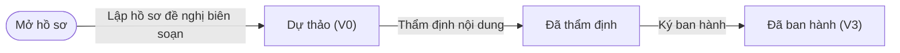
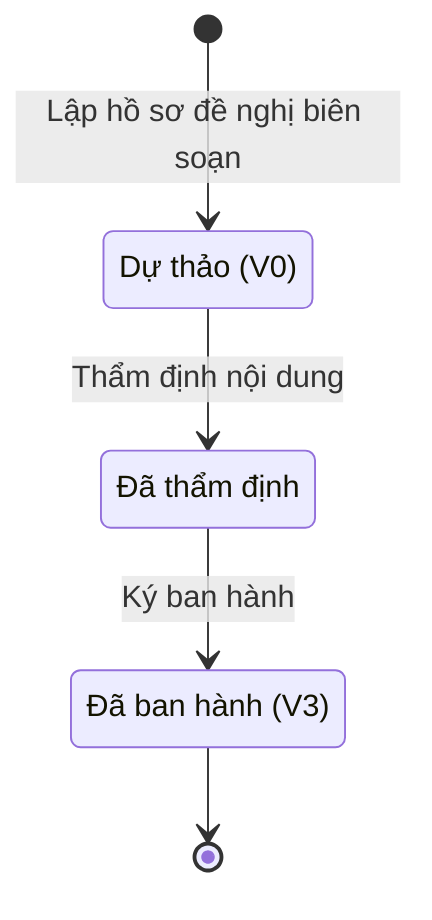

# ngoai63.curriculum-dossier · Hồ sơ chương trình, giáo trình, tài liệu huấn luyện

<!-- máy sinh: tom-tat -->
> **Hồ sơ:** Hồ sơ chương trình, giáo trình, tài liệu huấn luyện (`CurriculumDossier`)
>
> 6 bước · 3 chặng · 3 vai · 0 bảng quyết định · 0 hạn · 1 khớp nối.
>
> **Nguồn:** sổ nghiệp vụ `ngoai63.curriculum-dossier` · khai báo của app: `dqtv-app/core/processes/curriculum-dossier/workflow/curriculum-dossier.yaml`. Các bảng do máy sinh từ nguồn này.
<!-- hết: tom-tat -->

<!-- viết tay: dien-giai -->
## Diễn giải

*Phần này viết tay, diễn giải lại điều các bảng bên dưới ghi.*

### Quy trình này để làm gì

Theo dõi một **hồ sơ chương trình, giáo trình hoặc tài liệu huấn luyện** từ lúc lập hồ sơ đề nghị biên soạn, qua thẩm định nội dung, tới lúc ký ban hành. Có ba loại: chương trình, giáo trình, tài liệu huấn luyện. Ba vai: Nhân viên văn thư (lập hồ sơ, soạn dự thảo quyết định, bổ sung phụ lục), Chỉ huy trưởng Ban CHQS xã (thẩm định, từ chối thẩm định) và Cục Dân quân tự vệ (ký ban hành). Với mọi bước trừ bước mở, người làm phải thuộc đơn vị chủ hồ sơ.

Hồ sơ đi qua ba chặng: *Dự thảo (V0)* → *Đã thẩm định* → *Đã ban hành (V3)*.

### Khi nào bắt đầu

Nhân viên văn thư bấm **Lập hồ sơ đề nghị biên soạn**, bắt buộc nhập tên chương trình, giáo trình, tài liệu; loại; nội dung; và vai biên soạn. Bản thảo đính kèm là ô nhập nếu có. Bước này còn lưu người đã lập hồ sơ (`draftedByActor`). Bước mở không đòi gì trước và không nối tới hồ sơ nào.

### Diễn ra thế nào

**Chặng "Dự thảo (V0)"** — chờ thẩm định. Chỉ huy trưởng Ban CHQS xã có hai việc:

- **Thẩm định nội dung**: ghi kết quả thẩm định (đạt `PASSED` hoặc không đạt `FAILED`) và căn cứ thẩm định. Hồ sơ sang *Đã thẩm định*.
- **Từ chối thẩm định nội dung**: bắt buộc ghi lý do từ chối. Hồ sơ vẫn ở *Dự thảo (V0)*.

**Chặng "Đã thẩm định"** — hai việc, theo thứ tự:

1. Nhân viên văn thư bấm **Soạn dự thảo quyết định ban hành**, nhập dự thảo quyết định; bước ghi lại thời điểm soạn. Hồ sơ đứng yên. Chỉ soạn một lần: đã có dấu thời điểm soạn thì hệ báo "đã soạn dự thảo quyết định ban hành cho giáo trình này rồi".
2. Cục Dân quân tự vệ bấm **Ký ban hành**: phải đã có dấu "soạn dự thảo quyết định lúc" ở trên, thiếu thì hệ báo "chưa có dự thảo quyết định ban hành thì chưa ký ban hành được". Hồ sơ sang *Đã ban hành (V3)*.

**Chặng "Đã ban hành (V3)"** — Nhân viên văn thư còn bấm được **Bổ sung phụ lục, ghi chú**.

Không có bước nào đưa hồ sơ lùi về chặng trước.

### Kết thúc và để lại gì

Hồ sơ kết thúc ở *Đã ban hành (V3)*. Bản thảo đính kèm của hồ sơ là một Tệp lưu trữ (D16).

### Điều kiện chặn

- Mọi bước trừ bước mở: người làm phải thuộc đơn vị chủ hồ sơ. Sai người, sai chặng, thiếu thứ phải có trước thì bước bị chặn, hồ sơ giữ nguyên.
- Ký ban hành đòi đã soạn dự thảo quyết định.
- Soạn dự thảo quyết định lần hai bị chặn.
<!-- hết viết tay -->

## 1. Đường đi ngắn nhất qua các chặng

<!-- máy sinh: luong-chinh -->
Đường ít bước nhất từ lúc mở hồ sơ tới chặng kết thúc xa nhất. Máy chọn theo số chặng, không theo ý nghĩa nghiệp vụ — trình tự công việc thật xem phần Diễn giải và bảng "Việc làm ở từng chặng" ở mục 6.

| # | Ai làm | Làm gì | Hồ sơ sang chặng |
|---|---|---|---|
| 1 | Nhân viên văn thư | Lập hồ sơ đề nghị biên soạn | Dự thảo (V0) |
| 2 | Chỉ huy trưởng Ban CHQS xã | Thẩm định nội dung | Đã thẩm định |
| 3 | Cục Dân quân tự vệ | Ký ban hành | Đã ban hành (V3) |

<!-- hết: luong-chinh -->

## 2. Hồ sơ và việc nó để lại

<!-- máy sinh: muc-tieu -->
**App gọi quy trình này là:** Chương trình, giáo trình, tài liệu huấn luyện.
<!-- hết: muc-tieu -->

## 3. Khởi phát và kết thúc

<!-- máy sinh: khoi-phat -->
**1 cửa vào** — bước mở hồ sơ:

| Bước mở | Ai mở | Hồ sơ vào chặng | App bắt buộc nhập |
|---|---|---|---|
| Lập hồ sơ đề nghị biên soạn | Nhân viên văn thư | Dự thảo (V0) | tên chương trình, giáo trình, tài liệu, loại, nội dung, vai biên soạn |

**Kết thúc:** *Đã ban hành (V3)* (`ISSUED`)
<!-- hết: khoi-phat -->

## 4. Vai trò

<!-- máy sinh: vai-tro -->
| Vai trong sổ | Tên trong app | Điều kiện | Làm những bước |
|---|---|---|---|
| `compiler` | Nhân viên văn thư |  | Lập hồ sơ đề nghị biên soạn · Soạn dự thảo quyết định ban hành · Bổ sung phụ lục, ghi chú |
| `reviewer` | Chỉ huy trưởng Ban CHQS xã |  | Thẩm định nội dung · Từ chối thẩm định nội dung |
| `issuer` | Cục Dân quân tự vệ |  | Ký ban hành |

*"Tên trong app" là tên app đặt cho mã chủ thể của vai. Hồ sơ thuộc đơn vị cấp khác thì người làm là người giữ vai ấy ở đơn vị nêu trong cột "Điều kiện" (nếu sổ có ghi) và ở cột "Người làm phải thuộc" của bảng "Theo khai báo của app" (mục 7).*
<!-- hết: vai-tro -->

## 5. Nhánh phụ

<!-- máy sinh: nhanh-phu -->
**Làm trong lúc hồ sơ đứng yên ở một chặng** — ghi nhận, bổ sung:

| Bước | Ai làm | Ở chặng |
|---|---|---|
| Từ chối thẩm định nội dung | Chỉ huy trưởng Ban CHQS xã | Dự thảo (V0) |
| Soạn dự thảo quyết định ban hành | Nhân viên văn thư | Đã thẩm định |
| Bổ sung phụ lục, ghi chú | Nhân viên văn thư | Đã ban hành (V3) |

<!-- hết: nhanh-phu -->

## 6. Các chặng và việc làm ở từng chặng

<!-- máy sinh: chang -->
| Chặng | Tên hiển thị | Vào bằng bước | Kết thúc? |
|---|---|---|---|
| `DRAFT` | Dự thảo (V0) | Lập hồ sơ đề nghị biên soạn |  |
| `REVIEWED` | Đã thẩm định | Thẩm định nội dung |  |
| `ISSUED` | Đã ban hành (V3) | Ký ban hành | **kết thúc** — vẫn còn bước làm được |

### Việc làm ở từng chặng

Hồ sơ đang ở chặng nào thì làm được những bước nào.

| Hồ sơ đang ở chặng | Bước làm tại chặng (hồ sơ đứng yên) | Bước đưa hồ sơ sang chặng khác |
|---|---|---|
| **Dự thảo (V0)** | Từ chối thẩm định nội dung — Chỉ huy trưởng Ban CHQS xã | Thẩm định nội dung — Chỉ huy trưởng Ban CHQS xã → *Đã thẩm định* |
| **Đã thẩm định** | Soạn dự thảo quyết định ban hành — Nhân viên văn thư | Ký ban hành — Cục Dân quân tự vệ → *Đã ban hành (V3)* |
| **Đã ban hành (V3)** | Bổ sung phụ lục, ghi chú — Nhân viên văn thư | — (kết thúc) |
<!-- hết: chang -->

## 7. Bảng bước

<!-- máy sinh: buoc -->
| # | Bước | Mã bước | Ai thực hiện | Từ chặng | Sang chặng | Phải có trước | Ghi lại |
|---|---|---|---|---|---|---|---|
| 1 | Lập hồ sơ đề nghị biên soạn | `compileCurriculumDossier` | Nhân viên văn thư | — (mở hồ sơ) | `DRAFT` | — | mã tỉnh, mã xã, tên chương trình, giáo trình, tài liệu, loại, nội dung, vai biên soạn, `draftedByActor`, bản thảo đính kèm, đơn vị chủ hồ sơ |
| 2 | Thẩm định nội dung | `reviewCurriculumDossier` | Chỉ huy trưởng Ban CHQS xã | `DRAFT` | `REVIEWED` | người làm thuộc đơn vị chủ hồ sơ | kết quả thẩm định, căn cứ thẩm định, thẩm định lúc |
| 3 | Từ chối thẩm định nội dung | `rejectCurriculumDossier` | Chỉ huy trưởng Ban CHQS xã | `DRAFT` | giữ nguyên | người làm thuộc đơn vị chủ hồ sơ | lý do từ chối, từ chối lúc |
| 4 | Soạn dự thảo quyết định ban hành | `draftIssuanceDecision` | Nhân viên văn thư | `REVIEWED` | giữ nguyên | người làm thuộc đơn vị chủ hồ sơ | soạn dự thảo quyết định lúc |
| 5 | Ký ban hành | `issueCurriculumDossier` | Cục Dân quân tự vệ | `REVIEWED` | `ISSUED` | soạn dự thảo quyết định lúc, người làm thuộc đơn vị chủ hồ sơ | ban hành lúc |
| 6 | Bổ sung phụ lục, ghi chú | `addCurriculumNote` | Nhân viên văn thư | `ISSUED` | giữ nguyên | người làm thuộc đơn vị chủ hồ sơ | phụ lục, ghi chú bổ sung |

### Khi không đạt điều kiện

Mặc định: không đúng người, hồ sơ không ở đúng chặng, hoặc thiếu thứ "phải có trước" thì bước bị chặn, hồ sơ giữ nguyên. Bảng dưới chỉ kê những bước có kết quả riêng.

Không bước nào có kết quả riêng — tất cả theo mặc định.

### Điều kiện "phải có trước" bằng lời

Cột "Phải có trước" ở bảng bước có hai loại: ô dữ liệu thường (bước chỉ đòi ô ấy đã có giá trị) và điều kiện hệ tự xét. Bảng này diễn các điều kiện hệ tự xét theo đúng công thức sổ ghi; số ở cột cuối là số thứ tự bước.

| Điều kiện | Đúng khi | Bước đòi |
|---|---|---|
| `actorInOwnerUnit` | người đang làm là người của đơn vị ghi ở ô đơn vị chủ hồ sơ của hồ sơ này (theo danh mục người của đơn vị, `dm.unit-staff`) | 2, 3, 4, 5, 6 |

### Theo khai báo của app

Người làm phải thuộc đơn vị nào, ô người dùng phải nhập, bước có lặp được không, và căn cứ pháp lý — lấy từ khai báo quy trình trong app.

| # | Bước | Người làm phải thuộc | Bắt buộc nhập | Nhập nếu có | Lặp được | Căn cứ |
|---|---|---|---|---|---|---|
| 1 | Lập hồ sơ đề nghị biên soạn |  | tên chương trình, giáo trình, tài liệu, loại, nội dung, vai biên soạn | bản thảo đính kèm |  | QT-CDQTV-06 |
| 2 | Thẩm định nội dung |  | kết quả thẩm định, căn cứ thẩm định | — |  | QT-CDQTV-06 |
| 3 | Từ chối thẩm định nội dung |  | lý do từ chối | — |  | QT-CDQTV-06 |
| 4 | Soạn dự thảo quyết định ban hành |  | dự thảo quyết định ban hành | — |  | QT-CDQTV-06 |
| 5 | Ký ban hành |  | — | — |  | TT179/2019/TT-BQP Đ.2 khoản 3 điểm đ |
| 6 | Bổ sung phụ lục, ghi chú |  | phụ lục, ghi chú bổ sung | — |  | BR-10 |

### Điều kiện và ghi chú app khai cho từng bước

Lấy từ khai báo quy trình trong app. Lời trong ngoặc kép là câu app hiện cho người dùng. Chức danh người ký ngoài hệ app chỉ khai bằng mã.

| # | Bước | Điều kiện, ghi chú |
|---|---|---|
| 4 | Soạn dự thảo quyết định ban hành | · không làm được khi đã có ô "soạn dự thảo quyết định lúc" — app báo: "đã soạn dự thảo quyết định ban hành cho giáo trình này rồi" |
| 5 | Ký ban hành | · phải đã có ô "soạn dự thảo quyết định lúc" — thiếu thì app báo: "chưa có dự thảo quyết định ban hành thì chưa ký ban hành được" |
<!-- hết: buoc -->

## 8. Bảng quyết định, hạn, việc ngoài hệ

<!-- máy sinh: quyet-dinh -->

<!-- hết: quyet-dinh -->

## 9. Dữ liệu của hồ sơ

<!-- máy sinh: du-lieu -->
Các ô mà bước trong sổ ghi hoặc đòi. Số trong hai cột cuối là số thứ tự bước ở bảng bước (mục 7).

| Ô dữ liệu | Mã | Kiểu (app) | Giá trị cho phép | Loại ô (sổ) | Bước ghi | Bước đòi | Mô tả trong app |
|---|---|---|---|---|---|---|---|
| mã tỉnh | `provinceCode` | chữ |  |  | 1 | — | Mã tỉnh — dùng lọc phạm vi theo hàng; rỗng khi hồ sơ thuộc quân khu hoặc Bộ Quốc phòng |
| mã xã | `communeCode` | chữ |  |  | 1 | — | Mã xã |
| tên chương trình, giáo trình, tài liệu | `dossierTitle` | chữ |  |  | 1 | — | Tên chương trình, giáo trình hoặc tài liệu |
| loại | `docKind` | chọn một | Chương trình (`PROGRAM`), Giáo trình (`TEXTBOOK`), Tài liệu huấn luyện (`MATERIAL`) |  | 1 | — | PROGRAM chương trình · TEXTBOOK giáo trình · MATERIAL tài liệu huấn luyện — QT-CDQTV-06 |
| nội dung | `content` | chữ |  |  | 1 | — | Nội dung biên soạn |
| vai biên soạn | `draftedByRole` | chọn một | Chỉ huy trưởng Ban CHQS xã (`AC-CHT`), Chính trị viên (`AC-CTV`), Phó Chỉ huy trưởng (`AC-PCHT`), Chính trị viên phó (`AC-CTVP`), Trợ lý Tác huấn (`AC-TLTH`), Trợ lý Quân lực (`AC-TLQL`), Nhân viên quân khí kiêm thủ kho (`AC-NVQK`), Nhân viên văn thư (`AC-NVVT`), Nhân viên tài chính kiêm hậu cần (`AC-NVTC`) |  | 1 | — | Vai biên soạn thật, ánh xạ động theo lĩnh vực — BR-06; mặc định AC-NVVT khi không xác định được lĩnh vực |
| — | `draftedByActor` | chữ |  |  | 1 | — | Định danh actor thật đã lập hồ sơ — dùng chặn tự thẩm định hồ sơ của chính mình |
| bản thảo đính kèm | `draftAttachmentPath` | chữ |  |  | 1 | — | Đường dẫn tệp bản thảo đính kèm (ảnh/PDF), tuỳ chọn — FR-18 |
| đơn vị chủ hồ sơ | `ownerUnit` |  |  | lưu trên hồ sơ (`stored`) | 1 | — |  |
| kết quả thẩm định | `reviewOutcome` | chọn một | Đạt yêu cầu (`PASSED`), Không đạt (`FAILED`) |  | 2 | — | Kết quả thẩm định — FR-19; giá trị được SO KHỚP ở server/read/curriculum-dossier.mjs trước khi cho soạn dự thảo quyết định, cùng khuôn authorityRouting/reviewOutcome của AwardCase (requiresFact chỉ… |
| căn cứ thẩm định | `reviewNote` | chữ |  |  | 2 | — | Căn cứ thẩm định — FR-19 |
| thẩm định lúc | `reviewedAt` | ngày giờ |  |  | 2 | — | Thời điểm thẩm định — FR-19 |
| vì sao từ chối | `rejectionReason` | chữ |  | đưa vào ở bước (`input`) | 3 | — | Vì sao cấp có thẩm quyền từ chối hồ sơ giáo án, tài liệu — cán bộ trình cần biết sửa gì |
| từ chối lúc | `rejectedAt` | ngày giờ |  | lưu trên hồ sơ (`stored`) | 3 | — | Thời điểm từ chối |
| soạn dự thảo quyết định lúc | `decisionDraftedAt` | ngày giờ |  | lưu trên hồ sơ (`stored`) | 4 | 5 | Thời điểm soạn dự thảo quyết định ban hành — FR-20 |
| ban hành lúc | `issuedAt` | ngày giờ |  |  | 5 | — | Thời điểm ký ban hành, công bố — FR-21/FR-22, cấp Cục DQTV (BR-07), ngoài phạm vi ghi ở cấp xã |
| phụ lục, ghi chú bổ sung | `addendumNote` | chữ |  |  | 6 | — | Phụ lục, ghi chú bổ sung sau khi đã ban hành — BR-10, không sửa nội dung chính |
| người làm thuộc đơn vị chủ hồ sơ | `actorInOwnerUnit` |  | có hay chưa | hệ suy ra (`derived`) | — | 2, 3, 4, 5, 6 |  |

18 ô. Cột "Loại ô" là cách sổ phân loại ô, in kèm đúng chữ của sổ; ô nào người dùng phải nhập xem bảng "Theo khai báo của app" ở mục 7.
<!-- hết: du-lieu -->

## 10. Khớp nối với quy trình khác

<!-- máy sinh: khop-noi -->
| Quy trình kia | Hồ sơ kia | Quan hệ | Nội dung (mô tả trong app) | Bước ghi mối nối | Tên ô nối |
|---|---|---|---|---|---|
| D16 | Tệp lưu trữ | có nối | Tệp là bản thảo đính kèm hồ sơ giáo trình, tài liệu này — FR-18 | — | `fileOfCurriculumDossier` |

1 khớp nối. ⊕ là bước tạo hồ sơ.
<!-- hết: khop-noi -->

## 11. Thông tin chung

<!-- máy sinh: thong-tin -->
| | |
|---|---|
| **Mã trong sổ** | `ngoai63.curriculum-dossier` |
| **Quy trình trong app** | `curriculum-dossier` (`workflow/curriculum-dossier.yaml`) |
| **Hồ sơ** | Hồ sơ chương trình, giáo trình, tài liệu huấn luyện (`CurriculumDossier`) |
| **Căn cứ pháp lý từng bước** | cột "Căn cứ" ở bảng "Theo khai báo của app", mục 7 |
<!-- hết: thong-tin -->
