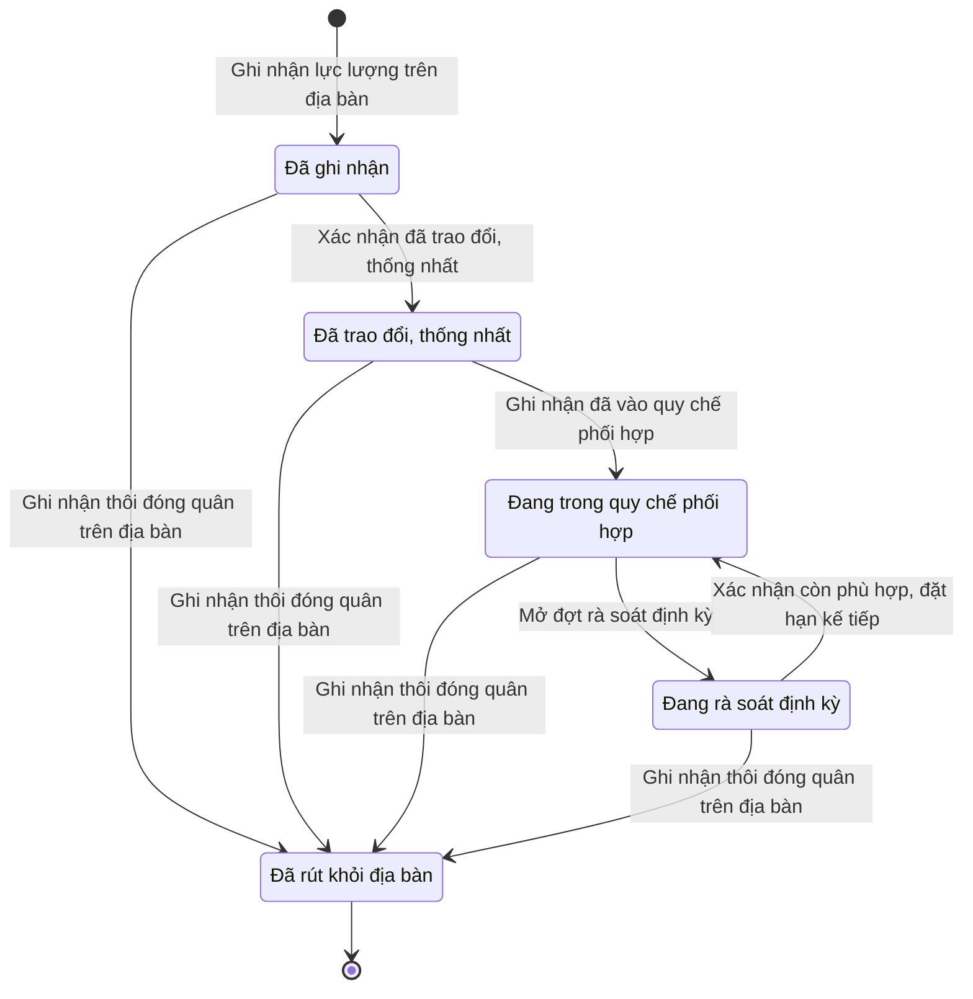

# ngoai63.stationed-force · Lực lượng đóng trên địa bàn

<!-- máy sinh: tom-tat -->
> **Hồ sơ:** Lực lượng đóng trên địa bàn (`StationedForce`)
>
> 8 bước · 5 chặng · 2 vai · 0 bảng quyết định · 0 hạn · 8 khớp nối.
>
> **Nguồn:** sổ nghiệp vụ `ngoai63.stationed-force` · khai báo của app: `dqtv-app/core/processes/stationed-force/workflow/stationed-force.yaml`. Các bảng do máy sinh từ nguồn này.
<!-- hết: tom-tat -->

<!-- viết tay: dien-giai -->
## Diễn giải

*Phần này viết tay, diễn giải lại điều các bảng bên dưới ghi.*

### Quy trình này để làm gì

Hồ sơ ghi một **lực lượng đóng trên địa bàn** — có chín loại: Công an cùng cấp, Trạm Biên phòng, Đơn vị Quân đội, Ban CHQS cơ quan, tổ chức, Người đứng đầu cơ quan, tổ chức, Kiểm lâm, Chủ rừng, Căn cứ, khu quân sự, Lực lượng khác trên địa bàn — và theo lực lượng ấy qua các chặng: ghi nhận, đã trao đổi thống nhất, trong quy chế phối hợp, đang rà soát, đã rút khỏi địa bàn.

Hồ sơ đi qua năm chặng: *Đã ghi nhận* → *Đã trao đổi, thống nhất* → *Đang trong quy chế phối hợp* ⇄ *Đang rà soát định kỳ*, và kết thúc ở *Đã rút khỏi địa bàn*.

### Khi nào bắt đầu

Trợ lý Tác huấn bấm **Ghi nhận lực lượng trên địa bàn**. Phải nhập tên lực lượng và loại lực lượng; cấp đơn vị, nơi đóng quân, diện bảo vệ bí mật, ghi chú nhập nếu có. Bước này cũng ghi ô "diện ký quy chế", suy ra từ loại lực lượng và cấp đơn vị. Hồ sơ vào *Đã ghi nhận*: xã tự lập, lúc này chưa trao đổi với lực lượng đó.

### Diễn ra thế nào

**Chặng "Đã ghi nhận".** Chỉ huy trưởng Ban CHQS xã bấm **Xác nhận đã trao đổi, thống nhất**: phải nhập chứng cứ trao đổi (số văn bản, biên bản), đầu mối và điện thoại; chức vụ, kênh dự phòng nhập nếu có. Hồ sơ sang *Đã trao đổi, thống nhất*.

**Chặng "Đã trao đổi, thống nhất".** Chỉ huy trưởng bấm **Ghi nhận đã vào quy chế phối hợp**: phải nhập `planId`, hạn rà soát kế tiếp nhập nếu có; bước này nối hồ sơ tới Kế hoạch, văn kiện (quy trình 2). Bước đòi đã có ô "đã thống nhất lúc"; thiếu thì báo "chưa trao đổi, thống nhất với lực lượng này thì chưa đưa vào quy chế phối hợp được". Hồ sơ sang *Đang trong quy chế phối hợp*. Ở đây có một việc ngoài hệ (`charter-approval-commune-chairman`, do `communeChairman` làm), hệ nhận về `planId`.

**Chặng "Đang trong quy chế phối hợp" và "Đang rà soát định kỳ".** Trợ lý Tác huấn bấm **Mở đợt rà soát định kỳ** để sang *Đang rà soát định kỳ* (đợt rà soát hằng năm; `planTargetId` nhập nếu có), rồi bấm **Xác nhận còn phù hợp, đặt hạn kế tiếp** để hồ sơ quay về *Đang trong quy chế phối hợp*; bước sau ghi ngày rà soát gần nhất, hạn rà soát kế tiếp và ghi chú. Cả hai bước tạo hoặc ghi vào hồ sơ con Đợt rà soát lực lượng đứng chân; bước sau lặp được.

**Việc làm trong lúc hồ sơ đứng yên:**

- **Sửa thông tin lực lượng** (Trợ lý Tác huấn) — tên, nơi đóng quân, đầu mối, liên lạc; làm được ở ba chặng đầu, không làm được khi đang rà soát.
- **Ghi nhận biên bản buổi thống nhất** (Chỉ huy trưởng Ban CHQS xã) — phải nhập `minutesAt`, `chairConclusion`; nhập nếu có: `minutesNumber`, `participants`, `scanPath`, lực lượng khác cùng dự buổi họp. Bước tạo một hồ sơ con Biên bản cuộc họp; làm được ở cả bốn chặng chưa kết thúc, lặp được.

**Kết thúc sớm:** Trợ lý Tác huấn bấm **Ghi nhận thôi đóng quân trên địa bàn** từ bất kỳ chặng nào, phải nhập ngày rút. Hồ sơ sang *Đã rút khỏi địa bàn*; lịch sử được giữ lại.

### Kết thúc và để lại gì

Hồ sơ kết thúc ở *Đã rút khỏi địa bàn*. Lực lượng gắn vào **Kế hoạch, văn kiện** (2) ở bước vào quy chế — diện cùng ký quy chế phối hợp và kế hoạch phối hợp hằng năm; còn được gắn vào **Tình huống dự kiến** (2) và **Vụ việc ứng phó** (20) bằng các bước của hai quy trình ấy. Lực lượng còn nối tới lệnh điều động có phối hợp (13a), tới văn kiện giao trách nhiệm cho lực lượng và dòng chỉ tiêu của đợt rà soát (2), và tới vụ việc ứng phó mà lực lượng chủ trì phối hợp (20).

### Điều kiện chặn

- Người làm phải thuộc đơn vị chủ hồ sơ ở sáu bước: sửa, xác nhận đã trao đổi, ghi biên bản, mở rà soát, xác nhận còn phù hợp, thôi đóng quân. Sai người, sai chặng, thiếu thứ phải có trước thì chặn, hồ sơ giữ nguyên.
- Vào quy chế: phải đã có ô "đã thống nhất lúc".
- Việc ngoài hệ `charter-approval-commune-chairman`: `communeChairman` làm, hệ nhận về `planId`; không được thì chặn, hồ sơ giữ nguyên.
<!-- hết viết tay -->

## 1. Đường đi ngắn nhất qua các chặng

<!-- máy sinh: luong-chinh -->
Đường ít bước nhất từ lúc mở hồ sơ tới chặng kết thúc xa nhất. Máy chọn theo số chặng, không theo ý nghĩa nghiệp vụ — trình tự công việc thật xem phần Diễn giải và bảng "Việc làm ở từng chặng" ở mục 6.

| # | Ai làm | Làm gì | Hồ sơ sang chặng |
|---|---|---|---|
| 1 | Trợ lý Tác huấn | Ghi nhận lực lượng trên địa bàn | Đã ghi nhận |
| 2 | Trợ lý Tác huấn | Ghi nhận thôi đóng quân trên địa bàn | Đã rút khỏi địa bàn |

<!-- hết: luong-chinh -->

## 2. Hồ sơ và việc nó để lại

<!-- máy sinh: muc-tieu -->
**App gọi quy trình này là:** Chặng 5 — Lực lượng đóng trên địa bàn.

**Hồ sơ này để lại cho quy trình khác** (bước tạo hồ sơ của quy trình kia ghi mối nối về đây):
- Vụ việc ứng phó (20) — bước `openCase`, khớp nối `caseCoordinatesWith`
- Vụ việc ứng phó (20) — bước `openCase`, khớp nối `caseLedBy`
<!-- hết: muc-tieu -->

## 3. Khởi phát và kết thúc

<!-- máy sinh: khoi-phat -->
**1 cửa vào** — bước mở hồ sơ:

| Bước mở | Ai mở | Hồ sơ vào chặng | App bắt buộc nhập |
|---|---|---|---|
| Ghi nhận lực lượng trên địa bàn | Trợ lý Tác huấn | Đã ghi nhận | tên lực lượng, loại lực lượng |

**Kết thúc:** *Đã rút khỏi địa bàn* (`DEPARTED`)
<!-- hết: khoi-phat -->

## 4. Vai trò

<!-- máy sinh: vai-tro -->
| Vai trong sổ | Tên trong app | Điều kiện | Làm những bước |
|---|---|---|---|
| `operator` | Trợ lý Tác huấn |  | Ghi nhận lực lượng trên địa bàn · Sửa thông tin lực lượng · Mở đợt rà soát định kỳ · Xác nhận còn phù hợp, đặt hạn kế tiếp · Ghi nhận thôi đóng quân trên địa bàn |
| `commander` | Chỉ huy trưởng Ban CHQS xã |  | Xác nhận đã trao đổi, thống nhất · Ghi nhận đã vào quy chế phối hợp · Ghi nhận biên bản buổi thống nhất |

*"Tên trong app" là tên app đặt cho mã chủ thể của vai. Hồ sơ thuộc đơn vị cấp khác thì người làm là người giữ vai ấy ở đơn vị nêu trong cột "Điều kiện" (nếu sổ có ghi) và ở cột "Người làm phải thuộc" của bảng "Theo khai báo của app" (mục 7).*

**Ngoài hệ** (hệ chỉ ghi kết quả, xem mục 8): `communeChairman`.
<!-- hết: vai-tro -->

## 5. Nhánh phụ

<!-- máy sinh: nhanh-phu -->
**Bước khác đưa hồ sơ sang chặng mới** — đường song song, rẽ nhánh hoặc kết thúc sớm:

| Bước | Ai làm | Từ chặng | Sang chặng |
|---|---|---|---|
| Xác nhận đã trao đổi, thống nhất | Chỉ huy trưởng Ban CHQS xã | Đã ghi nhận | Đã trao đổi, thống nhất |
| Ghi nhận đã vào quy chế phối hợp | Chỉ huy trưởng Ban CHQS xã | Đã trao đổi, thống nhất | Đang trong quy chế phối hợp |
| Mở đợt rà soát định kỳ | Trợ lý Tác huấn | Đang trong quy chế phối hợp | Đang rà soát định kỳ |

**Quay lại một chặng hồ sơ đã đi qua** (tính theo đường ngắn nhất từ lúc mở):

| Bước | Ai làm | Từ chặng | Về chặng |
|---|---|---|---|
| Xác nhận còn phù hợp, đặt hạn kế tiếp | Trợ lý Tác huấn | Đang rà soát định kỳ | Đang trong quy chế phối hợp |

**Làm trong lúc hồ sơ đứng yên ở một chặng** — ghi nhận, bổ sung:

| Bước | Ai làm | Ở chặng |
|---|---|---|
| Sửa thông tin lực lượng | Trợ lý Tác huấn | Đã ghi nhận, Đã trao đổi, thống nhất, Đang trong quy chế phối hợp |
| Ghi nhận biên bản buổi thống nhất *(lặp được)* | Chỉ huy trưởng Ban CHQS xã | Đã ghi nhận, Đã trao đổi, thống nhất, Đang trong quy chế phối hợp, Đang rà soát định kỳ |

<!-- hết: nhanh-phu -->

## 6. Các chặng và việc làm ở từng chặng

<!-- máy sinh: chang -->
| Chặng | Tên hiển thị | Vào bằng bước | Kết thúc? |
|---|---|---|---|
| `NOTED` | Đã ghi nhận | Ghi nhận lực lượng trên địa bàn |  |
| `CONFIRMED` | Đã trao đổi, thống nhất | Xác nhận đã trao đổi, thống nhất |  |
| `IN_CHARTER` | Đang trong quy chế phối hợp | Ghi nhận đã vào quy chế phối hợp · Xác nhận còn phù hợp, đặt hạn kế tiếp |  |
| `UNDER_REVIEW` | Đang rà soát định kỳ | Mở đợt rà soát định kỳ |  |
| `DEPARTED` | Đã rút khỏi địa bàn | Ghi nhận thôi đóng quân trên địa bàn | **kết thúc** |

### Việc làm ở từng chặng

Hồ sơ đang ở chặng nào thì làm được những bước nào.

| Hồ sơ đang ở chặng | Bước làm tại chặng (hồ sơ đứng yên) | Bước đưa hồ sơ sang chặng khác |
|---|---|---|
| **Đã ghi nhận** | Sửa thông tin lực lượng — Trợ lý Tác huấn Ghi nhận biên bản buổi thống nhất (lặp được) — Chỉ huy trưởng Ban CHQS xã | Xác nhận đã trao đổi, thống nhất — Chỉ huy trưởng Ban CHQS xã → *Đã trao đổi, thống nhất* Ghi nhận thôi đóng quân trên địa bàn — Trợ lý Tác huấn → *Đã rút khỏi địa bàn* |
| **Đã trao đổi, thống nhất** | Sửa thông tin lực lượng — Trợ lý Tác huấn Ghi nhận biên bản buổi thống nhất (lặp được) — Chỉ huy trưởng Ban CHQS xã | Ghi nhận đã vào quy chế phối hợp — Chỉ huy trưởng Ban CHQS xã → *Đang trong quy chế phối hợp* Ghi nhận thôi đóng quân trên địa bàn — Trợ lý Tác huấn → *Đã rút khỏi địa bàn* |
| **Đang trong quy chế phối hợp** | Sửa thông tin lực lượng — Trợ lý Tác huấn Ghi nhận biên bản buổi thống nhất (lặp được) — Chỉ huy trưởng Ban CHQS xã | Mở đợt rà soát định kỳ — Trợ lý Tác huấn → *Đang rà soát định kỳ* Ghi nhận thôi đóng quân trên địa bàn — Trợ lý Tác huấn → *Đã rút khỏi địa bàn* |
| **Đang rà soát định kỳ** | Ghi nhận biên bản buổi thống nhất (lặp được) — Chỉ huy trưởng Ban CHQS xã | Xác nhận còn phù hợp, đặt hạn kế tiếp — Trợ lý Tác huấn → *Đang trong quy chế phối hợp* Ghi nhận thôi đóng quân trên địa bàn — Trợ lý Tác huấn → *Đã rút khỏi địa bàn* |
| **Đã rút khỏi địa bàn** | — | — (kết thúc) |
<!-- hết: chang -->

## 7. Bảng bước

<!-- máy sinh: buoc -->
| # | Bước | Mã bước | Ai thực hiện | Từ chặng | Sang chặng | Phải có trước | Ghi lại |
|---|---|---|---|---|---|---|---|
| 1 | Ghi nhận lực lượng trên địa bàn | `noteStationedForce` | Trợ lý Tác huấn | — (mở hồ sơ) | `NOTED` | — | mã tỉnh, mã xã, tên lực lượng, loại lực lượng, cấp đơn vị, diện ký quy chế, nơi đóng quân, diện bảo vệ bí mật, `notedAt`, ghi chú, đơn vị chủ hồ sơ |
| 2 | Sửa thông tin lực lượng | `editStationedForce` | Trợ lý Tác huấn | `NOTED`, `CONFIRMED`, `IN_CHARTER` | giữ nguyên | người làm thuộc đơn vị chủ hồ sơ | tên lực lượng, nơi đóng quân, đầu mối, chức vụ, điện thoại, kênh dự phòng, ghi chú |
| 3 | Xác nhận đã trao đổi, thống nhất | `confirmStationedForce` | Chỉ huy trưởng Ban CHQS xã | `NOTED` | `CONFIRMED` | người làm thuộc đơn vị chủ hồ sơ | đã thống nhất lúc, chứng cứ trao đổi, đầu mối, chức vụ, điện thoại, kênh dự phòng |
| 4 | Ghi nhận đã vào quy chế phối hợp | `enterCharter` | Chỉ huy trưởng Ban CHQS xã | `CONFIRMED` | `IN_CHARTER` | đã thống nhất lúc | hạn rà soát kế tiếp, nối tới Kế hoạch, văn kiện |
| 5 | Ghi nhận biên bản buổi thống nhất | `recordAgreementMinutes` | Chỉ huy trưởng Ban CHQS xã | `NOTED`, `CONFIRMED`, `IN_CHARTER`, `UNDER_REVIEW` | giữ nguyên | người làm thuộc đơn vị chủ hồ sơ | nối tới Biên bản cuộc họp |
| 6 | Mở đợt rà soát định kỳ | `startReview` | Trợ lý Tác huấn | `IN_CHARTER` | `UNDER_REVIEW` | người làm thuộc đơn vị chủ hồ sơ | nối tới Đợt rà soát lực lượng đứng chân, nối `reviewUnderTarget` (Đợt rà soát lực lượng đứng chân → Chỉ tiêu) |
| 7 | Xác nhận còn phù hợp, đặt hạn kế tiếp | `finishReview` | Trợ lý Tác huấn | `UNDER_REVIEW` | `IN_CHARTER` | người làm thuộc đơn vị chủ hồ sơ | rà soát gần nhất, hạn rà soát kế tiếp, ghi chú, nối tới Đợt rà soát lực lượng đứng chân |
| 8 | Ghi nhận thôi đóng quân trên địa bàn | `markDeparted` | Trợ lý Tác huấn | `NOTED`, `CONFIRMED`, `IN_CHARTER`, `UNDER_REVIEW` | `DEPARTED` | người làm thuộc đơn vị chủ hồ sơ | ngày rút khỏi địa bàn, ghi chú |

### Khi không đạt điều kiện

Mặc định: không đúng người, hồ sơ không ở đúng chặng, hoặc thiếu thứ "phải có trước" thì bước bị chặn, hồ sơ giữ nguyên. Bảng dưới chỉ kê những bước có kết quả riêng.

| # | Bước | Kết quả riêng |
|---|---|---|
| 4 | Ghi nhận đã vào quy chế phối hợp | bên ngoài hệ không trả về `planId` → hồ sơ sang *Đang trong quy chế phối hợp* |

### Điều kiện "phải có trước" bằng lời

Cột "Phải có trước" ở bảng bước có hai loại: ô dữ liệu thường (bước chỉ đòi ô ấy đã có giá trị) và điều kiện hệ tự xét. Bảng này diễn các điều kiện hệ tự xét theo đúng công thức sổ ghi; số ở cột cuối là số thứ tự bước.

| Điều kiện | Đúng khi | Bước đòi |
|---|---|---|
| `actorInOwnerUnit` | người đang làm là người của đơn vị ghi ở ô đơn vị chủ hồ sơ của hồ sơ này (theo danh mục người của đơn vị, `dm.unit-staff`) | 2, 3, 5, 6, 7, 8 |

### Theo khai báo của app

Người làm phải thuộc đơn vị nào, ô người dùng phải nhập, bước có lặp được không, và căn cứ pháp lý — lấy từ khai báo quy trình trong app.

| # | Bước | Người làm phải thuộc | Bắt buộc nhập | Nhập nếu có | Lặp được | Căn cứ |
|---|---|---|---|---|---|---|
| 1 | Ghi nhận lực lượng trên địa bàn |  | tên lực lượng, loại lực lượng | cấp đơn vị, nơi đóng quân, diện bảo vệ bí mật, ghi chú |  | NĐ02/2020/NĐ-CP Đ.4 k1 c · QĐ1126/QĐ-TM Đ.8 k2 |
| 2 | Sửa thông tin lực lượng | đơn vị chủ hồ sơ | — | tên lực lượng, nơi đóng quân, đầu mối, chức vụ, điện thoại, kênh dự phòng, ghi chú |  | NĐ02/2020/NĐ-CP Đ.4 k1 c |
| 3 | Xác nhận đã trao đổi, thống nhất | đơn vị chủ hồ sơ | chứng cứ trao đổi, đầu mối, điện thoại | chức vụ, kênh dự phòng |  | NĐ02/2020/NĐ-CP Đ.4 k1 c |
| 4 | Ghi nhận đã vào quy chế phối hợp |  | `planId` | hạn rà soát kế tiếp |  | NĐ02/2020/NĐ-CP Đ.4 k1 c |
| 5 | Ghi nhận biên bản buổi thống nhất | đơn vị chủ hồ sơ | `minutesAt`, `chairConclusion` | `minutesNumber`, `participants`, `scanPath`, lực lượng khác cùng dự buổi họp | có | NĐ02/2020/NĐ-CP Đ.4 k1 c · Đ.4 k1 d |
| 6 | Mở đợt rà soát định kỳ | đơn vị chủ hồ sơ | — | `planTargetId` |  | NĐ02/2020/NĐ-CP Đ.4 k1 d · QĐ1126/QĐ-TM Đ.8 k6 |
| 7 | Xác nhận còn phù hợp, đặt hạn kế tiếp | đơn vị chủ hồ sơ | — | hạn rà soát kế tiếp, ghi chú | có | NĐ02/2020/NĐ-CP Đ.4 k1 d · QĐ1126/QĐ-TM Đ.8 k6 |
| 8 | Ghi nhận thôi đóng quân trên địa bàn | đơn vị chủ hồ sơ | — | ghi chú |  | NĐ02/2020/NĐ-CP Đ.4 k1 d · QĐ1126/QĐ-TM Đ.8 k2 |

### Điều kiện và ghi chú app khai cho từng bước

Lấy từ khai báo quy trình trong app. Lời trong ngoặc kép là câu app hiện cho người dùng. Chức danh người ký ngoài hệ app chỉ khai bằng mã.

| # | Bước | Điều kiện, ghi chú |
|---|---|---|
| 4 | Ghi nhận đã vào quy chế phối hợp | · phải đã có ô "đã thống nhất lúc" — thiếu thì app báo: "chưa trao đổi, thống nhất với lực lượng này thì chưa đưa vào quy chế phối hợp được" |
| 5 | Ghi nhận biên bản buổi thống nhất | · tạo thêm một hồ sơ con: Biên bản cuộc họp (`MeetingMinutes`) |
| 6 | Mở đợt rà soát định kỳ | · tạo thêm một hồ sơ con: Đợt rà soát lực lượng đứng chân (`ForceReview`) |
| 7 | Xác nhận còn phù hợp, đặt hạn kế tiếp | · tạo thêm một hồ sơ con: Đợt rà soát lực lượng đứng chân (`ForceReview`) |
<!-- hết: buoc -->

## 8. Bảng quyết định, hạn, việc ngoài hệ

<!-- máy sinh: quyet-dinh -->
**Việc làm ngoài hệ, hệ chỉ ghi kết quả:**

| Ranh giới | Ai làm | Hệ gửi ra | Hệ nhận về | Không được thì |
|---|---|---|---|---|
| `charter-approval-commune-chairman` | `communeChairman` | — | `planId` | chặn, hồ sơ giữ nguyên |
<!-- hết: quyet-dinh -->

## 9. Dữ liệu của hồ sơ

<!-- máy sinh: du-lieu -->
Các ô mà bước trong sổ ghi hoặc đòi. Số trong hai cột cuối là số thứ tự bước ở bảng bước (mục 7).

| Ô dữ liệu | Mã | Kiểu (app) | Giá trị cho phép | Loại ô (sổ) | Bước ghi | Bước đòi | Mô tả trong app |
|---|---|---|---|---|---|---|---|
| mã tỉnh | `provinceCode` | chữ |  | lưu trên hồ sơ (`stored`) | 1 | — | Mã tỉnh — dùng lọc phạm vi theo hàng; rỗng khi hồ sơ thuộc quân khu hoặc Bộ Quốc phòng |
| mã xã | `communeCode` | chữ |  | lưu trên hồ sơ (`stored`) | 1 | — | Mã xã |
| tên lực lượng | `forceName` | chữ |  | đưa vào ở bước (`input`) | 1, 2 | — | Tên lực lượng, cơ quan, tổ chức |
| loại lực lượng | `forceType` | chọn một | Công an cùng cấp (`police`), Trạm Biên phòng (`border_post`), Đơn vị Quân đội (`army_unit`), Ban CHQS cơ quan, tổ chức (`org_command`), Người đứng đầu cơ quan, tổ chức (`org_head`), Kiểm lâm (`forest_ranger`), Chủ rừng (`forest_owner`), Căn cứ, khu quân sự (`military_base`), Lực lượng khác trên địa bàn (`other`) | đưa vào ở bước (`input`) | 1 | — | Loại — theo đúng danh sách NĐ02/2020 Đ.4 k1 c |
| cấp đơn vị | `echelon` | chọn một | Trung đội (`platoon`), Đại đội (`company`), Tiểu đoàn (`battalion`), Trung đoàn (`regiment`), Từ Trung đoàn trở lên (`higher`) | đưa vào ở bước (`input`) | 1 | — | Cấp của đơn vị Quân đội — quyết định có thuộc diện ký quy chế không |
| diện ký quy chế | `inCharterScope` | chọn một | Thuộc diện cùng ký (`yes`), Chỉ ghi nhận (`no`) | lưu trên hồ sơ (`stored`) | 1 | — | Thuộc diện cùng ký quy chế phối hợp — suy ra từ forceType và echelon |
| nơi đóng quân | `location` | chữ |  | đưa vào ở bước (`input`) | 1, 2 | — | Địa chỉ đóng quân |
| diện bảo vệ bí mật | `classified` | chọn một | Có — hạn chế hiển thị (`yes`), Không (`no`) | đưa vào ở bước (`input`) | 1 | — | 🔒 Thuộc diện bảo vệ bí mật — che phiên hiệu, địa chỉ với vai không đủ thẩm quyền |
| — | `notedAt` | ngày giờ |  | lưu trên hồ sơ (`stored`) | 1 | — | Thời điểm ghi nhận |
| ghi chú | `note` | chữ |  | đưa vào ở bước (`input`) | 1, 2, 7, 8 | — | Ghi chú |
| đơn vị chủ hồ sơ | `ownerUnit` |  |  | lưu trên hồ sơ (`stored`) | 1 | — |  |
| đầu mối | `contactName` | chữ |  | đưa vào ở bước (`input`) | 2, 3 | — | Họ tên đầu mối |
| chức vụ | `contactRole` | chữ |  | đưa vào ở bước (`input`) | 2, 3 | — | Chức vụ đầu mối |
| điện thoại | `contactPhone` | chữ |  | đưa vào ở bước (`input`) | 2, 3 | — | Điện thoại |
| kênh dự phòng | `backupChannel` | chữ |  | đưa vào ở bước (`input`) | 2, 3 | — | Kênh liên lạc dự phòng |
| đã thống nhất lúc | `agreedAt` | ngày giờ |  | lưu trên hồ sơ (`stored`) | 3 | 4 | Thời điểm đã trao đổi, thống nhất — NĐ02/2020 Đ.4 k1 c |
| chứng cứ trao đổi | `confirmEvidence` | chữ |  | đưa vào ở bước (`input`) | 3 | — | Chứng cứ đã trao đổi: số văn bản, biên bản |
| hạn rà soát kế tiếp | `nextReviewDate` | ngày |  | đưa vào ở bước (`input`) | 4, 7 | — | Hạn rà soát kế tiếp (hằng năm) |
| rà soát gần nhất | `lastReviewedAt` | ngày |  | lưu trên hồ sơ (`stored`) | 7 | — | Lần rà soát gần nhất — NĐ02/2020 Đ.4 k1 d |
| ngày rút khỏi địa bàn | `departedAt` | ngày |  | lưu trên hồ sơ (`stored`) | 8 | — | Ngày thôi đóng quân trên địa bàn |
| người làm thuộc đơn vị chủ hồ sơ | `actorInOwnerUnit` |  | có hay chưa | hệ suy ra (`derived`) | — | 2, 3, 5, 6, 7, 8 |  |

21 ô. Cột "Loại ô" là cách sổ phân loại ô, in kèm đúng chữ của sổ; ô nào người dùng phải nhập xem bảng "Theo khai báo của app" ở mục 7.
<!-- hết: du-lieu -->

## 10. Khớp nối với quy trình khác

<!-- máy sinh: khop-noi -->
| Quy trình kia | Hồ sơ kia | Quan hệ | Nội dung (mô tả trong app) | Bước ghi mối nối | Tên ô nối |
|---|---|---|---|---|---|
| 13a | Lệnh điều động | gắn với nhau ở một bước giữa chừng | Nhiệm vụ có phối hợp, hoặc đã đề nghị UBND huy động lực lượng này — NĐ02/2020 Đ.4; Luật PTDS Đ.21 k2 | 13a·recordCoordination, 13a·requestMobilization | `coordinatesWith` |
| 14 | Sự kiện — huấn luyện, hội thi, diễn tập, hội nghị | có nối | KHÔNG DÙNG — diễn tập chung với đơn vị đứng chân trên địa bàn (mã gốc B055); chưa use case nào trong 60_ nói… | — | `exercisesWith` |
| 2 | Kế hoạch, văn kiện | gắn với nhau ở một bước giữa chừng | Diện phải CÙNG KÝ văn kiện này — chỉ quy chế phối hợp và kế hoạch phối hợp hằng năm, NĐ02/2020 Đ.4 k1 c và Đ.… | stationed-force·enterCharter, 2·setPlanForces | `charterCoversForce` |
| 2 | Kế hoạch, văn kiện | có nối | Cơ quan, đơn vị mà văn kiện này giao trách nhiệm — KHÔNG cùng ký. Kế hoạch phòng thủ dân sự (L18/2023 Đ.12 k2… | — | `planAssignsForce` |
| 2 | Chỉ tiêu | gắn với nhau ở một bước giữa chừng | Đợt rà soát quy chế phối hợp thuộc dòng chỉ tiêu nào — NĐ02/2020 Đ.4 k1 d | stationed-force·startReview | `reviewUnderTarget` |
| 2 | Tình huống dự kiến | gắn với nhau ở một bước giữa chừng | Lực lượng trên địa bàn dự kiến phối hợp trong tình huống này — L18/2023 Đ.12 k2 e; NĐ02/2020 Đ.20 k2 | 2·addPlannedSituation, 2·editPlannedSituation | `situationWithForce` |
| 20 | Vụ việc ứng phó | hồ sơ kia **mở ra từ** hồ sơ này | Vụ việc ứng phó có hiệp đồng, hoặc đã đề nghị huy động lực lượng này — NĐ02/2020 Đ.9–Đ.22; L18/2023 Đ.21 k2 | 20·openCase ⊕, 20·recordCaseCoordination, 20·requestCaseMobilizationRequestSignature | `caseCoordinatesWith` |
| 20 | Vụ việc ứng phó | hồ sơ kia **mở ra từ** hồ sơ này | Bên chủ trì phối hợp trong vụ việc này — NĐ02/2020 Đ.20 k2, Đ.21 k2 (cháy rừng: Kiểm lâm; cháy nổ: Công an) | 20·openCase ⊕ | `caseLedBy` |

8 khớp nối. ⊕ là bước tạo hồ sơ.
<!-- hết: khop-noi -->

## 11. Thông tin chung

<!-- máy sinh: thong-tin -->
| | |
|---|---|
| **Mã trong sổ** | `ngoai63.stationed-force` |
| **Quy trình trong app** | `stationed-force` (`workflow/stationed-force.yaml`) |
| **Hồ sơ** | Lực lượng đóng trên địa bàn (`StationedForce`) |
| **Căn cứ pháp lý từng bước** | cột "Căn cứ" ở bảng "Theo khai báo của app", mục 7 |
<!-- hết: thong-tin -->
