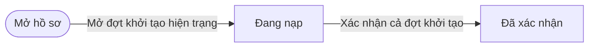
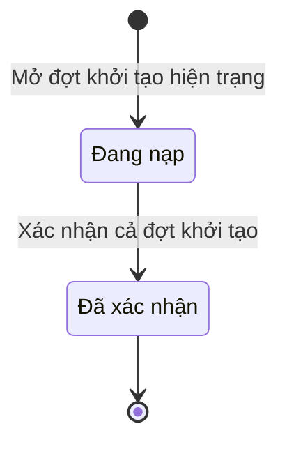

# ngoai63.system-onboarding · Đợt khởi tạo hiện trạng

<!-- máy sinh: tom-tat -->
> **Hồ sơ:** Đợt khởi tạo hiện trạng (`OnboardingBatch`)
>
> 3 bước · 2 chặng · 2 vai · 2 bảng quyết định · 0 hạn · 5 khớp nối.
>
> **Nguồn:** sổ nghiệp vụ `ngoai63.system-onboarding` · khai báo của app: `dqtv-app/core/processes/system-onboarding/workflow/system-onboarding.yaml`. Các bảng do máy sinh từ nguồn này.
<!-- hết: tom-tat -->

<!-- viết tay: dien-giai -->
## Diễn giải

*Phần này viết tay, diễn giải lại điều các bảng bên dưới ghi.*

### Quy trình này để làm gì

Trợ lý Quân lực mở một **đợt khởi tạo hiện trạng**, nạp các tệp danh sách vào đợt, rồi Chỉ huy trưởng Ban CHQS xã xác nhận cả đợt. Ngày khởi tạo là mốc hệ thống bắt đầu là sổ gốc của xã. Đợt chỉ có hai chặng: *Đang nạp* → *Đã xác nhận*.

### Khi nào bắt đầu

Trợ lý Quân lực bấm **Mở đợt khởi tạo hiện trạng**. Phải nhập ngày khởi tạo, ngày mở đợt và `planTargetIds` (`planTargetId` là id dòng chỉ tiêu của nhiệm vụ đưa hệ thống vào sử dụng); căn cứ (văn bản triển khai của cấp trên) và ghi chú là ô nhập nếu có. Đợt mở ra có nối tới chỉ tiêu (quy trình 2).

### Diễn ra thế nào

1. **Đang nạp.** Trợ lý Quân lực **Nạp tệp danh sách** (lặp được, đợt đứng yên). Mỗi lần nạp phải nhập `kind`, `sourceFile` và các dòng đã đối chiếu xong với dữ liệu dân cư và đợt; bước tạo hồ sơ con Dòng khởi tạo hiện trạng. Nạp lại một tệp cùng loại thì dòng nháp cũ cùng loại bị thay.
2. Chỉ huy trưởng Ban CHQS xã bấm **Xác nhận cả đợt khởi tạo**, nhập ngày xác nhận; bước nhận vào các dòng nháp của đợt kèm id đã tra sẵn. Đợt sang *Đã xác nhận*: lúc này hồ sơ đã được tạo và đợt khoá.

### Kết thúc và để lại gì

Đợt kết thúc ở *Đã xác nhận*. Bốn loại hồ sơ vào hệ qua đợt khởi tạo: chiến sĩ dân quân tự vệ đang phục vụ (16.enlistment), đơn vị dân quân tự vệ (29), Ban chỉ huy quân sự cấp xã (29.command-board) và chức danh Ban chỉ huy (30.commune-command).

### Điều kiện chặn

- Nạp tệp và xác nhận: người làm phải thuộc đơn vị chủ hồ sơ. Sai người, sai chặng thì bước bị chặn, đợt giữ nguyên.
- Nạp tệp chỉ làm được ở chặng *Đang nạp*; đợt đã xác nhận không còn bước nào.
<!-- hết viết tay -->

## 1. Đường đi ngắn nhất qua các chặng

<!-- máy sinh: luong-chinh -->
Đường ít bước nhất từ lúc mở hồ sơ tới chặng kết thúc xa nhất. Máy chọn theo số chặng, không theo ý nghĩa nghiệp vụ — trình tự công việc thật xem phần Diễn giải và bảng "Việc làm ở từng chặng" ở mục 6.

| # | Ai làm | Làm gì | Hồ sơ sang chặng |
|---|---|---|---|
| 1 | Trợ lý Quân lực | Mở đợt khởi tạo hiện trạng | Đang nạp |
| 2 | Chỉ huy trưởng Ban CHQS xã | Xác nhận cả đợt khởi tạo | Đã xác nhận |

<!-- hết: luong-chinh -->

## 2. Hồ sơ và việc nó để lại

<!-- máy sinh: muc-tieu -->
**App gọi quy trình này là:** Khởi tạo hiện trạng.

**Khi mở, hồ sơ này ghi mối nối tới:**
- Chỉ tiêu (2) — bước `openOnboarding`, khớp nối `onboardingUnderTarget`
<!-- hết: muc-tieu -->

## 3. Khởi phát và kết thúc

<!-- máy sinh: khoi-phat -->
**1 cửa vào** — bước mở hồ sơ:

| Bước mở | Ai mở | Hồ sơ vào chặng | App bắt buộc nhập |
|---|---|---|---|
| Mở đợt khởi tạo hiện trạng | Trợ lý Quân lực | Đang nạp | ngày khởi tạo, ngày mở đợt, `planTargetIds` |

**Kết thúc:** *Đã xác nhận* (`CONFIRMED`)
<!-- hết: khoi-phat -->

## 4. Vai trò

<!-- máy sinh: vai-tro -->
| Vai trong sổ | Tên trong app | Điều kiện | Làm những bước |
|---|---|---|---|
| `operator` | Trợ lý Quân lực |  | Mở đợt khởi tạo hiện trạng · Nạp tệp danh sách |
| `commander` | Chỉ huy trưởng Ban CHQS xã |  | Xác nhận cả đợt khởi tạo |

*"Tên trong app" là tên app đặt cho mã chủ thể của vai. Hồ sơ thuộc đơn vị cấp khác thì người làm là người giữ vai ấy ở đơn vị nêu trong cột "Điều kiện" (nếu sổ có ghi) và ở cột "Người làm phải thuộc" của bảng "Theo khai báo của app" (mục 7).*
<!-- hết: vai-tro -->

## 5. Nhánh phụ

<!-- máy sinh: nhanh-phu -->
**Làm trong lúc hồ sơ đứng yên ở một chặng** — ghi nhận, bổ sung:

| Bước | Ai làm | Ở chặng |
|---|---|---|
| Nạp tệp danh sách *(lặp được)* | Trợ lý Quân lực | Đang nạp |

<!-- hết: nhanh-phu -->

## 6. Các chặng và việc làm ở từng chặng

<!-- máy sinh: chang -->
| Chặng | Tên hiển thị | Vào bằng bước | Kết thúc? |
|---|---|---|---|
| `OPEN` | Đang nạp | Mở đợt khởi tạo hiện trạng |  |
| `CONFIRMED` | Đã xác nhận | Xác nhận cả đợt khởi tạo | **kết thúc** |

### Việc làm ở từng chặng

Hồ sơ đang ở chặng nào thì làm được những bước nào.

| Hồ sơ đang ở chặng | Bước làm tại chặng (hồ sơ đứng yên) | Bước đưa hồ sơ sang chặng khác |
|---|---|---|
| **Đang nạp** | Nạp tệp danh sách (lặp được) — Trợ lý Quân lực | Xác nhận cả đợt khởi tạo — Chỉ huy trưởng Ban CHQS xã → *Đã xác nhận* |
| **Đã xác nhận** | — | — (kết thúc) |
<!-- hết: chang -->

## 7. Bảng bước

<!-- máy sinh: buoc -->
| # | Bước | Mã bước | Ai thực hiện | Từ chặng | Sang chặng | Phải có trước | Ghi lại |
|---|---|---|---|---|---|---|---|
| 1 | Mở đợt khởi tạo hiện trạng | `openOnboarding` | Trợ lý Quân lực | — (mở hồ sơ) | `OPEN` | — | mã tỉnh, mã xã, đợt khởi tạo, ngày khởi tạo, `planTargetId`, ngày mở đợt, căn cứ, ghi chú, nối tới Chỉ tiêu, đơn vị chủ hồ sơ, `loaiXa` |
| 2 | Nạp tệp danh sách | `stageOnboardingRows` | Trợ lý Quân lực | `OPEN` | giữ nguyên | người làm thuộc đơn vị chủ hồ sơ | nối tới Dòng khởi tạo hiện trạng, `laPhoChiHuyTruong` |
| 3 | Xác nhận cả đợt khởi tạo | `confirmOnboarding` | Chỉ huy trưởng Ban CHQS xã | `OPEN` | `CONFIRMED` | người làm thuộc đơn vị chủ hồ sơ, `dotCoDongNap` | ngày xác nhận, ghi chú, nối tới Đơn vị dân quân tự vệ, nối tới Ban chỉ huy quân sự cấp xã, nối tới Nhân sự Ban chỉ huy quân sự cấp xã, nối tới Chiến sĩ dân quân tự vệ |

### Khi không đạt điều kiện

Mặc định: không đúng người, hồ sơ không ở đúng chặng, hoặc thiếu thứ "phải có trước" thì bước bị chặn, hồ sơ giữ nguyên. Bảng dưới chỉ kê những bước có kết quả riêng.

| # | Bước | Kết quả riêng |
|---|---|---|
| 2 | Nạp tệp danh sách | bước dừng lại, hồ sơ giữ nguyên khi kết quả xét là: `bao_loi` |
| 3 | Xác nhận cả đợt khởi tạo | bước dừng lại, hồ sơ giữ nguyên khi kết quả xét là: `bao_loi` |

### Điều kiện "phải có trước" bằng lời

Cột "Phải có trước" ở bảng bước có hai loại: ô dữ liệu thường (bước chỉ đòi ô ấy đã có giá trị) và điều kiện hệ tự xét. Bảng này diễn các điều kiện hệ tự xét theo đúng công thức sổ ghi; số ở cột cuối là số thứ tự bước.

| Điều kiện | Đúng khi | Bước đòi |
|---|---|---|
| `actorInOwnerUnit` | người đang làm là người của đơn vị ghi ở ô đơn vị chủ hồ sơ của hồ sơ này (theo danh mục người của đơn vị, `dm.unit-staff`) | 2, 3 |
| `dotCoDongNap` | đã có nối tới Dòng khởi tạo hiện trạng | 3 |

### Theo khai báo của app

Người làm phải thuộc đơn vị nào, ô người dùng phải nhập, bước có lặp được không, và căn cứ pháp lý — lấy từ khai báo quy trình trong app.

| # | Bước | Người làm phải thuộc | Bắt buộc nhập | Nhập nếu có | Lặp được | Căn cứ |
|---|---|---|---|---|---|---|
| 1 | Mở đợt khởi tạo hiện trạng |  | ngày khởi tạo, ngày mở đợt, `planTargetIds` | căn cứ, ghi chú |  | docs/122 §3 ① · §7 ① |
| 2 | Nạp tệp danh sách | đơn vị chủ hồ sơ | `kind`, các dòng đã đối chiếu xong với dữ liệu dân cư và đợt, `sourceFile` | dòng nháp cũ cùng loại bị thay khi nạp lại tệp | có | docs/122 §3 ② · §4 |
| 3 | Xác nhận cả đợt khởi tạo | đơn vị chủ hồ sơ | ngày xác nhận, các dòng nháp của đợt, kèm id đã tra sẵn | ghi chú |  | docs/122 §3 ③ |

### Điều kiện và ghi chú app khai cho từng bước

Lấy từ khai báo quy trình trong app. Lời trong ngoặc kép là câu app hiện cho người dùng. Chức danh người ký ngoài hệ app chỉ khai bằng mã.

| # | Bước | Điều kiện, ghi chú |
|---|---|---|
| 2 | Nạp tệp danh sách | · tạo thêm một hồ sơ con: Dòng khởi tạo hiện trạng (`OnboardingLine`) |
<!-- hết: buoc -->

## 8. Bảng quyết định, hạn, việc ngoài hệ

<!-- máy sinh: quyet-dinh -->
**Bảng `chucDanhHopLe`** — xét ở bước *Nạp tệp danh sách*; đầu vào: `chucDanhTrongDanhMuc`. 3 dòng, dòng đầu tiên khớp thì dừng.

| Thứ tự dò (số sổ ghi) | Dòng | Khi | Thì |
|---|---|---|---|
| — | `chuaRo` | chưa có `chucDanhTrongDanhMuc` | `bao_loi` |
| — | `ngoaiDanhMuc` | `chucDanhTrongDanhMuc` là `khong` | `bao_loi` |
| — | `trongDanhMuc` | `chucDanhTrongDanhMuc` là `co` | cho qua |

**Bảng `dinhBienChucDanh`** — xét ở bước *Xác nhận cả đợt khởi tạo*; đầu vào: `laPhoChiHuyTruong`, `loaiXa`, `soNguoiCungChucDanhTrongDot`. 13 dòng, dòng đầu tiên khớp thì dừng.

| Thứ tự dò (số sổ ghi) | Dòng | Khi | Thì |
|---|---|---|---|
| — | `khongPhaiPhoChuaGhiLoaiXaTrongDinhBien` | `laPhoChiHuyTruong` đến 0 và chưa có `loaiXa` và `soNguoiCungChucDanhTrongDot` đến 1 | cho qua |
| — | `khongPhaiPhoChuaGhiLoaiXaVuot` | `laPhoChiHuyTruong` đến 0 và chưa có `loaiXa` và `soNguoiCungChucDanhTrongDot` lớn hơn 1 | `bao_loi` |
| — | `khongPhaiPhoXaThuongTrongDinhBien` | `laPhoChiHuyTruong` đến 0 và `loaiXa` là `khong_trong_diem` và `soNguoiCungChucDanhTrongDot` đến 1 | cho qua |
| — | `khongPhaiPhoXaThuongVuot` | `laPhoChiHuyTruong` đến 0 và `loaiXa` là `khong_trong_diem` và `soNguoiCungChucDanhTrongDot` lớn hơn 1 | `bao_loi` |
| — | `khongPhaiPhoXaTrongDiemTrongDinhBien` | `laPhoChiHuyTruong` đến 0 và `loaiXa` là `trong_diem` và `soNguoiCungChucDanhTrongDot` đến 1 | cho qua |
| — | `khongPhaiPhoXaTrongDiemVuot` | `laPhoChiHuyTruong` đến 0 và `loaiXa` là `trong_diem` và `soNguoiCungChucDanhTrongDot` lớn hơn 1 | `bao_loi` |
| — | `khongRoChucDanh` | chưa có `laPhoChiHuyTruong` | `bao_loi` |
| — | `phoChuaGhiLoaiXaTrongDinhBien` | `laPhoChiHuyTruong` lớn hơn 0 và chưa có `loaiXa` và `soNguoiCungChucDanhTrongDot` đến 1 | cho qua |
| — | `phoChuaGhiLoaiXaVuot` | `laPhoChiHuyTruong` lớn hơn 0 và chưa có `loaiXa` và `soNguoiCungChucDanhTrongDot` lớn hơn 1 | `bao_loi` |
| — | `phoXaThuongTrongDinhBien` | `laPhoChiHuyTruong` lớn hơn 0 và `loaiXa` là `khong_trong_diem` và `soNguoiCungChucDanhTrongDot` đến 1 | cho qua |
| — | `phoXaThuongVuot` | `laPhoChiHuyTruong` lớn hơn 0 và `loaiXa` là `khong_trong_diem` và `soNguoiCungChucDanhTrongDot` lớn hơn 1 | `bao_loi` |
| — | `phoXaTrongDiemTrongDinhBien` | `laPhoChiHuyTruong` lớn hơn 0 và `loaiXa` là `trong_diem` và `soNguoiCungChucDanhTrongDot` đến 2 | cho qua |
| — | `phoXaTrongDiemVuot` | `laPhoChiHuyTruong` lớn hơn 0 và `loaiXa` là `trong_diem` và `soNguoiCungChucDanhTrongDot` lớn hơn 2 | `bao_loi` |

<!-- hết: quyet-dinh -->

## 9. Dữ liệu của hồ sơ

<!-- máy sinh: du-lieu -->
Các ô mà bước trong sổ ghi hoặc đòi. Số trong hai cột cuối là số thứ tự bước ở bảng bước (mục 7).

| Ô dữ liệu | Mã | Kiểu (app) | Giá trị cho phép | Loại ô (sổ) | Bước ghi | Bước đòi | Mô tả trong app |
|---|---|---|---|---|---|---|---|
| mã tỉnh | `provinceCode` | chữ |  | lưu trên hồ sơ (`stored`) | 1 | — | Mã tỉnh — dùng lọc phạm vi theo hàng |
| mã xã | `communeCode` | chữ |  | lưu trên hồ sơ (`stored`) | 1 | — | Mã xã |
| đợt khởi tạo | `batchName` | chữ |  | lưu trên hồ sơ (`stored`) | 1 | — | Tên đợt — đọc được, vd Khởi tạo hiện trạng xã Đức Thịnh |
| ngày khởi tạo | `onboardingDate` | ngày |  | đưa vào ở bước (`input`) | 1 | — | Ngày khởi tạo — mốc hệ thống bắt đầu là sổ gốc của xã |
| — | `planTargetId` | chữ |  | lưu trên hồ sơ (`stored`) | 1 | — | id dòng chỉ tiêu của nhiệm vụ đưa hệ thống vào sử dụng — lọc nhanh, quan hệ thật ở cạnh onboardingUnderTarget |
| ngày mở đợt | `openedAt` | ngày |  | đưa vào ở bước (`input`) | 1 | — | Ngày mở đợt |
| căn cứ | `basisNote` | chữ |  | đưa vào ở bước (`input`) | 1 | — | Căn cứ — văn bản triển khai của cấp trên |
| ghi chú | `note` | chữ |  | đưa vào ở bước (`input`) | 1, 3 | — | Ghi chú |
| đơn vị chủ hồ sơ | `ownerUnit` |  |  | lưu trên hồ sơ (`stored`) | 1 | — |  |
| — | `loaiXa` |  | `trong_diem`, `khong_trong_diem` | lưu trên hồ sơ (`stored`) | 1 | — |  |
| — | `laPhoChiHuyTruong` |  |  | lưu trên hồ sơ (`stored`) | 2 | — |  |
| ngày xác nhận | `confirmationDate` | ngày |  | đưa vào ở bước (`input`) | 3 | — | Ngày Chỉ huy trưởng xác nhận cả đợt |
| người làm thuộc đơn vị chủ hồ sơ | `actorInOwnerUnit` |  | có hay chưa | hệ suy ra (`derived`) | — | 2, 3 |  |
| — | `dotCoDongNap` |  |  | hệ suy ra (`derived`) | — | 3 |  |
| — | `soNguoiCungChucDanhTrongDot` |  |  | đưa vào ở bước (`input`) | — | — |  |
| — | `chucDanhTrongDanhMuc` |  | `co`, `khong` | đưa vào ở bước (`input`) | — | — |  |

16 ô. Cột "Loại ô" là cách sổ phân loại ô, in kèm đúng chữ của sổ; ô nào người dùng phải nhập xem bảng "Theo khai báo của app" ở mục 7.
<!-- hết: du-lieu -->

## 10. Khớp nối với quy trình khác

<!-- máy sinh: khop-noi -->
| Quy trình kia | Hồ sơ kia | Quan hệ | Nội dung (mô tả trong app) | Bước ghi mối nối | Tên ô nối |
|---|---|---|---|---|---|
| 16.enlistment | Chiến sĩ dân quân tự vệ | gắn với nhau ở một bước giữa chừng | Chiến sĩ đang phục vụ vào hệ qua đợt khởi tạo hiện trạng nào — không phải qua tuyển, nên không nối chỉ tiêu | system-onboarding·confirmOnboarding | `memberOnboardedIn` |
| 2 | Chỉ tiêu | hồ sơ này **mở ra có nối tới** hồ sơ kia | Đợt khởi tạo thực hiện dòng chỉ tiêu của nhiệm vụ đưa hệ thống vào sử dụng — docs/122 §7 | system-onboarding·openOnboarding ⊕ | `onboardingUnderTarget` |
| 29 | Đơn vị dân quân tự vệ | gắn với nhau ở một bước giữa chừng | Đơn vị vào hệ qua đợt khởi tạo hiện trạng nào — căn cứ là quyết định thành lập trong tệp | system-onboarding·confirmOnboarding | `unitOnboardedIn` |
| 29.command-board | Ban chỉ huy quân sự cấp xã | gắn với nhau ở một bước giữa chừng | Ban chỉ huy quân sự xã vào hệ qua đợt khởi tạo hiện trạng nào | system-onboarding·confirmOnboarding | `boardOnboardedIn` |
| 30.commune-command | Nhân sự Ban chỉ huy quân sự cấp xã | gắn với nhau ở một bước giữa chừng | Chức danh Ban chỉ huy vào hệ qua đợt khởi tạo hiện trạng nào — căn cứ là quyết định bổ nhiệm | system-onboarding·confirmOnboarding | `assignmentOnboardedIn` |

5 khớp nối. ⊕ là bước tạo hồ sơ.
<!-- hết: khop-noi -->

## 11. Thông tin chung

<!-- máy sinh: thong-tin -->
| | |
|---|---|
| **Mã trong sổ** | `ngoai63.system-onboarding` |
| **Quy trình trong app** | `system-onboarding` (`workflow/system-onboarding.yaml`) |
| **Hồ sơ** | Đợt khởi tạo hiện trạng (`OnboardingBatch`) |
| **Căn cứ pháp lý từng bước** | cột "Căn cứ" ở bảng "Theo khai báo của app", mục 7 |
<!-- hết: thong-tin -->
