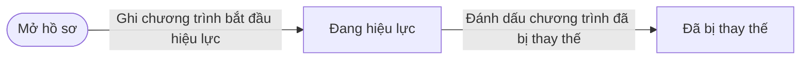
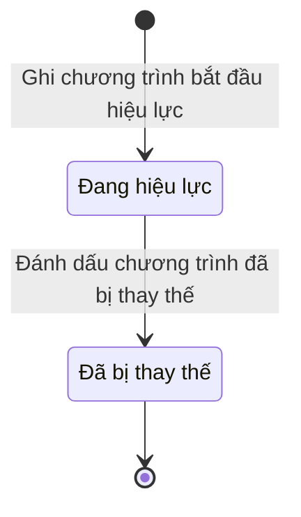

# ngoai63.training-programme

<!-- máy sinh: tom-tat -->
> **Hồ sơ:** Chương trình huấn luyện (`TrainingProgramme`)
>
> 2 bước · 2 chặng · 1 vai · 0 bảng quyết định · 0 hạn · 1 khớp nối.
>
> **Nguồn:** sổ nghiệp vụ `ngoai63.training-programme` · khai báo của app: `dqtv-app/core/processes/militia-enlistment/workflow/training-programme.yaml`. Các bảng do máy sinh từ nguồn này.
<!-- hết: tom-tat -->

## 1. Đường đi ngắn nhất qua các chặng

<!-- máy sinh: luong-chinh -->
Đường ít bước nhất từ lúc mở hồ sơ tới chặng kết thúc xa nhất. Máy chọn theo số chặng, không theo ý nghĩa nghiệp vụ — trình tự công việc thật xem phần Diễn giải và bảng "Việc làm ở từng chặng" ở mục 6.

| # | Ai làm | Làm gì | Hồ sơ sang chặng |
|---|---|---|---|
| 1 | Cục Dân quân tự vệ | Ghi chương trình bắt đầu hiệu lực | Đang hiệu lực |
| 2 | Cục Dân quân tự vệ | Đánh dấu chương trình đã bị thay thế | Đã bị thay thế |

<!-- hết: luong-chinh -->

## 2. Hồ sơ và việc nó để lại

<!-- máy sinh: muc-tieu -->
**App gọi quy trình này là:** Danh mục chương trình huấn luyện.

**Khi mở, hồ sơ này ghi mối nối tới:**
- Văn bản đến (1.incoming-document) — bước `recordProgrammeInForce`, khớp nối `programmeIssuedByIncomingDocument`
<!-- hết: muc-tieu -->

## 3. Khởi phát và kết thúc

<!-- máy sinh: khoi-phat -->
**1 cửa vào** — bước mở hồ sơ:

| Bước mở | Ai mở | Hồ sơ vào chặng | App bắt buộc nhập |
|---|---|---|---|
| Ghi chương trình bắt đầu hiệu lực | Cục Dân quân tự vệ | Đang hiệu lực | thông tư, phụ lục chương trình trong sổ văn bản đến, đối tượng áp dụng, phụ lục, thứ tự, nội dung huấn luyện, cấp tổ chức, căn cứ, đối tượng phải học, nhóm nội dung, hiệu lực từ, đơn vị chủ hồ sơ |

**Kết thúc:** *Đã bị thay thế* (`SUPERSEDED`)
<!-- hết: khoi-phat -->

## 4. Vai trò

<!-- máy sinh: vai-tro -->
| Vai trong sổ | Tên trong app | Điều kiện | Làm những bước |
|---|---|---|---|
| `AC-CUC` | Cục Dân quân tự vệ |  | Ghi chương trình bắt đầu hiệu lực · Đánh dấu chương trình đã bị thay thế |

*"Tên trong app" là tên app đặt cho mã chủ thể của vai. Hồ sơ thuộc đơn vị cấp khác thì người làm là người giữ vai ấy ở đơn vị nêu trong cột "Điều kiện" (nếu sổ có ghi) và ở cột "Người làm phải thuộc" của bảng "Theo khai báo của app" (mục 7).*
<!-- hết: vai-tro -->

## 5. Nhánh phụ

<!-- máy sinh: nhanh-phu -->
Không có bước nào ngoài luồng chính.
<!-- hết: nhanh-phu -->

## 6. Các chặng và việc làm ở từng chặng

<!-- máy sinh: chang -->
| Chặng | Tên hiển thị | Vào bằng bước | Kết thúc? |
|---|---|---|---|
| `IN_FORCE` | Đang hiệu lực | Ghi chương trình bắt đầu hiệu lực |  |
| `SUPERSEDED` | Đã bị thay thế | Đánh dấu chương trình đã bị thay thế | **kết thúc** |

### Việc làm ở từng chặng

Hồ sơ đang ở chặng nào thì làm được những bước nào.

| Hồ sơ đang ở chặng | Bước làm tại chặng (hồ sơ đứng yên) | Bước đưa hồ sơ sang chặng khác |
|---|---|---|
| **Đang hiệu lực** | — | Đánh dấu chương trình đã bị thay thế — Cục Dân quân tự vệ → *Đã bị thay thế* |
| **Đã bị thay thế** | — | — (kết thúc) |
<!-- hết: chang -->

## 7. Bảng bước

<!-- máy sinh: buoc -->
| # | Bước | Mã bước | Ai thực hiện | Từ chặng | Sang chặng | Phải có trước | Ghi lại |
|---|---|---|---|---|---|---|---|
| 1 | Ghi chương trình bắt đầu hiệu lực | `recordProgrammeInForce` | Cục Dân quân tự vệ | — (mở hồ sơ) | `IN_FORCE` | `programmeIssuedByIncomingDocumentUsable` | đối tượng phải học, nhóm nội dung, hiệu lực từ, nối tới Văn bản đến, đơn vị chủ hồ sơ |
| 2 | Đánh dấu chương trình đã bị thay thế | `supersedeProgramme` | Cục Dân quân tự vệ | `IN_FORCE` | `SUPERSEDED` | — | nối tới Chương trình huấn luyện |

### Khi không đạt điều kiện

Mặc định: không đúng người, hồ sơ không ở đúng chặng, hoặc thiếu thứ "phải có trước" thì bước bị chặn, hồ sơ giữ nguyên. Bảng dưới chỉ kê những bước có kết quả riêng.

Không bước nào có kết quả riêng — tất cả theo mặc định.

### Điều kiện "phải có trước" bằng lời

Cột "Phải có trước" ở bảng bước có hai loại: ô dữ liệu thường (bước chỉ đòi ô ấy đã có giá trị) và điều kiện hệ tự xét. Bảng này diễn các điều kiện hệ tự xét theo đúng công thức sổ ghi; số ở cột cuối là số thứ tự bước.

| Điều kiện | Đúng khi | Bước đòi |
|---|---|---|
| `programmeIssuedByIncomingDocumentUsable` | có hồ sơ Việc luật giao kèm văn bản đến, đi — Văn bản đến (qt-1.incoming-document) chính là hồ sơ ghi ở ô nối `programmeIssuedByIncomingDocument` của hồ sơ đang làm mà hồ sơ ấy đang ở chặng `RECEIVED` hoặc `DISTRIBUTED` | 1 |

### Theo khai báo của app

Người làm phải thuộc đơn vị nào, ô người dùng phải nhập, bước có lặp được không, và căn cứ pháp lý — lấy từ khai báo quy trình trong app.

| # | Bước | Người làm phải thuộc | Bắt buộc nhập | Nhập nếu có | Lặp được | Căn cứ |
|---|---|---|---|---|---|---|
| 1 | Ghi chương trình bắt đầu hiệu lực |  | thông tư, phụ lục chương trình trong sổ văn bản đến, đối tượng áp dụng, phụ lục, thứ tự, nội dung huấn luyện, cấp tổ chức, căn cứ, đối tượng phải học, nhóm nội dung, hiệu lực từ, đơn vị chủ hồ sơ | số giờ, tuyến, mã nội dung |  | L48/2019/QH14 Đ.28 k3; TT69/2020/TT-BQP Đ.6 k2 a, b |
| 2 | Đánh dấu chương trình đã bị thay thế |  | — | chương trình mới thay thế |  | TT69/2020/TT-BQP Đ.6 k2 (sửa bởi TT47/2024) |

### Điều kiện và ghi chú app khai cho từng bước

Lấy từ khai báo quy trình trong app. Lời trong ngoặc kép là câu app hiện cho người dùng. Chức danh người ký ngoài hệ app chỉ khai bằng mã.

| # | Bước | Điều kiện, ghi chú |
|---|---|---|
| 1 | Ghi chương trình bắt đầu hiệu lực | · không đòi bản chụp — app ghi: "bản số hoá nằm ở văn bản đến văn thư đã vào sổ — Cục chọn văn bản ấy, không tải ảnh lần hai" |
<!-- hết: buoc -->

## 8. Bảng quyết định, hạn, việc ngoài hệ

<!-- máy sinh: quyet-dinh -->

<!-- hết: quyet-dinh -->

## 9. Dữ liệu của hồ sơ

<!-- máy sinh: du-lieu -->
Các ô mà bước trong sổ ghi hoặc đòi. Số trong hai cột cuối là số thứ tự bước ở bảng bước (mục 7).

| Ô dữ liệu | Mã | Kiểu (app) | Giá trị cho phép | Loại ô (sổ) | Bước ghi | Bước đòi | Mô tả trong app |
|---|---|---|---|---|---|---|---|
| đối tượng phải học | `audience` | chữ |  | đưa vào ở bước (`input`) | 1 | — | Đối tượng phải học nội dung này — chiến sĩ theo năm và loại, hoặc chức vụ chỉ huy nào |
| nhóm nội dung | `subjectGroup` | chữ |  | đưa vào ở bước (`input`) | 1 | — | Nhóm nội dung của chương trình — Cục ghi lúc đưa vào danh mục |
| hiệu lực từ | `effectiveFrom` | ngày |  | đưa vào ở bước (`input`) | 1 | — | Có hiệu lực từ ngày — theo văn bản ban hành ở annexRef |
| đơn vị chủ hồ sơ | `ownerUnit` | chữ |  | lưu trên hồ sơ (`stored`) | 1 | — | Đơn vị chủ quản chương trình — chương trình riêng của tỉnh (TT69/2020 Đ.6 k2c) |
| — | `programmeIssuedByIncomingDocumentUsable` |  | có hay chưa | hệ suy ra (`derived`) | — | 1 |  |

5 ô. Cột "Loại ô" là cách sổ phân loại ô, in kèm đúng chữ của sổ; ô nào người dùng phải nhập xem bảng "Theo khai báo của app" ở mục 7.
<!-- hết: du-lieu -->

## 10. Khớp nối với quy trình khác

<!-- máy sinh: khop-noi -->
| Quy trình kia | Hồ sơ kia | Quan hệ | Nội dung (mô tả trong app) | Bước ghi mối nối | Tên ô nối |
|---|---|---|---|---|---|
| 1.incoming-document | Văn bản đến | hồ sơ này **mở ra có nối tới** hồ sơ kia | Chương trình huấn luyện ghi từ văn bản đến nào — thông tư hoặc phụ lục chương trình, văn thư đã vào sổ | training-programme·recordProgrammeInForce ⊕ | `programmeIssuedByIncomingDocument` |

1 khớp nối. ⊕ là bước tạo hồ sơ.

**Ô nối giữa các hồ sơ cùng mã quy trình, hoặc tới danh mục nền:** `supersededByProgramme` (Chương trình huấn luyện → Chương trình huấn luyện) — bước Đánh dấu chương trình đã bị thay thế.
<!-- hết: khop-noi -->

## 11. Thông tin chung

<!-- máy sinh: thong-tin -->
| | |
|---|---|
| **Mã trong sổ** | `ngoai63.training-programme` |
| **Quy trình trong app** | `militia-enlistment` (`workflow/training-programme.yaml`) — mặt công tác: `personnel` |
| **Hồ sơ** | Chương trình huấn luyện (`TrainingProgramme`) |
| **Căn cứ pháp lý từng bước** | cột "Căn cứ" ở bảng "Theo khai báo của app", mục 7 |
<!-- hết: thong-tin -->
