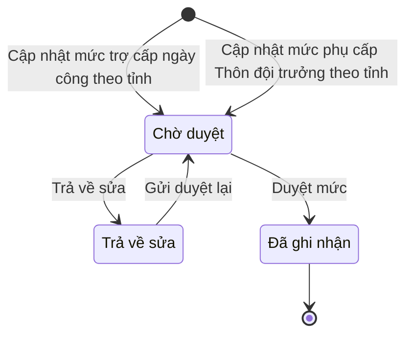

# ngoai63.wage-rate · Danh mục, tham số

<!-- máy sinh: tom-tat -->
> **Hồ sơ:** Danh mục, tham số (`Parameter`)
>
> 5 bước · 3 chặng · 2 vai · 0 bảng quyết định · 0 hạn · 2 khớp nối.
>
> **Nguồn:** sổ nghiệp vụ `ngoai63.wage-rate` · khai báo của app: `dqtv-app/core/processes/wage-rate/workflow/wage-rate.yaml`. Các bảng do máy sinh từ nguồn này.
<!-- hết: tom-tat -->

<!-- viết tay: dien-giai -->
## Diễn giải

*Phần này viết tay, diễn giải lại điều các bảng bên dưới ghi.*

### Quy trình này để làm gì

Ban Dân quân tự vệ, Bộ CHQS cấp tỉnh nhập hai mức tiền theo tỉnh: **mức trợ cấp ngày công lao động** (đồng/ngày) và **mức phụ cấp Thôn đội trưởng** (đồng/tháng). Mỗi lần nhập là một bản ghi Danh mục, tham số; mỗi lần cập nhật phải qua bước duyệt. Ba chặng: *Chờ duyệt*, *Trả về sửa*, *Đã ghi nhận*. Vòng đời này chỉ có ở bản ghi tạo qua hai bước nhập mức, không áp cho các nhóm tham số khác.

### Khi nào bắt đầu

Có hai cửa vào, đều do Ban Dân quân tự vệ tỉnh làm và đều đưa bản ghi vào *Chờ duyệt*:

- **Cập nhật mức trợ cấp ngày công theo tỉnh** — bắt buộc nhập mã tỉnh, mức (đồng/ngày), hiệu lực từ, `legalBasis` (căn cứ pháp lý của giá trị này), đơn vị chủ hồ sơ.
- **Cập nhật mức phụ cấp Thôn đội trưởng theo tỉnh** — bắt buộc nhập các ô như trên (mức tính đồng/tháng), thêm số nghị quyết HĐND và nghị quyết HĐND tỉnh (ảnh/bản quét).

Đơn vị chủ bản ghi là đơn vị của người đặt mức.

### Diễn ra thế nào

1. **Chờ duyệt.** Bộ CHQS cấp tỉnh bấm **Duyệt mức** — bản ghi sang *Đã ghi nhận*; nếu có thì nhập bản ghi cũ được thay thế và hiệu lực từ. Hoặc bấm **Trả về sửa** — bản ghi sang *Trả về sửa*, trả về cho Ban Dân quân tự vệ sửa.
2. **Trả về sửa.** Ban Dân quân tự vệ tỉnh bấm **Gửi duyệt lại**; bản ghi về *Chờ duyệt*.

### Kết thúc và để lại gì

Bản ghi kết thúc ở *Đã ghi nhận*, để lại mức trợ cấp ngày công hoặc mức phụ cấp Thôn đội trưởng của tỉnh cùng ngày hiệu lực và căn cứ.

### Điều kiện chặn

Sai người, sai chặng thì bước bị chặn, bản ghi giữ nguyên.
<!-- hết viết tay -->

## 1. Đường đi ngắn nhất qua các chặng

<!-- máy sinh: luong-chinh -->
Đường ít bước nhất từ lúc mở hồ sơ tới chặng kết thúc xa nhất. Máy chọn theo số chặng, không theo ý nghĩa nghiệp vụ — trình tự công việc thật xem phần Diễn giải và bảng "Việc làm ở từng chặng" ở mục 6.

| # | Ai làm | Làm gì | Hồ sơ sang chặng |
|---|---|---|---|
| 1 | Ban Dân quân tự vệ, Bộ CHQS cấp tỉnh | Cập nhật mức trợ cấp ngày công theo tỉnh | Chờ duyệt |
| 2 | Bộ CHQS cấp tỉnh | Duyệt mức | Đã ghi nhận |

<!-- hết: luong-chinh -->

## 2. Hồ sơ và việc nó để lại

<!-- máy sinh: muc-tieu -->
**App gọi quy trình này là:** Tham số — Mức trợ cấp ngày công lao động theo tỉnh.

**Khi mở, hồ sơ này ghi mối nối tới:**
- Văn bản đến (1.incoming-document) — bước `setHamletLeaderRate`, khớp nối `setHamletLeaderRateFromIncomingDocument`
- Văn bản đến (1.incoming-document) — bước `setWageRate`, khớp nối `setWageRateFromIncomingDocument`
<!-- hết: muc-tieu -->

## 3. Khởi phát và kết thúc

<!-- máy sinh: khoi-phat -->
**2 cửa vào** — bước mở hồ sơ:

| Bước mở | Ai mở | Hồ sơ vào chặng | App bắt buộc nhập |
|---|---|---|---|
| Cập nhật mức trợ cấp ngày công theo tỉnh | Ban Dân quân tự vệ, Bộ CHQS cấp tỉnh | Chờ duyệt | mã tỉnh, mức (đồng/ngày), hiệu lực từ, `legalBasis`, văn bản đến là nghị quyết HĐND tỉnh quyết mức, đơn vị chủ hồ sơ |
| Cập nhật mức phụ cấp Thôn đội trưởng theo tỉnh | Ban Dân quân tự vệ, Bộ CHQS cấp tỉnh | Chờ duyệt | mã tỉnh, mức (đồng/tháng), hiệu lực từ, `legalBasis`, văn bản đến là nghị quyết HĐND tỉnh quyết mức, đơn vị chủ hồ sơ |

**Kết thúc:** *Đã ghi nhận* (`recorded`)
<!-- hết: khoi-phat -->

## 4. Vai trò

<!-- máy sinh: vai-tro -->
| Vai trong sổ | Tên trong app | Điều kiện | Làm những bước |
|---|---|---|---|
| `operator` | Ban Dân quân tự vệ, Bộ CHQS cấp tỉnh |  | Cập nhật mức trợ cấp ngày công theo tỉnh · Cập nhật mức phụ cấp Thôn đội trưởng theo tỉnh · Gửi duyệt lại |
| `approver` | Bộ CHQS cấp tỉnh |  | Duyệt mức · Trả về sửa |

*"Tên trong app" là tên app đặt cho mã chủ thể của vai. Hồ sơ thuộc đơn vị cấp khác thì người làm là người giữ vai ấy ở đơn vị nêu trong cột "Điều kiện" (nếu sổ có ghi) và ở cột "Người làm phải thuộc" của bảng "Theo khai báo của app" (mục 7).*
<!-- hết: vai-tro -->

## 5. Nhánh phụ

<!-- máy sinh: nhanh-phu -->
**Bước khác đưa hồ sơ sang chặng mới** — đường song song, rẽ nhánh hoặc kết thúc sớm:

| Bước | Ai làm | Từ chặng | Sang chặng |
|---|---|---|---|
| Trả về sửa | Bộ CHQS cấp tỉnh | Chờ duyệt | Trả về sửa |

**Quay lại một chặng hồ sơ đã đi qua** (tính theo đường ngắn nhất từ lúc mở):

| Bước | Ai làm | Từ chặng | Về chặng |
|---|---|---|---|
| Gửi duyệt lại | Ban Dân quân tự vệ, Bộ CHQS cấp tỉnh | Trả về sửa | Chờ duyệt |

**Cửa vào khác:** 2 bước cùng mở hồ sơ — xem mục 3.

<!-- hết: nhanh-phu -->

## 6. Các chặng và việc làm ở từng chặng

<!-- máy sinh: chang -->
| Chặng | Tên hiển thị | Vào bằng bước | Kết thúc? |
|---|---|---|---|
| `pendingApproval` | Chờ duyệt | Cập nhật mức trợ cấp ngày công theo tỉnh · Cập nhật mức phụ cấp Thôn đội trưởng theo tỉnh · Gửi duyệt lại |  |
| `returned` | Trả về sửa | Trả về sửa |  |
| `recorded` | Đã ghi nhận | Duyệt mức | **kết thúc** |

### Việc làm ở từng chặng

Hồ sơ đang ở chặng nào thì làm được những bước nào.

| Hồ sơ đang ở chặng | Bước làm tại chặng (hồ sơ đứng yên) | Bước đưa hồ sơ sang chặng khác |
|---|---|---|
| **Chờ duyệt** | — | Duyệt mức — Bộ CHQS cấp tỉnh → *Đã ghi nhận* Trả về sửa — Bộ CHQS cấp tỉnh → *Trả về sửa* |
| **Trả về sửa** | — | Gửi duyệt lại — Ban Dân quân tự vệ, Bộ CHQS cấp tỉnh → *Chờ duyệt* |
| **Đã ghi nhận** | — | — (kết thúc) |
<!-- hết: chang -->

## 7. Bảng bước

<!-- máy sinh: buoc -->
| # | Bước | Mã bước | Ai thực hiện | Từ chặng | Sang chặng | Phải có trước | Ghi lại |
|---|---|---|---|---|---|---|---|
| 1 | Cập nhật mức trợ cấp ngày công theo tỉnh | `setWageRate` | Ban Dân quân tự vệ, Bộ CHQS cấp tỉnh | — (mở hồ sơ) | `pendingApproval` | `setWageRateFromIncomingDocumentUsable` | nhóm tham số, khoá, giá trị, `unit`, hiệu lực từ, `legalBasis`, đơn vị chủ hồ sơ, nối tới Văn bản đến |
| 2 | Cập nhật mức phụ cấp Thôn đội trưởng theo tỉnh | `setHamletLeaderRate` | Ban Dân quân tự vệ, Bộ CHQS cấp tỉnh | — (mở hồ sơ) | `pendingApproval` | `setHamletLeaderRateFromIncomingDocumentUsable` | nhóm tham số, khoá, giá trị, `unit`, hiệu lực từ, `legalBasis`, đơn vị chủ hồ sơ, nối tới Văn bản đến |
| 3 | Duyệt mức | `approveRate` | Bộ CHQS cấp tỉnh | `pendingApproval` | `recorded` | người làm thuộc đơn vị chủ hồ sơ | nối tới Danh mục, tham số |
| 4 | Trả về sửa | `returnRate` | Bộ CHQS cấp tỉnh | `pendingApproval` | `returned` | người làm thuộc đơn vị chủ hồ sơ, lý do trả về | lý do trả về, người trả về, trả về lúc |
| 5 | Gửi duyệt lại | `resubmitRate` | Ban Dân quân tự vệ, Bộ CHQS cấp tỉnh | `returned` | `pendingApproval` | người làm thuộc đơn vị chủ hồ sơ | — |

### Khi không đạt điều kiện

Mặc định: không đúng người, hồ sơ không ở đúng chặng, hoặc thiếu thứ "phải có trước" thì bước bị chặn, hồ sơ giữ nguyên. Bảng dưới chỉ kê những bước có kết quả riêng.

Không bước nào có kết quả riêng — tất cả theo mặc định.

### Điều kiện "phải có trước" bằng lời

Cột "Phải có trước" ở bảng bước có hai loại: ô dữ liệu thường (bước chỉ đòi ô ấy đã có giá trị) và điều kiện hệ tự xét. Bảng này diễn các điều kiện hệ tự xét theo đúng công thức sổ ghi; số ở cột cuối là số thứ tự bước.

| Điều kiện | Đúng khi | Bước đòi |
|---|---|---|
| `setWageRateFromIncomingDocumentUsable` | có hồ sơ Việc luật giao kèm văn bản đến, đi — Văn bản đến (qt-1.incoming-document) chính là hồ sơ ghi ở ô nối `setWageRateFromIncomingDocument` của hồ sơ đang làm mà hồ sơ ấy đang ở chặng `RECEIVED` hoặc `DISTRIBUTED` | 1 |
| `setHamletLeaderRateFromIncomingDocumentUsable` | có hồ sơ Việc luật giao kèm văn bản đến, đi — Văn bản đến (qt-1.incoming-document) chính là hồ sơ ghi ở ô nối `setHamletLeaderRateFromIncomingDocument` của hồ sơ đang làm mà hồ sơ ấy đang ở chặng `RECEIVED` hoặc `DISTRIBUTED` | 2 |
| `actorInOwnerUnit` | người đang làm là người của đơn vị ghi ở ô đơn vị chủ hồ sơ của hồ sơ này (theo danh mục người của đơn vị, `dm.unit-staff`) | 3, 4, 5 |

### Theo khai báo của app

Người làm phải thuộc đơn vị nào, ô người dùng phải nhập, bước có lặp được không, và căn cứ pháp lý — lấy từ khai báo quy trình trong app.

| # | Bước | Người làm phải thuộc | Bắt buộc nhập | Nhập nếu có | Lặp được | Căn cứ |
|---|---|---|---|---|---|---|
| 1 | Cập nhật mức trợ cấp ngày công theo tỉnh |  | mã tỉnh, mức (đồng/ngày), hiệu lực từ, `legalBasis`, văn bản đến là nghị quyết HĐND tỉnh quyết mức, đơn vị chủ hồ sơ | — |  | NĐ72/2020/NĐ-CP Đ.11 (sửa NĐ16/2025 Đ.1 k4) — sàn 327.600đ/ngày, HĐND cấp tỉnh quyết mức thật |
| 2 | Cập nhật mức phụ cấp Thôn đội trưởng theo tỉnh |  | mã tỉnh, mức (đồng/tháng), hiệu lực từ, `legalBasis`, văn bản đến là nghị quyết HĐND tỉnh quyết mức, đơn vị chủ hồ sơ | — |  | NĐ72/2020/NĐ-CP Đ.8 k2 (sửa NĐ16/2025) — sàn 1.170.000đ/tháng, HĐND cấp tỉnh quyết mức thật |
| 3 | Duyệt mức | đơn vị chủ hồ sơ | — | bản ghi cũ được thay thế, hiệu lực từ |  | sổ nghiệp vụ ngoai63.wage-rate · step:approveRate |
| 4 | Trả về sửa | đơn vị chủ hồ sơ | lý do trả về | người trả về, trả về lúc |  | sổ nghiệp vụ ngoai63.wage-rate · step:returnRate |
| 5 | Gửi duyệt lại | đơn vị chủ hồ sơ | — | — |  | sổ nghiệp vụ ngoai63.wage-rate · step:resubmitRate |
<!-- hết: buoc -->

## 8. Bảng quyết định, hạn, việc ngoài hệ

<!-- máy sinh: quyet-dinh -->

<!-- hết: quyet-dinh -->

## 9. Dữ liệu của hồ sơ

<!-- máy sinh: du-lieu -->
Các ô mà bước trong sổ ghi hoặc đòi. Số trong hai cột cuối là số thứ tự bước ở bảng bước (mục 7).

| Ô dữ liệu | Mã | Kiểu (app) | Giá trị cho phép | Loại ô (sổ) | Bước ghi | Bước đòi | Mô tả trong app |
|---|---|---|---|---|---|---|---|
| nhóm tham số | `paramGroup` | chọn một | Mức chế độ, phụ cấp (`benefit_rate`), Phụ cấp huấn luyện (`training_allowance`), `training_days`, Định mức vật chất (`material_norm`), `training_norm`, `benefit_document`, `service_term`, `deadline_warning`, `age_range`, Ngày nghỉ lễ (`holiday`), Tiêu chí khen thưởng (`commendation_criteria`), Hồ sơ xã (`commune_profile`), `position_allowance`, `post_allowance_tier`, `seniority_allowance`, `special_allowance`, `command_board_equipment`, Chức vụ chỉ huy Dân quân tự vệ — Đ.19 k2 (`post_name`), Quy mô tổ chức đơn vị — Đ.15 (`echelon`), Thành phần Dân quân tự vệ — Đ.6 (`unit_type`), Binh chủng — Đ.6 k5 (`branch`), `organizer_level`, `charter_scope`, `signing_authority`, `establishment_authority`, `dissolution_authority`, `dissolution_decider`, `training_commitment`, `asset_compensation`, `board_establishment`, `training_grade`, `selection_directive`, `commune_directory`, `training_school`, `violation_behavior`, `medal_service_years`, `uniform_service_life`, Định mức trang phục theo NĐ72 Phụ lục II (số lượng, niên hạn) (`uniform_standard`), Thành phần hồ sơ Người có công (`veteran_dossier_component`), Thành phần hồ sơ theo hình thức khen thưởng (`award_dossier_template`), `award_form_catalog`, `award_authority_matrix`, `benefit_type`, `death_cause`, `budget_item`, `material_category`, `uniform_target`, `violator_position`, `discipline_form`, `org_ownership`, `deferment_ground`, `service_exemption_ground`, `registration_exemption_ground`, `early_exit_ground`, `removal_ground`, `chairman_confirmed_ground`, `hamlet_kind`, `host_kind`, `organisation_kind`, `force_type`, `commune_category`, `readiness_level`, `expansion_readiness_level`, `coordination_field`, `hazard_type`, `defence_level`, `stationed_force_type`, `mission_type`, Mẫu nội dung phát động phong trào thi đua (`campaign_template`), Định mức vũ khí, trang bị (số minh hoạ — cập nhật khi vận hành) (`weapon_standard`) | lưu trên hồ sơ (`stored`) | 1, 2 | — | Nhóm tham số: mức chế độ · phụ cấp huấn luyện · định mức vật chất · ngày nghỉ lễ · tiêu chí khen thưởng · hồ sơ xã · niên hạn trang phục · thành phần hồ sơ Người có công |
| khoá | `paramKey` | chữ |  | lưu trên hồ sơ (`stored`) | 1, 2 | — | Khoá tra cứu trong nhóm |
| giá trị | `paramValue` | chữ |  | đưa vào ở bước (`input`) | 1, 2 | — | Giá trị, dạng chuỗi để không phụ thuộc kiểu — trống khi luật có tham số mà chưa nhận được văn bản |
| — | `unit` | chữ |  | lưu trên hồ sơ (`stored`) | 1, 2 | — | Đơn vị tính |
| hiệu lực từ | `effectiveFrom` | ngày |  | đưa vào ở bước (`input`) | 1, 2 | — | Hiệu lực từ ngày |
| — | `legalBasis` | chữ |  | đưa vào ở bước (`input`) | 1, 2 | — | Căn cứ pháp lý của giá trị này |
| đơn vị chủ hồ sơ | `ownerUnit` | chữ |  | lưu trên hồ sơ (`stored`) | 1, 2 | — | Đơn vị chủ bản ghi mức — đơn vị của người đặt mức (ngoai63.wage-rate) |
| lý do trả về | `returnReason` | chữ |  | đưa vào ở bước (`input`) | 4 | 4 | Lý do Bộ CHQS tỉnh trả mức về sửa |
| người trả về | `returnedBy` | chữ |  | lưu trên hồ sơ (`stored`) | 4 | — | Người trả mức về sửa |
| trả về lúc | `returnedAt` | ngày giờ |  | lưu trên hồ sơ (`stored`) | 4 | — | Thời điểm trả mức về sửa |
| — | `setWageRateFromIncomingDocumentUsable` |  | có hay chưa | hệ suy ra (`derived`) | — | 1 |  |
| — | `setHamletLeaderRateFromIncomingDocumentUsable` |  | có hay chưa | hệ suy ra (`derived`) | — | 2 |  |
| người làm thuộc đơn vị chủ hồ sơ | `actorInOwnerUnit` |  | có hay chưa | hệ suy ra (`derived`) | — | 3, 4, 5 |  |

13 ô. Cột "Loại ô" là cách sổ phân loại ô, in kèm đúng chữ của sổ; ô nào người dùng phải nhập xem bảng "Theo khai báo của app" ở mục 7.
<!-- hết: du-lieu -->

## 10. Khớp nối với quy trình khác

<!-- máy sinh: khop-noi -->
| Quy trình kia | Hồ sơ kia | Quan hệ | Nội dung (mô tả trong app) | Bước ghi mối nối | Tên ô nối |
|---|---|---|---|---|---|
| 1.incoming-document | Văn bản đến | hồ sơ này **mở ra có nối tới** hồ sơ kia | Nghị quyết HĐND cấp tỉnh quyết mức phụ cấp Thôn đội trưởng — văn bản đến đã vào sổ (NĐ72/2020/NĐ-CP Đ.8 k2, s… | wage-rate·setHamletLeaderRate ⊕ | `setHamletLeaderRateFromIncomingDocument` |
| 1.incoming-document | Văn bản đến | hồ sơ này **mở ra có nối tới** hồ sơ kia | Nghị quyết HĐND cấp tỉnh quyết mức trợ cấp ngày công lao động — văn bản đến đã vào sổ (NĐ72/2020/NĐ-CP Đ.11 k… | wage-rate·setWageRate ⊕ | `setWageRateFromIncomingDocument` |

2 khớp nối. ⊕ là bước tạo hồ sơ.

**Ô nối giữa các hồ sơ cùng mã quy trình, hoặc tới danh mục nền:** `supersedesRate` (Danh mục, tham số → Danh mục, tham số) — bước Duyệt mức.
<!-- hết: khop-noi -->

## 11. Thông tin chung

<!-- máy sinh: thong-tin -->
| | |
|---|---|
| **Mã trong sổ** | `ngoai63.wage-rate` |
| **Quy trình trong app** | `wage-rate` (`workflow/wage-rate.yaml`) |
| **Hồ sơ** | Danh mục, tham số (`Parameter`) |
| **Căn cứ pháp lý từng bước** | cột "Căn cứ" ở bảng "Theo khai báo của app", mục 7 |
<!-- hết: thong-tin -->
