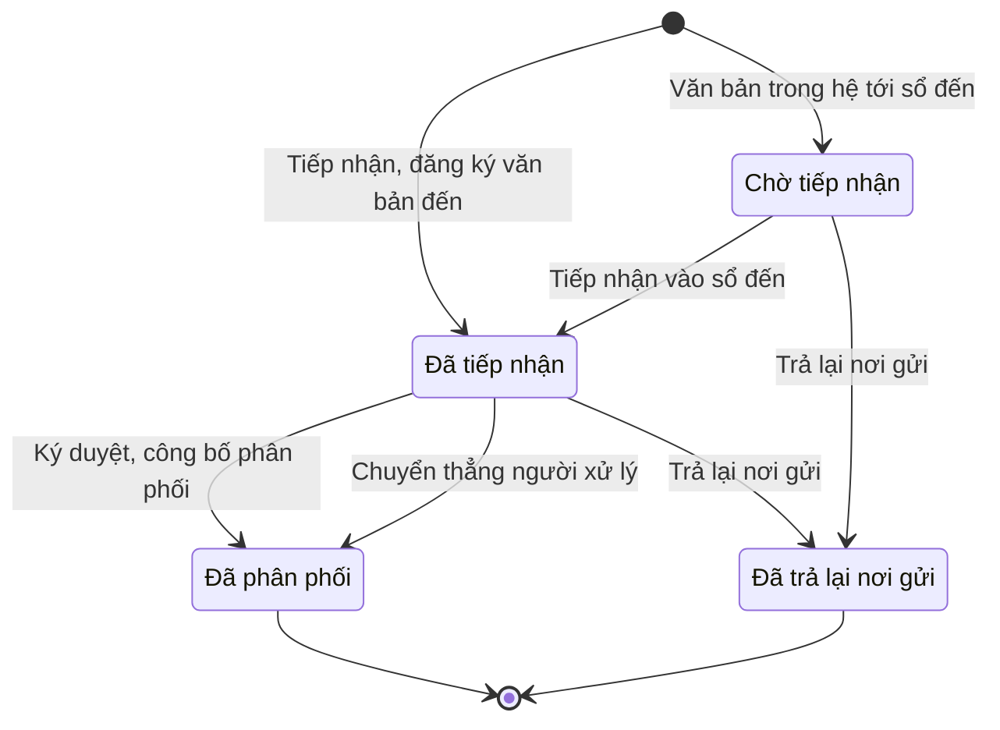

# qt-1.incoming-document · Việc luật giao kèm văn bản đến, đi — Văn bản đến

<!-- máy sinh: tom-tat -->
> **Hồ sơ:** Văn bản đến (`IncomingDocument`)
>
> **Trong sổ phạm vi:** 1 · Việc luật giao kèm văn bản đến, đi — hồ sơ phụ incoming-document (tầng 1)
>
> 13 bước · 4 chặng · 4 vai · 0 bảng quyết định · 2 hạn · 209 khớp nối.
>
> **Nguồn:** sổ nghiệp vụ `qt-1.incoming-document` · khai báo của app: `dqtv-app/core/processes/tasking/workflow/incoming-document.yaml`. Các bảng do máy sinh từ nguồn này.
<!-- hết: tom-tat -->

<!-- viết tay: dien-giai -->
## Diễn giải

*Phần này viết tay, diễn giải lại điều các bảng bên dưới ghi.*

### Quy trình này để làm gì

Nhân viên văn thư và Chỉ huy trưởng Ban CHQS xã theo dõi một **văn bản đến**: vào sổ, phân cho người xử lý, hoặc trả lại nơi gửi. Hồ sơ có ba chặng: *Đã tiếp nhận* (đã vào sổ, trình chỉ huy trưởng phân xử lý) → *Đã phân phối* (hoàn tất vòng đời văn bản đến), hoặc rẽ sang *Đã trả lại nơi gửi* (gửi sai nơi).

### Khi nào bắt đầu

Nhân viên văn thư bấm **Tiếp nhận, đăng ký văn bản đến**. Bắt buộc nhập ngày đến, nơi gửi, trích yếu nội dung, loại văn bản; bản số hoá, số – ký hiệu văn bản gốc và ý kiến văn thư khi trình là ô nhập nếu có. Năm vào sổ, số thứ tự trong sổ và số đến do hệ thống tự cấp. Hồ sơ vào chặng *Đã tiếp nhận*.

### Diễn ra thế nào

**Chặng "Đã tiếp nhận"** — không có việc nào làm tại chỗ, chỉ có ba lối ra:

- **Ký duyệt, công bố phân phối** (Chỉ huy trưởng): bắt nhập đơn vị/cá nhân xử lý chính thức; đơn vị/cá nhân phối hợp và thời hạn giải quyết là ô nhập nếu có. Hồ sơ sang *Đã phân phối*.
- **Chuyển thẳng người xử lý** (Nhân viên văn thư): văn thư tự ghi đơn vị/cá nhân xử lý chính thức, không qua Chỉ huy trưởng. Hồ sơ cũng sang *Đã phân phối*.
- **Trả lại nơi gửi** (Nhân viên văn thư): phải ghi lý do trả lại. Hồ sơ sang *Đã trả lại nơi gửi*.

**Chặng "Đã phân phối"** — hai việc làm khi hồ sơ đứng yên:

- **Bổ sung phụ lục, ghi chú** (Nhân viên văn thư): thêm phụ lục, ghi chú sau khi đã phân phối, không sửa nội dung chính.
- **Xét văn bản có giao nhiệm vụ** (Chỉ huy trưởng): ghi văn bản này có giao nhiệm vụ hay không.

**Chặng "Đã trả lại nơi gửi"** — không còn bước nào.

### Kết thúc và để lại gì

Hồ sơ kết thúc ở *Đã phân phối* hoặc *Đã trả lại nơi gửi*. Các hồ sơ của quy trình khác mở ra từ văn bản đến: lệnh điều động (13a), tiếp nhận quân nhân xuất ngũ (27), đợt gọi quân nhân dự bị (35), báo cáo đột xuất (6), cuộc thanh tra, kiểm tra (9). Các hồ sơ gắn văn bản đến vào ở một bước giữa chừng: điều động trong tình trạng đặc biệt (13b), học viên đào tạo Chỉ huy trưởng (18), đợt huy động lực lượng dự bị động viên (22, hai mối nối), vòng xử lý hồ sơ khen thưởng ở cấp trên (8), đợt thu hồi, thanh lý (D14), đợt mua sắm (D9), đợt điều chỉnh danh sách liên kết và dòng điều chỉnh liên kết (G10).

### Điều kiện chặn

- Mọi bước trừ bước tiếp nhận đòi người làm thuộc đơn vị chủ hồ sơ. Không đúng người, sai chặng, thiếu thông tin bắt buộc thì chặn, hồ sơ giữ nguyên.
- Một hạn: **1 ngày làm việc** tính từ bước tiếp nhận, để trình, chuyển giao văn bản đến người có thẩm quyền chỉ đạo giải quyết; quá hạn thì chặn. Ngày làm việc tính theo lịch nhà nước, giờ Việt Nam — nghỉ thứ Bảy, Chủ nhật, ngày lễ, Tết, kể cả ngày nghỉ bù. Ô "hạn trình, chuyển giao" được ghi ở bước tiếp nhận và ghi lại ở ba bước ra khỏi chặng *Đã tiếp nhận*.
<!-- hết viết tay -->

## 1. Đường đi ngắn nhất qua các chặng

<!-- máy sinh: luong-chinh -->
Đường ít bước nhất từ lúc mở hồ sơ tới chặng kết thúc xa nhất. Máy chọn theo số chặng, không theo ý nghĩa nghiệp vụ — trình tự công việc thật xem phần Diễn giải và bảng "Việc làm ở từng chặng" ở mục 6.

| # | Ai làm | Làm gì | Hồ sơ sang chặng |
|---|---|---|---|
| 1 | Nhân viên văn thư | Tiếp nhận, đăng ký văn bản đến | Đã tiếp nhận |
| 2 | Chỉ huy trưởng Ban CHQS xã | Ký duyệt, công bố phân phối | Đã phân phối |

<!-- hết: luong-chinh -->

## 2. Hồ sơ và việc nó để lại

<!-- máy sinh: muc-tieu -->
**App gọi quy trình này là:** Văn bản đến.

**Hồ sơ này để lại cho quy trình khác** (bước tạo hồ sơ của quy trình kia ghi mối nối về đây):
- Ban chỉ huy quân sự cấp xã (29.command-board) — bước `establishBoard`, khớp nối `boardEstablishedByIncomingDocument`
- Báo cáo đột xuất (6) — bước `prepareAdHocReport`, khớp nối `respondsToIncomingDocument`
- Chương trình huấn luyện (training-programme) — bước `recordProgrammeInForce`, khớp nối `programmeIssuedByIncomingDocument`
- Cuộc thanh tra, kiểm tra (9) — bước `openFromSupervisionConclusion`, khớp nối `conclusionDocument`
- Cuộc thanh tra, kiểm tra (9) — bước `openInspection`, khớp nối `openInspectionFromIncomingDocument`
- Cấp độ phòng thủ dân sự của vụ việc (21) — bước `recordDirectedDefenceLevel`, khớp nối `recordDirectedDefenceLevelFromIncomingDocument`
- Danh mục, tham số (wage-rate) — bước `setHamletLeaderRate`, khớp nối `setHamletLeaderRateFromIncomingDocument`
- Danh mục, tham số (wage-rate) — bước `setWageRate`, khớp nối `setWageRateFromIncomingDocument`
- Dòng quyết định cho thôi, đưa ra khỏi danh sách (16.service-exit-decision) — bước `recordExitDecisionRow`, khớp nối `exitDecisionFromIncomingDocument`
- Dòng quyết định kéo dài (16.service-extension-decision) — bước `recordExtensionDecisionRow`, khớp nối `extensionDecisionFromIncomingDocument`
- Dòng quyết định về một người (C1) — bước `recordPersonDutyDecision`, khớp nối `personDecisionFromIncomingDocument`
- Hồ sơ giải thể tổ chức (31) — bước `receiveDissolutionDossier`, khớp nối `receiveDissolutionDossierFromIncomingDocument`
- Hồ sơ giải thể tổ chức (31) — bước `recordBoardDisbandDecision`, khớp nối `dissolutionDecisionDeliveredAs`
- Hồ sơ giải thể tổ chức (31) — bước `recordBoardDisbandDecision`, khớp nối `dissolutionDossierDecidedByIncomingDocument`
- Hồ sơ thành lập tổ chức (29) — bước `receiveOrganizationDossier`, khớp nối `receiveOrganizationDossierFromIncomingDocument`
- Hồ sơ thành lập tổ chức (29) — bước `recordCouncilEstablishment`, khớp nối `organisationDossierDecidedByIncomingDocument`
- Hồ sơ tổ chức lại Ban chỉ huy quân sự cấp xã (29.board-reorganization) — bước `recordBoardReorganization`, khớp nối `reorganizationByIncomingDocument`
- Kế hoạch, văn kiện (2) — bước `openSubmissionRound`, khớp nối `submissionDeliveredAs`
- Lượt trình đề nghị kỷ luật lên cấp có thẩm quyền (D15.submission) — bước `openSubmissionRound`, khớp nối `disciplineRoundDeliveredAs`
- Lệnh điều động (13a) — bước `receiveUpperDeploymentDecision`, khớp nối `deploymentFromIncomingDocument`
- Một vòng xử lý hồ sơ khen thưởng ở cấp trên (8.submission) — bước `openAwardSubmissionRound`, khớp nối `awardReviewDeliveredAs`
- Thực hiện quyết định động viên công nghiệp (40) — bước `notifyFacilityOfMobilization`, khớp nối `ministerDecisionIncoming`
- Tiếp nhận quân nhân xuất ngũ (27) — bước `addToDischargeNotice`, khớp nối `dischargeIntakeNotice`
- Tiếp nhận quân nhân xuất ngũ (27) — bước `receiveDischargeNotice`, khớp nối `dischargeIntakeNotice`
- Tệp lưu trữ (D16) — bước `recordArchiveFile`, khớp nối `fileOfIncomingDocument`
- Điều động trong tình trạng đặc biệt (13b) — bước `receiveSuperiorOrder`, khớp nối `specialDeploymentFromIncomingDocument`
- Đơn khiếu nại, tố cáo, kiến nghị, phản ánh (28) — bước `receivePetition`, khớp nối `petitionFromIncomingDocument`
- Đợt gọi quân nhân dự bị (35) — bước `receiveUpperReserveCall`, khớp nối `callFromIncomingDocument`
- Đợt mở rộng lực lượng (D5) — bước `recordExpansionOrder`, khớp nối `recordExpansionOrderFromIncomingDocument`
<!-- hết: muc-tieu -->

## 3. Khởi phát và kết thúc

<!-- máy sinh: khoi-phat -->
**2 cửa vào** — bước mở hồ sơ:

| Bước mở | Ai mở | Hồ sơ vào chặng | App bắt buộc nhập |
|---|---|---|---|
| Tiếp nhận, đăng ký văn bản đến | Nhân viên văn thư | Đã tiếp nhận | ngày đến, nơi gửi, trích yếu nội dung, loại văn bản |
| Văn bản trong hệ tới sổ đến | Hệ thống tự làm | Chờ tiếp nhận | nơi gửi, trích yếu nội dung, loại văn bản |

**Kết thúc:** *Đã phân phối* (`DISTRIBUTED`), *Đã trả lại nơi gửi* (`RETURNED`)
<!-- hết: khoi-phat -->

## 4. Vai trò

<!-- máy sinh: vai-tro -->
| Vai trong sổ | Tên trong app | Điều kiện | Làm những bước |
|---|---|---|---|
| `operator` | Nhân viên văn thư |  | Tiếp nhận, đăng ký văn bản đến · Tiếp nhận vào sổ đến · Chuyển thẳng người xử lý · Trả lại nơi gửi · Bổ sung phụ lục, ghi chú · Văn thư xem nội dung văn bản mật |
| `system` | Hệ thống tự làm |  | Văn bản trong hệ tới sổ đến · Đánh dấu văn bản trong hệ quá hạn tiếp nhận |
| `approver` | Chỉ huy trưởng Ban CHQS xã |  | Ký duyệt, công bố phân phối · Xét văn bản có giao nhiệm vụ · Nêu tên người được xem văn bản mật · Chỉ huy xem nội dung văn bản mật |
| `reader` | `AC-CHT/AC-CTV/AC-PCHT/AC-CTVP/AC-TLTH/AC-TLQL/AC-NVQK/AC-NVVT/AC-NVTC/AC-BDQt/AC-PDQqk/AC-PCHTcq/AC-PCHTbn/AC-PKH` |  | Người được nêu tên xem nội dung văn bản mật |

*"Tên trong app" là tên app đặt cho mã chủ thể của vai. Hồ sơ thuộc đơn vị cấp khác thì người làm là người giữ vai ấy ở đơn vị nêu trong cột "Điều kiện" (nếu sổ có ghi) và ở cột "Người làm phải thuộc" của bảng "Theo khai báo của app" (mục 7).*
<!-- hết: vai-tro -->

## 5. Nhánh phụ

<!-- máy sinh: nhanh-phu -->
**Bước khác đưa hồ sơ sang chặng mới** — đường song song, rẽ nhánh hoặc kết thúc sớm:

| Bước | Ai làm | Từ chặng | Sang chặng |
|---|---|---|---|
| Tiếp nhận vào sổ đến | Nhân viên văn thư | Chờ tiếp nhận | Đã tiếp nhận |
| Chuyển thẳng người xử lý | Nhân viên văn thư | Đã tiếp nhận | Đã phân phối |
| Trả lại nơi gửi | Nhân viên văn thư | Chờ tiếp nhận, Đã tiếp nhận | Đã trả lại nơi gửi |

**Làm trong lúc hồ sơ đứng yên ở một chặng** — ghi nhận, bổ sung:

| Bước | Ai làm | Ở chặng |
|---|---|---|
| Bổ sung phụ lục, ghi chú | Nhân viên văn thư | Đã phân phối |
| Xét văn bản có giao nhiệm vụ | Chỉ huy trưởng Ban CHQS xã | Đã phân phối |
| Đánh dấu văn bản trong hệ quá hạn tiếp nhận | Hệ thống tự làm | Chờ tiếp nhận |
| Nêu tên người được xem văn bản mật | Chỉ huy trưởng Ban CHQS xã | Đã tiếp nhận, Đã phân phối |
| Văn thư xem nội dung văn bản mật | Nhân viên văn thư | Đã tiếp nhận, Đã phân phối |
| Chỉ huy xem nội dung văn bản mật | Chỉ huy trưởng Ban CHQS xã | Đã tiếp nhận, Đã phân phối |
| Người được nêu tên xem nội dung văn bản mật | `AC-CHT/AC-CTV/AC-PCHT/AC-CTVP/AC-TLTH/AC-TLQL/AC-NVQK/AC-NVVT/AC-NVTC/AC-BDQt/AC-PDQqk/AC-PCHTcq/AC-PCHTbn/AC-PKH` | Đã tiếp nhận, Đã phân phối |

**Cửa vào khác:** 2 bước cùng mở hồ sơ — xem mục 3.

<!-- hết: nhanh-phu -->

## 6. Các chặng và việc làm ở từng chặng

<!-- máy sinh: chang -->
| Chặng | Tên hiển thị | Vào bằng bước | Kết thúc? |
|---|---|---|---|
| `AWAITING_RECEIPT` | Chờ tiếp nhận | Văn bản trong hệ tới sổ đến |  |
| `RECEIVED` | Đã tiếp nhận | Tiếp nhận, đăng ký văn bản đến · Tiếp nhận vào sổ đến |  |
| `DISTRIBUTED` | Đã phân phối | Ký duyệt, công bố phân phối · Chuyển thẳng người xử lý | **kết thúc** — vẫn còn bước làm được |
| `RETURNED` | Đã trả lại nơi gửi | Trả lại nơi gửi | **kết thúc** |

### Việc làm ở từng chặng

Hồ sơ đang ở chặng nào thì làm được những bước nào.

| Hồ sơ đang ở chặng | Bước làm tại chặng (hồ sơ đứng yên) | Bước đưa hồ sơ sang chặng khác |
|---|---|---|
| **Chờ tiếp nhận** | Đánh dấu văn bản trong hệ quá hạn tiếp nhận — Hệ thống tự làm | Tiếp nhận vào sổ đến — Nhân viên văn thư → *Đã tiếp nhận* Trả lại nơi gửi — Nhân viên văn thư → *Đã trả lại nơi gửi* |
| **Đã tiếp nhận** | Nêu tên người được xem văn bản mật — Chỉ huy trưởng Ban CHQS xã Văn thư xem nội dung văn bản mật — Nhân viên văn thư Chỉ huy xem nội dung văn bản mật — Chỉ huy trưởng Ban CHQS xã Người được nêu tên xem nội dung văn bản mật — `AC-CHT/AC-CTV/AC-PCHT/AC-CTVP/AC-TLTH/AC-TLQL/AC-NVQK/AC-NVVT/AC-NVTC/AC-BDQt/AC-PDQqk/AC-PCHTcq/AC-PCHTbn/AC-PKH` | Ký duyệt, công bố phân phối — Chỉ huy trưởng Ban CHQS xã → *Đã phân phối* Chuyển thẳng người xử lý — Nhân viên văn thư → *Đã phân phối* Trả lại nơi gửi — Nhân viên văn thư → *Đã trả lại nơi gửi* |
| **Đã phân phối** | Bổ sung phụ lục, ghi chú — Nhân viên văn thư Xét văn bản có giao nhiệm vụ — Chỉ huy trưởng Ban CHQS xã Nêu tên người được xem văn bản mật — Chỉ huy trưởng Ban CHQS xã Văn thư xem nội dung văn bản mật — Nhân viên văn thư Chỉ huy xem nội dung văn bản mật — Chỉ huy trưởng Ban CHQS xã Người được nêu tên xem nội dung văn bản mật — `AC-CHT/AC-CTV/AC-PCHT/AC-CTVP/AC-TLTH/AC-TLQL/AC-NVQK/AC-NVVT/AC-NVTC/AC-BDQt/AC-PDQqk/AC-PCHTcq/AC-PCHTbn/AC-PKH` | — (kết thúc) |
| **Đã trả lại nơi gửi** | — | — (kết thúc) |
<!-- hết: chang -->

## 7. Bảng bước

<!-- máy sinh: buoc -->
| # | Bước | Mã bước | Ai thực hiện | Từ chặng | Sang chặng | Phải có trước | Ghi lại |
|---|---|---|---|---|---|---|---|
| 1 | Tiếp nhận, đăng ký văn bản đến | `registerIncomingDocument` | Nhân viên văn thư | — (mở hồ sơ) | `RECEIVED` | `topSecretWithoutSummary`, `noSecretScan`, `originSignedDateNotAfterArrival` | `id`, mã tỉnh, `ownerScope`, mã xã, năm vào sổ, số thứ tự trong sổ, số đến, số, ký hiệu văn bản gốc, `originSignedDate`, ngày đến, nơi gửi, trích yếu nội dung, loại văn bản, bản số hoá văn bản đến, hạn trình, chuyển giao, đơn vị chủ hồ sơ, ý kiến văn thư khi trình, độ mật, hạn thu hồi, cấp nơi gửi |
| 2 | Văn bản trong hệ tới sổ đến | `deliverIncomingFromSystem` | Hệ thống tự làm | — (mở hồ sơ) | `AWAITING_RECEIPT` | `topSecretWithoutSummary`, `noSecretScan` | `id`, mã tỉnh, `ownerScope`, mã xã, số, ký hiệu văn bản gốc, `originSignedDate`, nơi gửi, trích yếu nội dung, loại văn bản, bản số hoá văn bản đến, đơn vị chủ hồ sơ, hạn trình, chuyển giao, nối tới Văn bản đi, độ mật, hạn thu hồi, nối tới Văn bản đến, `senderUnit`, cấp nơi gửi |
| 3 | Tiếp nhận vào sổ đến | `receiveDeliveredIncomingDocument` | Nhân viên văn thư | `AWAITING_RECEIPT` | `RECEIVED` | người làm thuộc đơn vị chủ hồ sơ | năm vào sổ, số thứ tự trong sổ, số đến, ngày đến, ý kiến văn thư khi trình, hạn trình, chuyển giao |
| 4 | Ký duyệt, công bố phân phối | `approveIncomingDocumentDistribution` | Chỉ huy trưởng Ban CHQS xã | `RECEIVED` | `DISTRIBUTED` | người làm thuộc đơn vị chủ hồ sơ | đơn vị/cá nhân xử lý chính thức, đơn vị/cá nhân phối hợp, thời hạn giải quyết, ký duyệt phân phối lúc |
| 5 | Chuyển thẳng người xử lý | `forwardIncomingDocument` | Nhân viên văn thư | `RECEIVED` | `DISTRIBUTED` | người làm thuộc đơn vị chủ hồ sơ | đơn vị/cá nhân xử lý chính thức, văn thư chuyển thẳng lúc |
| 6 | Trả lại nơi gửi | `returnIncomingDocumentToSender` | Nhân viên văn thư | `AWAITING_RECEIPT`, `RECEIVED` | `RETURNED` | trả lại vì, ghi rõ lý do trả lại, người làm thuộc đơn vị chủ hồ sơ, `noRecordAttached` | trả lại vì, ghi rõ lý do trả lại, trả lại nơi gửi lúc |
| 7 | Bổ sung phụ lục, ghi chú | `addIncomingDocumentNote` | Nhân viên văn thư | `DISTRIBUTED` | giữ nguyên | người làm thuộc đơn vị chủ hồ sơ | phụ lục, ghi chú bổ sung |
| 8 | Xét văn bản có giao nhiệm vụ | `markDocumentTasking` | Chỉ huy trưởng Ban CHQS xã | `DISTRIBUTED` | giữ nguyên | người làm thuộc đơn vị chủ hồ sơ, `noTaskingMarkAllowed` | có giao nhiệm vụ |
| 9 | Đánh dấu văn bản trong hệ quá hạn tiếp nhận | `flagIncomingReceiptOverdue` | Hệ thống tự làm | `AWAITING_RECEIPT` | giữ nguyên | `receiptDeadlineNotFlagged` | quá hạn tiếp nhận từ |
| 10 | Nêu tên người được xem văn bản mật | `nameSecretReaders` | Chỉ huy trưởng Ban CHQS xã | `RECEIVED`, `DISTRIBUTED` | giữ nguyên | người làm thuộc đơn vị chủ hồ sơ | người được nêu tên xem văn bản mật |
| 11 | Văn thư xem nội dung văn bản mật | `viewSecretContent` | Nhân viên văn thư | `RECEIVED`, `DISTRIBUTED` | giữ nguyên | người làm thuộc đơn vị chủ hồ sơ | — |
| 12 | Chỉ huy xem nội dung văn bản mật | `viewSecretContentAsSigner` | Chỉ huy trưởng Ban CHQS xã | `RECEIVED`, `DISTRIBUTED` | giữ nguyên | người làm thuộc đơn vị chủ hồ sơ | — |
| 13 | Người được nêu tên xem nội dung văn bản mật | `viewSecretContentAsReader` | `AC-CHT/AC-CTV/AC-PCHT/AC-CTVP/AC-TLTH/AC-TLQL/AC-NVQK/AC-NVVT/AC-NVTC/AC-BDQt/AC-PDQqk/AC-PCHTcq/AC-PCHTbn/AC-PKH` | `RECEIVED`, `DISTRIBUTED` | giữ nguyên | `actorIsSecretReader` | — |

### Khi không đạt điều kiện

Mặc định: không đúng người, hồ sơ không ở đúng chặng, hoặc thiếu thứ "phải có trước" thì bước bị chặn, hồ sơ giữ nguyên. Bảng dưới chỉ kê những bước có kết quả riêng.

| # | Bước | Kết quả riêng |
|---|---|---|
| 2 | Văn bản trong hệ tới sổ đến | bước này không do người nào bấm |
| 9 | Đánh dấu văn bản trong hệ quá hạn tiếp nhận | bước này không do người nào bấm |

### Điều kiện "phải có trước" bằng lời

Cột "Phải có trước" ở bảng bước có hai loại: ô dữ liệu thường (bước chỉ đòi ô ấy đã có giá trị) và điều kiện hệ tự xét. Bảng này diễn các điều kiện hệ tự xét theo đúng công thức sổ ghi; số ở cột cuối là số thứ tự bước.

| Điều kiện | Đúng khi | Bước đòi |
|---|---|---|
| `topSecretWithoutSummary` | KHÔNG (độ mật là `top_secret` VÀ đã có trích yếu nội dung) | 1, 2 |
| `noSecretScan` | KHÔNG (độ mật là `confidential` hoặc `secret` hoặc `top_secret` VÀ đã có bản số hoá văn bản đến) | 1, 2 |
| `originSignedDateNotAfterArrival` | KHÔNG (đã có `originSignedDate`) HOẶC `{"le": [{"fact": "originSignedDate", "on": "self"}, {"fact": "arrivalDate", "on": "self"}]}` | 1 |
| `actorInOwnerUnit` | người đang làm là người của đơn vị ghi ở ô đơn vị chủ hồ sơ của hồ sơ này (theo danh mục người của đơn vị, `dm.unit-staff`) | 3, 4, 5, 6, 7, 8, 10, 11, 12 |
| `noTaskingMarkAllowed` | KHÔNG (có giao nhiệm vụ là Không giao nhiệm vụ (`no`)) HOẶC không có hồ sơ Việc luật giao kèm văn bản đến, đi (qt-1) có ô nối `raisesTasking` trỏ về chính hồ sơ đang làm mà hồ sơ ấy đang ở chặng `RECEIVED` hoặc `ASSIGNED` hoặc `BROKEN_DOWN` hoặc `DONE` | 8 |
| `receiptDeadlineNotFlagged` | đã có hạn trình, chuyển giao VÀ KHÔNG (đã có quá hạn tiếp nhận từ) | 9 |
| `actorIsSecretReader` | `"actor"` nằm trong người được nêu tên xem văn bản mật | 13 |

### Theo khai báo của app

Người làm phải thuộc đơn vị nào, ô người dùng phải nhập, bước có lặp được không, và căn cứ pháp lý — lấy từ khai báo quy trình trong app.

| # | Bước | Người làm phải thuộc | Bắt buộc nhập | Nhập nếu có | Lặp được | Căn cứ |
|---|---|---|---|---|---|---|
| 1 | Tiếp nhận, đăng ký văn bản đến |  | ngày đến, nơi gửi, trích yếu nội dung, loại văn bản | bản số hoá văn bản đến, số, ký hiệu văn bản gốc, ngày ký văn bản, ý kiến văn thư khi trình, độ mật, hạn thu hồi, cấp nơi gửi |  | Nghị định 30/2020/NĐ-CP Điều 20–24 |
| 2 | Văn bản trong hệ tới sổ đến |  | nơi gửi, trích yếu nội dung, loại văn bản | `outgoingDocumentId`, `senderUnit`, cấp nơi gửi, số, ký hiệu văn bản gốc, ngày ký văn bản, bản số hoá văn bản đến, độ mật, hạn thu hồi |  | NĐ30/2020/NĐ-CP Đ.20 k1 (văn bản đến từ mọi nguồn đều do văn thư tiếp nhận), Đ.21 |
| 3 | Tiếp nhận vào sổ đến | đơn vị chủ hồ sơ | — | ý kiến văn thư khi trình, ngày đến |  | NĐ30/2020/NĐ-CP Đ.21, Đ.22 |
| 4 | Ký duyệt, công bố phân phối | đơn vị chủ hồ sơ | đơn vị/cá nhân xử lý chính thức | đơn vị/cá nhân phối hợp, thời hạn giải quyết |  | Nghị định 30/2020/NĐ-CP Điều 20–24 |
| 5 | Chuyển thẳng người xử lý | đơn vị chủ hồ sơ | đơn vị/cá nhân xử lý chính thức | — |  | Nghị định 30/2020/NĐ-CP Đ.23 k1 |
| 6 | Trả lại nơi gửi | đơn vị chủ hồ sơ | trả lại vì, ghi rõ lý do trả lại | — |  | Nghị định 30/2020/NĐ-CP Đ.21 k2 b |
| 7 | Bổ sung phụ lục, ghi chú | đơn vị chủ hồ sơ | phụ lục, ghi chú bổ sung | — |  | BR-10 |
| 8 | Xét văn bản có giao nhiệm vụ | đơn vị chủ hồ sơ | có giao nhiệm vụ | — |  | NĐ 30/2020/NĐ-CP Đ.24 — giải quyết văn bản đến; TT77/VBHN-BQP Đ.7 k2 b |
| 9 | Đánh dấu văn bản trong hệ quá hạn tiếp nhận |  | — | — |  | NĐ30/2020/NĐ-CP Đ.20 k1, Đ.21 (sổ qt-1 chốt 15/10/2026) |
| 10 | Nêu tên người được xem văn bản mật | đơn vị chủ hồ sơ | người được nêu tên xem văn bản mật | — |  | Luật Bảo vệ bí mật nhà nước 2025 (117/2025/QH15); sổ qt-1 chốt 15/10/2026 |
| 11 | Văn thư xem nội dung văn bản mật | đơn vị chủ hồ sơ | — | — |  | Luật Bảo vệ bí mật nhà nước 2025 (117/2025/QH15); sổ qt-1 chốt 15/10/2026 |
| 12 | Chỉ huy xem nội dung văn bản mật | đơn vị chủ hồ sơ | — | — |  | Luật Bảo vệ bí mật nhà nước 2025 (117/2025/QH15); sổ qt-1 chốt 15/10/2026 |
| 13 | Người được nêu tên xem nội dung văn bản mật |  | — | — |  | Luật Bảo vệ bí mật nhà nước 2025 (117/2025/QH15); sổ qt-1 chốt 15/10/2026 |

### Điều kiện và ghi chú app khai cho từng bước

Lấy từ khai báo quy trình trong app. Lời trong ngoặc kép là câu app hiện cho người dùng. Chức danh người ký ngoài hệ app chỉ khai bằng mã.

| # | Bước | Điều kiện, ghi chú |
|---|---|---|
| 1 | Tiếp nhận, đăng ký văn bản đến | · hạn: 1 ngày làm việc — Trình, chuyển giao đến người có thẩm quyền chỉ đạo giải quyết trong 1 ngày làm việc (Đ.23 k1) |
| 2 | Văn bản trong hệ tới sổ đến | · hạn: 1 ngày làm việc — Văn thư tiếp nhận văn bản trong hệ tới trong 1 ngày làm việc (chốt 15/10/2026) |
| 3 | Tiếp nhận vào sổ đến | · hạn: 1 ngày làm việc — Trình, chuyển giao đến người có thẩm quyền chỉ đạo giải quyết trong 1 ngày làm việc (Đ.23 k1) |
| 9 | Đánh dấu văn bản trong hệ quá hạn tiếp nhận | · phải đã có ô "hạn trình, chuyển giao" — thiếu thì app báo: "văn bản không có hạn tiếp nhận nào đang chạy" · không làm được khi đã có ô "quá hạn tiếp nhận từ" — app báo: "văn bản đã được ghi quá hạn tiếp nhận" |
<!-- hết: buoc -->

## 8. Bảng quyết định, hạn, việc ngoài hệ

<!-- máy sinh: quyet-dinh -->
| Hạn | Tính từ | Thời hạn | Quá hạn thì |
|---|---|---|---|
| `deliverIncomingFromSystem.deadline` | khi hồ sơ vào chặng Chờ tiếp nhận | 1 ngày làm việc | hệ làm bước Đánh dấu văn bản trong hệ quá hạn tiếp nhận |
| `registerIncomingDocument.deadline` | khi hồ sơ vào chặng Đã tiếp nhận | 1 ngày làm việc | chặn |

<!-- hết: quyet-dinh -->

## 9. Dữ liệu của hồ sơ

<!-- máy sinh: du-lieu -->
Các ô mà bước trong sổ ghi hoặc đòi. Số trong hai cột cuối là số thứ tự bước ở bảng bước (mục 7).

| Ô dữ liệu | Mã | Kiểu (app) | Giá trị cho phép | Loại ô (sổ) | Bước ghi | Bước đòi | Mô tả trong app |
|---|---|---|---|---|---|---|---|
| — | `id` |  |  | lưu trên hồ sơ (`stored`) | 1, 2 | — |  |
| mã tỉnh | `provinceCode` | chữ |  | lưu trên hồ sơ (`stored`) | 1, 2 | — | Mã tỉnh — dùng lọc phạm vi theo hàng; rỗng khi hồ sơ thuộc quân khu hoặc Bộ Quốc phòng |
| — | `ownerScope` | chữ |  | lưu trên hồ sơ (`stored`) | 1, 2 | — | Chủ hồ sơ khi ở trên cấp tỉnh — rỗng · central · mã quân khu |
| mã xã | `communeCode` | chữ |  | lưu trên hồ sơ (`stored`) | 1, 2 | — | Mã xã — bỏ trống khi sổ của cấp tỉnh |
| năm vào sổ | `documentYear` | chữ |  | lưu trên hồ sơ (`stored`) | 1, 3 | — | Năm vào sổ — hệ thống tự cấp |
| số thứ tự trong sổ | `documentSeq` | số |  | lưu trên hồ sơ (`stored`) | 1, 3 | — | Số thứ tự trong sổ văn bản đến — hệ thống tự cấp |
| số đến | `documentNumber` | chữ |  | lưu trên hồ sơ (`stored`) | 1, 3 | — | Số đến — hệ thống tự cấp theo sổ của cấp mình, Nghị định 30/2020 Điều 22 |
| số, ký hiệu văn bản gốc | `originDocumentNumber` | chữ |  | đưa vào ở bước (`input`) | 1, 2 | — | Số, ký hiệu của văn bản gốc do bên gửi ghi — khác với Số đến do chính cấp mình cấp |
| — | `originSignedDate` |  |  | đưa vào ở bước (`input`) | 1, 2 | — |  |
| ngày đến | `arrivalDate` | ngày |  | đưa vào ở bước (`input`) | 1, 3 | — | Ngày đến — văn bản hệ đẩy sang thì ghi lúc văn thư tiếp nhận |
| nơi gửi | `senderName` | chữ |  | đưa vào ở bước (`input`) | 1, 2 | — | Nơi gửi — cơ quan, đơn vị gửi văn bản |
| trích yếu nội dung | `summary` | chữ |  | đưa vào ở bước (`input`) | 1, 2 | — | Trích yếu nội dung |
| loại văn bản | `documentType` | chọn một | Nghị quyết (`resolution`), Quyết định (`decision`), Chỉ thị (`directive`), Quy chế (`regulation`), Quy định (`rule`), Thông cáo (`public_notice`), Thông báo (`announcement`), Hướng dẫn (`guidance`), Chương trình (`program`), Kế hoạch (`plan`), Phương án (`action_plan`), Đề án (`scheme`), Dự án (`project`), Báo cáo (`report`), Biên bản (`minutes`), Tờ trình (`submission`), Hợp đồng (`contract`), Công văn (`official_letter`), Công điện (`telegram`), Bản ghi nhớ (`memo_of_record`), Bản thỏa thuận (`agreement`), Giấy ủy quyền (`power_of_attorney`), Giấy mời (`invitation`), Giấy giới thiệu (`introduction_letter`), Giấy nghỉ phép (`leave_permit`), Phiếu gửi (`dispatch_slip`), Phiếu chuyển (`transfer_slip`), Phiếu báo (`notification_slip`), Thư công (`correspondence`) | đưa vào ở bước (`input`) | 1, 2 | — | Loại văn bản hành chính — danh mục ĐÓNG 29 loại, NĐ30/2020/NĐ-CP Điều 7 |
| bản số hoá văn bản đến | `scanPath` | tệp |  | đưa vào ở bước (`input`) | 1, 2 | — | Bản số hoá văn bản đến — chính tờ văn bản nhận được, NĐ30/2020 Điều 22 |
| hạn trình, chuyển giao | `dueDate` | ngày |  | lưu trên hồ sơ (`stored`) | 1, 2, 3 | — | Hạn trình, chuyển giao — tính theo ngày làm việc, NĐ30/2020/NĐ-CP Đ.23 k1 |
| đơn vị chủ hồ sơ | `ownerUnit` |  |  | lưu trên hồ sơ (`stored`) | 1, 2 | — |  |
| ý kiến văn thư khi trình | `clerkNote` | chữ |  | lưu trên hồ sơ (`stored`) | 1, 3 | — | Ý kiến của văn thư khi trình văn bản đến — tuỳ chọn |
| độ mật | `secrecyLevel` | chọn một | Không thuộc diện mật (`none`), `confidential`, `secret`, `top_secret` | đưa vào ở bước (`input`) | 1, 2 | — | Độ mật — mặc định 'không mật' khi không thuộc diện mật; có độ mật thì không đính bản số hoá |
| hạn thu hồi | `recallDueDate` | ngày |  | đưa vào ở bước (`input`) | 1, 2 | — | Hạn thu hồi — văn bản đóng dấu thu hồi phải trả lại trước ngày này; trống khi văn bản không thu hồi |
| cấp nơi gửi | `senderLevel` | chọn một | Cấp xã (`commune`), Cấp tỉnh (`province`), Quân khu (`region`), Trung ương (`central`) | lưu trên hồ sơ (`stored`) | 1, 2 | — | Cấp nơi gửi văn bản — xã, tỉnh, quân khu, trung ương |
| — | `senderUnit` | chữ |  | lưu trên hồ sơ (`stored`) | 2 | — | Đơn vị gửi văn bản (id đơn vị) — trống khi văn bản từ ngoài hệ |
| đơn vị/cá nhân xử lý chính thức | `assignedHandler` | chữ |  | đưa vào ở bước (`input`) | 4, 5 | — | Đơn vị/cá nhân xử lý chính thức, sau khi ký duyệt phân phối — FR-04 |
| đơn vị/cá nhân phối hợp | `coordinatingHandlers` | chữ |  | lưu trên hồ sơ (`stored`) | 4 | — | Đơn vị/cá nhân phối hợp xử lý — NĐ30/2020 Đ.23 k2 |
| thời hạn giải quyết | `resolutionDueDate` | ngày |  | lưu trên hồ sơ (`stored`) | 4 | — | Thời hạn giải quyết văn bản đến — NĐ30/2020 Đ.23 k2 |
| ký duyệt phân phối lúc | `distributionApprovedAt` | ngày giờ |  | lưu trên hồ sơ (`stored`) | 4 | — | Thời điểm AC-CHT ký duyệt phân phối, hệ thống công bố cùng lúc — FR-04/FR-05 |
| văn thư chuyển thẳng lúc | `forwardedAt` | ngày giờ |  | lưu trên hồ sơ (`stored`) | 5 | — | Thời điểm văn thư chuyển thẳng cho người xử lý — NĐ30/2020 Đ.23 k1 |
| trả lại vì | `returnReasonKind` | chọn một | Gửi sai nơi nhận (`wrong_recipient`), Văn bản lỗi (không xác thực, không toàn vẹn) (`invalid_document`) | đưa vào ở bước (`input`) | 6 | 6 | Loại lý do trả lại nơi gửi — NĐ30/2020 Đ.21 k2 b |
| ghi rõ lý do trả lại | `returnReason` | chữ |  | đưa vào ở bước (`input`) | 6 | 6 | Lý do trả lại nơi gửi — NĐ30/2020 Đ.21 k2 b |
| trả lại nơi gửi lúc | `returnedAt` | ngày giờ |  | lưu trên hồ sơ (`stored`) | 6 | — | Thời điểm trả lại nơi gửi |
| phụ lục, ghi chú bổ sung | `addendumNote` | chữ |  | đưa vào ở bước (`input`) | 7 | — | Phụ lục, ghi chú bổ sung sau khi đã phân phối — BR-10, không sửa nội dung chính |
| có giao nhiệm vụ | `carriesTasking` | chọn một | Có giao nhiệm vụ (`yes`), Không giao nhiệm vụ (`no`) | lưu trên hồ sơ (`stored`) | 8 | — | Chỉ huy trưởng đã xét: văn bản này có giao nhiệm vụ hay không |
| quá hạn tiếp nhận từ | `overdueAt` | ngày |  | lưu trên hồ sơ (`stored`) | 9 | — | Ngày hệ ghi văn bản trong hệ quá hạn tiếp nhận — trống khi chưa quá hạn hoặc không còn hạn tiếp nhận nào chạy |
| người được nêu tên xem văn bản mật | `secretReaders` | bảng |  | đưa vào ở bước (`input`) | 10 | — | Danh sách người được chỉ huy trưởng nêu tên xem nội dung văn bản mật (định danh người làm) |
| — | `topSecretWithoutSummary` |  | có hay chưa | hệ suy ra (`derived`) | — | 1, 2 |  |
| — | `noSecretScan` |  | có hay chưa | hệ suy ra (`derived`) | — | 1, 2 |  |
| — | `originSignedDateNotAfterArrival` |  | có hay chưa | hệ suy ra (`derived`) | — | 1 |  |
| người làm thuộc đơn vị chủ hồ sơ | `actorInOwnerUnit` |  | có hay chưa | hệ suy ra (`derived`) | — | 3, 4, 5, 6, 7, 8, 10, 11, 12 |  |
| — | `noRecordAttached` |  | có hay chưa | đưa vào ở bước (`input`) | — | 6 |  |
| — | `noTaskingMarkAllowed` |  | có hay chưa | hệ suy ra (`derived`) | — | 8 |  |
| — | `receiptDeadlineNotFlagged` |  | có hay chưa | hệ suy ra (`derived`) | — | 9 |  |
| — | `actorIsSecretReader` |  | có hay chưa | hệ suy ra (`derived`) | — | 13 |  |

41 ô. Cột "Loại ô" là cách sổ phân loại ô, in kèm đúng chữ của sổ; ô nào người dùng phải nhập xem bảng "Theo khai báo của app" ở mục 7.
<!-- hết: du-lieu -->

## 10. Khớp nối với quy trình khác

<!-- máy sinh: khop-noi -->
| Quy trình kia | Hồ sơ kia | Quan hệ | Nội dung (mô tả trong app) | Bước ghi mối nối | Tên ô nối |
|---|---|---|---|---|---|
| 10 | Vụ việc vi phạm hành chính | gắn với nhau ở một bước giữa chừng | Quyết định giải quyết khiếu nại đã ký — văn bản đến đã vào sổ (Luật Khiếu nại 2011/QH13) | 10·recordComplaintResolution | `recordComplaintResolutionFromIncomingDocument` |
| 10 | Vụ việc vi phạm hành chính | gắn với nhau ở một bước giữa chừng | Quyết định đính chính, sửa đổi một phần quyết định xử phạt đã ký — văn bản đến đã vào sổ (NĐ68/2025/NĐ-CP sửa… | 10·recordDecisionAmendment | `recordDecisionAmendmentFromIncomingDocument` |
| 10 | Vụ việc vi phạm hành chính | gắn với nhau ở một bước giữa chừng | Quyết định hủy bỏ toàn bộ quyết định xử phạt đã ký — văn bản đến đã vào sổ (NĐ68/2025/NĐ-CP sửa Đ.13 NĐ118/20… | 10·recordDecisionRevocation | `recordDecisionRevocationFromIncomingDocument` |
| 10 | Vụ việc vi phạm hành chính | gắn với nhau ở một bước giữa chừng | Quyết định cưỡng chế thi hành quyết định xử phạt đã ký — văn bản đến đã vào sổ (NĐ218/2025/NĐ-CP Đ.6 k9) | 10·recordEnforcementDecision | `recordEnforcementDecisionFromIncomingDocument` |
| 10 | Vụ việc vi phạm hành chính | gắn với nhau ở một bước giữa chừng | Văn bản đến là quyết định xử phạt đã ký (Chủ tịch UBND cấp xã, cấp tỉnh) — NĐ218/2025/NĐ-CP Đ.52 | 10·recordPenaltyDecision | `recordPenaltyDecisionFromIncomingDocument` |
| 12b | Hồ sơ chế độ chính sách | gắn với nhau ở một bước giữa chừng | Quyết định hưởng chế độ đã ký — văn bản trong sổ văn bản đến | 12b·recordBenefitDecision | `recordBenefitDecisionFromIncomingDocument` |
| 12b | Hồ sơ chế độ chính sách | gắn với nhau ở một bước giữa chừng | Văn bản không đồng ý của cấp có thẩm quyền — văn bản trong sổ văn bản đến | 12b·recordClaimRefusal | `recordClaimRefusalFromIncomingDocument` |
| 12b | Hồ sơ chế độ chính sách | gắn với nhau ở một bước giữa chừng | Văn bản trả lời của cơ quan Bảo hiểm xã hội — văn bản trong sổ văn bản đến | 12b·recordExternalResult | `recordExternalResultFromIncomingDocument` |
| 12b | Hồ sơ chế độ chính sách | gắn với nhau ở một bước giữa chừng | Văn bản kết quả của ngành Người có công — văn bản trong sổ văn bản đến | 12b·recordVeteranAffairsResult | `recordVeteranAffairsResultFromIncomingDocument` |
| 12b | Hồ sơ chế độ chính sách | gắn với nhau ở một bước giữa chừng | Xác nhận của Chủ tịch UBND xã cho hồ sơ thương binh, liệt sĩ — văn bản trong sổ văn bản đến | 12b·recordVeteranConfirmation | `recordVeteranConfirmationFromIncomingDocument` |
| 12b | Hồ sơ chế độ chính sách | gắn với nhau ở một bước giữa chừng | Văn bản trả hồ sơ của cơ quan đã nhận (BHXH / Người có công) — văn bản trong sổ văn bản đến (L48/2019/QH14 Đ.… | 12b·withdrawTransferredClaim | `withdrawTransferredClaimFromIncomingDocument` |
| 12b.compensation | Hồ sơ bồi thường thiệt hại | gắn với nhau ở một bước giữa chừng | Quyết định chi trả bồi thường thiệt hại đã ký — văn bản trong sổ văn bản đến (TT75/2020/TT-BQP Đ.7) | 12b.compensation·approveCompensation | `approveCompensationFromIncomingDocument` |
| 13a | Lệnh điều động | hồ sơ kia **mở ra từ** hồ sơ này | Quyết định điều động của cấp trên trong sổ văn bản đến mà xã chấp hành — sổ qt-13a link.deploymentFromIncomin… | 13a·receiveUpperDeploymentDecision ⊕ | `deploymentFromIncomingDocument` |
| 13a | Lệnh điều động | có nối | Văn bản không nhất trí đến sổ văn bản đến của đơn vị lập lệnh — sổ qt-13a `link.returnDeliveredAs` | — | `deploymentReturnDeliveredAs` |
| 13a | Lệnh điều động | có nối | Tờ trình lệnh điều động ở sổ văn bản đến của Bộ CHQS tỉnh — sổ qt-13a link.submissionDeliveredAs | — | `deploymentSubmissionDeliveredAs` |
| 13a | Lệnh điều động | gắn với nhau ở một bước giữa chừng | Văn bản không nhất trí điều động của Chủ tịch UBND cấp xã — văn bản đến đã vào sổ (L48/2019/QH14 Đ.32 k1 g) | 13a·recordConsentRefusal | `recordConsentRefusalFromIncomingDocument` |
| 13a | Lệnh điều động | gắn với nhau ở một bước giữa chừng | Văn bản nhất trí điều động của Chủ tịch UBND cấp xã — văn bản đến đã vào sổ (L48/2019/QH14 Đ.32 k1 g) | 13a·recordDeploymentConsent | `recordDeploymentConsentFromIncomingDocument` |
| 13b | Điều động trong tình trạng đặc biệt | hồ sơ kia **mở ra từ** hồ sơ này | Văn bản lệnh cấp trên trong sổ văn bản đến — chọn lúc mở hồ sơ theo lệnh ngoài hệ, gắn thêm về sau | 13b·linkSuperiorOrderDocument, 13b·receiveSuperiorOrder ⊕ | `specialDeploymentFromIncomingDocument` |
| 14 | Sự kiện — huấn luyện, hội thi, diễn tập, hội nghị | gắn với nhau ở một bước giữa chừng | Văn bản cho phép dùng đạn thật của Bộ trưởng BQP / Tổng Tham mưu trưởng — chọn trong sổ văn bản đến (sổ qt-14… | 14·recordLiveAmmoAuthorization | `recordLiveAmmoAuthorizationFromIncomingDocument` |
| 14 | Sự kiện — huấn luyện, hội thi, diễn tập, hội nghị | gắn với nhau ở một bước giữa chừng | Văn bản phê duyệt của cấp trên trực tiếp cho tập huấn, bồi dưỡng của quân khu, Bộ — chọn trong sổ văn bản đến… | 14·recordSuperiorTrainingApproval | `recordSuperiorTrainingApprovalFromIncomingDocument` |
| 14 | Sự kiện — huấn luyện, hội thi, diễn tập, hội nghị | gắn với nhau ở một bước giữa chừng | Tờ trình nội dung, thời gian của tỉnh ở sổ văn bản đến của quân khu (sổ qt-14) | 14·submitTrainingProgramme | `trainingProgrammeSubmissionDeliveredAs` |
| 14 | Sự kiện — huấn luyện, hội thi, diễn tập, hội nghị | gắn với nhau ở một bước giữa chừng | Văn bản trả lại kế hoạch / nội dung chương trình ở sổ văn bản đến của đơn vị chủ đợt (sổ qt-14 link.trainingR… | 14·returnTrainingPlan, 14·returnTrainingProgramme | `trainingReturnDeliveredAs` |
| 14 | Sự kiện — huấn luyện, hội thi, diễn tập, hội nghị | gắn với nhau ở một bước giữa chừng | Tờ trình kế hoạch của xã, cơ quan tổ chức ở sổ văn bản đến của Bộ CHQS tỉnh (sổ qt-14 link.trainingSubmission… | 14·submitTrainingPlan | `trainingSubmissionDeliveredAs` |
| 15 | Đợt kiểm kê | có nối | Văn bản trả về ở sổ văn bản đến của Ban CHQS xã — sổ qt-15 link.returnDeliveredAs | — | `inventoryCheckReturnDeliveredAs` |
| 15 | Đợt kiểm kê | có nối | Tờ trình kết quả kiểm kê ở sổ văn bản đến của Bộ CHQS tỉnh — sổ qt-15 link.submissionDeliveredAs | — | `inventoryCheckSubmissionDeliveredAs` |
| 16 | Sổ nghĩa vụ | gắn với nhau ở một bước giữa chừng | Quyết định kéo dài độ tuổi thực hiện nghĩa vụ DQTV ghi từ văn bản đến nào — mỗi lần kéo dài một cạnh (L48 Đ.8… | 16·extendDutyAge · đòi: 16·extendDutyAge | `ageExtensionFromIncomingDocument` |
| 16 | Sổ nghĩa vụ | gắn với nhau ở một bước giữa chừng | Quyết định của Chủ tịch UBND xã đưa người đang tại ngũ đã chết ra khỏi sổ — ghi từ văn bản đến nào | 16·leavePoolInArmyOnDeath · đòi: 16·leavePoolInArmyOnDeath | `armyDeathDecisionFromIncomingDocument` |
| 16.enlistment | Chiến sĩ dân quân tự vệ | gắn với nhau ở một bước giữa chừng | Quyết định cho thôi, đưa ra khỏi danh sách, kéo dài, hoàn thành nghĩa vụ đã ký — văn bản trong sổ văn bản đến… | 16.enlistment·recordSignedDecision | `recordSignedDecisionFromIncomingDocument` |
| 16.military-registration | Đăng ký nghĩa vụ quân sự | gắn với nhau ở một bước giữa chừng | Quyết định đưa ra khỏi danh sách đăng ký nghĩa vụ quân sự của Chủ tịch UBND xã — văn bản trong sổ văn bản đến… | 16.military-registration·removeFromMilitaryRegistration | `militaryRemovalFromIncomingDocument` |
| 16.military-registration | Đăng ký nghĩa vụ quân sự | gắn với nhau ở một bước giữa chừng | Quyết định gọi đăng ký nghĩa vụ quân sự ghi từ văn bản đến nào (L78 Đ.16) | 16.military-registration·recordRegistrationCallDecision · đòi: 16.military-registration·recordRegistrationCallDecision | `registrationCallFromIncomingDocument` |
| 16.reserve-registration | Đăng ký quân nhân dự bị | gắn với nhau ở một bước giữa chừng | Quyết định của Chủ tịch UBND xã đưa quân nhân dự bị đã chết ra khỏi danh sách đăng ký NVQS — ghi từ văn bản đ… | 16.reserve-registration·removeReserveRegistration | `reserveRemovalFromIncomingDocument` |
| 16.service-exit-decision | Dòng quyết định cho thôi, đưa ra khỏi danh sách | hồ sơ kia **mở ra từ** hồ sơ này | Dòng cho thôi / đưa ra ghi từ văn bản đến nào — quyết định Chủ tịch UBND xã đã ký, văn thư đã vào sổ | 16.service-exit-decision·recordExitDecisionRow ⊕ · đòi: 16.service-exit-decision·recordExitDecisionRow | `exitDecisionFromIncomingDocument` |
| 16.service-extension-decision | Dòng quyết định kéo dài | hồ sơ kia **mở ra từ** hồ sơ này | Dòng kéo dài ghi từ văn bản đến nào — quyết định Chủ tịch UBND xã đã ký, văn thư đã vào sổ | 16.service-extension-decision·recordExtensionDecisionRow ⊕ · đòi: 16.service-extension-decision·recordExtensionDecisionRow | `extensionDecisionFromIncomingDocument` |
| 17 | Đợt tuyển quân | gắn với nhau ở một bước giữa chừng | Quyết định gọi bổ sung công dân nhập ngũ của Chủ tịch UBND cấp xã — văn bản đến đã vào sổ (L78/2015/QH13 Đ.34… | 17·callSupplementaryConscript | `callSupplementaryConscriptFromIncomingDocument` |
| 17 | Đợt tuyển quân | có nối | Văn bản yêu cầu bổ sung ở sổ văn bản đến của Ban CHQS xã — sổ qt-17 link.returnDeliveredAs | — | `conscriptionDriveReturnDeliveredAs` |
| 17 | Đợt tuyển quân | có nối | Văn bản gửi danh sách ở sổ văn bản đến của Bộ CHQS tỉnh — sổ qt-17 link.submissionDeliveredAs | — | `conscriptionDriveSubmissionDeliveredAs` |
| 17 | Đợt tuyển quân | gắn với nhau ở một bước giữa chừng | Quyết định gọi sơ tuyển sức khoẻ của Chủ tịch UBND xã — văn bản trong sổ văn bản đến (L78/2015/QH13 Đ.40 k3) | 17·preScreenCitizen | `preScreenCitizenFromIncomingDocument` |
| 17 | Đợt tuyển quân | gắn với nhau ở một bước giữa chừng | Quyết định gọi khám sức khoẻ của Chủ tịch UBND xã — văn bản trong sổ văn bản đến (L78/2015/QH13 Đ.40 k3) | 17·recordConscriptMedicalExam | `recordConscriptMedicalExamFromIncomingDocument` |
| 17 | Đợt tuyển quân | gắn với nhau ở một bước giữa chừng | Quyết định gọi công dân nhập ngũ của Chủ tịch UBND cấp xã — văn bản đến đã vào sổ (L78/2015/QH13 Đ.34 k6) | 17·recordConscriptionCallDecision · đòi: 17·recordConscriptionCallDecision | `recordConscriptionCallDecisionFromIncomingDocument` |
| 17 | Đợt tuyển quân | gắn với nhau ở một bước giữa chừng | Công văn của đơn vị nhận quân trả công dân về địa phương — văn bản đến đã vào sổ của Ban CHQS xã | 17·recordReturnedConscript · đòi: 17·recordReturnedConscript | `returnNoticeIncomingDocument` |
| 18 | Học viên đào tạo Chỉ huy trưởng | gắn với nhau ở một bước giữa chừng | Quyết định phong quân hàm thiếu úy sĩ quan dự bị trong sổ văn bản đến — sổ qt-18 | 18·commissionTrainee | `commissionFromIncomingDocument` |
| 2 | Kế hoạch, văn kiện | gắn với nhau ở một bước giữa chừng | Văn bản thẩm định kế hoạch của cơ quan có thẩm quyền — chọn trong sổ văn bản đến của đơn vị lập (sổ qt-2 appr… | 2.submission·recordPlanApproval | `planAppraisalFromIncomingDocument` |
| 2 | Kế hoạch, văn kiện | gắn với nhau ở một bước giữa chừng | Văn bản phê duyệt kế hoạch của cơ quan có thẩm quyền — chọn trong sổ văn bản đến của đơn vị lập (NĐ30/2020/NĐ… | 2.submission·recordPlanApproval | `planApprovedByIncomingDocument` |
| 2 | Kế hoạch, văn kiện | gắn với nhau ở một bước giữa chừng | Văn bản Uỷ ban nhân dân ban hành kế hoạch — chọn trong sổ văn bản đến của đơn vị lập (NĐ30/2020/NĐ-CP Đ.3 k6) | 2·recordCommitteeIssuedPlan | `planIssuedByIncomingDocument` |
| 2 | Kế hoạch, văn kiện | gắn với nhau ở một bước giữa chừng | Văn bản trả lại kế hoạch ở sổ văn bản đến của xã | 2.submission·returnCommunePlan | `planReturnDeliveredAs` |
| 2 | Kế hoạch, văn kiện | hồ sơ kia **mở ra từ** hồ sơ này | Tờ trình kế hoạch ở sổ văn bản đến của cấp duyệt trong hệ (NĐ30/2020/NĐ-CP Đ.20–22) | 13a·submitDeployment, 15·submitInventoryCheck, 17·submitCandidateList, 2·submitPlan, 2.submission·openSubmissionRound ⊕, 2.submission·returnPlanByReceiver, 23·proposeInvestment, 23·submitLandProposal, 29·submitUnitProposal, 31·submitDisbandProposal, 34·submitArrangement, 35·sendNominationList, 36·sendDossierToProvince, 5·resubmitReport, 5·sendReport, 6·sendAdHocReport, D11.training-allocation·submitTrainingAllocation, D14·submitDisposalBatch, D15.submission·openSubmissionRound ⊕, D4·recordProposalSubmissionSigned | `submissionDeliveredAs` |
| 20 | Vụ việc ứng phó | gắn với nhau ở một bước giữa chừng | Văn bản ban bố, công bố tình trạng khẩn cấp — văn bản đến đã vào sổ (L104/2025/QH15 Đ.9) | 20·recordEmergencyDeclaration | `recordEmergencyDeclarationFromIncomingDocument` |
| 20.mobilized-asset | Tài sản đã huy động của dân | gắn với nhau ở một bước giữa chừng | Quyết định bồi thường tài sản huy động bị hư hỏng — văn bản trong sổ văn bản đến (L18/2023/QH15 Đ.21 k3, Đ.41… | 20.mobilized-asset·markAssetCompensated | `markAssetCompensatedFromIncomingDocument` |
| 21 | Cấp độ phòng thủ dân sự của vụ việc | gắn với nhau ở một bước giữa chừng | Quyết định ban bố cấp độ phòng thủ dân sự của Chủ tịch UBND — văn bản đến đã vào sổ (NĐ200/2025/NĐ-CP Đ.14 k1… | 21·recordDefenceLevelDecision | `recordDefenceLevelDecisionFromIncomingDocument` |
| 21 | Cấp độ phòng thủ dân sự của vụ việc | hồ sơ kia **mở ra từ** hồ sơ này | Quyết định ban bố cấp độ phòng thủ dân sự theo chỉ đạo của cấp trên — văn bản đến đã vào sổ (NĐ200/2025/NĐ-CP… | 21·recordDirectedDefenceLevel ⊕ | `recordDirectedDefenceLevelFromIncomingDocument` |
| 21 | Cấp độ phòng thủ dân sự của vụ việc | gắn với nhau ở một bước giữa chừng | Quyết định bãi bỏ cấp độ phòng thủ dân sự của Chủ tịch UBND — văn bản đến đã vào sổ (NĐ200/2025/NĐ-CP Đ.15 k1… | 21·recordRevokeDefenceLevel | `recordRevokeDefenceLevelFromIncomingDocument` |
| 21 | Cấp độ phòng thủ dân sự của vụ việc | gắn với nhau ở một bước giữa chừng | Văn bản cấp trên bãi bỏ cấp độ phòng thủ dân sự — văn bản đến đã vào sổ (NĐ200/2025/NĐ-CP Đ.15 k1 b) | 21·recordUpperRevocation | `recordUpperRevocationFromIncomingDocument` |
| 22 | Đợt huy động lực lượng dự bị động viên | gắn với nhau ở một bước giữa chừng | Quyết định huy động của cấp có thẩm quyền trong sổ văn bản đến của xã | 22·numberMobilizationOrder | `mobilizationFromIncomingDocument` |
| 22 | Đợt huy động lực lượng dự bị động viên | gắn với nhau ở một bước giữa chừng | Quyết định huy động phương tiện kỹ thuật dự bị của Chủ tịch UBND tỉnh (hoặc người chỉ huy nơi thiết quân luật… | 22·numberMobilizationOrder | `mobilizationVehicleDecision` |
| 22 | Đợt huy động lực lượng dự bị động viên | gắn với nhau ở một bước giữa chừng | Lệnh, quyết định của cấp trên mà xã chuyển tiếp (ba loại lệnh chuyển) — trong sổ văn bản đến | 22·numberMobilizationOrder | `relayedUpperOrder` |
| 23 | Công trình, đất đai quốc phòng | gắn với nhau ở một bước giữa chừng | Quyết định đầu tư xây dựng công trình quốc phòng — văn bản trong sổ văn bản đến của Bộ CHQS tỉnh (L58/2024/QH… | 23·approveInvestment | `approveInvestmentFromIncomingDocument` |
| 23 | Công trình, đất đai quốc phòng | gắn với nhau ở một bước giữa chừng | Quyết định giao đất quốc phòng — văn bản trong sổ văn bản đến của Bộ CHQS tỉnh (L31/2024/QH15 Đ.200; NĐ102/20… | 23·approveLand | `approveLandFromIncomingDocument` |
| 23 | Công trình, đất đai quốc phòng | gắn với nhau ở một bước giữa chừng | Quyết định thu hồi, bàn giao đất quốc phòng — văn bản trong sổ văn bản đến của Bộ CHQS tỉnh (L31/2024/QH15 Đ.… | 23·approveWithdrawal | `approveWithdrawalFromIncomingDocument` |
| 23 | Công trình, đất đai quốc phòng | có nối | Văn bản không duyệt của Bộ CHQS tỉnh ở sổ văn bản đến của Ban CHQS xã | — | `defenceWorkReturnDeliveredAs` |
| 23 | Công trình, đất đai quốc phòng | có nối | Tờ trình (phương án quỹ đất, chủ trương đầu tư) ở sổ văn bản đến của Bộ CHQS tỉnh (NĐ30/2020/NĐ-CP Đ.20–22) | — | `defenceWorkSubmissionDeliveredAs` |
| 23 | Công trình, đất đai quốc phòng | gắn với nhau ở một bước giữa chừng | Quyết định phá dỡ, chuyển mục đích công trình sang dân sự — văn bản trong sổ văn bản đến của Bộ CHQS tỉnh (L2… | 23·delistMilitaryUnitWork | `delistMilitaryUnitWorkFromIncomingDocument` |
| 27 | Tiếp nhận quân nhân xuất ngũ | hồ sơ kia **mở ra từ** hồ sơ này | Công văn báo xuất ngũ của đơn vị, đã vào sổ văn bản đến (L78/2015 Đ.44 k3) | 27·addToDischargeNotice ⊕, 27·receiveDischargeNotice ⊕ | `dischargeIntakeNotice` |
| 27 | Tiếp nhận quân nhân xuất ngũ | gắn với nhau ở một bước giữa chừng | Biên bản bàn giao quân nhân xuất ngũ — văn bản đến đã vào sổ (L78/2015/QH13 Đ.44 k2, k4) | 27·recordProvinceReceipt | `recordProvinceReceiptFromIncomingDocument` |
| 27 | Tiếp nhận quân nhân xuất ngũ | gắn với nhau ở một bước giữa chừng | Biên bản bàn giao khi quân nhân chưa về địa phương — văn bản đến đã vào sổ (L78/2015/QH13 Đ.44 k2, k4) | 27·recordProvinceReceiptNotReturned | `recordProvinceReceiptNotReturnedFromIncomingDocument` |
| 28 | Đơn khiếu nại, tố cáo, kiến nghị, phản ánh | hồ sơ kia **mở ra từ** hồ sơ này | Đơn UBND giao Ban tham mưu qua văn bản đến — sổ qt-28, người dùng 28/9/2026 | 28·receivePetition ⊕ | `petitionFromIncomingDocument` |
| 29 | Hồ sơ thành lập tổ chức | gắn với nhau ở một bước giữa chừng | Quyết định thành lập / văn bản không đồng ý của Bộ CHQS cấp tỉnh, quân khu ở Sổ văn bản đến của cấp đề nghị —… | 29·publishEstablishmentDecisionByMilitaryRegion, 29·publishEstablishmentDecisionByProvince, 29·publishEstablishmentRefusalByMilitaryRegion, 29·publishEstablishmentRefusalByProvince | `establishmentDecisionDeliveredAs` |
| 29 | Hồ sơ thành lập tổ chức | có nối | Văn bản trả hồ sơ thành lập đã vào Sổ văn bản đến của cấp đề nghị trong hệ (NĐ30/2020/NĐ-CP Đ.20–22) | — | `establishmentReturnDeliveredAs` |
| 29 | Hồ sơ thành lập tổ chức | có nối | Tờ trình thành lập tổ chức ở Sổ văn bản đến của cấp nhận trong hệ — Bộ CHQS cấp tỉnh, quân khu (N2; NĐ30/2020… | — | `establishmentSubmissionDeliveredAs` |
| 29 | Hồ sơ thành lập tổ chức | hồ sơ kia **mở ra từ** hồ sơ này | Quyết định thành lập của cấp khác gửi về — dòng trong Sổ văn bản đến của đơn vị chủ hồ sơ (NĐ30/2020/NĐ-CP Đ.… | 29·recordCouncilEstablishment ⊕, 29·recordEstablishmentDecision, 29·recordEstablishmentDecisionByBureau | `organisationDossierDecidedByIncomingDocument` |
| 29 | Hồ sơ thành lập tổ chức | gắn với nhau ở một bước giữa chừng | Văn bản không đồng ý thành lập của cấp ngoài hệ gửi về — dòng trong Sổ văn bản đến (NĐ30/2020/NĐ-CP Đ.3 k6) | 29·recordEstablishmentRefusal, 29·recordEstablishmentRefusalByBureau | `organisationDossierRefusedByIncomingDocument` |
| 29 | Hồ sơ thành lập tổ chức | gắn với nhau ở một bước giữa chừng | Quyết định kiện toàn Hội đồng GDQP&AN — dòng trong Sổ văn bản đến của cơ quan thường trực ghi quyết định (20/… | 29·recordCouncilReorganization | `organisationDossierReorganizedByIncomingDocument` |
| 29 | Hồ sơ thành lập tổ chức | hồ sơ kia **mở ra từ** hồ sơ này | Hồ sơ đề nghị thành lập, tổ chức lại trung tâm GDQP&AN nhà trường gửi — văn bản đến đã vào sổ (QĐ10/2025/QĐ-T… | 29·receiveOrganizationDossier ⊕ | `receiveOrganizationDossierFromIncomingDocument` |
| 29 | Hồ sơ thành lập tổ chức | gắn với nhau ở một bước giữa chừng | Hồ sơ hoàn thiện sau thẩm định nhà trường gửi lại — văn bản đến đã vào sổ (QĐ10/2025/QĐ-TTg Đ.6) | 29.appraisal·receiveRevisedDossierAfterAppraisal | `receiveRevisedDossierFromIncomingDocument` |
| 29 | Hồ sơ thành lập tổ chức | gắn với nhau ở một bước giữa chừng | Hồ sơ bổ sung nhà trường gửi lại — văn bản đến đã vào sổ (QĐ10/2025/QĐ-TTg Đ.6) | 29.appraisal·receiveSupplementedDossier | `receiveSupplementedDossierFromIncomingDocument` |
| 29 | Hồ sơ thành lập tổ chức | gắn với nhau ở một bước giữa chừng | Giấy chứng nhận mẫu dấu của Ban CHQS cơ quan, tổ chức — dòng trong Sổ văn bản đến của Ban (L48/2019/QH14 Đ.21… | 29·recordSeal, 29·recordSealOnBehalf | `sealCertificateDocument` |
| 29.appraisal | Hồ sơ thẩm định dùng chung (nhận, kiểm đủ, thẩm định, thông báo) | có nối | Hồ sơ hoàn thiện sau thẩm định bên đề nghị gửi lại — văn bản đến đã vào sổ; mỗi lượt một cạnh, giữ lịch sử (s… | — | `appraisalRevisionFromIncomingDocument` |
| 29.appraisal | Hồ sơ thẩm định dùng chung (nhận, kiểm đủ, thẩm định, thông báo) | có nối | Hồ sơ bổ sung bên đề nghị gửi lại — văn bản đến đã vào sổ; mỗi lượt một cạnh, giữ lịch sử (sổ link.receiveSup… | — | `appraisalSupplementFromIncomingDocument` |
| 29.board-reorganization | Hồ sơ tổ chức lại Ban chỉ huy quân sự cấp xã | hồ sơ kia **mở ra từ** hồ sơ này | Quyết định tổ chức lại Ban CHQS cấp xã của ngành quân sự — dòng trong Sổ văn bản đến của Bộ CHQS cấp tỉnh (NĐ… | 29.board-reorganization·recordBoardReorganization ⊕ | `reorganizationByIncomingDocument` |
| 29.board-reorganization | Hồ sơ tổ chức lại Ban chỉ huy quân sự cấp xã | gắn với nhau ở một bước giữa chừng | Quyết định tổ chức lại đã chuyển vào Sổ văn bản đến của xã có Ban trong quyết định (N4; NĐ30/2020/NĐ-CP Đ.20–… | 29.board-reorganization·verifyBoardReorganization | `reorganizationDecisionDeliveredAs` |
| 29.command-board | Ban chỉ huy quân sự cấp xã | gắn với nhau ở một bước giữa chừng | Quyết định thành lập Ban CHQS cấp xã đã chuyển vào Sổ văn bản đến của chính Ban (N4; NĐ30/2020/NĐ-CP Đ.20–22) | 29.command-board·verifyBoardEstablishment | `boardDecisionDeliveredAs` |
| 29.command-board | Ban chỉ huy quân sự cấp xã | hồ sơ kia **mở ra từ** hồ sơ này | Quyết định thành lập Ban CHQS cấp xã của ngành quân sự — dòng trong Sổ văn bản đến của Bộ CHQS cấp tỉnh (NĐ30… | 29.command-board·establishBoard ⊕ · đòi: 29.command-board·establishBoard | `boardEstablishedByIncomingDocument` |
| 3 | Bản giao chỉ tiêu, mốc xuống cấp dưới | gắn với nhau ở một bước giữa chừng | Văn bản đến ở sổ của cấp nhận, mang văn bản giao việc của bản giao này — NĐ30/2020 Đ.20–23 | 3·approveAssignment | `assignmentDeliveredAs` |
| 3.adjustment | Điều chỉnh, thu hồi bản giao | gắn với nhau ở một bước giữa chừng | Văn bản đến ở sổ của cấp nhận, mang văn bản điều chỉnh, thu hồi bản giao này | 3.adjustment·issueAssignmentAdjustment, 3.adjustment·issueAssignmentRevocation | `adjustmentDeliveredAs` |
| 3.adjustment | Điều chỉnh, thu hồi bản giao | gắn với nhau ở một bước giữa chừng | Văn bản không chấp nhận đề nghị ở sổ văn bản đến của cấp nhận | 3.adjustment·rejectAdjustmentRequest | `adjustmentRejectDeliveredAs` |
| 3.adjustment | Điều chỉnh, thu hồi bản giao | gắn với nhau ở một bước giữa chừng | Văn bản đề nghị điều chỉnh ở sổ văn bản đến của cấp giao — NĐ30/2020 Đ.20–23 | 3.adjustment·submitAdjustmentRequest | `adjustmentRequestDeliveredAs` |
| 3.assignment-result | Kết quả trả lên cấp trên | gắn với nhau ở một bước giữa chừng | Văn bản yêu cầu bổ sung ở sổ văn bản đến của cấp báo | 13a·rejectDeployment, 15·rejectInventoryCheck, 17·requestCandidateListSupplement, 23·rejectInvestment, 23·rejectLand, 23·rejectRepair, 23·rejectWithdrawal, 29·returnUnitProposalAfterAcceptanceByMilitaryRegion, 29·returnUnitProposalAfterAcceptanceByProvince, 3.assignment-result·requestResultSupplement, 30·returnAppointmentDossierByCentral, 30·returnAppointmentDossierByCommune, 30·returnAppointmentDossierByMilitaryRegion, 30·returnAppointmentDossierByProvince, 30·returnDismissalDossierByCentral, 30·returnDismissalDossierByCommune, 30·returnDismissalDossierByMilitaryRegion, 30·returnDismissalDossierByProvince, 31·returnDisbandDossier, 34·requestArrangementSupplement, 5·returnSubordinateReport, 6·returnAdHocReport, D11.training-allocation·rejectTrainingAllocation, D4·rejectServiceRecognitionProposal, G10.centre-proposal·returnCentreProposal | `returnDeliveredAs` |
| 30 | Chức vụ chỉ huy dân quân tự vệ | gắn với nhau ở một bước giữa chừng | Quyết định bổ nhiệm của Bộ CHQS tỉnh, quân khu vào sổ văn bản đến của đơn vị đề nghị — sổ qt-30 link.appointm… | 30·publishAppointmentDecisionByCommune, 30·publishAppointmentDecisionByMilitaryRegion, 30·publishAppointmentDecisionByProvince, 30·recordAppointmentDecisionByCentral, 30.commune-command·verifyAppointment | `appointmentDecisionDeliveredAs` |
| 30 | Chức vụ chỉ huy dân quân tự vệ | gắn với nhau ở một bước giữa chừng | Quyết định bổ nhiệm do cấp khác ban hành, nằm trong sổ văn bản đến của đơn vị chủ hồ sơ (L48/2019/QH14 Đ.23 k… | 30·recordAppointmentDecision, 30·recordAppointmentDecisionByCentral | `commandTenureAppointedByIncomingDocument` |
| 30 | Chức vụ chỉ huy dân quân tự vệ | gắn với nhau ở một bước giữa chừng | Quyết định miễn nhiệm do cấp khác ban hành, nằm trong sổ văn bản đến của đơn vị chủ hồ sơ (L48/2019/QH14 Đ.23… | 30·recordDismissalDecision, 30·recordDismissalDecisionByCentral | `commandTenureDismissedByIncomingDocument` |
| 30 | Chức vụ chỉ huy dân quân tự vệ | có nối | Văn bản trả lại hồ sơ đề nghị bổ nhiệm, miễn nhiệm vào sổ văn bản đến của đơn vị đề nghị — sổ qt-30 link.retu… | — | `commandTenureReturnDeliveredAs` |
| 30 | Chức vụ chỉ huy dân quân tự vệ | gắn với nhau ở một bước giữa chừng | Quyết định miễn nhiệm của Bộ CHQS tỉnh, quân khu vào sổ văn bản đến của đơn vị đề nghị — sổ qt-30 link.dismis… | 30·publishDismissalDecisionByCommune, 30·publishDismissalDecisionByMilitaryRegion, 30·publishDismissalDecisionByProvince, 30·recordDismissalDecisionByCentral | `dismissalDecisionDeliveredAs` |
| 30 | Chức vụ chỉ huy dân quân tự vệ | có nối | Tờ trình đề nghị miễn nhiệm vào sổ văn bản đến của cấp quyết định — sổ qt-30 dismissalProposalDeliveredAs (N2) | — | `dismissalProposalDeliveredAs` |
| 30 | Chức vụ chỉ huy dân quân tự vệ | gắn với nhau ở một bước giữa chừng | Tờ trình đề nghị bổ nhiệm vào sổ văn bản đến của cấp quyết định — sổ qt-30 link.submissionDeliveredAs (N2) | 30·sendTenureProposal | `tenureProposalDeliveredAs` |
| 30.commune-command | Nhân sự Ban chỉ huy quân sự cấp xã | gắn với nhau ở một bước giữa chừng | Quyết định bổ nhiệm chức danh Ban chỉ huy quân sự cấp xã, nằm trong sổ văn bản đến của đơn vị ghi nhận (L14/2… | 30.commune-command·recordAppointment | `commandAssignmentAppointedByIncomingDocument` |
| 30.commune-command | Nhân sự Ban chỉ huy quân sự cấp xã | có nối | Quyết định bổ nhiệm chức danh Ban CHQS cấp xã đã chuyển xuống Sổ văn bản đến của xã sau khi tỉnh đối chiếu (N… | — | `commandAssignmentDecisionDeliveredAs` |
| 30.commune-command | Nhân sự Ban chỉ huy quân sự cấp xã | gắn với nhau ở một bước giữa chừng | Quyết định miễn nhiệm chức danh Ban chỉ huy quân sự cấp xã, nằm trong sổ văn bản đến của đơn vị ghi nhận (L48… | 30.commune-command·recordSurplusDismissal | `commandAssignmentDismissedByIncomingDocument` |
| 31 | Hồ sơ giải thể tổ chức | hồ sơ kia **mở ra từ** hồ sơ này | Quyết định giải thể Ban CHQS cấp xã đã chuyển vào Sổ văn bản đến của xã liên quan (N4; NĐ30/2020/NĐ-CP Đ.20–2… | 31·publishDisbandDecision, 31·publishDisbandRefusal, 31·recordBoardDisbandDecision ⊕ | `dissolutionDecisionDeliveredAs` |
| 31 | Hồ sơ giải thể tổ chức | hồ sơ kia **mở ra từ** hồ sơ này | Quyết định giải thể của cấp ngoài hệ gửi về — dòng trong Sổ văn bản đến của Cục (NĐ30/2020/NĐ-CP Đ.3 k6) | 31·disbandUnit, 31·recordBoardDisbandDecision ⊕ · đòi: 31·disbandUnit, 31·recordBoardDisbandDecision | `dissolutionDossierDecidedByIncomingDocument` |
| 31 | Hồ sơ giải thể tổ chức | gắn với nhau ở một bước giữa chừng | Văn bản không đồng ý giải thể của cấp ngoài hệ gửi về — dòng trong Sổ văn bản đến của Cục (NĐ30/2020/NĐ-CP Đ.… | 31·refuseDisband · đòi: 31·refuseDisband | `dissolutionDossierRefusedByIncomingDocument` |
| 31 | Hồ sơ giải thể tổ chức | có nối | Văn bản trả hồ sơ giải thể đã vào Sổ văn bản đến của cấp đề nghị trong hệ (NĐ30/2020/NĐ-CP Đ.20–22) | — | `dissolutionReturnDeliveredAs` |
| 31 | Hồ sơ giải thể tổ chức | có nối | Tờ trình giải thể ở Sổ văn bản đến của cấp nhận trong hệ (N2; NĐ30/2020/NĐ-CP Đ.20–22) | — | `dissolutionSubmissionDeliveredAs` |
| 31 | Hồ sơ giải thể tổ chức | hồ sơ kia **mở ra từ** hồ sơ này | Hồ sơ đề nghị giải thể trung tâm GDQP&AN nhà trường gửi — văn bản đến đã vào sổ (QĐ10/2025/QĐ-TTg Đ.8 k2; QC2… | 31·receiveDissolutionDossier ⊕ | `receiveDissolutionDossierFromIncomingDocument` |
| 31 | Hồ sơ giải thể tổ chức | có nối | Hồ sơ giải thể hoàn thiện sau thẩm định nhà trường gửi lại — văn bản đến đã vào sổ (QĐ10/2025/QĐ-TTg Đ.8 k4) | — | `receiveRevisedDissolutionFromIncomingDocument` |
| 31 | Hồ sơ giải thể tổ chức | có nối | Hồ sơ giải thể bổ sung nhà trường gửi lại — văn bản đến đã vào sổ (QĐ10/2025/QĐ-TTg Đ.8 k3) | — | `receiveSupplementedDissolutionFromIncomingDocument` |
| 34 | Bản sắp xếp đơn vị dự bị động viên | có nối | Văn bản yêu cầu bổ sung ở sổ văn bản đến của Ban CHQS xã — sổ qt-34 link.returnDeliveredAs | — | `reserveArrangementReturnDeliveredAs` |
| 34 | Bản sắp xếp đơn vị dự bị động viên | có nối | Văn bản gửi bản sắp xếp ở sổ văn bản đến của Bộ CHQS tỉnh — sổ qt-34 link.submissionDeliveredAs | — | `reserveArrangementSubmissionDeliveredAs` |
| 35 | Đợt gọi quân nhân dự bị | hồ sơ kia **mở ra từ** hồ sơ này | Lệnh gọi của cấp trên trong sổ văn bản đến của xã | 35·receiveCallForNomination, 35·receiveUpperReserveCall ⊕ | `callFromIncomingDocument` |
| 35 | Đợt gọi quân nhân dự bị | có nối | Văn bản gửi danh sách đề nghị ở sổ văn bản đến của Bộ CHQS tỉnh — sổ qt-35 link.submissionDeliveredAs | — | `reserveCallSubmissionDeliveredAs` |
| 36 | Thí sinh sơ tuyển vào trường Quân đội | có nối | Văn bản gửi hồ sơ sơ tuyển ở sổ văn bản đến của Bộ CHQS tỉnh — sổ qt-36 link.submissionDeliveredAs | — | `militaryCandidateSubmissionDeliveredAs` |
| 39 | Cơ sở động viên công nghiệp | gắn với nhau ở một bước giữa chừng | Văn bản đến là quyết định đưa cơ sở vào danh mục (sổ qt-39, 28/10/2026) | 39·registerFacility | `catalogueDecisionDocument` |
| 39 | Cơ sở động viên công nghiệp | gắn với nhau ở một bước giữa chừng | Văn bản đến báo thay đổi của cơ sở — Ban DQTV tỉnh ghi thay cơ sở (sổ qt-39, N5) | 39·recordCapacityChangeOnBehalf | `recordCapacityChangeOnBehalfFromIncomingDocument` |
| 39 | Cơ sở động viên công nghiệp | gắn với nhau ở một bước giữa chừng | Văn bản đến là quyết định đưa cơ sở khỏi danh mục (sổ qt-39, 28/10/2026) | 39·removeFacilityFromCatalogue | `removalDecisionDocument` |
| 39.mobilization-line | Dây chuyền động viên công nghiệp | gắn với nhau ở một bước giữa chừng | Văn bản đến là quyết định đưa dây chuyền vào hoạt động — sổ qt-39.mobilization-line (N5) | 39.mobilization-line·activateMobilizationLine | `activationDecisionDocument` |
| 39.mobilization-line | Dây chuyền động viên công nghiệp | gắn với nhau ở một bước giữa chừng | Văn bản UBND tỉnh về thay đổi dây chuyền (ký ngoài hệ, vào sổ đến Bộ CHQS tỉnh) — L38/2024 Đ.82 k2c | 39.mobilization-line·recordCommitteeLineChangeReport | `committeeLineChangeReportFromIncomingDocument` |
| 39.mobilization-line | Dây chuyền động viên công nghiệp | gắn với nhau ở một bước giữa chừng | Văn bản UBND tỉnh trả lại tờ trình thay đổi dây chuyền — Bộ CHQS tỉnh sửa rồi trình lại | 39.mobilization-line·recordCommitteeReturnedLineChangeReport | `committeeReturnedLineReportFromIncomingDocument` |
| 39.mobilization-line | Dây chuyền động viên công nghiệp | gắn với nhau ở một bước giữa chừng | Văn bản đến là quyết định giao trang thiết bị chuyên dùng cho dây chuyền — sổ qt-39.mobilization-line (N5) | 39.mobilization-line·recordLineEquipmentHandover | `equipmentDecisionDocument` |
| 39.mobilization-line | Dây chuyền động viên công nghiệp | gắn với nhau ở một bước giữa chừng | Văn bản đến báo thay đổi của dây chuyền — ghi thay cơ sở (sổ qt-39.mobilization-line, N5) | 39.mobilization-line·recordLineChangeOnBehalf | `recordLineChangeOnBehalfFromIncomingDocument` |
| 39.mobilization-line | Dây chuyền động viên công nghiệp | gắn với nhau ở một bước giữa chừng | Văn bản đến là quyết định bồi thường thiết bị mất, hỏng của dây chuyền — sổ qt-39.mobilization-line (N5) | 39.mobilization-line·recordLineLossCompensation | `recordLineLossCompensationFromIncomingDocument` |
| 39.mobilization-line | Dây chuyền động viên công nghiệp | gắn với nhau ở một bước giữa chừng | Văn bản đến là quyết định giao chỉ tiêu cho dây chuyền — sổ qt-39.mobilization-line (N5) | 39.mobilization-line·recordLineTarget | `targetDecisionDocument` |
| 39.mobilization-line | Dây chuyền động viên công nghiệp | gắn với nhau ở một bước giữa chừng | Văn bản đến là quyết định hủy thu hồi dây chuyền — sổ qt-39.mobilization-line (N5) | 39.mobilization-line·cancelLineWithdrawal | `withdrawalCancelDocument` |
| 39.mobilization-line | Dây chuyền động viên công nghiệp | gắn với nhau ở một bước giữa chừng | Văn bản đến là quyết định thu hồi dây chuyền — sổ qt-39.mobilization-line (N5) | 39.mobilization-line·recordLineWithdrawalDecision | `withdrawalDecisionDocument` |
| 4 | Dự toán ngân sách năm | gắn với nhau ở một bước giữa chừng | Văn bản UBND xã duyệt dự toán mà Chỉ huy trưởng đối chiếu — văn bản đến đã vào sổ (L72/2025/QH15 Đ.21 k2b) | 4·decideCommuneBudget | `decideCommuneBudgetFromIncomingDocument` |
| 4 | Dự toán ngân sách năm | gắn với nhau ở một bước giữa chừng | Văn bản UBND tỉnh duyệt dự toán mà Bộ CHQS tỉnh đối chiếu — văn bản đến đã vào sổ (L72/2025/QH15 Đ.15 k2c) | 4.budget-province·decideProvinceBudget | `decideProvinceBudgetFromIncomingDocument` |
| 4 | Dự toán ngân sách năm | gắn với nhau ở một bước giữa chừng | Văn bản UBND cấp xã quyết định dự toán — văn bản đến đã vào sổ (L72/2025/QH15 Đ.21 k2b) | 4·recordCommuneCouncilDecision | `recordCommuneCouncilDecisionFromIncomingDocument` |
| 4 | Dự toán ngân sách năm | gắn với nhau ở một bước giữa chừng | Văn bản UBND cấp tỉnh quyết định dự toán — văn bản đến đã vào sổ (L72/2025/QH15 Đ.15 k2c) | 4.budget-province·recordProvinceCouncilDecision | `recordProvinceCouncilDecisionFromIncomingDocument` |
| 40 | Thực hiện quyết định động viên công nghiệp | gắn với nhau ở một bước giữa chừng | Văn bản UBND cấp tỉnh trả lại tờ trình thông báo quyết định động viên công nghiệp — văn bản đến đã vào sổ (NĐ… | 40·recordCommitteeReturnedFacilityNotice | `committeeReturnedFacilityNoticeFromIncomingDocument` |
| 40 | Thực hiện quyết định động viên công nghiệp | gắn với nhau ở một bước giữa chừng | Quyết định kết thúc động viên công nghiệp — văn bản đến đã vào sổ của Bộ CHQS tỉnh (NĐ30/2020/NĐ-CP Đ.21, Đ.2… | 40·closeMobilizationExecution | `endDecisionIncoming` |
| 40 | Thực hiện quyết định động viên công nghiệp | hồ sơ kia **mở ra từ** hồ sơ này | Quyết định động viên công nghiệp của Bộ trưởng Bộ Quốc phòng — văn bản đến đã vào sổ của Bộ CHQS tỉnh (L38/20… | 40·linkMinisterDecisionDocument, 40·notifyFacilityOfMobilization ⊕ | `ministerDecisionIncoming` |
| 40 | Thực hiện quyết định động viên công nghiệp | gắn với nhau ở một bước giữa chừng | Thông báo quyết định động viên công nghiệp do UBND cấp tỉnh ký — văn bản đến đã vào sổ (L38/2024/QH15 Đ.56) | 40·recordCommitteeFacilityNotice | `recordCommitteeFacilityNoticeFromIncomingDocument` |
| 41 | Công trình trong phạm vi bảo vệ | gắn với nhau ở một bước giữa chừng | Văn bản đến là quyết định bồi thường công trình hợp pháp của UBND tỉnh — sổ qt-41 (L25/2023/QH15 Đ.19) | 41·compensateLawfulStructure | `compensateLawfulStructureFromIncomingDocument` |
| 41 | Công trình trong phạm vi bảo vệ | gắn với nhau ở một bước giữa chừng | Văn bản đến là quyết định của Thủ tướng phê duyệt phương án xử lý công trình — sổ qt-41 (L25/2023/QH15 Đ.19) | 41·recordHandlingPlanApproval | `recordHandlingPlanApprovalFromIncomingDocument` |
| 41 | Công trình trong phạm vi bảo vệ | gắn với nhau ở một bước giữa chừng | Văn bản đến là quyết định xử lý công trình không hợp pháp (xử phạt, cưỡng chế phá dỡ) của cơ quan có thẩm quy… | 41·recordUnlawfulStructureHandling | `recordUnlawfulStructureHandlingFromIncomingDocument` |
| 5 | Báo cáo định kỳ, đột xuất | có nối | Văn bản trả lại báo cáo định kỳ ở sổ văn bản đến của đơn vị lập (NĐ30/2020/NĐ-CP Đ.20–22) | — | `periodicReportReturnDeliveredAs` |
| 5 | Báo cáo định kỳ, đột xuất | có nối | Văn bản báo cáo định kỳ ở sổ văn bản đến của cấp trên trực tiếp (NĐ30/2020/NĐ-CP Đ.20–22) | — | `periodicReportSubmissionDeliveredAs` |
| 6 | Báo cáo đột xuất | có nối | Văn bản trả lại báo cáo đột xuất ở sổ văn bản đến của đơn vị lập (NĐ30/2020/NĐ-CP Đ.20–22) | — | `adHocReportReturnDeliveredAs` |
| 6 | Báo cáo đột xuất | có nối | Văn bản báo cáo đột xuất ở sổ văn bản đến của cấp trên trực tiếp (NĐ30/2020/NĐ-CP Đ.20–22) | — | `adHocReportSubmissionDeliveredAs` |
| 6 | Báo cáo đột xuất | hồ sơ kia **mở ra từ** hồ sơ này | Văn bản yêu cầu báo cáo của cấp trên (sổ đến) mà báo cáo đột xuất này trả lời | 6·prepareAdHocReport ⊕ | `respondsToIncomingDocument` |
| 7 | Phong trào thi đua | gắn với nhau ở một bước giữa chừng | Văn bản phê duyệt phát động phong trào thi đua — văn bản đến đã vào sổ (TT93/2024/TT-BQP Đ.22, Đ.23 k6; 23/VB… | 7·recordCampaignApproval | `recordCampaignApprovalFromIncomingDocument` |
| 8 | Hồ sơ khen thưởng | gắn với nhau ở một bước giữa chừng | Quyết định, thông báo của cấp trên về hồ sơ khen thưởng ở sổ văn bản đến của từng đơn vị trên đường trình (NĐ… | 8.revocation·recordAwardRevocation | `awardCaseDecisionDeliveredAs` |
| 8 | Hồ sơ khen thưởng | có nối | Quyết định khen thưởng ghi từ văn bản đến (sổ `link.awardReviewForIncomingDocument`; tên cạnh mang tiền tố th… | — | `awardCaseReviewForIncomingDocument` |
| 8 | Hồ sơ khen thưởng | có nối | Tờ trình đề nghị khen thưởng ở sổ văn bản đến của cấp nhận (NĐ30/2020/NĐ-CP Đ.20; TT93/2024 Đ.25 k5–k7) | — | `awardCaseSubmissionDeliveredAs` |
| 8 | Hồ sơ khen thưởng | gắn với nhau ở một bước giữa chừng | Văn bản cấp uỷ không nhất trí đề nghị khen thưởng — văn bản đến đã vào sổ (TT93/2024/TT-BQP Đ.25 k4) | 8·recordPartyRefusal | `recordPartyRefusalFromIncomingDocument` |
| 8 | Hồ sơ khen thưởng | gắn với nhau ở một bước giữa chừng | Quyết nghị khen thưởng của cấp uỷ đảng cùng cấp — văn bản đến đã vào sổ (TT93/2024/TT-BQP Đ.25 k4) | 8·recordPartyResolution | `recordPartyResolutionFromIncomingDocument` |
| 8.medal | Hồ sơ Kỷ niệm chương "Vì sự nghiệp vũ trang quần chúng" | gắn với nhau ở một bước giữa chừng | Quyết định tặng hoặc từ chối tặng Kỷ niệm chương ở sổ văn bản đến của đơn vị đề nghị (NĐ30/2020/NĐ-CP Đ.20) | 8.medal·issueMedal, 8.medal·rejectMedal | `medalCaseDecisionDeliveredAs` |
| 8.medal | Hồ sơ Kỷ niệm chương "Vì sự nghiệp vũ trang quần chúng" | gắn với nhau ở một bước giữa chừng | Văn bản đề nghị tặng Kỷ niệm chương ở sổ văn bản đến của Cục Dân quân tự vệ (NĐ30/2020/NĐ-CP Đ.20) | 8.medal·issueMedalProposal, 8.medal·reviseMedal | `medalCaseSubmissionDeliveredAs` |
| 8.revocation | Một lượt đề nghị huỷ quyết định khen thưởng, thu hồi | có nối | Bản chuyển quyết định huỷ khen thưởng ở sổ văn bản đến của từng đơn vị liên quan (NĐ30/2020/NĐ-CP Đ.20) | — | `awardRevocationDecisionDeliveredAs` |
| 8.revocation | Một lượt đề nghị huỷ quyết định khen thưởng, thu hồi | gắn với nhau ở một bước giữa chừng | Quyết định huỷ khen thưởng — văn bản đến đã vào sổ của đơn vị đã quyết định khen (Luật Thi đua, khen thưởng Đ… | 8.revocation·recordAwardRevocation | `recordAwardRevocationFromIncomingDocument` |
| 8.submission | Một vòng xử lý hồ sơ khen thưởng ở cấp trên | gắn với nhau ở một bước giữa chừng | Quyết định, thông báo trả lại của cấp trên về sổ văn bản đến của đơn vị trình và các đơn vị trên đường trình… | 8.submission·issueAuthorityDecision, 8.submission·issueReviewingLevelDecision, 8.submission·recordProvinceCommitteeAward, 8.submission·refuseSubmission | `awardReviewDecisionDeliveredAs` |
| 8.submission | Một vòng xử lý hồ sơ khen thưởng ở cấp trên | hồ sơ kia **mở ra từ** hồ sơ này | Tờ trình vào sổ văn bản đến của cơ quan xét — chờ tiếp nhận, phân phối (NĐ30/2020 Đ.20) | 8.submission·openAwardSubmissionRound ⊕ | `awardReviewDeliveredAs` |
| 8.submission | Một vòng xử lý hồ sơ khen thưởng ở cấp trên | gắn với nhau ở một bước giữa chừng | Văn bản quyết định của cấp trên gửi VỀ (E24), vào sổ văn bản đến — NĐ30/2020/NĐ-CP Đ.20 | 8·recordOwnLevelDecision | `awardReviewForIncomingDocument` |
| 9 | Cuộc thanh tra, kiểm tra | hồ sơ kia **mở ra từ** hồ sơ này | Văn bản kết luận giám sát của Hội đồng nhân dân đã vào sổ đến — hồ sơ theo dõi mở từ văn bản này (sổ qt-9) | 9·openFromSupervisionConclusion ⊕ | `conclusionDocument` |
| 9 | Cuộc thanh tra, kiểm tra | hồ sơ kia **mở ra từ** hồ sơ này | Quyết định, kế hoạch kiểm tra — văn bản đến đã vào sổ (L48/2019/QH14 Đ.37) | 9·openInspection ⊕ | `openInspectionFromIncomingDocument` |
| 9 | Cuộc thanh tra, kiểm tra | gắn với nhau ở một bước giữa chừng | Quyết định điều chỉnh, phân luồng đơn vị liên kết — văn bản đến đã vào sổ (QĐ10/2025/QĐ-TTg Đ.21 k1 e) | 9·recordLinkageReroutingDecision | `recordLinkageReroutingDecisionFromIncomingDocument` |
| 9 | Cuộc thanh tra, kiểm tra | gắn với nhau ở một bước giữa chừng | Quyết định cho ngừng giảng dạy của Bộ Quốc phòng — văn bản đến đã vào sổ (QĐ10/2025/QĐ-TTg Đ.21 k1 d) | 9·recordTeachingSuspensionDecision | `teachingSuspensionFromIncomingDocument` |
| C1 | Dòng quyết định về một người | có nối | Bản chuyển của quyết định cấp tỉnh trong Sổ văn bản đến của xã có người trên dòng (N4) | — | `personDecisionDeliveredAs` |
| C1 | Dòng quyết định về một người | hồ sơ kia **mở ra từ** hồ sơ này | Dòng quyết định về một người ghi từ văn bản đến nào — tờ đã ký, văn thư đã vào sổ văn bản đến | C1·recordPersonDutyDecision ⊕ · đòi: C1·recordPersonDutyDecision | `personDecisionFromIncomingDocument` |
| D11.training-allocation | Phiếu cấp phát huấn luyện | có nối | Văn bản trả phiếu về đến sổ văn bản đến của xã lập phiếu — sổ qt-D11.training-allocation `link.returnDelivere… | — | `allocationReturnDeliveredAs` |
| D11.training-allocation | Phiếu cấp phát huấn luyện | có nối | Văn bản đến ở sổ của tỉnh là tờ trình phiếu cấp phát xã gửi lên — sổ qt-D11.training-allocation `link.submiss… | — | `trainingAllocationSubmissionDeliveredAs` |
| D12 | Trang bị, phương tiện | gắn với nhau ở một bước giữa chừng | Văn bản báo mất vũ khí, đạn dược, vật liệu nổ ở sổ văn bản đến của Bộ CHQS tỉnh (NĐ30/2020/NĐ-CP Đ.20) | D12·reportEquipmentLossToProvince | `equipmentSubmissionDeliveredAs` |
| D14 | Đợt thu hồi, thanh lý | có nối | Văn bản đến ở sổ của tỉnh là tờ trình thanh lý xã gửi lên — sổ qt-D14 submissionDistributedAtReceiver (N2) | — | `disposalBatchSubmissionDeliveredAs` |
| D14 | Đợt thu hồi, thanh lý | gắn với nhau ở một bước giữa chừng | Văn bản đến mang quyết định thanh lý của đợt — sổ qt-D14 | D14·recordDisposalBatchDecision | `disposalDecisionFromIncomingDocument` |
| D15 | Vụ việc kỷ luật | gắn với nhau ở một bước giữa chừng | Quyết định kỷ luật của cấp có thẩm quyền gửi về (Điều 35 khoản 5, 8, 9) — văn bản đến đã vào sổ, trợ lý chọn… | D15.submission·recordOrgHeadDecision, D15.submission·recordTitleRevocationDecision | `disciplinaryCaseDecidedByIncomingDocument` |
| D15 | Vụ việc kỷ luật | có nối | Quyết định kỷ luật của Bộ CHQS cấp tỉnh, quân khu ở sổ văn bản đến của Ban CHQS giữ hồ sơ — chỉ để tra cứu | — | `disciplineDecisionDeliveredAs` |
| D15 | Vụ việc kỷ luật | có nối | Tờ đề nghị quyết định kỷ luật ở sổ văn bản đến của Bộ CHQS cấp tỉnh, quân khu (NĐ30/2020/NĐ-CP Đ.20–22) | — | `disciplineSubmissionDeliveredAs` |
| D15 | Vụ việc kỷ luật | gắn với nhau ở một bước giữa chừng | Văn bản trả lời không đồng ý đề nghị tước danh hiệu (Điều 35 khoản 5) — văn bản đến đã vào sổ, trợ lý chọn để… | D15.submission·recordProposalRefusal | `proposalRefusedByIncomingDocument` |
| D15.complaint | Khiếu nại quyết định kỷ luật | gắn với nhau ở một bước giữa chừng | Văn bản đến là quyết định giải quyết khiếu nại của Chủ tịch UBND cấp xã (quyết định gốc khoản 5) | D15.complaint·resolveComplaintOffSystemByCommune | `complaintCommuneResolutionFromIncomingDocument` |
| D15.complaint | Khiếu nại quyết định kỷ luật | gắn với nhau ở một bước giữa chừng | Văn bản đến là quyết định giải quyết khiếu nại ký ngoài hệ (TT75/2020/TT-BQP Đ.6) | D15.complaint·recordComplaintOffSystemDecision | `complaintDecisionFromIncomingDocument` |
| D15.complaint | Khiếu nại quyết định kỷ luật | gắn với nhau ở một bước giữa chừng | Văn bản đến là quyết định giải quyết khiếu nại của Tư lệnh quân khu (quyết định gốc khoản 9) | D15.complaint·resolveComplaintOffSystemByMilitaryRegion | `complaintRegionResolutionFromIncomingDocument` |
| D15.submission | Lượt trình đề nghị kỷ luật lên cấp có thẩm quyền | có nối | Quyết định của Chủ tịch UBND cấp xã, người đứng đầu cơ quan, tổ chức về sổ đến (khoản 5) | — | `disciplineRoundDecidedByIncomingDocument` |
| D15.submission | Lượt trình đề nghị kỷ luật lên cấp có thẩm quyền | hồ sơ kia **mở ra từ** hồ sơ này | Tờ đề nghị vào sổ văn bản đến của cấp nhận (khoản 8, 9) | D15.submission·openSubmissionRound ⊕ | `disciplineRoundDeliveredAs` |
| D15.submission | Lượt trình đề nghị kỷ luật lên cấp có thẩm quyền | có nối | Văn bản không đồng ý tước danh hiệu về sổ đến (khoản 5) | — | `disciplineRoundRefusedByIncomingDocument` |
| D16 | Tệp lưu trữ | hồ sơ kia **mở ra từ** hồ sơ này | Tệp là bản số hoá của văn bản đến này — bản chính hoặc phụ lục kèm theo, NĐ30/2020 Điều 22 | D16.archive-file·recordArchiveFile ⊕ | `fileOfIncomingDocument` |
| D2 | Kỳ tuyển chọn | gắn với nhau ở một bước giữa chừng | Văn bản đến là quyết định công nhận công dân vào DQTV của Chủ tịch UBND xã — sổ qt-D2 (L48/2019/QH14 Đ.10 k4) | D2·recordDriveDecision2 | `recordDriveDecision2FromIncomingDocument` |
| D3 | Đợt hoàn thành nghĩa vụ | gắn với nhau ở một bước giữa chừng | Quyết định công nhận hoàn thành nghĩa vụ tham gia DQTV — văn bản đến đã vào sổ (L48/2019/QH14 Đ.13 k4) | D3·recordServiceCompletionDecision | `recordServiceCompletionDecisionFromIncomingDocument` |
| D4 | Đề nghị công nhận hoàn thành nghĩa vụ quân sự tại ngũ | gắn với nhau ở một bước giữa chừng | Tờ đề nghị Chủ tịch UBND xã đã ký (L78/2015/QH13 Đ.4 k4 a) ở sổ văn bản đến của Ban CHQS xã | D4·recordProposalSubmissionSigned | `recordProposalSubmissionSignedFromIncomingDocument` |
| D4 | Đề nghị công nhận hoàn thành nghĩa vụ quân sự tại ngũ | có nối | Văn bản trả lại ở sổ văn bản đến của Ban CHQS xã — sổ qt-D4 link.returnDeliveredAs | — | `serviceRecognitionReturnDeliveredAs` |
| D4 | Đề nghị công nhận hoàn thành nghĩa vụ quân sự tại ngũ | có nối | Văn bản đề nghị công nhận ở sổ văn bản đến của Bộ CHQS tỉnh — sổ qt-D4 link.submissionDeliveredAs | — | `serviceRecognitionSubmissionDeliveredAs` |
| D5 | Đợt mở rộng lực lượng | gắn với nhau ở một bước giữa chừng | Quyết định của Chủ tịch UBND cấp xã đưa danh sách vào lực lượng — văn bản đến đã vào sổ (L48/2019 Đ.10 k4) | D5·recordExpansionDecision | `recordExpansionDecisionFromIncomingDocument` |
| D5 | Đợt mở rộng lực lượng | hồ sơ kia **mở ra từ** hồ sơ này | Lệnh động viên, lệnh ban bố tình trạng khẩn cấp làm căn cứ mở đợt — văn bản đến đã vào sổ (L48/2019 Đ.16 k1,… | D5·recordExpansionOrder ⊕ | `recordExpansionOrderFromIncomingDocument` |
| D6 | Lần chuyển mức sẵn sàng chiến đấu của địa bàn | có nối | Dòng sổ văn bản đến của lệnh chuyển mức này | — | `areaChangeInIncomingDocument` |
| D6 | Trạng thái sẵn sàng chiến đấu của địa bàn | gắn với nhau ở một bước giữa chừng | Văn bản đến là lệnh của lần chuyển mức này (bước lowerAreaReadinessToEnhanced) | D6·lowerAreaReadinessToEnhanced | `lowerAreaReadinessToEnhancedFromIncomingDocument` |
| D6 | Trạng thái sẵn sàng chiến đấu của địa bàn | gắn với nhau ở một bước giữa chừng | Văn bản đến là lệnh của lần chuyển mức này (bước lowerAreaReadinessToHigh) | D6·lowerAreaReadinessToHigh | `lowerAreaReadinessToHighFromIncomingDocument` |
| D6 | Trạng thái sẵn sàng chiến đấu của địa bàn | gắn với nhau ở một bước giữa chừng | Văn bản đến là lệnh của lần chuyển mức này (bước lowerAreaReadinessToRoutine) | D6·lowerAreaReadinessToRoutine | `lowerAreaReadinessToRoutineFromIncomingDocument` |
| D6 | Trạng thái sẵn sàng chiến đấu của địa bàn | gắn với nhau ở một bước giữa chừng | Văn bản đến là lệnh của lần chuyển mức này (bước raiseAreaReadinessToEnhanced) | D6·raiseAreaReadinessToEnhanced | `raiseAreaReadinessToEnhancedFromIncomingDocument` |
| D6 | Trạng thái sẵn sàng chiến đấu của địa bàn | gắn với nhau ở một bước giữa chừng | Văn bản đến là lệnh của lần chuyển mức này (bước raiseAreaReadinessToFull) | D6·raiseAreaReadinessToFull | `raiseAreaReadinessToFullFromIncomingDocument` |
| D6 | Trạng thái sẵn sàng chiến đấu của địa bàn | gắn với nhau ở một bước giữa chừng | Văn bản đến là lệnh của lần chuyển mức này (bước raiseAreaReadinessToHigh) | D6·raiseAreaReadinessToHigh | `raiseAreaReadinessToHighFromIncomingDocument` |
| D7 | Danh mục bảo đảm | gắn với nhau ở một bước giữa chừng | Bản văn bản báo danh mục đã vào sổ văn bản đến của cấp trên trực tiếp (sổ qt-D7, N3/N7) | D7·reportAggregatedDemand | `provisionDemandSubmissionDeliveredAs` |
| D7.provision-request | Đề nghị trang bị | gắn với nhau ở một bước giữa chừng | Bản văn bản đề nghị trang bị đã vào sổ văn bản đến của cấp trên trực tiếp (sổ qt-D7.provision-request, N2/N7) | D7.provision-request·submitProvisionRequest | `provisionRequestSubmissionDeliveredAs` |
| D7.provision-request | Đề nghị trang bị | gắn với nhau ở một bước giữa chừng | Quyết định cấp trang bị của cấp trên — văn bản đến đã vào sổ (L48/2019/QH14 Đ.25) | D7.provision-request·recordProvisionDecision | `recordProvisionDecisionFromIncomingDocument` |
| D9 | Đợt mua sắm | gắn với nhau ở một bước giữa chừng | Giấy phép trang bị của đợt mua — tờ trong sổ văn bản đến (Luật 42/2024 Đ.53) | D9·recordPurchasePermit | `permitFromIncomingDocument` |
| G1 | Khoá bồi dưỡng kiến thức QP&AN | gắn với nhau ở một bước giữa chừng | Quyết định duyệt kế hoạch khoá bồi dưỡng của Chủ tịch Hội đồng GDQPAN cùng cấp — văn bản đến đã vào sổ (VBHN5… | G1·approveCoursePlan | `coursePlanApprovedByIncomingDocument` |
| G1 | Khoá bồi dưỡng kiến thức QP&AN | gắn với nhau ở một bước giữa chừng | Văn bản trình duyệt kế hoạch khoá ở sổ văn bản đến của nơi nhận trong hệ — khoá quân khu (NĐ30/2020/NĐ-CP Đ.2… | G1·submitCoursePlan | `coursePlanDeliveredAs` |
| G1 | Khoá bồi dưỡng kiến thức QP&AN | gắn với nhau ở một bước giữa chừng | Quyết định cấp giấy chứng nhận của Hiệu trưởng trường quân sự quân khu — văn bản đến đã vào sổ (VBHN53/VBHN-B… | G1·issueCertificatesDirect | `issueCertificatesDirectFromIncomingDocument` |
| G1 | Khoá bồi dưỡng kiến thức QP&AN | gắn với nhau ở một bước giữa chừng | Quyết định cấp giấy chứng nhận bồi dưỡng — văn bản đến đã vào sổ (VBHN53/VBHN-BQP Đ.5 k2) | G1·issueCertificates | `issueCertificatesFromIncomingDocument` |
| G1 | Khoá bồi dưỡng kiến thức QP&AN | gắn với nhau ở một bước giữa chừng | Quyết định triệu tập người học — văn bản đến đã vào sổ (VBHN53/VBHN-BQP Đ.2) | G1·summonLearners | `summonsByIncomingDocument` |
| G1 | Khoá bồi dưỡng kiến thức QP&AN | gắn với nhau ở một bước giữa chừng | Văn bản đề nghị triệu tập ở sổ văn bản đến của nơi nhận trong hệ — khoá quân khu (NĐ30/2020/NĐ-CP Đ.20) | G1·proposeSummons | `summonsProposalDeliveredAs` |
| G10 | Đợt điều chỉnh danh sách liên kết GDQP&AN | gắn với nhau ở một bước giữa chừng | Văn bản ý kiến của Bộ GD&ĐT về đợt điều chỉnh — có mới được trình Bộ trưởng BQP | G10·recordMoetOpinion | `linkageBatchMoetOpinion` |
| G10 | Dòng điều chỉnh liên kết | gắn với nhau ở một bước giữa chừng | Văn bản đến làm căn cứ dòng điều chỉnh — đề nghị của trung tâm hoặc kết luận kiểm tra | G10·addLinkageChangeLine | `linkageLineFromIncomingDocument` |
| G10 | Đợt điều chỉnh danh sách liên kết GDQP&AN | gắn với nhau ở một bước giữa chừng | Quyết định của Bộ trưởng BQP về danh sách liên kết — văn bản đến đã vào sổ của Cục (TT179/2019/TT-BQP) | G10·recordMinisterDecision | `recordMinisterDecisionFromIncomingDocument` |
| G10 | Đợt điều chỉnh danh sách liên kết GDQP&AN | gắn với nhau ở một bước giữa chừng | Văn bản Bộ trưởng BQP không duyệt đợt điều chỉnh — văn bản đến đã vào sổ của Cục (QĐ10/2025/QĐ-TTg Đ.19, Đ.21) | G10·recordMinisterRejection | `recordMinisterRejectionFromIncomingDocument` |
| G2 | Đề nghị cấp lại, bản sao, chỉnh sửa giấy chứng nhận | gắn với nhau ở một bước giữa chừng | Quyết định giải quyết đề nghị về giấy chứng nhận — văn bản đến đã vào sổ (TT10/2026 Đ.14, Đ.15, Đ.17) | G2·decideCertificateRequest | `decideCertificateRequestFromIncomingDocument` |
| G3 | Hồ sơ thu hồi, huỷ bỏ giấy chứng nhận | gắn với nhau ở một bước giữa chừng | Quyết định thu hồi giấy chứng nhận — văn bản đến đã vào sổ (TT10/2026 Đ.16) | G3·decideRevocation | `decideRevocationFromIncomingDocument` |
| XT | Đợt đề nghị xã trọng điểm về quốc phòng | gắn với nhau ở một bước giữa chừng | Văn bản yêu cầu bổ sung / trả đợt về tỉnh ở Sổ văn bản đến của Bộ CHQS tỉnh — mỗi lượt một văn bản đến | XT·requestKeyCommuneSupplement, XT·returnKeyCommuneBatch | `keyCommuneBatchReturnDeliveredAs` |
| XT | Đợt đề nghị xã trọng điểm về quốc phòng | gắn với nhau ở một bước giữa chừng | Quyết định của Bộ trưởng Bộ Quốc phòng về xã trọng điểm — văn bản đến của Cục Dân quân tự vệ | XT·recordMinisterKeyCommuneDecision | `recordMinisterKeyCommuneDecisionFromIncomingDocument` |
| XT.commune-proposal | Đề nghị của xã về xã trọng điểm quốc phòng | gắn với nhau ở một bước giữa chừng | Văn bản tỉnh trả đề nghị ở Sổ văn bản đến của Ban CHQS xã — mỗi lượt một văn bản đến | XT.commune-proposal·returnCommuneProposal | `keyCommuneProposalReturnDeliveredAs` |
| XT.commune-proposal | Đề nghị của xã về xã trọng điểm quốc phòng | gắn với nhau ở một bước giữa chừng | Văn bản đề nghị / gửi lại của xã ở Sổ văn bản đến của Bộ CHQS tỉnh — mỗi lượt một văn bản đến | XT.commune-proposal·issueKeyCommuneProposal, XT.commune-proposal·resubmitCommuneProposal | `keyCommuneProposalSubmissionDeliveredAs` |
| training-programme | Chương trình huấn luyện | hồ sơ kia **mở ra từ** hồ sơ này | Chương trình huấn luyện ghi từ văn bản đến nào — thông tư hoặc phụ lục chương trình, văn thư đã vào sổ | training-programme·recordProgrammeInForce ⊕ | `programmeIssuedByIncomingDocument` |
| wage-rate | Danh mục, tham số | hồ sơ kia **mở ra từ** hồ sơ này | Nghị quyết HĐND cấp tỉnh quyết mức phụ cấp Thôn đội trưởng — văn bản đến đã vào sổ (NĐ72/2020/NĐ-CP Đ.8 k2, s… | wage-rate·setHamletLeaderRate ⊕ | `setHamletLeaderRateFromIncomingDocument` |
| wage-rate | Danh mục, tham số | hồ sơ kia **mở ra từ** hồ sơ này | Nghị quyết HĐND cấp tỉnh quyết mức trợ cấp ngày công lao động — văn bản đến đã vào sổ (NĐ72/2020/NĐ-CP Đ.11 k… | wage-rate·setWageRate ⊕ | `setWageRateFromIncomingDocument` |

209 khớp nối. ⊕ là bước tạo hồ sơ.

**Ô nối giữa các hồ sơ cùng mã quy trình, hoặc tới danh mục nền:** `deliveredFromOutgoingDocument` (Văn bản đến → Văn bản đi) — bước Văn bản trong hệ tới sổ đến.
<!-- hết: khop-noi -->

## 11. Thông tin chung

<!-- máy sinh: thong-tin -->
| | |
|---|---|
| **Mã trong sổ** | `qt-1.incoming-document` |
| **Quy trình trong app** | `tasking` (`workflow/incoming-document.yaml`) — mặt công tác: `common` |
| **Hồ sơ** | Văn bản đến (`IncomingDocument`) |
| **Cùng mã quy trình** | [qt-1](qt-1.html), [qt-1.outgoing-document](qt-1.outgoing-document.html) |
| **Căn cứ pháp lý từng bước** | cột "Căn cứ" ở bảng "Theo khai báo của app", mục 7 |
<!-- hết: thong-tin -->
