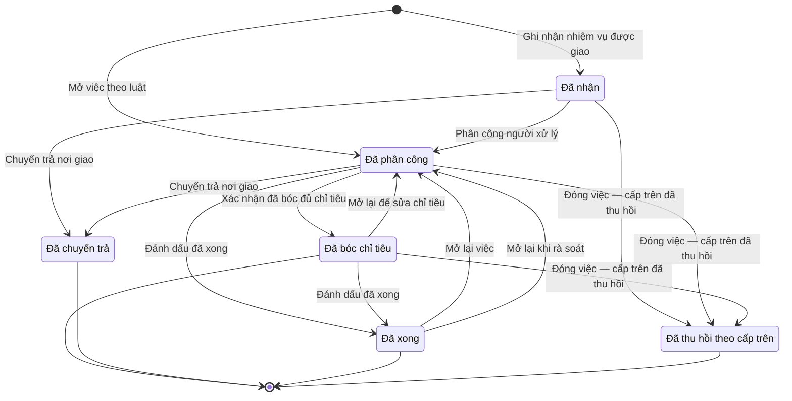

# qt-1 · Việc luật giao kèm văn bản đến, đi

<!-- máy sinh: tom-tat -->
> **Hồ sơ:** Nhiệm vụ trên giao (`MissionTasking`)
>
> **Trong sổ phạm vi:** 1 · Việc luật giao kèm văn bản đến, đi (tầng 1)
>
> 19 bước · 6 chặng · 3 vai · 3 bảng quyết định · 0 hạn · 34 khớp nối.
>
> **Nguồn:** sổ nghiệp vụ `qt-1` · khai báo của app: `dqtv-app/core/processes/tasking/workflow/mission-tasking.yaml`. Các bảng do máy sinh từ nguồn này.
<!-- hết: tom-tat -->

<!-- viết tay: dien-giai -->
## Diễn giải

*Phần này viết tay, diễn giải lại điều các bảng bên dưới ghi.*

### Quy trình này để làm gì

Đơn vị theo dõi một **nhiệm vụ trên giao**: nhận việc, phân công người cầm việc, bóc việc thành chỉ tiêu và mốc thời gian, rồi đánh dấu xong. Hai vai làm việc là Chỉ huy trưởng Ban CHQS xã và Trợ lý Tác huấn; ô "cấp nhận nhiệm vụ" có sáu cấp (từ Bộ Quốc phòng tới cấp xã, Ban CHQS cơ quan, tổ chức, Ban CHQS bộ, ngành).

Hồ sơ có sáu chặng: *Đã nhận* (vào sổ từ văn bản đến, chưa ai cầm) → *Đã phân công* (đã có người xử lý chính) → *Đã bóc chỉ tiêu* (biết cấp mình phải làm gì, bao nhiêu) → *Đã xong*; hai chặng rẽ là *Đã chuyển trả* và *Đã thu hồi theo cấp trên*. Rất nhiều hồ sơ của quy trình khác ghi mối nối về nhiệm vụ này như "việc gốc" (mục 2).

### Khi nào bắt đầu

Có hai cửa vào:

- Chỉ huy trưởng Ban CHQS xã bấm **Ghi nhận nhiệm vụ được giao**: hồ sơ vào chặng *Đã nhận*. Phải nhập `incomingDocumentId`, loại văn kiện giao, tên nhiệm vụ, ngày nhận, cấp nhận nhiệm vụ, loại việc. Bước ghi mối nối tới Văn bản đến và Đơn vị hành chính. Riêng khi bảng `raise-handler` cho kết quả `handler-derived` (mười sáu loại việc), hồ sơ sang thẳng *Đã phân công*, bước ghi thêm "vai xử lý chính" và "phân công lúc".
- Trợ lý Tác huấn bấm **Mở việc theo luật**: hồ sơ vào thẳng chặng *Đã phân công*. Phải nhập việc luật giao cho cấp mình, loại văn kiện giao, tên nhiệm vụ, cấp nhận nhiệm vụ, vai cầm việc này, loại việc. Bước này ghi luôn "phân công lúc", "xếp việc lúc" và "phân loại lúc".

Ở cả hai cửa, nhãn "báo cáo đột xuất" và hạn trả báo cáo là ô nhập nếu có. Yêu cầu báo cáo đột xuất là một việc giao chạy trên luồng này, mang nhãn đột xuất và hạn trả rõ để cấp dưới biết mà theo.

Nhiệm vụ ở cấp dưới còn sinh ra khi cấp ấy nhận bản giao của quy trình 3 (bước `acceptAssignment` của quy trình 3).

### Diễn ra thế nào

**Chặng "Đã nhận".** Chỉ huy trưởng **Phân công người xử lý** (chọn vai cầm việc) để sang *Đã phân công*; bước này lặp được, tức bấm lại được khi hồ sơ đã ở *Đã phân công*. Trợ lý Tác huấn **Sửa nội dung nhiệm vụ** (tên, trích yếu, kỳ thực hiện, loại văn kiện, độ mật) được ở hai chặng *Đã nhận* và *Đã phân công*.

**Xếp việc vào một việc luật giao** (Trợ lý Tác huấn) làm được ở ba chặng *Đã nhận*, *Đã phân công*, *Đã bóc chỉ tiêu*: chọn dòng việc luật giao cho cấp mình, hoặc ghi không xếp được kèm lý do nằm ngoài danh mục. Bước ghi "phân loại lúc" — ô mà bước đánh dấu xong đòi; đây là việc còn nợ cho tới khi có ô ấy.

**Chặng "Đã phân công" và "Đã bóc chỉ tiêu"** — Trợ lý Tác huấn bóc việc, mọi bước đều lặp được, hồ sơ đứng yên:

- **Thêm chỉ tiêu** (phải nhập tên chỉ tiêu, `measureKey`, số được giao, `selfExecuted`), **Sửa chỉ tiêu**, **Gỡ chỉ tiêu khỏi kế hoạch** (phải ghi lý do gỡ), **Bổ chỉ tiêu theo kỳ** (phải nhập chỉ tiêu đem bổ và số cho từng kỳ con). Thêm và bổ tạo hồ sơ con Chỉ tiêu.
- **Thêm mốc thời gian** (việc phải làm, hạn, cách xác nhận xong; tạo hồ sơ con Mốc thời gian), **Sửa việc phải làm**, **Gỡ việc phải làm khỏi kế hoạch** (phải ghi lý do gỡ).

**Xác nhận đã bóc đủ chỉ tiêu** (Chỉ huy trưởng) đưa hồ sơ từ *Đã phân công* sang *Đã bóc chỉ tiêu*; phải đã có ô "nhập chỉ tiêu đầu lúc", thiếu thì hệ báo "chưa nhập chỉ tiêu nào thì chưa đóng được chặng bóc chỉ tiêu". Sau khi xác nhận, các bước thêm, sửa, gỡ, bổ ở trên vẫn làm được.

**Đường rẽ và kết thúc:**

- **Chuyển trả nơi giao** (Chỉ huy trưởng) từ *Đã nhận* hoặc *Đã phân công* sang *Đã chuyển trả*; phải ghi lý do, và phải đạt điều kiện `notFromAssignment`: không có hồ sơ Giao chỉ tiêu hai bậc (qt-3) nào có ô nối `raisedTasking` trỏ về chính hồ sơ đang làm — tức nhiệm vụ này không sinh ra từ một bản giao.
- **Đánh dấu đã xong** (Trợ lý Tác huấn) từ *Đã phân công* hoặc *Đã bóc chỉ tiêu* sang *Đã xong* — tức không buộc phải qua chặng bóc chỉ tiêu. Phải đã có "phân loại lúc" (thiếu thì hệ báo "chưa xếp việc vào một việc luật giao (hoặc ghi ngoài danh mục kèm lý do) thì chưa đánh dấu xong được") và đạt điều kiện `allAssignmentsConfirmed`: mọi hồ sơ Giao chỉ tiêu hai bậc (qt-3) đang ở chặng `DONE`, `RETURNED`, `CANCELLED` hoặc `WITHDRAWN`. Văn bản đi trả lời việc này là ô nhập nếu có. Gửi một văn bản đi không có nghĩa là xong việc, nên luôn phải có người bấm đánh dấu xong.
- **Đóng việc — cấp trên đã thu hồi** (Trợ lý Tác huấn) từ ba chặng đầu sang *Đã thu hồi theo cấp trên*; phải đã có "cấp trên thu hồi ngày" và đạt `allAssignmentsConfirmed`.
- Từ *Đã xong* quay về *Đã phân công* bằng **Mở lại việc** (Trợ lý Tác huấn) hoặc **Mở lại khi rà soát** (Chỉ huy trưởng); cả hai bắt ghi lý do mở lại.

### Kết thúc và để lại gì

Bốn chặng kết thúc: *Đã bóc chỉ tiêu*, *Đã chuyển trả*, *Đã xong*, *Đã thu hồi theo cấp trên*. Ở *Đã bóc chỉ tiêu* vẫn làm tiếp được các bước bóc việc, đánh dấu xong và đóng việc; ở *Đã xong* vẫn mở lại được.

Hồ sơ của quy trình khác mở ra có nối về nhiệm vụ này (mục 10): bản giao chỉ tiêu xuống cấp dưới (3), báo cáo định kỳ (5), dự toán ngân sách năm (4), hồ sơ khen thưởng (8), hồ sơ chế độ chính sách (12b), lệnh điều động (13a), sự kiện huấn luyện – hội thi – diễn tập (14), đợt kiểm kê (15), công trình, đất đai quốc phòng (23), đơn vị dân quân tự vệ (29), chức vụ chỉ huy (30), phiếu cấp phát huấn luyện (D11), đợt thu hồi, thanh lý (D14), đợt mở rộng lực lượng (D5). Kế hoạch, văn kiện (2) gắn vào nhiệm vụ ở một bước giữa chừng; chỉ tiêu và mốc thời gian bóc ra ở đây là hồ sơ mục 10 xếp dưới quy trình 2.

### Điều kiện chặn

- Mọi bước trừ hai bước mở: người làm phải thuộc đơn vị chủ hồ sơ. Không đúng người, sai chặng, thiếu thứ phải có trước thì chặn, hồ sơ giữ nguyên. Nhiều lỗi cùng lúc thì báo theo thứ tự quyền → chặng → thông tin.
- Bảng `raise-handler` (xét ở bước ghi nhận nhiệm vụ, theo loại việc đã chọn): chưa chọn loại việc thì chặn (`kind-missing`); bốn loại `outreach`, `inspection`, `system_onboarding`, `other` thì cho qua; mười sáu loại còn lại cho kết quả `handler-derived` (hồ sơ sang *Đã phân công*).
- Bảng `placement` (xét ở bước xếp việc): chưa chọn thì chặn (`choice-missing`); chọn ngoài danh mục mà không ghi lý do thì chặn (`reason-missing`); chọn xếp vào dòng (`on-line`) thì ghi "việc này thuộc việc nào của cấp mình" và "xếp việc lúc"; ngoài danh mục có lý do (`outside-catalogue`) thì ghi "không xếp được vì" và "lý do nằm ngoài danh mục"; hồ sơ giữ nguyên chặng.
- Gỡ, bổ chỉ tiêu đòi đã nối tới Chỉ tiêu; sửa chỉ tiêu đòi thêm tên chỉ tiêu, số được giao, kỳ, nấc kỳ. Gỡ việc phải làm đòi đã nối tới Mốc thời gian; sửa việc phải làm đòi thêm việc phải làm, hạn, cách xác nhận xong.
- Quy trình không đặt hạn nào và không có việc nào làm ngoài hệ.
<!-- hết viết tay -->

## 1. Đường đi ngắn nhất qua các chặng

<!-- máy sinh: luong-chinh -->
Đường ít bước nhất từ lúc mở hồ sơ tới chặng kết thúc xa nhất. Máy chọn theo số chặng, không theo ý nghĩa nghiệp vụ — trình tự công việc thật xem phần Diễn giải và bảng "Việc làm ở từng chặng" ở mục 6.

| # | Ai làm | Làm gì | Hồ sơ sang chặng |
|---|---|---|---|
| 1 | Trợ lý Tác huấn | Mở việc theo luật | Đã phân công |
| 2 | Chỉ huy trưởng Ban CHQS xã | Xác nhận đã bóc đủ chỉ tiêu | Đã bóc chỉ tiêu |

<!-- hết: luong-chinh -->

## 2. Hồ sơ và việc nó để lại

<!-- máy sinh: muc-tieu -->
**App gọi quy trình này là:** Nhiệm vụ trên giao.

**Hồ sơ này để lại cho quy trình khác** (bước tạo hồ sơ của quy trình kia ghi mối nối về đây):
- Báo cáo định kỳ, đột xuất (5) — bước `prepareRoutineReport`, khớp nối `covers`
- Báo cáo đột xuất (6) — bước `prepareAdHocReport`, khớp nối `adHocReportForTasking`
- Bản giao chỉ tiêu, mốc xuống cấp dưới (3) — bước `draftAssignment`, khớp nối `hasAssignment`
- Chức vụ chỉ huy dân quân tự vệ (30) — bước `openTenureFromEstablishment`, khớp nối `commandTenureServesTasking`
- Chức vụ chỉ huy dân quân tự vệ (30) — bước `planTenure`, khớp nối `commandTenureServesTasking`
- Công trình, đất đai quốc phòng (23) — bước `proposeLand`, khớp nối `defenceWorkServesTasking`
- Cơ sở động viên công nghiệp (39) — bước `surveyFacility`, khớp nối `facilityServesTasking`
- Danh mục bảo đảm (D7) — bước `openProvisionDemand`, khớp nối `provisionDemandServesTasking`
- Dự toán ngân sách năm (4) — bước `establishCommuneBudget`, khớp nối `budgetPlanServesTasking`
- Dự toán ngân sách năm (4) — bước `establishProvinceBudget`, khớp nối `budgetPlanServesTasking`
- Hồ sơ Kỷ niệm chương "Vì sự nghiệp vũ trang quần chúng" (8.medal) — bước `proposeMedal`, khớp nối `medalCaseServesTasking`
- Hồ sơ chế độ chính sách (12b) — bước `raiseAllowanceFromCase`, khớp nối `benefitClaimServesTasking`
- Hồ sơ chế độ chính sách (12b) — bước `raiseAllowanceFromEvent`, khớp nối `benefitClaimServesTasking`
- Hồ sơ chế độ chính sách (12b) — bước `raiseAllowanceFromMission`, khớp nối `benefitClaimServesTasking`
- Hồ sơ chế độ chính sách (12b) — bước `raiseAllowanceFromSpecialDeployment`, khớp nối `benefitClaimServesTasking`
- Hồ sơ chế độ chính sách (12b) — bước `submitClaim`, khớp nối `benefitClaimServesTasking`
- Hồ sơ giải thể tổ chức (31) — bước `receiveDissolutionDossier`, khớp nối `dissolutionDossierServesTasking`
- Hồ sơ giải thể tổ chức (31) — bước `requestDisbandSignature`, khớp nối `dissolutionDossierServesTasking`
- Hồ sơ khen thưởng (8) — bước `recordMemberSelection`, khớp nối `awardCaseServesTasking`
- Hồ sơ khen thưởng (8) — bước `recordUnitSelection`, khớp nối `awardCaseServesTasking`
- Hồ sơ lưu trữ (D16) — bước `openArchiveFile`, khớp nối `dossierOfTasking`
- Hồ sơ thành lập tổ chức (29) — bước `draftUnit`, khớp nối `organisationDossierServesTasking`
- Hồ sơ thành lập tổ chức (29) — bước `receiveOrganizationDossier`, khớp nối `organisationDossierServesTasking`
- Hồ sơ thành lập tổ chức (29) — bước `recordCouncilEstablishment`, khớp nối `organisationDossierServesTasking`
- Kế hoạch, văn kiện (2) — bước `draftPlan`, khớp nối `answeredBy`
- Kế hoạch, văn kiện (2) — bước `openPlanAmendment`, khớp nối `answeredBy`
- Kỳ tuyển chọn (D2) — bước `openSelectionDrive`, khớp nối `selectionDriveServesTasking`
- Lệnh điều động (13a) — bước `proposeDeployment`, khớp nối `deploymentOrderServesTasking`
- Lệnh điều động (13a) — bước `receiveUpperDeploymentDecision`, khớp nối `deploymentOrderServesTasking`
- Phiếu cấp phát huấn luyện (D11.training-allocation) — bước `openTrainingAllocation`, khớp nối `trainingAllocationServesTasking`
- Sự kiện — huấn luyện, hội thi, diễn tập, hội nghị (14) — bước `createTrainingPlan`, khớp nối `trainingEventServesTasking`
- Vụ việc ứng phó (20) — bước `openCase`, khớp nối `responseCaseServesTasking`
- Đề nghị công nhận hoàn thành nghĩa vụ quân sự tại ngũ (D4) — bước `draftServiceRecognitionProposal`, khớp nối `recognitionProposalServesTasking`
- Đề nghị của xã về xã trọng điểm quốc phòng (XT.commune-proposal) — bước `proposeKeyCommuneStatus`, khớp nối `keyCommuneProposalServesTasking`
- Đợt hoàn thành nghĩa vụ (D3) — bước `gatherServiceCompletionBatch`, khớp nối `serviceCompletionBatchServesTasking`
- Đợt kiểm kê (15) — bước `openInventoryCheck`, khớp nối `inventoryCheckServesTasking`
- Đợt mở rộng lực lượng (D5) — bước `recordExpansionOrder`, khớp nối `forceExpansionServesTasking`
- Đợt thu hồi, thanh lý (D14) — bước `openDisposalBatch`, khớp nối `disposalBatchServesTasking`
- Đợt đề nghị xã trọng điểm về quốc phòng (XT) — bước `openKeyCommuneBatch`, khớp nối `keyCommuneBatchServesTasking`
<!-- hết: muc-tieu -->

## 3. Khởi phát và kết thúc

<!-- máy sinh: khoi-phat -->
**2 cửa vào** — bước mở hồ sơ:

| Bước mở | Ai mở | Hồ sơ vào chặng | App bắt buộc nhập |
|---|---|---|---|
| Ghi nhận nhiệm vụ được giao | Chỉ huy trưởng Ban CHQS xã | Đã nhận | `incomingDocumentId`, loại văn kiện giao, tên nhiệm vụ, ngày nhận, cấp nhận nhiệm vụ, loại việc |
| Mở việc theo luật | Trợ lý Tác huấn | Đã phân công | đậu vào việc nào của cấp mình, loại văn kiện giao, tên nhiệm vụ, cấp nhận nhiệm vụ, vai xử lý chính, loại việc |

**Kết thúc:** *Đã bóc chỉ tiêu* (`BROKEN_DOWN`), *Đã chuyển trả* (`RETURNED`), *Đã xong* (`DONE`), *Đã thu hồi theo cấp trên* (`REVOKED`)
<!-- hết: khoi-phat -->

## 4. Vai trò

<!-- máy sinh: vai-tro -->
| Vai trong sổ | Tên trong app | Điều kiện | Làm những bước |
|---|---|---|---|
| `commander` | Chỉ huy trưởng Ban CHQS xã |  | Ghi nhận nhiệm vụ được giao · Phân công người xử lý · Xác nhận đã bóc đủ chỉ tiêu · Chuyển trả nơi giao · Mở lại khi rà soát |
| `operator` | Trợ lý Tác huấn |  | Mở việc theo luật · Sửa nội dung nhiệm vụ · Thêm chỉ tiêu · Xếp việc vào một việc luật giao · Sửa chỉ tiêu · Gỡ chỉ tiêu khỏi kế hoạch · Gỡ việc phải làm khỏi kế hoạch · Sửa việc phải làm · Bổ chỉ tiêu theo kỳ · Thêm mốc thời gian · Mở lại để sửa chỉ tiêu · Đánh dấu đã xong · Mở lại việc |
| `system` | Hệ thống tự làm |  | Đóng việc — cấp trên đã thu hồi |

*"Tên trong app" là tên app đặt cho mã chủ thể của vai. Hồ sơ thuộc đơn vị cấp khác thì người làm là người giữ vai ấy ở đơn vị nêu trong cột "Điều kiện" (nếu sổ có ghi) và ở cột "Người làm phải thuộc" của bảng "Theo khai báo của app" (mục 7).*
<!-- hết: vai-tro -->

## 5. Nhánh phụ

<!-- máy sinh: nhanh-phu -->
**Bước khác đưa hồ sơ sang chặng mới** — đường song song, rẽ nhánh hoặc kết thúc sớm:

| Bước | Ai làm | Từ chặng | Sang chặng |
|---|---|---|---|
| Phân công người xử lý | Chỉ huy trưởng Ban CHQS xã | Đã nhận, Đã phân công | Đã phân công |
| Chuyển trả nơi giao | Chỉ huy trưởng Ban CHQS xã | Đã nhận, Đã phân công | Đã chuyển trả |
| Đánh dấu đã xong | Trợ lý Tác huấn | Đã phân công, Đã bóc chỉ tiêu | Đã xong |
| Đóng việc — cấp trên đã thu hồi | Hệ thống tự làm | Đã nhận, Đã phân công, Đã bóc chỉ tiêu | Đã thu hồi theo cấp trên |

**Quay lại một chặng hồ sơ đã đi qua** (tính theo đường ngắn nhất từ lúc mở):

| Bước | Ai làm | Từ chặng | Về chặng |
|---|---|---|---|
| Mở lại để sửa chỉ tiêu | Trợ lý Tác huấn | Đã bóc chỉ tiêu | Đã phân công |
| Mở lại việc | Trợ lý Tác huấn | Đã xong | Đã phân công |
| Mở lại khi rà soát | Chỉ huy trưởng Ban CHQS xã | Đã xong | Đã phân công |

**Làm trong lúc hồ sơ đứng yên ở một chặng** — ghi nhận, bổ sung:

| Bước | Ai làm | Ở chặng |
|---|---|---|
| Sửa nội dung nhiệm vụ | Trợ lý Tác huấn | Đã nhận, Đã phân công |
| Thêm chỉ tiêu *(lặp được)* | Trợ lý Tác huấn | Đã phân công |
| Xếp việc vào một việc luật giao *(lặp được)* | Trợ lý Tác huấn | Đã nhận, Đã phân công, Đã bóc chỉ tiêu |
| Sửa chỉ tiêu *(lặp được)* | Trợ lý Tác huấn | Đã phân công |
| Gỡ chỉ tiêu khỏi kế hoạch *(lặp được)* | Trợ lý Tác huấn | Đã phân công |
| Gỡ việc phải làm khỏi kế hoạch *(lặp được)* | Trợ lý Tác huấn | Đã phân công |
| Sửa việc phải làm *(lặp được)* | Trợ lý Tác huấn | Đã phân công |
| Bổ chỉ tiêu theo kỳ *(lặp được)* | Trợ lý Tác huấn | Đã phân công |
| Thêm mốc thời gian *(lặp được)* | Trợ lý Tác huấn | Đã phân công |

**Cửa vào khác:** 2 bước cùng mở hồ sơ — xem mục 3.

<!-- hết: nhanh-phu -->

## 6. Các chặng và việc làm ở từng chặng

<!-- máy sinh: chang -->
| Chặng | Tên hiển thị | Vào bằng bước | Kết thúc? |
|---|---|---|---|
| `RECEIVED` | Đã nhận | Ghi nhận nhiệm vụ được giao |  |
| `ASSIGNED` | Đã phân công | Mở việc theo luật · Phân công người xử lý · Mở lại để sửa chỉ tiêu · Mở lại việc · Mở lại khi rà soát |  |
| `BROKEN_DOWN` | Đã bóc chỉ tiêu | Xác nhận đã bóc đủ chỉ tiêu | **kết thúc** — vẫn còn bước làm được |
| `RETURNED` | Đã chuyển trả | Chuyển trả nơi giao | **kết thúc** |
| `DONE` | Đã xong | Đánh dấu đã xong | **kết thúc** — vẫn còn bước làm được |
| `REVOKED` | Đã thu hồi theo cấp trên | Đóng việc — cấp trên đã thu hồi | **kết thúc** |

### Việc làm ở từng chặng

Hồ sơ đang ở chặng nào thì làm được những bước nào.

| Hồ sơ đang ở chặng | Bước làm tại chặng (hồ sơ đứng yên) | Bước đưa hồ sơ sang chặng khác |
|---|---|---|
| **Đã nhận** | Sửa nội dung nhiệm vụ — Trợ lý Tác huấn Xếp việc vào một việc luật giao (lặp được) — Trợ lý Tác huấn | Phân công người xử lý — Chỉ huy trưởng Ban CHQS xã → *Đã phân công* Chuyển trả nơi giao — Chỉ huy trưởng Ban CHQS xã → *Đã chuyển trả* Đóng việc — cấp trên đã thu hồi — Hệ thống tự làm → *Đã thu hồi theo cấp trên* |
| **Đã phân công** | Phân công người xử lý (lặp được) — Chỉ huy trưởng Ban CHQS xã Sửa nội dung nhiệm vụ — Trợ lý Tác huấn Thêm chỉ tiêu (lặp được) — Trợ lý Tác huấn Xếp việc vào một việc luật giao (lặp được) — Trợ lý Tác huấn Sửa chỉ tiêu (lặp được) — Trợ lý Tác huấn Gỡ chỉ tiêu khỏi kế hoạch (lặp được) — Trợ lý Tác huấn Gỡ việc phải làm khỏi kế hoạch (lặp được) — Trợ lý Tác huấn Sửa việc phải làm (lặp được) — Trợ lý Tác huấn Bổ chỉ tiêu theo kỳ (lặp được) — Trợ lý Tác huấn Thêm mốc thời gian (lặp được) — Trợ lý Tác huấn | Xác nhận đã bóc đủ chỉ tiêu — Chỉ huy trưởng Ban CHQS xã → *Đã bóc chỉ tiêu* Chuyển trả nơi giao — Chỉ huy trưởng Ban CHQS xã → *Đã chuyển trả* Đánh dấu đã xong — Trợ lý Tác huấn → *Đã xong* Đóng việc — cấp trên đã thu hồi — Hệ thống tự làm → *Đã thu hồi theo cấp trên* |
| **Đã bóc chỉ tiêu** | Xếp việc vào một việc luật giao (lặp được) — Trợ lý Tác huấn | Mở lại để sửa chỉ tiêu — Trợ lý Tác huấn → *Đã phân công* Đánh dấu đã xong — Trợ lý Tác huấn → *Đã xong* Đóng việc — cấp trên đã thu hồi — Hệ thống tự làm → *Đã thu hồi theo cấp trên* |
| **Đã chuyển trả** | — | — (kết thúc) |
| **Đã xong** | — | Mở lại việc — Trợ lý Tác huấn → *Đã phân công* Mở lại khi rà soát — Chỉ huy trưởng Ban CHQS xã → *Đã phân công* |
| **Đã thu hồi theo cấp trên** | — | — (kết thúc) |
<!-- hết: chang -->

## 7. Bảng bước

<!-- máy sinh: buoc -->
| # | Bước | Mã bước | Ai thực hiện | Từ chặng | Sang chặng | Phải có trước | Ghi lại |
|---|---|---|---|---|---|---|---|
| 1 | Ghi nhận nhiệm vụ được giao | `raiseTaskingFromDocument` | Chỉ huy trưởng Ban CHQS xã | — (mở hồ sơ) | `RECEIVED` | `taskingSourceDocumentUsable` | mã tỉnh, mã xã, cấp nhận nhiệm vụ, loại văn kiện giao, tên nhiệm vụ, trích yếu, kỳ thực hiện, ngày nhận, độ mật, loại việc, mã đơn vị giao, `incomingDocumentId`, nối tới Văn bản đến, nối tới Đơn vị hành chính, báo cáo đột xuất, hạn trả báo cáo, đơn vị chủ hồ sơ, `id` |
| 2 | Mở việc theo luật | `openObligationTasking` | Trợ lý Tác huấn | — (mở hồ sơ) | `ASSIGNED` | `taskingBasisGiven` | mã tỉnh, mã xã, cấp nhận nhiệm vụ, loại văn kiện giao, tên nhiệm vụ, trích yếu, kỳ thực hiện, ngày nhận, vai cầm việc này, phân công lúc, độ mật, loại việc, việc luật giao cho cấp mình, xếp việc lúc, phân loại lúc, báo cáo đột xuất, hạn trả báo cáo, đơn vị chủ hồ sơ, `id`, nối tới Văn bản đến, căn cứ kỳ báo cáo luật định |
| 3 | Phân công người xử lý | `assignTaskingHandler` | Chỉ huy trưởng Ban CHQS xã | `RECEIVED`, `ASSIGNED` | `ASSIGNED` | người làm thuộc đơn vị chủ hồ sơ | phân công lúc, vai xử lý chính |
| 4 | Sửa nội dung nhiệm vụ | `editTasking` | Trợ lý Tác huấn | `RECEIVED`, `ASSIGNED` | giữ nguyên | người làm thuộc đơn vị chủ hồ sơ | tên nhiệm vụ, trích yếu, kỳ thực hiện, loại văn kiện giao, độ mật |
| 5 | Thêm chỉ tiêu | `addTaskingTarget` | Trợ lý Tác huấn | `ASSIGNED` | giữ nguyên | người làm thuộc đơn vị chủ hồ sơ | nhập chỉ tiêu đầu lúc, nối tới Chỉ tiêu, tên chỉ tiêu, số được giao, kỳ, nấc kỳ, nối `fulfils` |
| 6 | Xếp việc vào một việc luật giao | `placeTaskingOnFoundation` | Trợ lý Tác huấn | `RECEIVED`, `ASSIGNED`, `BROKEN_DOWN` | giữ nguyên | người làm thuộc đơn vị chủ hồ sơ | phân loại lúc |
| 7 | Sửa chỉ tiêu | `editTaskingTarget` | Trợ lý Tác huấn | `ASSIGNED` | giữ nguyên | người làm thuộc đơn vị chủ hồ sơ, nối tới Chỉ tiêu, `lineNotSignedDown` | tên chỉ tiêu, số được giao, cấp tổ chức, ghi chú, hạn, ngày bắt đầu, lặp mỗi, số lần mỗi kỳ, vai phối hợp, vai chỉ đạo, phụ trách, địa điểm, văn bản căn cứ, kỳ, nấc kỳ, chốt số liệu từ, chốt số liệu đến, vai chủ trì |
| 8 | Gỡ chỉ tiêu khỏi kế hoạch | `withdrawTaskingTarget` | Trợ lý Tác huấn | `ASSIGNED` | giữ nguyên | người làm thuộc đơn vị chủ hồ sơ, nối tới Chỉ tiêu, `lineNotSignedDown` | `withdrawnAt`, `withdrawnReason` |
| 9 | Gỡ việc phải làm khỏi kế hoạch | `withdrawTaskingTask` | Trợ lý Tác huấn | `ASSIGNED` | giữ nguyên | người làm thuộc đơn vị chủ hồ sơ, nối tới Mốc thời gian, `taskNotSignedDown` | `withdrawnAt`, `withdrawnReason` |
| 10 | Sửa việc phải làm | `editTaskingTask` | Trợ lý Tác huấn | `ASSIGNED` | giữ nguyên | người làm thuộc đơn vị chủ hồ sơ, nối tới Mốc thời gian, `taskNotSignedDown` | việc phải làm, cách xác nhận xong, ghi chú, hạn, ngày bắt đầu, lặp mỗi, số lần mỗi kỳ, vai phối hợp, vai chỉ đạo, phụ trách, địa điểm, văn bản căn cứ, kỳ, nấc kỳ, chốt số liệu từ, chốt số liệu đến, vai chủ trì |
| 11 | Bổ chỉ tiêu theo kỳ | `splitTargetByPeriod` | Trợ lý Tác huấn | `ASSIGNED` | giữ nguyên | người làm thuộc đơn vị chủ hồ sơ, nối tới Chỉ tiêu | nhập chỉ tiêu đầu lúc, nối `subTargetOf`, nối tới Chỉ tiêu |
| 12 | Thêm mốc thời gian | `addTaskingTask` | Trợ lý Tác huấn | `ASSIGNED` | giữ nguyên | người làm thuộc đơn vị chủ hồ sơ | nối tới Mốc thời gian, việc phải làm, hạn, cách xác nhận xong |
| 13 | Mở lại để sửa chỉ tiêu | `reopenTaskingBreakdown` | Trợ lý Tác huấn | `BROKEN_DOWN` | `ASSIGNED` | người làm thuộc đơn vị chủ hồ sơ | mở lại để sửa chỉ tiêu lúc; **xoá:** bóc chỉ tiêu xong lúc |
| 14 | Xác nhận đã bóc đủ chỉ tiêu | `confirmTaskingBreakdown` | Chỉ huy trưởng Ban CHQS xã | `ASSIGNED` | `BROKEN_DOWN` | nhập chỉ tiêu đầu lúc, người làm thuộc đơn vị chủ hồ sơ | bóc chỉ tiêu xong lúc |
| 15 | Chuyển trả nơi giao | `returnTasking` | Chỉ huy trưởng Ban CHQS xã | `RECEIVED`, `ASSIGNED` | `RETURNED` | người làm thuộc đơn vị chủ hồ sơ, `notFromAssignment` | lý do chuyển trả, chuyển trả lúc |
| 16 | Đánh dấu đã xong | `closeTaskingWithOutgoingDocument` | Trợ lý Tác huấn | `ASSIGNED`, `BROKEN_DOWN` | `DONE` | người làm thuộc đơn vị chủ hồ sơ, phân loại lúc, `allAssignmentsConfirmed`, `noOpenResponseCase`, `noOpenAwardCase`, `noOpenMedalCase` | xong lúc, văn bản đi trả lời việc này |
| 17 | Đóng việc — cấp trên đã thu hồi | `closeTaskingOnRevocation` | Hệ thống tự làm | `RECEIVED`, `ASSIGNED`, `BROKEN_DOWN` | `REVOKED` | `allAssignmentsConfirmed` | đóng vì cấp trên thu hồi lúc |
| 18 | Mở lại việc | `reopenTasking` | Trợ lý Tác huấn | `DONE` | `ASSIGNED` | lý do mở lại, người làm thuộc đơn vị chủ hồ sơ | lý do mở lại, mở lại lúc |
| 19 | Mở lại khi rà soát | `reopenTaskingOnReview` | Chỉ huy trưởng Ban CHQS xã | `DONE` | `ASSIGNED` | lý do mở lại, người làm thuộc đơn vị chủ hồ sơ | lý do mở lại, mở lại lúc |

### Khi không đạt điều kiện

Mặc định: không đúng người, hồ sơ không ở đúng chặng, hoặc thiếu thứ "phải có trước" thì bước bị chặn, hồ sơ giữ nguyên. Bảng dưới chỉ kê những bước có kết quả riêng.

| # | Bước | Kết quả riêng |
|---|---|---|
| 1 | Ghi nhận nhiệm vụ được giao | bước dừng lại, hồ sơ giữ nguyên khi kết quả xét là: `kind-missing`; nhánh `handler-derived`: hồ sơ sang *Đã phân công*, ghi thêm vai xử lý chính, phân công lúc |
| 6 | Xếp việc vào một việc luật giao | bước dừng lại, hồ sơ giữ nguyên khi kết quả xét là: `choice-missing`, `reason-missing`; nhánh `on-line`: hồ sơ giữ nguyên chặng, ghi thêm việc này thuộc việc nào của cấp mình, xếp việc lúc; nhánh `outside-catalogue`: hồ sơ giữ nguyên chặng, ghi thêm không xếp được vì, lý do nằm ngoài danh mục |
| 16 | Đánh dấu đã xong | bước dừng lại, hồ sơ giữ nguyên khi kết quả xét là: `over-delegated` |
| 17 | Đóng việc — cấp trên đã thu hồi | bước này không do người nào bấm |

### Điều kiện "phải có trước" bằng lời

Cột "Phải có trước" ở bảng bước có hai loại: ô dữ liệu thường (bước chỉ đòi ô ấy đã có giá trị) và điều kiện hệ tự xét. Bảng này diễn các điều kiện hệ tự xét theo đúng công thức sổ ghi; số ở cột cuối là số thứ tự bước.

| Điều kiện | Đúng khi | Bước đòi |
|---|---|---|
| `taskingSourceDocumentUsable` | có hồ sơ Việc luật giao kèm văn bản đến, đi — Văn bản đến (qt-1.incoming-document) chính là hồ sơ ghi ở `incomingDocumentId` của hồ sơ đang làm mà hồ sơ ấy đang ở chặng `DISTRIBUTED` | 1 |
| `taskingBasisGiven` | đã có nối tới Văn bản đến HOẶC đã có căn cứ kỳ báo cáo luật định | 2 |
| `actorInOwnerUnit` | người đang làm là người của đơn vị ghi ở ô đơn vị chủ hồ sơ của hồ sơ này (theo danh mục người của đơn vị, `dm.unit-staff`) | 3, 4, 5, 6, 7, 8, 9, 10, 11, 12, 13, 14, 15, 16, 18, 19 |
| `lineNotSignedDown` | không có hồ sơ Giao chỉ tiêu hai bậc (qt-3) có ô nối `assignsTarget` trùng với `targetId` của hồ sơ đang làm mà hồ sơ ấy đang ở chặng `DELEGATED` hoặc `ACCEPTED` hoặc `DONE` | 7, 8 |
| `taskNotSignedDown` | không có hồ sơ Giao chỉ tiêu hai bậc (qt-3) có ô nối `assignsTask` trùng với `taskId` của hồ sơ đang làm mà hồ sơ ấy đang ở chặng `DELEGATED` hoặc `ACCEPTED` hoặc `DONE` | 9, 10 |
| `notFromAssignment` | không có hồ sơ Giao chỉ tiêu hai bậc (qt-3) có ô nối `raisedTasking` trỏ về chính hồ sơ đang làm | 15 |
| `allAssignmentsConfirmed` | mọi hồ sơ Giao chỉ tiêu hai bậc (qt-3) đang ở chặng `DONE` hoặc `RETURNED` hoặc `CANCELLED` hoặc `WITHDRAWN` | 16, 17 |
| `noOpenResponseCase` | không có hồ sơ Vụ việc ứng phó (qt-20) có ô nối `responseCaseServesTasking` trỏ về chính hồ sơ đang làm mà hồ sơ ấy đang ở chặng `ASSESSING` hoặc `RESPONDING` | 16 |
| `noOpenAwardCase` | không có hồ sơ Khen thưởng (qt-8) có ô nối `awardCaseServesTasking` trỏ về chính hồ sơ đang làm mà hồ sơ ấy đang ở chặng `SELECTED` hoặc `DOSSIER_DRAFTED` hoặc `COUNCIL_REVIEWED` hoặc `ENDORSED` hoặc `SUBMITTED` hoặc `DECIDED` hoặc `ANNOUNCED` hoặc `AWARDED` hoặc `RESULT_NOTIFIED` | 16 |
| `noOpenMedalCase` | không có hồ sơ Khen thưởng — Hồ sơ Kỷ niệm chương "Vì sự nghiệp vũ trang quần chúng" (qt-8.medal) có ô nối `medalCaseServesTasking` trỏ về chính hồ sơ đang làm mà hồ sơ ấy đang ở chặng `DRAFT` hoặc `PROPOSED` hoặc `REJECTED` | 16 |

### Theo khai báo của app

Người làm phải thuộc đơn vị nào, ô người dùng phải nhập, bước có lặp được không, và căn cứ pháp lý — lấy từ khai báo quy trình trong app.

| # | Bước | Người làm phải thuộc | Bắt buộc nhập | Nhập nếu có | Lặp được | Căn cứ |
|---|---|---|---|---|---|---|
| 1 | Ghi nhận nhiệm vụ được giao |  | `incomingDocumentId`, loại văn kiện giao, tên nhiệm vụ, ngày nhận, cấp nhận nhiệm vụ, loại việc | trích yếu, kỳ thực hiện, độ mật, mã đơn vị giao, báo cáo đột xuất, hạn trả báo cáo |  | TT77/VBHN-BQP Đ.7 k2 a — ban hành quyết định, chỉ thị, mệnh lệnh, kế hoạch, hướng dẫn thực hiện công tác quốc phòng ở địa phương |
| 2 | Mở việc theo luật |  | việc luật giao cho cấp mình, loại văn kiện giao, tên nhiệm vụ, cấp nhận nhiệm vụ, vai cầm việc này, loại việc | trích yếu, kỳ thực hiện, độ mật, `incomingDocumentId`, cơ quan giao việc, loại văn bản, số, ký hiệu văn bản, trích yếu văn bản, tệp văn bản giao việc, báo cáo đột xuất, hạn trả báo cáo |  | L48/2019/QH14 Đ.37 k2 — trách nhiệm của cơ quan quân sự các cấp trong xây dựng lực lượng Dân quân tự vệ |
| 3 | Phân công người xử lý | đơn vị chủ hồ sơ | vai xử lý chính | — | có | NĐ 30/2020/NĐ-CP Đ.23 — trình, chuyển giao văn bản đến; NĐ168/2018/NĐ-CP Đ.12 k4 |
| 4 | Sửa nội dung nhiệm vụ | đơn vị chủ hồ sơ | — | tên nhiệm vụ, trích yếu, kỳ thực hiện, loại văn kiện giao, độ mật |  | NĐ 30/2020/NĐ-CP Đ.19 |
| 5 | Thêm chỉ tiêu | đơn vị chủ hồ sơ | tên chỉ tiêu, `measureKey`, số được giao, `selfExecuted` | loại việc, hạn, ghi chú, kỳ, nấc kỳ, ngày bắt đầu, lặp mỗi, số lần mỗi kỳ, vai phối hợp, vai chỉ đạo, phụ trách, địa điểm, văn bản căn cứ, chốt số liệu từ, chốt số liệu đến, vai chủ trì, `programmeKey`, cấp tổ chức | có | NĐ01/2019/NĐ-CP Đ.3 k6 |
| 6 | Xếp việc vào một việc luật giao | đơn vị chủ hồ sơ | — | việc này thuộc việc nào của cấp mình, không xếp được vì, lý do nằm ngoài danh mục | có | TT77/VBHN-BQP Đ.7 k1 n · NQ66.12/2026 Đ.4 k10 · NĐ72/2020/NĐ-CP Đ.11 |
| 7 | Sửa chỉ tiêu | đơn vị chủ hồ sơ | chỉ tiêu cần sửa | tên chỉ tiêu, số được giao, hạn, ghi chú, ngày bắt đầu, lặp mỗi, số lần mỗi kỳ, vai phối hợp, vai chỉ đạo, phụ trách, địa điểm, văn bản căn cứ, kỳ, nấc kỳ, chốt số liệu từ, chốt số liệu đến, vai chủ trì, cấp tổ chức | có | NĐ 30/2020/NĐ-CP Đ.19 |
| 8 | Gỡ chỉ tiêu khỏi kế hoạch | đơn vị chủ hồ sơ | chỉ tiêu cần gỡ, lý do gỡ | — | có | NĐ 30/2020/NĐ-CP Đ.19 |
| 9 | Gỡ việc phải làm khỏi kế hoạch | đơn vị chủ hồ sơ | việc cần gỡ, lý do gỡ | — | có | NĐ 30/2020/NĐ-CP Đ.19 |
| 10 | Sửa việc phải làm | đơn vị chủ hồ sơ | việc cần sửa | việc phải làm, hạn, ghi chú, cách xác nhận xong, ngày bắt đầu, lặp mỗi, số lần mỗi kỳ, vai phối hợp, vai chỉ đạo, phụ trách, địa điểm, văn bản căn cứ, kỳ, nấc kỳ, chốt số liệu từ, chốt số liệu đến, vai chủ trì | có | NĐ 30/2020/NĐ-CP Đ.19 |
| 11 | Bổ chỉ tiêu theo kỳ | đơn vị chủ hồ sơ | chỉ tiêu đem bổ, số cho từng kỳ con | — | có | QC20/6/2025 Đ.20 k2 — hằng quý Cục xác định nội dung chương trình công tác quý sau, gửi Phòng DQTV các quân khu |
| 12 | Thêm mốc thời gian | đơn vị chủ hồ sơ | việc phải làm, hạn, cách xác nhận xong | loại việc, vai chủ trì, ghi chú, ngày bắt đầu, lặp mỗi, số lần mỗi kỳ, vai phối hợp, vai chỉ đạo, phụ trách, địa điểm, văn bản căn cứ, kỳ, nấc kỳ, chốt số liệu từ, chốt số liệu đến | có | TT77/VBHN-BQP Đ.7 k2 b — hướng dẫn, đôn đốc, kiểm tra, tổng hợp, báo cáo kết quả thực hiện công tác quốc phòng |
| 13 | Mở lại để sửa chỉ tiêu | đơn vị chủ hồ sơ | — | — |  | NQ 66.12/2026 Đ.4 k4 b, c — thực hiện chỉ tiêu kế hoạch theo quyết định của cấp có thẩm quyền |
| 14 | Xác nhận đã bóc đủ chỉ tiêu | đơn vị chủ hồ sơ | — | — |  | NQ 66.12/2026 Đ.4 k4 b, c — tổ chức thực hiện quyết định của cấp có thẩm quyền về xây dựng lực lượng; thực hiện chỉ tiêu kế hoạch theo quyết định của cấp có thẩm quyền |
| 15 | Chuyển trả nơi giao | đơn vị chủ hồ sơ | lý do chuyển trả | — |  | NĐ 30/2020/NĐ-CP Đ.21 k2 b — văn bản gửi sai nơi nhận thì trả lại cho cơ quan, tổ chức gửi |
| 16 | Đánh dấu đã xong | đơn vị chủ hồ sơ | — | văn bản đi trả lời việc này |  | NĐ 30/2020/NĐ-CP Đ.24 — giải quyết và theo dõi, đôn đốc việc giải quyết văn bản đến |
| 17 | Đóng việc — cấp trên đã thu hồi |  | — | — |  | NĐ30/2020/NĐ-CP Đ.18 k3, k4 (thu hồi văn bản đã phát hành) |
| 18 | Mở lại việc | đơn vị chủ hồ sơ | lý do mở lại | — |  | NĐ 30/2020/NĐ-CP Đ.24 — giải quyết và theo dõi, đôn đốc việc giải quyết văn bản đến |
| 19 | Mở lại khi rà soát | đơn vị chủ hồ sơ | lý do mở lại | — |  | NĐ 30/2020/NĐ-CP Đ.24 — giải quyết và theo dõi, đôn đốc việc giải quyết văn bản đến |

### Điều kiện và ghi chú app khai cho từng bước

Lấy từ khai báo quy trình trong app. Lời trong ngoặc kép là câu app hiện cho người dùng. Chức danh người ký ngoài hệ app chỉ khai bằng mã.

| # | Bước | Điều kiện, ghi chú |
|---|---|---|
| 5 | Thêm chỉ tiêu | · tạo thêm một hồ sơ con: Chỉ tiêu (`PlanTarget`) |
| 6 | Xếp việc vào một việc luật giao | · là việc còn nợ cho tới khi có ô "phân loại lúc" |
| 11 | Bổ chỉ tiêu theo kỳ | · tạo thêm một hồ sơ con: Chỉ tiêu (`PlanTarget`) |
| 12 | Thêm mốc thời gian | · tạo thêm một hồ sơ con: Mốc thời gian (`PlanTask`) |
| 14 | Xác nhận đã bóc đủ chỉ tiêu | · phải đã có ô "nhập chỉ tiêu đầu lúc" — thiếu thì app báo: "chưa nhập chỉ tiêu nào thì chưa đóng được chặng bóc chỉ tiêu" |
| 16 | Đánh dấu đã xong | · phải đã có ô "phân loại lúc" — thiếu thì app báo: "chưa xếp việc vào một việc luật giao (hoặc ghi ngoài danh mục kèm lý do) thì chưa đánh dấu xong được" |
<!-- hết: buoc -->

## 8. Bảng quyết định, hạn, việc ngoài hệ

<!-- máy sinh: quyet-dinh -->
**Bảng `close-not-over-delegated`** — xét ở bước *Đánh dấu đã xong*; đầu vào: `overDelegatedQty`. 3 dòng, dòng đầu tiên khớp thì dừng.

| Thứ tự dò (số sổ ghi) | Dòng | Khi | Thì |
|---|---|---|---|
| — | `none-delegated` | chưa có `overDelegatedQty` | cho qua |
| — | `over` | `overDelegatedQty` từ 1 | `over-delegated` |
| — | `within` | `overDelegatedQty` nhỏ hơn 1 | cho qua |

**Bảng `placement`** — xét ở bước *Xếp việc vào một việc luật giao*; đầu vào: `placementChoice`, `givenGapReason`. 4 dòng, dòng đầu tiên khớp thì dừng.

| Thứ tự dò (số sổ ghi) | Dòng | Khi | Thì |
|---|---|---|---|
| — | `missing` | chưa có `placementChoice` | `choice-missing` |
| — | `on-line` | `placementChoice` là `on-line` | `on-line` |
| — | `outside` | `placementChoice` là `outside-catalogue` và `givenGapReason` là `yes` | `outside-catalogue` |
| — | `outside-no-reason` | `placementChoice` là `outside-catalogue` và chưa có `givenGapReason` | `reason-missing` |

**Bảng `raise-handler`** — xét ở bước *Ghi nhận nhiệm vụ được giao*; đầu vào: `chosenWorkKind`. 3 dòng, dòng đầu tiên khớp thì dừng.

| Thứ tự dò (số sổ ghi) | Dòng | Khi | Thì |
|---|---|---|---|
| — | `chosen-by-commander` | `chosenWorkKind` là `outreach` hoặc `inspection` hoặc `system_onboarding` hoặc `other` | cho qua |
| — | `derived` | `chosenWorkKind` là `force_building` hoặc `training` hoặc `cadre_education` hoặc `exercise_contest` hoặc `defence_education` hoặc `conscription` hoặc `reserve_mobilisation` hoặc `defence_works` hoặc `force_employment` hoặc `civil_defence` hoặc `policy_benefit` hoặc `logistics_technical` hoặc `combat_readiness` hoặc `directive_issuance` hoặc `review_commendation` hoặc `finance_budget` | `handler-derived` |
| — | `kind-missing` | chưa có `chosenWorkKind` | `kind-missing` |

<!-- hết: quyet-dinh -->

## 9. Dữ liệu của hồ sơ

<!-- máy sinh: du-lieu -->
Các ô mà bước trong sổ ghi hoặc đòi. Số trong hai cột cuối là số thứ tự bước ở bảng bước (mục 7).

| Ô dữ liệu | Mã | Kiểu (app) | Giá trị cho phép | Loại ô (sổ) | Bước ghi | Bước đòi | Mô tả trong app |
|---|---|---|---|---|---|---|---|
| mã tỉnh | `provinceCode` | chữ |  | lưu trên hồ sơ (`stored`) | 1, 2 | — | Mã tỉnh — dùng lọc phạm vi theo hàng; rỗng khi hồ sơ thuộc quân khu hoặc Bộ Quốc phòng |
| mã xã | `communeCode` | chữ |  | lưu trên hồ sơ (`stored`) | 1, 2 | — | Mã xã — bỏ trống khi level=province |
| cấp nhận nhiệm vụ | `level` | chọn một | Bộ Quốc phòng (`central`), Quân khu (`region`), Cấp tỉnh (`province`), Cấp xã (`commune`), Ban chỉ huy quân sự cơ quan, tổ chức (`organization`), Ban chỉ huy quân sự bộ, ngành trung ương (`ministry`) | lưu trên hồ sơ (`stored`) | 1, 2 | — | Cấp NHẬN nhiệm vụ — cấp giao nằm ở quan hệ taskingFromUnit |
| loại văn kiện giao | `taskingKind` | chọn một | Quyết định (`quyet_dinh`), Chỉ thị (`chi_thi`), Mệnh lệnh (`menh_lenh`), Kế hoạch (`ke_hoach`), Hướng dẫn thực hiện (`huong_dan`), Văn kiện giao việc chuyên ngành (`chuyen_nganh_dqtv`) | đưa vào ở bước (`input`) | 1, 2, 4 | — | Loại văn kiện giao việc — TT77 Đ.7 k2 a |
| tên nhiệm vụ | `title` | chữ |  | đưa vào ở bước (`input`) | 1, 2, 4 | — | Tên nhiệm vụ |
| trích yếu | `summary` | chữ |  | đưa vào ở bước (`input`) | 1, 2, 4 | — | Trích yếu nội dung nhiệm vụ |
| kỳ thực hiện | `period` | chữ |  | đưa vào ở bước (`input`) | 1, 2, 4 | — | Kỳ thực hiện — năm hoặc giai đoạn |
| ngày nhận | `receivedAt` | ngày |  | đưa vào ở bước (`input`) | 1, 2 | — | Ngày nhận nhiệm vụ |
| độ mật | `secrecyLevel` | chọn một | Không thuộc diện mật (`none`), Mật (`mat`), Tối mật (`toi_mat`), Tuyệt mật (`tuyet_mat`) | đưa vào ở bước (`input`) | 1, 2, 4 | — | Độ mật của nhiệm vụ — mặc định không thuộc diện mật |
| loại việc | `workKind` | chọn một | Xây dựng lực lượng dân quân tự vệ (`force_building`), Huấn luyện (`training`), Tuyển sinh, đào tạo cán bộ (`cadre_education`), Diễn tập, hội thi, hội thao (`exercise_contest`), Giáo dục quốc phòng và an ninh (`defence_education`), Tuyên truyền, vận động Nhân dân (`outreach`), Tuyển quân (`conscription`), Dự bị động viên (`reserve_mobilisation`), Công trình quốc phòng, khu vực phòng thủ (`defence_works`), Kiểm tra, thanh tra (`inspection`), Sử dụng lực lượng — điều động, huy động, phối hợp (`force_employment`), Phòng thủ dân sự, ứng phó thảm hoạ, sự cố (`civil_defence`), Chế độ, chính sách (`policy_benefit`), Hậu cần, kỹ thuật (`logistics_technical`), Sẵn sàng chiến đấu (`combat_readiness`), Ban hành văn bản lãnh đạo, chỉ đạo (`directive_issuance`), Sơ kết, tổng kết, thi đua khen thưởng (`review_commendation`), Tài chính, ngân sách (`finance_budget`), Đưa hệ thống vào sử dụng (`system_onboarding`), Việc khác (`other`) | lưu trên hồ sơ (`stored`) | 1, 2 | — | Bản chất việc — người tạo việc chọn; chỉ tiêu bóc ra và bản giao xuống cấp dưới đều thừa hưởng |
| mã đơn vị giao | `fromUnitCode` | chữ |  | lưu trên hồ sơ (`stored`) | 1 | — | Mã đơn vị hành chính đã giao — lọc nhanh, quan hệ thật ở taskingFromUnit |
| — | `incomingDocumentId` |  |  | đưa vào ở bước (`input`) | 1 | — |  |
| báo cáo đột xuất | `adHocReport` | chọn một | Đột xuất (`yes`), Không (`no`) | đưa vào ở bước (`input`) | 1, 2 | — | Việc là yêu cầu báo cáo đột xuất — nhãn để cấp làm biết mà theo dõi |
| hạn trả báo cáo | `reportDueDate` | ngày |  | đưa vào ở bước (`input`) | 1, 2 | — | Hạn trả báo cáo đột xuất |
| đơn vị chủ hồ sơ | `ownerUnit` |  |  | lưu trên hồ sơ (`stored`) | 1, 2 | — |  |
| — | `id` |  |  | lưu trên hồ sơ (`stored`) | 1, 2 | — |  |
| vai xử lý chính | `handlerRole` | chọn một | Chỉ huy trưởng (`AC-CHT`), Chính trị viên (`AC-CTV`), Phó Chỉ huy trưởng (`AC-PCHT`), Chính trị viên phó (`AC-CTVP`), Trợ lý Tác huấn (`AC-TLTH`), Trợ lý Quân lực (`AC-TLQL`), Nhân viên Quân khí (`AC-NVQK`), Nhân viên Văn thư (`AC-NVVT`), Nhân viên Tài chính (`AC-NVTC`), Ban Dân quân tự vệ, Bộ CHQS cấp tỉnh (`AC-BDQt`), Bộ CHQS cấp tỉnh (`AC-BCHt`), Phòng Dân quân tự vệ, quân khu (`AC-PDQqk`), Tư lệnh quân khu (`AC-TLqk`), Phó chỉ huy trưởng Ban CHQS cơ quan, tổ chức (`AC-PCHTcq`), Phó chỉ huy trưởng Ban CHQS bộ, ngành (`AC-PCHTbn`), Chỉ huy trưởng Ban CHQS cơ quan, tổ chức (`AC-CHTcq`), Chỉ huy trưởng Ban CHQS bộ, ngành (`AC-CHTbn`), Phòng Kế hoạch tổng hợp, Cục Dân quân tự vệ (`AC-PKH`), Cục Dân quân tự vệ (`AC-CUC`) | đưa vào ở bước (`input`) | 2, 3 | — | Vai được phân công xử lý chính nhiệm vụ này |
| phân công lúc | `assignedAt` | ngày giờ |  | lưu trên hồ sơ (`stored`) | 2, 3 | — | Thời điểm phân công người xử lý |
| đậu vào việc nào của cấp mình | `servesObligation` | chữ |  | đưa vào ở bước (`input`) | 2 | — | Dòng nền mà việc này đậu vào — khoá của một dòng trong danh mục nghĩa vụ của chính cấp nhận |
| xếp việc lúc | `servesObligationAt` | ngày giờ |  | lưu trên hồ sơ (`stored`) | 2 | — | Thời điểm xếp việc vào dòng nền |
| phân loại lúc | `classifiedAt` | ngày giờ |  | lưu trên hồ sơ (`stored`) | 2, 6 | 16 | Lúc việc được phân loại — gắn dòng việc luật giao hoặc ghi ngoài danh mục |
| căn cứ kỳ báo cáo luật định | `obligationCycleStatutory` | chữ | có hay chưa | đưa vào ở bước (`input`) | 2 | — | Căn cứ kỳ báo cáo luật định của dòng việc luật giao — việc mở không cần văn bản giao |
| nhập chỉ tiêu đầu lúc | `targetsEnteredAt` | ngày giờ |  | lưu trên hồ sơ (`stored`) | 5, 11 | 14 | Thời điểm nhập chỉ tiêu đầu tiên |
| tên chỉ tiêu | `name` |  |  | đưa vào ở bước (`input`) | 5, 7 | — |  |
| số được giao | `assignedQty` |  |  | đưa vào ở bước (`input`) | 5, 7 | — |  |
| kỳ | `periodKey` |  |  | đưa vào ở bước (`input`) | 5, 7, 10 | — |  |
| nấc kỳ | `periodKind` |  |  | đưa vào ở bước (`input`) | 5, 7, 10 | — |  |
| cấp tổ chức | `organizerLevel` |  |  | đưa vào ở bước (`input`) | 7 | — |  |
| ghi chú | `note` |  |  | đưa vào ở bước (`input`) | 7, 10 | — |  |
| hạn | `dueDate` |  |  | đưa vào ở bước (`input`) | 7, 10, 12 | — |  |
| ngày bắt đầu | `startDate` |  |  | đưa vào ở bước (`input`) | 7, 10 | — |  |
| lặp mỗi | `recurrenceEvery` |  |  | đưa vào ở bước (`input`) | 7, 10 | — |  |
| số lần mỗi kỳ | `recurrenceTimes` |  |  | đưa vào ở bước (`input`) | 7, 10 | — |  |
| vai phối hợp | `coordinatingRoles` |  |  | đưa vào ở bước (`input`) | 7, 10 | — |  |
| vai chỉ đạo, phụ trách | `directingRole` |  |  | đưa vào ở bước (`input`) | 7, 10 | — |  |
| địa điểm | `location` |  |  | đưa vào ở bước (`input`) | 7, 10 | — |  |
| văn bản căn cứ | `basisRefs` |  |  | đưa vào ở bước (`input`) | 7, 10 | — |  |
| chốt số liệu từ | `periodFrom` |  |  | đưa vào ở bước (`input`) | 7, 10 | — |  |
| chốt số liệu đến | `periodTo` |  |  | đưa vào ở bước (`input`) | 7, 10 | — |  |
| vai chủ trì | `ownerRole` |  |  | đưa vào ở bước (`input`) | 7, 10 | — |  |
| — | `withdrawnAt` |  |  | lưu trên hồ sơ (`stored`) | 8, 9 | — |  |
| — | `withdrawnReason` |  |  | đưa vào ở bước (`input`) | 8, 9 | — |  |
| việc phải làm | `task` |  |  | đưa vào ở bước (`input`) | 10, 12 | — |  |
| cách xác nhận xong | `completionSource` |  |  | đưa vào ở bước (`input`) | 10, 12 | — |  |
| mở lại để sửa chỉ tiêu lúc | `breakdownReopenedAt` | ngày giờ |  | lưu trên hồ sơ (`stored`) | 13 | — | Thời điểm mở lại phần bóc chỉ tiêu để sửa (lần sau cùng) |
| bóc chỉ tiêu xong lúc | `brokenDownAt` | ngày giờ |  | lưu trên hồ sơ (`stored`) | 14 | — | Thời điểm xác nhận đã bóc đủ chỉ tiêu |
| lý do chuyển trả | `returnReason` | chữ |  | đưa vào ở bước (`input`) | 15 | — | Lý do chuyển trả — bắt buộc khi chuyển trả |
| chuyển trả lúc | `returnedAt` | ngày giờ |  | lưu trên hồ sơ (`stored`) | 15 | — | Thời điểm chuyển trả |
| xong lúc | `completedAt` | ngày giờ |  | lưu trên hồ sơ (`stored`) | 16 | — | Thời điểm đánh dấu việc đã xong |
| văn bản đi trả lời | `outgoingDocumentId` | chữ |  | đưa vào ở bước (`input`) | 16 | — | Văn bản đi trả lời việc này (nếu có) — ghi kèm lúc đánh dấu xong |
| đóng vì cấp trên thu hồi lúc | `closedOnRevocationAt` | ngày giờ |  | lưu trên hồ sơ (`stored`) | 17 | — | Lúc đóng việc vì cấp trên đã thu hồi |
| lý do mở lại | `reopenReason` | chữ |  | đưa vào ở bước (`input`) | 18, 19 | 18, 19 | Lý do mở lại việc đã xong — bắt buộc khi mở lại |
| mở lại lúc | `reopenedAt` | ngày giờ |  | lưu trên hồ sơ (`stored`) | 18, 19 | — | Thời điểm mở lại lần gần nhất |
| — | `taskingSourceDocumentUsable` |  | có hay chưa | hệ suy ra (`derived`) | — | 1 |  |
| — | `taskingBasisGiven` |  | có hay chưa | hệ suy ra (`derived`) | — | 2 |  |
| người làm thuộc đơn vị chủ hồ sơ | `actorInOwnerUnit` |  | có hay chưa | hệ suy ra (`derived`) | — | 3, 4, 5, 6, 7, 8, 9, 10, 11, 12, 13, 14, 15, 16, 18, 19 |  |
| — | `lineNotSignedDown` |  | có hay chưa | hệ suy ra (`derived`) | — | 7, 8 |  |
| — | `taskNotSignedDown` |  | có hay chưa | hệ suy ra (`derived`) | — | 9, 10 |  |
| — | `notFromAssignment` |  |  | hệ suy ra (`derived`) | — | 15 |  |
| — | `allAssignmentsConfirmed` |  |  | hệ tổng hợp (`aggregate`) | — | 16, 17 |  |
| — | `noOpenResponseCase` |  | có hay chưa | hệ suy ra (`derived`) | — | 16 |  |
| — | `noOpenAwardCase` |  | có hay chưa | hệ suy ra (`derived`) | — | 16 |  |
| — | `noOpenMedalCase` |  | có hay chưa | hệ suy ra (`derived`) | — | 16 |  |
| — | `chosenWorkKind` |  | `force_building`, `training`, `cadre_education`, `exercise_contest`, `defence_education`, `conscription`, `reserve_mobilisation`, `defence_works`, `force_employment`, `civil_defence`, `policy_benefit`, `logistics_technical`, `combat_readiness`, `directive_issuance`, `review_commendation`, `finance_budget`, `outreach`, `inspection`, `system_onboarding`, `other` | đưa vào ở bước (`input`) | — | — |  |
| — | `placementChoice` |  | `on-line`, `outside-catalogue` | đưa vào ở bước (`input`) | — | — |  |
| — | `givenGapReason` |  | `yes` | đưa vào ở bước (`input`) | — | — |  |
| — | `overDelegatedQty` |  |  | đưa vào ở bước (`input`) | — | — |  |

67 ô. Cột "Loại ô" là cách sổ phân loại ô, in kèm đúng chữ của sổ; ô nào người dùng phải nhập xem bảng "Theo khai báo của app" ở mục 7.
<!-- hết: du-lieu -->

## 10. Khớp nối với quy trình khác

<!-- máy sinh: khop-noi -->
| Quy trình kia | Hồ sơ kia | Quan hệ | Nội dung (mô tả trong app) | Bước ghi mối nối | Tên ô nối |
|---|---|---|---|---|---|
| 12b | Hồ sơ chế độ chính sách | hồ sơ kia **mở ra từ** hồ sơ này | Việc gốc mà hồ sơ chế độ này thực hiện — SUY từ hồ sơ nguồn (đợt/lệnh/vụ việc), không hỏi lại (docs/123 §T, c… | 12b·raiseAllowanceFromCase ⊕, 12b·raiseAllowanceFromEvent ⊕, 12b·raiseAllowanceFromMission ⊕, 12b·raiseAllowanceFromSpecialDeployment ⊕, 12b·submitClaim ⊕ | `benefitClaimServesTasking` |
| 13a | Lệnh điều động | hồ sơ kia **mở ra từ** hồ sơ này | Việc gốc mà lệnh điều động này thực hiện — tờ trình đề nghị phê chuẩn và mọi văn bản đi sinh từ hồ sơ kế thừa… | 13a·proposeDeployment ⊕, 13a·receiveUpperDeploymentDecision ⊕ | `deploymentOrderServesTasking` |
| 13a | Lệnh điều động | gắn với nhau ở một bước giữa chừng | Việc tuyển chọn của xã mà danh sách người đi được nộp lại từ đó — sổ qt-13a link.rosterFromSelectionTasking | 13a·setDeploymentRoster | `rosterFromSelectionTasking` |
| 14 | Sự kiện — huấn luyện, hội thi, diễn tập, hội nghị | hồ sơ kia **mở ra từ** hồ sơ này | Việc gốc mà đợt huấn luyện này thực hiện — KHÔNG suy từ `trainingUnderTarget` vì chỉ tiêu là số nhiều (docs/1… | 14·createTrainingPlan ⊕ | `trainingEventServesTasking` |
| 15 | Đợt kiểm kê | hồ sơ kia **mở ra từ** hồ sơ này | Việc gốc mà đợt kiểm kê này thực hiện — biên bản, tờ trình sinh từ hồ sơ kế thừa việc này (docs/123 §T, chốt… | 15·openInventoryCheck ⊕ | `inventoryCheckServesTasking` |
| 2 | Kế hoạch, văn kiện | hồ sơ kia **mở ra từ** hồ sơ này | Kế hoạch này đáp ứng nhiệm vụ nào | 2·draftPlan ⊕, 2·linkPlanBasis, 2·linkProvincePlanBasis, 2·openPlanAmendment ⊕ | `answeredBy` |
| 2 | Chỉ tiêu | gắn với nhau ở một bước giữa chừng | Chỉ tiêu này bóc ra từ nhiệm vụ nào | 1·addTaskingTarget, 1·splitTargetByPeriod · đòi: 1·editTaskingTarget, 1·splitTargetByPeriod, 1·withdrawTaskingTarget | `hasTarget` |
| 2 | Mốc thời gian | gắn với nhau ở một bước giữa chừng | Mốc thời gian này thuộc nhiệm vụ nào | 1·addTaskingTask · đòi: 1·editTaskingTask, 1·withdrawTaskingTask | `hasTask` |
| 20 | Vụ việc ứng phó | hồ sơ kia **mở ra từ** hồ sơ này | Nhiệm vụ mà vụ việc ứng phó này thuộc về, NẾU có — mối nối tuỳ chọn; vụ việc là sự việc, tự nó là gốc (chốt 1… | 20·openCase ⊕ | `responseCaseServesTasking` |
| 23 | Công trình, đất đai quốc phòng | hồ sơ kia **mở ra từ** hồ sơ này | Việc gốc mà hồ sơ công trình quốc phòng này thực hiện (docs/123 §T, chốt 20/9/2026) | 23·proposeLand ⊕, 23·requestSubmitLandProposalSignature | `defenceWorkServesTasking` |
| 29 | Hồ sơ thành lập tổ chức | hồ sơ kia **mở ra từ** hồ sơ này | Việc gốc mà hồ sơ thành lập này thực hiện — mọi văn bản đi sinh từ hồ sơ kế thừa việc này (docs/123 §T) | 29·draftUnit ⊕, 29·receiveOrganizationDossier ⊕, 29·recordCouncilEstablishment ⊕ | `organisationDossierServesTasking` |
| 29 | Đơn vị dân quân tự vệ | gắn với nhau ở một bước giữa chừng | Việc gốc mà đề án thành lập/giải thể đơn vị này thực hiện — mọi văn bản đi sinh từ hồ sơ kế thừa việc này (do… | 29·publishEstablishmentDecision, 29·publishEstablishmentDecisionByMilitaryRegion | `unitServesTasking` |
| 3 | Bản giao chỉ tiêu, mốc xuống cấp dưới | hồ sơ kia **mở ra từ** hồ sơ này | Bản giao này bóc ra từ nhiệm vụ nào của cấp mình | 3·draftAssignment ⊕ | `hasAssignment` |
| 3 | Bản giao chỉ tiêu, mốc xuống cấp dưới | gắn với nhau ở một bước giữa chừng | Nhiệm vụ ở cấp dưới sinh ra khi cấp ấy nhận bản giao — chỗ vòng khép lại | 3·acceptAssignment | `raisedTasking` |
| 30 | Chức vụ chỉ huy dân quân tự vệ | hồ sơ kia **mở ra từ** hồ sơ này | Việc gốc mà hồ sơ chức vụ này thực hiện — mọi văn bản đi sinh từ hồ sơ kế thừa việc này (docs/123 §T, chốt 11… | 30·openTenureFromEstablishment ⊕, 30·planTenure ⊕ | `commandTenureServesTasking` |
| 31 | Hồ sơ giải thể tổ chức | hồ sơ kia **mở ra từ** hồ sơ này | Việc gốc mà hồ sơ giải thể này thực hiện — mọi văn bản đi sinh từ hồ sơ kế thừa việc này (docs/123 §T) | 31·receiveDissolutionDossier ⊕, 31·requestDisbandSignature ⊕ | `dissolutionDossierServesTasking` |
| 39 | Cơ sở động viên công nghiệp | hồ sơ kia **mở ra từ** hồ sơ này | Việc gốc mà hồ sơ cơ sở động viên công nghiệp này thực hiện — văn bản đi sinh từ hồ sơ kế thừa việc này (sổ q… | 39·surveyFacility ⊕ | `facilityServesTasking` |
| 4 | Dự toán ngân sách năm | hồ sơ kia **mở ra từ** hồ sơ này | Việc gốc mà dự toán ngân sách này thực hiện — tờ trình dự toán và mọi văn bản đi sinh từ hồ sơ kế thừa việc n… | 4·establishCommuneBudget ⊕, 4.budget-province·establishProvinceBudget ⊕ | `budgetPlanServesTasking` |
| 5 | Báo cáo định kỳ, đột xuất | hồ sơ kia **mở ra từ** hồ sơ này | Báo cáo này nói về những nhiệm vụ nào — NĐ168/2018/NĐ-CP Đ.15 | 5·prepareRoutineReport ⊕ | `covers` |
| 6 | Báo cáo đột xuất | hồ sơ kia **mở ra từ** hồ sơ này | Việc loại báo cáo đột xuất (qt-1) mà báo cáo này gắn vào — gửi xong người làm bấm xong việc | 6·prepareAdHocReport ⊕ | `adHocReportForTasking` |
| 8 | Hồ sơ khen thưởng | hồ sơ kia **mở ra từ** hồ sơ này | Việc gốc mà hồ sơ khen thưởng này thực hiện — đợt bình xét bao giờ cũng chạy theo một hướng dẫn/kế hoạch được… | 8·recordMemberSelection ⊕, 8·recordUnitSelection ⊕ | `awardCaseServesTasking` |
| 8.medal | Hồ sơ Kỷ niệm chương "Vì sự nghiệp vũ trang quần chúng" | hồ sơ kia **mở ra từ** hồ sơ này | Việc gốc mà hồ sơ đề nghị Kỷ niệm chương thực hiện — TT93/2024/TT-BQP Đ.27 k1 a (danh sách gốc kín 13/10/2026) | 8.medal·proposeMedal ⊕ · đòi: 8.medal·proposeMedal | `medalCaseServesTasking` |
| D11.training-allocation | Phiếu cấp phát huấn luyện | hồ sơ kia **mở ra từ** hồ sơ này | Việc gốc mà đợt cấp phát vật chất huấn luyện này thực hiện (docs/123 §T, chốt 20/9/2026) | D11.training-allocation·openTrainingAllocation ⊕ | `trainingAllocationServesTasking` |
| D14 | Đợt thu hồi, thanh lý | hồ sơ kia **mở ra từ** hồ sơ này | Việc gốc mà đợt thanh lý này thực hiện — tờ trình thanh lý và mọi văn bản đi sinh từ hồ sơ kế thừa việc này (… | D14·openDisposalBatch ⊕ | `disposalBatchServesTasking` |
| D16 | Hồ sơ lưu trữ | hồ sơ kia **mở ra từ** hồ sơ này | Hồ sơ lưu trữ của việc nào — hệ mở khi việc sang Đã xong | D16·openArchiveFile ⊕ | `dossierOfTasking` |
| D2 | Kỳ tuyển chọn | hồ sơ kia **mở ra từ** hồ sơ này | Việc gốc mà kỳ tuyển chọn này thực hiện — lấy theo dòng chỉ tiêu của kỳ; tờ trình của kỳ kế thừa việc này (ch… | D2·openSelectionDrive ⊕ | `selectionDriveServesTasking` |
| D3 | Đợt hoàn thành nghĩa vụ | hồ sơ kia **mở ra từ** hồ sơ này | Việc gốc mà đợt hoàn thành nghĩa vụ này thực hiện — người lập chọn trong các việc của đơn vị đã phân công; tờ… | D3·gatherServiceCompletionBatch ⊕ | `serviceCompletionBatchServesTasking` |
| D4 | Đề nghị công nhận hoàn thành nghĩa vụ quân sự tại ngũ | hồ sơ kia **mở ra từ** hồ sơ này | Việc gốc mà bản trình đề nghị công nhận hoàn thành nghĩa vụ quân sự tại ngũ này thực hiện — người lập chọn tr… | D4·draftServiceRecognitionProposal ⊕ | `recognitionProposalServesTasking` |
| D5 | Đợt mở rộng lực lượng | hồ sơ kia **mở ra từ** hồ sơ này | Việc gốc mà đợt mở rộng lực lượng này thực hiện — KHÔNG suy từ `expansionUnderPlan` vì kế hoạch dẫn là SỐ NHI… | D5·recordExpansionOrder ⊕ | `forceExpansionServesTasking` |
| D7 | Danh mục bảo đảm | hồ sơ kia **mở ra từ** hồ sơ này | Việc gốc mà danh mục bảo đảm này thực hiện — nhiệm vụ dự toán ngân sách năm của đơn vị (sổ qt-D7, 21/10/2026) | D7·openProvisionDemand ⊕ | `provisionDemandServesTasking` |
| D9 | Đợt mua sắm | gắn với nhau ở một bước giữa chừng | Nhiệm vụ mà đợt mua sắm này thực hiện — việc gốc của văn bản đề nghị cấp giấy phép trang bị | D9·requestRequestEquipmentPermitSignature | `procurementServesTasking` |
| G10.centre-proposal | Đề nghị điều chỉnh liên kết của trung tâm | có nối | Việc luật giao của cấp trung tâm mà đề nghị này thực hiện (dòng tt.tb.linkage-proposal; người dùng chốt 29/10… | — | `centreProposalServesTasking` |
| XT | Đợt đề nghị xã trọng điểm về quốc phòng | hồ sơ kia **mở ra từ** hồ sơ này | Việc gốc mà đợt đề nghị xã trọng điểm này thực hiện — văn bản đi sinh từ đợt kế thừa việc này (sổ qt-XT, 21/1… | XT·openKeyCommuneBatch ⊕ | `keyCommuneBatchServesTasking` |
| XT.commune-proposal | Đề nghị của xã về xã trọng điểm quốc phòng | hồ sơ kia **mở ra từ** hồ sơ này | Việc gốc mà đề nghị xã trọng điểm này thực hiện — văn bản đi sinh từ đề nghị kế thừa việc này (sổ, 21/10/2026) | XT.commune-proposal·proposeKeyCommuneStatus ⊕ | `keyCommuneProposalServesTasking` |

34 khớp nối. ⊕ là bước tạo hồ sơ.

**Ô nối giữa các hồ sơ cùng mã quy trình, hoặc tới danh mục nền:** `fulfils` (Chỉ tiêu → Bản giao chỉ tiêu, mốc xuống cấp dưới) — bước Thêm chỉ tiêu; `subTargetOf` (Chỉ tiêu → Chỉ tiêu) — bước Bổ chỉ tiêu theo kỳ.
<!-- hết: khop-noi -->

## 11. Thông tin chung

<!-- máy sinh: thong-tin -->
| | |
|---|---|
| **Mã trong sổ** | `qt-1` |
| **Quy trình trong app** | `tasking` (`workflow/mission-tasking.yaml`) — mặt công tác: `common` |
| **Hồ sơ** | Nhiệm vụ trên giao (`MissionTasking`) |
| **Cùng mã quy trình** | [qt-1.incoming-document](qt-1.incoming-document.html), [qt-1.outgoing-document](qt-1.outgoing-document.html) |
| **Căn cứ pháp lý từng bước** | cột "Căn cứ" ở bảng "Theo khai báo của app", mục 7 |
<!-- hết: thong-tin -->
