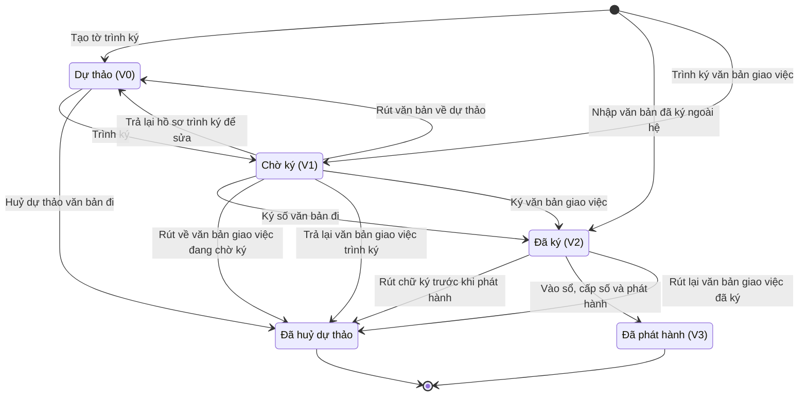

# qt-1.outgoing-document · Việc luật giao kèm văn bản đến, đi — Văn bản đi

<!-- máy sinh: tom-tat -->
> **Hồ sơ:** Văn bản đi (`OutgoingDocument`)
>
> **Trong sổ phạm vi:** 1 · Việc luật giao kèm văn bản đến, đi — hồ sơ phụ outgoing-document (tầng 1)
>
> 22 bước · 5 chặng · 5 vai · 0 bảng quyết định · 2 hạn · 139 khớp nối.
>
> **Nguồn:** sổ nghiệp vụ `qt-1.outgoing-document` · khai báo của app: `dqtv-app/core/processes/tasking/workflow/outgoing-document.yaml`. Các bảng do máy sinh từ nguồn này.
<!-- hết: tom-tat -->

<!-- viết tay: dien-giai -->
## Diễn giải

*Phần này viết tay, diễn giải lại điều các bảng bên dưới ghi.*

### Quy trình này để làm gì

Theo dõi một **văn bản đi** của đơn vị từ tờ trình ký tới lúc phát hành. Hệ giữ trích yếu, thông tin chính, tờ trình và bản đã ký; thân văn bản nằm trong tệp tờ trình trình ký. Có bốn vai: `drafter` và `clerk` (Nhân viên văn thư), `approver` và `commander` (Chỉ huy trưởng Ban CHQS xã).

Hồ sơ đi qua các chặng: *Dự thảo (V0)* → *Chờ ký (V1)* → *Đã ký (V2)* → *Đã phát hành (V3)*; chặng rẽ là *Đã huỷ dự thảo*. Rất nhiều quy trình khác gắn tờ trình hoặc quyết định của mình vào hồ sơ văn bản đi này (mục 10).

### Khi nào bắt đầu

Có ba cửa vào:

- **Tạo tờ trình ký** (Nhân viên văn thư, vai `drafter`) — hồ sơ vào *Dự thảo (V0)*. Bắt buộc nhập trích yếu nội dung, thể thức, vai soạn thảo, loại văn bản, tệp tờ trình và nhiệm vụ trên giao mà văn bản này thuộc về (`taskingId`).
- **Nhập văn bản đã ký ngoài hệ** (Nhân viên văn thư, vai `clerk`) — hồ sơ vào thẳng *Đã ký (V2)*. Bắt buộc nhập trích yếu, loại văn bản, bản đã ký, người ký và nhiệm vụ trên giao (`taskingId`).
- **Ký ban hành văn bản giao việc** (Chỉ huy trưởng Ban CHQS xã, vai `commander`) — hồ sơ vào thẳng *Đã phát hành (V3)*. Bắt buộc nhập trích yếu, bản đã ký, số – ký hiệu trên bản đã ký, nơi nhận, vai soạn thảo. Bước này ghi một lần mọi mốc: hoàn tất soạn thảo, trình ký, ký, vào sổ, phát hành.

Hai cửa đầu ghi mối nối tới hồ sơ *Nhiệm vụ trên giao* (quy trình 1).

### Diễn ra thế nào

**Chặng "Dự thảo (V0)".** Nhân viên văn thư (`drafter`) bấm **Trình ký** để sang *Chờ ký (V1)*, hoặc **Huỷ dự thảo văn bản đi** (ghi vì sao huỷ) để sang *Đã huỷ dự thảo*. Hai bước này đòi điều kiện `actorHandlesTasking`: người đang làm chính là người ghi ở ô "người tạo tờ trình".

**Chặng "Chờ ký (V1)".** Nhân viên văn thư (`clerk`) **Chuẩn bị hồ sơ trình ký** (nhập tài liệu đính kèm), hồ sơ đứng yên; chỉ làm được một lần, làm lại thì hệ báo "đã chuẩn bị hồ sơ trình ký cho văn bản này rồi". Chỉ huy trưởng Ban CHQS xã (`approver`) **Ký số văn bản đi** (bắt buộc nhập bản đã ký) để sang *Đã ký (V2)*, hoặc **Trả lại hồ sơ trình ký để sửa** (ghi vì sao trả lại) để về *Dự thảo (V0)*. Bước trả lại ghi lại hai mốc "khởi tạo trình ký lúc" và "hồ sơ trình ký hoàn chỉnh lúc", mở lại hai bước của văn thư đã khoá.

**Chặng "Đã ký (V2)".** Nhân viên văn thư (`clerk`) **Vào sổ văn bản đi** (hồ sơ đứng yên), rồi **Phát hành văn bản đi** (bắt buộc nhập hình thức gửi, nơi nhận) để sang *Đã phát hành (V3)*. Thứ tự là bắt buộc: phải có "ký số lúc" mới vào sổ (hệ báo "chưa ký số thì chưa vào sổ được, không được bỏ qua bước ký (BR-03)"), phải có "vào sổ lúc" mới phát hành (hệ báo "chưa vào sổ thì chưa phát hành được (BR-03)"). Vào sổ lần hai bị chặn: "đã vào sổ văn bản này rồi — vào sổ lại sẽ cấp trùng số hiệu".

**Chặng "Đã phát hành (V3)".** Nhân viên văn thư còn **Bổ sung phụ lục, ghi chú**; không sửa nội dung chính.

### Kết thúc và để lại gì

Hồ sơ kết thúc ở *Đã phát hành (V3)* hoặc *Đã huỷ dự thảo*. Không hồ sơ nào mở ra từ văn bản đi; các quy trình khác gắn văn bản đi vào hồ sơ của mình ở một bước giữa chừng (mục 10, các dòng có bước ghi):

- **Tờ trình đi kèm một lượt trình** (kể cả danh sách chiến sĩ 16.enlistment và chức vụ đề nghị bổ nhiệm kèm tờ trình, ghi ở bước của quy trình 29): kế hoạch, văn kiện (2), dự toán ngân sách năm (4), vụ việc vi phạm hành chính (10), hồ sơ chế độ chính sách (12b), lệnh điều động (13a), sự kiện huấn luyện (14), đợt kiểm kê (15), công trình quốc phòng (23), đơn vị dân quân tự vệ (29), chức vụ chỉ huy (30), phiếu cấp phát huấn luyện (D11), đợt thu hồi, thanh lý (D14), kỳ tuyển chọn (D2), đợt mở rộng lực lượng (D5).
- **Văn bản quyết định hoặc văn bản gửi đi**: bản kế hoạch ban hành (2); báo cáo tình hình lên Bộ CHQS tỉnh (13b); văn bản giao việc, điều chỉnh, thu hồi bản giao (3); quyết định thành lập đơn vị và báo cáo danh sách thành viên Hội đồng (29); quyết định bổ nhiệm, miễn nhiệm (30); danh sách đề nghị gọi quân nhân dự bị (35); hồ sơ trình cấp trên của vòng xử lý khen thưởng (8); đề nghị cấp giấy phép trang bị (D9).

### Điều kiện chặn

- Không đúng người, sai chặng, thiếu thứ phải có trước thì chặn, hồ sơ giữ nguyên.
- Bảy bước đòi người làm thuộc đơn vị chủ hồ sơ: chuẩn bị hồ sơ, ký số, trả lại, nhập văn bản ký ngoài hệ, vào sổ, phát hành, bổ sung phụ lục. Trình ký và huỷ dự thảo đòi `actorHandlesTasking` (người đang làm chính là người tạo tờ trình).
- Trả lại phải ghi vì sao trả lại. Thứ tự ký → vào sổ → phát hành và hai chỗ chặn làm lần hai nêu ở trên.
- Một hạn: **1 ngày làm việc** kể từ ngày ký — "Hoàn thành thủ tục và phát hành trong 1 ngày làm việc kể từ ngày ký"; quá hạn thì chặn. Ngày làm việc tính theo lịch nhà nước, giờ Việt Nam, nghỉ thứ Bảy, Chủ nhật, lễ, Tết, kể cả nghỉ bù.
- Văn bản ký ngoài hệ đi vào bằng cửa *Nhập văn bản đã ký ngoài hệ*.
<!-- hết viết tay -->

## 1. Đường đi ngắn nhất qua các chặng

<!-- máy sinh: luong-chinh -->
Đường ít bước nhất từ lúc mở hồ sơ tới chặng kết thúc xa nhất. Máy chọn theo số chặng, không theo ý nghĩa nghiệp vụ — trình tự công việc thật xem phần Diễn giải và bảng "Việc làm ở từng chặng" ở mục 6.

| # | Ai làm | Làm gì | Hồ sơ sang chặng |
|---|---|---|---|
| 1 | Nhân viên văn thư | Nhập văn bản đã ký ngoài hệ | Đã ký (V2) |
| 2 | Nhân viên văn thư | Vào sổ, cấp số và phát hành | Đã phát hành (V3) |

<!-- hết: luong-chinh -->

## 2. Hồ sơ và việc nó để lại

<!-- máy sinh: muc-tieu -->
**App gọi quy trình này là:** Văn bản đi.

**Hồ sơ này để lại cho quy trình khác** (bước tạo hồ sơ của quy trình kia ghi mối nối về đây):
- Chức vụ chỉ huy dân quân tự vệ (30) — bước `openTenureFromEstablishment`, khớp nối `submissionProposesTenure`
- Hồ sơ giải thể tổ chức (31) — bước `requestDisbandSignature`, khớp nối `dissolutionDossierSubmittedByDocument`
- Lượt trình đề nghị kỷ luật lên cấp có thẩm quyền (D15.submission) — bước `openSubmissionRound`, khớp nối `disciplineRoundSubmittedByDocument`
- Một vòng xử lý hồ sơ khen thưởng ở cấp trên (8.submission) — bước `openAwardSubmissionRound`, khớp nối `awardReviewSubmittedByDocument`
- Tệp lưu trữ (D16) — bước `recordArchiveFile`, khớp nối `fileOfOutgoingDocument`
<!-- hết: muc-tieu -->

## 3. Khởi phát và kết thúc

<!-- máy sinh: khoi-phat -->
**3 cửa vào** — bước mở hồ sơ:

| Bước mở | Ai mở | Hồ sơ vào chặng | App bắt buộc nhập |
|---|---|---|---|
| Tạo tờ trình ký | Trợ lý Quân lực | Dự thảo (V0) | trích yếu nội dung, thể thức (ghi chú tự do), vai soạn thảo, loại văn bản, `taskingId` |
| Nhập văn bản đã ký ngoài hệ | Nhân viên văn thư | Đã ký (V2) | trích yếu nội dung, loại văn bản, người ký ghi trên bản giấy, `taskingId` |
| Trình ký văn bản giao việc | Trợ lý Quân lực | Chờ ký (V1) | trích yếu nội dung, vai soạn thảo |

**Kết thúc:** *Đã phát hành (V3)* (`ISSUED`), *Đã huỷ dự thảo* (`CANCELLED`)
<!-- hết: khoi-phat -->

## 4. Vai trò

<!-- máy sinh: vai-tro -->
| Vai trong sổ | Tên trong app | Điều kiện | Làm những bước |
|---|---|---|---|
| `drafter` | Trợ lý Quân lực |  | Tạo tờ trình ký · Trình ký · Rút văn bản về dự thảo · Huỷ dự thảo văn bản đi · Trình ký văn bản giao việc · Rút về văn bản giao việc đang chờ ký · `viewSecretContent` |
| `clerk` | Nhân viên văn thư |  | Chuẩn bị hồ sơ trình ký · Nhập văn bản đã ký ngoài hệ · Vào sổ theo dõi mẫu KC (chưa ghi số) · Vào sổ, cấp số và phát hành · Bổ sung phụ lục, ghi chú · Văn thư xem nội dung văn bản mật |
| `approver` | Chỉ huy trưởng Ban CHQS xã (`approver`) |  | Ký số văn bản đi · Trả lại hồ sơ trình ký để sửa · Rút chữ ký trước khi phát hành · `viewSecretContentAsSigner` |
| `commander` | Chỉ huy trưởng Ban CHQS xã (`commander`) |  | Trả lại văn bản giao việc trình ký · Ký văn bản giao việc · Rút lại văn bản giao việc đã ký |
| `system` | Hệ thống tự làm |  | Đánh dấu văn bản đã ký quá hạn phát hành · Báo văn thư văn bản khẩn đã ký chờ phát hành |

*"Tên trong app" là tên app đặt cho mã chủ thể của vai. Hồ sơ thuộc đơn vị cấp khác thì người làm là người giữ vai ấy ở đơn vị nêu trong cột "Điều kiện" (nếu sổ có ghi) và ở cột "Người làm phải thuộc" của bảng "Theo khai báo của app" (mục 7).*
<!-- hết: vai-tro -->

## 5. Nhánh phụ

<!-- máy sinh: nhanh-phu -->
**Bước khác đưa hồ sơ sang chặng mới** — đường song song, rẽ nhánh hoặc kết thúc sớm:

| Bước | Ai làm | Từ chặng | Sang chặng |
|---|---|---|---|
| Trình ký | Trợ lý Quân lực | Dự thảo (V0) | Chờ ký (V1) |
| Ký số văn bản đi | Chỉ huy trưởng Ban CHQS xã (`approver`) | Chờ ký (V1) | Đã ký (V2) |
| Trả lại hồ sơ trình ký để sửa | Chỉ huy trưởng Ban CHQS xã (`approver`) | Chờ ký (V1) | Dự thảo (V0) |
| Rút văn bản về dự thảo | Trợ lý Quân lực | Chờ ký (V1) | Dự thảo (V0) |
| Rút chữ ký trước khi phát hành | Chỉ huy trưởng Ban CHQS xã (`approver`) | Đã ký (V2) | Đã huỷ dự thảo |
| Huỷ dự thảo văn bản đi | Trợ lý Quân lực | Dự thảo (V0) | Đã huỷ dự thảo |
| Rút về văn bản giao việc đang chờ ký | Trợ lý Quân lực | Chờ ký (V1) | Đã huỷ dự thảo |
| Trả lại văn bản giao việc trình ký | Chỉ huy trưởng Ban CHQS xã (`commander`) | Chờ ký (V1) | Đã huỷ dự thảo |
| Ký văn bản giao việc | Chỉ huy trưởng Ban CHQS xã (`commander`) | Chờ ký (V1) | Đã ký (V2) |
| Rút lại văn bản giao việc đã ký | Chỉ huy trưởng Ban CHQS xã (`commander`) | Đã ký (V2) | Đã huỷ dự thảo |

**Làm trong lúc hồ sơ đứng yên ở một chặng** — ghi nhận, bổ sung:

| Bước | Ai làm | Ở chặng |
|---|---|---|
| Chuẩn bị hồ sơ trình ký | Nhân viên văn thư | Chờ ký (V1) |
| Vào sổ theo dõi mẫu KC (chưa ghi số) | Nhân viên văn thư | Đã ký (V2) |
| Bổ sung phụ lục, ghi chú | Nhân viên văn thư | Đã phát hành (V3) |
| Văn thư xem nội dung văn bản mật | Nhân viên văn thư | Chờ ký (V1), Đã ký (V2), Đã phát hành (V3) |
| Đánh dấu văn bản đã ký quá hạn phát hành | Hệ thống tự làm | Đã ký (V2) |
| Báo văn thư văn bản khẩn đã ký chờ phát hành | Hệ thống tự làm | Đã ký (V2) |
| `viewSecretContent` | Trợ lý Quân lực | Dự thảo (V0), Chờ ký (V1), Đã ký (V2), Đã phát hành (V3) |
| `viewSecretContentAsSigner` | Chỉ huy trưởng Ban CHQS xã (`approver`) | Chờ ký (V1), Đã ký (V2), Đã phát hành (V3) |

**Cửa vào khác:** 3 bước cùng mở hồ sơ — xem mục 3.

<!-- hết: nhanh-phu -->

## 6. Các chặng và việc làm ở từng chặng

<!-- máy sinh: chang -->
| Chặng | Tên hiển thị | Vào bằng bước | Kết thúc? |
|---|---|---|---|
| `DRAFT` | Dự thảo (V0) | Tạo tờ trình ký · Trả lại hồ sơ trình ký để sửa · Rút văn bản về dự thảo |  |
| `PENDING_SIGNATURE` | Chờ ký (V1) | Trình ký · Trình ký văn bản giao việc |  |
| `SIGNED` | Đã ký (V2) | Ký số văn bản đi · Nhập văn bản đã ký ngoài hệ · Ký văn bản giao việc |  |
| `ISSUED` | Đã phát hành (V3) | Vào sổ, cấp số và phát hành | **kết thúc** — vẫn còn bước làm được |
| `CANCELLED` | Đã huỷ dự thảo | Rút chữ ký trước khi phát hành · Huỷ dự thảo văn bản đi · Rút về văn bản giao việc đang chờ ký · Trả lại văn bản giao việc trình ký · Rút lại văn bản giao việc đã ký | **kết thúc** |

### Việc làm ở từng chặng

Hồ sơ đang ở chặng nào thì làm được những bước nào.

| Hồ sơ đang ở chặng | Bước làm tại chặng (hồ sơ đứng yên) | Bước đưa hồ sơ sang chặng khác |
|---|---|---|
| **Dự thảo (V0)** | `viewSecretContent` — Trợ lý Quân lực | Trình ký — Trợ lý Quân lực → *Chờ ký (V1)* Huỷ dự thảo văn bản đi — Trợ lý Quân lực → *Đã huỷ dự thảo* |
| **Chờ ký (V1)** | Chuẩn bị hồ sơ trình ký — Nhân viên văn thư Văn thư xem nội dung văn bản mật — Nhân viên văn thư `viewSecretContent` — Trợ lý Quân lực `viewSecretContentAsSigner` — Chỉ huy trưởng Ban CHQS xã (`approver`) | Ký số văn bản đi — Chỉ huy trưởng Ban CHQS xã (`approver`) → *Đã ký (V2)* Trả lại hồ sơ trình ký để sửa — Chỉ huy trưởng Ban CHQS xã (`approver`) → *Dự thảo (V0)* Rút văn bản về dự thảo — Trợ lý Quân lực → *Dự thảo (V0)* Rút về văn bản giao việc đang chờ ký — Trợ lý Quân lực → *Đã huỷ dự thảo* Trả lại văn bản giao việc trình ký — Chỉ huy trưởng Ban CHQS xã (`commander`) → *Đã huỷ dự thảo* Ký văn bản giao việc — Chỉ huy trưởng Ban CHQS xã (`commander`) → *Đã ký (V2)* |
| **Đã ký (V2)** | Vào sổ theo dõi mẫu KC (chưa ghi số) — Nhân viên văn thư Văn thư xem nội dung văn bản mật — Nhân viên văn thư Đánh dấu văn bản đã ký quá hạn phát hành — Hệ thống tự làm Báo văn thư văn bản khẩn đã ký chờ phát hành — Hệ thống tự làm `viewSecretContent` — Trợ lý Quân lực `viewSecretContentAsSigner` — Chỉ huy trưởng Ban CHQS xã (`approver`) | Rút chữ ký trước khi phát hành — Chỉ huy trưởng Ban CHQS xã (`approver`) → *Đã huỷ dự thảo* Vào sổ, cấp số và phát hành — Nhân viên văn thư → *Đã phát hành (V3)* Rút lại văn bản giao việc đã ký — Chỉ huy trưởng Ban CHQS xã (`commander`) → *Đã huỷ dự thảo* |
| **Đã phát hành (V3)** | Bổ sung phụ lục, ghi chú — Nhân viên văn thư Văn thư xem nội dung văn bản mật — Nhân viên văn thư `viewSecretContent` — Trợ lý Quân lực `viewSecretContentAsSigner` — Chỉ huy trưởng Ban CHQS xã (`approver`) | — (kết thúc) |
| **Đã huỷ dự thảo** | — | — (kết thúc) |
<!-- hết: chang -->

## 7. Bảng bước

<!-- máy sinh: buoc -->
| # | Bước | Mã bước | Ai thực hiện | Từ chặng | Sang chặng | Phải có trước | Ghi lại |
|---|---|---|---|---|---|---|---|
| 1 | Tạo tờ trình ký | `draftOutgoingDocument` | Trợ lý Quân lực | — (mở hồ sơ) | `DRAFT` | `noSecretFile` | mã tỉnh, `ownerScope`, mã xã, trích yếu nội dung, nội dung, thể thức (ghi chú tự do), loại văn bản, độ mật, độ khẩn, vai soạn thảo, người tạo tờ trình, tờ trình trình ký, nối tới Nhiệm vụ trên giao, hình thức văn bản, đơn vị chủ hồ sơ, loại gốc, `id` |
| 2 | Trình ký | `initiateSigningRequest` | Trợ lý Quân lực | `DRAFT` | `PENDING_SIGNATURE` | `actorHandlesTasking`, `notTopSecret`, `notCreatedBySourceRecord` | khởi tạo trình ký lúc |
| 3 | Chuẩn bị hồ sơ trình ký | `prepareSigningDossier` | Nhân viên văn thư | `PENDING_SIGNATURE` | giữ nguyên | người làm thuộc đơn vị chủ hồ sơ, `notCreatedBySourceRecord` | hồ sơ trình ký hoàn chỉnh lúc |
| 4 | Ký số văn bản đi | `signOutgoingDocument` | Chỉ huy trưởng Ban CHQS xã (`approver`) | `PENDING_SIGNATURE` | `SIGNED` | người làm thuộc đơn vị chủ hồ sơ, `notCreatedBySourceRecord`, `noSecretFile` | ký số lúc, bản đã ký, hạn phát hành |
| 5 | Trả lại hồ sơ trình ký để sửa | `returnOutgoingDocument` | Chỉ huy trưởng Ban CHQS xã (`approver`) | `PENDING_SIGNATURE` | `DRAFT` | vì sao trả lại, người làm thuộc đơn vị chủ hồ sơ, `notCreatedBySourceRecord` | vì sao trả lại, trả lại lúc, khởi tạo trình ký lúc, hồ sơ trình ký hoàn chỉnh lúc |
| 6 | Rút văn bản về dự thảo | `withdrawOutgoingSubmission` | Trợ lý Quân lực | `PENDING_SIGNATURE` | `DRAFT` | `actorHandlesTasking`, `notCreatedBySourceRecord` | — |
| 7 | Rút chữ ký trước khi phát hành | `releaseOutgoingSignature` | Chỉ huy trưởng Ban CHQS xã (`approver`) | `SIGNED` | `CANCELLED` | ký số lúc, người làm thuộc đơn vị chủ hồ sơ, `notCreatedBySourceRecord`, vì sao rút chữ ký | vì sao rút chữ ký |
| 8 | Huỷ dự thảo văn bản đi | `cancelOutgoingDocument` | Trợ lý Quân lực | `DRAFT` | `CANCELLED` | `actorHandlesTasking` | vì sao huỷ dự thảo, huỷ lúc |
| 9 | Nhập văn bản đã ký ngoài hệ | `recordSignedOutgoingDocument` | Nhân viên văn thư | — (mở hồ sơ) | `SIGNED` | `topSecretWithoutSubject`, `noSecretFile`, `documentNumberNotTaken` | mã tỉnh, `ownerScope`, mã xã, trích yếu nội dung, loại văn bản, bản đã ký, ký số lúc, người ký, số, ký hiệu trên bản đã ký (nếu đã có), nối tới Nhiệm vụ trên giao, hình thức văn bản, hạn phát hành, đơn vị chủ hồ sơ, loại gốc, `id`, độ mật, độ khẩn |
| 10 | Vào sổ theo dõi mẫu KC (chưa ghi số) | `enterSealedOrderInRegister` | Nhân viên văn thư | `SIGNED` | giữ nguyên | ký số lúc, người làm thuộc đơn vị chủ hồ sơ, `notCreatedBySourceRecord` | vào sổ lúc, năm vào sổ, nguồn số hiệu |
| 11 | Vào sổ, cấp số và phát hành | `issueOutgoingDocument` | Nhân viên văn thư | `SIGNED` | `ISSUED` | ký số lúc, người làm thuộc đơn vị chủ hồ sơ, `notCreatedBySourceRecord`, loại gốc, `documentNumberNotTaken` | số hiệu văn bản đi, năm vào sổ, số thứ tự trong sổ, nguồn số hiệu, vào sổ lúc, hình thức gửi, nơi nhận, nơi nhận trong hệ, nối tới Văn bản đến, phát hành lúc, hạn phát hành, `recallDueDate` |
| 12 | Bổ sung phụ lục, ghi chú | `addOutgoingDocumentNote` | Nhân viên văn thư | `ISSUED` | giữ nguyên | người làm thuộc đơn vị chủ hồ sơ | phụ lục, ghi chú bổ sung |
| 13 | Văn thư xem nội dung văn bản mật | `viewSecretContentAsClerk` | Nhân viên văn thư | `PENDING_SIGNATURE`, `SIGNED`, `ISSUED` | giữ nguyên | người làm thuộc đơn vị chủ hồ sơ | — |
| 14 | Trình ký văn bản giao việc | `openDelegationSubmission` | Trợ lý Quân lực | — (mở hồ sơ) | `PENDING_SIGNATURE` | `notTopSecret`, `noSecretFile` | mã tỉnh, `ownerScope`, mã xã, trích yếu nội dung, nội dung, loại văn bản, tờ trình trình ký, vai soạn thảo, người tạo tờ trình, khởi tạo trình ký lúc, nơi nhận, đơn vị chủ hồ sơ, hạn phát hành, nối tới Nhiệm vụ trên giao, loại gốc, `id`, độ khẩn, độ mật |
| 15 | Rút về văn bản giao việc đang chờ ký | `withdrawDelegationSubmission` | Trợ lý Quân lực | `PENDING_SIGNATURE` | `CANCELLED` | người làm thuộc đơn vị chủ hồ sơ | vì sao huỷ dự thảo, huỷ lúc |
| 16 | Trả lại văn bản giao việc trình ký | `returnDelegationSubmission` | Chỉ huy trưởng Ban CHQS xã (`commander`) | `PENDING_SIGNATURE` | `CANCELLED` | người làm thuộc đơn vị chủ hồ sơ | vì sao trả lại, huỷ lúc |
| 17 | Ký văn bản giao việc | `issueDelegationDocument` | Chỉ huy trưởng Ban CHQS xã (`commander`) | `PENDING_SIGNATURE` | `SIGNED` | người làm thuộc đơn vị chủ hồ sơ, `noSecretFile` | ký số lúc, bản đã ký, hạn phát hành |
| 18 | Rút lại văn bản giao việc đã ký | `withdrawDelegationDocument` | Chỉ huy trưởng Ban CHQS xã (`commander`) | `SIGNED` | `CANCELLED` | ký số lúc, người làm thuộc đơn vị chủ hồ sơ | vì sao rút lại văn bản đã ký, huỷ lúc |
| 19 | Đánh dấu văn bản đã ký quá hạn phát hành | `flagOutgoingDocumentOverdue` | Hệ thống tự làm | `SIGNED` | giữ nguyên | `deadlineRunningAndNotFlagged` | quá hạn phát hành từ |
| 20 | Báo văn thư văn bản khẩn đã ký chờ phát hành | `flagUrgentAwaitingIssue` | Hệ thống tự làm | `SIGNED` | giữ nguyên | `urgentSignedNotFlagged` | đã báo văn thư (văn bản khẩn) lúc |
| 21 | `viewSecretContent` | `viewSecretContent` | Trợ lý Quân lực | `DRAFT`, `PENDING_SIGNATURE`, `SIGNED`, `ISSUED` | giữ nguyên | `actorHandlesTasking` | — |
| 22 | `viewSecretContentAsSigner` | `viewSecretContentAsSigner` | Chỉ huy trưởng Ban CHQS xã (`approver`) | `PENDING_SIGNATURE`, `SIGNED`, `ISSUED` | giữ nguyên | người làm thuộc đơn vị chủ hồ sơ | — |

### Khi không đạt điều kiện

Mặc định: không đúng người, hồ sơ không ở đúng chặng, hoặc thiếu thứ "phải có trước" thì bước bị chặn, hồ sơ giữ nguyên. Bảng dưới chỉ kê những bước có kết quả riêng.

| # | Bước | Kết quả riêng |
|---|---|---|
| 11 | Vào sổ, cấp số và phát hành | kết quả xét `full-number-typed-by-clerk` → hồ sơ sang *Đã phát hành (V3)*; kết quả xét `number-from-ledger` → hồ sơ sang *Đã phát hành (V3)* |
| 19 | Đánh dấu văn bản đã ký quá hạn phát hành | bước này không do người nào bấm |
| 20 | Báo văn thư văn bản khẩn đã ký chờ phát hành | bước này không do người nào bấm |

### Điều kiện "phải có trước" bằng lời

Cột "Phải có trước" ở bảng bước có hai loại: ô dữ liệu thường (bước chỉ đòi ô ấy đã có giá trị) và điều kiện hệ tự xét. Bảng này diễn các điều kiện hệ tự xét theo đúng công thức sổ ghi; số ở cột cuối là số thứ tự bước.

| Điều kiện | Đúng khi | Bước đòi |
|---|---|---|
| `noSecretFile` | KHÔNG (độ mật là `confidential` hoặc `secret` hoặc `top_secret` VÀ (đã có tờ trình trình ký HOẶC đã có bản đã ký)) | 1, 4, 9, 14, 17 |
| `actorHandlesTasking` | người đang làm chính là người ghi ở ô "người tạo tờ trình" | 2, 6, 8, 21 |
| `notTopSecret` | KHÔNG (độ mật là `top_secret`) | 2, 14 |
| `notCreatedBySourceRecord` | KHÔNG (có hồ sơ Cấp phát, thu hồi cho người, cho đợt — Phiếu cấp phát huấn luyện (qt-D11.training-allocation) có ô nối `trainingAllocationSubmittedByDocument` trỏ về chính hồ sơ đang làm HOẶC có hồ sơ Khen thưởng (qt-8) có ô nối `awardCaseSubmittedByDocument` trỏ về chính hồ sơ đang làm HOẶC có hồ sơ Giải quyết chế độ theo hồ sơ từng người (qt-12b) có ô nối `benefitClaimSubmittedByDocument` trỏ về chính hồ sơ đang làm HOẶC có hồ sơ Ngân sách dự toán → quyết toán (qt-4) có ô nối `budgetPlanSubmittedByDocument` trỏ về chính hồ sơ đang làm HOẶC có hồ sơ Ngân sách dự toán → quyết toán — Dự toán ngân sách năm (qt-4.budget-province) có ô nối `budgetPlanSubmittedByDocument` trỏ về chính hồ sơ đang làm HOẶC có hồ sơ Kiện toàn tổ chức, bổ nhiệm chỉ huy (qt-30) có ô nối `commandTenureSubmittedByDocument` trỏ về chính hồ sơ đang làm HOẶC có hồ sơ Kiện toàn tổ chức, bổ nhiệm chỉ huy (qt-30) có ô nối `commandTenureDecidedByDocument` trỏ về chính hồ sơ đang làm HOẶC có hồ sơ Kiện toàn tổ chức, bổ nhiệm chỉ huy (qt-30) có ô nối `commandTenureEndedByDocument` trỏ về chính hồ sơ đang làm HOẶC có hồ sơ Điều động lực lượng khi bình thường (qt-13a) có ô nối `deploymentOrderSubmittedByDocument` trỏ về chính hồ sơ đang làm HOẶC có hồ sơ Xử lý kỷ luật DQTV (qt-D15) có ô nối `disciplinaryCaseSubmittedByDocument` trỏ về chính hồ sơ đang làm HOẶC có hồ sơ Xử lý kỷ luật DQTV (qt-D15) có ô nối `disciplinaryCaseDecidedByDocument` trỏ về chính hồ sơ đang làm HOẶC có hồ sơ Thu hồi, thanh lý, loại biên (qt-D14) có ô nối `disposalBatchSubmittedByDocument` trỏ về chính hồ sơ đang làm HOẶC có hồ sơ Mở rộng lực lượng DQTV (qt-D5) có ô nối `forceExpansionSubmittedByDocument` trỏ về chính hồ sơ đang làm HOẶC có hồ sơ Kiểm kê (qt-15) có ô nối `inventoryCheckSubmittedByDocument` trỏ về chính hồ sơ đang làm HOẶC có hồ sơ Kế hoạch lập → thẩm định → phê chuẩn → rà soát (qt-2) có ô nối `planDocumentSubmittedByDocument` trỏ về chính hồ sơ đang làm HOẶC có hồ sơ Tuyển chọn vào DQTV (qt-D2) có ô nối `selectionDriveSubmittedByDocument` trỏ về chính hồ sơ đang làm HOẶC có hồ sơ Công nhận hoàn thành nghĩa vụ theo lô (qt-D3) có ô nối `serviceCompletionBatchSubmittedByDocument` trỏ về chính hồ sơ đang làm HOẶC có hồ sơ Đợt tập trung: huấn luyện, diễn tập, tập huấn, hội thi (qt-14) có ô nối `trainingEventSubmittedByDocument` trỏ về chính hồ sơ đang làm HOẶC có hồ sơ Giải thể tổ chức (qt-31) có ô nối `dissolutionDossierSubmittedByDocument` trỏ về chính hồ sơ đang làm HOẶC có hồ sơ Giải thể tổ chức (qt-31) có ô nối `dissolutionDossierDecidedByDocument` trỏ về chính hồ sơ đang làm HOẶC có hồ sơ Giải thể tổ chức (qt-31) có ô nối `dissolutionDossierEndedByDocument` trỏ về chính hồ sơ đang làm HOẶC có hồ sơ Thành lập, tổ chức lại tổ chức (qt-29) có ô nối `organisationDossierSubmittedByDocument` trỏ về chính hồ sơ đang làm HOẶC có hồ sơ Thành lập, tổ chức lại tổ chức (qt-29) có ô nối `organisationDossierDecidedByDocument` trỏ về chính hồ sơ đang làm HOẶC có hồ sơ Thành lập, tổ chức lại tổ chức (qt-29) có ô nối `organisationDossierRefusedByDocument` trỏ về chính hồ sơ đang làm HOẶC có hồ sơ Xử lý vi phạm hành chính (qt-10) có ô nối `violationCaseSubmittedByDocument` trỏ về chính hồ sơ đang làm) | 2, 3, 4, 5, 6, 7, 10, 11 |
| `actorInOwnerUnit` | người đang làm là người của đơn vị ghi ở ô đơn vị chủ hồ sơ của hồ sơ này (theo danh mục người của đơn vị, `dm.unit-staff`) | 3, 4, 5, 7, 10, 11, 12, 13, 15, 16, 17, 18, 22 |
| `topSecretWithoutSubject` | KHÔNG (độ mật là `top_secret` VÀ đã có trích yếu nội dung) | 9 |
| `documentNumberNotTaken` | KHÔNG (có hồ sơ Việc luật giao kèm văn bản đến, đi — Văn bản đi (qt-1.outgoing-document) có đơn vị chủ hồ sơ trùng với đơn vị chủ hồ sơ của hồ sơ đang làm và có năm vào sổ trùng với năm vào sổ của hồ sơ đang làm và có số hiệu văn bản đi trùng với số hiệu văn bản đi của hồ sơ đang làm mà KHÔNG (hồ sơ ấy đang ở chặng `CANCELLED`)) | 9, 11 |
| `deadlineRunningAndNotFlagged` | đã có hạn phát hành VÀ KHÔNG (đã có quá hạn phát hành từ) | 19 |
| `urgentSignedNotFlagged` | độ khẩn là Khẩn (`khan`) hoặc Thượng khẩn (`thuong_khan`) hoặc Hỏa tốc (`hoa_toc`) VÀ KHÔNG (đã có đã báo văn thư (văn bản khẩn) lúc) | 20 |

### Theo khai báo của app

Người làm phải thuộc đơn vị nào, ô người dùng phải nhập, bước có lặp được không, và căn cứ pháp lý — lấy từ khai báo quy trình trong app.

| # | Bước | Người làm phải thuộc | Bắt buộc nhập | Nhập nếu có | Lặp được | Căn cứ |
|---|---|---|---|---|---|---|
| 1 | Tạo tờ trình ký |  | trích yếu nội dung, thể thức (ghi chú tự do), vai soạn thảo, loại văn bản, `taskingId` | nội dung, độ mật, độ khẩn, hình thức văn bản, tờ trình trình ký |  | Nghị định 30/2020/NĐ-CP Điều 10; Điều 7 (V3-21, danh mục loại văn bản); Điều 8 (V3-21, độ mật/độ khẩn) |
| 2 | Trình ký |  | — | — |  | Nghị định 30/2020/NĐ-CP Điều 10, Điều 11 |
| 3 | Chuẩn bị hồ sơ trình ký | đơn vị chủ hồ sơ | tài liệu đính kèm hồ sơ trình ký | — |  | Nghị định 30/2020/NĐ-CP Điều 13 |
| 4 | Ký số văn bản đi | đơn vị chủ hồ sơ | — | bản đã ký |  | Nghị định 30/2020/NĐ-CP Điều 13 |
| 5 | Trả lại hồ sơ trình ký để sửa | đơn vị chủ hồ sơ | vì sao trả lại | — |  | Nghị định 30/2020/NĐ-CP Điều 13 |
| 6 | Rút văn bản về dự thảo |  | — | — |  | Nghị định 30/2020/NĐ-CP Điều 13 (văn bản chưa ký) |
| 7 | Rút chữ ký trước khi phát hành | đơn vị chủ hồ sơ | vì sao rút chữ ký | — |  | Nghị định 30/2020/NĐ-CP Điều 13, Điều 18 khoản 1 (chưa phát hành) |
| 8 | Huỷ dự thảo văn bản đi |  | vì sao huỷ dự thảo | — |  | Nghị định 30/2020/NĐ-CP Điều 10 |
| 9 | Nhập văn bản đã ký ngoài hệ | đơn vị chủ hồ sơ | trích yếu nội dung, loại văn bản, người ký, `taskingId` | số, ký hiệu trên bản đã ký (nếu đã có), hình thức văn bản, độ mật, độ khẩn, bản đã ký |  | Nghị định 30/2020/NĐ-CP Đ.16, Đ.18 k5 |
| 10 | Vào sổ theo dõi mẫu KC (chưa ghi số) | đơn vị chủ hồ sơ | — | — |  | Nghị định 03/2020/NĐ-CP (sửa bởi Nghị định 12/2025/NĐ-CP) Điều 10 khoản 2–5, Điều 13; Nghị định 30/2020/NĐ-CP Điều 15 |
| 11 | Vào sổ, cấp số và phát hành | đơn vị chủ hồ sơ | hình thức gửi, nơi nhận | số hiệu văn bản đi, nơi nhận trong hệ |  | Nghị định 30/2020/NĐ-CP Điều 15, Điều 16, Điều 18 khoản 1 |
| 12 | Bổ sung phụ lục, ghi chú | đơn vị chủ hồ sơ | phụ lục, ghi chú bổ sung | — |  | BR-10 |
| 13 | Văn thư xem nội dung văn bản mật | đơn vị chủ hồ sơ | — | — |  | Luật Bảo vệ bí mật nhà nước 2025 (117/2025/QH15); sổ qt-1.outgoing-document chốt 15/10/2026 |
| 14 | Trình ký văn bản giao việc |  | trích yếu nội dung, vai soạn thảo | nội dung, loại văn bản, `taskingIds`, nơi nhận, nơi nhận trong hệ, tờ trình trình ký, độ mật, độ khẩn |  | Nghị định 30/2020/NĐ-CP Điều 13 (trình ký), Điều 15 |
| 15 | Rút về văn bản giao việc đang chờ ký | đơn vị chủ hồ sơ | — | vì sao huỷ dự thảo |  | Nghị định 30/2020/NĐ-CP Điều 13 (văn bản chưa ký) |
| 16 | Trả lại văn bản giao việc trình ký | đơn vị chủ hồ sơ | vì sao trả lại | — |  | Nghị định 30/2020/NĐ-CP Điều 13 |
| 17 | Ký văn bản giao việc | đơn vị chủ hồ sơ | — | bản đã ký |  | Nghị định 30/2020/NĐ-CP Điều 13, Điều 15, Điều 16 khoản 2 điểm a, Điều 18 khoản 1, Điều 19 |
| 18 | Rút lại văn bản giao việc đã ký | đơn vị chủ hồ sơ | vì sao rút lại văn bản đã ký | — |  | Nghị định 30/2020/NĐ-CP Điều 15, Điều 18 khoản 1 (văn bản chưa đăng ký, chưa phát hành) |
| 19 | Đánh dấu văn bản đã ký quá hạn phát hành |  | — | — |  | Nghị định 30/2020/NĐ-CP Điều 18 khoản 1 |
| 20 | Báo văn thư văn bản khẩn đã ký chờ phát hành |  | — | — |  | Nghị định 30/2020/NĐ-CP Điều 18 khoản 1 |
| — | Người tạo tờ trình xem nội dung văn bản mật (`viewOutgoingSecretContent`) | đơn vị chủ hồ sơ | — | — |  | Luật Bảo vệ bí mật nhà nước 2025 (117/2025/QH15); sổ qt-1.outgoing-document chốt 15/10/2026 |
| — | Người ký xem nội dung văn bản mật (`viewOutgoingSecretContentAsSigner`) | đơn vị chủ hồ sơ | — | — |  | Luật Bảo vệ bí mật nhà nước 2025 (117/2025/QH15); sổ qt-1.outgoing-document chốt 15/10/2026 |

### Điều kiện và ghi chú app khai cho từng bước

Lấy từ khai báo quy trình trong app. Lời trong ngoặc kép là câu app hiện cho người dùng. Chức danh người ký ngoài hệ app chỉ khai bằng mã.

| # | Bước | Điều kiện, ghi chú |
|---|---|---|
| 3 | Chuẩn bị hồ sơ trình ký | · không làm được khi đã có ô "hồ sơ trình ký hoàn chỉnh lúc" — app báo: "đã chuẩn bị hồ sơ trình ký cho văn bản này rồi" |
| 4 | Ký số văn bản đi | · hạn: 1 ngày làm việc — Hoàn thành thủ tục và phát hành trong 1 ngày làm việc kể từ ngày ký (Đ.18 k1) |
| 7 | Rút chữ ký trước khi phát hành | · phải đã có ô "ký số lúc" — thiếu thì app báo: "chưa ký thì không có chữ ký để rút" |
| 9 | Nhập văn bản đã ký ngoài hệ | · hạn: 1 ngày làm việc — Hoàn thành thủ tục và phát hành trong 1 ngày làm việc kể từ ngày ký (Đ.18 k1) |
| 10 | Vào sổ theo dõi mẫu KC (chưa ghi số) | · chỉ làm được khi ô "hình thức văn bản" là Mẫu KC huy động dự bị động viên lập sẵn (`dbdv-kc-sealed`) — ngoài ra app báo: "bước này chỉ cho mẫu KC huy động dự bị động viên lập sẵn — văn bản khác vào sổ, cấp số và phát hành trong một lần bấm" · phải đã có ô "ký số lúc" — thiếu thì app báo: "chưa ký thì chưa vào sổ theo dõi được (BR-03)" · không làm được khi đã có ô "vào sổ lúc" — app báo: "mẫu KC này đã vào sổ theo dõi rồi — chờ lệnh để ghi số và phát hành" |
| 11 | Vào sổ, cấp số và phát hành | · phải đã có ô "ký số lúc" — thiếu thì app báo: "chưa ký thì chưa vào sổ, phát hành được, không được bỏ qua bước ký (BR-03)" · phải đã có ô "loại gốc" — thiếu thì app báo: "văn bản chưa có việc gốc (nhiệm vụ hoặc sự việc) — nối việc gốc rồi mới phát hành được" |
| 17 | Ký văn bản giao việc | · hạn: 1 ngày làm việc — Hoàn thành thủ tục và phát hành trong 1 ngày làm việc kể từ ngày ký (Đ.18 k1) |
| 19 | Đánh dấu văn bản đã ký quá hạn phát hành | · phải đã có ô "hạn phát hành" — thiếu thì app báo: "văn bản không có hạn phát hành nào đang chạy" · không làm được khi đã có ô "quá hạn phát hành từ" — app báo: "văn bản đã được ghi quá hạn phát hành" |
| 20 | Báo văn thư văn bản khẩn đã ký chờ phát hành | · chỉ làm được khi ô "độ khẩn" là Khẩn (`khan`) hoặc Thượng khẩn (`thuong_khan`) hoặc Hỏa tốc (`hoa_toc`) — ngoài ra app báo: "văn bản không khẩn — không có gì báo trước" · phải đã có ô "độ khẩn" — thiếu thì app báo: "văn bản không khẩn — không có gì báo trước" · không làm được khi đã có ô "đã báo văn thư (văn bản khẩn) lúc" — app báo: "văn bản khẩn này đã được báo cho văn thư" |
<!-- hết: buoc -->

## 8. Bảng quyết định, hạn, việc ngoài hệ

<!-- máy sinh: quyet-dinh -->
| Hạn | Tính từ | Thời hạn | Quá hạn thì |
|---|---|---|---|
| `issueDelegationDocument.deadline` | khi hồ sơ vào chặng Đã ký (V2) | 1 ngày làm việc | hệ làm bước Đánh dấu văn bản đã ký quá hạn phát hành |
| `signOutgoingDocument.deadline` | khi hồ sơ vào chặng Đã ký (V2) | 1 ngày làm việc | hệ làm bước Đánh dấu văn bản đã ký quá hạn phát hành |

<!-- hết: quyet-dinh -->

## 9. Dữ liệu của hồ sơ

<!-- máy sinh: du-lieu -->
Các ô mà bước trong sổ ghi hoặc đòi. Số trong hai cột cuối là số thứ tự bước ở bảng bước (mục 7).

| Ô dữ liệu | Mã | Kiểu (app) | Giá trị cho phép | Loại ô (sổ) | Bước ghi | Bước đòi | Mô tả trong app |
|---|---|---|---|---|---|---|---|
| mã tỉnh | `provinceCode` | chữ |  | lưu trên hồ sơ (`stored`) | 1, 9, 14 | — | Mã tỉnh — dùng lọc phạm vi theo hàng; rỗng khi hồ sơ thuộc quân khu hoặc Bộ Quốc phòng |
| — | `ownerScope` | chữ |  | lưu trên hồ sơ (`stored`) | 1, 9, 14 | — | Chủ hồ sơ khi ở trên cấp tỉnh — rỗng · central · mã quân khu |
| mã xã | `communeCode` | chữ |  | lưu trên hồ sơ (`stored`) | 1, 9, 14 | — | Mã xã — bỏ trống khi sổ của cấp tỉnh |
| trích yếu nội dung | `subject` | chữ |  | đưa vào ở bước (`input`) | 1, 9, 14 | — | Trích yếu nội dung |
| nội dung | `content` | chữ |  | đưa vào ở bước (`input`) | 1, 14 | — | Trích yếu, thông tin chính của văn bản — thân văn bản nằm trong tệp `draftFilePath` |
| thể thức (ghi chú tự do) | `format` | chữ |  | đưa vào ở bước (`input`) | 1 | — | Thể thức bổ sung |
| loại văn bản | `documentType` | chọn một | Nghị quyết (cá biệt) (`resolution`), Quyết định (cá biệt) (`decision`), Chỉ thị (`directive`), Quy chế (`regulation`), Quy định (`rule`), Thông cáo (`public_notice`), Thông báo (`announcement`), Hướng dẫn (`guidance`), Chương trình (`program`), Kế hoạch (`plan`), Phương án (`action_plan`), Đề án (`scheme`), Dự án (`project`), Báo cáo (`report`), Biên bản (`minutes`), Tờ trình (`submission`), Hợp đồng (`contract`), Công văn (`official_letter`), Công điện (`telegram`), Bản ghi nhớ (`memo_of_record`), Bản thỏa thuận (`agreement`), Giấy ủy quyền (`power_of_attorney`), Giấy mời (`invitation`), Giấy giới thiệu (`introduction_letter`), Giấy nghỉ phép (`leave_permit`), Phiếu gửi (`dispatch_slip`), Phiếu chuyển (`transfer_slip`), Phiếu báo (`notification_slip`), Thư công (`correspondence`) | đưa vào ở bước (`input`) | 1, 9, 14 | — | Loại văn bản hành chính — danh mục ĐÓNG 29 loại, NĐ30/2020/NĐ-CP Điều 7; cùng bộ từ với IncomingDocument.documentType |
| độ mật | `secrecyLevel` | chọn một | Không thuộc diện mật (`none`), `confidential`, `secret`, `top_secret` | đưa vào ở bước (`input`) | 1, 9, 14 | — | Độ mật — mặc định 'không mật' khi không thuộc diện mật |
| độ khẩn | `urgencyLevel` | chọn một | Bình thường (`none`), Khẩn (`khan`), Thượng khẩn (`thuong_khan`), Hỏa tốc (`hoa_toc`) | đưa vào ở bước (`input`) | 1, 9, 14 | — | Độ khẩn — mặc định 'bình thường' khi không khẩn |
| vai soạn thảo | `draftedByRole` | chọn một | Chỉ huy trưởng Ban CHQS xã (`AC-CHT`), Chính trị viên (`AC-CTV`), Phó Chỉ huy trưởng (`AC-PCHT`), Chính trị viên phó (`AC-CTVP`), Trợ lý Tác huấn (`AC-TLTH`), Trợ lý Quân lực (`AC-TLQL`), Nhân viên quân khí kiêm thủ kho (`AC-NVQK`), Nhân viên văn thư (`AC-NVVT`), Nhân viên tài chính kiêm hậu cần (`AC-NVTC`), Ban Dân quân tự vệ, Bộ CHQS cấp tỉnh (`AC-BDQt`), Phòng Dân quân tự vệ, quân khu (`AC-PDQqk`), Phó chỉ huy trưởng Ban CHQS cơ quan, tổ chức (`AC-PCHTcq`), Phó chỉ huy trưởng Ban CHQS bộ, ngành (`AC-PCHTbn`), Phòng Kế hoạch tổng hợp, Cục Dân quân tự vệ (`AC-PKH`) | lưu trên hồ sơ (`stored`) | 1, 14 | — | Vai soạn thảo thật, ánh xạ động theo lĩnh vực văn bản |
| người tạo tờ trình | `draftedBy` | chữ |  | lưu trên hồ sơ (`stored`) | 1, 14 | — | Tài khoản đã tạo tờ trình ký |
| tờ trình trình ký | `draftFilePath` | tệp |  | đưa vào ở bước (`input`) | 1, 14 | — | Tờ trình trợ lý lập, trình người có thẩm quyền đọc và ký |
| hình thức văn bản | `documentForm` | chọn một | Mẫu KC huy động dự bị động viên lập sẵn (`dbdv-kc-sealed`), Văn bản thường (`ordinary`) | lưu trên hồ sơ (`stored`) | 1, 9 | — | Hình thức văn bản — thường · mẫu KC huy động DBĐV lập sẵn (số ghi khi phát lệnh) |
| đơn vị chủ hồ sơ | `ownerUnit` |  |  | lưu trên hồ sơ (`stored`) | 1, 9, 14 | — |  |
| loại gốc | `rootKind` | chọn một | Nhiệm vụ (luật giao, cấp trên giao) (`tasking`), Tin cảnh báo (`emergency_alert`), Vụ việc ứng phó (`response_case`), Vụ tàu bay không người lái (`drone_case`), Vi phạm hành chính (`administrative_violation`), Kỷ luật (`disciplinary_case`), Đơn thư (`petition`), Thu hồi giấy chứng nhận (`certificate_revocation`), Đề nghị cấp lại giấy chứng nhận (`certificate_reissue_request`), Sự cố trang phục (`uniform_incident`), Sự cố trang bị (`equipment_incident`), Tai nạn khi làm nhiệm vụ (`duty_accident`), Bồi thường thiệt hại (`compensation_case`), Lệnh điều động trong tình trạng đặc biệt (`special_deployment_order`), Lệnh huy động dự bị động viên (`reserve_mobilization_order`), Quyết định động viên công nghiệp (`industrial_mobilization_order`), Đợt xã trọng điểm (`key_commune_batch`), Đề nghị xã trọng điểm (`key_commune_proposal`) | lưu trên hồ sơ (`stored`) | 1, 9, 14 | 11 | Loại gốc của văn bản — nhiệm vụ hoặc một loại sự việc của danh sách gốc kín |
| — | `id` |  |  | lưu trên hồ sơ (`stored`) | 1, 9, 14 | — |  |
| khởi tạo trình ký lúc | `signingRequestedAt` | ngày giờ |  | lưu trên hồ sơ (`stored`) | 2, 5, 14 | — | Thời điểm khởi tạo trình ký |
| hồ sơ trình ký hoàn chỉnh lúc | `signingDossierReadyAt` | ngày giờ |  | lưu trên hồ sơ (`stored`) | 3, 5 | — | Thời điểm hồ sơ trình ký hoàn chỉnh |
| ký số lúc | `signedAt` | ngày giờ |  | lưu trên hồ sơ (`stored`) | 4, 9, 17 | 7, 10, 11, 18 | Thời điểm ký số |
| bản đã ký | `signedScanPath` | tệp |  | đưa vào ở bước (`input`) | 4, 9, 17 | — | Bản đã ký của văn bản đi — bản gốc lưu theo NĐ30/2020 Điều 19 |
| hạn phát hành | `dueDate` | ngày |  | lưu trên hồ sơ (`stored`) | 4, 9, 11, 14, 17 | — | Hạn phát hành — tính theo ngày làm việc kể từ ngày ký, NĐ30/2020/NĐ-CP Đ.18 k1 |
| vì sao trả lại | `returnReason` | chữ |  | đưa vào ở bước (`input`) | 5 | 5 | Vì sao Chỉ huy trưởng trả lại hồ sơ trình ký — thiếu phụ lục, sai thể thức, sửa nội dung |
| trả lại lúc | `returnedAt` | ngày giờ |  | lưu trên hồ sơ (`stored`) | 5 | — | Thời điểm trả lại — mở lại hai bước của văn thư đã khoá bằng forbidsFact |
| vì sao rút chữ ký | `releaseReason` | chữ |  | đưa vào ở bước (`input`) | 7 | 7 | Vì sao người ký rút chữ ký sau khi đã ký, trước khi phát hành — sổ qt-1.outgoing-document, khuôn trình ký chung |
| vì sao huỷ dự thảo | `cancelReason` | chữ |  | đưa vào ở bước (`input`) | 8, 15, 16, 18 | — | Vì sao huỷ dự thảo — chủ trương đổi, đã có văn bản khác thay, nhập trùng |
| huỷ lúc | `cancelledAt` | ngày giờ |  | lưu trên hồ sơ (`stored`) | 8, 15, 16, 18 | — | Thời điểm huỷ dự thảo — lối ra của chặng DỰ THẢO |
| người ký ghi trên bản giấy | `signerName` | chữ |  | lưu trên hồ sơ (`stored`) | 9 | — | Người ký — ghi theo bản đã ký ngoài hệ |
| số hiệu văn bản đi | `documentNumber` | chữ |  | đưa vào ở bước (`input`) | 9, 11 | — | Số hiệu văn bản đi — cấp theo nguồn số của cơ quan ban hành |
| vào sổ lúc | `registeredAt` | ngày giờ |  | lưu trên hồ sơ (`stored`) | 10, 11 | — | Thời điểm vào sổ |
| năm vào sổ | `documentYear` | chữ |  | lưu trên hồ sơ (`stored`) | 10, 11 | — | Năm vào sổ |
| nguồn số hiệu | `numberSource` | chọn một | Sổ văn bản đi trong hệ (`ledger`), Hệ thống quản lý văn bản (`system`), Văn thư cấp, ghi từ bản đã ký (`transcribed`), `at-issue`, Văn thư gõ số, ký hiệu từ sổ của cơ quan (`manual`) | lưu trên hồ sơ (`stored`) | 10, 11 | — | Nguồn cấp số hiệu — sổ trong hệ · hệ thống quản lý văn bản · ghi từ bản đã ký · ghi khi phát lệnh (mẫu KC lập sẵn) · văn thư gõ số, ký hiệu từ sổ cơ quan |
| số thứ tự trong sổ | `documentSeq` | số |  | lưu trên hồ sơ (`stored`) | 11 | — | Số thứ tự trong sổ — hệ thống tự cấp; ở cấp văn thư gõ số hiệu là phần số đứng đầu, chỉ để sắp xếp |
| hình thức gửi | `issueMethod` | chữ |  | đưa vào ở bước (`input`) | 11 | — | Hình thức gửi |
| nơi nhận | `recipients` | chữ |  | đưa vào ở bước (`input`) | 11, 14 | — | Danh sách nơi nhận |
| nơi nhận trong hệ | `internalRecipientUnits` | bảng |  | đưa vào ở bước (`input`) | 11 | — | Đơn vị nhận trong hệ — khoá đơn vị trong danh mục; mỗi đơn vị nhận một văn bản đến chờ tiếp nhận khi phát hành |
| phát hành lúc | `issuedAt` | ngày giờ |  | lưu trên hồ sơ (`stored`) | 11 | — | Thời điểm phát hành |
| — | `recallDueDate` |  |  | đưa vào ở bước (`input`) | 11 | — |  |
| phụ lục, ghi chú bổ sung | `addendumNote` | chữ |  | đưa vào ở bước (`input`) | 12 | — | Phụ lục, ghi chú bổ sung sau khi đã phát hành — BR-10, không sửa nội dung chính |
| quá hạn phát hành từ | `overdueAt` | ngày |  | lưu trên hồ sơ (`stored`) | 19 | — | Ngày hệ ghi văn bản đã ký quá hạn phát hành — trống khi chưa quá hạn hoặc không còn hạn nào chạy |
| đã báo văn thư (văn bản khẩn) lúc | `urgentFlaggedAt` | ngày giờ |  | lưu trên hồ sơ (`stored`) | 20 | — | Thời điểm hệ báo văn thư văn bản khẩn đã ký chờ phát hành — trống khi văn bản không khẩn hoặc chưa ký |
| — | `noSecretFile` |  | có hay chưa | hệ suy ra (`derived`) | — | 1, 4, 9, 14, 17 |  |
| — | `actorHandlesTasking` |  |  | lấy theo người đang làm (`actor`) | — | 2, 6, 8, 21 |  |
| — | `notTopSecret` |  | có hay chưa | hệ suy ra (`derived`) | — | 2, 14 |  |
| — | `notCreatedBySourceRecord` |  | có hay chưa | hệ suy ra (`derived`) | — | 2, 3, 4, 5, 6, 7, 10, 11 |  |
| người làm thuộc đơn vị chủ hồ sơ | `actorInOwnerUnit` |  | có hay chưa | hệ suy ra (`derived`) | — | 3, 4, 5, 7, 10, 11, 12, 13, 15, 16, 17, 18, 22 |  |
| — | `topSecretWithoutSubject` |  | có hay chưa | hệ suy ra (`derived`) | — | 9 |  |
| — | `documentNumberNotTaken` |  | có hay chưa | hệ suy ra (`derived`) | — | 9, 11 |  |
| — | `deadlineRunningAndNotFlagged` |  |  | hệ suy ra (`derived`) | — | 19 |  |
| — | `urgentSignedNotFlagged` |  | có hay chưa | hệ suy ra (`derived`) | — | 20 |  |

49 ô. Cột "Loại ô" là cách sổ phân loại ô, in kèm đúng chữ của sổ; ô nào người dùng phải nhập xem bảng "Theo khai báo của app" ở mục 7.
<!-- hết: du-lieu -->

## 10. Khớp nối với quy trình khác

<!-- máy sinh: khop-noi -->
| Quy trình kia | Hồ sơ kia | Quan hệ | Nội dung (mô tả trong app) | Bước ghi mối nối | Tên ô nối |
|---|---|---|---|---|---|
| 10 | Vụ việc vi phạm hành chính | gắn với nhau ở một bước giữa chừng | Văn bản chuyển hồ sơ lên Chủ tịch UBND cấp tỉnh (NĐ218/2025/NĐ-CP Đ.52) | 10·requestProvinceTransferSignature | `provinceTransferByDocument` |
| 10 | Vụ việc vi phạm hành chính | gắn với nhau ở một bước giữa chừng | Văn bản chuyển hồ sơ sang cơ quan tố tụng sau khi hủy bỏ toàn bộ quyết định xử phạt (Luật XLVPHC Đ.62 k3) | 10·requestTransferToProsecutionAfterRevocationSignature | `transferToProsecutionAfterRevocationByDocument` |
| 10 | Vụ việc vi phạm hành chính | gắn với nhau ở một bước giữa chừng | Văn bản chuyển hồ sơ sang cơ quan tiến hành tố tụng (Luật XLVPHC Đ.62) | 10·requestTransferToProsecutionSignature | `transferToProsecutionByDocument` |
| 10 | Vụ việc vi phạm hành chính | gắn với nhau ở một bước giữa chừng | Tờ trình kèm dự thảo quyết định xử phạt — Ban CHQS cấp xã tham mưu Chủ tịch UBND, mỗi vòng đề xuất một tờ (Lu… | 10·requestPenaltySignature | `violationCaseSubmittedByDocument` |
| 12b | Hồ sơ chế độ chính sách | gắn với nhau ở một bước giữa chừng | Tờ trình đi kèm mỗi lượt trình hồ sơ chế độ — văn bản đi của Ban CHQS, đã ký và vào sổ (NĐ30/2020/NĐ-CP Điều… | 12b·requestClaimSignature | `benefitClaimSubmittedByDocument` |
| 12b | Hồ sơ chế độ chính sách | gắn với nhau ở một bước giữa chừng | Văn bản chuyển hồ sơ chế độ sang cơ quan Bảo hiểm xã hội — sổ qt-12b | 12b·requestTransferToSocialInsuranceSignature | `transferToSocialInsuranceByDocument` |
| 12b | Hồ sơ chế độ chính sách | gắn với nhau ở một bước giữa chừng | Văn bản chuyển hồ sơ thương binh, liệt sĩ sang ngành Người có công — sổ qt-12b | 12b·requestTransferToVeteranAffairsSignature | `transferToVeteranAffairsByDocument` |
| 13a | Lệnh điều động | gắn với nhau ở một bước giữa chừng | Văn bản lệnh điều động ở Sổ văn bản đi — mỗi lượt trình một tờ (NĐ30/2020/NĐ-CP Điều 13, Điều 18) | 13a·requestDeploymentOrderSignature | `deploymentOrderByDocument` |
| 13a | Lệnh điều động | có nối | Văn bản đề nghị Chủ tịch UBND huy động ở Sổ văn bản đi — sổ qt-13a link.mobilizationRequestByDocument (L18/20… | — | `deploymentOrderMobilizationRequestDocument` |
| 13a | Lệnh điều động | gắn với nhau ở một bước giữa chừng | Tờ trình đi kèm mỗi lượt trình lệnh điều động — văn bản đi của Ban CHQS, đã ký và vào sổ (NĐ30/2020/NĐ-CP Điề… | 13a·requestDeploymentSignature | `deploymentOrderSubmittedByDocument` |
| 13a | Lệnh điều động | gắn với nhau ở một bước giữa chừng | Văn bản không nhất trí lệnh điều động của cấp trên trực tiếp (L48/2019/QH14 Đ.32 k1 g) | 13a·requestRejectDeploymentSignature | `rejectDeploymentByDocument` |
| 13b | Điều động trong tình trạng đặc biệt | gắn với nhau ở một bước giữa chừng | Văn bản mệnh lệnh điều động ở Sổ văn bản đi — sổ qt-13b link.specialDeploymentOrderByDocument (NĐ30/2020/NĐ-C… | 13b·requestSpecialDeploymentOrderSignature | `specialDeploymentOrderByDocument` |
| 13b | Điều động trong tình trạng đặc biệt | gắn với nhau ở một bước giữa chừng | Văn bản báo cáo tình hình lên Bộ CHQS tỉnh — sổ qt-13b link.specialDeploymentSituationReport (A3.2, 28/10/202… | 13b·requestReportSituationToProvinceSignature | `specialDeploymentSituationReport` |
| 14 | Sự kiện — huấn luyện, hội thi, diễn tập, hội nghị | gắn với nhau ở một bước giữa chừng | Văn bản quyết định trao giải hội thi, hội thao — văn bản đi của cấp tổ chức (sổ qt-14 link.prizeDecisionByDoc… | 14·requestPrizeDecisionSignature | `prizeDecisionByDocument` |
| 14 | Sự kiện — huấn luyện, hội thi, diễn tập, hội nghị | gắn với nhau ở một bước giữa chừng | Văn bản đi báo cáo kết quả huấn luyện, dựng tự động ngay sau khi khép đợt | 14·draftTrainingResultReport | `reportDocumentOfTrainingEvent` |
| 14 | Sự kiện — huấn luyện, hội thi, diễn tập, hội nghị | gắn với nhau ở một bước giữa chừng | Văn bản trả lại kế hoạch huấn luyện — văn bản đi của Bộ CHQS tỉnh (sổ qt-14 link.returnTrainingPlanByDocument) | 14·requestReturnTrainingPlanSignature | `returnTrainingPlanByDocument` |
| 14 | Sự kiện — huấn luyện, hội thi, diễn tập, hội nghị | gắn với nhau ở một bước giữa chừng | Văn bản trả lại nội dung, thời gian huấn luyện — văn bản đi của quân khu (sổ qt-14) | 14·requestReturnTrainingProgrammeSignature | `returnTrainingProgrammeByDocument` |
| 14 | Sự kiện — huấn luyện, hội thi, diễn tập, hội nghị | gắn với nhau ở một bước giữa chừng | Tờ trình nội dung, thời gian huấn luyện của tỉnh lên quân khu — văn bản đi của Bộ CHQS tỉnh (sổ qt-14) | 14·requestTrainingProgrammeSignature | `submitTrainingProgrammeByDocument` |
| 14 | Sự kiện — huấn luyện, hội thi, diễn tập, hội nghị | gắn với nhau ở một bước giữa chừng | Tờ trình đi kèm mỗi lượt trình đợt huấn luyện — văn bản đi của Ban CHQS, đã ký và vào sổ (NĐ30/2020/NĐ-CP Điề… | 14·requestTrainingPlanSignature | `trainingEventSubmittedByDocument` |
| 15 | Đợt kiểm kê | gắn với nhau ở một bước giữa chừng | Tờ trình đi kèm mỗi lượt trình đợt kiểm kê — văn bản đi của Ban CHQS, đã ký và vào sổ (NĐ30/2020/NĐ-CP Điều 1… | 15·requestInventoryCheckSignature | `inventoryCheckSubmittedByDocument` |
| 15 | Đợt kiểm kê | gắn với nhau ở một bước giữa chừng | Văn bản không duyệt, trả về kết quả kiểm kê — văn bản đi của Bộ CHQS tỉnh | 15·requestRejectInventoryCheckSignature | `rejectInventoryCheckByDocument` |
| 16.enlistment | Chiến sĩ dân quân tự vệ | gắn với nhau ở một bước giữa chừng | Chiến sĩ có tên trong danh sách kèm tờ trình (QĐ2910/2020 thủ tục số 3, mẫu 4 — nhóm II đơn vị) | 29·requestUnitSignature | `submissionListsMember` |
| 17 | Đợt tuyển quân | gắn với nhau ở một bước giữa chừng | Văn bản xác nhận danh sách công dân gọi nhập ngũ của Bộ CHQS tỉnh — văn bản đi (khuôn trình ký chung) | 17·requestApproveCandidateListSignature | `candidateListApprovedByDocument` |
| 17 | Đợt tuyển quân | gắn với nhau ở một bước giữa chừng | Văn bản yêu cầu xã bổ sung danh sách — văn bản đi của Bộ CHQS tỉnh (L78/2015/QH13 Đ.37 k3) | 17·requestRequestCandidateListSupplementSignature | `requestCandidateListSupplementByDocument` |
| 17 | Đợt tuyển quân | gắn với nhau ở một bước giữa chừng | Văn bản gửi danh sách tuyển quân lên Hội đồng NVQS tỉnh — văn bản đi của Ban CHQS xã (L78/2015/QH13 Đ.39 k2) | 17·requestSubmitCandidateListSignature | `submitCandidateListByDocument` |
| 2 | Kế hoạch, văn kiện | gắn với nhau ở một bước giữa chừng | Tờ trình đi kèm mỗi lượt trình văn kiện — văn bản đi của Ban CHQS, đã ký và vào sổ (NĐ30/2020/NĐ-CP Điều 18,… | 2·requestPlanSignature · đòi: 2·submitPlan | `planDocumentSubmittedByDocument` |
| 2 | Kế hoạch, văn kiện | gắn với nhau ở một bước giữa chừng | Bản kế hoạch Ban chỉ huy quân sự ban hành — văn thư cấp số, vào sổ văn bản đi (NĐ30/2020/NĐ-CP Điều 18) | 2·issueCommunePlan | `planIssuedByDocument` |
| 2 | Kế hoạch, văn kiện | gắn với nhau ở một bước giữa chừng | Văn bản Bộ CHQS tỉnh trả lại kế hoạch của xã — văn bản đi của tỉnh, Chỉ huy tỉnh ký | 2.submission·requestReturnCommunePlanSignature | `returnCommunePlanByDocument` |
| 20 | Vụ việc ứng phó | gắn với nhau ở một bước giữa chừng | Văn bản đề nghị Chủ tịch UBND huy động ở Sổ văn bản đi — sổ qt-20 link.caseMobilizationRequestByDocument (L18… | 20·requestCaseMobilizationRequestSignature | `responseCaseMobilizationRequestDocument` |
| 20.mobilized-asset | Tài sản đã huy động của dân | gắn với nhau ở một bước giữa chừng | Văn bản thông báo gia hạn trả tiền bồi thường ở Sổ văn bản đi — sổ qt-20.mobilized-asset link.compensationExt… | 20.mobilized-asset·requestCompensationExtensionSignature | `mobilizedAssetCompensationExtensionDocument` |
| 21 | Cấp độ phòng thủ dân sự của vụ việc | có nối | Tờ trình đề nghị ban bố hoặc bãi bỏ cấp độ sinh TRƯỚC 13/10/2026 — từ ngày ấy đề xuất không còn là văn bản đi… | — | `defenceLevelByDocument` |
| 21 | Cấp độ phòng thủ dân sự của vụ việc | gắn với nhau ở một bước giữa chừng | Văn bản đề xuất bãi bỏ cấp độ phòng thủ dân sự gửi Chủ tịch UBND — văn bản đi của Ban CHQS (NĐ200/2025 Đ.15 k… | 21·requestProposeRevokeDefenceLevelSignature | `proposeRevokeDefenceLevelByDocument` |
| 21 | Cấp độ phòng thủ dân sự của vụ việc | gắn với nhau ở một bước giữa chừng | Văn bản đề xuất ban bố cấp độ phòng thủ dân sự gửi Chủ tịch UBND — văn bản đi của Ban CHQS (NĐ200/2025 Đ.14 k… | 21·requestSubmitDefenceLevelProposalSignature | `submitDefenceLevelProposalByDocument` |
| 23 | Công trình, đất đai quốc phòng | gắn với nhau ở một bước giữa chừng | Tờ trình đi kèm mỗi lượt trình công trình quốc phòng — văn bản đi của Ban CHQS, đã ký và vào sổ (NĐ30/2020/NĐ… | 23·requestInvestmentSignature | `defenceWorkSubmittedByDocument` |
| 23 | Công trình, đất đai quốc phòng | gắn với nhau ở một bước giữa chừng | Tờ trình chủ trương, thiết kế đầu tư — văn bản đi của Ban CHQS xã; văn thư phát hành thì hồ sơ sang chờ duyệt… | 23·requestInvestmentSignature | `proposeInvestmentByDocument` |
| 23 | Công trình, đất đai quốc phòng | gắn với nhau ở một bước giữa chừng | Văn bản Bộ CHQS tỉnh không duyệt chủ trương đầu tư — văn bản đi của tỉnh | 23·requestRejectInvestmentSignature | `rejectInvestmentByDocument` |
| 23 | Công trình, đất đai quốc phòng | gắn với nhau ở một bước giữa chừng | Văn bản Bộ CHQS tỉnh không duyệt phương án quỹ đất — văn bản đi của tỉnh | 23·requestRejectLandSignature | `rejectLandByDocument` |
| 23 | Công trình, đất đai quốc phòng | gắn với nhau ở một bước giữa chừng | Văn bản Bộ CHQS tỉnh không duyệt đề nghị sửa chữa — văn bản đi của tỉnh | 23·requestRejectRepairSignature | `rejectRepairByDocument` |
| 23 | Công trình, đất đai quốc phòng | gắn với nhau ở một bước giữa chừng | Văn bản Bộ CHQS tỉnh không duyệt đề nghị thu hồi — văn bản đi của tỉnh | 23·requestRejectWithdrawalSignature | `rejectWithdrawalByDocument` |
| 23 | Công trình, đất đai quốc phòng | gắn với nhau ở một bước giữa chừng | Tờ trình phương án quỹ đất — văn bản đi của Ban CHQS xã, Chỉ huy trưởng ký (NĐ30/2020/NĐ-CP Đ.13, Đ.18) | 23·requestSubmitLandProposalSignature | `submitLandProposalByDocument` |
| 28 | Đơn khiếu nại, tố cáo, kiến nghị, phản ánh | gắn với nhau ở một bước giữa chừng | Văn bản trả lời người viết đơn — văn bản đi, Chỉ huy trưởng ký (L02/2011/QH13 Đ.32; L25/2018/QH14 Đ.35 k2) | 28·requestAnswerPetitionSignature | `answerPetitionByDocument` |
| 28 | Đơn khiếu nại, tố cáo, kiến nghị, phản ánh | gắn với nhau ở một bước giữa chừng | Văn bản thụ lý, không thụ lý, chuyển đơn — văn bản đi, Chỉ huy trưởng ký (L02/2011/QH13 Đ.27; L25/2018/QH14 Đ… | 28·requestClassifyPetitionSignature | `classifyPetitionByDocument` |
| 28 | Đơn khiếu nại, tố cáo, kiến nghị, phản ánh | gắn với nhau ở một bước giữa chừng | Thông báo nội dung tố cáo cho người bị tố cáo — văn bản đi, Chỉ huy trưởng ký (L25/2018/QH14 Đ.29 k3; NĐ31/20… | 28·requestNotifyDenouncedOfContentSignature | `notifyDenouncedOfContentByDocument` |
| 28 | Đơn khiếu nại, tố cáo, kiến nghị, phản ánh | gắn với nhau ở một bước giữa chừng | Thông báo thụ lý tố cáo cho người tố cáo — văn bản đi, Chỉ huy trưởng ký (L25/2018/QH14 Đ.29 k3; NĐ31/2019 Mẫ… | 28·requestNotifyDenouncerOfAcceptanceSignature | `notifyDenouncerOfAcceptanceByDocument` |
| 28 | Đơn khiếu nại, tố cáo, kiến nghị, phản ánh | gắn với nhau ở một bước giữa chừng | Thông báo cho người viết đơn kiến nghị, phản ánh — văn bản đi, cán bộ ký, văn thư phát hành (L42/2013/QH13 Đ.… | 28·requestNotifyPetitionerSignature | `notifyPetitionerByDocument` |
| 28 | Đơn khiếu nại, tố cáo, kiến nghị, phản ánh | gắn với nhau ở một bước giữa chừng | Văn bản giải quyết đơn — văn bản đi, Chỉ huy trưởng ký (L02/2011/QH13 Đ.31; L25/2018/QH14 Đ.35) | 28·requestResolvePetitionSignature | `resolvePetitionByDocument` |
| 28 | Đơn khiếu nại, tố cáo, kiến nghị, phản ánh | gắn với nhau ở một bước giữa chừng | Quyết định tạm đình chỉ, đình chỉ, mở lại giải quyết đơn — văn bản đi, Chỉ huy trưởng ký (L02/2011/QH13 Đ.11a… | 28·requestSuspensionDecisionSignature | `suspensionDecisionByDocument` |
| 29 | Đơn vị dân quân tự vệ | gắn với nhau ở một bước giữa chừng | Quyết định thành lập đơn vị — văn bản đi của cơ quan người ký, số hiệu theo nguồn số của cơ quan ấy, có bản k… | 29·publishEstablishmentDecision, 29·publishEstablishmentDecisionByMilitaryRegion | `militiaUnitDecidedByDocument` |
| 29 | Đơn vị dân quân tự vệ | có nối | KHÔNG GHI NỮA (12/10/2026) — tờ trình thành lập và giải thể đi trên hồ sơ thành lập, hồ sơ giải thể; giữ để t… | — | `militiaUnitSubmittedByDocument` |
| 29 | Hồ sơ thành lập tổ chức | gắn với nhau ở một bước giữa chừng | Quyết định thành lập — sổ văn bản đi của cơ quan người ký | 29·requestEstablishmentDecisionSignature, 29·requestEstablishmentDecisionSignatureByMilitaryRegion, 29·requestEstablishmentDecisionSignatureByProvince | `organisationDossierDecidedByDocument` |
| 29 | Hồ sơ thành lập tổ chức | gắn với nhau ở một bước giữa chừng | Văn bản không đồng ý thành lập — sổ văn bản đi của cấp có thẩm quyền quyết trong hệ (ba vai), mỗi lượt trình… | 29·requestEstablishmentRefusalSignature, 29·requestEstablishmentRefusalSignatureByMilitaryRegion, 29·requestEstablishmentRefusalSignatureByProvince | `organisationDossierRefusedByDocument` |
| 29 | Hồ sơ thành lập tổ chức | gắn với nhau ở một bước giữa chừng | Báo cáo Thủ tướng danh sách thành viên Hội đồng GDQP&AN Trung ương — văn bản đi (qt-30, 5/10/2026) | 29·requestReportCouncilMembersToPrimeMinisterSignature | `organisationDossierReportedByDocument` |
| 29 | Hồ sơ thành lập tổ chức | gắn với nhau ở một bước giữa chừng | Tờ trình đề nghị thành lập — sổ văn bản đi của cấp đề nghị | 29·requestUnitSignature | `organisationDossierSubmittedByDocument` |
| 29 | Hồ sơ thành lập tổ chức | gắn với nhau ở một bước giữa chừng | Văn bản Bộ CHQS tỉnh trả hồ sơ đề nghị thành lập đã tiếp nhận về cấp đề nghị — sổ văn bản đi của tỉnh, mỗi lư… | 29·requestReturnUnitProposalAfterAcceptanceByProvinceSignature | `proposalReturnByProvinceByDocument` |
| 29 | Hồ sơ thành lập tổ chức | gắn với nhau ở một bước giữa chừng | Văn bản quân khu trả hồ sơ đề nghị thành lập đã tiếp nhận về cấp đề nghị — sổ văn bản đi của quân khu, mỗi lư… | 29·requestReturnUnitProposalAfterAcceptanceByMilitaryRegionSignature | `proposalReturnByRegionByDocument` |
| 29 | Hồ sơ thành lập tổ chức | gắn với nhau ở một bước giữa chừng | Văn bản Cục yêu cầu nhà trường hoàn thiện hồ sơ thành lập trung tâm sau thẩm định chưa đạt — sổ văn bản đi củ… | 29.appraisal·requestReturnAppraisalForSupplementSignature | `returnAppraisalForSupplementByDocument` |
| 29 | Hồ sơ thành lập tổ chức | gắn với nhau ở một bước giữa chừng | Văn bản Cục yêu cầu nhà trường bổ sung hồ sơ thành lập trung tâm GDQP&AN — sổ văn bản đi của Cục | 29.appraisal·requestReturnDossierForSupplementSignature | `returnDossierForSupplementByDocument` |
| 29.appraisal | Hồ sơ thẩm định dùng chung (nhận, kiểm đủ, thẩm định, thông báo) | có nối | Văn bản yêu cầu bên đề nghị hoàn thiện hồ sơ sau thẩm định chưa đạt — sổ qt-29.appraisal link.returnAppraisal… | — | `appraisalRevisionByDocument` |
| 29.appraisal | Hồ sơ thẩm định dùng chung (nhận, kiểm đủ, thẩm định, thông báo) | có nối | Văn bản yêu cầu bên đề nghị bổ sung hồ sơ lúc kiểm đủ — sổ qt-29.appraisal link.returnDossierForSupplementByD… | — | `appraisalSupplementByDocument` |
| 29.appraisal | Hồ sơ thẩm định dùng chung (nhận, kiểm đủ, thẩm định, thông báo) | có nối | Văn bản thông báo kết quả thẩm định ở Sổ văn bản đi của cơ quan thẩm định — sổ qt-29.appraisal link.appraisal… | — | `organisationAppraisalNoticeByDocument` |
| 3 | Bản giao chỉ tiêu, mốc xuống cấp dưới | gắn với nhau ở một bước giữa chừng | Văn bản giao việc của cấp trên — TT77 Đ.7 k2 a; NĐ30/2020 (mọi văn bản đi đều vào sổ) | 3·approveAssignment, 3·requestAssignmentSignature | `assignmentByDocument` |
| 3.adjustment | Điều chỉnh, thu hồi bản giao | gắn với nhau ở một bước giữa chừng | Văn bản điều chỉnh hoặc thu hồi bản giao — NĐ30/2020/NĐ-CP Đ.18 k3 | 3.adjustment·requestAssignmentAdjustmentSignature, 3.adjustment·requestAssignmentRevocationSignature | `adjustmentByDocument` |
| 3.adjustment | Điều chỉnh, thu hồi bản giao | gắn với nhau ở một bước giữa chừng | Văn bản không chấp nhận đề nghị điều chỉnh của cấp giao — NĐ30/2020 (văn bản đi vào sổ) | 3.adjustment·requestRejectAdjustmentRequestSignature | `adjustmentRejectByDocument` |
| 3.adjustment | Điều chỉnh, thu hồi bản giao | gắn với nhau ở một bước giữa chừng | Văn bản đề nghị điều chỉnh của cấp nhận gửi cấp giao — NĐ30/2020 (văn bản đi vào sổ) | 3.adjustment·requestAdjustmentRequestSignature | `adjustmentRequestByDocument` |
| 3.assignment-result | Kết quả trả lên cấp trên | gắn với nhau ở một bước giữa chừng | Văn bản yêu cầu bổ sung kết quả của cấp giao — NĐ30/2020 (văn bản đi vào sổ) | 3.assignment-result·requestRequestResultSupplementSignature | `requestResultSupplementByDocument` |
| 30 | Chức vụ chỉ huy dân quân tự vệ | gắn với nhau ở một bước giữa chừng | Quyết định bổ nhiệm chức vụ chỉ huy — văn bản đi của cơ quan người ký, số hiệu theo nguồn số của cơ quan ấy,… | 30·requestAppointmentDecisionSignature, 30·requestAppointmentDecisionSignatureByCommune, 30·requestAppointmentDecisionSignatureByMilitaryRegion, 30·requestAppointmentDecisionSignatureByProvince, 30·requestAppointmentDecisionSignatureDirect | `commandTenureDecidedByDocument` |
| 30 | Chức vụ chỉ huy dân quân tự vệ | gắn với nhau ở một bước giữa chừng | Quyết định miễn nhiệm chức vụ chỉ huy — cấp bổ nhiệm thì miễn nhiệm, văn bản đi của cơ quan người ký, có bản… | 30·requestDismissalDecisionSignature, 30·requestDismissalDecisionSignatureByCommune, 30·requestDismissalDecisionSignatureByMilitaryRegion, 30·requestDismissalDecisionSignatureByProvince | `commandTenureEndedByDocument` |
| 30 | Chức vụ chỉ huy dân quân tự vệ | gắn với nhau ở một bước giữa chừng | Tờ trình đi kèm mỗi lượt trình lượt bổ nhiệm chức vụ chỉ huy — văn bản đi của Ban CHQS, đã ký và vào sổ (NĐ30… | 30·requestDismissalProposalSignature, 30·requestTenureSignature | `commandTenureSubmittedByDocument` |
| 30 | Chức vụ chỉ huy dân quân tự vệ | gắn với nhau ở một bước giữa chừng | Văn bản trả lại hồ sơ đề nghị bổ nhiệm của Cục Dân quân tự vệ (hồ sơ của Ban CHQS bộ, ngành) — văn bản đi của… | 30·requestReturnAppointmentDossierByCentralSignature | `returnAppointmentDossierByCentralByDocument` |
| 30 | Chức vụ chỉ huy dân quân tự vệ | gắn với nhau ở một bước giữa chừng | Văn bản trả lại hồ sơ đề nghị bổ nhiệm của Ban CHQS xã (hồ sơ của cơ quan, tổ chức) — văn bản đi của cấp quyế… | 30·requestReturnAppointmentDossierByCommuneSignature | `returnAppointmentDossierByCommuneByDocument` |
| 30 | Chức vụ chỉ huy dân quân tự vệ | gắn với nhau ở một bước giữa chừng | Văn bản trả lại hồ sơ đề nghị bổ nhiệm của quân khu — văn bản đi của cấp quyết định (QĐ2910/2020 thủ tục số 3… | 30·requestReturnAppointmentDossierByMilitaryRegionSignature | `returnAppointmentDossierByMilitaryRegionByDocument` |
| 30 | Chức vụ chỉ huy dân quân tự vệ | gắn với nhau ở một bước giữa chừng | Văn bản trả lại hồ sơ đề nghị bổ nhiệm của Bộ CHQS tỉnh — văn bản đi của cấp quyết định (QĐ2910/2020 thủ tục… | 30·requestReturnAppointmentDossierByProvinceSignature | `returnAppointmentDossierByProvinceByDocument` |
| 30 | Chức vụ chỉ huy dân quân tự vệ | gắn với nhau ở một bước giữa chừng | Văn bản trả lại hồ sơ đề nghị miễn nhiệm của Cục Dân quân tự vệ (hồ sơ của Ban CHQS bộ, ngành) — văn bản đi c… | 30·requestReturnDismissalDossierByCentralSignature | `returnDismissalDossierByCentralByDocument` |
| 30 | Chức vụ chỉ huy dân quân tự vệ | gắn với nhau ở một bước giữa chừng | Văn bản trả lại hồ sơ đề nghị miễn nhiệm của Ban CHQS xã (hồ sơ của cơ quan, tổ chức) — văn bản đi của cấp qu… | 30·requestReturnDismissalDossierByCommuneSignature | `returnDismissalDossierByCommuneByDocument` |
| 30 | Chức vụ chỉ huy dân quân tự vệ | gắn với nhau ở một bước giữa chừng | Văn bản trả lại hồ sơ đề nghị miễn nhiệm của quân khu — văn bản đi của cấp quyết định (QĐ2910/2020 thủ tục số… | 30·requestReturnDismissalDossierByMilitaryRegionSignature | `returnDismissalDossierByMilitaryRegionByDocument` |
| 30 | Chức vụ chỉ huy dân quân tự vệ | gắn với nhau ở một bước giữa chừng | Văn bản trả lại hồ sơ đề nghị miễn nhiệm của Bộ CHQS tỉnh — văn bản đi của cấp quyết định (QĐ2910/2020 thủ tụ… | 30·requestReturnDismissalDossierByProvinceSignature | `returnDismissalDossierByProvinceByDocument` |
| 30 | Chức vụ chỉ huy dân quân tự vệ | hồ sơ kia **mở ra từ** hồ sơ này | Chức vụ chỉ huy đề nghị bổ nhiệm trong danh sách kèm tờ trình thành lập — người và chức vụ (QĐ2910/2020 thủ t… | 30·openTenureFromEstablishment ⊕ | `submissionProposesTenure` |
| 31 | Hồ sơ giải thể tổ chức | gắn với nhau ở một bước giữa chừng | Văn bản thông báo kết quả thẩm định giải thể trung tâm ở Sổ văn bản đi — sổ qt-31 link.appraisalNoticeByDocum… | 29.appraisal·requestAppraisalNoticeSignature | `appraisalNoticeByDocument` |
| 31 | Hồ sơ giải thể tổ chức | gắn với nhau ở một bước giữa chừng | Quyết định giải thể — sổ văn bản đi của cơ quan ban hành (cấp có thẩm quyền quyết trong hệ, đi ba vai) | 31·requestDisbandDecisionSignatureForCommune, 31·requestDisbandDecisionSignatureForMilitaryRegion, 31·requestDisbandDecisionSignatureForProvince | `dissolutionDossierDecidedByDocument` |
| 31 | Hồ sơ giải thể tổ chức | gắn với nhau ở một bước giữa chừng | Văn bản không đồng ý giải thể — sổ văn bản đi của cơ quan ban hành (cấp có thẩm quyền quyết trong hệ, đi ba v… | 31·requestDisbandRefusalSignatureForCommune, 31·requestDisbandRefusalSignatureForMilitaryRegion, 31·requestDisbandRefusalSignatureForProvince | `dissolutionDossierEndedByDocument` |
| 31 | Hồ sơ giải thể tổ chức | hồ sơ kia **mở ra từ** hồ sơ này | Tờ trình đề nghị giải thể — sổ văn bản đi của cấp đề nghị, mỗi lượt trình một tờ | 31·requestDisbandSignature ⊕, 31·reviseDisbandProposal | `dissolutionDossierSubmittedByDocument` |
| 31 | Hồ sơ giải thể tổ chức | có nối | Văn bản Cục yêu cầu nhà trường hoàn thiện hồ sơ giải thể trung tâm sau thẩm định chưa đạt — sổ văn bản đi của… | — | `dissolutionRevisionByDocument` |
| 31 | Hồ sơ giải thể tổ chức | có nối | Văn bản Cục yêu cầu nhà trường bổ sung hồ sơ giải thể trung tâm GDQP&AN — sổ văn bản đi của Cục | — | `dissolutionSupplementByDocument` |
| 31 | Hồ sơ giải thể tổ chức | gắn với nhau ở một bước giữa chừng | Văn bản trả hồ sơ giải thể cho cấp đề nghị bổ sung — sổ văn bản đi của cấp quyết, mỗi lượt trình một tờ | 31·requestReturnDisbandDossierSignature | `returnDisbandDossierByDocument` |
| 34 | Bản sắp xếp đơn vị dự bị động viên | gắn với nhau ở một bước giữa chừng | Văn bản yêu cầu xã bổ sung bản sắp xếp — văn bản đi của Bộ CHQS tỉnh | 34·requestRequestArrangementSupplementSignature | `requestArrangementSupplementByDocument` |
| 34 | Bản sắp xếp đơn vị dự bị động viên | gắn với nhau ở một bước giữa chừng | Văn bản gửi bản sắp xếp lên Bộ CHQS tỉnh — văn bản đi của Ban CHQS xã (L53/2019 Đ.19) | 34·requestSubmitArrangementSignature | `submitArrangementByDocument` |
| 35 | Đợt gọi quân nhân dự bị | có nối | Văn bản đi mang danh sách đề nghị gọi của xã (gắn tay, trước 20/10/2026) — hết dùng từ khuôn trình ký N9, chỉ… | — | `nominationOutgoingDocument` |
| 35 | Đợt gọi quân nhân dự bị | gắn với nhau ở một bước giữa chừng | Văn bản gửi danh sách đề nghị gọi quân nhân dự bị — văn bản đi của Ban CHQS xã (L53/2019 Đ.22 k3) | 35·requestSendNominationListSignature | `sendNominationListByDocument` |
| 36 | Thí sinh sơ tuyển vào trường Quân đội | gắn với nhau ở một bước giữa chừng | Văn bản gửi hồ sơ sơ tuyển lên Ban TSQS tỉnh — văn bản đi của Ban CHQS xã (QĐ5519/QĐ-BQP) | 36·requestSendDossierToProvinceSignature | `sendDossierToProvinceByDocument` |
| 39 | Cơ sở động viên công nghiệp | gắn với nhau ở một bước giữa chừng | Văn bản báo cáo Bộ về thay đổi của cơ sở động viên công nghiệp — văn bản đi của Bộ CHQS tỉnh (L38/2024 Đ.47) | 39·requestConfirmCapacityChangeSignature | `reportToMinistryDocument` |
| 39.mobilization-line | Dây chuyền động viên công nghiệp | gắn với nhau ở một bước giữa chừng | Văn bản báo cáo Bộ về thay đổi của dây chuyền động viên công nghiệp — văn bản đi của Bộ CHQS tỉnh (L38/2024 Đ… | 39.mobilization-line·requestConfirmLineChangeSignature | `lineReportToMinistryDocument` |
| 4 | Dự toán ngân sách năm | gắn với nhau ở một bước giữa chừng | Tờ trình đề nghị phê duyệt dự toán — văn bản đi của Ban CHQS, mỗi lượt trình một tờ (NĐ30/2020/NĐ-CP Điều 18,… | 4·requestCommuneBudgetSignature, 4.budget-province·requestProvinceBudgetSignature · đòi: 4·submitCommuneBudget, 4.budget-province·submitProvinceBudget | `budgetPlanSubmittedByDocument` |
| 4 | Dự toán ngân sách năm | gắn với nhau ở một bước giữa chừng | Văn bản báo cáo quyết toán ngân sách xã — văn bản đi của Ban CHQS xã, mỗi lượt trình một tờ (QĐ1126/QĐ-TM Đ.1… | 4·requestCommuneSettlementReportSignature | `communeSettlementReportByDocument` |
| 40 | Thực hiện quyết định động viên công nghiệp | gắn với nhau ở một bước giữa chừng | Văn bản thông báo quyết định động viên công nghiệp tới cơ sở — văn bản đi của Bộ CHQS tỉnh (L38/2024 Đ.56) | 40·requestFacilityNoticeSignature | `facilityNoticeByDocument` |
| 5 | Báo cáo định kỳ, đột xuất | gắn với nhau ở một bước giữa chừng | Văn bản cấp trên trả lại báo cáo định kỳ — văn bản đi của cấp trên, Chỉ huy cấp trên ký | 5·requestReturnRoutineReportSignature | `returnRoutineReportByDocument` |
| 5 | Báo cáo định kỳ, đột xuất | gắn với nhau ở một bước giữa chừng | Văn bản đi gửi báo cáo định kỳ lên cấp trên — trợ lý trình, Chỉ huy ký, văn thư phát hành | 5·requestRoutineReportSignature | `routineReportByDocument` |
| 6 | Báo cáo đột xuất | gắn với nhau ở một bước giữa chừng | Văn bản đi gửi báo cáo đột xuất lên cấp trên — trợ lý trình, Chỉ huy ký, văn thư phát hành | 6·requestAdHocReportSignature | `adHocReportByDocument` |
| 6 | Báo cáo đột xuất | gắn với nhau ở một bước giữa chừng | Văn bản cấp trên trả lại báo cáo đột xuất — văn bản đi của cấp trên, Chỉ huy cấp trên ký | 6·requestReturnAdHocReportSignature | `returnAdHocReportByDocument` |
| 6 | Yêu cầu báo cáo cấp trên | có nối | Yêu cầu báo cáo cấp trên gắn với văn bản báo cáo (E24) nào, khi đã lập — nối cứng thay linkedReportDocumentRe… | — | `superiorReportRequestForOutgoingDocument` |
| 8 | Hồ sơ khen thưởng | có nối | Văn bản quyết định khen thưởng của Bộ CHQS tỉnh, Tư lệnh quân khu — TT93/2024/TT-BQP Đ.23 k2, k3 | — | `awardCaseDecidedByDocument` |
| 8 | Hồ sơ khen thưởng | gắn với nhau ở một bước giữa chừng | Tờ trình đi kèm mỗi lượt trình hồ sơ khen thưởng — văn bản đi của Ban CHQS, đã ký và vào sổ (NĐ30/2020/NĐ-CP… | 8·requestDossierSignature | `awardCaseSubmittedByDocument` |
| 8 | Hồ sơ khen thưởng | có nối | Tờ trình tiếp hồ sơ khen thưởng của quân khu đề nghị Bộ trưởng qua Cục — TT93/2024/TT-BQP Đ.25 k6, k7 | — | `awardForwardedToBureauByDocument` |
| 8 | Hồ sơ khen thưởng | có nối | Tờ trình tiếp hồ sơ khen thưởng của Bộ CHQS tỉnh lên quân khu — TT93/2024/TT-BQP Đ.25 k5 | — | `awardForwardedToRegionByDocument` |
| 8 | Hồ sơ khen thưởng | gắn với nhau ở một bước giữa chừng | Quyết định khen thưởng của thủ trưởng chính đơn vị lập hồ sơ — văn bản đi đã phát hành (sổ `link.ownDecisionO… | 8·recordCommuneAward, 8·recordOwnLevelDecision | `ownDecisionOutgoingDocument` |
| 8.medal | Hồ sơ Kỷ niệm chương "Vì sự nghiệp vũ trang quần chúng" | gắn với nhau ở một bước giữa chừng | Văn bản quyết định tặng Kỷ niệm chương — 23/VBHN-BQP Đ.23 k1 c | 8.medal·requestMedalDecisionSignature | `medalCaseDecidedByDocument` |
| 8.medal | Hồ sơ Kỷ niệm chương "Vì sự nghiệp vũ trang quần chúng" | gắn với nhau ở một bước giữa chừng | Văn bản từ chối tặng Kỷ niệm chương — 23/VBHN-BQP Đ.23 k1 c | 8.medal·requestRejectMedalSignature | `medalCaseRejectedByDocument` |
| 8.medal | Hồ sơ Kỷ niệm chương "Vì sự nghiệp vũ trang quần chúng" | gắn với nhau ở một bước giữa chừng | Văn bản đề nghị tặng Kỷ niệm chương về Bộ Quốc phòng (qua Cục Dân quân tự vệ) — TT93/2024/TT-BQP Đ.27 k1 a | 8.medal·requestMedalProposalSignature, 8.medal·requestReviseMedalSignature | `medalCaseSubmittedByDocument` |
| 8.submission | Một vòng xử lý hồ sơ khen thưởng ở cấp trên | gắn với nhau ở một bước giữa chừng | Quyết định khen thưởng của cơ quan xét (tỉnh, quân khu) — văn bản đi của chính cơ quan xét | 8.submission·requestReviewingLevelDecisionSignature | `awardReviewDecidedByDocument` |
| 8.submission | Một vòng xử lý hồ sơ khen thưởng ở cấp trên | gắn với nhau ở một bước giữa chừng | Hồ sơ trình cấp trên (E24) của vòng xử lý này, khi đã lập | 8.submission·requestAuthorityProposalSignature | `awardReviewForOutgoingDocument` |
| 8.submission | Một vòng xử lý hồ sơ khen thưởng ở cấp trên | gắn với nhau ở một bước giữa chừng | Tờ trình tiếp hồ sơ lên cấp trên nữa của cơ quan xét (tỉnh lên quân khu, quân khu lên Cục) — TT93/2024 Đ.25 k… | 8.submission·requestForwardSignature | `awardReviewForwardedByDocument` |
| 8.submission | Một vòng xử lý hồ sơ khen thưởng ở cấp trên | hồ sơ kia **mở ra từ** hồ sơ này | Tờ trình của đơn vị trình đưa hồ sơ lên lượt này — văn bản đi đã phát hành (NĐ30/2020 Đ.18, Đ.19) | 8.submission·openAwardSubmissionRound ⊕ | `awardReviewSubmittedByDocument` |
| D11.training-allocation | Phiếu cấp phát huấn luyện | gắn với nhau ở một bước giữa chừng | Văn bản Bộ CHQS tỉnh trả phiếu cấp phát huấn luyện về để sửa (TT78/VBHN-BQP Đ.10 k2) | D11.training-allocation·requestRejectTrainingAllocationSignature | `rejectTrainingAllocationByDocument` |
| D11.training-allocation | Phiếu cấp phát huấn luyện | gắn với nhau ở một bước giữa chừng | Tờ trình đi kèm mỗi lượt trình đợt phân bổ chỉ tiêu huấn luyện — văn bản đi của Ban CHQS, đã ký và vào sổ (NĐ… | D11.training-allocation·requestAllocationSignature | `trainingAllocationSubmittedByDocument` |
| D12 | Trang bị, phương tiện | gắn với nhau ở một bước giữa chừng | Văn bản Ban CHQS báo Bộ CHQS tỉnh việc mất vũ khí, đạn dược, vật liệu nổ — QĐ1126 Đ.12 k4; L42/2024 Đ.3 k8 | D12·requestReportEquipmentLossToProvinceSignature | `lossReportDocument` |
| D14 | Đợt thu hồi, thanh lý | gắn với nhau ở một bước giữa chừng | Tờ trình đi kèm mỗi lượt trình đợt thanh, xử lý trang bị — văn bản đi của Ban CHQS, đã ký và vào sổ (NĐ30/202… | D14·requestDisposalBatchSignature | `disposalBatchSubmittedByDocument` |
| D15 | Vụ việc kỷ luật | gắn với nhau ở một bước giữa chừng | Quyết định kỷ luật là văn bản đi của cơ quan ra quyết định (xã: khoản 3 · tỉnh: khoản 8 · quân khu: khoản 9)… | D15·requestDecisionSignature, D15.submission·requestDecisionSignatureByMilitaryRegion, D15.submission·requestDecisionSignatureByProvince | `disciplinaryCaseDecidedByDocument` |
| D15 | Vụ việc kỷ luật | gắn với nhau ở một bước giữa chừng | Tờ đề nghị cấp có thẩm quyền quyết định kỷ luật (Điều 35 khoản 5, 8, 9) — văn bản đi của Ban CHQS: trợ lý trì… | D15·requestProposalSignature | `disciplinaryCaseSubmittedByDocument` |
| D15.complaint | Khiếu nại quyết định kỷ luật | gắn với nhau ở một bước giữa chừng | Văn bản quyết định giải quyết khiếu nại về quyết định kỷ luật — TT75/2020/TT-BQP Điều 6 | D15.complaint·requestComplaintResolutionSignature, D15.complaint·requestComplaintResolutionSignatureByProvince | `complaintResolvedByDocument` |
| D15.submission | Lượt trình đề nghị kỷ luật lên cấp có thẩm quyền | có nối | Quyết định kỷ luật do cấp nhận ban hành trên hệ (khoản 8, 9) | — | `disciplineRoundDecidedByDocument` |
| D15.submission | Lượt trình đề nghị kỷ luật lên cấp có thẩm quyền | hồ sơ kia **mở ra từ** hồ sơ này | Tờ đề nghị đã phát hành của lượt trình | D15.submission·openSubmissionRound ⊕ | `disciplineRoundSubmittedByDocument` |
| D16 | Tệp lưu trữ | hồ sơ kia **mở ra từ** hồ sơ này | Tệp là bản đã ký của văn bản đi này — bản gốc lưu theo NĐ30/2020 Điều 19 | D16.archive-file·recordArchiveFile ⊕ | `fileOfOutgoingDocument` |
| D2 | Kỳ tuyển chọn | gắn với nhau ở một bước giữa chừng | Tờ trình Chủ tịch Uỷ ban nhân dân cấp xã ký quyết định tuyển chọn — danh sách người khám đạt, đã có đơn vị (L… | D2·requestDriveListSignature | `selectionDriveSubmittedByDocument` |
| D3 | Đợt hoàn thành nghĩa vụ | gắn với nhau ở một bước giữa chừng | Tờ trình Chủ tịch Uỷ ban nhân dân cấp xã công nhận hoàn thành nghĩa vụ — trình lại là tờ thứ hai (L48/2019/QH… | D3·requestServiceCompletionSignature | `serviceCompletionBatchSubmittedByDocument` |
| D4 | Đề nghị công nhận hoàn thành nghĩa vụ quân sự tại ngũ | gắn với nhau ở một bước giữa chừng | Văn bản trả lại bản trình đề nghị công nhận — văn bản đi của Bộ CHQS tỉnh | D4·requestRejectServiceRecognitionProposalSignature | `rejectServiceRecognitionProposalByDocument` |
| D4 | Đề nghị công nhận hoàn thành nghĩa vụ quân sự tại ngũ | gắn với nhau ở một bước giữa chừng | Văn bản Ban CHQS xã trình Chủ tịch UBND xã đề nghị công nhận hoàn thành NVQS tại ngũ (sổ qt-D4) | D4·requestSendServiceRecognitionToChairmanSignature | `sendServiceRecognitionToChairmanByDocument` |
| D5 | Đợt mở rộng lực lượng | gắn với nhau ở một bước giữa chừng | Tờ trình đi kèm mỗi lượt trình đợt mở rộng lực lượng — văn bản đi của Ban CHQS, đã ký và vào sổ (NĐ30/2020/NĐ… | D5·requestExpansionListSignature | `forceExpansionSubmittedByDocument` |
| D7 | Danh mục bảo đảm | gắn với nhau ở một bước giữa chừng | Văn bản báo danh mục bảo đảm đã ký lên cấp trên — văn bản đi của đơn vị lập (sổ qt-D7) | D7·requestProvisionDemandSignature | `reportAggregatedDemandByDocument` |
| D7.provision-request | Đề nghị trang bị | gắn với nhau ở một bước giữa chừng | Văn bản đề nghị trang bị gửi cấp trên — văn bản đi của đơn vị lập (sổ qt-D7.provision-request) | D7.provision-request·requestSubmitProvisionRequestSignature | `submitProvisionRequestByDocument` |
| D9 | Đợt mua sắm | gắn với nhau ở một bước giữa chừng | Văn bản đề nghị cấp giấy phép trang bị của đợt mua — tờ trong sổ văn bản đi | D9·requestRequestEquipmentPermitSignature | `permitRequestDocument` |
| G1 | Khoá bồi dưỡng kiến thức QP&AN | gắn với nhau ở một bước giữa chừng | Văn bản trình duyệt kế hoạch khoá bồi dưỡng — văn bản đi của đơn vị lập khoá (VBHN53/VBHN-BQP Đ.4 k1; NĐ30/20… | G1·requestCoursePlanSubmissionSignature | `coursePlanSubmittedByDocument` |
| G1 | Khoá bồi dưỡng kiến thức QP&AN | gắn với nhau ở một bước giữa chừng | Văn bản đề nghị triệu tập người học — văn bản đi của đơn vị lập khoá (VBHN53/VBHN-BQP Đ.2; NĐ30/2020/NĐ-CP Đ.… | G1·requestSummonsProposalSignature | `summonsProposedByDocument` |
| G10.centre-proposal | Đề nghị điều chỉnh liên kết của trung tâm | gắn với nhau ở một bước giữa chừng | Văn bản đề nghị của trung tâm gửi Cục — trình ký, phát hành ở sổ văn bản đi (NĐ30/2020 Đ.13; sổ link.centrePr… | G10.centre-proposal·requestCentreProposalSignature | `centreProposalByDocument` |
| G10.centre-proposal | Đề nghị điều chỉnh liên kết của trung tâm | gắn với nhau ở một bước giữa chừng | Văn bản Cục trả lại đề nghị cho trung tâm — trình ký, phát hành ở sổ văn bản đi của Cục (sổ link.returnCentre… | G10.centre-proposal·requestReturnCentreProposalSignature | `returnCentreProposalByDocument` |
| XT | Đợt đề nghị xã trọng điểm về quốc phòng | gắn với nhau ở một bước giữa chừng | Tờ trình của Bộ CHQS tỉnh gửi Quân khu — văn bản đi (khuôn trình ký chung) | XT·requestKeyCommuneBatchSubmissionSignature | `keyCommuneBatchSubmittedByDocument` |
| XT | Đợt đề nghị xã trọng điểm về quốc phòng | gắn với nhau ở một bước giữa chừng | Văn bản Quân khu yêu cầu tỉnh bổ sung đợt đề nghị xã trọng điểm — văn bản đi của Bộ Tư lệnh Quân khu | XT·requestRequestKeyCommuneSupplementSignature | `requestKeyCommuneSupplementByDocument` |
| XT | Đợt đề nghị xã trọng điểm về quốc phòng | gắn với nhau ở một bước giữa chừng | Văn bản Cục trả đợt đề nghị xã trọng điểm về tỉnh — văn bản đi của Cục Dân quân tự vệ | XT·requestReturnKeyCommuneBatchSignature | `returnKeyCommuneBatchByDocument` |
| XT.commune-proposal | Đề nghị của xã về xã trọng điểm quốc phòng | gắn với nhau ở một bước giữa chừng | Văn bản đề nghị xã trọng điểm của Ban CHQS xã gửi Bộ CHQS tỉnh | XT.commune-proposal·requestKeyCommuneProposalSignature | `keyCommuneProposalByDocument` |
| XT.commune-proposal | Đề nghị của xã về xã trọng điểm quốc phòng | gắn với nhau ở một bước giữa chừng | Văn bản Ban CHQS xã gửi lại đề nghị sau khi tỉnh trả về | XT.commune-proposal·requestResubmitCommuneProposalSignature | `resubmitCommuneProposalByDocument` |
| XT.commune-proposal | Đề nghị của xã về xã trọng điểm quốc phòng | gắn với nhau ở một bước giữa chừng | Văn bản Bộ CHQS tỉnh trả đề nghị về xã | XT.commune-proposal·requestReturnCommuneProposalSignature | `returnCommuneProposalByDocument` |

139 khớp nối. ⊕ là bước tạo hồ sơ.

**Ô nối giữa các hồ sơ cùng mã quy trình, hoặc tới danh mục nền:** `outgoingDocumentAnswersTasking` (Văn bản đi → Nhiệm vụ trên giao) — bước Tạo tờ trình ký, Nhập văn bản đã ký ngoài hệ, Trình ký văn bản giao việc.
<!-- hết: khop-noi -->

## 11. Thông tin chung

<!-- máy sinh: thong-tin -->
| | |
|---|---|
| **Mã trong sổ** | `qt-1.outgoing-document` |
| **Quy trình trong app** | `tasking` (`workflow/outgoing-document.yaml`) — mặt công tác: `common` |
| **Hồ sơ** | Văn bản đi (`OutgoingDocument`) |
| **Cùng mã quy trình** | [qt-1](qt-1.html), [qt-1.incoming-document](qt-1.incoming-document.html) |
| **Căn cứ pháp lý từng bước** | cột "Căn cứ" ở bảng "Theo khai báo của app", mục 7 |
<!-- hết: thong-tin -->
