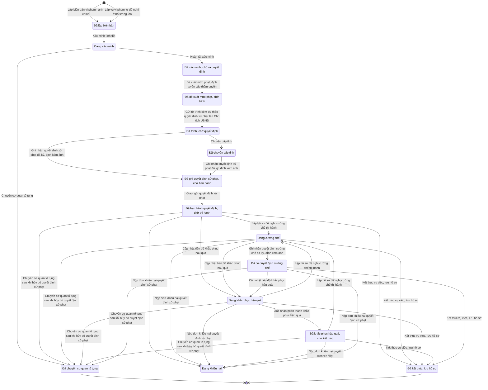

# qt-10 · Xử lý vi phạm hành chính

<!-- máy sinh: tom-tat -->
> **Hồ sơ:** Vụ việc vi phạm hành chính (`ViolationCase`)
>
> **Trong sổ phạm vi:** 10 · Xử lý vi phạm hành chính (tầng 2)
>
> 30 bước · 15 chặng · 4 vai · 6 bảng quyết định · 0 hạn · 31 khớp nối.
>
> **Nguồn:** sổ nghiệp vụ `qt-10` · khai báo của app: `dqtv-app/core/processes/violation/workflow/violation.yaml`. Các bảng do máy sinh từ nguồn này.
<!-- hết: tom-tat -->

<!-- viết tay: dien-giai -->
## Diễn giải

*Phần này viết tay, diễn giải lại điều các bảng bên dưới ghi.*

### Quy trình này để làm gì

Hồ sơ theo dõi một **vụ việc vi phạm hành chính** từ lúc lập biên bản tới lúc lưu hồ sơ: xác minh, đề xuất mức phạt, trình ký, ghi quyết định xử phạt đã ký, giao quyết định, rồi theo dõi việc thi hành (tự nguyện chấp hành, cưỡng chế, tịch thu tang vật, khắc phục hậu quả), khiếu nại, và việc hủy bỏ hay đính chính quyết định. Gần như mọi bước do Trợ lý Tác huấn làm; Chỉ huy trưởng Ban CHQS xã ký hoặc trả lại tờ trình và kết thúc vụ việc; Nhân viên văn thư gửi tờ trình đi. Với mọi bước trừ bước lập biên bản, người làm phải thuộc đơn vị chủ hồ sơ.

Hồ sơ có 11 chặng. Đường chính: *Đã lập biên bản* → *Đang xác minh* → *Đã xác minh, chờ ra quyết định* (có thể qua *Đã chuyển cấp tỉnh*) → *Đã ban hành quyết định, chờ thi hành* → *Đã kết thúc, lưu hồ sơ*. Các chặng rẽ: *Đang cưỡng chế*, *Đang khắc phục hậu quả*, *Đã khắc phục hậu quả, chờ kết thúc*, *Đang khiếu nại*, và *Đã chuyển cơ quan tố tụng*.

### Khi nào bắt đầu

Trợ lý Tác huấn bấm **Lập biên bản vi phạm hành chính**. Phải nhập đối tượng vi phạm (cá nhân hay tổ chức), tên đối tượng, hành vi vi phạm, ngày thực hiện hành vi, ngày phát hiện, địa điểm phát hiện; số CCCD/mã số thuế, ghi chú tình tiết và số vụ việc là ô nhập nếu có. Hành vi vi phạm là mã tra trong bảng tham số, không nhận mô tả tự do. Bước này ghi luôn mức tối đa của khung phạt theo hành vi và bộ chế tài áp dụng (suy từ ngày thực hiện hành vi).

Vụ vi phạm còn được gắn với hồ sơ của quy trình khác: người vắng không lý do ngày giao quân (17), và quân nhân xuất ngũ không đăng ký ngạch dự bị đúng hạn (27).

### Diễn ra thế nào

**Chặng "Đã lập biên bản"** — Trợ lý Tác huấn bấm **Xác minh tình tiết**, nhập kết quả xác minh; hồ sơ sang *Đang xác minh*.

**Chặng "Đang xác minh"** — **Tiếp nhận giải trình** ghi nội dung giải trình của đối tượng, hồ sơ đứng yên. Từ đây có hai lối ra:

- **Hoàn tất xác minh** → *Đã xác minh, chờ ra quyết định*; bước này ghi lại hành vi vi phạm và mức tối đa khung phạt.
- **Chuyển cơ quan tố tụng** → *Đã chuyển cơ quan tố tụng* (kết thúc); phải nhập dấu hiệu tội phạm, căn cứ, số văn bản chuyển hồ sơ, cơ quan tiếp nhận.

**Chặng "Đã xác minh, chờ ra quyết định"** — các việc đi theo thứ tự, việc sau đòi kết quả của việc trước:

1. **Đề xuất mức phạt, định tuyến cấp thẩm quyền** (Trợ lý Tác huấn, lặp được): phải nhập mức phạt tiền đề xuất; biện pháp khắc phục hậu quả và cấp xử lý (xã hay tỉnh) nhập nếu có. Bước ghi cấp thẩm quyền ký (Chủ tịch UBND cấp xã hoặc Chủ tịch UBND cấp tỉnh) và mở một Vòng đề xuất mức phạt. Không làm được khi tờ trình đang chờ ký: "tờ trình đang chờ Chỉ huy trưởng ký — xin trả lại tờ trình rồi mới tính lại mức phạt".
2. **Trình ký tờ trình kèm dự thảo quyết định xử phạt** (Trợ lý Tác huấn): phải có cấp thẩm quyền ký (thiếu thì báo "chưa đề xuất mức phạt — tính mức phạt trước rồi mới soạn tờ trình"); kèm tệp tờ trình và dự thảo; bước tạo một Văn bản đi (quy trình 1).
3. Chỉ huy trưởng Ban CHQS xã hoặc **Ký tờ trình đề xuất mức phạt, kèm kết quả xác minh**, hoặc **Trả lại đề xuất mức phạt để tính lại** (lặp được, phải ghi vì sao trả lại). Cả hai chỉ làm được khi đã có "trình chỉ huy trưởng lúc", và không làm được nữa khi chỉ huy trưởng đã ký tờ trình rồi.
4. **Gửi tờ trình kèm dự thảo quyết định xử phạt lên Chủ tịch UBND** (Nhân viên văn thư): phải có "chỉ huy trưởng xác nhận lúc" (thiếu thì báo "Chỉ huy trưởng chưa ký tờ trình — chưa gửi được"); kèm bản chụp tờ trình đã ký; gửi một lần cho mỗi vòng. Nơi nhận là `commune_chairman`.
5. Nếu cấp thẩm quyền ký là `province`: **Chuyển cấp tỉnh** → *Đã chuyển cấp tỉnh*; phải đã gửi tờ trình và ghi lý do chuyển.
6. **Ghi nhận quyết định xử phạt đã ký, đính kèm ảnh**: phải đã gửi tờ trình; phải nhập số quyết định xử phạt, `subject`, `signedDate`, `legalBasis`, `scanPath` (`signedBy` nhập nếu có); bước tạo một Quyết định ký ngoài hệ thống, người ký là `commune_chairman` hoặc `province_chairman`. Tiếp đó **Đối chiếu, ghi nhận quyết định xử phạt đã ký** ghi "ký quyết định xử phạt lúc"; phải đã có quyết định ký ngoài hệ ấy và phải có người thứ hai kiểm. Hai bước này làm được ở cả chặng *Đã chuyển cấp tỉnh*.
7. **Giao, gửi quyết định xử phạt**: phải có "ký quyết định xử phạt lúc" (thiếu thì báo "chưa ký số quyết định xử phạt thì chưa giao/gửi được"); nhập hình thức giao/gửi và hạn thi hành; hồ sơ sang *Đã ban hành quyết định, chờ thi hành*.

**Sau khi ban hành quyết định** — bốn chặng *Đã ban hành quyết định, chờ thi hành*, *Đang cưỡng chế*, *Đang khắc phục hậu quả*, *Đã khắc phục hậu quả, chờ kết thúc* dùng chung phần lớn các việc sau, đều do Trợ lý Tác huấn làm trừ bước kết thúc:

- **Ghi nhận đối tượng tự nguyện chấp hành** — không làm được ở chặng *Đang cưỡng chế*; chỉ ghi một lần.
- Cưỡng chế: **Lập hồ sơ đề nghị cưỡng chế thi hành** (nhập biện pháp cưỡng chế) đưa hồ sơ sang *Đang cưỡng chế*. Ở chặng đó: **Ghi nhận quyết định cưỡng chế đã ký, đính kèm ảnh**, rồi **Đối chiếu, ghi nhận quyết định cưỡng chế đã ký**, rồi **Ghi nhận kết quả thi hành cưỡng chế** (bước cuối phải có "ký quyết định cưỡng chế lúc", ô do bước đối chiếu ghi).
- **Ghi nhận đã thi hành tịch thu tang vật** — làm được ở cả bốn chặng; chỉ ghi một lần ("sai sót thì đính chính, không ghi lại").
- Khắc phục hậu quả: **Cập nhật tiến độ khắc phục hậu quả** làm được từ *Đã ban hành quyết định, chờ thi hành*, *Đang cưỡng chế*, *Đang khắc phục hậu quả*, đưa hồ sơ sang *Đang khắc phục hậu quả* (làm lại ở chính chặng ấy thì hồ sơ đứng yên); **Xác nhận hoàn thành khắc phục hậu quả** đưa sang *Đã khắc phục hậu quả, chờ kết thúc*.
- Khiếu nại: **Nộp đơn khiếu nại quyết định xử phạt** đưa hồ sơ sang *Đang khiếu nại*; hồ sơ phải có số CCCD/mã số thuế của đối tượng, và bước ghi lại chặng đang đứng trước khi khiếu nại. Ở chặng *Đang khiếu nại* có **Ghi nhận quyết định giải quyết khiếu nại đã ký, đính kèm ảnh** và **Đối chiếu, ghi nhận kết quả giải quyết khiếu nại**; cả hai làm trong lúc hồ sơ đứng yên ở chặng này.
- Hủy bỏ toàn bộ: **Ghi nhận quyết định hủy bỏ toàn bộ quyết định xử phạt đã ký, đính kèm ảnh**, rồi **Đối chiếu, ghi nhận quyết định hủy bỏ toàn bộ đã ký**. Có thời điểm đối chiếu này thì mới bấm được **Chuyển cơ quan tố tụng (sau khi đã hủy bỏ toàn bộ quyết định xử phạt)** → *Đã chuyển cơ quan tố tụng*.
- Đính chính, sửa một phần: **Ghi nhận quyết định đính chính/sửa đổi một phần đã ký, đính kèm ảnh** và **Đối chiếu, ghi nhận quyết định đính chính/sửa đổi một phần đã ký** — làm được cả khi hồ sơ đã ở *Đã kết thúc, lưu hồ sơ*.
- **Kết thúc vụ việc, lưu hồ sơ** (Chỉ huy trưởng Ban CHQS xã) — bấm được từ cả bốn chặng.

**Ở mọi chặng** — **Liên kết vụ việc kỷ luật để đối chiếu** gắn vụ vi phạm với một vụ việc kỷ luật (quy trình D15).

### Kết thúc và để lại gì

Hồ sơ kết thúc ở *Đã kết thúc, lưu hồ sơ* hoặc *Đã chuyển cơ quan tố tụng*. Không có hồ sơ nào của quy trình khác mở ra từ vụ vi phạm; chỉ có các mối gắn giữa chừng: văn bản đi mang tờ trình (1), vụ việc kỷ luật (D15), người trong đợt tuyển quân (17), tiếp nhận quân nhân xuất ngũ (27).

### Điều kiện chặn

- Mọi bước trừ bước lập biên bản: người làm phải thuộc đơn vị chủ hồ sơ. Sai người, sai chặng, thiếu thứ phải có trước thì bước bị chặn, hồ sơ giữ nguyên.
- Bảng `penalty-cap`, xét khi đề xuất mức phạt, so mức tối đa khung phạt theo hành vi với trần của từng cấp. Cá nhân: đến 37,5 triệu đồng là cấp xã, trên 37,5 đến 75 triệu là cấp tỉnh, trên 75 triệu thì chặn (`over_cap`). Tổ chức: đến 75 triệu là xã, trên 75 đến 150 triệu là tỉnh, trên 150 triệu thì chặn. Chọn cấp xử lý không khớp thì chặn (`wrong_level`); thiếu khung phạt, thiếu cấp xử lý, thiếu đối tượng cũng chặn.
- Bảng `province-transfer-check`, xét khi chuyển cấp tỉnh: cấp thẩm quyền ký phải là tỉnh; là xã hoặc để trống thì chặn.
- Bảng `penalty-authority`, xét khi ghi nhận quyết định xử phạt đã ký: cấp thẩm quyền ký là `commune` thì cấp ký quyết định xử phạt phải là `commune_chairman`, là `province` thì phải là `province_chairman`; không khớp thì chặn (`wrong_authority`); thiếu cấp thẩm quyền hoặc thiếu cấp ký cũng chặn.
- Năm bước đối chiếu (quyết định xử phạt, cưỡng chế, giải quyết khiếu nại, hủy bỏ toàn bộ, đính chính): phải đã có quyết định ký ngoài hệ tương ứng và có người thứ hai kiểm.
- Các bước chỉ làm một lần: trình ký, ký tờ trình, gửi tờ trình, đối chiếu quyết định xử phạt, cưỡng chế và hủy bỏ toàn bộ, tự nguyện chấp hành, tịch thu tang vật.
- Năm bước "ghi nhận … đã ký, đính kèm ảnh" là ghi một quyết định ký ngoài hệ, người ký `commune_chairman` hoặc `province_chairman`.
<!-- hết viết tay -->

## 1. Đường đi ngắn nhất qua các chặng

<!-- máy sinh: luong-chinh -->
Đường ít bước nhất từ lúc mở hồ sơ tới chặng kết thúc xa nhất. Máy chọn theo số chặng, không theo ý nghĩa nghiệp vụ — trình tự công việc thật xem phần Diễn giải và bảng "Việc làm ở từng chặng" ở mục 6.

| # | Ai làm | Làm gì | Hồ sơ sang chặng |
|---|---|---|---|
| 1 | Trợ lý Tác huấn | Lập biên bản vi phạm hành chính | Đã lập biên bản |
| 2 | Trợ lý Tác huấn | Xác minh tình tiết | Đang xác minh |
| 3 | Trợ lý Tác huấn | Hoàn tất xác minh | Đã xác minh, chờ ra quyết định |
| 4 | Trợ lý Tác huấn | Đề xuất mức phạt, định tuyến cấp thẩm quyền | Đã đề xuất mức phạt, chờ trình |
| 5 | Nhân viên văn thư | Gửi tờ trình kèm dự thảo quyết định xử phạt lên Chủ tịch UBND | Đã trình, chờ quyết định |
| 6 | Trợ lý Tác huấn | Ghi nhận quyết định xử phạt đã ký, đính kèm ảnh | Đã ghi quyết định xử phạt, chờ ban hành |
| 7 | Trợ lý Tác huấn | Giao, gửi quyết định xử phạt | Đã ban hành quyết định, chờ thi hành |
| 8 | Chỉ huy trưởng Ban CHQS xã | Kết thúc vụ việc, lưu hồ sơ | Đã kết thúc, lưu hồ sơ |

<!-- hết: luong-chinh -->

## 2. Hồ sơ và việc nó để lại

<!-- máy sinh: muc-tieu -->
**App gọi quy trình này là:** Vụ việc vi phạm hành chính.

**Khi mở, hồ sơ này ghi mối nối tới:**
- Chiến sĩ dân quân tự vệ (16.enlistment) — bước `openViolationFromSource`, khớp nối `violationFromEnlistment`
- Chiến sĩ dân quân tự vệ (16.enlistment) — bước `openViolationFromSource`, khớp nối `violatorMember`
- Lệnh điều động (13a) — bước `openViolationFromSource`, khớp nối `violationFromDeployment`
- Người trong đợt gọi (35) — bước `openViolationFromSource`, khớp nối `violationFromReserveCall`
- Người trong đợt huy động (22) — bước `openViolationFromSource`, khớp nối `violationFromReserveMobilization`
- Người trong đợt tuyển quân (17) — bước `openViolationFromSource`, khớp nối `violationFromConscription`
- Phương tiện trong sổ (33) — bước `openViolationFromSource`, khớp nối `violationFromMobilizedVehicle`
- Sự kiện — huấn luyện, hội thi, diễn tập, hội nghị (14) — bước `openViolationFromSource`, khớp nối `violationFromTraining`
- Tiếp nhận quân nhân xuất ngũ (27) — bước `openViolationFromSource`, khớp nối `violationFromDischargeIntake`
- Vụ việc ứng phó (20) — bước `openViolationFromSource`, khớp nối `violationFromResponse`

**Hồ sơ này để lại cho quy trình khác** (bước tạo hồ sơ của quy trình kia ghi mối nối về đây):
- Vụ việc kỷ luật (D15) — bước `openDisciplineFromSource`, khớp nối `disciplineFromViolation`
- Vụ việc kỷ luật (D15) — bước `openDisciplineFromSource`, khớp nối `relatedViolationCase`
<!-- hết: muc-tieu -->

## 3. Khởi phát và kết thúc

<!-- máy sinh: khoi-phat -->
**2 cửa vào** — bước mở hồ sơ:

| Bước mở | Ai mở | Hồ sơ vào chặng | App bắt buộc nhập |
|---|---|---|---|
| Lập biên bản vi phạm hành chính | Trợ lý Tác huấn | Đã lập biên bản | đối tượng vi phạm, tên đối tượng vi phạm, hành vi vi phạm, ngày thực hiện hành vi, ngày phát hiện, địa điểm phát hiện |
| Lập vụ vi phạm từ đề nghị ở hồ sơ nguồn | Hệ thống tự làm | Đã lập biên bản | đối tượng vi phạm, tên đối tượng vi phạm, hành vi vi phạm, ngày thực hiện hành vi, ngày phát hiện, địa điểm phát hiện, loại hồ sơ nguồn, hồ sơ nguồn |

**Kết thúc:** *Đã chuyển cơ quan tố tụng* (`TRANSFERRED_TO_PROSECUTION`), *Đã kết thúc, lưu hồ sơ* (`CLOSED`)
<!-- hết: khoi-phat -->

## 4. Vai trò

<!-- máy sinh: vai-tro -->
| Vai trong sổ | Tên trong app | Điều kiện | Làm những bước |
|---|---|---|---|
| `operator` | Trợ lý Tác huấn |  | Lập biên bản vi phạm hành chính · Xác minh tình tiết · Tiếp nhận giải trình · Hoàn tất xác minh · Trình ký văn bản chuyển cơ quan tố tụng · Đề xuất mức phạt, định tuyến cấp thẩm quyền · Trình ký tờ trình kèm dự thảo quyết định xử phạt · Trình ký văn bản chuyển cấp tỉnh · Ghi nhận quyết định xử phạt đã ký, đính kèm ảnh · Giao, gửi quyết định xử phạt · Ghi nhận đối tượng tự nguyện chấp hành · Lập hồ sơ đề nghị cưỡng chế thi hành · Ghi nhận quyết định cưỡng chế đã ký, đính kèm ảnh · Ghi nhận kết quả thi hành cưỡng chế · Ghi nhận đã thi hành tịch thu tang vật · Cập nhật tiến độ khắc phục hậu quả · Xác nhận hoàn thành khắc phục hậu quả · Nộp đơn khiếu nại quyết định xử phạt · Ghi nhận quyết định giải quyết khiếu nại đã ký, đính kèm ảnh · Đối chiếu, ghi nhận kết quả giải quyết khiếu nại · Ghi nhận quyết định hủy bỏ toàn bộ quyết định xử phạt đã ký, đính kèm ảnh · Trình ký văn bản chuyển cơ quan tố tụng sau khi hủy bỏ quyết định xử phạt · Ghi nhận quyết định đính chính/sửa đổi một phần đã ký, đính kèm ảnh · Đề nghị xử lý kỷ luật người vi phạm |
| `system` | Hệ thống tự làm |  | Lập vụ vi phạm từ đề nghị ở hồ sơ nguồn · Chuyển cơ quan tố tụng · Chuyển cấp tỉnh · Chuyển cơ quan tố tụng sau khi hủy bỏ quyết định xử phạt |
| `clerk` | Nhân viên văn thư |  | Gửi tờ trình kèm dự thảo quyết định xử phạt lên Chủ tịch UBND |
| `commander` | Chỉ huy trưởng Ban CHQS xã |  | Kết thúc vụ việc, lưu hồ sơ |

*"Tên trong app" là tên app đặt cho mã chủ thể của vai. Hồ sơ thuộc đơn vị cấp khác thì người làm là người giữ vai ấy ở đơn vị nêu trong cột "Điều kiện" (nếu sổ có ghi) và ở cột "Người làm phải thuộc" của bảng "Theo khai báo của app" (mục 7).*
<!-- hết: vai-tro -->

## 5. Nhánh phụ

<!-- máy sinh: nhanh-phu -->
**Bước khác đưa hồ sơ sang chặng mới** — đường song song, rẽ nhánh hoặc kết thúc sớm:

| Bước | Ai làm | Từ chặng | Sang chặng |
|---|---|---|---|
| Chuyển cơ quan tố tụng | Hệ thống tự làm | Đang xác minh | Đã chuyển cơ quan tố tụng |
| Chuyển cấp tỉnh | Hệ thống tự làm | Đã trình, chờ quyết định | Đã chuyển cấp tỉnh |
| Lập hồ sơ đề nghị cưỡng chế thi hành | Trợ lý Tác huấn | Đã ban hành quyết định, chờ thi hành, Đang khắc phục hậu quả, Đã khắc phục hậu quả, chờ kết thúc | Đang cưỡng chế |
| Ghi nhận quyết định cưỡng chế đã ký, đính kèm ảnh | Trợ lý Tác huấn | Đang cưỡng chế | Đã có quyết định cưỡng chế |
| Cập nhật tiến độ khắc phục hậu quả | Trợ lý Tác huấn | Đã ban hành quyết định, chờ thi hành, Đang cưỡng chế, Đang khắc phục hậu quả, Đã có quyết định cưỡng chế | Đang khắc phục hậu quả |
| Xác nhận hoàn thành khắc phục hậu quả | Trợ lý Tác huấn | Đang khắc phục hậu quả | Đã khắc phục hậu quả, chờ kết thúc |
| Nộp đơn khiếu nại quyết định xử phạt | Trợ lý Tác huấn | Đã ban hành quyết định, chờ thi hành, Đang cưỡng chế, Đang khắc phục hậu quả, Đã khắc phục hậu quả, chờ kết thúc, Đã có quyết định cưỡng chế | Đang khiếu nại |
| Chuyển cơ quan tố tụng sau khi hủy bỏ quyết định xử phạt | Hệ thống tự làm | Đã ban hành quyết định, chờ thi hành, Đang cưỡng chế, Đang khắc phục hậu quả, Đã khắc phục hậu quả, chờ kết thúc, Đã có quyết định cưỡng chế | Đã chuyển cơ quan tố tụng |

**Làm trong lúc hồ sơ đứng yên ở một chặng** — ghi nhận, bổ sung:

| Bước | Ai làm | Ở chặng |
|---|---|---|
| Tiếp nhận giải trình | Trợ lý Tác huấn | Đang xác minh |
| Trình ký văn bản chuyển cơ quan tố tụng | Trợ lý Tác huấn | Đang xác minh |
| Trình ký tờ trình kèm dự thảo quyết định xử phạt | Trợ lý Tác huấn | Đã đề xuất mức phạt, chờ trình |
| Trình ký văn bản chuyển cấp tỉnh | Trợ lý Tác huấn | Đã trình, chờ quyết định |
| Ghi nhận đối tượng tự nguyện chấp hành | Trợ lý Tác huấn | Đã ban hành quyết định, chờ thi hành, Đang khắc phục hậu quả, Đã khắc phục hậu quả, chờ kết thúc |
| Ghi nhận kết quả thi hành cưỡng chế | Trợ lý Tác huấn | Đã có quyết định cưỡng chế |
| Ghi nhận đã thi hành tịch thu tang vật | Trợ lý Tác huấn | Đã ban hành quyết định, chờ thi hành, Đang cưỡng chế, Đang khắc phục hậu quả, Đã khắc phục hậu quả, chờ kết thúc, Đã có quyết định cưỡng chế |
| Ghi nhận quyết định giải quyết khiếu nại đã ký, đính kèm ảnh | Trợ lý Tác huấn | Đang khiếu nại |
| Đối chiếu, ghi nhận kết quả giải quyết khiếu nại | Trợ lý Tác huấn | Đang khiếu nại |
| Ghi nhận quyết định hủy bỏ toàn bộ quyết định xử phạt đã ký, đính kèm ảnh | Trợ lý Tác huấn | Đã ban hành quyết định, chờ thi hành, Đang cưỡng chế, Đang khắc phục hậu quả, Đã khắc phục hậu quả, chờ kết thúc, Đã có quyết định cưỡng chế |
| Trình ký văn bản chuyển cơ quan tố tụng sau khi hủy bỏ quyết định xử phạt | Trợ lý Tác huấn | Đã ban hành quyết định, chờ thi hành, Đang cưỡng chế, Đang khắc phục hậu quả, Đã khắc phục hậu quả, chờ kết thúc, Đã có quyết định cưỡng chế |
| Ghi nhận quyết định đính chính/sửa đổi một phần đã ký, đính kèm ảnh | Trợ lý Tác huấn | Đã ban hành quyết định, chờ thi hành, Đang cưỡng chế, Đang khắc phục hậu quả, Đã khắc phục hậu quả, chờ kết thúc, Đã kết thúc, lưu hồ sơ, Đã có quyết định cưỡng chế |
| Đề nghị xử lý kỷ luật người vi phạm | Trợ lý Tác huấn | Đã lập biên bản, Đang xác minh, Đã xác minh, chờ ra quyết định, Đã chuyển cấp tỉnh, Đã ban hành quyết định, chờ thi hành, Đang cưỡng chế, Đang khắc phục hậu quả, Đã khắc phục hậu quả, chờ kết thúc, Đang khiếu nại, Đã kết thúc, lưu hồ sơ, Đã đề xuất mức phạt, chờ trình, Đã trình, chờ quyết định, Đã ghi quyết định xử phạt, chờ ban hành, Đã có quyết định cưỡng chế |

**Cửa vào khác:** 2 bước cùng mở hồ sơ — xem mục 3.

<!-- hết: nhanh-phu -->

## 6. Các chặng và việc làm ở từng chặng

<!-- máy sinh: chang -->
| Chặng | Tên hiển thị | Vào bằng bước | Kết thúc? |
|---|---|---|---|
| `RECORDED` | Đã lập biên bản | Lập biên bản vi phạm hành chính · Lập vụ vi phạm từ đề nghị ở hồ sơ nguồn |  |
| `VERIFYING` | Đang xác minh | Xác minh tình tiết |  |
| `TRANSFERRED_TO_PROSECUTION` | Đã chuyển cơ quan tố tụng | Chuyển cơ quan tố tụng · Chuyển cơ quan tố tụng sau khi hủy bỏ quyết định xử phạt | **kết thúc** |
| `AWAITING_DECISION` | Đã xác minh, chờ ra quyết định | Hoàn tất xác minh |  |
| `PENALTY_PROPOSED` | Đã đề xuất mức phạt, chờ trình | Đề xuất mức phạt, định tuyến cấp thẩm quyền |  |
| `PENALTY_SUBMITTED` | Đã trình, chờ quyết định | Gửi tờ trình kèm dự thảo quyết định xử phạt lên Chủ tịch UBND |  |
| `PENALTY_DECISION_RECORDED` | Đã ghi quyết định xử phạt, chờ ban hành | Ghi nhận quyết định xử phạt đã ký, đính kèm ảnh |  |
| `PROVINCE_TRANSFERRED` | Đã chuyển cấp tỉnh | Chuyển cấp tỉnh |  |
| `ISSUED` | Đã ban hành quyết định, chờ thi hành | Giao, gửi quyết định xử phạt |  |
| `ENFORCING` | Đang cưỡng chế | Lập hồ sơ đề nghị cưỡng chế thi hành |  |
| `REMEDIATING` | Đang khắc phục hậu quả | Cập nhật tiến độ khắc phục hậu quả |  |
| `REMEDIATED` | Đã khắc phục hậu quả, chờ kết thúc | Xác nhận hoàn thành khắc phục hậu quả |  |
| `ENFORCEMENT_DECIDED` | Đã có quyết định cưỡng chế | Ghi nhận quyết định cưỡng chế đã ký, đính kèm ảnh |  |
| `COMPLAINING` | Đang khiếu nại | Nộp đơn khiếu nại quyết định xử phạt |  |
| `CLOSED` | Đã kết thúc, lưu hồ sơ | Kết thúc vụ việc, lưu hồ sơ | **kết thúc** — vẫn còn bước làm được |

### Việc làm ở từng chặng

Hồ sơ đang ở chặng nào thì làm được những bước nào.

| Hồ sơ đang ở chặng | Bước làm tại chặng (hồ sơ đứng yên) | Bước đưa hồ sơ sang chặng khác |
|---|---|---|
| **Đã lập biên bản** | Đề nghị xử lý kỷ luật người vi phạm — Trợ lý Tác huấn | Xác minh tình tiết — Trợ lý Tác huấn → *Đang xác minh* |
| **Đang xác minh** | Tiếp nhận giải trình — Trợ lý Tác huấn Trình ký văn bản chuyển cơ quan tố tụng — Trợ lý Tác huấn Đề nghị xử lý kỷ luật người vi phạm — Trợ lý Tác huấn | Hoàn tất xác minh — Trợ lý Tác huấn → *Đã xác minh, chờ ra quyết định* Chuyển cơ quan tố tụng — Hệ thống tự làm → *Đã chuyển cơ quan tố tụng* |
| **Đã chuyển cơ quan tố tụng** | — | — (kết thúc) |
| **Đã xác minh, chờ ra quyết định** | Đề nghị xử lý kỷ luật người vi phạm — Trợ lý Tác huấn | Đề xuất mức phạt, định tuyến cấp thẩm quyền — Trợ lý Tác huấn → *Đã đề xuất mức phạt, chờ trình* |
| **Đã đề xuất mức phạt, chờ trình** | Trình ký tờ trình kèm dự thảo quyết định xử phạt — Trợ lý Tác huấn Đề nghị xử lý kỷ luật người vi phạm — Trợ lý Tác huấn | Gửi tờ trình kèm dự thảo quyết định xử phạt lên Chủ tịch UBND — Nhân viên văn thư → *Đã trình, chờ quyết định* |
| **Đã trình, chờ quyết định** | Trình ký văn bản chuyển cấp tỉnh — Trợ lý Tác huấn Đề nghị xử lý kỷ luật người vi phạm — Trợ lý Tác huấn | Chuyển cấp tỉnh — Hệ thống tự làm → *Đã chuyển cấp tỉnh* Ghi nhận quyết định xử phạt đã ký, đính kèm ảnh — Trợ lý Tác huấn → *Đã ghi quyết định xử phạt, chờ ban hành* |
| **Đã ghi quyết định xử phạt, chờ ban hành** | Đề nghị xử lý kỷ luật người vi phạm — Trợ lý Tác huấn | Giao, gửi quyết định xử phạt — Trợ lý Tác huấn → *Đã ban hành quyết định, chờ thi hành* |
| **Đã chuyển cấp tỉnh** | Đề nghị xử lý kỷ luật người vi phạm — Trợ lý Tác huấn | Ghi nhận quyết định xử phạt đã ký, đính kèm ảnh — Trợ lý Tác huấn → *Đã ghi quyết định xử phạt, chờ ban hành* |
| **Đã ban hành quyết định, chờ thi hành** | Ghi nhận đối tượng tự nguyện chấp hành — Trợ lý Tác huấn Ghi nhận đã thi hành tịch thu tang vật — Trợ lý Tác huấn Ghi nhận quyết định hủy bỏ toàn bộ quyết định xử phạt đã ký, đính kèm ảnh — Trợ lý Tác huấn Trình ký văn bản chuyển cơ quan tố tụng sau khi hủy bỏ quyết định xử phạt — Trợ lý Tác huấn Ghi nhận quyết định đính chính/sửa đổi một phần đã ký, đính kèm ảnh — Trợ lý Tác huấn Đề nghị xử lý kỷ luật người vi phạm — Trợ lý Tác huấn | Lập hồ sơ đề nghị cưỡng chế thi hành — Trợ lý Tác huấn → *Đang cưỡng chế* Cập nhật tiến độ khắc phục hậu quả — Trợ lý Tác huấn → *Đang khắc phục hậu quả* Nộp đơn khiếu nại quyết định xử phạt — Trợ lý Tác huấn → *Đang khiếu nại* Kết thúc vụ việc, lưu hồ sơ — Chỉ huy trưởng Ban CHQS xã → *Đã kết thúc, lưu hồ sơ* Chuyển cơ quan tố tụng sau khi hủy bỏ quyết định xử phạt — Hệ thống tự làm → *Đã chuyển cơ quan tố tụng* |
| **Đang cưỡng chế** | Ghi nhận đã thi hành tịch thu tang vật — Trợ lý Tác huấn Ghi nhận quyết định hủy bỏ toàn bộ quyết định xử phạt đã ký, đính kèm ảnh — Trợ lý Tác huấn Trình ký văn bản chuyển cơ quan tố tụng sau khi hủy bỏ quyết định xử phạt — Trợ lý Tác huấn Ghi nhận quyết định đính chính/sửa đổi một phần đã ký, đính kèm ảnh — Trợ lý Tác huấn Đề nghị xử lý kỷ luật người vi phạm — Trợ lý Tác huấn | Ghi nhận quyết định cưỡng chế đã ký, đính kèm ảnh — Trợ lý Tác huấn → *Đã có quyết định cưỡng chế* Cập nhật tiến độ khắc phục hậu quả — Trợ lý Tác huấn → *Đang khắc phục hậu quả* Nộp đơn khiếu nại quyết định xử phạt — Trợ lý Tác huấn → *Đang khiếu nại* Kết thúc vụ việc, lưu hồ sơ — Chỉ huy trưởng Ban CHQS xã → *Đã kết thúc, lưu hồ sơ* Chuyển cơ quan tố tụng sau khi hủy bỏ quyết định xử phạt — Hệ thống tự làm → *Đã chuyển cơ quan tố tụng* |
| **Đang khắc phục hậu quả** | Ghi nhận đối tượng tự nguyện chấp hành — Trợ lý Tác huấn Ghi nhận đã thi hành tịch thu tang vật — Trợ lý Tác huấn Cập nhật tiến độ khắc phục hậu quả — Trợ lý Tác huấn Ghi nhận quyết định hủy bỏ toàn bộ quyết định xử phạt đã ký, đính kèm ảnh — Trợ lý Tác huấn Trình ký văn bản chuyển cơ quan tố tụng sau khi hủy bỏ quyết định xử phạt — Trợ lý Tác huấn Ghi nhận quyết định đính chính/sửa đổi một phần đã ký, đính kèm ảnh — Trợ lý Tác huấn Đề nghị xử lý kỷ luật người vi phạm — Trợ lý Tác huấn | Lập hồ sơ đề nghị cưỡng chế thi hành — Trợ lý Tác huấn → *Đang cưỡng chế* Xác nhận hoàn thành khắc phục hậu quả — Trợ lý Tác huấn → *Đã khắc phục hậu quả, chờ kết thúc* Nộp đơn khiếu nại quyết định xử phạt — Trợ lý Tác huấn → *Đang khiếu nại* Kết thúc vụ việc, lưu hồ sơ — Chỉ huy trưởng Ban CHQS xã → *Đã kết thúc, lưu hồ sơ* Chuyển cơ quan tố tụng sau khi hủy bỏ quyết định xử phạt — Hệ thống tự làm → *Đã chuyển cơ quan tố tụng* |
| **Đã khắc phục hậu quả, chờ kết thúc** | Ghi nhận đối tượng tự nguyện chấp hành — Trợ lý Tác huấn Ghi nhận đã thi hành tịch thu tang vật — Trợ lý Tác huấn Ghi nhận quyết định hủy bỏ toàn bộ quyết định xử phạt đã ký, đính kèm ảnh — Trợ lý Tác huấn Trình ký văn bản chuyển cơ quan tố tụng sau khi hủy bỏ quyết định xử phạt — Trợ lý Tác huấn Ghi nhận quyết định đính chính/sửa đổi một phần đã ký, đính kèm ảnh — Trợ lý Tác huấn Đề nghị xử lý kỷ luật người vi phạm — Trợ lý Tác huấn | Lập hồ sơ đề nghị cưỡng chế thi hành — Trợ lý Tác huấn → *Đang cưỡng chế* Nộp đơn khiếu nại quyết định xử phạt — Trợ lý Tác huấn → *Đang khiếu nại* Kết thúc vụ việc, lưu hồ sơ — Chỉ huy trưởng Ban CHQS xã → *Đã kết thúc, lưu hồ sơ* Chuyển cơ quan tố tụng sau khi hủy bỏ quyết định xử phạt — Hệ thống tự làm → *Đã chuyển cơ quan tố tụng* |
| **Đã có quyết định cưỡng chế** | Ghi nhận kết quả thi hành cưỡng chế — Trợ lý Tác huấn Ghi nhận đã thi hành tịch thu tang vật — Trợ lý Tác huấn Ghi nhận quyết định hủy bỏ toàn bộ quyết định xử phạt đã ký, đính kèm ảnh — Trợ lý Tác huấn Trình ký văn bản chuyển cơ quan tố tụng sau khi hủy bỏ quyết định xử phạt — Trợ lý Tác huấn Ghi nhận quyết định đính chính/sửa đổi một phần đã ký, đính kèm ảnh — Trợ lý Tác huấn Đề nghị xử lý kỷ luật người vi phạm — Trợ lý Tác huấn | Cập nhật tiến độ khắc phục hậu quả — Trợ lý Tác huấn → *Đang khắc phục hậu quả* Nộp đơn khiếu nại quyết định xử phạt — Trợ lý Tác huấn → *Đang khiếu nại* Kết thúc vụ việc, lưu hồ sơ — Chỉ huy trưởng Ban CHQS xã → *Đã kết thúc, lưu hồ sơ* Chuyển cơ quan tố tụng sau khi hủy bỏ quyết định xử phạt — Hệ thống tự làm → *Đã chuyển cơ quan tố tụng* |
| **Đang khiếu nại** | Ghi nhận quyết định giải quyết khiếu nại đã ký, đính kèm ảnh — Trợ lý Tác huấn Đối chiếu, ghi nhận kết quả giải quyết khiếu nại — Trợ lý Tác huấn Đề nghị xử lý kỷ luật người vi phạm — Trợ lý Tác huấn | — |
| **Đã kết thúc, lưu hồ sơ** | Ghi nhận quyết định đính chính/sửa đổi một phần đã ký, đính kèm ảnh — Trợ lý Tác huấn Đề nghị xử lý kỷ luật người vi phạm — Trợ lý Tác huấn | — (kết thúc) |
<!-- hết: chang -->

## 7. Bảng bước

<!-- máy sinh: buoc -->
| # | Bước | Mã bước | Ai thực hiện | Từ chặng | Sang chặng | Phải có trước | Ghi lại |
|---|---|---|---|---|---|---|---|
| 1 | Lập biên bản vi phạm hành chính | `recordViolation` | Trợ lý Tác huấn | — (mở hồ sơ) | `RECORDED` | `noDuplicateViolation` | `id`, mã tỉnh, mã xã, số vụ việc, đối tượng vi phạm, tên đối tượng vi phạm, số CCCD/mã số thuế, hành vi vi phạm, ghi chú tình tiết hành vi, mức tối đa khung phạt theo hành vi, ngày thực hiện hành vi, ngày phát hiện, địa điểm phát hiện, người lập biên bản (vai), bộ chế tài áp dụng, lập biên bản lúc, đơn vị chủ hồ sơ, `monthsViolationToOpening`, `enteredSubjectIdNumber`, `enteredBehaviorCode`, `enteredViolationDate` |
| 2 | Lập vụ vi phạm từ đề nghị ở hồ sơ nguồn | `openViolationFromSource` | Hệ thống tự làm | — (mở hồ sơ) | `RECORDED` | `violationRaisedFromSource`, `noDuplicateViolation` | `id`, đơn vị chủ hồ sơ, số vụ việc, đối tượng vi phạm, nối `violatorPerson`, nối `violationSource`, hành vi vi phạm, mức tối đa khung phạt theo hành vi, ngày thực hiện hành vi, lập biên bản lúc, tên đối tượng vi phạm, số CCCD/mã số thuế, `monthsViolationToOpening`, `enteredSubjectIdNumber`, `enteredBehaviorCode`, `enteredViolationDate` |
| 3 | Xác minh tình tiết | `verifyViolation` | Trợ lý Tác huấn | `RECORDED` | `VERIFYING` | người làm thuộc đơn vị chủ hồ sơ | kết quả xác minh |
| 4 | Tiếp nhận giải trình | `receiveExplanation` | Trợ lý Tác huấn | `VERIFYING` | giữ nguyên | người làm thuộc đơn vị chủ hồ sơ | nội dung giải trình, ngày tiếp nhận giải trình |
| 5 | Hoàn tất xác minh | `finalizeVerification` | Trợ lý Tác huấn | `VERIFYING` | `AWAITING_DECISION` | người làm thuộc đơn vị chủ hồ sơ | hoàn tất xác minh lúc, hành vi vi phạm, mức tối đa khung phạt theo hành vi |
| 6 | Trình ký văn bản chuyển cơ quan tố tụng | `requestTransferToProsecutionSignature` | Trợ lý Tác huấn | `VERIFYING` | giữ nguyên | `noTransferToProsecutionDocumentOpen`, người làm thuộc đơn vị chủ hồ sơ | dấu hiệu tội phạm phát hiện, căn cứ chuyển cơ quan tố tụng, cơ quan tiếp nhận, nối tới Văn bản đi |
| 7 | Chuyển cơ quan tố tụng | `transferToProsecution` | Hệ thống tự làm | `VERIFYING` | `TRANSFERRED_TO_PROSECUTION` | `transferToProsecutionDocumentIssued` | chuyển cơ quan tố tụng lúc |
| 8 | Đề xuất mức phạt, định tuyến cấp thẩm quyền | `proposePenaltyDecision` | Trợ lý Tác huấn | `AWAITING_DECISION` | `PENALTY_PROPOSED` | người làm thuộc đơn vị chủ hồ sơ, `noPendingProvinceTransfer` | cấp thẩm quyền ký, nối tới Vòng đề xuất mức phạt, mức phạt tiền đề xuất |
| 9 | Trình ký tờ trình kèm dự thảo quyết định xử phạt | `requestPenaltySignature` | Trợ lý Tác huấn | `PENALTY_PROPOSED` | giữ nguyên | cấp thẩm quyền ký, người làm thuộc đơn vị chủ hồ sơ, `noViolationCaseSubmittedDocumentOpen` | nối tới Văn bản đi |
| 10 | Gửi tờ trình kèm dự thảo quyết định xử phạt lên Chủ tịch UBND | `submitPenaltyProposal` | Nhân viên văn thư | `PENALTY_PROPOSED` | `PENALTY_SUBMITTED` | người làm thuộc đơn vị chủ hồ sơ, `violationCaseSubmittedDocumentIssued` | — |
| 11 | Trình ký văn bản chuyển cấp tỉnh | `requestProvinceTransferSignature` | Trợ lý Tác huấn | `PENALTY_SUBMITTED` | giữ nguyên | cấp thẩm quyền ký, `routedToProvince`, `noProvinceTransferDocumentOpen`, người làm thuộc đơn vị chủ hồ sơ | lý do chuyển cấp tỉnh, nối tới Văn bản đi |
| 12 | Chuyển cấp tỉnh | `transferToProvinceAuthority` | Hệ thống tự làm | `PENALTY_SUBMITTED` | `PROVINCE_TRANSFERRED` | `provinceTransferDocumentIssued` | — |
| 13 | Ghi nhận quyết định xử phạt đã ký, đính kèm ảnh | `recordPenaltyDecision` | Trợ lý Tác huấn | `PENALTY_SUBMITTED`, `PROVINCE_TRANSFERRED` | `PENALTY_DECISION_RECORDED` | người làm thuộc đơn vị chủ hồ sơ, `recordPenaltyDecisionFromIncomingDocumentUsable`, `noPendingProvinceTransfer` | nối tới Quyết định ký ngoài hệ thống, nối tới Văn bản đến, số tháng từ ngày vi phạm tới ngày ký quyết định |
| 14 | Giao, gửi quyết định xử phạt | `issueViolationDecision` | Trợ lý Tác huấn | `PENALTY_DECISION_RECORDED` | `ISSUED` | nối tới Quyết định ký ngoài hệ thống, người làm thuộc đơn vị chủ hồ sơ, `noPendingProvinceTransfer` | hình thức giao/gửi, giao/gửi quyết định lúc, hạn thi hành |
| 15 | Ghi nhận đối tượng tự nguyện chấp hành | `recordVoluntaryCompliance` | Trợ lý Tác huấn | `ISSUED`, `REMEDIATING`, `REMEDIATED` | giữ nguyên | người làm thuộc đơn vị chủ hồ sơ | ngày tự nguyện chấp hành |
| 16 | Lập hồ sơ đề nghị cưỡng chế thi hành | `initiateEnforcement` | Trợ lý Tác huấn | `ISSUED`, `REMEDIATING`, `REMEDIATED` | `ENFORCING` | người làm thuộc đơn vị chủ hồ sơ | lập hồ sơ cưỡng chế lúc, biện pháp cưỡng chế, `complianceOverdue` |
| 17 | Ghi nhận quyết định cưỡng chế đã ký, đính kèm ảnh | `recordEnforcementDecision` | Trợ lý Tác huấn | `ENFORCING` | `ENFORCEMENT_DECIDED` | người làm thuộc đơn vị chủ hồ sơ, `recordEnforcementDecisionFromIncomingDocumentUsable` | nối tới Quyết định ký ngoài hệ thống, nối tới Văn bản đến |
| 18 | Ghi nhận kết quả thi hành cưỡng chế | `recordEnforcementResult` | Trợ lý Tác huấn | `ENFORCEMENT_DECIDED` | giữ nguyên | người làm thuộc đơn vị chủ hồ sơ | kết quả thi hành cưỡng chế |
| 19 | Ghi nhận đã thi hành tịch thu tang vật | `recordSupplementarySanction` | Trợ lý Tác huấn | `ISSUED`, `ENFORCING`, `REMEDIATING`, `REMEDIATED`, `ENFORCEMENT_DECIDED` | giữ nguyên | người làm thuộc đơn vị chủ hồ sơ | hình thức xử phạt bổ sung, tang vật đã tịch thu, ngày thi hành tịch thu |
| 20 | Cập nhật tiến độ khắc phục hậu quả | `updateRemedialProgress` | Trợ lý Tác huấn | `ISSUED`, `ENFORCING`, `REMEDIATING`, `ENFORCEMENT_DECIDED` | `REMEDIATING` | người làm thuộc đơn vị chủ hồ sơ | nối tới Lượt cập nhật khắc phục hậu quả, biện pháp khắc phục hậu quả, tiến độ khắc phục hậu quả, cập nhật tiến độ lúc |
| 21 | Xác nhận hoàn thành khắc phục hậu quả | `confirmRemedialCompletion` | Trợ lý Tác huấn | `REMEDIATING` | `REMEDIATED` | người làm thuộc đơn vị chủ hồ sơ | hoàn thành khắc phục hậu quả lúc |
| 22 | Nộp đơn khiếu nại quyết định xử phạt | `fileComplaint` | Trợ lý Tác huấn | `ISSUED`, `ENFORCING`, `REMEDIATING`, `REMEDIATED`, `ENFORCEMENT_DECIDED` | `COMPLAINING` | số CCCD/mã số thuế, người làm thuộc đơn vị chủ hồ sơ | trạng thái trước khiếu nại, số CCCD/mã số thuế người khiếu nại, nội dung khiếu nại, ngày nộp khiếu nại |
| 23 | Ghi nhận quyết định giải quyết khiếu nại đã ký, đính kèm ảnh | `recordComplaintResolution` | Trợ lý Tác huấn | `COMPLAINING` | giữ nguyên | người làm thuộc đơn vị chủ hồ sơ, `recordComplaintResolutionFromIncomingDocumentUsable` | nối tới Quyết định ký ngoài hệ thống, nối tới Văn bản đến |
| 24 | Đối chiếu, ghi nhận kết quả giải quyết khiếu nại | `confirmComplaintResolution` | Trợ lý Tác huấn | `COMPLAINING` | giữ nguyên | người làm thuộc đơn vị chủ hồ sơ | — |
| 25 | Kết thúc vụ việc, lưu hồ sơ | `closeViolationCase` | Chỉ huy trưởng Ban CHQS xã | `ISSUED`, `ENFORCING`, `REMEDIATING`, `REMEDIATED`, `ENFORCEMENT_DECIDED` | `CLOSED` | người làm thuộc đơn vị chủ hồ sơ, `closeReady` | kết thúc, lưu hồ sơ lúc |
| 26 | Ghi nhận quyết định hủy bỏ toàn bộ quyết định xử phạt đã ký, đính kèm ảnh | `recordDecisionRevocation` | Trợ lý Tác huấn | `ISSUED`, `ENFORCING`, `REMEDIATING`, `REMEDIATED`, `ENFORCEMENT_DECIDED` | giữ nguyên | người làm thuộc đơn vị chủ hồ sơ, `recordDecisionRevocationFromIncomingDocumentUsable` | nối tới Quyết định ký ngoài hệ thống, nối tới Văn bản đến |
| 27 | Trình ký văn bản chuyển cơ quan tố tụng sau khi hủy bỏ quyết định xử phạt | `requestTransferToProsecutionAfterRevocationSignature` | Trợ lý Tác huấn | `ISSUED`, `ENFORCING`, `REMEDIATING`, `REMEDIATED`, `ENFORCEMENT_DECIDED` | giữ nguyên | `revocationDecisionRecorded`, `noTransferToProsecutionAfterRevocationDocumentOpen`, người làm thuộc đơn vị chủ hồ sơ | dấu hiệu tội phạm phát hiện, căn cứ chuyển cơ quan tố tụng, cơ quan tiếp nhận, nối tới Văn bản đi |
| 28 | Chuyển cơ quan tố tụng sau khi hủy bỏ quyết định xử phạt | `transferToProsecutionAfterRevocation` | Hệ thống tự làm | `ISSUED`, `ENFORCING`, `REMEDIATING`, `REMEDIATED`, `ENFORCEMENT_DECIDED` | `TRANSFERRED_TO_PROSECUTION` | `transferToProsecutionAfterRevocationDocumentIssued` | chuyển cơ quan tố tụng lúc |
| 29 | Ghi nhận quyết định đính chính/sửa đổi một phần đã ký, đính kèm ảnh | `recordDecisionAmendment` | Trợ lý Tác huấn | `ISSUED`, `ENFORCING`, `REMEDIATING`, `REMEDIATED`, `CLOSED`, `ENFORCEMENT_DECIDED` | giữ nguyên | người làm thuộc đơn vị chủ hồ sơ, `recordDecisionAmendmentFromIncomingDocumentUsable` | nối tới Quyết định ký ngoài hệ thống, nối tới Văn bản đến |
| 30 | Đề nghị xử lý kỷ luật người vi phạm | `proposeDisciplineFromViolation` | Trợ lý Tác huấn | `RECORDED`, `VERIFYING`, `AWAITING_DECISION`, `PROVINCE_TRANSFERRED`, `ISSUED`, `ENFORCING`, `REMEDIATING`, `REMEDIATED`, `COMPLAINING`, `CLOSED`, `PENALTY_PROPOSED`, `PENALTY_SUBMITTED`, `PENALTY_DECISION_RECORDED`, `ENFORCEMENT_DECIDED` | giữ nguyên | người làm thuộc đơn vị chủ hồ sơ, `disciplineNotYetProposed` | nối `handlingDisciplinaryCase` |

### Khi không đạt điều kiện

Mặc định: không đúng người, hồ sơ không ở đúng chặng, hoặc thiếu thứ "phải có trước" thì bước bị chặn, hồ sơ giữ nguyên. Bảng dưới chỉ kê những bước có kết quả riêng.

| # | Bước | Kết quả riêng |
|---|---|---|
| 1 | Lập biên bản vi phạm hành chính | bước dừng lại, hồ sơ giữ nguyên khi kết quả xét là: `out_of_limitation` |
| 2 | Lập vụ vi phạm từ đề nghị ở hồ sơ nguồn | bước dừng lại, hồ sơ giữ nguyên khi kết quả xét là: `out_of_limitation`; bước này không do người nào bấm |
| 7 | Chuyển cơ quan tố tụng | bước này không do người nào bấm |
| 8 | Đề xuất mức phạt, định tuyến cấp thẩm quyền | bước dừng lại, hồ sơ giữ nguyên khi kết quả xét là: `over_cap`, `frame_unknown`, `subject_unknown`, `level_unknown`, `wrong_level` |
| 12 | Chuyển cấp tỉnh | bước dừng lại, hồ sơ giữ nguyên khi kết quả xét là: `not_province_level`, `routing_unknown`; bước này không do người nào bấm |
| 13 | Ghi nhận quyết định xử phạt đã ký, đính kèm ảnh | bước dừng lại, hồ sơ giữ nguyên khi kết quả xét là: `wrong_authority`, `signer_unknown`, `routing_unknown`, `out_of_limitation` |
| 16 | Lập hồ sơ đề nghị cưỡng chế thi hành | bước dừng lại, hồ sơ giữ nguyên khi kết quả xét là: `not_overdue` |
| 28 | Chuyển cơ quan tố tụng sau khi hủy bỏ quyết định xử phạt | bước này không do người nào bấm |

### Điều kiện "phải có trước" bằng lời

Cột "Phải có trước" ở bảng bước có hai loại: ô dữ liệu thường (bước chỉ đòi ô ấy đã có giá trị) và điều kiện hệ tự xét. Bảng này diễn các điều kiện hệ tự xét theo đúng công thức sổ ghi; số ở cột cuối là số thứ tự bước.

| Điều kiện | Đúng khi | Bước đòi |
|---|---|---|
| `noDuplicateViolation` | KHÔNG (đã có `enteredSubjectIdNumber`) HOẶC không có hồ sơ Xử lý vi phạm hành chính (qt-10) có số CCCD/mã số thuế trùng với `enteredSubjectIdNumber` của hồ sơ đang làm và có hành vi vi phạm trùng với `enteredBehaviorCode` của hồ sơ đang làm mà ngày thực hiện hành vi của hồ sơ đang xét bằng `enteredViolationDate` của hồ sơ này | 1, 2 |
| `actorInOwnerUnit` | người đang làm là người của đơn vị ghi ở ô đơn vị chủ hồ sơ của hồ sơ này (theo danh mục người của đơn vị, `dm.unit-staff`) | 3, 4, 5, 6, 8, 9, 10, 11, 13, 14, 15, 16, 17, 18, 19, 20, 21, 22, 23, 24, 25, 26, 27, 29, 30 |
| `noTransferToProsecutionDocumentOpen` | KHÔNG (có hồ sơ Việc luật giao kèm văn bản đến, đi — Văn bản đi (qt-1.outgoing-document) chính là hồ sơ ghi ở ô nối `transferToProsecutionByDocument` của hồ sơ đang làm mà hồ sơ ấy đang ở chặng `DRAFT` hoặc `PENDING_SIGNATURE` hoặc `SIGNED`) | 6 |
| `transferToProsecutionDocumentIssued` | có hồ sơ Việc luật giao kèm văn bản đến, đi — Văn bản đi (qt-1.outgoing-document) chính là hồ sơ ghi ở ô nối `transferToProsecutionByDocument` của hồ sơ đang làm mà hồ sơ ấy đang ở chặng `ISSUED` | 7 |
| `noPendingProvinceTransfer` | KHÔNG (có hồ sơ Việc luật giao kèm văn bản đến, đi — Văn bản đi (qt-1.outgoing-document) chính là hồ sơ ghi ở ô nối `provinceTransferByDocument` của hồ sơ đang làm mà hồ sơ ấy đang ở chặng `DRAFT` hoặc `PENDING_SIGNATURE` hoặc `SIGNED`) | 8, 13, 14 |
| `noViolationCaseSubmittedDocumentOpen` | KHÔNG (có hồ sơ Việc luật giao kèm văn bản đến, đi — Văn bản đi (qt-1.outgoing-document) chính là hồ sơ ghi ở ô nối `violationCaseSubmittedByDocument` của hồ sơ đang làm mà hồ sơ ấy đang ở chặng `DRAFT` hoặc `PENDING_SIGNATURE` hoặc `SIGNED`) | 9 |
| `violationCaseSubmittedDocumentIssued` | có hồ sơ Việc luật giao kèm văn bản đến, đi — Văn bản đi (qt-1.outgoing-document) chính là hồ sơ ghi ở ô nối `violationCaseSubmittedByDocument` của hồ sơ đang làm mà hồ sơ ấy đang ở chặng `ISSUED` | 10 |
| `routedToProvince` | cấp thẩm quyền ký bằng `province` | 11 |
| `noProvinceTransferDocumentOpen` | KHÔNG (có hồ sơ Việc luật giao kèm văn bản đến, đi — Văn bản đi (qt-1.outgoing-document) chính là hồ sơ ghi ở ô nối `provinceTransferByDocument` của hồ sơ đang làm mà hồ sơ ấy đang ở chặng `DRAFT` hoặc `PENDING_SIGNATURE` hoặc `SIGNED`) | 11 |
| `provinceTransferDocumentIssued` | có hồ sơ Việc luật giao kèm văn bản đến, đi — Văn bản đi (qt-1.outgoing-document) chính là hồ sơ ghi ở ô nối `provinceTransferByDocument` của hồ sơ đang làm mà hồ sơ ấy đang ở chặng `ISSUED` | 12 |
| `recordPenaltyDecisionFromIncomingDocumentUsable` | có hồ sơ Việc luật giao kèm văn bản đến, đi — Văn bản đến (qt-1.incoming-document) chính là hồ sơ ghi ở ô nối `recordPenaltyDecisionFromIncomingDocument` của hồ sơ đang làm mà hồ sơ ấy đang ở chặng `RECEIVED` hoặc `DISTRIBUTED` | 13 |
| `recordEnforcementDecisionFromIncomingDocumentUsable` | có hồ sơ Việc luật giao kèm văn bản đến, đi — Văn bản đến (qt-1.incoming-document) chính là hồ sơ ghi ở ô nối `recordEnforcementDecisionFromIncomingDocument` của hồ sơ đang làm mà hồ sơ ấy đang ở chặng `RECEIVED` hoặc `DISTRIBUTED` | 17 |
| `recordComplaintResolutionFromIncomingDocumentUsable` | có hồ sơ Việc luật giao kèm văn bản đến, đi — Văn bản đến (qt-1.incoming-document) chính là hồ sơ ghi ở ô nối `recordComplaintResolutionFromIncomingDocument` của hồ sơ đang làm mà hồ sơ ấy đang ở chặng `RECEIVED` hoặc `DISTRIBUTED` | 23 |
| `closeReady` | (đã có tự nguyện chấp hành lúc HOẶC đã có kết quả thi hành cưỡng chế) VÀ (KHÔNG (`supplementarySanctionRequired` là `yes`) HOẶC đã có tịch thu tang vật lúc) | 25 |
| `recordDecisionRevocationFromIncomingDocumentUsable` | có hồ sơ Việc luật giao kèm văn bản đến, đi — Văn bản đến (qt-1.incoming-document) chính là hồ sơ ghi ở ô nối `recordDecisionRevocationFromIncomingDocument` của hồ sơ đang làm mà hồ sơ ấy đang ở chặng `RECEIVED` hoặc `DISTRIBUTED` | 26 |
| `revocationDecisionRecorded` | đã có nối tới Văn bản đến | 27 |
| `noTransferToProsecutionAfterRevocationDocumentOpen` | KHÔNG (có hồ sơ Việc luật giao kèm văn bản đến, đi — Văn bản đi (qt-1.outgoing-document) chính là hồ sơ ghi ở ô nối `transferToProsecutionAfterRevocationByDocument` của hồ sơ đang làm mà hồ sơ ấy đang ở chặng `DRAFT` hoặc `PENDING_SIGNATURE` hoặc `SIGNED`) | 27 |
| `transferToProsecutionAfterRevocationDocumentIssued` | có hồ sơ Việc luật giao kèm văn bản đến, đi — Văn bản đi (qt-1.outgoing-document) chính là hồ sơ ghi ở ô nối `transferToProsecutionAfterRevocationByDocument` của hồ sơ đang làm mà hồ sơ ấy đang ở chặng `ISSUED` | 28 |
| `recordDecisionAmendmentFromIncomingDocumentUsable` | có hồ sơ Việc luật giao kèm văn bản đến, đi — Văn bản đến (qt-1.incoming-document) chính là hồ sơ ghi ở ô nối `recordDecisionAmendmentFromIncomingDocument` của hồ sơ đang làm mà hồ sơ ấy đang ở chặng `RECEIVED` hoặc `DISTRIBUTED` | 29 |
| `disciplineNotYetProposed` | KHÔNG (đã có nối `handlingDisciplinaryCase`) | 30 |

### Theo khai báo của app

Người làm phải thuộc đơn vị nào, ô người dùng phải nhập, bước có lặp được không, và căn cứ pháp lý — lấy từ khai báo quy trình trong app.

| # | Bước | Người làm phải thuộc | Bắt buộc nhập | Nhập nếu có | Lặp được | Căn cứ |
|---|---|---|---|---|---|---|
| 1 | Lập biên bản vi phạm hành chính |  | đối tượng vi phạm, tên đối tượng vi phạm, hành vi vi phạm, ngày thực hiện hành vi, ngày phát hiện, địa điểm phát hiện | số CCCD/mã số thuế, ghi chú tình tiết hành vi, số vụ việc |  | NĐ218/2025/NĐ-CP Đ.51 (BR-07); Đ.68 k1 (BR-14) |
| 2 | Lập vụ vi phạm từ đề nghị ở hồ sơ nguồn |  | đối tượng vi phạm, tên đối tượng vi phạm, hành vi vi phạm, ngày thực hiện hành vi, ngày phát hiện, địa điểm phát hiện, loại hồ sơ nguồn, hồ sơ nguồn | số CCCD/mã số thuế, ghi chú tình tiết hành vi, `memberId` |  | sổ qt-10 · step:openViolationFromSource · NĐ218/2025/NĐ-CP Đ.51 |
| 3 | Xác minh tình tiết | đơn vị chủ hồ sơ | kết quả xác minh | — |  | NĐ218/2025/NĐ-CP (BR-01) |
| 4 | Tiếp nhận giải trình | đơn vị chủ hồ sơ | nội dung giải trình | ngày tiếp nhận giải trình |  | NĐ218/2025/NĐ-CP Đ.51 |
| 5 | Hoàn tất xác minh | đơn vị chủ hồ sơ | — | — |  | NĐ218/2025/NĐ-CP |
| 6 | Trình ký văn bản chuyển cơ quan tố tụng | đơn vị chủ hồ sơ | dấu hiệu tội phạm phát hiện, căn cứ chuyển cơ quan tố tụng, cơ quan tiếp nhận, văn bản chuyển cơ quan tố tụng (PDF) | — |  | Luật XLVPHC Đ.62 (BR-13); NĐ30/2020/NĐ-CP Đ.13 |
| 7 | Chuyển cơ quan tố tụng |  | — | — |  | Luật XLVPHC Đ.62 (BR-13); NĐ30/2020/NĐ-CP Đ.18 |
| 8 | Đề xuất mức phạt, định tuyến cấp thẩm quyền | đơn vị chủ hồ sơ | mức phạt tiền đề xuất | biện pháp khắc phục hậu quả |  | NĐ218/2025/NĐ-CP Đ.4, Đ.52, Đ.59 k1 (BR-02); Đ.4 k2 (BR-11) |
| 9 | Trình ký tờ trình kèm dự thảo quyết định xử phạt | đơn vị chủ hồ sơ | tờ trình kèm dự thảo quyết định (PDF) | — |  | NQ66.12/2026/NQ-CP Đ.4 k2; NĐ218/2025/NĐ-CP Đ.52; NĐ30/2020/NĐ-CP Đ.10, Đ.13 |
| 10 | Gửi tờ trình kèm dự thảo quyết định xử phạt lên Chủ tịch UBND | đơn vị chủ hồ sơ | — | — |  | NQ66.12/2026/NQ-CP Đ.4 k2; NĐ218/2025/NĐ-CP Đ.52 |
| 11 | Trình ký văn bản chuyển cấp tỉnh | đơn vị chủ hồ sơ | lý do chuyển cấp tỉnh, văn bản chuyển cấp tỉnh (PDF) | — |  | NĐ218/2025/NĐ-CP Đ.52 (BR-12); NĐ30/2020/NĐ-CP Đ.13 |
| 12 | Chuyển cấp tỉnh |  | — | — |  | NĐ218/2025/NĐ-CP Đ.52 (BR-12); NĐ30/2020/NĐ-CP Đ.18 |
| 13 | Ghi nhận quyết định xử phạt đã ký, đính kèm ảnh | đơn vị chủ hồ sơ | văn bản đến là quyết định xử phạt đã ký | người ký quyết định |  | NĐ218/2025/NĐ-CP Đ.52; AD-18 |
| 14 | Giao, gửi quyết định xử phạt | đơn vị chủ hồ sơ | hình thức giao/gửi, hạn thi hành | — |  | NĐ218/2025/NĐ-CP |
| 15 | Ghi nhận đối tượng tự nguyện chấp hành | đơn vị chủ hồ sơ | — | ngày tự nguyện chấp hành |  | NĐ218/2025/NĐ-CP |
| 16 | Lập hồ sơ đề nghị cưỡng chế thi hành | đơn vị chủ hồ sơ | biện pháp cưỡng chế | — |  | NĐ218/2025/NĐ-CP (BR-03) |
| 17 | Ghi nhận quyết định cưỡng chế đã ký, đính kèm ảnh | đơn vị chủ hồ sơ | văn bản đến là quyết định cưỡng chế đã ký | — |  | NĐ218/2025/NĐ-CP Đ.6 k9; AD-18 |
| 18 | Ghi nhận kết quả thi hành cưỡng chế | đơn vị chủ hồ sơ | kết quả thi hành cưỡng chế | — |  | NĐ218/2025/NĐ-CP Đ.6 k9 |
| 19 | Ghi nhận đã thi hành tịch thu tang vật | đơn vị chủ hồ sơ | tang vật đã tịch thu | ngày thi hành tịch thu |  | NĐ218/2025/NĐ-CP Đ.46 k2 |
| 20 | Cập nhật tiến độ khắc phục hậu quả | đơn vị chủ hồ sơ | biện pháp khắc phục hậu quả, tiến độ khắc phục hậu quả | — |  | NĐ218/2025/NĐ-CP Đ.16-19 k4 (BR-08) |
| 21 | Xác nhận hoàn thành khắc phục hậu quả | đơn vị chủ hồ sơ | — | — |  | NĐ218/2025/NĐ-CP Đ.16-19 k4 |
| 22 | Nộp đơn khiếu nại quyết định xử phạt | đơn vị chủ hồ sơ | số CCCD/mã số thuế người khiếu nại, nội dung khiếu nại, ngày nộp khiếu nại | — |  | Luật Khiếu nại 2011/QH13 Đ.9 (BR-05) |
| 23 | Ghi nhận quyết định giải quyết khiếu nại đã ký, đính kèm ảnh | đơn vị chủ hồ sơ | văn bản đến là quyết định giải quyết khiếu nại đã ký | — |  | Luật Khiếu nại 2011/QH13; AD-18 |
| 24 | Đối chiếu, ghi nhận kết quả giải quyết khiếu nại | đơn vị chủ hồ sơ | `decisionId` | — |  | Luật Khiếu nại 2011/QH13 |
| 25 | Kết thúc vụ việc, lưu hồ sơ | đơn vị chủ hồ sơ | — | — |  | NĐ218/2025/NĐ-CP (BR-06); NQ66.12/2026/NQ-CP Đ.4 k2 |
| 26 | Ghi nhận quyết định hủy bỏ toàn bộ quyết định xử phạt đã ký, đính kèm ảnh | đơn vị chủ hồ sơ | văn bản đến là quyết định hủy bỏ toàn bộ đã ký | — |  | NĐ68/2025/NĐ-CP sửa Đ.13 NĐ118/2021/NĐ-CP k1 điểm b; Luật XLVPHC Đ.62 k3 (BR-16); AD-18 |
| 27 | Trình ký văn bản chuyển cơ quan tố tụng sau khi hủy bỏ quyết định xử phạt | đơn vị chủ hồ sơ | dấu hiệu tội phạm phát hiện, căn cứ chuyển cơ quan tố tụng, cơ quan tiếp nhận, văn bản chuyển cơ quan tố tụng sau khi hủy bỏ quyết định xử phạt (PDF) | — |  | Luật XLVPHC Đ.62 k3; NĐ68/2025/NĐ-CP sửa Đ.13 NĐ118/2021/NĐ-CP k1b (BR-16); NĐ30/2020/NĐ-CP Đ.13 |
| 28 | Chuyển cơ quan tố tụng sau khi hủy bỏ quyết định xử phạt |  | — | — |  | Luật XLVPHC Đ.62 k3; NĐ68/2025/NĐ-CP sửa Đ.13 NĐ118/2021/NĐ-CP k1b (BR-16); NĐ30/2020/NĐ-CP Đ.18 |
| 29 | Ghi nhận quyết định đính chính/sửa đổi một phần đã ký, đính kèm ảnh | đơn vị chủ hồ sơ | văn bản đến là quyết định đính chính, sửa đổi đã ký | — |  | NĐ68/2025/NĐ-CP sửa Đ.14 NĐ118/2021/NĐ-CP (BR-17); AD-18 |
| 30 | Đề nghị xử lý kỷ luật người vi phạm | đơn vị chủ hồ sơ | mô tả hành vi vi phạm | chiến sĩ vi phạm, nhóm hành vi (TT81), thời hiệu, ngày vi phạm mới hơn của người này (nếu có) |  | sổ qt-10 · Luật DQTV Đ.47 · TT81/VBHN-BQP Đ.33 |
| — | Đối chiếu, ghi nhận quyết định hủy bỏ toàn bộ đã ký (`confirmDecisionRevocation`) | đơn vị chủ hồ sơ | `decisionId` | — |  | NĐ68/2025/NĐ-CP sửa Đ.13 NĐ118/2021/NĐ-CP k1 điểm b (BR-16) |
| — | Đối chiếu, ghi nhận quyết định đính chính/sửa đổi một phần đã ký (`confirmDecisionAmendment`) | đơn vị chủ hồ sơ | `decisionId` | — |  | NĐ68/2025/NĐ-CP sửa Đ.14 NĐ118/2021/NĐ-CP (BR-17) |

### Điều kiện và ghi chú app khai cho từng bước

Lấy từ khai báo quy trình trong app. Lời trong ngoặc kép là câu app hiện cho người dùng. Chức danh người ký ngoài hệ app chỉ khai bằng mã.

| # | Bước | Điều kiện, ghi chú |
|---|---|---|
| 8 | Đề xuất mức phạt, định tuyến cấp thẩm quyền | · tạo thêm một hồ sơ con: Vòng đề xuất mức phạt (`PenaltyProposalRound`) |
| 9 | Trình ký tờ trình kèm dự thảo quyết định xử phạt | · phải đã có ô "cấp thẩm quyền ký" — thiếu thì app báo: "chưa đề xuất mức phạt — tính mức phạt trước rồi mới soạn tờ trình" · tạo thêm một hồ sơ con: Văn bản đi (`OutgoingDocument`) |
| 10 | Gửi tờ trình kèm dự thảo quyết định xử phạt lên Chủ tịch UBND | · không làm được khi đã có ô "gửi tờ trình xử phạt lúc" — app báo: "tờ trình của vòng này đã gửi rồi" |
| 11 | Trình ký văn bản chuyển cấp tỉnh | · chỉ làm được khi ô "cấp thẩm quyền ký" là Chủ tịch UBND cấp tỉnh (`province`) — ngoài ra app báo: "mức phạt đề xuất còn trong thẩm quyền Chủ tịch UBND cấp xã — không trình chuyển cấp tỉnh" · phải đã có ô "gửi tờ trình xử phạt lúc" — thiếu thì app báo: "chưa gửi tờ trình đã ký lên Chủ tịch UBND — không đẩy hồ sơ lên tỉnh khi Ban CHQS chưa trình con số" · phải đã có ô "cấp thẩm quyền ký" — thiếu thì app báo: "chưa đề xuất mức phạt nên chưa biết vụ việc thuộc cấp nào — không chuyển cấp tỉnh được" |
| 12 | Chuyển cấp tỉnh | · phải đã có ô "gửi tờ trình xử phạt lúc" — thiếu thì app báo: "chưa gửi tờ trình đã ký lên Chủ tịch UBND — không đẩy hồ sơ lên tỉnh" |
| 13 | Ghi nhận quyết định xử phạt đã ký, đính kèm ảnh | · phải đã có ô "gửi tờ trình xử phạt lúc" — thiếu thì app báo: "chưa gửi tờ trình đã ký lên Chủ tịch UBND — không ghi quyết định đã ký khi Ban chỉ huy quân sự xã chưa trình con số lên" · bước này ghi một quyết định ký NGOÀI hệ (`violationCaseAuthorizedBy`), người ký: `commune_chairman`, `province_chairman` · tạo thêm một hồ sơ con: Quyết định ký ngoài hệ thống (`OffSystemDecision`) · không đòi bản chụp — app ghi: "bản số hoá lấy từ văn bản đến văn thư đã vào sổ (tầng đọc chép `scanPath` của văn bản ấy), không tải ảnh ở bước này" |
| 15 | Ghi nhận đối tượng tự nguyện chấp hành | · không làm được khi đã có ô "tự nguyện chấp hành lúc" — app báo: "đã ghi nhận tự nguyện chấp hành rồi — ghi lại chỉ làm sai mốc trên hồ sơ" |
| 17 | Ghi nhận quyết định cưỡng chế đã ký, đính kèm ảnh | · bước này ghi một quyết định ký NGOÀI hệ (`violationCaseAuthorizedBy`), người ký: `commune_chairman`, `province_chairman` · tạo thêm một hồ sơ con: Quyết định ký ngoài hệ thống (`OffSystemDecision`) · không đòi bản chụp — app ghi: "bản số hoá lấy từ văn bản đến văn thư đã vào sổ (tầng đọc chép `scanPath` của văn bản ấy), không tải ảnh ở bước này" |
| 19 | Ghi nhận đã thi hành tịch thu tang vật | · không làm được khi đã có ô "tịch thu tang vật lúc" — app báo: "hồ sơ này đã ghi nhận thi hành tịch thu tang vật — sai sót thì đính chính, không ghi lại" |
| 20 | Cập nhật tiến độ khắc phục hậu quả | · tạo thêm một hồ sơ con: Lượt cập nhật khắc phục hậu quả (`RemedialProgress`) |
| 22 | Nộp đơn khiếu nại quyết định xử phạt | · phải đã có ô "số CCCD/mã số thuế" — thiếu thì app báo: "biên bản chưa ghi số định danh đối tượng vi phạm — chưa đối chiếu được người khiếu nại" |
| 23 | Ghi nhận quyết định giải quyết khiếu nại đã ký, đính kèm ảnh | · bước này ghi một quyết định ký NGOÀI hệ (`violationCaseAuthorizedBy`), người ký: `commune_chairman`, `province_chairman` · tạo thêm một hồ sơ con: Quyết định ký ngoài hệ thống (`OffSystemDecision`) · không đòi bản chụp — app ghi: "bản số hoá lấy từ văn bản đến văn thư đã vào sổ (tầng đọc chép `scanPath` của văn bản ấy), không tải ảnh ở bước này" |
| 24 | Đối chiếu, ghi nhận kết quả giải quyết khiếu nại | · phải có quyết định ký ngoài hệ `violationCaseAuthorizedBy`; phải có người thứ hai kiểm |
| 26 | Ghi nhận quyết định hủy bỏ toàn bộ quyết định xử phạt đã ký, đính kèm ảnh | · bước này ghi một quyết định ký NGOÀI hệ (`violationCaseAuthorizedBy`), người ký: `commune_chairman`, `province_chairman` · tạo thêm một hồ sơ con: Quyết định ký ngoài hệ thống (`OffSystemDecision`) · không đòi bản chụp — app ghi: "bản số hoá lấy từ văn bản đến văn thư đã vào sổ (tầng đọc chép `scanPath` của văn bản ấy), không tải ảnh ở bước này" |
| 27 | Trình ký văn bản chuyển cơ quan tố tụng sau khi hủy bỏ quyết định xử phạt | · phải đã có ô "hủy bỏ toàn bộ quyết định xử phạt lúc" — thiếu thì app báo: "chưa đối chiếu quyết định hủy bỏ toàn bộ quyết định xử phạt — phải hủy bỏ toàn bộ trước khi chuyển tố tụng (BR-16)" |
| 29 | Ghi nhận quyết định đính chính/sửa đổi một phần đã ký, đính kèm ảnh | · bước này ghi một quyết định ký NGOÀI hệ (`violationCaseAuthorizedBy`), người ký: `commune_chairman`, `province_chairman` · tạo thêm một hồ sơ con: Quyết định ký ngoài hệ thống (`OffSystemDecision`) · không đòi bản chụp — app ghi: "bản số hoá lấy từ văn bản đến văn thư đã vào sổ (tầng đọc chép `scanPath` của văn bản ấy), không tải ảnh ở bước này" |
| — | Đối chiếu, ghi nhận quyết định hủy bỏ toàn bộ đã ký | · không làm được khi đã có ô "hủy bỏ toàn bộ quyết định xử phạt lúc" — app báo: "vụ việc đã đối chiếu quyết định hủy bỏ toàn bộ rồi — đối chiếu lại chỉ dời mốc, không đổi sự thật" · phải có quyết định ký ngoài hệ `violationCaseAuthorizedBy`; phải có người thứ hai kiểm |
| — | Đối chiếu, ghi nhận quyết định đính chính/sửa đổi một phần đã ký | · phải có quyết định ký ngoài hệ `violationCaseAuthorizedBy`; phải có người thứ hai kiểm |
<!-- hết: buoc -->

## 8. Bảng quyết định, hạn, việc ngoài hệ

<!-- máy sinh: quyet-dinh -->
**Bảng `enforcement-overdue`** — xét ở bước *Lập hồ sơ đề nghị cưỡng chế thi hành*; đầu vào: `complianceOverdue`. 2 dòng, dò từ trên xuống, dòng đầu tiên khớp thì dừng.

| Thứ tự dò (số sổ ghi) | Dòng | Khi | Thì |
|---|---|---|---|
| 1 | `overdue` | `complianceOverdue` là `yes` | cho qua |
| 9 | `not-yet` | mọi trường hợp còn lại | `not_overdue` |

**Bảng `limitation-openViolationFromSource`** — xét ở bước *Lập vụ vi phạm từ đề nghị ở hồ sơ nguồn*; đầu vào: `monthsViolationToOpening`. 3 dòng, dò từ trên xuống, dòng đầu tiên khớp thì dừng.

| Thứ tự dò (số sổ ghi) | Dòng | Khi | Thì |
|---|---|---|---|
| 0 | `months-unset` | chưa có `monthsViolationToOpening` | `out_of_limitation` |
| 1 | `within` | `monthsViolationToOpening` đến 12 | cho qua |
| 9 | `expired` | mọi trường hợp còn lại | `out_of_limitation` |

**Bảng `limitation-recordViolation`** — xét ở bước *Lập biên bản vi phạm hành chính*; đầu vào: `monthsViolationToOpening`. 3 dòng, dò từ trên xuống, dòng đầu tiên khớp thì dừng.

| Thứ tự dò (số sổ ghi) | Dòng | Khi | Thì |
|---|---|---|---|
| 0 | `months-unset` | chưa có `monthsViolationToOpening` | `out_of_limitation` |
| 1 | `within` | `monthsViolationToOpening` đến 12 | cho qua |
| 9 | `expired` | mọi trường hợp còn lại | `out_of_limitation` |

**Bảng `penalty-authority`** — xét ở bước *Ghi nhận quyết định xử phạt đã ký, đính kèm ảnh*; đầu vào: số tháng từ ngày vi phạm tới ngày ký quyết định, cấp thẩm quyền ký, cấp ký quyết định xử phạt. 8 dòng, dò từ trên xuống, dòng đầu tiên khớp thì dừng.

| Thứ tự dò (số sổ ghi) | Dòng | Khi | Thì |
|---|---|---|---|
| 0 | `limitation-unset` | chưa có số tháng từ ngày vi phạm tới ngày ký quyết định | `out_of_limitation` |
| 1 | `limitation-expired` | số tháng từ ngày vi phạm tới ngày ký quyết định lớn hơn 12 | `out_of_limitation` |
| 2 | `routing-unset` | chưa có cấp thẩm quyền ký | `routing_unknown` |
| 3 | `signer-unset` | cấp thẩm quyền ký là Chủ tịch UBND cấp xã (`commune`) hoặc Chủ tịch UBND cấp tỉnh (`province`) và chưa có cấp ký quyết định xử phạt | `signer_unknown` |
| 4 | `commune-wrong` | cấp thẩm quyền ký là Chủ tịch UBND cấp xã (`commune`) và cấp ký quyết định xử phạt là `province_chairman` | `wrong_authority` |
| 5 | `province-wrong` | cấp thẩm quyền ký là Chủ tịch UBND cấp tỉnh (`province`) và cấp ký quyết định xử phạt là `commune_chairman` | `wrong_authority` |
| 6 | `commune-ok` | cấp thẩm quyền ký là Chủ tịch UBND cấp xã (`commune`) và cấp ký quyết định xử phạt là `commune_chairman` | cho qua |
| 7 | `province-ok` | cấp thẩm quyền ký là Chủ tịch UBND cấp tỉnh (`province`) và cấp ký quyết định xử phạt là `province_chairman` | cho qua |

**Bảng `penalty-cap`** — xét ở bước *Đề xuất mức phạt, định tuyến cấp thẩm quyền*; đầu vào: đối tượng vi phạm, mức tối đa khung phạt theo hành vi. 8 dòng, dòng đầu tiên khớp thì dừng.

| Thứ tự dò (số sổ ghi) | Dòng | Khi | Thì |
|---|---|---|---|
| — | `frame-unset` | đối tượng vi phạm là Cá nhân (`individual`) hoặc Tổ chức (`organization`) và chưa có mức tối đa khung phạt theo hành vi | `frame_unknown` |
| — | `individual-commune-ok` | đối tượng vi phạm là Cá nhân (`individual`) và mức tối đa khung phạt theo hành vi đến 37500000 | cho qua |
| — | `individual-over` | đối tượng vi phạm là Cá nhân (`individual`) và mức tối đa khung phạt theo hành vi lớn hơn 75000000 | `over_cap` |
| — | `individual-province-ok` | đối tượng vi phạm là Cá nhân (`individual`) và mức tối đa khung phạt theo hành vi lớn hơn 37500000 đến 75000000 | cho qua |
| — | `organization-commune-ok` | đối tượng vi phạm là Tổ chức (`organization`) và mức tối đa khung phạt theo hành vi đến 37500000 | cho qua |
| — | `organization-over` | đối tượng vi phạm là Tổ chức (`organization`) và mức tối đa khung phạt theo hành vi lớn hơn 75000000 | `over_cap` |
| — | `organization-province-ok` | đối tượng vi phạm là Tổ chức (`organization`) và mức tối đa khung phạt theo hành vi lớn hơn 37500000 đến 75000000 | cho qua |
| — | `subject-unset` | chưa có đối tượng vi phạm | `subject_unknown` |

**Bảng `province-transfer-check`** — xét ở bước *Chuyển cấp tỉnh*; đầu vào: cấp thẩm quyền ký. 3 dòng, dòng đầu tiên khớp thì dừng.

| Thứ tự dò (số sổ ghi) | Dòng | Khi | Thì |
|---|---|---|---|
| — | `commune` | cấp thẩm quyền ký là Chủ tịch UBND cấp xã (`commune`) | `not_province_level` |
| — | `province` | cấp thẩm quyền ký là Chủ tịch UBND cấp tỉnh (`province`) | cho qua |
| — | `unset` | chưa có cấp thẩm quyền ký | `routing_unknown` |

<!-- hết: quyet-dinh -->

## 9. Dữ liệu của hồ sơ

<!-- máy sinh: du-lieu -->
Các ô mà bước trong sổ ghi hoặc đòi. Số trong hai cột cuối là số thứ tự bước ở bảng bước (mục 7).

| Ô dữ liệu | Mã | Kiểu (app) | Giá trị cho phép | Loại ô (sổ) | Bước ghi | Bước đòi | Mô tả trong app |
|---|---|---|---|---|---|---|---|
| — | `id` |  |  | lưu trên hồ sơ (`stored`) | 1, 2 | — |  |
| mã tỉnh | `provinceCode` | chữ |  | lưu trên hồ sơ (`stored`) | 1 | — | Mã tỉnh — dùng lọc phạm vi theo hàng; rỗng khi hồ sơ thuộc quân khu hoặc Bộ Quốc phòng |
| mã xã | `communeCode` | chữ |  | lưu trên hồ sơ (`stored`) | 1 | — | Mã xã |
| số vụ việc | `caseNumber` | chữ |  | lưu trên hồ sơ (`stored`) | 1, 2 | — | Số vụ việc |
| đối tượng vi phạm | `subjectType` | chọn một | Cá nhân (`individual`), Tổ chức (`organization`) | lưu trên hồ sơ (`stored`) | 1, 2 | — | Đối tượng vi phạm là cá nhân hay tổ chức — NĐ218 Đ.7 k2 (hệ số tổ chức, BR-11) |
| tên đối tượng vi phạm | `subjectName` | chữ |  | đưa vào ở bước (`input`) | 1, 2 | — | Tên đối tượng vi phạm (cá nhân hoặc tổ chức) |
| số CCCD/mã số thuế | `subjectIdNumber` | chữ |  | lưu trên hồ sơ (`stored`) | 1, 2 | 22 | Số CCCD (cá nhân) hoặc mã số thuế (tổ chức) — dùng đối chiếu người khiếu nại, BR-05 |
| hành vi vi phạm | `behaviorCode` | chữ |  | lưu trên hồ sơ (`stored`) | 1, 2, 5 | — | Mã hành vi vi phạm — tra bảng tham số hành vi × khung phạt (BR-09, nhóm `violation_behavior`), không nhận mô tả tự do |
| ghi chú tình tiết hành vi | `behaviorNote` | chữ |  | đưa vào ở bước (`input`) | 1 | — | Ghi chú bổ sung tình tiết hành vi — KHÔNG phải phân loại hành vi (đó là behaviorCode) |
| mức tối đa khung phạt theo hành vi | `behaviorFrameMax` | số |  | lưu trên hồ sơ (`stored`) | 1, 2, 5 | — | Mức tối đa của khung phạt tiền theo hành vi (đồng) — sổ qt-10, bảng penalty-cap |
| ngày thực hiện hành vi | `violationDate` | ngày |  | đưa vào ở bước (`input`) | 1, 2 | — | Ngày thực hiện hành vi vi phạm — mốc chọn bộ chế tài (BR-14) |
| ngày phát hiện | `discoveryDate` | ngày |  | đưa vào ở bước (`input`) | 1 | — | Ngày phát hiện hành vi vi phạm |
| địa điểm phát hiện | `discoveryLocation` | chữ |  | đưa vào ở bước (`input`) | 1 | — | Địa điểm phát hiện |
| người lập biên bản (vai) | `recorderRole` | chữ |  | lưu trên hồ sơ (`stored`) | 1 | — | Vai AC-NLBB thực tế đã lập biên bản — bằng chứng thoả Điều 51 (BR-07) |
| bộ chế tài áp dụng | `regimeSet` | chọn một | Nghị định 218/2025/NĐ-CP (`nd218_2025`), Nghị định 120/2013 sửa bởi Nghị định 37/2022 (`nd120_2013_nd37_2022`) | lưu trên hồ sơ (`stored`) | 1 | — | Bộ chế tài áp dụng, suy từ violationDate — NĐ218/2025 Đ.68 k1 (BR-14) |
| lập biên bản lúc | `recordedAt` | ngày giờ |  | lưu trên hồ sơ (`stored`) | 1, 2 | — | Thời điểm lập biên bản — mốc tính thời hạn ra quyết định xử phạt, Luật XLVPHC Đ.66 k1 (FR-06d/BR-18) |
| đơn vị chủ hồ sơ | `ownerUnit` |  |  | lưu trên hồ sơ (`stored`) | 1, 2 | — |  |
| — | `monthsViolationToOpening` |  |  | đưa vào ở bước (`input`) | 1, 2 | — |  |
| — | `enteredSubjectIdNumber` |  |  | lưu trên hồ sơ (`stored`) | 1, 2 | — |  |
| — | `enteredBehaviorCode` |  |  | lưu trên hồ sơ (`stored`) | 1, 2 | — |  |
| — | `enteredViolationDate` |  |  | đưa vào ở bước (`input`) | 1, 2 | — |  |
| kết quả xác minh | `verificationNote` | chữ |  | đưa vào ở bước (`input`) | 3 | — | Kết quả xác minh tình tiết — FR-03 |
| nội dung giải trình | `explanationNote` | chữ |  | đưa vào ở bước (`input`) | 4 | — | Nội dung giải trình của đối tượng vi phạm — FR-04 |
| ngày tiếp nhận giải trình | `explanationReceivedAt` | ngày giờ |  | đưa vào ở bước (`input`) | 4 | — | Ngày tiếp nhận giải trình thực tế — cán bộ ghi (sổ qt-10 A0.2) |
| hoàn tất xác minh lúc | `verifiedAt` | ngày giờ |  | lưu trên hồ sơ (`stored`) | 5 | — | Thời điểm hoàn tất xác minh — FR-05 |
| dấu hiệu tội phạm | `prosecutionTransferNote` | chữ |  | đưa vào ở bước (`input`) | 6, 27 | — | Dấu hiệu tội phạm phát hiện khi xác minh — FR-06b/BR-13 |
| căn cứ chuyển cơ quan tố tụng | `prosecutionLegalBasis` | chữ |  | đưa vào ở bước (`input`) | 6, 27 | — | Căn cứ pháp lý chuyển cơ quan tố tụng — FR-06b/BR-13 |
| cơ quan tiếp nhận | `prosecutionReceivingAgency` | chữ |  | đưa vào ở bước (`input`) | 6, 27 | — | Cơ quan tiến hành tố tụng tiếp nhận hồ sơ — FR-06b/BR-13 |
| chuyển cơ quan tố tụng lúc | `prosecutionTransferredAt` | ngày giờ |  | lưu trên hồ sơ (`stored`) | 7, 28 | — | Thời điểm chuyển cơ quan tố tụng — FR-06b/BR-13 |
| cấp thẩm quyền ký | `routingLevel` | chọn một | Chủ tịch UBND cấp xã (`commune`), Chủ tịch UBND cấp tỉnh (`province`) | lưu trên hồ sơ (`stored`) | 8 | 9, 11 | Cấp thẩm quyền ký xử phạt/cưỡng chế theo mức phạt tiền — BR-02, BR-11, BR-12 |
| mức phạt tiền đề xuất | `proposedPenaltyAmount` | số |  | lưu trên hồ sơ (`stored`) | 8 | — | Mức phạt tiền đề xuất (đồng) — FR-06, đã tính đúng đối tượng, hệ số tổ chức tính riêng ở BR-11 |
| lý do chuyển cấp tỉnh | `provinceTransferReason` | chữ |  | đưa vào ở bước (`input`) | 11 | — | Lý do chuyển cấp tỉnh — BR-12 |
| số tháng từ ngày vi phạm tới ngày ký quyết định | `monthsViolationToDecision` | số |  | đưa vào ở bước (`input`) | 13 | — | Số tháng từ ngày vi phạm tới ngày ký quyết định xử phạt — hệ tính, bảng thời hiệu chấm |
| hình thức giao/gửi | `issueMethod` | chữ |  | đưa vào ở bước (`input`) | 14 | — | Hình thức giao/gửi quyết định — FR-08 |
| giao/gửi quyết định lúc | `issuedAt` | ngày giờ |  | lưu trên hồ sơ (`stored`) | 14 | — | Thời điểm giao/gửi quyết định — FR-08 |
| hạn thi hành | `complianceDueDate` | ngày |  | đưa vào ở bước (`input`) | 14 | — | Hạn thi hành quyết định xử phạt — FR-09 |
| tự nguyện chấp hành lúc | `voluntaryComplianceAt` | ngày giờ |  | đưa vào ở bước (`input`) | 15 | — | Thời điểm xác nhận đối tượng tự nguyện chấp hành — UC-05 luồng thay thế A1 |
| lập hồ sơ cưỡng chế lúc | `enforcementInitiatedAt` | ngày giờ |  | lưu trên hồ sơ (`stored`) | 16 | — | Thời điểm lập hồ sơ đề nghị cưỡng chế — FR-10 |
| biện pháp cưỡng chế | `enforcementMeasureNote` | chữ |  | đưa vào ở bước (`input`) | 16 | — | Biện pháp cưỡng chế áp dụng — FR-10 |
| — | `complianceOverdue` |  | `yes`, `no` | đưa vào ở bước (`input`) | 16 | — |  |
| kết quả thi hành cưỡng chế | `enforcementResultNote` | chữ |  | đưa vào ở bước (`input`) | 18 | — | Kết quả thi hành cưỡng chế — FR-11 |
| hình thức xử phạt bổ sung | `supplementarySanctionCode` | chọn một | Tịch thu tang vật vi phạm hành chính (`confiscate_exhibit`) | lưu trên hồ sơ (`stored`) | 19 | — | Hình thức xử phạt bổ sung đã thi hành — NĐ218/2025 Đ.5 k2 |
| tang vật đã tịch thu | `confiscatedItemNote` | chữ |  | đưa vào ở bước (`input`) | 19 | — | Tang vật vi phạm hành chính đã tịch thu — mô tả, số lượng, biên bản tịch thu |
| tịch thu tang vật lúc | `confiscatedAt` | ngày giờ |  | đưa vào ở bước (`input`) | 19 | — | Thời điểm ghi nhận đã thi hành tịch thu tang vật |
| biện pháp khắc phục hậu quả | `remedialMeasureCode` | chọn một | Buộc giải tán lực lượng dân quân tự vệ lập không đúng quy định (`dissolve_improper_unit`), Buộc thực hiện nghĩa vụ tham gia dân quân tự vệ (`fulfill_militia_duty`), Buộc tham gia huấn luyện dân quân tự vệ (`attend_training`), Buộc chấp hành quyết định điều động làm nhiệm vụ (`comply_deployment_order`), Biện pháp khắc phục hậu quả chung (Điều 28 khoản 1 Luật Xử lý vi phạm hành chính, Điều 5 khoản 3 Nghị định 218/2025) (`general_measure_28k1`) | đưa vào ở bước (`input`) | 20 | — | Biện pháp khắc phục hậu quả kèm quyết định xử phạt — danh mục ĐÓNG (BR-08), không nhận văn bản tự do |
| tiến độ khắc phục hậu quả | `remedialProgressNote` | chữ |  | đưa vào ở bước (`input`) | 20 | — | Tiến độ thực hiện biện pháp khắc phục hậu quả — FR-12 |
| cập nhật tiến độ lúc | `remedialProgressAt` | ngày giờ |  | lưu trên hồ sơ (`stored`) | 20 | — | Thời điểm cập nhật tiến độ khắc phục hậu quả — FR-12 |
| hoàn thành khắc phục hậu quả lúc | `remedialCompletedAt` | ngày giờ |  | lưu trên hồ sơ (`stored`) | 21 | — | Thời điểm xác nhận hoàn thành khắc phục hậu quả — FR-13 |
| trạng thái trước khiếu nại | `statusBeforeComplaint` | chữ |  | lưu trên hồ sơ (`stored`) | 22 | — | Trạng thái vụ việc ngay trước khi khiếu nại — phục hồi khi giải quyết xong (AD-33: không phình state) |
| số CCCD/mã số thuế người khiếu nại | `complainantIdNumber` | chữ |  | đưa vào ở bước (`input`) | 22 | — | Số CCCD/mã số thuế người nộp khiếu nại — đối chiếu với subjectIdNumber (BR-05) |
| nội dung khiếu nại | `complaintNote` | chữ |  | đưa vào ở bước (`input`) | 22 | — | Nội dung khiếu nại — FR-14 |
| ngày nộp khiếu nại | `complaintFiledAt` | ngày |  | đưa vào ở bước (`input`) | 22 | — | Ngày nộp khiếu nại — FR-14 |
| kết thúc, lưu hồ sơ lúc | `closedAt` | ngày giờ |  | lưu trên hồ sơ (`stored`) | 25 | — | Thời điểm kết thúc, lưu hồ sơ — FR-16 |
| — | `noDuplicateViolation` |  |  | hệ suy ra (`derived`) | — | 1, 2 |  |
| — | `violationRaisedFromSource` |  |  | đưa vào ở bước (`input`) | — | 2 |  |
| người làm thuộc đơn vị chủ hồ sơ | `actorInOwnerUnit` |  | có hay chưa | hệ suy ra (`derived`) | — | 3, 4, 5, 6, 8, 9, 10, 11, 13, 14, 15, 16, 17, 18, 19, 20, 21, 22, 23, 24, 25, 26, 27, 29, 30 |  |
| — | `noTransferToProsecutionDocumentOpen` |  | có hay chưa | hệ suy ra (`derived`) | — | 6 |  |
| — | `transferToProsecutionDocumentIssued` |  | có hay chưa | hệ suy ra (`derived`) | — | 7 |  |
| — | `noPendingProvinceTransfer` |  | có hay chưa | hệ suy ra (`derived`) | — | 8, 13, 14 |  |
| — | `noViolationCaseSubmittedDocumentOpen` |  | có hay chưa | hệ suy ra (`derived`) | — | 9 |  |
| — | `violationCaseSubmittedDocumentIssued` |  | có hay chưa | hệ suy ra (`derived`) | — | 10 |  |
| — | `routedToProvince` |  | có hay chưa | hệ suy ra (`derived`) | — | 11 |  |
| — | `noProvinceTransferDocumentOpen` |  | có hay chưa | hệ suy ra (`derived`) | — | 11 |  |
| — | `provinceTransferDocumentIssued` |  | có hay chưa | hệ suy ra (`derived`) | — | 12 |  |
| — | `recordPenaltyDecisionFromIncomingDocumentUsable` |  | có hay chưa | hệ suy ra (`derived`) | — | 13 |  |
| — | `recordEnforcementDecisionFromIncomingDocumentUsable` |  | có hay chưa | hệ suy ra (`derived`) | — | 17 |  |
| — | `recordComplaintResolutionFromIncomingDocumentUsable` |  | có hay chưa | hệ suy ra (`derived`) | — | 23 |  |
| — | `closeReady` |  | có hay chưa | hệ suy ra (`derived`) | — | 25 |  |
| — | `recordDecisionRevocationFromIncomingDocumentUsable` |  | có hay chưa | hệ suy ra (`derived`) | — | 26 |  |
| — | `revocationDecisionRecorded` |  | có hay chưa | hệ suy ra (`derived`) | — | 27 |  |
| — | `noTransferToProsecutionAfterRevocationDocumentOpen` |  | có hay chưa | hệ suy ra (`derived`) | — | 27 |  |
| — | `transferToProsecutionAfterRevocationDocumentIssued` |  | có hay chưa | hệ suy ra (`derived`) | — | 28 |  |
| — | `recordDecisionAmendmentFromIncomingDocumentUsable` |  | có hay chưa | hệ suy ra (`derived`) | — | 29 |  |
| — | `disciplineNotYetProposed` |  |  | hệ suy ra (`derived`) | — | 30 |  |
| cấp ký quyết định xử phạt | `decisionSignerLevel` | chọn một | `commune_chairman`, `province_chairman` | đưa vào ở bước (`input`) | — | — | Cấp đã ký quyết định xử phạt — FR-07 |

75 ô. Cột "Loại ô" là cách sổ phân loại ô, in kèm đúng chữ của sổ; ô nào người dùng phải nhập xem bảng "Theo khai báo của app" ở mục 7.
<!-- hết: du-lieu -->

## 10. Khớp nối với quy trình khác

<!-- máy sinh: khop-noi -->
| Quy trình kia | Hồ sơ kia | Quan hệ | Nội dung (mô tả trong app) | Bước ghi mối nối | Tên ô nối |
|---|---|---|---|---|---|
| 1.incoming-document | Văn bản đến | gắn với nhau ở một bước giữa chừng | Quyết định giải quyết khiếu nại đã ký — văn bản đến đã vào sổ (Luật Khiếu nại 2011/QH13) | 10·recordComplaintResolution | `recordComplaintResolutionFromIncomingDocument` |
| 1.incoming-document | Văn bản đến | gắn với nhau ở một bước giữa chừng | Quyết định đính chính, sửa đổi một phần quyết định xử phạt đã ký — văn bản đến đã vào sổ (NĐ68/2025/NĐ-CP sửa… | 10·recordDecisionAmendment | `recordDecisionAmendmentFromIncomingDocument` |
| 1.incoming-document | Văn bản đến | gắn với nhau ở một bước giữa chừng | Quyết định hủy bỏ toàn bộ quyết định xử phạt đã ký — văn bản đến đã vào sổ (NĐ68/2025/NĐ-CP sửa Đ.13 NĐ118/20… | 10·recordDecisionRevocation | `recordDecisionRevocationFromIncomingDocument` |
| 1.incoming-document | Văn bản đến | gắn với nhau ở một bước giữa chừng | Quyết định cưỡng chế thi hành quyết định xử phạt đã ký — văn bản đến đã vào sổ (NĐ218/2025/NĐ-CP Đ.6 k9) | 10·recordEnforcementDecision | `recordEnforcementDecisionFromIncomingDocument` |
| 1.incoming-document | Văn bản đến | gắn với nhau ở một bước giữa chừng | Văn bản đến là quyết định xử phạt đã ký (Chủ tịch UBND cấp xã, cấp tỉnh) — NĐ218/2025/NĐ-CP Đ.52 | 10·recordPenaltyDecision | `recordPenaltyDecisionFromIncomingDocument` |
| 1.outgoing-document | Văn bản đi | gắn với nhau ở một bước giữa chừng | Văn bản chuyển hồ sơ lên Chủ tịch UBND cấp tỉnh (NĐ218/2025/NĐ-CP Đ.52) | 10·requestProvinceTransferSignature | `provinceTransferByDocument` |
| 1.outgoing-document | Văn bản đi | gắn với nhau ở một bước giữa chừng | Văn bản chuyển hồ sơ sang cơ quan tố tụng sau khi hủy bỏ toàn bộ quyết định xử phạt (Luật XLVPHC Đ.62 k3) | 10·requestTransferToProsecutionAfterRevocationSignature | `transferToProsecutionAfterRevocationByDocument` |
| 1.outgoing-document | Văn bản đi | gắn với nhau ở một bước giữa chừng | Văn bản chuyển hồ sơ sang cơ quan tiến hành tố tụng (Luật XLVPHC Đ.62) | 10·requestTransferToProsecutionSignature | `transferToProsecutionByDocument` |
| 1.outgoing-document | Văn bản đi | gắn với nhau ở một bước giữa chừng | Tờ trình kèm dự thảo quyết định xử phạt — Ban CHQS cấp xã tham mưu Chủ tịch UBND, mỗi vòng đề xuất một tờ (Lu… | 10·requestPenaltySignature | `violationCaseSubmittedByDocument` |
| 13a | Lệnh điều động | gắn với nhau ở một bước giữa chừng | Vụ vi phạm hành chính (qt-10) mở từ đề nghị xử lý vi phạm trên hồ sơ này — sổ qt-13a | 13a·proposeDeploymentViolationHandling | `deploymentOrderHandlingViolationCase` |
| 13a | Lệnh điều động | hồ sơ này **mở ra có nối tới** hồ sơ kia | Vụ vi phạm mở từ lệnh điều động (qt-13a) — NĐ218 Đ.19 | 10·openViolationFromSource ⊕ | `violationFromDeployment` |
| 14 | Sự kiện — huấn luyện, hội thi, diễn tập, hội nghị | gắn với nhau ở một bước giữa chừng | Vụ vi phạm hành chính (qt-10) mở từ đề nghị xử lý vi phạm trên hồ sơ này — sổ qt-14 | 14·proposeTrainingViolationHandling | `trainingEventHandlingViolationCase` |
| 14 | Sự kiện — huấn luyện, hội thi, diễn tập, hội nghị | hồ sơ này **mở ra có nối tới** hồ sơ kia | Vụ vi phạm mở từ đợt tập trung huấn luyện (qt-14) — NĐ218 Đ.18 | 10·openViolationFromSource ⊕ | `violationFromTraining` |
| 16.enlistment | Chiến sĩ dân quân tự vệ | gắn với nhau ở một bước giữa chừng | Vụ việc vi phạm hành chính (qt-10) mở từ đề nghị xử lý vi phạm tự ý bỏ nghĩa vụ — NĐ218/2025/NĐ-CP Đ.17 k3 | 16.enlistment·proposeDutyAbandonmentHandling | `memberHandlingViolationCase` |
| 16.enlistment | Chiến sĩ dân quân tự vệ | hồ sơ này **mở ra có nối tới** hồ sơ kia | Vụ vi phạm mở từ hồ sơ chiến sĩ tự ý thôi nghĩa vụ (qt-16) — NĐ218 Đ.17 k3 | 10·openViolationFromSource ⊕ | `violationFromEnlistment` |
| 16.enlistment | Chiến sĩ dân quân tự vệ | hồ sơ này **mở ra có nối tới** hồ sơ kia | Chiến sĩ dân quân tự vệ vi phạm — hồ sơ mở từ đề nghị ở hồ sơ nguồn (sổ qt-10) | 10·openViolationFromSource ⊕ | `violatorMember` |
| 17 | Người trong đợt tuyển quân | gắn với nhau ở một bước giữa chừng | Vụ vi phạm lập cho người vắng không lý do ngày giao quân | 17·openAbsenteeViolation, 22·openAbsenteeViolation, 35·openAbsenteeViolation | `absenteeViolationCase` |
| 17 | Người trong đợt tuyển quân | hồ sơ này **mở ra có nối tới** hồ sơ kia | Vụ vi phạm mở từ người vắng ngày giao quân (qt-17) — NĐ218 Đ.10 k1 | 10·openViolationFromSource ⊕ | `violationFromConscription` |
| 20 | Vụ việc ứng phó | gắn với nhau ở một bước giữa chừng | Vụ vi phạm hành chính (qt-10) mở từ đề nghị xử lý vi phạm trên hồ sơ này — sổ qt-20 | 20·proposeCaseViolationHandling | `responseCaseHandlingViolationCase` |
| 20 | Vụ việc ứng phó | hồ sơ này **mở ra có nối tới** hồ sơ kia | Vụ vi phạm mở từ vụ việc ứng phó (qt-20) — NĐ218 Đ.19 | 10·openViolationFromSource ⊕ | `violationFromResponse` |
| 22 | Người trong đợt huy động | có nối | Vụ vi phạm lập cho người vắng không lý do khi huy động | — | `mobilizationAbsenteeViolationCase` |
| 22 | Đợt huy động lực lượng dự bị động viên | có nối | Vụ vi phạm lập cho chủ phương tiện không đưa xe đến tập trung, không có lý do chính đáng | — | `mobilizationVehicleViolationCase` |
| 22 | Người trong đợt huy động | hồ sơ này **mở ra có nối tới** hồ sơ kia | Vụ vi phạm mở từ quân nhân dự bị vắng khi huy động (qt-22) | 10·openViolationFromSource ⊕ | `violationFromReserveMobilization` |
| 27 | Tiếp nhận quân nhân xuất ngũ | gắn với nhau ở một bước giữa chừng | Vụ vi phạm hành chính vì không đăng ký phục vụ trong ngạch dự bị đúng hạn (NĐ218/2025/NĐ-CP Đ.8 k2 b) | 27·openLateRegistrationViolation | `lateRegistrationViolation` |
| 27 | Tiếp nhận quân nhân xuất ngũ | hồ sơ này **mở ra có nối tới** hồ sơ kia | Vụ vi phạm mở từ người xuất ngũ đăng ký ngạch dự bị muộn (qt-27) — NĐ218 Đ.8 k2b | 10·openViolationFromSource ⊕ | `violationFromDischargeIntake` |
| 33 | Phương tiện trong sổ | hồ sơ này **mở ra có nối tới** hồ sơ kia | Vụ vi phạm mở từ phương tiện không đưa đến tập trung khi huy động (qt-22) — NĐ218 Đ.15 | 10·openViolationFromSource ⊕ | `violationFromMobilizedVehicle` |
| 35 | Người trong đợt gọi | có nối | Vụ vi phạm lập cho người vắng không lý do ngày tập trung | — | `reserveAbsenteeViolationCase` |
| 35 | Người trong đợt gọi | hồ sơ này **mở ra có nối tới** hồ sơ kia | Vụ vi phạm mở từ quân nhân dự bị vắng khi gọi huấn luyện (qt-35) | 10·openViolationFromSource ⊕ | `violationFromReserveCall` |
| D15 | Vụ việc kỷ luật | hồ sơ kia **mở ra từ** hồ sơ này | Vụ việc kỷ luật mở từ đề nghị trên vụ vi phạm hành chính (qt-10) — Luật DQTV Đ.47 | D15·openDisciplineFromSource ⊕ | `disciplineFromViolation` |
| D15 | Vụ việc kỷ luật | hồ sơ kia **mở ra từ** hồ sơ này | Vụ vi phạm hành chính mở cùng lượt đề nghị ở hồ sơ nguồn — cùng một hành vi (Luật DQTV Đ.47) | D15·openDisciplineFromSource ⊕ | `relatedViolationCase` |
| D15 | Vụ việc kỷ luật | gắn với nhau ở một bước giữa chừng | Hồ sơ kỷ luật mở từ đề nghị trên vụ vi phạm này — người vi phạm là dân quân (Luật DQTV Đ.47) | 10·proposeDisciplineFromViolation | `violationHandlingDisciplinaryCase` |

31 khớp nối. ⊕ là bước tạo hồ sơ.
<!-- hết: khop-noi -->

## 11. Thông tin chung

<!-- máy sinh: thong-tin -->
| | |
|---|---|
| **Mã trong sổ** | `qt-10` |
| **Quy trình trong app** | `violation` (`workflow/violation.yaml`) — mặt công tác: `political` |
| **Hồ sơ** | Vụ việc vi phạm hành chính (`ViolationCase`) |
| **Căn cứ pháp lý từng bước** | cột "Căn cứ" ở bảng "Theo khai báo của app", mục 7 |
<!-- hết: thong-tin -->
