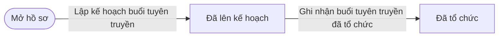
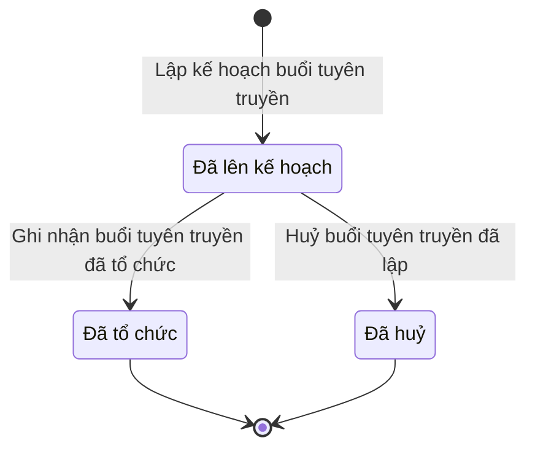

# qt-11 · Tuyên truyền, phổ biến

<!-- máy sinh: tom-tat -->
> **Hồ sơ:** Đợt tuyên truyền, vận động (`OutreachSession`)
>
> **Trong sổ phạm vi:** 11 · Tuyên truyền, phổ biến (tầng 1)
>
> 3 bước · 3 chặng · 1 vai · 0 bảng quyết định · 0 hạn · 3 khớp nối.
>
> **Nguồn:** sổ nghiệp vụ `qt-11` · khai báo của app: `dqtv-app/core/processes/outreach/workflow/outreach.yaml`. Các bảng do máy sinh từ nguồn này.
<!-- hết: tom-tat -->

<!-- viết tay: dien-giai -->
## Diễn giải

*Phần này viết tay, diễn giải lại điều các bảng bên dưới ghi.*

### Quy trình này để làm gì

Chính trị viên theo dõi một **đợt tuyên truyền, vận động** của một đơn vị dân quân tự vệ: lên kế hoạch buổi, rồi ghi kết quả khi đã tổ chức, hoặc huỷ nếu không tổ chức. Cả ba bước đều do Chính trị viên làm.

Hồ sơ có ba chặng: *Đã lên kế hoạch*, rồi rẽ sang *Đã tổ chức* hoặc *Đã huỷ*. Tiền (nếu có) quyết toán ở hồ sơ kinh phí, không ở hồ sơ này.

### Khi nào bắt đầu

Chính trị viên bấm **Lập kế hoạch buổi tuyên truyền**. Bắt buộc nhập đơn vị (`unitId`), chỉ tiêu (`planTargetId`), ngày tuyên truyền, nội dung; số lượt người, hình thức, dự toán chi phí là ô nhập nếu có.

Khi mở, hồ sơ nối tới **Đơn vị dân quân tự vệ** (29) và tới **Chỉ tiêu** (2) — chỉ tiêu tuyên truyền năm mà buổi này thuộc về.

### Diễn ra thế nào

**Chặng "Đã lên kế hoạch"** — Chính trị viên bấm một trong hai:

1. **Ghi nhận buổi tuyên truyền đã tổ chức** → *Đã tổ chức*. Hồ sơ ghi lại số lượt người, hình thức, đối tượng dự, vùng, người trình bày, số tài liệu phát; đều là ô nhập nếu có. Vùng chỉ ghi để thống kê.
2. **Huỷ buổi tuyên truyền đã lập** → *Đã huỷ*. Bắt buộc nhập lý do huỷ.

Buổi đã tổ chức hoặc đã huỷ thì hồ sơ khép lại.

### Kết thúc và để lại gì

Hồ sơ kết thúc ở *Đã tổ chức* hoặc *Đã huỷ*. Hai mối nối tới đơn vị và tới chỉ tiêu đều ghi ở bước mở. Đề nghị cấp kinh phí (4.funding-request) phát sinh từ buổi tuyên truyền thì nối về buổi ấy.

### Điều kiện chặn

- Hai bước ghi nhận và huỷ: người làm phải thuộc đơn vị chủ hồ sơ.
- Không đúng người, hồ sơ không ở đúng chặng, hoặc thiếu thông tin bắt buộc thì bước bị chặn, hồ sơ giữ nguyên. Nhiều lỗi cùng lúc thì báo theo thứ tự quyền → chặng → thông tin.
- Bước huỷ: bắt buộc nhập lý do huỷ.
<!-- hết viết tay -->

## 1. Đường đi ngắn nhất qua các chặng

<!-- máy sinh: luong-chinh -->
Đường ít bước nhất từ lúc mở hồ sơ tới chặng kết thúc xa nhất. Máy chọn theo số chặng, không theo ý nghĩa nghiệp vụ — trình tự công việc thật xem phần Diễn giải và bảng "Việc làm ở từng chặng" ở mục 6.

| # | Ai làm | Làm gì | Hồ sơ sang chặng |
|---|---|---|---|
| 1 | Chính trị viên | Lập kế hoạch buổi tuyên truyền | Đã lên kế hoạch |
| 2 | Chính trị viên | Ghi nhận buổi tuyên truyền đã tổ chức | Đã tổ chức |

<!-- hết: luong-chinh -->

## 2. Hồ sơ và việc nó để lại

<!-- máy sinh: muc-tieu -->
**App gọi quy trình này là:** Đợt tuyên truyền, vận động.

**Khi mở, hồ sơ này ghi mối nối tới:**
- Chỉ tiêu (2) — bước `planOutreach`, khớp nối `outreachPlannedBy`
- Đơn vị dân quân tự vệ (29) — bước `planOutreach`, khớp nối `outreachOfUnit`

**Hồ sơ này để lại cho quy trình khác** (bước tạo hồ sơ của quy trình kia ghi mối nối về đây):
- Đề nghị cấp kinh phí (4.funding-request) — bước `estimateCommuneFundingRequest`, khớp nối `fundingRequestFromOutreach`
- Đề nghị cấp kinh phí (4.funding-request) — bước `estimateProvinceFundingRequest`, khớp nối `fundingRequestFromOutreach`
<!-- hết: muc-tieu -->

## 3. Khởi phát và kết thúc

<!-- máy sinh: khoi-phat -->
**1 cửa vào** — bước mở hồ sơ:

| Bước mở | Ai mở | Hồ sơ vào chặng | App bắt buộc nhập |
|---|---|---|---|
| Lập kế hoạch buổi tuyên truyền | Chính trị viên | Đã lên kế hoạch | `unitId`, ngày tuyên truyền, nội dung, `planTargetId` |

**Kết thúc:** *Đã tổ chức* (`DONE`), *Đã huỷ* (`CANCELLED`)
<!-- hết: khoi-phat -->

## 4. Vai trò

<!-- máy sinh: vai-tro -->
| Vai trong sổ | Tên trong app | Điều kiện | Làm những bước |
|---|---|---|---|
| `operator` | Chính trị viên |  | Lập kế hoạch buổi tuyên truyền · Ghi nhận buổi tuyên truyền đã tổ chức · Huỷ buổi tuyên truyền đã lập |

*"Tên trong app" là tên app đặt cho mã chủ thể của vai. Hồ sơ thuộc đơn vị cấp khác thì người làm là người giữ vai ấy ở đơn vị nêu trong cột "Điều kiện" (nếu sổ có ghi) và ở cột "Người làm phải thuộc" của bảng "Theo khai báo của app" (mục 7).*
<!-- hết: vai-tro -->

## 5. Nhánh phụ

<!-- máy sinh: nhanh-phu -->
**Bước khác đưa hồ sơ sang chặng mới** — đường song song, rẽ nhánh hoặc kết thúc sớm:

| Bước | Ai làm | Từ chặng | Sang chặng |
|---|---|---|---|
| Huỷ buổi tuyên truyền đã lập | Chính trị viên | Đã lên kế hoạch | Đã huỷ |

<!-- hết: nhanh-phu -->

## 6. Các chặng và việc làm ở từng chặng

<!-- máy sinh: chang -->
| Chặng | Tên hiển thị | Vào bằng bước | Kết thúc? |
|---|---|---|---|
| `PLANNED` | Đã lên kế hoạch | Lập kế hoạch buổi tuyên truyền |  |
| `DONE` | Đã tổ chức | Ghi nhận buổi tuyên truyền đã tổ chức | **kết thúc** |
| `CANCELLED` | Đã huỷ | Huỷ buổi tuyên truyền đã lập | **kết thúc** |

### Việc làm ở từng chặng

Hồ sơ đang ở chặng nào thì làm được những bước nào.

| Hồ sơ đang ở chặng | Bước làm tại chặng (hồ sơ đứng yên) | Bước đưa hồ sơ sang chặng khác |
|---|---|---|
| **Đã lên kế hoạch** | — | Ghi nhận buổi tuyên truyền đã tổ chức — Chính trị viên → *Đã tổ chức* Huỷ buổi tuyên truyền đã lập — Chính trị viên → *Đã huỷ* |
| **Đã tổ chức** | — | — (kết thúc) |
| **Đã huỷ** | — | — (kết thúc) |
<!-- hết: chang -->

## 7. Bảng bước

<!-- máy sinh: buoc -->
| # | Bước | Mã bước | Ai thực hiện | Từ chặng | Sang chặng | Phải có trước | Ghi lại |
|---|---|---|---|---|---|---|---|
| 1 | Lập kế hoạch buổi tuyên truyền | `planOutreach` | Chính trị viên | — (mở hồ sơ) | `PLANNED` | `taskingAssigned` | nối tới Đơn vị dân quân tự vệ, nối tới Chỉ tiêu, nối `outreachServesTasking`, đơn vị chủ hồ sơ, `id` |
| 2 | Ghi nhận buổi tuyên truyền đã tổ chức | `recordOutreach` | Chính trị viên | `PLANNED` | `DONE` | người làm thuộc đơn vị chủ hồ sơ | số lượt người, hình thức, đối tượng dự, vùng, người trình bày, số tài liệu phát |
| 3 | Huỷ buổi tuyên truyền đã lập | `cancelOutreach` | Chính trị viên | `PLANNED` | `CANCELLED` | người làm thuộc đơn vị chủ hồ sơ | lý do huỷ |

### Khi không đạt điều kiện

Mặc định: không đúng người, hồ sơ không ở đúng chặng, hoặc thiếu thứ "phải có trước" thì bước bị chặn, hồ sơ giữ nguyên. Bảng dưới chỉ kê những bước có kết quả riêng.

Không bước nào có kết quả riêng — tất cả theo mặc định.

### Điều kiện "phải có trước" bằng lời

Cột "Phải có trước" ở bảng bước có hai loại: ô dữ liệu thường (bước chỉ đòi ô ấy đã có giá trị) và điều kiện hệ tự xét. Bảng này diễn các điều kiện hệ tự xét theo đúng công thức sổ ghi; số ở cột cuối là số thứ tự bước.

| Điều kiện | Đúng khi | Bước đòi |
|---|---|---|
| `taskingAssigned` | đã có nối tới Chỉ tiêu HOẶC có hồ sơ Việc luật giao kèm văn bản đến, đi (qt-1) chính là hồ sơ ghi ở ô nối `outreachServesTasking` của hồ sơ đang làm mà hồ sơ ấy đang ở chặng `ASSIGNED` hoặc `BROKEN_DOWN` | 1 |
| `actorInOwnerUnit` | người đang làm là người của đơn vị ghi ở ô đơn vị chủ hồ sơ của hồ sơ này (theo danh mục người của đơn vị, `dm.unit-staff`) | 2, 3 |

### Theo khai báo của app

Người làm phải thuộc đơn vị nào, ô người dùng phải nhập, bước có lặp được không, và căn cứ pháp lý — lấy từ khai báo quy trình trong app.

| # | Bước | Người làm phải thuộc | Bắt buộc nhập | Nhập nếu có | Lặp được | Căn cứ |
|---|---|---|---|---|---|---|
| 1 | Lập kế hoạch buổi tuyên truyền |  | `unitId`, ngày tuyên truyền, nội dung, `planTargetId` | số lượt người, hình thức, dự toán chi phí |  | L48/2019/QH14 Đ.10; Đ.44 k2 h |
| 2 | Ghi nhận buổi tuyên truyền đã tổ chức | đơn vị chủ hồ sơ | — | số lượt người, hình thức, vùng, đối tượng dự, người trình bày, số tài liệu phát |  | L48/2019/QH14 Đ.10 |
| 3 | Huỷ buổi tuyên truyền đã lập | đơn vị chủ hồ sơ | lý do huỷ | — |  | L48/2019/QH14 Đ.44 k2 h |
<!-- hết: buoc -->

## 8. Bảng quyết định, hạn, việc ngoài hệ

<!-- máy sinh: quyet-dinh -->

<!-- hết: quyet-dinh -->

## 9. Dữ liệu của hồ sơ

<!-- máy sinh: du-lieu -->
Các ô mà bước trong sổ ghi hoặc đòi. Số trong hai cột cuối là số thứ tự bước ở bảng bước (mục 7).

| Ô dữ liệu | Mã | Kiểu (app) | Giá trị cho phép | Loại ô (sổ) | Bước ghi | Bước đòi | Mô tả trong app |
|---|---|---|---|---|---|---|---|
| đơn vị chủ hồ sơ | `ownerUnit` |  |  | lưu trên hồ sơ (`stored`) | 1 | — |  |
| — | `id` |  |  | lưu trên hồ sơ (`stored`) | 1 | — |  |
| số lượt người | `outreachReach` | số |  | đưa vào ở bước (`input`) | 2 | — | Số lượt người dự |
| hình thức | `outreachForm` | chọn một | Hội nghị, gặp mặt (`meeting`), Pa-nô, áp phích (`panel`), In, phát tài liệu (`doc_print`), Truyền thông, loa đài (`media`), Đi cơ sở, thăm hộ (`field_visit`) | đưa vào ở bước (`input`) | 2 | — | Hình thức tổ chức — quyết định mức chi (in ấn, hội trường, cơ động) |
| đối tượng dự | `outreachAudience` | chữ |  | lưu trên hồ sơ (`stored`) | 2 | — | Đối tượng dự — vd. người quản lý, người lao động doanh nghiệp, đơn vị sự nghiệp (Đ.22) |
| vùng | `outreachRegion` | chọn một | Biên giới (`border`), Hải đảo (`island`), Miền núi (`mountain`), Vùng sâu, vùng xa (`remote_area`), Vùng khác (`other_area`) | lưu trên hồ sơ (`stored`) | 2 | — | Vùng tổ chức buổi — Luật GDQP&AN Đ.21; chỉ để thống kê |
| người trình bày | `outreachPresenter` | chữ |  | lưu trên hồ sơ (`stored`) | 2 | — | Người trình bày — tuyên truyền viên, báo cáo viên (Đ.20 k1) |
| số tài liệu phát | `materialsDistributed` | số |  | lưu trên hồ sơ (`stored`) | 2 | — | Số tài liệu đã phát, kể cả tài liệu cho đồng bào dân tộc thiểu số |
| lý do huỷ | `cancelReason` | chữ |  | đưa vào ở bước (`input`) | 3 | — | Vì sao buổi tuyên truyền không tổ chức — bắt khi huỷ |
| — | `taskingAssigned` |  | có hay chưa | hệ suy ra (`derived`) | — | 1 |  |
| người làm thuộc đơn vị chủ hồ sơ | `actorInOwnerUnit` |  | có hay chưa | hệ suy ra (`derived`) | — | 2, 3 |  |

11 ô. Cột "Loại ô" là cách sổ phân loại ô, in kèm đúng chữ của sổ; ô nào người dùng phải nhập xem bảng "Theo khai báo của app" ở mục 7.
<!-- hết: du-lieu -->

## 10. Khớp nối với quy trình khác

<!-- máy sinh: khop-noi -->
| Quy trình kia | Hồ sơ kia | Quan hệ | Nội dung (mô tả trong app) | Bước ghi mối nối | Tên ô nối |
|---|---|---|---|---|---|
| 2 | Chỉ tiêu | hồ sơ này **mở ra có nối tới** hồ sơ kia | Buổi tuyên truyền thuộc chỉ tiêu tuyên truyền năm nào — doc 106 §1; không bắt buộc | 11·planOutreach ⊕ | `outreachPlannedBy` |
| 29 | Đơn vị dân quân tự vệ | hồ sơ này **mở ra có nối tới** hồ sơ kia | Một đợt tuyên truyền, vận động của đơn vị — Luật Đ.10 | 11·planOutreach ⊕ | `outreachOfUnit` |
| 4.funding-request | Đề nghị cấp kinh phí | hồ sơ kia **mở ra từ** hồ sơ này | Đề nghị cấp kinh phí phát sinh từ buổi tuyên truyền, vận động nào — E27 k3, doc 106 §1 | 4.funding-request·estimateCommuneFundingRequest ⊕, 4.funding-request·estimateProvinceFundingRequest ⊕ | `fundingRequestFromOutreach` |

3 khớp nối. ⊕ là bước tạo hồ sơ.
<!-- hết: khop-noi -->

## 11. Thông tin chung

<!-- máy sinh: thong-tin -->
| | |
|---|---|
| **Mã trong sổ** | `qt-11` |
| **Quy trình trong app** | `outreach` (`workflow/outreach.yaml`) — mặt công tác: `political` |
| **Hồ sơ** | Đợt tuyên truyền, vận động (`OutreachSession`) |
| **Căn cứ pháp lý từng bước** | cột "Căn cứ" ở bảng "Theo khai báo của app", mục 7 |
<!-- hết: thong-tin -->
