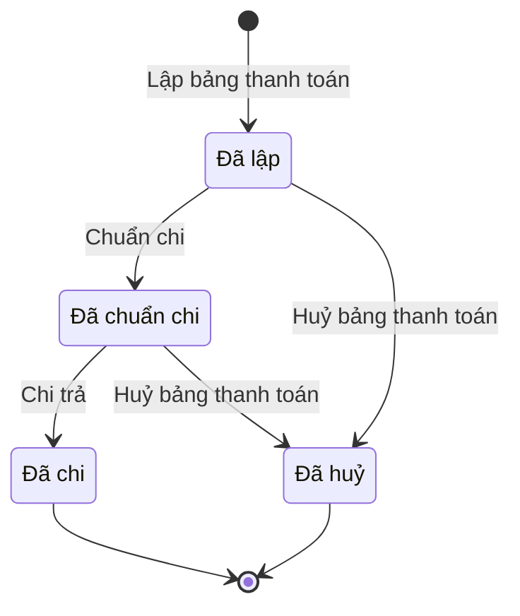

# qt-12a · Chi trả theo đợt

<!-- máy sinh: tom-tat -->
> **Hồ sơ:** Bảng thanh toán trợ cấp (`BenefitPaymentBatch`)
>
> **Trong sổ phạm vi:** 12a · Chi trả theo đợt (tầng 1)
>
> 4 bước · 4 chặng · 3 vai · 0 bảng quyết định · 0 hạn · 4 khớp nối.
>
> **Nguồn:** sổ nghiệp vụ `qt-12a` · khai báo của app: `dqtv-app/core/processes/benefit-payment/workflow/benefit-payment-batch.yaml`. Các bảng do máy sinh từ nguồn này.
<!-- hết: tom-tat -->

<!-- viết tay: dien-giai -->
## Diễn giải

*Phần này viết tay, diễn giải lại điều các bảng bên dưới ghi.*

### Quy trình này để làm gì

Quy trình theo dõi một **bảng thanh toán trợ cấp**: bảng gom các hồ sơ chế độ của một nguồn phát sinh — vụ việc ứng phó, đợt huấn luyện hoặc lệnh điều động — rồi được chuẩn chi và chi trả. Mỗi dòng của bảng là hồ sơ chế độ của một người; số người và tổng tiền cộng từ các dòng, số người không ai gõ.

Hồ sơ có bốn chặng: *Đã lập* → *Đã chuẩn chi* → *Đã chi*; hoặc rẽ sang *Đã huỷ*.

### Khi nào bắt đầu

Trợ lý Quân lực bấm **Lập bảng thanh toán**. Phải chọn nguồn phát sinh, hồ sơ phát sinh trợ cấp, cấp bảo đảm kinh phí và các hồ sơ chế độ đưa vào bảng; ghi chú, số bảng, số thứ tự và năm của sổ là ô nhập nếu có. Mọi dòng trong bảng phải cùng một cấp bảo đảm kinh phí. Bước này bị chặn nếu cấp bảo đảm kinh phí không khớp với ô `decidedBy` — xem "Điều kiện chặn". Hồ sơ vào *Đã lập*.

### Diễn ra thế nào

**Chặng "Đã lập".** Chỉ huy trưởng Ban CHQS xã bấm **Chuẩn chi**; ghi chú là ô nhập nếu có. Bước này ghi lại số người và các tổng tiền — tổng tiền được chốt lại lúc chuẩn chi. Hồ sơ sang *Đã chuẩn chi*.

**Chặng "Đã chuẩn chi".** Nhân viên tài chính kiêm hậu cần bấm **Chi trả**: phải chọn hình thức chi trả, khoản chi của dự trù, và gắn chứng từ chi trả — biên lai hoặc bảng đã có chữ ký nhận của từng người. Hồ sơ sang *Đã chi*: mọi chiến sĩ trong bảng đều đã nhận.

**Huỷ.** Ở cả hai chặng trên, Chỉ huy trưởng có thể bấm **Huỷ bảng thanh toán**, phải ghi lý do. Hồ sơ sang *Đã huỷ*: bảng lập nhầm, giữ vết không xoá, các hồ sơ chế độ trong bảng trở lại chờ chuẩn chi.

### Kết thúc và để lại gì

Hồ sơ kết thúc ở *Đã chi* hoặc *Đã huỷ*. Bảng có nối tới Hồ sơ chế độ chính sách (dòng của bảng), và tới Lệnh điều động, đợt huấn luyện, Vụ việc ứng phó (nguồn phát sinh).

### Điều kiện chặn

- **Cấp bảo đảm kinh phí phải khớp ô `decidedBy`** (bảng `funding-level`, xét lúc lập bảng). Cho qua khi: `decidedBy` là `commune` và cấp bảo đảm là Ngân sách cấp xã; là `province` và cấp bảo đảm là Ngân sách cấp tỉnh; là `ministry_of_defence`, `general_staff` hoặc `region_plan_approved_by_mod` và cấp bảo đảm là Bộ Quốc phòng (`central`). Bước dừng, hồ sơ giữ nguyên với ba kết quả: `wrong_funding_level` (sai cấp), `decided_unknown` (chưa có `decidedBy`), `funding_unknown` (chưa có cấp bảo đảm kinh phí).
- Ba bước sau bước lập: người làm phải thuộc đơn vị chủ hồ sơ.
- Không đúng người, sai chặng hoặc thiếu thông tin bắt buộc thì chặn, hồ sơ giữ nguyên; nhiều lỗi cùng lúc báo theo thứ tự quyền → chặng → thông tin.
- Phải nhập: lý do huỷ ở bước huỷ; hình thức chi trả, khoản chi của dự trù và chứng từ chi trả ở bước chi trả.
<!-- hết viết tay -->

## 1. Đường đi ngắn nhất qua các chặng

<!-- máy sinh: luong-chinh -->
Đường ít bước nhất từ lúc mở hồ sơ tới chặng kết thúc xa nhất. Máy chọn theo số chặng, không theo ý nghĩa nghiệp vụ — trình tự công việc thật xem phần Diễn giải và bảng "Việc làm ở từng chặng" ở mục 6.

| # | Ai làm | Làm gì | Hồ sơ sang chặng |
|---|---|---|---|
| 1 | Trợ lý Quân lực | Lập bảng thanh toán | Đã lập |
| 2 | Chỉ huy trưởng Ban CHQS xã | Chuẩn chi | Đã chuẩn chi |
| 3 | Nhân viên tài chính kiêm hậu cần | Chi trả | Đã chi |

<!-- hết: luong-chinh -->

## 2. Hồ sơ và việc nó để lại

<!-- máy sinh: muc-tieu -->
**App gọi quy trình này là:** Bảng thanh toán trợ cấp.

**Khi mở, hồ sơ này ghi mối nối tới:**
- Hồ sơ chế độ chính sách (12b) — bước `openBenefitPaymentBatch`, khớp nối `batchLine`
- Lệnh điều động (13a) — bước `openBenefitPaymentBatch`, khớp nối `batchFromOrder`
- Sự kiện — huấn luyện, hội thi, diễn tập, hội nghị (14) — bước `openBenefitPaymentBatch`, khớp nối `batchFromEvent`
- Vụ việc ứng phó (20) — bước `openBenefitPaymentBatch`, khớp nối `batchFromCase`
<!-- hết: muc-tieu -->

## 3. Khởi phát và kết thúc

<!-- máy sinh: khoi-phat -->
**1 cửa vào** — bước mở hồ sơ:

| Bước mở | Ai mở | Hồ sơ vào chặng | App bắt buộc nhập |
|---|---|---|---|
| Lập bảng thanh toán | Trợ lý Quân lực | Đã lập | nguồn phát sinh, hồ sơ phát sinh trợ cấp, cấp bảo đảm kinh phí, hồ sơ chế độ đưa vào bảng |

**Kết thúc:** *Đã chi* (`PAID`), *Đã huỷ* (`VOIDED`)
<!-- hết: khoi-phat -->

## 4. Vai trò

<!-- máy sinh: vai-tro -->
| Vai trong sổ | Tên trong app | Điều kiện | Làm những bước |
|---|---|---|---|
| `operator` | Trợ lý Quân lực |  | Lập bảng thanh toán |
| `verifier` | Chỉ huy trưởng Ban CHQS xã |  | Chuẩn chi · Huỷ bảng thanh toán |
| `finance` | Nhân viên tài chính kiêm hậu cần |  | Chi trả |

*"Tên trong app" là tên app đặt cho mã chủ thể của vai. Hồ sơ thuộc đơn vị cấp khác thì người làm là người giữ vai ấy ở đơn vị nêu trong cột "Điều kiện" (nếu sổ có ghi) và ở cột "Người làm phải thuộc" của bảng "Theo khai báo của app" (mục 7).*
<!-- hết: vai-tro -->

## 5. Nhánh phụ

<!-- máy sinh: nhanh-phu -->
**Bước khác đưa hồ sơ sang chặng mới** — đường song song, rẽ nhánh hoặc kết thúc sớm:

| Bước | Ai làm | Từ chặng | Sang chặng |
|---|---|---|---|
| Huỷ bảng thanh toán | Chỉ huy trưởng Ban CHQS xã | Đã lập, Đã chuẩn chi | Đã huỷ |

<!-- hết: nhanh-phu -->

## 6. Các chặng và việc làm ở từng chặng

<!-- máy sinh: chang -->
| Chặng | Tên hiển thị | Vào bằng bước | Kết thúc? |
|---|---|---|---|
| `DRAFT` | Đã lập | Lập bảng thanh toán |  |
| `AUTHORISED` | Đã chuẩn chi | Chuẩn chi |  |
| `PAID` | Đã chi | Chi trả | **kết thúc** |
| `VOIDED` | Đã huỷ | Huỷ bảng thanh toán | **kết thúc** |

### Việc làm ở từng chặng

Hồ sơ đang ở chặng nào thì làm được những bước nào.

| Hồ sơ đang ở chặng | Bước làm tại chặng (hồ sơ đứng yên) | Bước đưa hồ sơ sang chặng khác |
|---|---|---|
| **Đã lập** | — | Chuẩn chi — Chỉ huy trưởng Ban CHQS xã → *Đã chuẩn chi* Huỷ bảng thanh toán — Chỉ huy trưởng Ban CHQS xã → *Đã huỷ* |
| **Đã chuẩn chi** | — | Chi trả — Nhân viên tài chính kiêm hậu cần → *Đã chi* Huỷ bảng thanh toán — Chỉ huy trưởng Ban CHQS xã → *Đã huỷ* |
| **Đã chi** | — | — (kết thúc) |
| **Đã huỷ** | — | — (kết thúc) |
<!-- hết: chang -->

## 7. Bảng bước

<!-- máy sinh: buoc -->
| # | Bước | Mã bước | Ai thực hiện | Từ chặng | Sang chặng | Phải có trước | Ghi lại |
|---|---|---|---|---|---|---|---|
| 1 | Lập bảng thanh toán | `openBenefitPaymentBatch` | Trợ lý Quân lực | — (mở hồ sơ) | `DRAFT` | — | mã tỉnh, mã xã, số bảng, số thứ tự trong sổ, năm của sổ, nguồn phát sinh, cấp bảo đảm kinh phí, số người, tổng tiền, trợ cấp ngày công, tiền ăn, hạn sớm nhất, ghi chú, đơn vị chủ hồ sơ, nối tới Hồ sơ chế độ chính sách, nối tới Lệnh điều động, nối tới Sự kiện — huấn luyện, hội thi, diễn tập, hội nghị, nối tới Vụ việc ứng phó, nối `batchFromSpecialDeployment` |
| 2 | Chuẩn chi | `authoriseBenefitPaymentBatch` | Chỉ huy trưởng Ban CHQS xã | `DRAFT` | `AUTHORISED` | người làm thuộc đơn vị chủ hồ sơ | chuẩn chi lúc, ghi chú chuẩn chi, số người, tổng tiền, trợ cấp ngày công, tiền ăn |
| 3 | Chi trả | `payBenefitPaymentBatch` | Nhân viên tài chính kiêm hậu cần | `AUTHORISED` | `PAID` | người làm thuộc đơn vị chủ hồ sơ | đã chi lúc, hình thức chi trả, ngày chi, chứng từ chi trả — biên lai hoặc bảng đã ký nhận, nối tới Phiếu chi |
| 4 | Huỷ bảng thanh toán | `voidBenefitPaymentBatch` | Chỉ huy trưởng Ban CHQS xã | `DRAFT`, `AUTHORISED` | `VOIDED` | người làm thuộc đơn vị chủ hồ sơ | huỷ lúc, lý do huỷ |

### Khi không đạt điều kiện

Mặc định: không đúng người, hồ sơ không ở đúng chặng, hoặc thiếu thứ "phải có trước" thì bước bị chặn, hồ sơ giữ nguyên. Bảng dưới chỉ kê những bước có kết quả riêng.

| # | Bước | Kết quả riêng |
|---|---|---|
| 1 | Lập bảng thanh toán | bước dừng lại, hồ sơ giữ nguyên khi kết quả xét là: `decided_unknown`, `funding_unknown`, `wrong_funding_level` |

### Điều kiện "phải có trước" bằng lời

Cột "Phải có trước" ở bảng bước có hai loại: ô dữ liệu thường (bước chỉ đòi ô ấy đã có giá trị) và điều kiện hệ tự xét. Bảng này diễn các điều kiện hệ tự xét theo đúng công thức sổ ghi; số ở cột cuối là số thứ tự bước.

| Điều kiện | Đúng khi | Bước đòi |
|---|---|---|
| `actorInOwnerUnit` | người đang làm là người của đơn vị ghi ở ô đơn vị chủ hồ sơ của hồ sơ này (theo danh mục người của đơn vị, `dm.unit-staff`) | 2, 3, 4 |

### Theo khai báo của app

Người làm phải thuộc đơn vị nào, ô người dùng phải nhập, bước có lặp được không, và căn cứ pháp lý — lấy từ khai báo quy trình trong app.

| # | Bước | Người làm phải thuộc | Bắt buộc nhập | Nhập nếu có | Lặp được | Căn cứ |
|---|---|---|---|---|---|---|
| 1 | Lập bảng thanh toán |  | nguồn phát sinh, hồ sơ phát sinh trợ cấp, cấp bảo đảm kinh phí, hồ sơ chế độ đưa vào bảng | ghi chú, số bảng, số thứ tự trong sổ, năm của sổ |  | NĐ72/2020/NĐ-CP Đ.11 · NĐ131/2021/NĐ-CP (danh sách chi trả có ký nhận) · QĐ1126/QĐ-TM Đ.10 k1 |
| 2 | Chuẩn chi | đơn vị chủ hồ sơ | — | ghi chú chuẩn chi |  | QĐ1126/QĐ-TM Đ.2 k3 · L48/2019/QH14 Đ.34 k1, Đ.38 k4 · NĐ72/2020/NĐ-CP Đ.11 |
| 3 | Chi trả | đơn vị chủ hồ sơ | hình thức chi trả, khoản chi của dự trù, chứng từ chi trả — biên lai hoặc bảng đã ký nhận | `voucherId` |  | QĐ1126/QĐ-TM Đ.16 k2 · NĐ72/2020/NĐ-CP Đ.11 |
| 4 | Huỷ bảng thanh toán | đơn vị chủ hồ sơ | lý do huỷ | — |  | QĐ1126/QĐ-TM Đ.10 k1 |
<!-- hết: buoc -->

## 8. Bảng quyết định, hạn, việc ngoài hệ

<!-- máy sinh: quyet-dinh -->

<!-- hết: quyet-dinh -->

## 9. Dữ liệu của hồ sơ

<!-- máy sinh: du-lieu -->
Các ô mà bước trong sổ ghi hoặc đòi. Số trong hai cột cuối là số thứ tự bước ở bảng bước (mục 7).

| Ô dữ liệu | Mã | Kiểu (app) | Giá trị cho phép | Loại ô (sổ) | Bước ghi | Bước đòi | Mô tả trong app |
|---|---|---|---|---|---|---|---|
| mã tỉnh | `provinceCode` | chữ |  | lưu trên hồ sơ (`stored`) | 1 | — | Mã tỉnh — dùng lọc phạm vi theo hàng |
| mã xã | `communeCode` | chữ |  | lưu trên hồ sơ (`stored`) | 1 | — | Mã xã |
| số bảng | `batchNumber` | chữ |  | lưu trên hồ sơ (`stored`) | 1 | — | Số bảng thanh toán — cấp theo sổ chứng từ của chính cấp lập |
| số thứ tự trong sổ | `batchSeq` | số |  | đưa vào ở bước (`input`) | 1 | — | Số thứ tự trong sổ của cấp lập, theo năm |
| năm của sổ | `batchYear` | chữ |  | lưu trên hồ sơ (`stored`) | 1 | — | Năm của sổ — số đếm lại từ 1 mỗi năm |
| nguồn phát sinh | `sourceKind` | chọn một | Vụ việc ứng phó (`case`), Đợt huấn luyện (`event`), Lệnh điều động (`order`) | đưa vào ở bước (`input`) | 1 | — | Nguồn phát sinh — vụ việc ứng phó, đợt huấn luyện, lệnh điều động |
| cấp bảo đảm kinh phí | `fundingLevel` | chọn một | Ngân sách cấp xã (`commune`), Ngân sách cấp tỉnh (`province`), Bộ Quốc phòng (`central`) | lưu trên hồ sơ (`stored`) | 1 | — | Cấp bảo đảm kinh phí của cả bảng — NĐ72 Đ.14 k5; mọi dòng trong bảng phải cùng cấp |
| số người | `headcount` | số |  | lưu trên hồ sơ (`stored`) | 1, 2 | — | Số người trong bảng — cộng từ dòng, không ai gõ |
| tổng tiền | `totalAmount` | số |  | lưu trên hồ sơ (`stored`) | 1, 2 | — | Tổng tiền của bảng — cộng từ dòng, chốt lại lúc chuẩn chi |
| trợ cấp ngày công | `totalWorkAllowance` | số |  | lưu trên hồ sơ (`stored`) | 1, 2 | — | Cột trợ cấp ngày công — NĐ72 Đ.11 k1 a |
| tiền ăn | `totalMeal` | số |  | lưu trên hồ sơ (`stored`) | 1, 2 | — | Cột tiền ăn — NĐ72 Đ.11 k1 b (sửa NĐ16/2025) |
| hạn sớm nhất | `dueDate` | ngày |  | lưu trên hồ sơ (`stored`) | 1 | — | Hạn sớm nhất trong các dòng — NĐ72/2020 Đ.15 |
| ghi chú | `note` | chữ |  | đưa vào ở bước (`input`) | 1 | — | Ghi chú |
| đơn vị chủ hồ sơ | `ownerUnit` |  |  | lưu trên hồ sơ (`stored`) | 1 | — |  |
| chuẩn chi lúc | `authorisedAt` | ngày giờ |  | lưu trên hồ sơ (`stored`) | 2 | — | Chỉ huy trưởng chuẩn chi lúc — QĐ1126 Đ.2 k3 |
| ghi chú chuẩn chi | `authorisationNote` | chữ |  | đưa vào ở bước (`input`) | 2 | — | Ghi chú chuẩn chi |
| đã chi lúc | `paidAt` | ngày giờ |  | lưu trên hồ sơ (`stored`) | 3 | — | Nhân viên Tài chính chi lúc — QĐ1126 Đ.16 k2 |
| hình thức chi trả | `paymentMethod` | chọn một | Chuyển khoản (`bank_transfer`), Qua bưu điện (`postal`), Nhận trực tiếp (`in_person`) | đưa vào ở bước (`input`) | 3 | — | Hình thức chi trả mặc định cho cả bảng — từng hồ sơ vẫn ghi giá trị của mình |
| ngày chi | `paidDate` | ngày |  | đưa vào ở bước (`input`) | 3 | — | Ngày chi |
| chứng từ chi trả — biên lai hoặc bảng đã ký nhận | `signedSheetScanPath` | tệp |  | đưa vào ở bước (`input`) | 3 | — | Ảnh biên lai, chứng từ chi trả — hoặc bảng thanh toán đã có chữ ký nhận của từng người |
| huỷ lúc | `voidedAt` | ngày giờ |  | lưu trên hồ sơ (`stored`) | 4 | — | Thời điểm huỷ bảng |
| lý do huỷ | `voidReason` | chữ |  | đưa vào ở bước (`input`) | 4 | — | Lý do huỷ bảng — lập nhầm; giữ vết, không xoá |
| người làm thuộc đơn vị chủ hồ sơ | `actorInOwnerUnit` |  | có hay chưa | hệ suy ra (`derived`) | — | 2, 3, 4 |  |

23 ô. Cột "Loại ô" là cách sổ phân loại ô, in kèm đúng chữ của sổ; ô nào người dùng phải nhập xem bảng "Theo khai báo của app" ở mục 7.
<!-- hết: du-lieu -->

## 10. Khớp nối với quy trình khác

<!-- máy sinh: khop-noi -->
| Quy trình kia | Hồ sơ kia | Quan hệ | Nội dung (mô tả trong app) | Bước ghi mối nối | Tên ô nối |
|---|---|---|---|---|---|
| 12b | Hồ sơ chế độ chính sách | hồ sơ này **mở ra có nối tới** hồ sơ kia | Dòng của bảng thanh toán — mỗi dòng là hồ sơ chế độ của một người; NĐ131/2021 gọi tờ giấy này là danh sách ch… | 12a·openBenefitPaymentBatch ⊕ | `batchLine` |
| 13a | Lệnh điều động | hồ sơ này **mở ra có nối tới** hồ sơ kia | Bảng thanh toán lập từ một lệnh điều động — NĐ72/2020 Đ.11 căn cứ thứ nhất và thứ hai | 12a·openBenefitPaymentBatch ⊕ | `batchFromOrder` |
| 14 | Sự kiện — huấn luyện, hội thi, diễn tập, hội nghị | hồ sơ này **mở ra có nối tới** hồ sơ kia | Bảng thanh toán lập từ một đợt huấn luyện — NĐ72/2020 Đ.11 | 12a·openBenefitPaymentBatch ⊕ | `batchFromEvent` |
| 20 | Vụ việc ứng phó | hồ sơ này **mở ra có nối tới** hồ sơ kia | Bảng thanh toán lập từ một vụ việc ứng phó — NĐ72/2020 Đ.11 căn cứ thứ ba | 12a·openBenefitPaymentBatch ⊕ | `batchFromCase` |

4 khớp nối. ⊕ là bước tạo hồ sơ.
<!-- hết: khop-noi -->

## 11. Thông tin chung

<!-- máy sinh: thong-tin -->
| | |
|---|---|
| **Mã trong sổ** | `qt-12a` |
| **Quy trình trong app** | `benefit-payment` (`workflow/benefit-payment-batch.yaml`) — mặt công tác: `finance` |
| **Hồ sơ** | Bảng thanh toán trợ cấp (`BenefitPaymentBatch`) |
| **Cùng mã quy trình** | [qt-12a.payment-voucher](qt-12a.payment-voucher.html) |
| **Căn cứ pháp lý từng bước** | cột "Căn cứ" ở bảng "Theo khai báo của app", mục 7 |
<!-- hết: thong-tin -->
