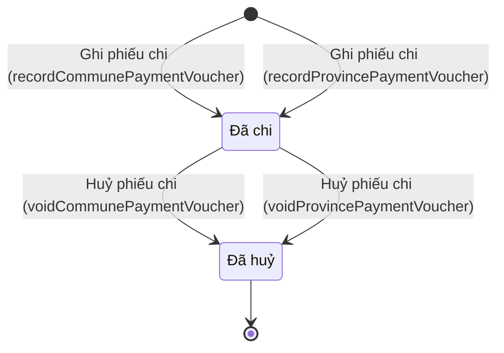

# qt-12a.payment-voucher · Chi trả theo đợt — Phiếu chi

<!-- máy sinh: tom-tat -->
> **Hồ sơ:** Phiếu chi (`PaymentVoucher`)
>
> **Trong sổ phạm vi:** 12a · Chi trả theo đợt — hồ sơ phụ payment-voucher (tầng 1)
>
> 4 bước · 2 chặng · 2 vai · 0 bảng quyết định · 0 hạn · 8 khớp nối.
>
> **Nguồn:** sổ nghiệp vụ `qt-12a.payment-voucher` · khai báo của app: `dqtv-app/core/processes/benefit-payment/workflow/payment-voucher.yaml`. Các bảng do máy sinh từ nguồn này.
<!-- hết: tom-tat -->

<!-- viết tay: dien-giai -->
## Diễn giải

*Phần này viết tay, diễn giải lại điều các bảng bên dưới ghi.*

### Quy trình này để làm gì

Cán bộ tài chính ghi **phiếu chi** cho từng lần chi thật trên một dự trù đã duyệt. Mỗi phiếu thuộc về một dòng khoản của hồ sơ kinh phí. Số quyết toán được tính bằng tổng các phiếu chi, không nhập lại. Quy trình có hai bộ bước cùng tên, một cho vai ở xã và một cho vai ở tỉnh; hai bộ chỉ khác nhau ở điều kiện của bước huỷ.

Hồ sơ chỉ có hai chặng: *Đã chi* và *Đã huỷ*.

### Khi nào bắt đầu

Phiếu mở ra bằng bước **Ghi phiếu chi**, do Nhân viên tài chính kiêm hậu cần (ở xã, bước `recordCommunePaymentVoucher`) hoặc Cán bộ tài chính Bộ CHQS tỉnh (ở tỉnh, bước `recordProvincePaymentVoucher`) bấm. Bắt buộc nhập dòng khoản mà phiếu thuộc về (`lineId`), nội dung chi, số tiền, ngày chi và ảnh chứng từ (hoá đơn, biên nhận, bảng ký nhận); ghi chú nhập nếu có. Phiếu mở ra có nối tới **Dòng khoản của hồ sơ kinh phí** (quy trình 4) và vào thẳng chặng *Đã chi* — đã chi thật trong quá trình tổ chức, có chứng từ.

### Diễn ra thế nào

**Chặng "Đã chi".** Phiếu chỉ còn một bước là **Huỷ phiếu chi**, cũng là hai bước cùng tên:

- Nhân viên tài chính kiêm hậu cần huỷ (`voidCommunePaymentVoucher`); người làm phải thuộc đơn vị chủ hồ sơ.
- Cán bộ tài chính Bộ CHQS tỉnh huỷ (`voidProvincePaymentVoucher`); người làm phải thuộc đơn vị chủ hồ sơ **hoặc** một đơn vị cấp trên của chủ hồ sơ.

Lý do huỷ là ô nhập nếu có. Phiếu sang *Đã huỷ*.

### Kết thúc và để lại gì

Hồ sơ kết thúc ở *Đã huỷ*; phiếu không bị huỷ thì đứng ở *Đã chi*. Mối nối tới dòng khoản ghi lúc lập phiếu. Phiếu chi còn nối tới **Tài sản đã huy động của dân** (20.mobilized-asset): phiếu chi đã cấp để bồi thường món tài sản ấy.

### Điều kiện chặn

- Sai người hoặc phiếu không ở chặng *Đã chi* thì bước huỷ bị chặn, hồ sơ giữ nguyên.
- Bước huỷ: ở xã chỉ người của đơn vị chủ hồ sơ; ở tỉnh là người của đơn vị chủ hồ sơ hoặc của một đơn vị cấp trên (`actorInOwnerOrSuperiorUnit`).
- Bước ghi phiếu: bắt buộc nhập `lineId`, nội dung chi, số tiền, ngày chi, ảnh chứng từ.
<!-- hết viết tay -->

## 1. Đường đi ngắn nhất qua các chặng

<!-- máy sinh: luong-chinh -->
Đường ít bước nhất từ lúc mở hồ sơ tới chặng kết thúc xa nhất. Máy chọn theo số chặng, không theo ý nghĩa nghiệp vụ — trình tự công việc thật xem phần Diễn giải và bảng "Việc làm ở từng chặng" ở mục 6.

| # | Ai làm | Làm gì | Hồ sơ sang chặng |
|---|---|---|---|
| 1 | Nhân viên tài chính kiêm hậu cần | Ghi phiếu chi (`recordCommunePaymentVoucher`) | Đã chi |
| 2 | Nhân viên tài chính kiêm hậu cần | Huỷ phiếu chi (`voidCommunePaymentVoucher`) | Đã huỷ |

<!-- hết: luong-chinh -->

## 2. Hồ sơ và việc nó để lại

<!-- máy sinh: muc-tieu -->
**App gọi quy trình này là:** Phiếu chi — ghi từng lần chi trên một dự trù đã duyệt, hoặc ghi thẳng vào khoản dự toán năm.

**Khi mở, hồ sơ này ghi mối nối tới:**
- Bảng chi trả phụ cấp chức vụ tháng (30.allowance-sheet) — bước `recordCommunePaymentVoucher`, khớp nối `voucherForSheet`
- Bảng chi trả phụ cấp chức vụ tháng (30.allowance-sheet) — bước `recordProvincePaymentVoucher`, khớp nối `voucherForSheet`
- Dòng khoản của hồ sơ kinh phí (4) — bước `recordCommunePaymentVoucher`, khớp nối `voucherOfLine`
- Dòng khoản của hồ sơ kinh phí (4) — bước `recordProvincePaymentVoucher`, khớp nối `voucherOfLine`
- Dự toán ngân sách năm (4) — bước `recordCommunePaymentVoucher`, khớp nối `voucherOfPlan`
- Dự toán ngân sách năm (4) — bước `recordProvincePaymentVoucher`, khớp nối `voucherOfPlan`
- Hồ sơ chế độ chính sách (12b) — bước `recordCommunePaymentVoucher`, khớp nối `voucherForClaim`
- Hồ sơ chế độ chính sách (12b) — bước `recordProvincePaymentVoucher`, khớp nối `voucherForClaim`
- Hồ sơ khen thưởng (8) — bước `recordCommunePaymentVoucher`, khớp nối `voucherForAward`
- Hồ sơ khen thưởng (8) — bước `recordProvincePaymentVoucher`, khớp nối `voucherForAward`
- Khoản dự toán (4) — bước `recordCommunePaymentVoucher`, khớp nối `voucherOfBudgetLine`
- Khoản dự toán (4) — bước `recordProvincePaymentVoucher`, khớp nối `voucherOfBudgetLine`
<!-- hết: muc-tieu -->

## 3. Khởi phát và kết thúc

<!-- máy sinh: khoi-phat -->
**2 cửa vào** — bước mở hồ sơ:

| Bước mở | Ai mở | Hồ sơ vào chặng | App bắt buộc nhập |
|---|---|---|---|
| Ghi phiếu chi (`recordCommunePaymentVoucher`) | Nhân viên tài chính kiêm hậu cần | Đã chi | nội dung chi, số tiền, ngày chi, ảnh chứng từ |
| Ghi phiếu chi (`recordProvincePaymentVoucher`) | Cán bộ tài chính Bộ CHQS tỉnh | Đã chi | nội dung chi, số tiền, ngày chi, ảnh chứng từ |

**Kết thúc:** *Đã huỷ* (`voided`)
<!-- hết: khoi-phat -->

## 4. Vai trò

<!-- máy sinh: vai-tro -->
| Vai trong sổ | Tên trong app | Điều kiện | Làm những bước |
|---|---|---|---|
| `communeOperator` | Nhân viên tài chính kiêm hậu cần |  | Ghi phiếu chi (`recordCommunePaymentVoucher`) · Huỷ phiếu chi (`voidCommunePaymentVoucher`) |
| `provinceOperator` | Cán bộ tài chính Bộ CHQS tỉnh |  | Ghi phiếu chi (`recordProvincePaymentVoucher`) · Huỷ phiếu chi (`voidProvincePaymentVoucher`) |

*"Tên trong app" là tên app đặt cho mã chủ thể của vai. Hồ sơ thuộc đơn vị cấp khác thì người làm là người giữ vai ấy ở đơn vị nêu trong cột "Điều kiện" (nếu sổ có ghi) và ở cột "Người làm phải thuộc" của bảng "Theo khai báo của app" (mục 7).*
<!-- hết: vai-tro -->

## 5. Nhánh phụ

<!-- máy sinh: nhanh-phu -->
**Bước khác đưa hồ sơ sang chặng mới** — đường song song, rẽ nhánh hoặc kết thúc sớm:

| Bước | Ai làm | Từ chặng | Sang chặng |
|---|---|---|---|
| Huỷ phiếu chi (`voidProvincePaymentVoucher`) | Cán bộ tài chính Bộ CHQS tỉnh | Đã chi | Đã huỷ |

**Cửa vào khác:** 2 bước cùng mở hồ sơ — xem mục 3.

<!-- hết: nhanh-phu -->

## 6. Các chặng và việc làm ở từng chặng

<!-- máy sinh: chang -->
| Chặng | Tên hiển thị | Vào bằng bước | Kết thúc? |
|---|---|---|---|
| `settled` | Đã chi | Ghi phiếu chi (`recordCommunePaymentVoucher`) · Ghi phiếu chi (`recordProvincePaymentVoucher`) |  |
| `voided` | Đã huỷ | Huỷ phiếu chi (`voidCommunePaymentVoucher`) · Huỷ phiếu chi (`voidProvincePaymentVoucher`) | **kết thúc** |

### Việc làm ở từng chặng

Hồ sơ đang ở chặng nào thì làm được những bước nào.

| Hồ sơ đang ở chặng | Bước làm tại chặng (hồ sơ đứng yên) | Bước đưa hồ sơ sang chặng khác |
|---|---|---|
| **Đã chi** | — | Huỷ phiếu chi (`voidCommunePaymentVoucher`) — Nhân viên tài chính kiêm hậu cần → *Đã huỷ* Huỷ phiếu chi (`voidProvincePaymentVoucher`) — Cán bộ tài chính Bộ CHQS tỉnh → *Đã huỷ* |
| **Đã huỷ** | — | — (kết thúc) |
<!-- hết: chang -->

## 7. Bảng bước

<!-- máy sinh: buoc -->
| # | Bước | Mã bước | Ai thực hiện | Từ chặng | Sang chặng | Phải có trước | Ghi lại |
|---|---|---|---|---|---|---|---|
| 1 | Ghi phiếu chi (`recordCommunePaymentVoucher`) | `recordCommunePaymentVoucher` | Nhân viên tài chính kiêm hậu cần | — (mở hồ sơ) | `settled` | `voucherParentReady`, `withinLineEstimate`, `directVoucherSourceDecided`, `directVoucherNotDuplicated`, `directVoucherWithinSourceAmount`, `voucherPlanExecuting`, `priorYearVoucherReasonGiven` | mã tỉnh, mã xã, `requestId`, `lineId`, nội dung chi, số tiền, ngày chi, ghi phiếu lúc, ảnh chứng từ, ghi chú, nối tới Dòng khoản của hồ sơ kinh phí, đơn vị chủ hồ sơ, cấp trên của chủ hồ sơ, `id`, `lineOverEstimate`, nối tới Khoản dự toán, nối tới Dự toán ngân sách năm, nối tới Bảng chi trả phụ cấp chức vụ tháng, nối tới Hồ sơ chế độ chính sách, nối tới Hồ sơ khen thưởng, `voucherOverSourceAmount`, `voucherPlanMissing`, `voucherItemCode`, `priorYearReason`, `voucherOnPriorYearPlan`, `sheetVoucherPlanSplit` |
| 2 | Ghi phiếu chi (`recordProvincePaymentVoucher`) | `recordProvincePaymentVoucher` | Cán bộ tài chính Bộ CHQS tỉnh | — (mở hồ sơ) | `settled` | `voucherParentReady`, `withinLineEstimate`, `directVoucherSourceDecided`, `directVoucherNotDuplicated`, `directVoucherWithinSourceAmount`, `voucherPlanExecuting`, `priorYearVoucherReasonGiven` | mã tỉnh, mã xã, `requestId`, `lineId`, nội dung chi, số tiền, ngày chi, ghi phiếu lúc, ảnh chứng từ, ghi chú, nối tới Dòng khoản của hồ sơ kinh phí, đơn vị chủ hồ sơ, cấp trên của chủ hồ sơ, `id`, `lineOverEstimate`, nối tới Khoản dự toán, nối tới Dự toán ngân sách năm, nối tới Bảng chi trả phụ cấp chức vụ tháng, nối tới Hồ sơ chế độ chính sách, nối tới Hồ sơ khen thưởng, `voucherOverSourceAmount`, `voucherPlanMissing`, `voucherItemCode`, `priorYearReason`, `voucherOnPriorYearPlan`, `sheetVoucherPlanSplit` |
| 3 | Huỷ phiếu chi (`voidCommunePaymentVoucher`) | `voidCommunePaymentVoucher` | Nhân viên tài chính kiêm hậu cần | `settled` | `voided` | người làm thuộc đơn vị chủ hồ sơ, `voucherParentReady`, `voucherNotBehindPayment` | lý do huỷ |
| 4 | Huỷ phiếu chi (`voidProvincePaymentVoucher`) | `voidProvincePaymentVoucher` | Cán bộ tài chính Bộ CHQS tỉnh | `settled` | `voided` | `actorInOwnerOrSuperiorUnit`, `voucherParentReady`, `voucherNotBehindPayment` | lý do huỷ |

### Khi không đạt điều kiện

Mặc định: không đúng người, hồ sơ không ở đúng chặng, hoặc thiếu thứ "phải có trước" thì bước bị chặn, hồ sơ giữ nguyên. Bảng dưới chỉ kê những bước có kết quả riêng.

Không bước nào có kết quả riêng — tất cả theo mặc định.

### Điều kiện "phải có trước" bằng lời

Cột "Phải có trước" ở bảng bước có hai loại: ô dữ liệu thường (bước chỉ đòi ô ấy đã có giá trị) và điều kiện hệ tự xét. Bảng này diễn các điều kiện hệ tự xét theo đúng công thức sổ ghi; số ở cột cuối là số thứ tự bước.

| Điều kiện | Đúng khi | Bước đòi |
|---|---|---|
| `voucherParentReady` | có hồ sơ Ngân sách dự toán → quyết toán — Đề nghị cấp kinh phí (qt-4.funding-request) chính là hồ sơ ghi ở `requestId` của hồ sơ đang làm mà hồ sơ ấy đang ở chặng `ESTIMATE_APPROVED` HOẶC (đã có nối tới Khoản dự toán VÀ (có hồ sơ Bảng chi trả phụ cấp chức vụ tháng của xã — Bảng chi trả phụ cấp chức vụ tháng (qt-30.allowance-sheet) chính là hồ sơ ghi ở ô nối `voucherForSheet` của hồ sơ đang làm mà hồ sơ ấy đang ở chặng `APPROVED` HOẶC đã có nối tới Hồ sơ chế độ chính sách HOẶC đã có nối tới Hồ sơ khen thưởng) VÀ (có hồ sơ Ngân sách dự toán → quyết toán (qt-4) chính là hồ sơ ghi ở ô nối `voucherOfPlan` của hồ sơ đang làm mà hồ sơ ấy đang ở chặng `D3` VÀ KHÔNG (đã có `spendingClosedAt`) HOẶC có hồ sơ Ngân sách dự toán → quyết toán — Dự toán ngân sách năm (qt-4.budget-province) chính là hồ sơ ghi ở ô nối `voucherOfPlan` của hồ sơ đang làm mà hồ sơ ấy đang ở chặng `D3` VÀ KHÔNG (đã có `spendingClosedAt`))) | 1, 2, 3, 4 |
| `withinLineEstimate` | KHÔNG (`lineOverEstimate` là `yes`) | 1, 2 |
| `directVoucherSourceDecided` | (KHÔNG (đã có nối tới Bảng chi trả phụ cấp chức vụ tháng) HOẶC có hồ sơ Bảng chi trả phụ cấp chức vụ tháng của xã — Bảng chi trả phụ cấp chức vụ tháng (qt-30.allowance-sheet) chính là hồ sơ ghi ở ô nối `voucherForSheet` của hồ sơ đang làm mà hồ sơ ấy đang ở chặng `APPROVED`) VÀ (KHÔNG (đã có nối tới Hồ sơ chế độ chính sách) HOẶC có hồ sơ Giải quyết chế độ theo hồ sơ từng người (qt-12b) chính là hồ sơ ghi ở ô nối `voucherForClaim` của hồ sơ đang làm mà hồ sơ ấy đang ở chặng `AUTHORISED` hoặc `DECIDED`) VÀ (KHÔNG (đã có nối tới Hồ sơ khen thưởng) HOẶC có hồ sơ Khen thưởng (qt-8) chính là hồ sơ ghi ở ô nối `voucherForAward` của hồ sơ đang làm mà hồ sơ ấy đang ở chặng `DECIDED` hoặc `ANNOUNCED` hoặc `AWARDED` hoặc `RESULT_NOTIFIED` hoặc `PAYMENT_SUPPLEMENT_REQUESTED`) | 1, 2 |
| `directVoucherNotDuplicated` | (KHÔNG (đã có nối tới Hồ sơ chế độ chính sách) HOẶC KHÔNG (có hồ sơ Chi trả theo đợt — Phiếu chi (qt-12a.payment-voucher) có ô nối `voucherForClaim` trùng với ô nối `voucherForClaim` của hồ sơ đang làm mà hồ sơ ấy đang ở chặng `settled`)) VÀ (KHÔNG (đã có nối tới Hồ sơ khen thưởng) HOẶC KHÔNG (có hồ sơ Chi trả theo đợt — Phiếu chi (qt-12a.payment-voucher) có ô nối `voucherForAward` trùng với ô nối `voucherForAward` của hồ sơ đang làm mà hồ sơ ấy đang ở chặng `settled`)) | 1, 2 |
| `directVoucherWithinSourceAmount` | KHÔNG (`voucherOverSourceAmount` là `yes`) | 1, 2 |
| `voucherPlanExecuting` | KHÔNG (`voucherPlanMissing` là `yes`) | 1, 2 |
| `priorYearVoucherReasonGiven` | KHÔNG (`voucherOnPriorYearPlan` là `yes`) HOẶC đã có `priorYearReason` | 1, 2 |
| `actorInOwnerUnit` | người đang làm là người của đơn vị ghi ở ô đơn vị chủ hồ sơ của hồ sơ này (theo danh mục người của đơn vị, `dm.unit-staff`) | 3 |
| `voucherNotBehindPayment` | KHÔNG (có hồ sơ Chi trả theo đợt (qt-12a) có ô nối `batchVoucher` trỏ về chính hồ sơ đang làm mà hồ sơ ấy đang ở chặng `PAID`) VÀ KHÔNG (có hồ sơ Vụ việc ứng phó — Tài sản đã huy động của dân (qt-20.mobilized-asset) có ô nối `assetCompensatedBy` trỏ về chính hồ sơ đang làm mà hồ sơ ấy đang ở chặng `compensated`) VÀ KHÔNG (có hồ sơ Bảng chi trả phụ cấp chức vụ tháng của xã — Bảng chi trả phụ cấp chức vụ tháng (qt-30.allowance-sheet) chính là hồ sơ ghi ở ô nối `voucherForSheet` của hồ sơ đang làm mà hồ sơ ấy đang ở chặng `PAID`) VÀ KHÔNG (có hồ sơ Giải quyết chế độ theo hồ sơ từng người (qt-12b) chính là hồ sơ ghi ở ô nối `voucherForClaim` của hồ sơ đang làm mà hồ sơ ấy đang ở chặng `PAID`) VÀ KHÔNG (có hồ sơ Khen thưởng (qt-8) chính là hồ sơ ghi ở ô nối `voucherForAward` của hồ sơ đang làm mà hồ sơ ấy đang ở chặng `PAID`) | 3, 4 |
| `actorInOwnerOrSuperiorUnit` | người đang làm là người của đơn vị ghi ở ô đơn vị chủ hồ sơ của hồ sơ này HOẶC là người của một đơn vị nằm trong ô cấp trên của chủ hồ sơ của hồ sơ này (theo danh mục người của đơn vị, `dm.unit-staff`) | 4 |

### Theo khai báo của app

Người làm phải thuộc đơn vị nào, ô người dùng phải nhập, bước có lặp được không, và căn cứ pháp lý — lấy từ khai báo quy trình trong app.

| # | Bước | Người làm phải thuộc | Bắt buộc nhập | Nhập nếu có | Lặp được | Căn cứ |
|---|---|---|---|---|---|---|
| 1 | Ghi phiếu chi (`recordCommunePaymentVoucher`) |  | nội dung chi, số tiền, ngày chi, ảnh chứng từ | `lineId`, khoản, chi cho, việc gốc của phiếu ghi thẳng, ghi chú |  | QĐ1126/QĐ-TM Đ.16 k2; TT43/2020/TT-BQP Đ.3 k1 h |
| 2 | Ghi phiếu chi (`recordProvincePaymentVoucher`) |  | nội dung chi, số tiền, ngày chi, ảnh chứng từ | `lineId`, khoản, chi cho, việc gốc của phiếu ghi thẳng, ghi chú |  | QĐ1126/QĐ-TM Đ.16 k2; TT43/2020/TT-BQP Đ.3 k1 h |
| 3 | Huỷ phiếu chi (`voidCommunePaymentVoucher`) | đơn vị chủ hồ sơ | — | lý do huỷ |  | QĐ1126/QĐ-TM Đ.16 k2 |
| 4 | Huỷ phiếu chi (`voidProvincePaymentVoucher`) | đơn vị chủ hồ sơ · cấp trên của chủ hồ sơ | — | lý do huỷ |  | QĐ1126/QĐ-TM Đ.16 k2 |
<!-- hết: buoc -->

## 8. Bảng quyết định, hạn, việc ngoài hệ

<!-- máy sinh: quyet-dinh -->

<!-- hết: quyet-dinh -->

## 9. Dữ liệu của hồ sơ

<!-- máy sinh: du-lieu -->
Các ô mà bước trong sổ ghi hoặc đòi. Số trong hai cột cuối là số thứ tự bước ở bảng bước (mục 7).

| Ô dữ liệu | Mã | Kiểu (app) | Giá trị cho phép | Loại ô (sổ) | Bước ghi | Bước đòi | Mô tả trong app |
|---|---|---|---|---|---|---|---|
| mã tỉnh | `provinceCode` | chữ |  | lưu trên hồ sơ (`stored`) | 1, 2 | — | Mã tỉnh — dùng lọc phạm vi theo hàng; theo hồ sơ kinh phí cha |
| mã xã | `communeCode` | chữ |  | lưu trên hồ sơ (`stored`) | 1, 2 | — | Mã xã — theo hồ sơ kinh phí cha |
| — | `requestId` | chữ |  | lưu trên hồ sơ (`stored`) | 1, 2 | — | id hồ sơ kinh phí mà phiếu chi này thuộc về — lọc nhanh; rỗng ở phiếu ghi thẳng vào khoản dự toán năm |
| — | `lineId` | chữ |  | đưa vào ở bước (`input`) | 1, 2 | — | id DÒNG KHOẢN mà phiếu chi này thuộc về (doc 112 §14) — quan hệ thật ở voucherOfLine; rỗng ở phiếu cũ neo thẳng hồ sơ |
| nội dung chi | `purpose` | chữ |  | đưa vào ở bước (`input`) | 1, 2 | — | Nội dung chi — Đồ ăn, Võng ô dù… |
| số tiền | `amount` | số |  | đưa vào ở bước (`input`) | 1, 2 | — | Số tiền THỰC CHI của phiếu — quyết toán tính từ Σ các phiếu chi, không nhập lại (doc 112 §17) |
| ngày chi | `spentOn` | ngày |  | đưa vào ở bước (`input`) | 1, 2 | — | Ngày chi |
| ghi phiếu lúc | `settledAt` | ngày giờ |  | lưu trên hồ sơ (`stored`) | 1, 2 | — | Thời điểm ghi phiếu chi |
| ảnh chứng từ | `receiptScanPath` | tệp |  | đưa vào ở bước (`input`) | 1, 2 | — | Ảnh chụp chứng từ chi — hoá đơn, biên nhận, bảng ký nhận |
| ghi chú | `note` | chữ |  | đưa vào ở bước (`input`) | 1, 2 | — | Ghi chú phiếu chi |
| đơn vị chủ hồ sơ | `ownerUnit` |  |  | lưu trên hồ sơ (`stored`) | 1, 2 | — |  |
| cấp trên của chủ hồ sơ | `superiorUnits` |  |  | hệ suy ra (`derived`) | 1, 2 | — |  |
| — | `id` |  |  | lưu trên hồ sơ (`stored`) | 1, 2 | — |  |
| — | `lineOverEstimate` |  | `yes`, `no` | lưu trên hồ sơ (`stored`) | 1, 2 | — |  |
| — | `voucherOverSourceAmount` |  | `yes`, `no` | đưa vào ở bước (`input`) | 1, 2 | — |  |
| — | `voucherPlanMissing` |  | `yes`, `no` | đưa vào ở bước (`input`) | 1, 2 | — |  |
| — | `voucherItemCode` |  | `item_1`, `item_2`, `item_3`, `item_4`, `item_5`, `item_6`, `item_7`, `item_8`, `item_9`, `item_10`, `item_11`, `item_12` | lưu trên hồ sơ (`stored`) | 1, 2 | — |  |
| — | `priorYearReason` |  |  | đưa vào ở bước (`input`) | 1, 2 | — |  |
| — | `voucherOnPriorYearPlan` |  | `yes`, `no` | đưa vào ở bước (`input`) | 1, 2 | — |  |
| — | `sheetVoucherPlanSplit` |  | `yes`, `no` | đưa vào ở bước (`input`) | 1, 2 | — |  |
| lý do huỷ | `voidReason` | chữ |  | đưa vào ở bước (`input`) | 3, 4 | — | Lý do huỷ phiếu |
| — | `voucherParentReady` |  | có hay chưa | hệ suy ra (`derived`) | — | 1, 2, 3, 4 |  |
| — | `withinLineEstimate` |  |  | hệ suy ra (`derived`) | — | 1, 2 |  |
| — | `directVoucherSourceDecided` |  | có hay chưa | hệ suy ra (`derived`) | — | 1, 2 |  |
| — | `directVoucherNotDuplicated` |  | có hay chưa | hệ suy ra (`derived`) | — | 1, 2 |  |
| — | `directVoucherWithinSourceAmount` |  | có hay chưa | hệ suy ra (`derived`) | — | 1, 2 |  |
| — | `voucherPlanExecuting` |  | có hay chưa | hệ suy ra (`derived`) | — | 1, 2 |  |
| — | `priorYearVoucherReasonGiven` |  | có hay chưa | hệ suy ra (`derived`) | — | 1, 2 |  |
| người làm thuộc đơn vị chủ hồ sơ | `actorInOwnerUnit` |  | có hay chưa | hệ suy ra (`derived`) | — | 3 |  |
| — | `voucherNotBehindPayment` |  | có hay chưa | hệ suy ra (`derived`) | — | 3, 4 |  |
| — | `actorInOwnerOrSuperiorUnit` |  | có hay chưa | hệ suy ra (`derived`) | — | 4 |  |

31 ô. Cột "Loại ô" là cách sổ phân loại ô, in kèm đúng chữ của sổ; ô nào người dùng phải nhập xem bảng "Theo khai báo của app" ở mục 7.
<!-- hết: du-lieu -->

## 10. Khớp nối với quy trình khác

<!-- máy sinh: khop-noi -->
| Quy trình kia | Hồ sơ kia | Quan hệ | Nội dung (mô tả trong app) | Bước ghi mối nối | Tên ô nối |
|---|---|---|---|---|---|
| 12b | Hồ sơ chế độ chính sách | hồ sơ này **mở ra có nối tới** hồ sơ kia | Phiếu chi này chi hồ sơ chế độ nào — L48/2019 Đ.35, Đ.38 k5 | 12a.payment-voucher·recordCommunePaymentVoucher ⊕, 12a.payment-voucher·recordProvincePaymentVoucher ⊕ | `voucherForClaim` |
| 20.mobilized-asset | Tài sản đã huy động của dân | gắn với nhau ở một bước giữa chừng | Phiếu chi đã cấp để bồi thường món tài sản này — L18/2023 Đ.21 k3; tiền đi qua dự trù kinh phí của vụ việc, N… | 20.mobilized-asset·markAssetCompensated · đòi: 20.mobilized-asset·markAssetCompensated | `assetCompensatedBy` |
| 30.allowance-sheet | Bảng chi trả phụ cấp chức vụ tháng | hồ sơ này **mở ra có nối tới** hồ sơ kia | Phiếu chi này chi bảng phụ cấp chức vụ tháng nào — NĐ72/2020 Đ.7, L48/2019 Đ.38 k4 | 12a.payment-voucher·recordCommunePaymentVoucher ⊕, 12a.payment-voucher·recordProvincePaymentVoucher ⊕ | `voucherForSheet` |
| 4 | Khoản dự toán | hồ sơ này **mở ra có nối tới** hồ sơ kia | Phiếu chi ghi thẳng vào khoản nào của dự toán năm — chốt 15/10/2026, L48/2019 Đ.36 k1 | 12a.payment-voucher·recordCommunePaymentVoucher ⊕, 12a.payment-voucher·recordProvincePaymentVoucher ⊕ | `voucherOfBudgetLine` |
| 4 | Dòng khoản của hồ sơ kinh phí | hồ sơ này **mở ra có nối tới** hồ sơ kia | Phiếu chi này thuộc dòng khoản nào — doc 112 §14, QĐ1126 Đ.16 k2 (chi trong quá trình tổ chức) | 12a.payment-voucher·recordCommunePaymentVoucher ⊕, 12a.payment-voucher·recordProvincePaymentVoucher ⊕ | `voucherOfLine` |
| 4 | Dự toán ngân sách năm | hồ sơ này **mở ra có nối tới** hồ sơ kia | Phiếu chi ghi thẳng trừ vào dự toán năm nào — phải đang chấp hành (D3) | 12a.payment-voucher·recordCommunePaymentVoucher ⊕, 12a.payment-voucher·recordProvincePaymentVoucher ⊕ | `voucherOfPlan` |
| 4.funding-request | Đề nghị cấp kinh phí | có nối | NGƯNG DÙNG doc 112 §14 — phiếu chi nay neo về DÒNG KHOẢN (`voucherOfLine`). Giữ để phiếu cũ (nếu có) còn đườn… | — | `voucherOfRequest` |
| 8 | Hồ sơ khen thưởng | hồ sơ này **mở ra có nối tới** hồ sơ kia | Phiếu chi này chi tiền thưởng của hồ sơ khen thưởng nào — L48/2019 Đ.38 k11 | 12a.payment-voucher·recordCommunePaymentVoucher ⊕, 12a.payment-voucher·recordProvincePaymentVoucher ⊕ | `voucherForAward` |

8 khớp nối. ⊕ là bước tạo hồ sơ.
<!-- hết: khop-noi -->

## 11. Thông tin chung

<!-- máy sinh: thong-tin -->
| | |
|---|---|
| **Mã trong sổ** | `qt-12a.payment-voucher` |
| **Quy trình trong app** | `benefit-payment` (`workflow/payment-voucher.yaml`) — mặt công tác: `finance` |
| **Hồ sơ** | Phiếu chi (`PaymentVoucher`) |
| **Cùng mã quy trình** | [qt-12a](qt-12a.html) |
| **Căn cứ pháp lý từng bước** | cột "Căn cứ" ở bảng "Theo khai báo của app", mục 7 |
<!-- hết: thong-tin -->
