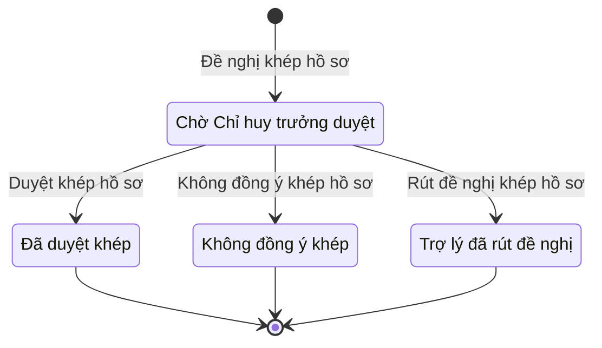

# qt-12b.closure · Giải quyết chế độ theo hồ sơ từng người — Lần đề nghị khép hồ sơ

<!-- máy sinh: tom-tat -->
> **Hồ sơ:** Lần đề nghị khép hồ sơ (`ClaimClosure`)
>
> **Trong sổ phạm vi:** 12b · Giải quyết chế độ theo hồ sơ từng người — hồ sơ phụ closure: đề nghị khép hồ sơ (tầng 2)
>
> 4 bước · 4 chặng · 2 vai · 0 bảng quyết định · 0 hạn · 0 khớp nối.
>
> **Nguồn:** sổ nghiệp vụ `qt-12b.closure` · khai báo của app: `dqtv-app/core/processes/benefit/workflow/claim-closure.yaml`. Các bảng do máy sinh từ nguồn này.
<!-- hết: tom-tat -->

## 1. Đường đi ngắn nhất qua các chặng

<!-- máy sinh: luong-chinh -->
Đường ít bước nhất từ lúc mở hồ sơ tới chặng kết thúc xa nhất. Máy chọn theo số chặng, không theo ý nghĩa nghiệp vụ — trình tự công việc thật xem phần Diễn giải và bảng "Việc làm ở từng chặng" ở mục 6.

| # | Ai làm | Làm gì | Hồ sơ sang chặng |
|---|---|---|---|
| 1 | Trợ lý Quân lực | Đề nghị khép hồ sơ | Chờ Chỉ huy trưởng duyệt |
| 2 | Chỉ huy trưởng Ban CHQS xã | Duyệt khép hồ sơ | Đã duyệt khép |

<!-- hết: luong-chinh -->

## 2. Hồ sơ và việc nó để lại

<!-- máy sinh: muc-tieu -->
**App gọi quy trình này là:** Đề nghị khép hồ sơ chế độ.
<!-- hết: muc-tieu -->

## 3. Khởi phát và kết thúc

<!-- máy sinh: khoi-phat -->
**1 cửa vào** — bước mở hồ sơ:

| Bước mở | Ai mở | Hồ sơ vào chặng | App bắt buộc nhập |
|---|---|---|---|
| Đề nghị khép hồ sơ | Trợ lý Quân lực | Chờ Chỉ huy trưởng duyệt | `claimId`, lý do khép |

**Kết thúc:** *Đã duyệt khép* (`APPROVED`), *Không đồng ý khép* (`REJECTED`), *Trợ lý đã rút đề nghị* (`WITHDRAWN`)
<!-- hết: khoi-phat -->

## 4. Vai trò

<!-- máy sinh: vai-tro -->
| Vai trong sổ | Tên trong app | Điều kiện | Làm những bước |
|---|---|---|---|
| `operator` | Trợ lý Quân lực |  | Đề nghị khép hồ sơ · Rút đề nghị khép hồ sơ |
| `verifier` | Chỉ huy trưởng Ban CHQS xã |  | Duyệt khép hồ sơ · Không đồng ý khép hồ sơ |

*"Tên trong app" là tên app đặt cho mã chủ thể của vai. Hồ sơ thuộc đơn vị cấp khác thì người làm là người giữ vai ấy ở đơn vị nêu trong cột "Điều kiện" (nếu sổ có ghi) và ở cột "Người làm phải thuộc" của bảng "Theo khai báo của app" (mục 7).*
<!-- hết: vai-tro -->

## 5. Nhánh phụ

<!-- máy sinh: nhanh-phu -->
**Bước khác đưa hồ sơ sang chặng mới** — đường song song, rẽ nhánh hoặc kết thúc sớm:

| Bước | Ai làm | Từ chặng | Sang chặng |
|---|---|---|---|
| Không đồng ý khép hồ sơ | Chỉ huy trưởng Ban CHQS xã | Chờ Chỉ huy trưởng duyệt | Không đồng ý khép |
| Rút đề nghị khép hồ sơ | Trợ lý Quân lực | Chờ Chỉ huy trưởng duyệt | Trợ lý đã rút đề nghị |

<!-- hết: nhanh-phu -->

## 6. Các chặng và việc làm ở từng chặng

<!-- máy sinh: chang -->
| Chặng | Tên hiển thị | Vào bằng bước | Kết thúc? |
|---|---|---|---|
| `PROPOSED` | Chờ Chỉ huy trưởng duyệt | Đề nghị khép hồ sơ |  |
| `APPROVED` | Đã duyệt khép | Duyệt khép hồ sơ | **kết thúc** |
| `REJECTED` | Không đồng ý khép | Không đồng ý khép hồ sơ | **kết thúc** |
| `WITHDRAWN` | Trợ lý đã rút đề nghị | Rút đề nghị khép hồ sơ | **kết thúc** |

### Việc làm ở từng chặng

Hồ sơ đang ở chặng nào thì làm được những bước nào.

| Hồ sơ đang ở chặng | Bước làm tại chặng (hồ sơ đứng yên) | Bước đưa hồ sơ sang chặng khác |
|---|---|---|
| **Chờ Chỉ huy trưởng duyệt** | — | Duyệt khép hồ sơ — Chỉ huy trưởng Ban CHQS xã → *Đã duyệt khép* Không đồng ý khép hồ sơ — Chỉ huy trưởng Ban CHQS xã → *Không đồng ý khép* Rút đề nghị khép hồ sơ — Trợ lý Quân lực → *Trợ lý đã rút đề nghị* |
| **Đã duyệt khép** | — | — (kết thúc) |
| **Không đồng ý khép** | — | — (kết thúc) |
| **Trợ lý đã rút đề nghị** | — | — (kết thúc) |
<!-- hết: chang -->

## 7. Bảng bước

<!-- máy sinh: buoc -->
| # | Bước | Mã bước | Ai thực hiện | Từ chặng | Sang chặng | Phải có trước | Ghi lại |
|---|---|---|---|---|---|---|---|
| 1 | Đề nghị khép hồ sơ | `proposeClaimClosure` | Trợ lý Quân lực | — (mở hồ sơ) | `PROPOSED` | lý do khép, `closureGroundRecorded`, `actorInClaimUnit`, `claimOpenForClosure`, `noOtherClosureOpen` | `id`, nối tới Hồ sơ chế độ chính sách, đơn vị chủ hồ sơ, lý do khép |
| 2 | Duyệt khép hồ sơ | `approveClaimClosure` | Chỉ huy trưởng Ban CHQS xã | `PROPOSED` | `APPROVED` | người làm thuộc đơn vị chủ hồ sơ, `claimOpenForClosure` | — |
| 3 | Không đồng ý khép hồ sơ | `rejectClaimClosure` | Chỉ huy trưởng Ban CHQS xã | `PROPOSED` | `REJECTED` | người làm thuộc đơn vị chủ hồ sơ | vì sao chưa khép |
| 4 | Rút đề nghị khép hồ sơ | `withdrawClaimClosure` | Trợ lý Quân lực | `PROPOSED` | `WITHDRAWN` | người làm thuộc đơn vị chủ hồ sơ | — |

### Khi không đạt điều kiện

Mặc định: không đúng người, hồ sơ không ở đúng chặng, hoặc thiếu thứ "phải có trước" thì bước bị chặn, hồ sơ giữ nguyên. Bảng dưới chỉ kê những bước có kết quả riêng.

Không bước nào có kết quả riêng — tất cả theo mặc định.

### Điều kiện "phải có trước" bằng lời

Cột "Phải có trước" ở bảng bước có hai loại: ô dữ liệu thường (bước chỉ đòi ô ấy đã có giá trị) và điều kiện hệ tự xét. Bảng này diễn các điều kiện hệ tự xét theo đúng công thức sổ ghi; số ở cột cuối là số thứ tự bước.

| Điều kiện | Đúng khi | Bước đòi |
|---|---|---|
| `closureGroundRecorded` | KHÔNG (lý do khép là Cấp có thẩm quyền không đồng ý (`authority_refused`)) HOẶC có hồ sơ Giải quyết chế độ theo hồ sơ từng người (qt-12b) chính là hồ sơ ghi ở ô nối `closureOfClaim` của hồ sơ đang làm mà đã có nối `recordClaimRefusalFromIncomingDocument` (Hồ sơ chế độ chính sách → Văn bản đến) HOẶC đã có nối `recordExternalResultFromIncomingDocument` (Hồ sơ chế độ chính sách → Văn bản đến) HOẶC đã có nối `recordVeteranAffairsResultFromIncomingDocument` (Hồ sơ chế độ chính sách → Văn bản đến) | 1 |
| `actorInClaimUnit` | có hồ sơ Giải quyết chế độ theo hồ sơ từng người (qt-12b) (gọi là src) chính là hồ sơ ghi ở ô nối `closureOfClaim` của hồ sơ đang làm mà người đang làm là người của đơn vị ghi ở ô đơn vị chủ hồ sơ của hồ sơ src ấy (theo danh mục người của đơn vị, `dm.unit-staff`) | 1 |
| `claimOpenForClosure` | có hồ sơ Giải quyết chế độ theo hồ sơ từng người (qt-12b) chính là hồ sơ ghi ở ô nối `closureOfClaim` của hồ sơ đang làm mà hồ sơ ấy đang ở chặng `SUBMITTED` hoặc `PENDING_SUPPLEMENT` hoặc `VALID` hoặc `FORWARDED` hoặc `DOSSIER_CHECKED` hoặc `VETERAN_CONFIRMED` hoặc `AUTHORITY_DECIDED` hoặc `REFUSED` hoặc `TRANSFERRED` hoặc `DECIDED` | 1, 2 |
| `noOtherClosureOpen` | không có hồ sơ Giải quyết chế độ theo hồ sơ từng người — Lần đề nghị khép hồ sơ (qt-12b.closure) có ô nối `closureOfClaim` trùng với ô nối `closureOfClaim` của hồ sơ đang làm mà hồ sơ ấy đang ở chặng `PROPOSED` | 1 |
| `actorInOwnerUnit` | người đang làm là người của đơn vị ghi ở ô đơn vị chủ hồ sơ của hồ sơ này (theo danh mục người của đơn vị, `dm.unit-staff`) | 2, 3, 4 |

### Theo khai báo của app

Người làm phải thuộc đơn vị nào, ô người dùng phải nhập, bước có lặp được không, và căn cứ pháp lý — lấy từ khai báo quy trình trong app.

| # | Bước | Người làm phải thuộc | Bắt buộc nhập | Nhập nếu có | Lặp được | Căn cứ |
|---|---|---|---|---|---|---|
| 1 | Đề nghị khép hồ sơ |  | `claimId`, lý do khép | diễn giải |  | NĐ72/2020/NĐ-CP Đ.14 k1 b; Đ.15 k2 |
| 2 | Duyệt khép hồ sơ | đơn vị chủ hồ sơ | — | — |  | NĐ72/2020/NĐ-CP Đ.14 k1 b; Đ.15 k2 |
| 3 | Không đồng ý khép hồ sơ | đơn vị chủ hồ sơ | vì sao chưa khép | — |  | NĐ72/2020/NĐ-CP Đ.14 k1 b; Đ.15 k2 |
| 4 | Rút đề nghị khép hồ sơ | đơn vị chủ hồ sơ | — | — |  | NĐ72/2020/NĐ-CP Đ.14 k1 b; Đ.15 k2 |
<!-- hết: buoc -->

## 8. Bảng quyết định, hạn, việc ngoài hệ

<!-- máy sinh: quyet-dinh -->

<!-- hết: quyet-dinh -->

## 9. Dữ liệu của hồ sơ

<!-- máy sinh: du-lieu -->
Các ô mà bước trong sổ ghi hoặc đòi. Số trong hai cột cuối là số thứ tự bước ở bảng bước (mục 7).

| Ô dữ liệu | Mã | Kiểu (app) | Giá trị cho phép | Loại ô (sổ) | Bước ghi | Bước đòi | Mô tả trong app |
|---|---|---|---|---|---|---|---|
| — | `id` |  |  | lưu trên hồ sơ (`stored`) | 1 | — |  |
| đơn vị chủ hồ sơ | `ownerUnit` |  |  | lưu trên hồ sơ (`stored`) | 1 | — |  |
| lý do khép | `closeReason` | chọn một | Không đủ điều kiện hưởng (`not_eligible`), Người nộp không bổ sung hồ sơ (`no_supplement`), Cấp có thẩm quyền không đồng ý (`authority_refused`), Ngành Người có công không công nhận (`not_recognized`) | đưa vào ở bước (`input`) | 1 | 1 | Vì sao khép — Chỉ huy trưởng cần căn cứ để duyệt |
| vì sao chưa khép | `closureDecisionNote` | chữ |  | đưa vào ở bước (`input`) | 3 | — | Ý kiến của Chỉ huy trưởng khi không đồng ý khép — sổ qt-12b.closure `closureDecisionNote` |
| — | `closureGroundRecorded` |  | có hay chưa | hệ suy ra (`derived`) | — | 1 |  |
| — | `actorInClaimUnit` |  | có hay chưa | hệ suy ra (`derived`) | — | 1 |  |
| — | `claimOpenForClosure` |  | có hay chưa | hệ suy ra (`derived`) | — | 1, 2 |  |
| — | `noOtherClosureOpen` |  | có hay chưa | hệ suy ra (`derived`) | — | 1 |  |
| người làm thuộc đơn vị chủ hồ sơ | `actorInOwnerUnit` |  | có hay chưa | hệ suy ra (`derived`) | — | 2, 3, 4 |  |

9 ô. Cột "Loại ô" là cách sổ phân loại ô, in kèm đúng chữ của sổ; ô nào người dùng phải nhập xem bảng "Theo khai báo của app" ở mục 7.
<!-- hết: du-lieu -->

## 10. Khớp nối với quy trình khác

<!-- máy sinh: khop-noi -->

**Ô nối giữa các hồ sơ cùng mã quy trình, hoặc tới danh mục nền:** `closureOfClaim` (Lần đề nghị khép hồ sơ → Hồ sơ chế độ chính sách) — bước Đề nghị khép hồ sơ.
<!-- hết: khop-noi -->

## 11. Thông tin chung

<!-- máy sinh: thong-tin -->
| | |
|---|---|
| **Mã trong sổ** | `qt-12b.closure` |
| **Quy trình trong app** | `benefit` (`workflow/claim-closure.yaml`) — mặt công tác: `personnel` |
| **Hồ sơ** | Lần đề nghị khép hồ sơ (`ClaimClosure`) |
| **Cùng mã quy trình** | [qt-12b](qt-12b.html), [qt-12b.compensation](qt-12b.compensation.html) |
| **Căn cứ pháp lý từng bước** | cột "Căn cứ" ở bảng "Theo khai báo của app", mục 7 |
<!-- hết: thong-tin -->
