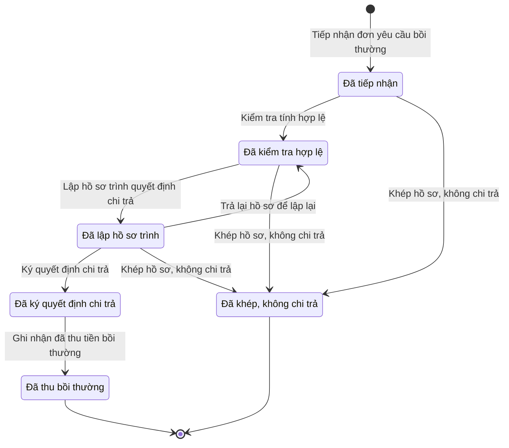

# qt-12b.compensation · Giải quyết chế độ theo hồ sơ từng người — Hồ sơ bồi thường thiệt hại

<!-- máy sinh: tom-tat -->
> **Hồ sơ:** Hồ sơ bồi thường thiệt hại (`CompensationCase`)
>
> **Trong sổ phạm vi:** 12b · Giải quyết chế độ theo hồ sơ từng người — hồ sơ phụ compensation (tầng 2)
>
> 7 bước · 6 chặng · 2 vai · 1 bảng quyết định · 0 hạn · 7 khớp nối.
>
> **Nguồn:** sổ nghiệp vụ `qt-12b.compensation` · khai báo của app: `dqtv-app/core/processes/benefit/workflow/compensation.yaml`. Các bảng do máy sinh từ nguồn này.
<!-- hết: tom-tat -->

<!-- viết tay: dien-giai -->
## Diễn giải

*Phần này viết tay, diễn giải lại điều các bảng bên dưới ghi.*

### Quy trình này để làm gì

Quy trình giải quyết một **hồ sơ bồi thường thiệt hại** gắn với một chiến sĩ dân quân tự vệ: tiếp nhận đơn, kiểm tra tính hợp lệ, lập hồ sơ trình, Chỉ huy trưởng ký quyết định chi trả, rồi chi trả. Nhân viên tài chính kiêm hậu cần làm các bước chuẩn bị và chi trả; Chỉ huy trưởng Ban CHQS xã ký, trả lại hoặc khép.

Hồ sơ đi qua các chặng: *Đã tiếp nhận* → *Đã kiểm tra hợp lệ* → *Đã lập hồ sơ trình* → *Đã ký quyết định chi trả* → *Đã chi trả*; hoặc rẽ sang *Đã khép, không chi trả*.

### Khi nào bắt đầu

Nhân viên tài chính kiêm hậu cần bấm **Tiếp nhận đơn yêu cầu bồi thường**, nhập `memberId`, mô tả thiệt hại, mức thiệt hại và thiệt hại có phát sinh khi làm nhiệm vụ hay không; `disciplinaryCaseId`, `equipmentIncidentId`, `uniformIncidentId` là ô nhập nếu có. Hồ sơ mở ra có nối tới **Chiến sĩ dân quân tự vệ** (16.enlistment) và vào chặng *Đã tiếp nhận*.

### Diễn ra thế nào

**Chặng "Đã tiếp nhận".** Nhân viên tài chính kiêm hậu cần bấm **Kiểm tra tính hợp lệ**, ghi kết quả kiểm tra; hồ sơ sang *Đã kiểm tra hợp lệ*.

**Chặng "Đã kiểm tra hợp lệ".** Nhân viên tài chính kiêm hậu cần bấm **Lập hồ sơ trình quyết định chi trả**; bước không đòi nhập gì, hệ ghi lại thời điểm lập. Hồ sơ sang *Đã lập hồ sơ trình*.

**Chặng "Đã lập hồ sơ trình".** Chỉ huy trưởng Ban CHQS xã làm một trong ba việc:

- **Ký quyết định chi trả** — nhập số quyết định và ảnh hoặc bản quét quyết định đã ký; hồ sơ sang *Đã ký quyết định chi trả*.
- **Trả lại hồ sơ để lập lại** — phải ghi vì sao không ký; hồ sơ quay về *Đã kiểm tra hợp lệ* để lập hồ sơ trình lại.
- **Khép hồ sơ, không chi trả** — phải ghi vì sao khép.

Bước khép cũng bấm được sớm hơn, ngay từ *Đã tiếp nhận* hoặc *Đã kiểm tra hợp lệ*.

**Chặng "Đã ký quyết định chi trả".** Nhân viên tài chính kiêm hậu cần bấm **Thực hiện chi trả**, chọn hình thức chi trả (chuyển khoản, bưu chính, trực tiếp); hồ sơ sang *Đã chi trả*.

### Kết thúc và để lại gì

Hồ sơ kết thúc ở *Đã chi trả* hoặc *Đã khép, không chi trả*. Hồ sơ nối tới chiến sĩ từ lúc tiếp nhận. Hồ sơ còn có thể liên kết tới sự cố mất, hư hỏng trang bị đã kết luận có lỗi cá nhân, sự cố quân trang đã kết luận phải bồi thường, vụ việc kỷ luật cùng sự việc gây thiệt hại (D13, D15), và tệp quyết định chi trả đã ký lưu ở Tệp lưu trữ (D16).

### Điều kiện chặn

- Sáu bước sau bước tiếp nhận: người làm phải thuộc đơn vị chủ hồ sơ.
- Sai người hoặc sai chặng thì bước bị chặn, hồ sơ giữ nguyên.
- Ô bắt buộc nhập: kết quả kiểm tra (bước kiểm tra); số quyết định và ảnh hoặc bản quét quyết định (bước ký); vì sao không ký (bước trả lại); vì sao khép (bước khép); hình thức chi trả (bước chi trả).
<!-- hết viết tay -->

## 1. Đường đi ngắn nhất qua các chặng

<!-- máy sinh: luong-chinh -->
Đường ít bước nhất từ lúc mở hồ sơ tới chặng kết thúc xa nhất. Máy chọn theo số chặng, không theo ý nghĩa nghiệp vụ — trình tự công việc thật xem phần Diễn giải và bảng "Việc làm ở từng chặng" ở mục 6.

| # | Ai làm | Làm gì | Hồ sơ sang chặng |
|---|---|---|---|
| 1 | Nhân viên tài chính kiêm hậu cần | Tiếp nhận đơn yêu cầu bồi thường | Đã tiếp nhận |
| 2 | Nhân viên tài chính kiêm hậu cần | Kiểm tra tính hợp lệ | Đã kiểm tra hợp lệ |
| 3 | Nhân viên tài chính kiêm hậu cần | Lập hồ sơ trình quyết định chi trả | Đã lập hồ sơ trình |
| 4 | Chỉ huy trưởng Ban CHQS xã | Ký quyết định chi trả | Đã ký quyết định chi trả |
| 5 | Nhân viên tài chính kiêm hậu cần | Ghi nhận đã thu tiền bồi thường | Đã thu bồi thường |

<!-- hết: luong-chinh -->

## 2. Hồ sơ và việc nó để lại

<!-- máy sinh: muc-tieu -->
**App gọi quy trình này là:** Hồ sơ bồi thường thiệt hại.

**Khi mở, hồ sơ này ghi mối nối tới:**
- Chiến sĩ dân quân tự vệ (16.enlistment) — bước `fileCompensation`, khớp nối `compensationCaseFor`
- Sự cố mất, hư hỏng (D13) — bước `fileCompensation`, khớp nối `compensationCaseFromIncident`
- Sự cố trang phục (D13) — bước `fileCompensation`, khớp nối `compensationCaseFromUniformIncident`
- Vụ việc kỷ luật (D15) — bước `fileCompensation`, khớp nối `compensationCaseRelatesTo`

**Hồ sơ này để lại cho quy trình khác** (bước tạo hồ sơ của quy trình kia ghi mối nối về đây):
- Hồ sơ lưu trữ (D16) — bước `openRecordArchiveFile`, khớp nối `dossierOfCompensationCase`
- Tệp lưu trữ (D16) — bước `recordArchiveFile`, khớp nối `fileOfCompensationCase`
<!-- hết: muc-tieu -->

## 3. Khởi phát và kết thúc

<!-- máy sinh: khoi-phat -->
**1 cửa vào** — bước mở hồ sơ:

| Bước mở | Ai mở | Hồ sơ vào chặng | App bắt buộc nhập |
|---|---|---|---|
| Tiếp nhận đơn yêu cầu bồi thường | Nhân viên tài chính kiêm hậu cần | Đã tiếp nhận | `memberId`, mô tả thiệt hại, mức thiệt hại, phát sinh khi làm nhiệm vụ |

**Kết thúc:** *Đã thu bồi thường* (`PAID`), *Đã khép, không chi trả* (`CLOSED`)
<!-- hết: khoi-phat -->

## 4. Vai trò

<!-- máy sinh: vai-tro -->
| Vai trong sổ | Tên trong app | Điều kiện | Làm những bước |
|---|---|---|---|
| `finance` | Nhân viên tài chính kiêm hậu cần |  | Tiếp nhận đơn yêu cầu bồi thường · Kiểm tra tính hợp lệ · Lập hồ sơ trình quyết định chi trả · Ghi nhận đã thu tiền bồi thường |
| `verifier` | Chỉ huy trưởng Ban CHQS xã |  | Ký quyết định chi trả · Trả lại hồ sơ để lập lại · Khép hồ sơ, không chi trả |

*"Tên trong app" là tên app đặt cho mã chủ thể của vai. Hồ sơ thuộc đơn vị cấp khác thì người làm là người giữ vai ấy ở đơn vị nêu trong cột "Điều kiện" (nếu sổ có ghi) và ở cột "Người làm phải thuộc" của bảng "Theo khai báo của app" (mục 7).*
<!-- hết: vai-tro -->

## 5. Nhánh phụ

<!-- máy sinh: nhanh-phu -->
**Bước khác đưa hồ sơ sang chặng mới** — đường song song, rẽ nhánh hoặc kết thúc sớm:

| Bước | Ai làm | Từ chặng | Sang chặng |
|---|---|---|---|
| Khép hồ sơ, không chi trả | Chỉ huy trưởng Ban CHQS xã | Đã tiếp nhận, Đã kiểm tra hợp lệ, Đã lập hồ sơ trình | Đã khép, không chi trả |

**Quay lại một chặng hồ sơ đã đi qua** (tính theo đường ngắn nhất từ lúc mở):

| Bước | Ai làm | Từ chặng | Về chặng |
|---|---|---|---|
| Trả lại hồ sơ để lập lại | Chỉ huy trưởng Ban CHQS xã | Đã lập hồ sơ trình | Đã kiểm tra hợp lệ |

<!-- hết: nhanh-phu -->

## 6. Các chặng và việc làm ở từng chặng

<!-- máy sinh: chang -->
| Chặng | Tên hiển thị | Vào bằng bước | Kết thúc? |
|---|---|---|---|
| `FILED` | Đã tiếp nhận | Tiếp nhận đơn yêu cầu bồi thường |  |
| `CHECKED` | Đã kiểm tra hợp lệ | Kiểm tra tính hợp lệ · Trả lại hồ sơ để lập lại |  |
| `DOCUMENTED` | Đã lập hồ sơ trình | Lập hồ sơ trình quyết định chi trả |  |
| `APPROVED` | Đã ký quyết định chi trả | Ký quyết định chi trả |  |
| `PAID` | Đã thu bồi thường | Ghi nhận đã thu tiền bồi thường | **kết thúc** |
| `CLOSED` | Đã khép, không chi trả | Khép hồ sơ, không chi trả | **kết thúc** |

### Việc làm ở từng chặng

Hồ sơ đang ở chặng nào thì làm được những bước nào.

| Hồ sơ đang ở chặng | Bước làm tại chặng (hồ sơ đứng yên) | Bước đưa hồ sơ sang chặng khác |
|---|---|---|
| **Đã tiếp nhận** | — | Kiểm tra tính hợp lệ — Nhân viên tài chính kiêm hậu cần → *Đã kiểm tra hợp lệ* Khép hồ sơ, không chi trả — Chỉ huy trưởng Ban CHQS xã → *Đã khép, không chi trả* |
| **Đã kiểm tra hợp lệ** | — | Lập hồ sơ trình quyết định chi trả — Nhân viên tài chính kiêm hậu cần → *Đã lập hồ sơ trình* Khép hồ sơ, không chi trả — Chỉ huy trưởng Ban CHQS xã → *Đã khép, không chi trả* |
| **Đã lập hồ sơ trình** | — | Ký quyết định chi trả — Chỉ huy trưởng Ban CHQS xã → *Đã ký quyết định chi trả* Trả lại hồ sơ để lập lại — Chỉ huy trưởng Ban CHQS xã → *Đã kiểm tra hợp lệ* Khép hồ sơ, không chi trả — Chỉ huy trưởng Ban CHQS xã → *Đã khép, không chi trả* |
| **Đã ký quyết định chi trả** | — | Ghi nhận đã thu tiền bồi thường — Nhân viên tài chính kiêm hậu cần → *Đã thu bồi thường* |
| **Đã thu bồi thường** | — | — (kết thúc) |
| **Đã khép, không chi trả** | — | — (kết thúc) |
<!-- hết: chang -->

## 7. Bảng bước

<!-- máy sinh: buoc -->
| # | Bước | Mã bước | Ai thực hiện | Từ chặng | Sang chặng | Phải có trước | Ghi lại |
|---|---|---|---|---|---|---|---|
| 1 | Tiếp nhận đơn yêu cầu bồi thường | `fileCompensation` | Nhân viên tài chính kiêm hậu cần | — (mở hồ sơ) | `FILED` | — | mã tỉnh, mã xã, mô tả thiệt hại, mức thiệt hại, phát sinh khi làm nhiệm vụ, tiếp nhận lúc, `filedByActor`, nối tới Chiến sĩ dân quân tự vệ, đơn vị chủ hồ sơ, nối tới Sự cố mất, hư hỏng, nối tới Sự cố trang phục, nối tới Vụ việc kỷ luật, `id` |
| 2 | Kiểm tra tính hợp lệ | `checkCompensation` | Nhân viên tài chính kiêm hậu cần | `FILED` | `CHECKED` | người làm thuộc đơn vị chủ hồ sơ, `compensableDamage` | kiểm tra xong lúc, kết quả kiểm tra |
| 3 | Lập hồ sơ trình quyết định chi trả | `documentCompensation` | Nhân viên tài chính kiêm hậu cần | `CHECKED` | `DOCUMENTED` | người làm thuộc đơn vị chủ hồ sơ | lập hồ sơ trình lúc |
| 4 | Ký quyết định chi trả | `approveCompensation` | Chỉ huy trưởng Ban CHQS xã | `DOCUMENTED` | `APPROVED` | người làm thuộc đơn vị chủ hồ sơ, `approveCompensationFromIncomingDocumentUsable` | ký quyết định chi trả lúc, tổng đã thu, nối tới Văn bản đến |
| 5 | Trả lại hồ sơ để lập lại | `returnCompensation` | Chỉ huy trưởng Ban CHQS xã | `DOCUMENTED` | `CHECKED` | người làm thuộc đơn vị chủ hồ sơ | vì sao không ký, không ký lúc |
| 6 | Khép hồ sơ, không chi trả | `closeCompensation` | Chỉ huy trưởng Ban CHQS xã | `FILED`, `CHECKED`, `DOCUMENTED` | `CLOSED` | người làm thuộc đơn vị chủ hồ sơ | vì sao khép hồ sơ, khép lúc |
| 7 | Ghi nhận đã thu tiền bồi thường | `recordCompensationCollected` | Nhân viên tài chính kiêm hậu cần | `APPROVED` | `PAID` | người làm thuộc đơn vị chủ hồ sơ | số tiền thu lượt gần nhất, thu lúc, tổng đã thu, ghi chú khi thu, chứng từ thu (ảnh/bản quét), còn phải thu |

### Khi không đạt điều kiện

Mặc định: không đúng người, hồ sơ không ở đúng chặng, hoặc thiếu thứ "phải có trước" thì bước bị chặn, hồ sơ giữ nguyên. Bảng dưới chỉ kê những bước có kết quả riêng.

| # | Bước | Kết quả riêng |
|---|---|---|
| 7 | Ghi nhận đã thu tiền bồi thường | bước dừng lại, hồ sơ giữ nguyên khi kết quả xét là: `over`; nhánh `full`: hồ sơ sang *Đã thu bồi thường*, ghi thêm số tiền thu lượt gần nhất, thu lúc, tổng đã thu, ghi chú khi thu, chứng từ thu (ảnh/bản quét), còn phải thu; nhánh `partial`: hồ sơ giữ nguyên chặng, ghi thêm số tiền thu lượt gần nhất, thu lúc, tổng đã thu, ghi chú khi thu, chứng từ thu (ảnh/bản quét), còn phải thu |

### Điều kiện "phải có trước" bằng lời

Cột "Phải có trước" ở bảng bước có hai loại: ô dữ liệu thường (bước chỉ đòi ô ấy đã có giá trị) và điều kiện hệ tự xét. Bảng này diễn các điều kiện hệ tự xét theo đúng công thức sổ ghi; số ở cột cuối là số thứ tự bước.

| Điều kiện | Đúng khi | Bước đòi |
|---|---|---|
| `actorInOwnerUnit` | người đang làm là người của đơn vị ghi ở ô đơn vị chủ hồ sơ của hồ sơ này (theo danh mục người của đơn vị, `dm.unit-staff`) | 2, 3, 4, 5, 6, 7 |
| `compensableDamage` | phát sinh khi làm nhiệm vụ là Có, khi đang làm nhiệm vụ (`during_duty`) hoặc Mất, hỏng vũ khí, trang bị được giao giữ (`equipment_in_custody`) | 2 |
| `approveCompensationFromIncomingDocumentUsable` | có hồ sơ Việc luật giao kèm văn bản đến, đi — Văn bản đến (qt-1.incoming-document) chính là hồ sơ ghi ở ô nối `approveCompensationFromIncomingDocument` của hồ sơ đang làm mà hồ sơ ấy đang ở chặng `RECEIVED` hoặc `DISTRIBUTED` | 4 |

### Theo khai báo của app

Người làm phải thuộc đơn vị nào, ô người dùng phải nhập, bước có lặp được không, và căn cứ pháp lý — lấy từ khai báo quy trình trong app.

| # | Bước | Người làm phải thuộc | Bắt buộc nhập | Nhập nếu có | Lặp được | Căn cứ |
|---|---|---|---|---|---|---|
| 1 | Tiếp nhận đơn yêu cầu bồi thường |  | `memberId`, mô tả thiệt hại, mức thiệt hại, phát sinh khi làm nhiệm vụ | `disciplinaryCaseId`, `equipmentIncidentId`, `uniformIncidentId` |  | TT75/2020/TT-BQP Điều 7 |
| 2 | Kiểm tra tính hợp lệ | đơn vị chủ hồ sơ | kết quả kiểm tra | — |  | TT75/2020/TT-BQP Điều 7 |
| 3 | Lập hồ sơ trình quyết định chi trả | đơn vị chủ hồ sơ | — | — |  | TT75/2020/TT-BQP Điều 7 |
| 4 | Ký quyết định chi trả | đơn vị chủ hồ sơ | quyết định chi trả đã ký trong sổ văn bản đến | — |  | TT75/2020/TT-BQP Điều 7 |
| 5 | Trả lại hồ sơ để lập lại | đơn vị chủ hồ sơ | vì sao không ký | — |  | TT75/2020/TT-BQP Điều 7 |
| 6 | Khép hồ sơ, không chi trả | đơn vị chủ hồ sơ | vì sao khép hồ sơ | — |  | TT75/2020/TT-BQP Điều 7 |
| 7 | Ghi nhận đã thu tiền bồi thường | đơn vị chủ hồ sơ | số tiền thu lượt gần nhất | ghi chú khi thu, chứng từ thu (ảnh/bản quét) |  | TT75/2020/TT-BQP Điều 7 · sổ qt-12b.compensation recordCompensationCollected (14/10/2026) |

### Điều kiện và ghi chú app khai cho từng bước

Lấy từ khai báo quy trình trong app. Lời trong ngoặc kép là câu app hiện cho người dùng. Chức danh người ký ngoài hệ app chỉ khai bằng mã.

| # | Bước | Điều kiện, ghi chú |
|---|---|---|
| 4 | Ký quyết định chi trả | · không đòi bản chụp — app ghi: "bản số hoá quyết định chi trả lấy từ văn bản đến văn thư đã vào sổ (tầng đọc chép `scanPath`), không tải ảnh ở bước này" |
<!-- hết: buoc -->

## 8. Bảng quyết định, hạn, việc ngoài hệ

<!-- máy sinh: quyet-dinh -->
**Bảng `collection-complete`** — xét ở bước *Ghi nhận đã thu tiền bồi thường*; đầu vào: còn phải thu. 4 dòng, dòng đầu tiên khớp thì dừng.

| Thứ tự dò (số sổ ghi) | Dòng | Khi | Thì |
|---|---|---|---|
| — | `full` | còn phải thu từ 0 đến 0 | `full` |
| — | `not-computed` | chưa có còn phải thu | `partial` |
| — | `over` | còn phải thu nhỏ hơn 0 | `over` |
| — | `partial` | còn phải thu lớn hơn 0 | `partial` |

**Công thức:** `outstanding-after-collection` — xem trong sổ.

<!-- hết: quyet-dinh -->

## 9. Dữ liệu của hồ sơ

<!-- máy sinh: du-lieu -->
Các ô mà bước trong sổ ghi hoặc đòi. Số trong hai cột cuối là số thứ tự bước ở bảng bước (mục 7).

| Ô dữ liệu | Mã | Kiểu (app) | Giá trị cho phép | Loại ô (sổ) | Bước ghi | Bước đòi | Mô tả trong app |
|---|---|---|---|---|---|---|---|
| mã tỉnh | `provinceCode` | chữ |  | lưu trên hồ sơ (`stored`) | 1 | — | Mã tỉnh — dùng lọc phạm vi theo hàng; rỗng khi hồ sơ thuộc quân khu hoặc Bộ Quốc phòng |
| mã xã | `communeCode` | chữ |  | lưu trên hồ sơ (`stored`) | 1 | — | Mã xã |
| mô tả thiệt hại | `damageDescription` | chữ |  | đưa vào ở bước (`input`) | 1 | — | Mô tả thiệt hại phát sinh khi làm nhiệm vụ |
| mức thiệt hại | `damageAmount` | số |  | đưa vào ở bước (`input`) | 1 | — | Mức thiệt hại (đồng) |
| phát sinh khi làm nhiệm vụ | `duringDuty` | chọn một | Có, khi đang làm nhiệm vụ (`during_duty`), Không phải khi làm nhiệm vụ (`not_during_duty`), Mất, hỏng vũ khí, trang bị được giao giữ (`equipment_in_custody`) | đưa vào ở bước (`input`) | 1 | — | Thiệt hại có phát sinh khi đang làm nhiệm vụ hay không, hay là mất, hỏng vũ khí, trang bị được giao giữ — BR-04, sổ 1-c |
| tiếp nhận lúc | `filedAt` | ngày giờ |  | lưu trên hồ sơ (`stored`) | 1 | — | Thời điểm tiếp nhận đơn yêu cầu bồi thường |
| — | `filedByActor` | chữ |  | lưu trên hồ sơ (`stored`) | 1 | — | Định danh actor thật đã tiếp nhận đơn — dùng chặn tự kiểm tra tính hợp lệ hồ sơ của chính mình |
| đơn vị chủ hồ sơ | `ownerUnit` |  |  | lưu trên hồ sơ (`stored`) | 1 | — |  |
| — | `id` |  |  | lưu trên hồ sơ (`stored`) | 1 | — |  |
| kiểm tra xong lúc | `checkedAt` | ngày giờ |  | lưu trên hồ sơ (`stored`) | 2 | — | Thời điểm hoàn tất kiểm tra tính hợp lệ (tham khảo — hạn 3 ngày chưa xác định căn cứ, xem BA.md mục 8) |
| kết quả kiểm tra | `checkNote` | chữ |  | đưa vào ở bước (`input`) | 2 | — | Kết quả kiểm tra tính hợp lệ |
| lập hồ sơ trình lúc | `documentedAt` | ngày giờ |  | lưu trên hồ sơ (`stored`) | 3 | — | Thời điểm lập hồ sơ trình (tham khảo — hạn 5 ngày chưa xác định căn cứ) |
| ký quyết định chi trả lúc | `approvedAt` | ngày giờ |  | lưu trên hồ sơ (`stored`) | 4 | — | Thời điểm AC-CHT ký quyết định chi trả (tham khảo — hạn 3 ngày chưa xác định căn cứ) |
| tổng đã thu | `collectedTotal` | số |  | lưu trên hồ sơ (`stored`) | 4, 7 | — | Tổng tiền bồi thường đã thu qua các lượt (đồng) — đủ mức thiệt hại thì hồ sơ xong |
| vì sao không ký | `rejectionReason` | chữ |  | đưa vào ở bước (`input`) | 5 | — | Vì sao không ký quyết định chi trả — sai mức thiệt hại, chưa đủ căn cứ, không thuộc diện bồi thường |
| không ký lúc | `rejectedAt` | ngày giờ |  | lưu trên hồ sơ (`stored`) | 5 | — | Thời điểm không ký |
| vì sao khép hồ sơ | `closeReason` | chữ |  | đưa vào ở bước (`input`) | 6 | — | Vì sao khép hồ sơ mà không chi trả |
| khép lúc | `closedAt` | ngày giờ |  | lưu trên hồ sơ (`stored`) | 6 | — | Thời điểm khép hồ sơ |
| số tiền thu lượt gần nhất | `collectedAmount` | số |  | đưa vào ở bước (`input`) | 7 | — | Số tiền bồi thường thu ở lượt thu gần nhất (đồng) — TT75/2020 Đ.7 |
| thu lúc | `collectedAt` | ngày giờ |  | lưu trên hồ sơ (`stored`) | 7 | — | Thời điểm ghi nhận đã thu tiền bồi thường |
| ghi chú khi thu | `collectionNote` | chữ |  | đưa vào ở bước (`input`) | 7 | — | Ghi chú khi thu tiền bồi thường |
| chứng từ thu (ảnh/bản quét) | `receiptScanPath` | tệp |  | đưa vào ở bước (`input`) | 7 | — | Ảnh/bản quét chứng từ thu tiền bồi thường |
| còn phải thu | `outstandingAfterCollection` | số |  | hệ suy ra (`derived`) | 7 | — | Số tiền bồi thường còn phải thu sau lượt thu gần nhất (đồng) — 0 là đã thu đủ |
| người làm thuộc đơn vị chủ hồ sơ | `actorInOwnerUnit` |  | có hay chưa | hệ suy ra (`derived`) | — | 2, 3, 4, 5, 6, 7 |  |
| — | `compensableDamage` |  | có hay chưa | hệ suy ra (`derived`) | — | 2 |  |
| — | `approveCompensationFromIncomingDocumentUsable` |  | có hay chưa | hệ suy ra (`derived`) | — | 4 |  |

26 ô. Cột "Loại ô" là cách sổ phân loại ô, in kèm đúng chữ của sổ; ô nào người dùng phải nhập xem bảng "Theo khai báo của app" ở mục 7.
<!-- hết: du-lieu -->

## 10. Khớp nối với quy trình khác

<!-- máy sinh: khop-noi -->
| Quy trình kia | Hồ sơ kia | Quan hệ | Nội dung (mô tả trong app) | Bước ghi mối nối | Tên ô nối |
|---|---|---|---|---|---|
| 1.incoming-document | Văn bản đến | gắn với nhau ở một bước giữa chừng | Quyết định chi trả bồi thường thiệt hại đã ký — văn bản trong sổ văn bản đến (TT75/2020/TT-BQP Đ.7) | 12b.compensation·approveCompensation | `approveCompensationFromIncomingDocument` |
| 16.enlistment | Chiến sĩ dân quân tự vệ | hồ sơ này **mở ra có nối tới** hồ sơ kia | Hồ sơ bồi thường thiệt hại của chiến sĩ nào — TT75/2020/TT-BQP Điều 7 | 12b.compensation·fileCompensation ⊕ | `compensationCaseFor` |
| D13 | Sự cố mất, hư hỏng | hồ sơ này **mở ra có nối tới** hồ sơ kia | Liên kết TUỲ CHỌN tới sự cố mất, hư hỏng trang bị đã kết luận có lỗi cá nhân — TT81/VBHN-BQP Đ.25; TT75/2020/… | 12b.compensation·fileCompensation ⊕ | `compensationCaseFromIncident` |
| D13 | Sự cố trang phục | hồ sơ này **mở ra có nối tới** hồ sơ kia | Liên kết TUỲ CHỌN tới sự cố quân trang đã kết luận không chính đáng, phải bồi thường — TT04/2015/TT-BQP Đ.5 k… | 12b.compensation·fileCompensation ⊕ | `compensationCaseFromUniformIncident` |
| D15 | Vụ việc kỷ luật | hồ sơ này **mở ra có nối tới** hồ sơ kia | Liên kết TUỲ CHỌN (io.link gọi hay không tuỳ hồ sơ) tới vụ việc kỷ luật cùng sự việc gây thiệt hại — BA mục 7… | 12b.compensation·fileCompensation ⊕ | `compensationCaseRelatesTo` |
| D16 | Hồ sơ lưu trữ | hồ sơ kia **mở ra từ** hồ sơ này | Hồ sơ lưu trữ của hồ sơ bồi thường nào — hệ mở khi đã thu bồi thường hoặc đã khép | D16·openRecordArchiveFile ⊕ | `dossierOfCompensationCase` |
| D16 | Tệp lưu trữ | hồ sơ kia **mở ra từ** hồ sơ này | Tệp là quyết định chi trả bồi thường đã ký đính kèm hồ sơ bồi thường này | D16.archive-file·recordArchiveFile ⊕ | `fileOfCompensationCase` |

7 khớp nối. ⊕ là bước tạo hồ sơ.
<!-- hết: khop-noi -->

## 11. Thông tin chung

<!-- máy sinh: thong-tin -->
| | |
|---|---|
| **Mã trong sổ** | `qt-12b.compensation` |
| **Quy trình trong app** | `benefit` (`workflow/compensation.yaml`) — mặt công tác: `personnel` |
| **Hồ sơ** | Hồ sơ bồi thường thiệt hại (`CompensationCase`) |
| **Cùng mã quy trình** | [qt-12b](qt-12b.html), [qt-12b.closure](qt-12b.closure.html) |
| **Căn cứ pháp lý từng bước** | cột "Căn cứ" ở bảng "Theo khai báo của app", mục 7 |
<!-- hết: thong-tin -->
