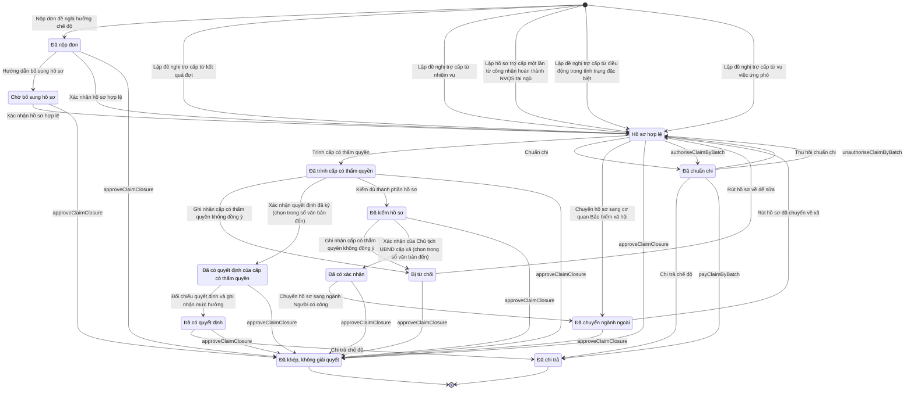

# qt-12b · Giải quyết chế độ theo hồ sơ từng người

<!-- máy sinh: tom-tat -->
> **Hồ sơ:** Hồ sơ chế độ chính sách (`BenefitClaim`)
>
> **Trong sổ phạm vi:** 12b · Giải quyết chế độ theo hồ sơ từng người (tầng 2)
>
> 31 bước · 13 chặng · 5 vai · 1 bảng quyết định · 4 hạn · 19 khớp nối.
>
> **Nguồn:** sổ nghiệp vụ `qt-12b` · khai báo của app: `dqtv-app/core/processes/benefit/workflow/benefit.yaml`. Các bảng do máy sinh từ nguồn này.
<!-- hết: tom-tat -->

<!-- viết tay: dien-giai -->
## Diễn giải

*Phần này viết tay, diễn giải lại điều các bảng bên dưới ghi.*

### Quy trình này để làm gì

Quy trình giải quyết **hồ sơ chế độ chính sách của từng người**: mỗi hồ sơ là một khoản chế độ của một chiến sĩ. Hồ sơ thuộc một trong hai nhánh, ghi ở ô "nhánh": Đ.34 · làm nhiệm vụ (`D34`) và Đ.35 · ốm đau, tai nạn, hy sinh (`D35`). Hồ sơ đi một trong ba đường: chuẩn chi rồi chi trả; trình cấp có thẩm quyền, chờ quyết định ký ngoài hệ rồi chi trả; hoặc chuyển sang ngành ngoài (Bảo hiểm xã hội, Người có công). Đường chuẩn chi dành cho nhánh `D34`, hai đường còn lại dành cho nhánh `D35`.

Hồ sơ đi qua 11 chặng. Đường dài nhất: *Đã nộp đơn* → *Chờ bổ sung hồ sơ* → *Hồ sơ hợp lệ* → *Chờ ký tờ trình* → *Tờ trình đã ký, chờ vào sổ* → *Đã trình cấp có thẩm quyền* → *Đã có quyết định* → *Đã chi trả*. Ngoài ra có *Đã chuẩn chi*, *Đã chuyển ngành ngoài* và *Đã khép, không giải quyết*.

### Khi nào bắt đầu

Có năm cửa vào, đều do Trợ lý Quân lực bấm.

- **Nộp đơn đề nghị hưởng chế độ**. Bắt buộc nhập `memberId` và loại chế độ; thông tin người đứng đơn, tài khoản, nơi điều trị, tai nạn… và ảnh chụp đơn đã ký là ô nhập nếu có. Hồ sơ vào *Đã nộp đơn*.
- Bốn bước lập từ hồ sơ nguồn, hồ sơ vào thẳng *Hồ sơ hợp lệ*: **Lập đề nghị trợ cấp từ kết quả đợt** (từ đợt huấn luyện, quy trình 14), **Lập đề nghị trợ cấp từ nhiệm vụ** (từ lệnh điều động, 13a), **Lập đề nghị trợ cấp từ vụ việc ứng phó** (20) — ba bước này bắt nhập số ngày công; và **Lập hồ sơ trợ cấp một lần từ công nhận hoàn thành NVQS tại ngũ** (D4) — bắt nhập `sourceRecognitionId` và số tháng phục vụ thường trực. Cả bốn bước đều bắt nhập `memberId`.

Với hồ sơ ngày công, loại chế độ, nhánh và cấp bảo đảm kinh phí do máy tự suy; cấp bảo đảm kinh phí là cấp đã quyết định đợt hay vụ việc ấy.

### Diễn ra thế nào

**Chặng "Đã nộp đơn" và "Chờ bổ sung hồ sơ".** Trợ lý Quân lực bấm **Hướng dẫn bổ sung hồ sơ** (ghi nội dung cần bổ sung; lặp được) nếu hồ sơ thiếu, hoặc **Xác nhận hồ sơ hợp lệ** — bước này đòi đã có ảnh chụp đơn đã ký. Hồ sơ sang *Hồ sơ hợp lệ*.

**Chặng "Hồ sơ hợp lệ"** — ba đường đi tiếp:

1. *Chuẩn chi.* Chỉ huy trưởng Ban CHQS xã bấm **Chuẩn chi** → *Đã chuẩn chi*; bấm **Thu hồi chuẩn chi** thì hồ sơ về *Hồ sơ hợp lệ*. Đây là đường ngắn của nhánh Đ.34; hai bước này chỉ làm được khi nhánh là `D34`.
2. *Trình cấp có thẩm quyền.* Trợ lý Quân lực bấm **Trình ký tờ trình chế độ** (kèm tờ trình PDF) → *Chờ ký tờ trình*. Chỉ huy trưởng bấm **Ký tờ trình** → *Tờ trình đã ký, chờ vào sổ*, hoặc **Trả lại tờ trình** (ở cả hai chặng này, phải ghi cần sửa gì) để về *Hồ sơ hợp lệ*. Nhân viên văn thư bấm **Trình cấp có thẩm quyền**, ghi trình cấp nào và bản chụp tờ trình đã ký → *Đã trình cấp có thẩm quyền*. Nơi nhận tờ trình là `commune_chairman` hoặc `province_chairman`.
3. *Chuyển Bảo hiểm xã hội.* Trợ lý Quân lực bấm **Chuyển hồ sơ sang cơ quan Bảo hiểm xã hội** → *Đã chuyển ngành ngoài*.

**Chặng "Đã trình cấp có thẩm quyền"** — chờ quyết định ký ngoài hệ. Trợ lý Quân lực làm các việc ghi nhận:

- **Xác nhận quyết định đã ký, đính kèm ảnh** — bắt buộc nhập `decisionNumber`, `subject`, `signedBy`, `signedDate`, `legalBasis`, `scanPath`; người ký ngoài hệ là `commune_chairman` hoặc `province_chairman`. Chỉ huy trưởng bấm **Đối chiếu quyết định và ghi nhận mức hưởng** → *Đã có quyết định*; bước này đòi đã có quyết định ký ngoài hệ ấy và phải có người thứ hai kiểm.
- **Ghi nhận cấp có thẩm quyền không đồng ý** (ghi lý do; lặp được), rồi **Rút hồ sơ về để sửa** → về *Hồ sơ hợp lệ*. Phải ghi nhận không đồng ý trước mới rút được.
- Đường sang ngành Người có công: **Kiểm đủ thành phần hồ sơ** → **Xác nhận của Chủ tịch UBND cấp xã, đính kèm ảnh** (phải kiểm xong) → Chỉ huy trưởng bấm **Chuyển hồ sơ sang ngành Người có công** (phải có xác nhận ấy) → *Đã chuyển ngành ngoài*.

**Chặng "Đã chuẩn chi" và "Đã có quyết định".** Nhân viên tài chính kiêm hậu cần bấm **Chi trả chế độ**, chọn hình thức chi trả → *Đã chi trả*.

**Chặng "Đã chuyển ngành ngoài".** Trợ lý Quân lực bấm **Ghi nhận kết quả ngành ngoài trả về** (lặp được) hoặc **Ghi nhận kết quả trả về từ Người có công** (kết quả, số và ngày quyết định công nhận). Hồ sơ vẫn đứng ở chặng này. Bước **Rút hồ sơ đã chuyển về xã** đưa hồ sơ về *Hồ sơ hợp lệ*; phải ghi lý do rút về và kèm văn bản trả lời của cơ quan đã nhận.

**Khép hồ sơ không giải quyết** — làm được ở năm chặng: *Đã nộp đơn*, *Chờ bổ sung hồ sơ*, *Hồ sơ hợp lệ*, *Đã trình cấp có thẩm quyền*, *Đã chuyển ngành ngoài*. Trợ lý Quân lực bấm **Đề nghị khép hồ sơ** (lý do khép và văn bản trả lời làm căn cứ); Chỉ huy trưởng bấm **Duyệt khép hồ sơ** → *Đã khép, không giải quyết*, hoặc **Không đồng ý khép hồ sơ** (hồ sơ đứng yên, phải ghi vì sao chưa khép). Đang có một đề nghị chờ thì không đề nghị thêm được; phải có đề nghị đang chờ thì mới duyệt hay từ chối được.

### Kết thúc và để lại gì

Hồ sơ kết thúc ở *Đã chi trả* hoặc *Đã khép, không giải quyết*. Bước trình ký gắn hồ sơ với một **Văn bản đi** (quy trình 1.outgoing-document) — tờ trình đi kèm mỗi lượt trình. Dọc đường hồ sơ còn sinh các hồ sơ con: lần hướng dẫn bổ sung, lần trình cấp có thẩm quyền, lần đề nghị khép, lần ngành ngoài trả lời. Mỗi hồ sơ chế độ là một dòng của Bảng thanh toán trợ cấp (12a).

### Điều kiện chặn

- **Bảng `benefit-decision-authority`** (xét ở bước ghi quyết định đã ký, theo loại chế độ và cấp bảo đảm kinh phí): tai nạn, từ trần, mai táng phí → `province_chairman`, kể cả khi cấp bảo đảm kinh phí còn trống; ốm đau, khám chữa bệnh, bị thương → theo cấp bảo đảm kinh phí: Ngân sách cấp xã thì `commune_chairman`, Ngân sách cấp tỉnh thì `province_chairman`, Bộ Quốc phòng thì `not_applicable`, còn trống thì `unit_unknown`; loại chế độ còn trống thì `unit_unknown`.
- **Theo nhánh:** chuẩn chi và thu hồi chuẩn chi chỉ làm được khi nhánh là `D34`; trình ký, ký, trả lại tờ trình, trình cấp có thẩm quyền, ghi nhận không đồng ý, ghi quyết định đã ký, đối chiếu quyết định, kiểm đủ thành phần hồ sơ, ghi văn bản của Chủ tịch UBND cấp xã, chuyển Người có công, chuyển Bảo hiểm xã hội chỉ làm được khi nhánh là `D35`.
- **Hạn** (tính theo ngày làm việc; quá hạn thì chặn): 3 ngày từ lúc hồ sơ vào *Đã nộp đơn* để kiểm tra hợp lệ; 5 ngày từ lúc vào *Hồ sơ hợp lệ* để lập hồ sơ, trình cấp có thẩm quyền; 3 ngày ở bước trình cấp có thẩm quyền để ra quyết định; 5 ngày ở bước đối chiếu quyết định để chi trả. Ba bước lập từ đợt, nhiệm vụ, vụ việc mang hạn 5 ngày; hướng dẫn bổ sung 3 ngày kể từ khi nhận đủ; rút hồ sơ về để sửa 5 ngày để sửa và trình lại.
- **Chuẩn chi:** người làm phải thuộc đơn vị ghi ở ô `fundingUnit` của hồ sơ, và hồ sơ không có mối nối tới vụ việc ứng phó, đợt huấn luyện hay lệnh điều động (`claimOutsidePaymentBatch`). Thu hồi chuẩn chi cũng đòi điều kiện thứ hai.
- **Người làm thuộc đơn vị chủ hồ sơ:** đòi ở 20 bước — mọi bước trừ năm bước mở hồ sơ, bước trình cấp có thẩm quyền, bước chuyển Bảo hiểm xã hội và bước chuẩn chi.
- **Thứ tự bước:** phải có ảnh chụp đơn đã ký mới ghi được hồ sơ hợp lệ; rút hồ sơ về để sửa đòi đã ghi nhận không đồng ý; ghi văn bản của Chủ tịch UBND cấp xã đòi đã kiểm đủ thành phần hồ sơ (kiểm rồi thì không kiểm lại được); chuyển Người có công đòi đã có văn bản ấy; ghi nhận kết quả ngành ngoài trả về và rút hồ sơ đã chuyển về xã đòi hồ sơ đã chuyển.
- **Việc ngoài hệ:** bốn ranh giới của ba chủ thể `benefitDecidingAuthority` (nhận trình và ký quyết định), `socialInsurance`, `veteranAffairs`. Cả bốn: không được thì chặn, hồ sơ giữ nguyên.
<!-- hết viết tay -->

## 1. Đường đi ngắn nhất qua các chặng

<!-- máy sinh: luong-chinh -->
Đường ít bước nhất từ lúc mở hồ sơ tới chặng kết thúc xa nhất. Máy chọn theo số chặng, không theo ý nghĩa nghiệp vụ — trình tự công việc thật xem phần Diễn giải và bảng "Việc làm ở từng chặng" ở mục 6.

| # | Ai làm | Làm gì | Hồ sơ sang chặng |
|---|---|---|---|
| 1 | Trợ lý Quân lực | Lập đề nghị trợ cấp từ kết quả đợt | Hồ sơ hợp lệ |
| 2 | Chỉ huy trưởng Ban CHQS xã | Chuẩn chi | Đã chuẩn chi |
| 3 | Nhân viên tài chính kiêm hậu cần | Chi trả chế độ | Đã chi trả |

<!-- hết: luong-chinh -->

## 2. Hồ sơ và việc nó để lại

<!-- máy sinh: muc-tieu -->
**App gọi quy trình này là:** Chặng 4 — Chế độ chính sách.

**Khi mở, hồ sơ này ghi mối nối tới:**
- Chiến sĩ dân quân tự vệ (16.enlistment) — bước `raiseAllowanceFromServiceRecognition`, khớp nối `claimFor`
- Chiến sĩ dân quân tự vệ (16.enlistment) — bước `submitClaim`, khớp nối `claimFor`
- Lệnh điều động (13a) — bước `raiseAllowanceFromMission`, khớp nối `arisesFrom`
- Nhiệm vụ trên giao (1) — bước `raiseAllowanceFromCase`, khớp nối `benefitClaimServesTasking`
- Nhiệm vụ trên giao (1) — bước `raiseAllowanceFromEvent`, khớp nối `benefitClaimServesTasking`
- Nhiệm vụ trên giao (1) — bước `raiseAllowanceFromMission`, khớp nối `benefitClaimServesTasking`
- Nhiệm vụ trên giao (1) — bước `raiseAllowanceFromSpecialDeployment`, khớp nối `benefitClaimServesTasking`
- Nhiệm vụ trên giao (1) — bước `submitClaim`, khớp nối `benefitClaimServesTasking`
- Sự kiện — huấn luyện, hội thi, diễn tập, hội nghị (14) — bước `raiseAllowanceFromEvent`, khớp nối `arisesFromEvent`
- Vụ việc ứng phó (20) — bước `raiseAllowanceFromCase`, khớp nối `claimArisesFromCase`
- Vụ việc ứng phó (20) — bước `submitClaim`, khớp nối `claimArisesFromCase`
- Điều động trong tình trạng đặc biệt (13b) — bước `raiseAllowanceFromSpecialDeployment`, khớp nối `claimArisesFromSpecialDeployment`
- Đề nghị công nhận hoàn thành nghĩa vụ quân sự tại ngũ (D4) — bước `raiseAllowanceFromServiceRecognition`, khớp nối `allowanceFromServiceRecognition`

**Hồ sơ này để lại cho quy trình khác** (bước tạo hồ sơ của quy trình kia ghi mối nối về đây):
- Bảng thanh toán trợ cấp (12a) — bước `openBenefitPaymentBatch`, khớp nối `batchLine`
- Phiếu chi (12a.payment-voucher) — bước `recordCommunePaymentVoucher`, khớp nối `voucherForClaim`
- Phiếu chi (12a.payment-voucher) — bước `recordProvincePaymentVoucher`, khớp nối `voucherForClaim`
- Đề nghị cấp kinh phí (4.funding-request) — bước `estimateCommuneFundingRequest`, khớp nối `fundingRequestFromBenefit`
- Đề nghị cấp kinh phí (4.funding-request) — bước `estimateProvinceFundingRequest`, khớp nối `fundingRequestFromBenefit`
<!-- hết: muc-tieu -->

## 3. Khởi phát và kết thúc

<!-- máy sinh: khoi-phat -->
**6 cửa vào** — bước mở hồ sơ:

| Bước mở | Ai mở | Hồ sơ vào chặng | App bắt buộc nhập |
|---|---|---|---|
| Nộp đơn đề nghị hưởng chế độ | Trợ lý Quân lực | Đã nộp đơn | `memberId`, loại chế độ |
| Lập đề nghị trợ cấp từ kết quả đợt | Trợ lý Quân lực | Hồ sơ hợp lệ | đợt huấn luyện, `memberId`, số ngày công |
| Lập đề nghị trợ cấp từ nhiệm vụ | Trợ lý Quân lực | Hồ sơ hợp lệ | lệnh điều động, `memberId`, số ngày công |
| Lập hồ sơ trợ cấp một lần từ công nhận hoàn thành NVQS tại ngũ | Trợ lý Quân lực | Hồ sơ hợp lệ | `sourceRecognitionId`, `memberId`, số tháng phục vụ thường trực |
| Lập đề nghị trợ cấp từ điều động trong tình trạng đặc biệt | Trợ lý Quân lực | Hồ sơ hợp lệ | `sourceSpecialDeploymentId`, `memberId`, số ngày công |
| Lập đề nghị trợ cấp từ vụ việc ứng phó | Trợ lý Quân lực | Hồ sơ hợp lệ | vụ việc ứng phó, `memberId`, số ngày công |

**Kết thúc:** *Đã chi trả* (`PAID`), *Đã khép, không giải quyết* (`CLOSED`)
<!-- hết: khoi-phat -->

## 4. Vai trò

<!-- máy sinh: vai-tro -->
| Vai trong sổ | Tên trong app | Điều kiện | Làm những bước |
|---|---|---|---|
| `operator` | Trợ lý Quân lực |  | Nộp đơn đề nghị hưởng chế độ · Lập đề nghị trợ cấp từ kết quả đợt · Lập đề nghị trợ cấp từ nhiệm vụ · Lập hồ sơ trợ cấp một lần từ công nhận hoàn thành NVQS tại ngũ · Lập đề nghị trợ cấp từ điều động trong tình trạng đặc biệt · Lập đề nghị trợ cấp từ vụ việc ứng phó · Hướng dẫn bổ sung hồ sơ · Xác nhận hồ sơ hợp lệ · Trình ký tờ trình chế độ · Ghi nhận cấp có thẩm quyền không đồng ý · Rút hồ sơ về để sửa · Xác nhận quyết định đã ký (chọn trong sổ văn bản đến) · Kiểm đủ thành phần hồ sơ · Xác nhận của Chủ tịch UBND cấp xã (chọn trong sổ văn bản đến) · Trình ký văn bản chuyển hồ sơ sang ngành Người có công · Ghi nhận kết quả ngành ngoài trả về · Ghi nhận kết quả trả về từ Người có công · Trình ký văn bản chuyển hồ sơ sang cơ quan Bảo hiểm xã hội · Rút hồ sơ đã chuyển về xã |
| `clerk` | Nhân viên văn thư |  | Trình cấp có thẩm quyền |
| `verifier` | Chỉ huy trưởng Ban CHQS xã |  | Đối chiếu quyết định và ghi nhận mức hưởng · Chuẩn chi · Thu hồi chuẩn chi |
| `finance` | Nhân viên tài chính kiêm hậu cần |  | Chi trả chế độ |
| `system` | Hệ thống tự làm |  | Chuyển hồ sơ sang ngành Người có công · Chuyển hồ sơ sang cơ quan Bảo hiểm xã hội · Đánh dấu hồ sơ chế độ quá hạn · `approveClaimClosure` · `authoriseClaimByBatch` · `payClaimByBatch` · `unauthoriseClaimByBatch` |

*"Tên trong app" là tên app đặt cho mã chủ thể của vai. Hồ sơ thuộc đơn vị cấp khác thì người làm là người giữ vai ấy ở đơn vị nêu trong cột "Điều kiện" (nếu sổ có ghi) và ở cột "Người làm phải thuộc" của bảng "Theo khai báo của app" (mục 7).*

**Ngoài hệ** (hệ chỉ ghi kết quả, xem mục 8): `benefitDecidingAuthority`, `socialInsurance`, `veteranAffairs`.
<!-- hết: vai-tro -->

## 5. Nhánh phụ

<!-- máy sinh: nhanh-phu -->
**Bước khác đưa hồ sơ sang chặng mới** — đường song song, rẽ nhánh hoặc kết thúc sớm:

| Bước | Ai làm | Từ chặng | Sang chặng |
|---|---|---|---|
| Hướng dẫn bổ sung hồ sơ | Trợ lý Quân lực | Đã nộp đơn, Chờ bổ sung hồ sơ | Chờ bổ sung hồ sơ |
| Xác nhận hồ sơ hợp lệ | Trợ lý Quân lực | Đã nộp đơn, Chờ bổ sung hồ sơ | Hồ sơ hợp lệ |
| Trình cấp có thẩm quyền | Nhân viên văn thư | Hồ sơ hợp lệ | Đã trình cấp có thẩm quyền |
| Ghi nhận cấp có thẩm quyền không đồng ý | Trợ lý Quân lực | Đã trình cấp có thẩm quyền, Đã kiểm hồ sơ | Bị từ chối |
| Xác nhận quyết định đã ký (chọn trong sổ văn bản đến) | Trợ lý Quân lực | Đã trình cấp có thẩm quyền | Đã có quyết định của cấp có thẩm quyền |
| Đối chiếu quyết định và ghi nhận mức hưởng | Chỉ huy trưởng Ban CHQS xã | Đã có quyết định của cấp có thẩm quyền | Đã có quyết định |
| Kiểm đủ thành phần hồ sơ | Trợ lý Quân lực | Đã trình cấp có thẩm quyền | Đã kiểm hồ sơ |
| Xác nhận của Chủ tịch UBND cấp xã (chọn trong sổ văn bản đến) | Trợ lý Quân lực | Đã kiểm hồ sơ | Đã có xác nhận |
| Chuyển hồ sơ sang ngành Người có công | Hệ thống tự làm | Đã có xác nhận | Đã chuyển ngành ngoài |
| Chuyển hồ sơ sang cơ quan Bảo hiểm xã hội | Hệ thống tự làm | Hồ sơ hợp lệ | Đã chuyển ngành ngoài |
| `approveClaimClosure` | Hệ thống tự làm | Đã nộp đơn, Chờ bổ sung hồ sơ, Hồ sơ hợp lệ, Đã trình cấp có thẩm quyền, Đã chuyển ngành ngoài, Đã có quyết định, Đã kiểm hồ sơ, Đã có xác nhận, Đã có quyết định của cấp có thẩm quyền, Bị từ chối | Đã khép, không giải quyết |
| `authoriseClaimByBatch` | Hệ thống tự làm | Hồ sơ hợp lệ | Đã chuẩn chi |
| `payClaimByBatch` | Hệ thống tự làm | Đã chuẩn chi | Đã chi trả |

**Quay lại một chặng hồ sơ đã đi qua** (tính theo đường ngắn nhất từ lúc mở):

| Bước | Ai làm | Từ chặng | Về chặng |
|---|---|---|---|
| Rút hồ sơ về để sửa | Trợ lý Quân lực | Bị từ chối | Hồ sơ hợp lệ |
| Thu hồi chuẩn chi | Chỉ huy trưởng Ban CHQS xã | Đã chuẩn chi | Hồ sơ hợp lệ |
| Rút hồ sơ đã chuyển về xã | Trợ lý Quân lực | Đã chuyển ngành ngoài | Hồ sơ hợp lệ |
| `unauthoriseClaimByBatch` | Hệ thống tự làm | Đã chuẩn chi | Hồ sơ hợp lệ |

**Làm trong lúc hồ sơ đứng yên ở một chặng** — ghi nhận, bổ sung:

| Bước | Ai làm | Ở chặng |
|---|---|---|
| Trình ký tờ trình chế độ | Trợ lý Quân lực | Hồ sơ hợp lệ |
| Trình ký văn bản chuyển hồ sơ sang ngành Người có công | Trợ lý Quân lực | Đã có xác nhận |
| Ghi nhận kết quả ngành ngoài trả về *(lặp được)* | Trợ lý Quân lực | Đã chuyển ngành ngoài |
| Ghi nhận kết quả trả về từ Người có công | Trợ lý Quân lực | Đã chuyển ngành ngoài |
| Trình ký văn bản chuyển hồ sơ sang cơ quan Bảo hiểm xã hội | Trợ lý Quân lực | Hồ sơ hợp lệ |
| Đánh dấu hồ sơ chế độ quá hạn | Hệ thống tự làm | Đã nộp đơn, Chờ bổ sung hồ sơ, Hồ sơ hợp lệ, Đã trình cấp có thẩm quyền, Đã kiểm hồ sơ, Đã có xác nhận, Đã có quyết định của cấp có thẩm quyền, Đã có quyết định, Đã chuẩn chi |

**Cửa vào khác:** 6 bước cùng mở hồ sơ — xem mục 3.

<!-- hết: nhanh-phu -->

## 6. Các chặng và việc làm ở từng chặng

<!-- máy sinh: chang -->
| Chặng | Tên hiển thị | Vào bằng bước | Kết thúc? |
|---|---|---|---|
| `SUBMITTED` | Đã nộp đơn | Nộp đơn đề nghị hưởng chế độ |  |
| `PENDING_SUPPLEMENT` | Chờ bổ sung hồ sơ | Hướng dẫn bổ sung hồ sơ |  |
| `VALID` | Hồ sơ hợp lệ | Lập đề nghị trợ cấp từ kết quả đợt · Lập đề nghị trợ cấp từ nhiệm vụ · Lập hồ sơ trợ cấp một lần từ công nhận hoàn thành NVQS tại ngũ · Lập đề nghị trợ cấp từ điều động trong tình trạng đặc biệt · Lập đề nghị trợ cấp từ vụ việc ứng phó · Xác nhận hồ sơ hợp lệ · Rút hồ sơ về để sửa · Thu hồi chuẩn chi · Rút hồ sơ đã chuyển về xã · `unauthoriseClaimByBatch` |  |
| `AUTHORISED` | Đã chuẩn chi | Chuẩn chi · `authoriseClaimByBatch` |  |
| `FORWARDED` | Đã trình cấp có thẩm quyền | Trình cấp có thẩm quyền |  |
| `DOSSIER_CHECKED` | Đã kiểm hồ sơ | Kiểm đủ thành phần hồ sơ |  |
| `VETERAN_CONFIRMED` | Đã có xác nhận | Xác nhận của Chủ tịch UBND cấp xã (chọn trong sổ văn bản đến) |  |
| `AUTHORITY_DECIDED` | Đã có quyết định của cấp có thẩm quyền | Xác nhận quyết định đã ký (chọn trong sổ văn bản đến) |  |
| `REFUSED` | Bị từ chối | Ghi nhận cấp có thẩm quyền không đồng ý |  |
| `DECIDED` | Đã có quyết định | Đối chiếu quyết định và ghi nhận mức hưởng |  |
| `PAID` | Đã chi trả | Chi trả chế độ · `payClaimByBatch` | **kết thúc** |
| `TRANSFERRED` | Đã chuyển ngành ngoài | Chuyển hồ sơ sang ngành Người có công · Chuyển hồ sơ sang cơ quan Bảo hiểm xã hội |  |
| `CLOSED` | Đã khép, không giải quyết | `approveClaimClosure` | **kết thúc** |

### Việc làm ở từng chặng

Hồ sơ đang ở chặng nào thì làm được những bước nào.

| Hồ sơ đang ở chặng | Bước làm tại chặng (hồ sơ đứng yên) | Bước đưa hồ sơ sang chặng khác |
|---|---|---|
| **Đã nộp đơn** | Đánh dấu hồ sơ chế độ quá hạn — Hệ thống tự làm | Hướng dẫn bổ sung hồ sơ — Trợ lý Quân lực → *Chờ bổ sung hồ sơ* Xác nhận hồ sơ hợp lệ — Trợ lý Quân lực → *Hồ sơ hợp lệ* `approveClaimClosure` — Hệ thống tự làm → *Đã khép, không giải quyết* |
| **Chờ bổ sung hồ sơ** | Hướng dẫn bổ sung hồ sơ (lặp được) — Trợ lý Quân lực Đánh dấu hồ sơ chế độ quá hạn — Hệ thống tự làm | Xác nhận hồ sơ hợp lệ — Trợ lý Quân lực → *Hồ sơ hợp lệ* `approveClaimClosure` — Hệ thống tự làm → *Đã khép, không giải quyết* |
| **Hồ sơ hợp lệ** | Trình ký tờ trình chế độ — Trợ lý Quân lực Trình ký văn bản chuyển hồ sơ sang cơ quan Bảo hiểm xã hội — Trợ lý Quân lực Đánh dấu hồ sơ chế độ quá hạn — Hệ thống tự làm | Trình cấp có thẩm quyền — Nhân viên văn thư → *Đã trình cấp có thẩm quyền* Chuẩn chi — Chỉ huy trưởng Ban CHQS xã → *Đã chuẩn chi* Chuyển hồ sơ sang cơ quan Bảo hiểm xã hội — Hệ thống tự làm → *Đã chuyển ngành ngoài* `approveClaimClosure` — Hệ thống tự làm → *Đã khép, không giải quyết* `authoriseClaimByBatch` — Hệ thống tự làm → *Đã chuẩn chi* |
| **Đã chuẩn chi** | Đánh dấu hồ sơ chế độ quá hạn — Hệ thống tự làm | Thu hồi chuẩn chi — Chỉ huy trưởng Ban CHQS xã → *Hồ sơ hợp lệ* Chi trả chế độ — Nhân viên tài chính kiêm hậu cần → *Đã chi trả* `payClaimByBatch` — Hệ thống tự làm → *Đã chi trả* `unauthoriseClaimByBatch` — Hệ thống tự làm → *Hồ sơ hợp lệ* |
| **Đã trình cấp có thẩm quyền** | Đánh dấu hồ sơ chế độ quá hạn — Hệ thống tự làm | Ghi nhận cấp có thẩm quyền không đồng ý — Trợ lý Quân lực → *Bị từ chối* Xác nhận quyết định đã ký (chọn trong sổ văn bản đến) — Trợ lý Quân lực → *Đã có quyết định của cấp có thẩm quyền* Kiểm đủ thành phần hồ sơ — Trợ lý Quân lực → *Đã kiểm hồ sơ* `approveClaimClosure` — Hệ thống tự làm → *Đã khép, không giải quyết* |
| **Đã kiểm hồ sơ** | Đánh dấu hồ sơ chế độ quá hạn — Hệ thống tự làm | Ghi nhận cấp có thẩm quyền không đồng ý — Trợ lý Quân lực → *Bị từ chối* Xác nhận của Chủ tịch UBND cấp xã (chọn trong sổ văn bản đến) — Trợ lý Quân lực → *Đã có xác nhận* `approveClaimClosure` — Hệ thống tự làm → *Đã khép, không giải quyết* |
| **Đã có xác nhận** | Trình ký văn bản chuyển hồ sơ sang ngành Người có công — Trợ lý Quân lực Đánh dấu hồ sơ chế độ quá hạn — Hệ thống tự làm | Chuyển hồ sơ sang ngành Người có công — Hệ thống tự làm → *Đã chuyển ngành ngoài* `approveClaimClosure` — Hệ thống tự làm → *Đã khép, không giải quyết* |
| **Đã có quyết định của cấp có thẩm quyền** | Đánh dấu hồ sơ chế độ quá hạn — Hệ thống tự làm | Đối chiếu quyết định và ghi nhận mức hưởng — Chỉ huy trưởng Ban CHQS xã → *Đã có quyết định* `approveClaimClosure` — Hệ thống tự làm → *Đã khép, không giải quyết* |
| **Bị từ chối** | — | Rút hồ sơ về để sửa — Trợ lý Quân lực → *Hồ sơ hợp lệ* `approveClaimClosure` — Hệ thống tự làm → *Đã khép, không giải quyết* |
| **Đã có quyết định** | Đánh dấu hồ sơ chế độ quá hạn — Hệ thống tự làm | Chi trả chế độ — Nhân viên tài chính kiêm hậu cần → *Đã chi trả* `approveClaimClosure` — Hệ thống tự làm → *Đã khép, không giải quyết* |
| **Đã chi trả** | — | — (kết thúc) |
| **Đã chuyển ngành ngoài** | Ghi nhận kết quả ngành ngoài trả về (lặp được) — Trợ lý Quân lực Ghi nhận kết quả trả về từ Người có công — Trợ lý Quân lực | Rút hồ sơ đã chuyển về xã — Trợ lý Quân lực → *Hồ sơ hợp lệ* `approveClaimClosure` — Hệ thống tự làm → *Đã khép, không giải quyết* |
| **Đã khép, không giải quyết** | — | — (kết thúc) |
<!-- hết: chang -->

## 7. Bảng bước

<!-- máy sinh: buoc -->
| # | Bước | Mã bước | Ai thực hiện | Từ chặng | Sang chặng | Phải có trước | Ghi lại |
|---|---|---|---|---|---|---|---|
| 1 | Nộp đơn đề nghị hưởng chế độ | `submitClaim` | Trợ lý Quân lực | — (mở hồ sơ) | `SUBMITTED` | loại chế độ, `deploymentOrderAnchored` | nối tới Chiến sĩ dân quân tự vệ, nối tới Vụ việc ứng phó, nối tới Nhiệm vụ trên giao, nối `claimDeploymentOrder`, mã tỉnh, mã xã, loại chế độ, nhánh, nguồn phát sinh (ô đã nghỉ), nộp lúc, hạn luật định, ghi chú, suy giảm khả năng lao động, nguyên nhân chết, cấp bảo đảm kinh phí, người đứng đơn, quan hệ với dân quân, số tài khoản nhận tiền, ngân hàng, chi nhánh, thân nhân hưởng tuất, đã tham gia bảo hiểm y tế, đã tham gia bảo hiểm xã hội, hình thức chi trả, địa chỉ thường trú của người đề nghị, số điện thoại, hộp thư điện tử, căn cước của người đề nghị, tóm tắt lý do, nơi khám bệnh, chữa bệnh, điều trị từ ngày, điều trị đến ngày, ngày bị tai nạn hoặc chết, nơi bị tai nạn hoặc chết, `accidentDetail`, tai nạn giao thông, số tiền đề nghị, ảnh chụp đơn đã ký, đơn vị chủ hồ sơ, cấp trên của chủ hồ sơ, `unitOrganizingLevel`, `id`, `fundingUnit` |
| 2 | Lập đề nghị trợ cấp từ kết quả đợt | `raiseAllowanceFromEvent` | Trợ lý Quân lực | — (mở hồ sơ) | `VALID` | `trainingDaysLocked` | nối tới Sự kiện — huấn luyện, hội thi, diễn tập, hội nghị, nối tới Nhiệm vụ trên giao, đơn vị chủ hồ sơ, cấp trên của chủ hồ sơ, loại chế độ, cấp bảo đảm kinh phí, nhánh, `fundingUnit`, `id` |
| 3 | Lập đề nghị trợ cấp từ nhiệm vụ | `raiseAllowanceFromMission` | Trợ lý Quân lực | — (mở hồ sơ) | `VALID` | `missionDaysLocked` | nối tới Lệnh điều động, nối tới Nhiệm vụ trên giao, đơn vị chủ hồ sơ, cấp trên của chủ hồ sơ, loại chế độ, cấp bảo đảm kinh phí, nhánh, `fundingUnit`, `id` |
| 4 | Lập hồ sơ trợ cấp một lần từ công nhận hoàn thành NVQS tại ngũ | `raiseAllowanceFromServiceRecognition` | Trợ lý Quân lực | — (mở hồ sơ) | `VALID` | `actorInSourceRecognitionUnit`, `serviceRecognitionApproved` | nối tới Đề nghị công nhận hoàn thành nghĩa vụ quân sự tại ngũ, loại chế độ, nhánh, cấp bảo đảm kinh phí, số tháng phục vụ thường trực, đơn vị chủ hồ sơ, cấp trên của chủ hồ sơ, nối tới Chiến sĩ dân quân tự vệ, `id` |
| 5 | Lập đề nghị trợ cấp từ điều động trong tình trạng đặc biệt | `raiseAllowanceFromSpecialDeployment` | Trợ lý Quân lực | — (mở hồ sơ) | `VALID` | `specialDeploymentDaysLocked` | nối tới Điều động trong tình trạng đặc biệt, nối tới Nhiệm vụ trên giao, đơn vị chủ hồ sơ, cấp trên của chủ hồ sơ, loại chế độ, cấp bảo đảm kinh phí, nhánh, `fundingUnit`, `id` |
| 6 | Lập đề nghị trợ cấp từ vụ việc ứng phó | `raiseAllowanceFromCase` | Trợ lý Quân lực | — (mở hồ sơ) | `VALID` | `caseDaysApproved` | nối tới Vụ việc ứng phó, nối tới Nhiệm vụ trên giao, đơn vị chủ hồ sơ, cấp trên của chủ hồ sơ, loại chế độ, cấp bảo đảm kinh phí, nhánh, `fundingUnit`, `id` |
| 7 | Hướng dẫn bổ sung hồ sơ | `requestSupplement` | Trợ lý Quân lực | `SUBMITTED`, `PENDING_SUPPLEMENT` | `PENDING_SUPPLEMENT` | người làm thuộc đơn vị chủ hồ sơ, `closureNotPending`, giấy tờ còn thiếu, báo người nộp qua, `claimNeedsDecision` | nội dung cần bổ sung, nối tới Lần hướng dẫn bổ sung hồ sơ, hạn luật định, ảnh chụp đơn đã ký, giấy tờ còn thiếu, báo người nộp qua, gửi phiếu yêu cầu bổ sung lúc |
| 8 | Xác nhận hồ sơ hợp lệ | `acceptClaim` | Trợ lý Quân lực | `SUBMITTED`, `PENDING_SUPPLEMENT` | `VALID` | người làm thuộc đơn vị chủ hồ sơ, ảnh chụp đơn đã ký, `closureNotPending`, `accidentGroundsStated` | hạn luật định |
| 9 | Trình ký tờ trình chế độ | `requestClaimSignature` | Trợ lý Quân lực | `VALID` | giữ nguyên | người làm thuộc đơn vị chủ hồ sơ, `closureNotPending`, `claimOutsidePaymentBatch`, `claimGoesToAuthority`, `noBenefitClaimSubmittedDocumentOpen` | nối tới Văn bản đi |
| 10 | Trình cấp có thẩm quyền | `forwardClaim` | Nhân viên văn thư | `VALID` | `FORWARDED` | `benefitClaimSubmittedDocumentIssued` | trình cấp, nối tới Lần trình cấp có thẩm quyền |
| 11 | Ghi nhận cấp có thẩm quyền không đồng ý | `recordClaimRefusal` | Trợ lý Quân lực | `FORWARDED`, `DOSSIER_CHECKED` | `REFUSED` | người làm thuộc đơn vị chủ hồ sơ, `closureNotPending`, `recordClaimRefusalFromIncomingDocumentUsable` | cấp có thẩm quyền nêu lý do gì, ngày ghi nhận không đồng ý, nối tới Văn bản đến |
| 12 | Rút hồ sơ về để sửa | `reviseClaim` | Trợ lý Quân lực | `REFUSED` | `VALID` | người làm thuộc đơn vị chủ hồ sơ, `closureNotPending` | hạn luật định |
| 13 | Xác nhận quyết định đã ký (chọn trong sổ văn bản đến) | `recordBenefitDecision` | Trợ lý Quân lực | `FORWARDED` | `AUTHORITY_DECIDED` | loại chế độ, cấp bảo đảm kinh phí, người làm thuộc đơn vị chủ hồ sơ, `closureNotPending`, `claimNeedsDecision`, `recordBenefitDecisionFromIncomingDocumentUsable` | nối tới Quyết định ký ngoài hệ thống, nối tới Văn bản đến |
| 14 | Đối chiếu quyết định và ghi nhận mức hưởng | `decideClaim` | Chỉ huy trưởng Ban CHQS xã | `AUTHORITY_DECIDED` | `DECIDED` | người làm thuộc đơn vị chủ hồ sơ, `closureNotPending`, `claimNeedsDecision` | mức hưởng, `decidedAt`, hạn luật định |
| 15 | Chuẩn chi | `authorisePayment` | Chỉ huy trưởng Ban CHQS xã | `VALID` | `AUTHORISED` | `actorInFundingUnit`, `claimOutsidePaymentBatch`, `closureNotPending`, `claimOnNormRoute` | ghi chú chuẩn chi, chuẩn chi lúc |
| 16 | Thu hồi chuẩn chi | `unauthorisePayment` | Chỉ huy trưởng Ban CHQS xã | `AUTHORISED` | `VALID` | người làm thuộc đơn vị chủ hồ sơ, `claimOutsidePaymentBatch`, `claimHasNoSettledVoucher` | chuẩn chi lúc, ghi chú chuẩn chi |
| 17 | Chi trả chế độ | `payClaim` | Nhân viên tài chính kiêm hậu cần | `DECIDED`, `AUTHORISED` | `PAID` | người làm thuộc đơn vị chủ hồ sơ, `closureNotPending`, `claimOutsidePaymentBatch`, `claimVoucherSettled` | hình thức chi trả, chi trả lúc, ngày chi thực tế (trống: hôm nay) |
| 18 | Kiểm đủ thành phần hồ sơ | `checkVeteranDossier` | Trợ lý Quân lực | `FORWARDED` | `DOSSIER_CHECKED` | người làm thuộc đơn vị chủ hồ sơ, `closureNotPending`, `claimForVeteranAffairs` | — |
| 19 | Xác nhận của Chủ tịch UBND cấp xã (chọn trong sổ văn bản đến) | `recordVeteranConfirmation` | Trợ lý Quân lực | `DOSSIER_CHECKED` | `VETERAN_CONFIRMED` | người làm thuộc đơn vị chủ hồ sơ, `closureNotPending`, `claimForVeteranAffairs`, `recordVeteranConfirmationFromIncomingDocumentUsable` | nối tới Quyết định ký ngoài hệ thống, nối tới Văn bản đến |
| 20 | Trình ký văn bản chuyển hồ sơ sang ngành Người có công | `requestTransferToVeteranAffairsSignature` | Trợ lý Quân lực | `VETERAN_CONFIRMED` | giữ nguyên | `closureNotPending`, `claimForVeteranAffairs`, `noTransferToVeteranAffairsDocumentOpen`, người làm thuộc đơn vị chủ hồ sơ | chuyển cho cơ quan, thành phần hồ sơ gửi kèm, nối tới Văn bản đi |
| 21 | Chuyển hồ sơ sang ngành Người có công | `transferToVeteranAffairs` | Hệ thống tự làm | `VETERAN_CONFIRMED` | `TRANSFERRED` | `transferToVeteranAffairsDocumentIssued` | chuyển hồ sơ lúc |
| 22 | Ghi nhận kết quả ngành ngoài trả về | `recordExternalResult` | Trợ lý Quân lực | `TRANSFERRED` | giữ nguyên | chuyển hồ sơ lúc, người làm thuộc đơn vị chủ hồ sơ, `closureNotPending`, `recordExternalResultFromIncomingDocumentUsable` | kết quả cơ quan tiếp nhận trả về, nối tới Lần ngành ngoài trả lời hồ sơ, nối tới Văn bản đến |
| 23 | Ghi nhận kết quả trả về từ Người có công | `recordVeteranAffairsResult` | Trợ lý Quân lực | `TRANSFERRED` | giữ nguyên | người làm thuộc đơn vị chủ hồ sơ, `closureNotPending`, `claimForVeteranAffairs`, `recordVeteranAffairsResultFromIncomingDocumentUsable` | kết quả Người có công, ngày quyết định công nhận, liên kết khen thưởng, nối tới Văn bản đến |
| 24 | Trình ký văn bản chuyển hồ sơ sang cơ quan Bảo hiểm xã hội | `requestTransferToSocialInsuranceSignature` | Trợ lý Quân lực | `VALID` | giữ nguyên | `closureNotPending`, `claimOutsidePaymentBatch`, `claimForSocialInsurance`, `noTransferToSocialInsuranceDocumentOpen`, người làm thuộc đơn vị chủ hồ sơ | chuyển cho cơ quan, ghi chú, nối tới Văn bản đi |
| 25 | Chuyển hồ sơ sang cơ quan Bảo hiểm xã hội | `transferToSocialInsurance` | Hệ thống tự làm | `VALID` | `TRANSFERRED` | `transferToSocialInsuranceDocumentIssued` | chuyển hồ sơ lúc |
| 26 | Rút hồ sơ đã chuyển về xã | `withdrawTransferredClaim` | Trợ lý Quân lực | `TRANSFERRED` | `VALID` | lý do rút về, người làm thuộc đơn vị chủ hồ sơ, `closureNotPending` | lý do rút về, thời điểm rút về, nối tới Văn bản đến |
| 27 | Đánh dấu hồ sơ chế độ quá hạn | `flagClaimOverdue` | Hệ thống tự làm | `SUBMITTED`, `PENDING_SUPPLEMENT`, `VALID`, `FORWARDED`, `DOSSIER_CHECKED`, `VETERAN_CONFIRMED`, `AUTHORITY_DECIDED`, `DECIDED`, `AUTHORISED` | giữ nguyên | `claimDeadlineRunningAndNotFlagged` | `overdueAt` |
| 28 | `approveClaimClosure` | `approveClaimClosure` | Hệ thống tự làm | `SUBMITTED`, `PENDING_SUPPLEMENT`, `VALID`, `FORWARDED`, `TRANSFERRED`, `DECIDED`, `DOSSIER_CHECKED`, `VETERAN_CONFIRMED`, `AUTHORITY_DECIDED`, `REFUSED` | `CLOSED` | — | ngày khép |
| 29 | `authoriseClaimByBatch` | `authoriseClaimByBatch` | Hệ thống tự làm | `VALID` | `AUTHORISED` | `closureNotPending` | chuẩn chi lúc |
| 30 | `payClaimByBatch` | `payClaimByBatch` | Hệ thống tự làm | `AUTHORISED` | `PAID` | — | chi trả lúc, ngày chi thực tế (trống: hôm nay), hình thức chi trả |
| 31 | `unauthoriseClaimByBatch` | `unauthoriseClaimByBatch` | Hệ thống tự làm | `AUTHORISED` | `VALID` | — | chuẩn chi lúc |

### Khi không đạt điều kiện

Mặc định: không đúng người, hồ sơ không ở đúng chặng, hoặc thiếu thứ "phải có trước" thì bước bị chặn, hồ sơ giữ nguyên. Bảng dưới chỉ kê những bước có kết quả riêng.

| # | Bước | Kết quả riêng |
|---|---|---|
| 13 | Xác nhận quyết định đã ký (chọn trong sổ văn bản đến) | bước dừng lại, hồ sơ giữ nguyên khi kết quả xét là: `unit_unknown`, `not_applicable`, `wrong_authority` |
| 25 | Chuyển hồ sơ sang cơ quan Bảo hiểm xã hội | thiếu thứ phải có trước → hồ sơ sang *Hồ sơ hợp lệ* |
| 27 | Đánh dấu hồ sơ chế độ quá hạn | bước này không do người nào bấm |
| 28 | `approveClaimClosure` | bước này không do người nào bấm |
| 29 | `authoriseClaimByBatch` | bước này không do người nào bấm |
| 30 | `payClaimByBatch` | bước này không do người nào bấm |
| 31 | `unauthoriseClaimByBatch` | bước này không do người nào bấm |

### Điều kiện "phải có trước" bằng lời

Cột "Phải có trước" ở bảng bước có hai loại: ô dữ liệu thường (bước chỉ đòi ô ấy đã có giá trị) và điều kiện hệ tự xét. Bảng này diễn các điều kiện hệ tự xét theo đúng công thức sổ ghi; số ở cột cuối là số thứ tự bước.

| Điều kiện | Đúng khi | Bước đòi |
|---|---|---|
| `deploymentOrderAnchored` | KHÔNG (loại chế độ là Thương binh (`veteran`) hoặc Xét công nhận liệt sĩ (`martyr`)) HOẶC đã có nối `claimDeploymentOrder` | 1 |
| `trainingDaysLocked` | có hồ sơ Đợt tập trung: huấn luyện, diễn tập, tập huấn, hội thi (qt-14) (gọi là src) chính là hồ sơ ghi ở ô nối `arisesFromEvent` của hồ sơ đang làm mà hồ sơ ấy đang ở chặng `DAYS_LOCKED` VÀ người đang làm là người của đơn vị ghi ở ô đơn vị chủ hồ sơ của hồ sơ src ấy (theo danh mục người của đơn vị, `dm.unit-staff`) | 2 |
| `missionDaysLocked` | có hồ sơ Điều động lực lượng khi bình thường (qt-13a) (gọi là src) chính là hồ sơ ghi ở ô nối `arisesFrom` của hồ sơ đang làm mà hồ sơ ấy đang ở chặng `DAYS_LOCKED` VÀ đã có `decidingLevel` VÀ người đang làm là người của đơn vị ghi ở ô đơn vị chủ hồ sơ của hồ sơ src ấy (theo danh mục người của đơn vị, `dm.unit-staff`) | 3 |
| `actorInSourceRecognitionUnit` | có hồ sơ Công nhận hoàn thành NVQS tại ngũ cho DQTT (qt-D4) (gọi là src) chính là hồ sơ ghi ở ô nối `allowanceFromServiceRecognition` của hồ sơ đang làm mà người đang làm là người của đơn vị ghi ở ô đơn vị chủ hồ sơ của hồ sơ src ấy (theo danh mục người của đơn vị, `dm.unit-staff`) | 4 |
| `serviceRecognitionApproved` | có hồ sơ Công nhận hoàn thành NVQS tại ngũ cho DQTT (qt-D4) chính là hồ sơ ghi ở ô nối `allowanceFromServiceRecognition` của hồ sơ đang làm mà hồ sơ ấy đang ở chặng `APPROVED` | 4 |
| `specialDeploymentDaysLocked` | có hồ sơ Điều động trong tình trạng đặc biệt (qt-13b) (gọi là src) chính là hồ sơ ghi ở ô nối `claimArisesFromSpecialDeployment` của hồ sơ đang làm mà hồ sơ ấy đang ở chặng `DAYS_LOCKED` VÀ đã có `decidingLevel` VÀ người đang làm là người của đơn vị ghi ở ô đơn vị chủ hồ sơ của hồ sơ src ấy (theo danh mục người của đơn vị, `dm.unit-staff`) | 5 |
| `caseDaysApproved` | có hồ sơ Vụ việc ứng phó (qt-20) (gọi là src) chính là hồ sơ ghi ở ô nối `claimArisesFromCase` của hồ sơ đang làm mà đã có `daysLockedAt` VÀ (đã có nối `followOnOrder` HOẶC đã có nối `mobilizationOfCase` HOẶC đã có nối `caseAttendanceOfCase` HOẶC có hồ sơ Kế hoạch lập → thẩm định → phê chuẩn → rà soát (qt-2) chính là hồ sơ ghi ở ô nối `caseUnderPlan` của hồ sơ vừa nêu mà hồ sơ ấy đang ở chặng `APPROVED` hoặc `IN_FORCE` hoặc `UNDER_REVIEW`) VÀ người đang làm là người của đơn vị ghi ở ô đơn vị chủ hồ sơ của hồ sơ src ấy (theo danh mục người của đơn vị, `dm.unit-staff`) | 6 |
| `actorInOwnerUnit` | người đang làm là người của đơn vị ghi ở ô đơn vị chủ hồ sơ của hồ sơ này (theo danh mục người của đơn vị, `dm.unit-staff`) | 7, 8, 9, 11, 12, 13, 14, 16, 17, 18, 19, 20, 22, 23, 24, 26 |
| `closureNotPending` | không có hồ sơ Giải quyết chế độ theo hồ sơ từng người — Lần đề nghị khép hồ sơ (qt-12b.closure) có ô nối `closureOfClaim` trỏ về chính hồ sơ đang làm mà hồ sơ ấy đang ở chặng `PROPOSED` | 7, 8, 9, 11, 12, 13, 14, 15, 17, 18, 19, 20, 22, 23, 24, 26, 29 |
| `claimNeedsDecision` | loại chế độ là Ốm đau (`sickness`) hoặc Tai nạn khi làm nhiệm vụ (`accident`) hoặc Bị thương (`injury`) hoặc Từ trần (`death`) hoặc Khám chữa bệnh (`medical`) hoặc Mai táng phí (`burial`) VÀ nguồn phát sinh (ô đã nghỉ) là Có đơn (`application`) | 7, 13, 14 |
| `accidentGroundsStated` | KHÔNG (loại chế độ là Tai nạn khi làm nhiệm vụ (`accident`)) HOẶC (đã có ngày bị tai nạn hoặc chết VÀ đã có `accidentDetail`) | 8 |
| `claimOutsidePaymentBatch` | KHÔNG ((đã có nối tới Vụ việc ứng phó HOẶC đã có nối tới Sự kiện — huấn luyện, hội thi, diễn tập, hội nghị HOẶC đã có nối tới Lệnh điều động HOẶC đã có nối tới Điều động trong tình trạng đặc biệt) VÀ KHÔNG (nguồn phát sinh (ô đã nghỉ) là Có đơn (`application`))) | 9, 15, 16, 17, 24 |
| `claimGoesToAuthority` | loại chế độ là Ốm đau (`sickness`) hoặc Tai nạn khi làm nhiệm vụ (`accident`) hoặc Bị thương (`injury`) hoặc Từ trần (`death`) hoặc Khám chữa bệnh (`medical`) hoặc Mai táng phí (`burial`) hoặc Thương binh (`veteran`) hoặc Xét công nhận liệt sĩ (`martyr`) hoặc Xét hưởng chính sách như thương binh (`war_invalid`) VÀ nguồn phát sinh (ô đã nghỉ) là Có đơn (`application`) | 9 |
| `noBenefitClaimSubmittedDocumentOpen` | KHÔNG (có hồ sơ Việc luật giao kèm văn bản đến, đi — Văn bản đi (qt-1.outgoing-document) chính là hồ sơ ghi ở ô nối `benefitClaimSubmittedByDocument` của hồ sơ đang làm mà hồ sơ ấy đang ở chặng `DRAFT` hoặc `PENDING_SIGNATURE` hoặc `SIGNED`) | 9 |
| `benefitClaimSubmittedDocumentIssued` | có hồ sơ Việc luật giao kèm văn bản đến, đi — Văn bản đi (qt-1.outgoing-document) chính là hồ sơ ghi ở ô nối `benefitClaimSubmittedByDocument` của hồ sơ đang làm mà hồ sơ ấy đang ở chặng `ISSUED` | 10 |
| `recordClaimRefusalFromIncomingDocumentUsable` | có hồ sơ Việc luật giao kèm văn bản đến, đi — Văn bản đến (qt-1.incoming-document) chính là hồ sơ ghi ở ô nối `recordClaimRefusalFromIncomingDocument` của hồ sơ đang làm mà hồ sơ ấy đang ở chặng `RECEIVED` hoặc `DISTRIBUTED` | 11 |
| `recordBenefitDecisionFromIncomingDocumentUsable` | có hồ sơ Việc luật giao kèm văn bản đến, đi — Văn bản đến (qt-1.incoming-document) chính là hồ sơ ghi ở ô nối `recordBenefitDecisionFromIncomingDocument` của hồ sơ đang làm mà hồ sơ ấy đang ở chặng `RECEIVED` hoặc `DISTRIBUTED` | 13 |
| `actorInFundingUnit` | người đang làm là người của đơn vị ghi ở ô `fundingUnit` của hồ sơ này (theo danh mục người của đơn vị, `dm.unit-staff`) | 15 |
| `claimOnNormRoute` | loại chế độ là Trợ cấp ngày công, tiền ăn (`work_allowance`) hoặc Trợ cấp ngày công lao động (thôi dùng — dùng Trợ cấp ngày công, tiền ăn) (`wage_subsidy`) hoặc Dân quân thường trực (`standing_militia`) hoặc Chế độ tự vệ khi làm nhiệm vụ (`self_defense_duty`) hoặc Dân quân biển làm nhiệm vụ thường (`maritime_duty`) hoặc Ăn, nghỉ, đi lại khi làm nhiệm vụ xa nơi cư trú (`duty_travel_support`) hoặc Phụ cấp đặc thù đi biển (`maritime_allowance`) hoặc Đấu tranh bảo vệ hải đảo, vùng biển (`maritime_defense`) hoặc Trợ cấp một lần hoàn thành nghĩa vụ dân quân thường trực (`standing_completion`) hoặc Phụ cấp Phó Chỉ huy trưởng trực SSCĐ, huấn luyện (`deputy_readiness_allowance`) hoặc Phụ cấp Thôn đội trưởng (`hamlet_commander_allowance`) hoặc Phụ cấp trách nhiệm thuyền trưởng, máy trưởng, lái tàu, thợ máy (`vessel_command_allowance`) hoặc Phụ cấp đặc thù đi biển — hải đội dân quân thường trực (`standing_maritime_allowance`) hoặc Tự vệ biển đấu tranh bảo vệ hải đảo, vùng biển (`self_defense_maritime_defense`) HOẶC KHÔNG (nguồn phát sinh (ô đã nghỉ) là Có đơn (`application`)) | 15 |
| `claimHasNoSettledVoucher` | KHÔNG (có hồ sơ Chi trả theo đợt — Phiếu chi (qt-12a.payment-voucher) có ô nối `voucherForClaim` trỏ về chính hồ sơ đang làm mà hồ sơ ấy đang ở chặng `settled`) | 16 |
| `claimVoucherSettled` | cấp bảo đảm kinh phí là Bộ Quốc phòng (`central`) HOẶC có hồ sơ Chi trả theo đợt — Phiếu chi (qt-12a.payment-voucher) có ô nối `voucherForClaim` trỏ về chính hồ sơ đang làm mà hồ sơ ấy đang ở chặng `settled` | 17 |
| `claimForVeteranAffairs` | loại chế độ là Thương binh (`veteran`) hoặc Xét công nhận liệt sĩ (`martyr`) hoặc Xét hưởng chính sách như thương binh (`war_invalid`) VÀ nguồn phát sinh (ô đã nghỉ) là Có đơn (`application`) | 18, 19, 20, 23 |
| `recordVeteranConfirmationFromIncomingDocumentUsable` | có hồ sơ Việc luật giao kèm văn bản đến, đi — Văn bản đến (qt-1.incoming-document) chính là hồ sơ ghi ở ô nối `recordVeteranConfirmationFromIncomingDocument` của hồ sơ đang làm mà hồ sơ ấy đang ở chặng `RECEIVED` hoặc `DISTRIBUTED` | 19 |
| `noTransferToVeteranAffairsDocumentOpen` | KHÔNG (có hồ sơ Việc luật giao kèm văn bản đến, đi — Văn bản đi (qt-1.outgoing-document) chính là hồ sơ ghi ở ô nối `transferToVeteranAffairsByDocument` của hồ sơ đang làm mà hồ sơ ấy đang ở chặng `DRAFT` hoặc `PENDING_SIGNATURE` hoặc `SIGNED`) | 20 |
| `transferToVeteranAffairsDocumentIssued` | có hồ sơ Việc luật giao kèm văn bản đến, đi — Văn bản đi (qt-1.outgoing-document) chính là hồ sơ ghi ở ô nối `transferToVeteranAffairsByDocument` của hồ sơ đang làm mà hồ sơ ấy đang ở chặng `ISSUED` | 21 |
| `recordExternalResultFromIncomingDocumentUsable` | có hồ sơ Việc luật giao kèm văn bản đến, đi — Văn bản đến (qt-1.incoming-document) chính là hồ sơ ghi ở ô nối `recordExternalResultFromIncomingDocument` của hồ sơ đang làm mà hồ sơ ấy đang ở chặng `RECEIVED` hoặc `DISTRIBUTED` | 22 |
| `recordVeteranAffairsResultFromIncomingDocumentUsable` | có hồ sơ Việc luật giao kèm văn bản đến, đi — Văn bản đến (qt-1.incoming-document) chính là hồ sơ ghi ở ô nối `recordVeteranAffairsResultFromIncomingDocument` của hồ sơ đang làm mà hồ sơ ấy đang ở chặng `RECEIVED` hoặc `DISTRIBUTED` | 23 |
| `claimForSocialInsurance` | loại chế độ là Bảo hiểm xã hội, bảo hiểm y tế (`social_insurance`) VÀ nguồn phát sinh (ô đã nghỉ) là Có đơn (`application`) | 24 |
| `noTransferToSocialInsuranceDocumentOpen` | KHÔNG (có hồ sơ Việc luật giao kèm văn bản đến, đi — Văn bản đi (qt-1.outgoing-document) chính là hồ sơ ghi ở ô nối `transferToSocialInsuranceByDocument` của hồ sơ đang làm mà hồ sơ ấy đang ở chặng `DRAFT` hoặc `PENDING_SIGNATURE` hoặc `SIGNED`) | 24 |
| `transferToSocialInsuranceDocumentIssued` | có hồ sơ Việc luật giao kèm văn bản đến, đi — Văn bản đi (qt-1.outgoing-document) chính là hồ sơ ghi ở ô nối `transferToSocialInsuranceByDocument` của hồ sơ đang làm mà hồ sơ ấy đang ở chặng `ISSUED` | 25 |
| `claimDeadlineRunningAndNotFlagged` | đã có hạn luật định VÀ KHÔNG (đã có `overdueAt`) | 27 |

### Theo khai báo của app

Người làm phải thuộc đơn vị nào, ô người dùng phải nhập, bước có lặp được không, và căn cứ pháp lý — lấy từ khai báo quy trình trong app.

| # | Bước | Người làm phải thuộc | Bắt buộc nhập | Nhập nếu có | Lặp được | Căn cứ |
|---|---|---|---|---|---|---|
| 1 | Nộp đơn đề nghị hưởng chế độ |  | `memberId`, loại chế độ | `deploymentOrderId`, ghi chú, suy giảm khả năng lao động, nguyên nhân chết, cấp bảo đảm kinh phí, người đứng đơn, quan hệ với dân quân, số tài khoản nhận tiền, ngân hàng, chi nhánh, thân nhân hưởng tuất, đã tham gia bảo hiểm y tế, đã tham gia bảo hiểm xã hội, hình thức chi trả, địa chỉ thường trú của người đề nghị, số điện thoại, hộp thư điện tử, căn cước của người đề nghị, tóm tắt lý do, nơi khám bệnh, chữa bệnh, điều trị từ ngày, điều trị đến ngày, ngày bị tai nạn hoặc chết, nơi bị tai nạn hoặc chết, tai nạn giao thông, số tiền đề nghị, ảnh chụp đơn đã ký, vụ việc ứng phó, việc gốc |  | NĐ72/2020/NĐ-CP Đ.14 |
| 2 | Lập đề nghị trợ cấp từ kết quả đợt |  | đợt huấn luyện, `memberId`, số ngày công | mức hưởng, trợ cấp ngày công, tiền ăn, trong đó ngày lễ, tết, được kéo dài thời hạn nghĩa vụ, làm nhiệm vụ nguy hiểm, cấp bảo đảm kinh phí, ghi chú, việc gốc |  | L48/2019/QH14 Đ.34 k1 a; NĐ72/2020/NĐ-CP Đ.11 (sửa NĐ16/2025/NĐ-CP) |
| 3 | Lập đề nghị trợ cấp từ nhiệm vụ |  | lệnh điều động, `memberId`, số ngày công | mức hưởng, trợ cấp ngày công, tiền ăn, trong đó ngày lễ, tết, được kéo dài thời hạn nghĩa vụ, làm nhiệm vụ nguy hiểm, cấp bảo đảm kinh phí, ghi chú, việc gốc |  | L48/2019/QH14 Đ.34 k1 a; NĐ72/2020/NĐ-CP Đ.11 (sửa NĐ16/2025/NĐ-CP) |
| 4 | Lập hồ sơ trợ cấp một lần từ công nhận hoàn thành NVQS tại ngũ |  | `sourceRecognitionId`, `memberId`, số tháng phục vụ thường trực | — |  | L48/2019/QH14 Đ.34 k1 c; NĐ72/2020/NĐ-CP Đ.12 k2 |
| 5 | Lập đề nghị trợ cấp từ điều động trong tình trạng đặc biệt |  | `sourceSpecialDeploymentId`, `memberId`, số ngày công | mức hưởng, trợ cấp ngày công, tiền ăn, trong đó ngày lễ, tết, được kéo dài thời hạn nghĩa vụ, làm nhiệm vụ nguy hiểm, cấp bảo đảm kinh phí, ghi chú |  | L48/2019/QH14 Đ.34 k1 a; NĐ72/2020/NĐ-CP Đ.11 (sửa NĐ16/2025/NĐ-CP), Đ.14 k5 |
| 6 | Lập đề nghị trợ cấp từ vụ việc ứng phó |  | vụ việc ứng phó, `memberId`, số ngày công | mức hưởng, trợ cấp ngày công, tiền ăn, trong đó ngày lễ, tết, được kéo dài thời hạn nghĩa vụ, làm nhiệm vụ nguy hiểm, cấp bảo đảm kinh phí, ghi chú, việc gốc |  | L48/2019/QH14 Đ.34 k1 a; NĐ72/2020/NĐ-CP Đ.11 (sửa NĐ16/2025/NĐ-CP) |
| 7 | Hướng dẫn bổ sung hồ sơ | đơn vị chủ hồ sơ | giấy tờ còn thiếu, báo người nộp qua | nội dung cần bổ sung, ảnh chụp đơn đã ký | có | NĐ72/2020/NĐ-CP Đ.14 k3 a |
| 8 | Xác nhận hồ sơ hợp lệ | đơn vị chủ hồ sơ | — | ảnh chụp đơn đã ký |  | NĐ72/2020/NĐ-CP Đ.14 |
| 9 | Trình ký tờ trình chế độ | đơn vị chủ hồ sơ | tờ trình (PDF) | — |  | NĐ72/2020/NĐ-CP Đ.15; NĐ30/2020/NĐ-CP Đ.10, Đ.13 |
| 10 | Trình cấp có thẩm quyền |  | trình cấp | bản chụp tờ trình đã ký | có | NĐ72/2020/NĐ-CP Đ.15; NĐ30/2020/NĐ-CP Đ.18, Đ.19 |
| 11 | Ghi nhận cấp có thẩm quyền không đồng ý | đơn vị chủ hồ sơ | văn bản không đồng ý trong sổ văn bản đến, cấp có thẩm quyền nêu lý do gì | — | có | NĐ72/2020/NĐ-CP Đ.14 k3 c; Đ.15 k4 c (sửa bởi NĐ220/2025 Đ.5 k6, k7) |
| 12 | Rút hồ sơ về để sửa | đơn vị chủ hồ sơ | — | — | có | NĐ72/2020/NĐ-CP Đ.14 k3 b (sửa bởi NĐ220/2025 Đ.5 k6) |
| 13 | Xác nhận quyết định đã ký (chọn trong sổ văn bản đến) | đơn vị chủ hồ sơ | quyết định đã ký trong sổ văn bản đến, `subject` | người ký quyết định |  | 50_MAU_KY_NGOAI_HE_THONG.md §D · NĐ72/2020/NĐ-CP Đ.15 |
| 14 | Đối chiếu quyết định và ghi nhận mức hưởng | đơn vị chủ hồ sơ | xác nhận của Chủ tịch UBND xã, mức hưởng | suy giảm khả năng lao động |  | NĐ72/2020/NĐ-CP Đ.15; NĐ16/2025/NĐ-CP (mức + trần 140.400.000đ, suy giảm ≥81%) |
| 15 | Chuẩn chi |  | — | ghi chú chuẩn chi |  | NĐ72/2020/NĐ-CP Đ.11, Đ.12 · L48/2019/QH14 Đ.34 k1, Đ.38 k4 · QĐ1126/QĐ-TM Đ.2 k3 |
| 16 | Thu hồi chuẩn chi | đơn vị chủ hồ sơ | — | lý do thu hồi |  | QĐ1126/QĐ-TM Đ.2 k3 |
| 17 | Chi trả chế độ | đơn vị chủ hồ sơ | hình thức chi trả | khoản chi của dự trù, ảnh chứng từ chi trả, ngày chi thực tế (trống: hôm nay) |  | NĐ72/2020/NĐ-CP Đ.15 · QĐ1126/QĐ-TM Đ.16 k2 |
| 18 | Kiểm đủ thành phần hồ sơ | đơn vị chủ hồ sơ | bảng kiểm thành phần hồ sơ | — |  | PL02/2020/UBTVQH14 Đ.8; NĐ131/2021/NĐ-CP |
| 19 | Xác nhận của Chủ tịch UBND cấp xã (chọn trong sổ văn bản đến) | đơn vị chủ hồ sơ | xác nhận của Chủ tịch UBND xã trong sổ văn bản đến, `subject` | — |  | PL02/2020/UBTVQH14 Đ.8; NĐ131/2021/NĐ-CP |
| 20 | Trình ký văn bản chuyển hồ sơ sang ngành Người có công | đơn vị chủ hồ sơ | xác nhận của Chủ tịch UBND xã, chuyển cho cơ quan, dự thảo văn bản chuyển hồ sơ (PDF) | thành phần hồ sơ gửi kèm |  | L48/2019/QH14 Đ.35 k1 c; PL02/2020/UBTVQH14 Đ.8; NĐ131/2021/NĐ-CP; NĐ30/2020/NĐ-CP Đ.13 |
| 21 | Chuyển hồ sơ sang ngành Người có công |  | — | — |  | L48/2019/QH14 Đ.35 k1 c; PL02/2020/UBTVQH14 Đ.8; NĐ131/2021/NĐ-CP; NĐ30/2020/NĐ-CP Đ.18 |
| 22 | Ghi nhận kết quả ngành ngoài trả về | đơn vị chủ hồ sơ | văn bản trả lời của cơ quan BHXH trong sổ văn bản đến, kết quả cơ quan tiếp nhận trả về | — | có | L48/2019/QH14 Đ.35 k1 c |
| 23 | Ghi nhận kết quả trả về từ Người có công | đơn vị chủ hồ sơ | văn bản kết quả của ngành Người có công trong sổ văn bản đến, kết quả Người có công | ngày quyết định công nhận, liên kết khen thưởng |  | L48/2019/QH14 Đ.35 k1 c; PL02/2020/UBTVQH14 |
| 24 | Trình ký văn bản chuyển hồ sơ sang cơ quan Bảo hiểm xã hội | đơn vị chủ hồ sơ | chuyển cho cơ quan, dự thảo văn bản chuyển hồ sơ (PDF) | ghi chú |  | L48/2019/QH14 Đ.34 k1 c; NĐ72/2020/NĐ-CP Đ.12 k4; Luật BHXH 41/2024/QH15; NĐ30/2020/NĐ-CP Đ.13 |
| 25 | Chuyển hồ sơ sang cơ quan Bảo hiểm xã hội |  | — | — |  | L48/2019/QH14 Đ.34 k1 c; NĐ72/2020/NĐ-CP Đ.12 k4; Luật BHXH 41/2024/QH15; NĐ30/2020/NĐ-CP Đ.18 |
| 26 | Rút hồ sơ đã chuyển về xã | đơn vị chủ hồ sơ | lý do rút về, văn bản trả hồ sơ của cơ quan đã nhận (trong sổ văn bản đến) | — |  | L48/2019/QH14 Đ.35 k1 c |
| 27 | Đánh dấu hồ sơ chế độ quá hạn |  | — | — |  | NĐ72/2020/NĐ-CP Đ.14 k3, Đ.15 k4 |
| — | Khép hồ sơ theo đề nghị đã duyệt (`closeClaimByClosure`) |  | — | — |  | NĐ72/2020/NĐ-CP Đ.14 k1 b; Đ.15 k2 |

### Điều kiện và ghi chú app khai cho từng bước

Lấy từ khai báo quy trình trong app. Lời trong ngoặc kép là câu app hiện cho người dùng. Chức danh người ký ngoài hệ app chỉ khai bằng mã.

| # | Bước | Điều kiện, ghi chú |
|---|---|---|
| 1 | Nộp đơn đề nghị hưởng chế độ | · hạn: 3 ngày làm việc — Kiểm tra hợp lệ trong 03 ngày làm việc |
| 2 | Lập đề nghị trợ cấp từ kết quả đợt | · hạn: 5 ngày làm việc — Lập hồ sơ, trình cấp thẩm quyền trong 05 ngày làm việc |
| 3 | Lập đề nghị trợ cấp từ nhiệm vụ | · hạn: 5 ngày làm việc — Lập hồ sơ, trình cấp thẩm quyền trong 05 ngày làm việc |
| 5 | Lập đề nghị trợ cấp từ điều động trong tình trạng đặc biệt | · hạn: 5 ngày làm việc — Lập hồ sơ, trình cấp thẩm quyền trong 05 ngày làm việc |
| 6 | Lập đề nghị trợ cấp từ vụ việc ứng phó | · hạn: 5 ngày làm việc — Lập hồ sơ, trình cấp thẩm quyền trong 05 ngày làm việc |
| 7 | Hướng dẫn bổ sung hồ sơ | · không làm được khi đã có ô "ngày đề nghị khép" — app báo: "đang có đề nghị khép hồ sơ chờ Chỉ huy trưởng quyết — duyệt, không đồng ý, hoặc trợ lý rút đề nghị trước" · tạo thêm một hồ sơ con: Lần hướng dẫn bổ sung hồ sơ (`SupplementRequest`) · hạn: 3 ngày làm việc — Kiểm tra lại trong 03 ngày làm việc kể từ khi nhận đủ |
| 8 | Xác nhận hồ sơ hợp lệ | · không làm được khi đã có ô "ngày đề nghị khép" — app báo: "đang có đề nghị khép hồ sơ chờ Chỉ huy trưởng quyết — duyệt, không đồng ý, hoặc trợ lý rút đề nghị trước" · hạn: 5 ngày làm việc — Lập hồ sơ, trình cấp có thẩm quyền trong 05 ngày làm việc |
| 9 | Trình ký tờ trình chế độ | · chỉ làm được khi ô "nhánh" là Đ.35 · ốm đau, tai nạn, hy sinh (`D35`) — ngoài ra app báo: "khoản này theo định mức của Nghị định 72 Điều 11, Điều 12 — không phải trình Chủ tịch Uỷ ban nhân dân quyết định. Chỉ huy trưởng chuẩn chi rồi Nhân viên Tài chính chi trả" · không làm được khi đã có ô "ngày đề nghị khép" — app báo: "đang có đề nghị khép hồ sơ chờ Chỉ huy trưởng quyết — duyệt, không đồng ý, hoặc trợ lý rút đề nghị trước" · tạo thêm một hồ sơ con: Văn bản đi (`OutgoingDocument`) |
| 10 | Trình cấp có thẩm quyền | · chỉ làm được khi ô "nhánh" là Đ.35 · ốm đau, tai nạn, hy sinh (`D35`) — ngoài ra app báo: "khoản này theo định mức của Nghị định 72 Điều 11, Điều 12 — không phải trình Chủ tịch Uỷ ban nhân dân quyết định. Chỉ huy trưởng chuẩn chi rồi Nhân viên Tài chính chi trả" · app khai nơi nhận: `commune_chairman`, `province_chairman` · tạo thêm một hồ sơ con: Lần trình cấp có thẩm quyền (`ClaimSubmission`) · hạn: 3 ngày làm việc — Ra quyết định trong 03 ngày làm việc |
| 11 | Ghi nhận cấp có thẩm quyền không đồng ý | · chỉ làm được khi ô "nhánh" là Đ.35 · ốm đau, tai nạn, hy sinh (`D35`) — ngoài ra app báo: "khoản này theo định mức của Nghị định 72 Điều 11, Điều 12 — không phải trình Chủ tịch Uỷ ban nhân dân quyết định. Chỉ huy trưởng chuẩn chi rồi Nhân viên Tài chính chi trả" · không làm được khi đã có ô "ngày đề nghị khép" — app báo: "đang có đề nghị khép hồ sơ chờ Chỉ huy trưởng quyết — duyệt, không đồng ý, hoặc trợ lý rút đề nghị trước" · bước này là một quyết định trong hệ, kết quả: từ chối, phải ghi ô "cấp có thẩm quyền nêu lý do gì" |
| 12 | Rút hồ sơ về để sửa | · không làm được khi đã có ô "ngày đề nghị khép" — app báo: "đang có đề nghị khép hồ sơ chờ Chỉ huy trưởng quyết — duyệt, không đồng ý, hoặc trợ lý rút đề nghị trước" · hạn: 5 ngày làm việc — Sửa và trình lại trong 05 ngày làm việc |
| 13 | Xác nhận quyết định đã ký (chọn trong sổ văn bản đến) | · chỉ làm được khi ô "nhánh" là Đ.35 · ốm đau, tai nạn, hy sinh (`D35`) — ngoài ra app báo: "khoản này theo định mức của Nghị định 72 Điều 11, Điều 12 — không phải trình Chủ tịch Uỷ ban nhân dân quyết định. Chỉ huy trưởng chuẩn chi rồi Nhân viên Tài chính chi trả" · không làm được khi đã có ô "ngày đề nghị khép" — app báo: "đang có đề nghị khép hồ sơ chờ Chỉ huy trưởng quyết — duyệt, không đồng ý, hoặc trợ lý rút đề nghị trước" · bước này ghi một quyết định ký NGOÀI hệ (`claimAuthorizedBy`), người ký: `commune_chairman`, `province_chairman` · không đòi bản chụp — app ghi: "bản số hoá nằm ở văn bản đến văn thư đã vào sổ — trợ lý chọn văn bản ấy, không tải ảnh lần hai" |
| 14 | Đối chiếu quyết định và ghi nhận mức hưởng | · chỉ làm được khi ô "nhánh" là Đ.35 · ốm đau, tai nạn, hy sinh (`D35`) — ngoài ra app báo: "khoản này theo định mức của Nghị định 72 Điều 11, Điều 12 — không phải trình Chủ tịch Uỷ ban nhân dân quyết định. Chỉ huy trưởng chuẩn chi rồi Nhân viên Tài chính chi trả" · không làm được khi đã có ô "ngày đề nghị khép" — app báo: "đang có đề nghị khép hồ sơ chờ Chỉ huy trưởng quyết — duyệt, không đồng ý, hoặc trợ lý rút đề nghị trước" · phải có quyết định ký ngoài hệ `claimAuthorizedBy`; phải có người thứ hai kiểm · hạn: 5 ngày làm việc — Chi trả trong 05 ngày làm việc |
| 15 | Chuẩn chi | · chỉ làm được khi ô "nhánh" là Đ.34 · làm nhiệm vụ (`D34`) — ngoài ra app báo: "khoản này theo Điều 14, Điều 15 Nghị định 72 — luật quy định phải trình cấp có thẩm quyền quyết định, không chuẩn chi thẳng" · không làm được khi đã có ô "ngày đề nghị khép" — app báo: "đang có đề nghị khép hồ sơ chờ Chỉ huy trưởng quyết — duyệt, không đồng ý, hoặc trợ lý rút đề nghị trước" |
| 16 | Thu hồi chuẩn chi | · chỉ làm được khi ô "nhánh" là Đ.34 · làm nhiệm vụ (`D34`) — ngoài ra app báo: "khoản này theo Điều 14, Điều 15 Nghị định 72 — không đi đường chuẩn chi nên cũng không có đường gỡ" |
| 17 | Chi trả chế độ | · không làm được khi đã có ô "ngày đề nghị khép" — app báo: "đang có đề nghị khép hồ sơ chờ Chỉ huy trưởng quyết — duyệt, không đồng ý, hoặc trợ lý rút đề nghị trước" |
| 18 | Kiểm đủ thành phần hồ sơ | · chỉ làm được khi ô "nhánh" là Đ.35 · ốm đau, tai nạn, hy sinh (`D35`) — ngoài ra app báo: "khoản này theo định mức của Nghị định 72 Điều 11, Điều 12 — không phải trình Chủ tịch Uỷ ban nhân dân quyết định. Chỉ huy trưởng chuẩn chi rồi Nhân viên Tài chính chi trả" · không làm được khi đã có ô "ngày đề nghị khép" — app báo: "đang có đề nghị khép hồ sơ chờ Chỉ huy trưởng quyết — duyệt, không đồng ý, hoặc trợ lý rút đề nghị trước" |
| 19 | Xác nhận của Chủ tịch UBND cấp xã (chọn trong sổ văn bản đến) | · chỉ làm được khi ô "nhánh" là Đ.35 · ốm đau, tai nạn, hy sinh (`D35`) — ngoài ra app báo: "khoản này theo định mức của Nghị định 72 Điều 11, Điều 12 — không phải trình Chủ tịch Uỷ ban nhân dân quyết định. Chỉ huy trưởng chuẩn chi rồi Nhân viên Tài chính chi trả" · không làm được khi đã có ô "ngày đề nghị khép" — app báo: "đang có đề nghị khép hồ sơ chờ Chỉ huy trưởng quyết — duyệt, không đồng ý, hoặc trợ lý rút đề nghị trước" · bước này ghi một quyết định ký NGOÀI hệ (`claimAuthorizedBy`), người ký: `commune_chairman` · không đòi bản chụp — app ghi: "bản số hoá nằm ở văn bản đến văn thư đã vào sổ — trợ lý chọn văn bản ấy, không tải ảnh lần hai" |
| 20 | Trình ký văn bản chuyển hồ sơ sang ngành Người có công | · chỉ làm được khi ô "nhánh" là Đ.35 · ốm đau, tai nạn, hy sinh (`D35`) — ngoài ra app báo: "khoản này theo định mức Nghị định 72 Điều 11, Điều 12 — không thuộc diện chuyển ngành" · không làm được khi đã có ô "ngày đề nghị khép" — app báo: "đang có đề nghị khép hồ sơ chờ Chỉ huy trưởng quyết — duyệt, không đồng ý, hoặc trợ lý rút đề nghị trước" · phải có quyết định ký ngoài hệ `claimAuthorizedBy`, người ký: `commune_chairman` |
| 21 | Chuyển hồ sơ sang ngành Người có công | · chỉ làm được khi ô "nhánh" là Đ.35 · ốm đau, tai nạn, hy sinh (`D35`) — ngoài ra app báo: "khoản này theo định mức Nghị định 72 Điều 11, Điều 12 — không thuộc diện chuyển ngành" |
| 22 | Ghi nhận kết quả ngành ngoài trả về | · phải đã có ô "chuyển hồ sơ lúc" — thiếu thì app báo: "hồ sơ chưa chuyển ra ngoài thì chưa có kết quả để ghi nhận" · không làm được khi đã có ô "ngày đề nghị khép" — app báo: "đang có đề nghị khép hồ sơ chờ Chỉ huy trưởng quyết — duyệt, không đồng ý, hoặc trợ lý rút đề nghị trước" · tạo thêm một hồ sơ con: Lần ngành ngoài trả lời hồ sơ (`ExternalReply`) |
| 23 | Ghi nhận kết quả trả về từ Người có công | · không làm được khi đã có ô "ngày đề nghị khép" — app báo: "đang có đề nghị khép hồ sơ chờ Chỉ huy trưởng quyết — duyệt, không đồng ý, hoặc trợ lý rút đề nghị trước" |
| 24 | Trình ký văn bản chuyển hồ sơ sang cơ quan Bảo hiểm xã hội | · chỉ làm được khi ô "nhánh" là Đ.35 · ốm đau, tai nạn, hy sinh (`D35`) — ngoài ra app báo: "khoản này theo định mức Nghị định 72 Điều 11, Điều 12 — không thuộc diện chuyển ngành" · không làm được khi đã có ô "ngày đề nghị khép" — app báo: "đang có đề nghị khép hồ sơ chờ Chỉ huy trưởng quyết — duyệt, không đồng ý, hoặc trợ lý rút đề nghị trước" |
| 25 | Chuyển hồ sơ sang cơ quan Bảo hiểm xã hội | · chỉ làm được khi ô "nhánh" là Đ.35 · ốm đau, tai nạn, hy sinh (`D35`) — ngoài ra app báo: "khoản này theo định mức Nghị định 72 Điều 11, Điều 12 — không thuộc diện chuyển ngành" |
| 26 | Rút hồ sơ đã chuyển về xã | · phải đã có ô "chuyển hồ sơ lúc" — thiếu thì app báo: "hồ sơ chưa chuyển ra ngoài thì không có gì để rút về" · không làm được khi đã có ô "ngày đề nghị khép" — app báo: "đang có đề nghị khép hồ sơ chờ Chỉ huy trưởng quyết — duyệt, không đồng ý, hoặc trợ lý rút đề nghị trước" · không đòi bản chụp — app ghi: "văn bản trả hồ sơ của cơ quan đã nhận là văn bản đến văn thư đã vào sổ — trợ lý chọn, không tải ảnh ở bước này" |
| 27 | Đánh dấu hồ sơ chế độ quá hạn | · phải đã có ô "hạn luật định" — thiếu thì app báo: "hồ sơ không có hạn nào đang chạy" · không làm được khi đã có `overdueAt` — app báo: "hồ sơ đã được ghi quá hạn cho hạn đang chạy" |
<!-- hết: buoc -->

## 8. Bảng quyết định, hạn, việc ngoài hệ

<!-- máy sinh: quyet-dinh -->
**Bảng `benefit-decision-authority`** — xét ở bước *Xác nhận quyết định đã ký (chọn trong sổ văn bản đến)*; đầu vào: loại chế độ, cấp bảo đảm kinh phí, `benefitDecisionSignerLevel`. 16 dòng, dòng đầu tiên khớp thì dừng.

| Thứ tự dò (số sổ ghi) | Dòng | Khi | Thì |
|---|---|---|---|
| — | `accident-death` | loại chế độ là Tai nạn khi làm nhiệm vụ (`accident`) hoặc Từ trần (`death`) hoặc Mai táng phí (`burial`) và đã có cấp bảo đảm kinh phí và `benefitDecisionSignerLevel` là `province_chairman` | cho qua |
| — | `accident-death-signer-unset` | loại chế độ là Tai nạn khi làm nhiệm vụ (`accident`) hoặc Từ trần (`death`) hoặc Mai táng phí (`burial`) và đã có cấp bảo đảm kinh phí và chưa có `benefitDecisionSignerLevel` | cho qua |
| — | `accident-death-unit-unset` | loại chế độ là Tai nạn khi làm nhiệm vụ (`accident`) hoặc Từ trần (`death`) hoặc Mai táng phí (`burial`) và chưa có cấp bảo đảm kinh phí và `benefitDecisionSignerLevel` là `province_chairman` | cho qua |
| — | `accident-death-unit-unset-signer-unset` | loại chế độ là Tai nạn khi làm nhiệm vụ (`accident`) hoặc Từ trần (`death`) hoặc Mai táng phí (`burial`) và chưa có cấp bảo đảm kinh phí và chưa có `benefitDecisionSignerLevel` | cho qua |
| — | `accident-death-unit-unset-wrong` | loại chế độ là Tai nạn khi làm nhiệm vụ (`accident`) hoặc Từ trần (`death`) hoặc Mai táng phí (`burial`) và chưa có cấp bảo đảm kinh phí và `benefitDecisionSignerLevel` là `commune_chairman` | `wrong_authority` |
| — | `accident-death-wrong` | loại chế độ là Tai nạn khi làm nhiệm vụ (`accident`) hoặc Từ trần (`death`) hoặc Mai táng phí (`burial`) và đã có cấp bảo đảm kinh phí và `benefitDecisionSignerLevel` là `commune_chairman` | `wrong_authority` |
| — | `medical-central` | loại chế độ là Ốm đau (`sickness`) hoặc Khám chữa bệnh (`medical`) hoặc Bị thương (`injury`) và cấp bảo đảm kinh phí là Bộ Quốc phòng (`central`) | `not_applicable` |
| — | `medical-commune` | loại chế độ là Ốm đau (`sickness`) hoặc Khám chữa bệnh (`medical`) hoặc Bị thương (`injury`) và cấp bảo đảm kinh phí là Ngân sách cấp xã (`commune`) và `benefitDecisionSignerLevel` là `commune_chairman` | cho qua |
| — | `medical-commune-signer-unset` | loại chế độ là Ốm đau (`sickness`) hoặc Khám chữa bệnh (`medical`) hoặc Bị thương (`injury`) và cấp bảo đảm kinh phí là Ngân sách cấp xã (`commune`) và chưa có `benefitDecisionSignerLevel` | cho qua |
| — | `medical-commune-wrong` | loại chế độ là Ốm đau (`sickness`) hoặc Khám chữa bệnh (`medical`) hoặc Bị thương (`injury`) và cấp bảo đảm kinh phí là Ngân sách cấp xã (`commune`) và `benefitDecisionSignerLevel` là `province_chairman` | `wrong_authority` |
| — | `medical-province` | loại chế độ là Ốm đau (`sickness`) hoặc Khám chữa bệnh (`medical`) hoặc Bị thương (`injury`) và cấp bảo đảm kinh phí là Ngân sách cấp tỉnh (`province`) và `benefitDecisionSignerLevel` là `province_chairman` | cho qua |
| — | `medical-province-signer-unset` | loại chế độ là Ốm đau (`sickness`) hoặc Khám chữa bệnh (`medical`) hoặc Bị thương (`injury`) và cấp bảo đảm kinh phí là Ngân sách cấp tỉnh (`province`) và chưa có `benefitDecisionSignerLevel` | cho qua |
| — | `medical-province-wrong` | loại chế độ là Ốm đau (`sickness`) hoặc Khám chữa bệnh (`medical`) hoặc Bị thương (`injury`) và cấp bảo đảm kinh phí là Ngân sách cấp tỉnh (`province`) và `benefitDecisionSignerLevel` là `commune_chairman` | `wrong_authority` |
| — | `other-type` | loại chế độ là Trợ cấp ngày công, tiền ăn (`work_allowance`) hoặc Xét hưởng chính sách như thương binh (`war_invalid`) hoặc Xét công nhận liệt sĩ (`martyr`) hoặc Thương binh (`veteran`) hoặc Bảo hiểm xã hội, bảo hiểm y tế (`social_insurance`) hoặc Trợ cấp ngày công lao động (thôi dùng — dùng Trợ cấp ngày công, tiền ăn) (`wage_subsidy`) hoặc Dân quân thường trực (`standing_militia`) hoặc Chế độ tự vệ khi làm nhiệm vụ (`self_defense_duty`) hoặc Dân quân biển làm nhiệm vụ thường (`maritime_duty`) hoặc Ăn, nghỉ, đi lại khi làm nhiệm vụ xa nơi cư trú (`duty_travel_support`) hoặc Phụ cấp đặc thù đi biển (`maritime_allowance`) hoặc Đấu tranh bảo vệ hải đảo, vùng biển (`maritime_defense`) hoặc Trợ cấp một lần hoàn thành nghĩa vụ dân quân thường trực (`standing_completion`) hoặc Phụ cấp Phó Chỉ huy trưởng trực SSCĐ, huấn luyện (`deputy_readiness_allowance`) hoặc Phụ cấp Thôn đội trưởng (`hamlet_commander_allowance`) hoặc Phụ cấp trách nhiệm thuyền trưởng, máy trưởng, lái tàu, thợ máy (`vessel_command_allowance`) hoặc Phụ cấp đặc thù đi biển — hải đội dân quân thường trực (`standing_maritime_allowance`) hoặc Tự vệ biển đấu tranh bảo vệ hải đảo, vùng biển (`self_defense_maritime_defense`) | `unit_unknown` |
| — | `type-unknown` | chưa có loại chế độ | `unit_unknown` |
| — | `unit-unknown` | loại chế độ là Ốm đau (`sickness`) hoặc Khám chữa bệnh (`medical`) hoặc Bị thương (`injury`) và chưa có cấp bảo đảm kinh phí | `unit_unknown` |

| Hạn | Tính từ | Thời hạn | Quá hạn thì |
|---|---|---|---|
| `acceptClaim.deadline` | khi hồ sơ vào chặng Hồ sơ hợp lệ | 5 ngày làm việc | hệ làm bước Đánh dấu hồ sơ chế độ quá hạn |
| `decideClaim.deadline` | khi làm bước Đối chiếu quyết định và ghi nhận mức hưởng | 5 ngày làm việc | hệ làm bước Đánh dấu hồ sơ chế độ quá hạn |
| `forwardClaim.deadline` | khi làm bước Trình cấp có thẩm quyền | 3 ngày làm việc | hệ làm bước Đánh dấu hồ sơ chế độ quá hạn |
| `submitClaim.deadline` | khi hồ sơ vào chặng Đã nộp đơn | 3 ngày làm việc | hệ làm bước Đánh dấu hồ sơ chế độ quá hạn |

**Việc làm ngoài hệ, hệ chỉ ghi kết quả:**

| Ranh giới | Ai làm | Hệ gửi ra | Hệ nhận về | Không được thì |
|---|---|---|---|---|
| `benefit_decision_signing` | `benefitDecidingAuthority` | — | nối tới Quyết định ký ngoài hệ thống | chặn, hồ sơ giữ nguyên |
| `benefit_external_handoff` | `benefitDecidingAuthority` | — | trình cấp, nối tới Lần trình cấp có thẩm quyền | chặn, hồ sơ giữ nguyên |
| `social-insurance-agency` | `socialInsurance` | ảnh chụp đơn đã ký | — | chặn, hồ sơ giữ nguyên |
| `veteran-affairs-agency` | `veteranAffairs` | thành phần hồ sơ gửi kèm | — | chặn, hồ sơ giữ nguyên |
<!-- hết: quyet-dinh -->

## 9. Dữ liệu của hồ sơ

<!-- máy sinh: du-lieu -->
Các ô mà bước trong sổ ghi hoặc đòi. Số trong hai cột cuối là số thứ tự bước ở bảng bước (mục 7).

| Ô dữ liệu | Mã | Kiểu (app) | Giá trị cho phép | Loại ô (sổ) | Bước ghi | Bước đòi | Mô tả trong app |
|---|---|---|---|---|---|---|---|
| mã tỉnh | `provinceCode` | chữ |  | lưu trên hồ sơ (`stored`) | 1 | — | Mã tỉnh — dùng lọc phạm vi theo hàng; rỗng khi hồ sơ thuộc quân khu hoặc Bộ Quốc phòng |
| mã xã | `communeCode` | chữ |  | lưu trên hồ sơ (`stored`) | 1 | — | Mã xã |
| loại chế độ | `benefitType` | chọn một | Ốm đau (`sickness`), Tai nạn khi làm nhiệm vụ (`accident`), Từ trần (`death`), Bị thương (`injury`), Trợ cấp ngày công, tiền ăn (`work_allowance`), Xét hưởng chính sách như thương binh (`war_invalid`), Xét công nhận liệt sĩ (`martyr`), Khám chữa bệnh (`medical`), Mai táng phí (`burial`), Thương binh (`veteran`), Bảo hiểm xã hội, bảo hiểm y tế (`social_insurance`), Trợ cấp ngày công lao động (thôi dùng — dùng Trợ cấp ngày công, tiền ăn) (`wage_subsidy`), Dân quân thường trực (`standing_militia`), Chế độ tự vệ khi làm nhiệm vụ (`self_defense_duty`), Dân quân biển làm nhiệm vụ thường (`maritime_duty`), Ăn, nghỉ, đi lại khi làm nhiệm vụ xa nơi cư trú (`duty_travel_support`), Phụ cấp đặc thù đi biển (`maritime_allowance`), Đấu tranh bảo vệ hải đảo, vùng biển (`maritime_defense`), Trợ cấp một lần hoàn thành nghĩa vụ dân quân thường trực (`standing_completion`), Phụ cấp Phó Chỉ huy trưởng trực SSCĐ, huấn luyện (`deputy_readiness_allowance`), Phụ cấp Thôn đội trưởng (`hamlet_commander_allowance`), Phụ cấp trách nhiệm thuyền trưởng, máy trưởng, lái tàu, thợ máy (`vessel_command_allowance`), Phụ cấp đặc thù đi biển — hải đội dân quân thường trực (`standing_maritime_allowance`), Tự vệ biển đấu tranh bảo vệ hải đảo, vùng biển (`self_defense_maritime_defense`) | đưa vào ở bước (`input`) | 1, 2, 3, 4, 5, 6 | 1, 13 | Loại chế độ. Đ.35 — ốm đau, tai nạn, chết, bị thương, thương binh, liệt sĩ. Đ.34 — trợ cấp ngày công. Đ.11/Đ.12/Đ.13/Đ.8 — chế độ của ba nhóm đối tượng (docs/96_) |
| nhánh | `legalBranch` | chọn một | Đ.34 · làm nhiệm vụ (`D34`), Đ.35 · ốm đau, tai nạn, hy sinh (`D35`) | lưu trên hồ sơ (`stored`) | 1, 2, 3, 4, 5, 6 | — | Nhánh điều luật — Luật DQTV Đ.34 (làm nhiệm vụ) hay Đ.35 (ốm đau, tai nạn, hy sinh) |
| nguồn phát sinh (ô đã nghỉ) | `intakeChannel` | chọn một | Có đơn (`application`) | lưu trên hồ sơ (`stored`) | 1 | — | Ô đã nghỉ (20/9/2026) — dùng `claimSource`. Giữ lại vì AD-16 cấm xoá trường |
| nộp lúc | `submittedAt` | ngày giờ |  | lưu trên hồ sơ (`stored`) | 1 | — | Thời điểm nộp |
| hạn luật định | `dueDate` | ngày |  | lưu trên hồ sơ (`stored`) | 1, 7, 8, 12, 14 | — | Hạn của bước kế tiếp, tính theo ngày làm việc — NĐ72/2020 Đ.14, 15 |
| ghi chú | `note` | chữ |  | đưa vào ở bước (`input`) | 1, 24 | — | Ghi chú của hồ sơ |
| suy giảm khả năng lao động | `disabilityPercent` | số |  | đưa vào ở bước (`input`) | 1 | — | Mức suy giảm khả năng lao động, % — theo biên bản giám định y khoa. NĐ72 Đ.15 k3 a |
| nguyên nhân chết | `deathCause` | chọn một | Do tai nạn khi làm nhiệm vụ (`accident`), Do ốm đau (`sickness`) | đưa vào ở bước (`input`) | 1 | — | Chết do tai nạn hay do ốm đau — hai mức tiền tuất khác nhau. NĐ72 Đ.15 k3 b, c |
| cấp bảo đảm kinh phí | `fundingLevel` | chọn một | Ngân sách cấp xã (`commune`), Ngân sách cấp tỉnh (`province`), Bộ Quốc phòng (`central`) | lưu trên hồ sơ (`stored`) | 1, 2, 3, 4, 5, 6 | 13 | Cấp bảo đảm kinh phí — NĐ220/2025 sửa NĐ72 Đ.14 k5 |
| người đứng đơn | `claimantName` | chữ |  | đưa vào ở bước (`input`) | 1 | — | Người đứng đơn đề nghị — NĐ72/2020 Phụ lục III, IV. Khác dân quân khi là trợ cấp tai nạn, tiền tuất |
| quan hệ với dân quân | `claimantRelation` | chọn một | Chính dân quân (`self`), Vợ, chồng (`spouse`), Cha, mẹ (`parent`), Con của dân quân (`child`), Anh, chị, em ruột (`sibling`), Người giám hộ (`guardian`), Quan hệ khác (`other`) | đưa vào ở bước (`input`) | 1 | — | Quan hệ của người đề nghị với dân quân — NĐ72/2020 Phụ lục III, IV |
| số tài khoản nhận tiền | `beneficiaryAccount` | chữ |  | đưa vào ở bước (`input`) | 1 | — | Số tài khoản nhận tiền — chỉ có nghĩa khi paymentMethod = bank_transfer |
| ngân hàng, chi nhánh | `beneficiaryBank` | chữ |  | đưa vào ở bước (`input`) | 1 | — | Ngân hàng, chi nhánh mở tài khoản |
| thân nhân hưởng tuất | `survivorName` | chữ |  | đưa vào ở bước (`input`) | 1 | — | Thân nhân hưởng tuất — NĐ72/2020 Phụ lục IV, chỉ có nghĩa với hồ sơ tiền tuất |
| đã tham gia bảo hiểm y tế | `hasHealthInsurance` | chọn một | Đã tham gia (`yes`), Chưa tham gia (`no`) | đưa vào ở bước (`input`) | 1 | — | Đã tham gia bảo hiểm y tế chưa — Đ.35 k1 a rẽ nhánh trên ô này |
| đã tham gia bảo hiểm xã hội | `hasSocialInsurance` | chọn một | Đã tham gia (`yes`), Chưa tham gia (`no`) | đưa vào ở bước (`input`) | 1 | — | Đã tham gia bảo hiểm xã hội chưa — Đ.35 k1 b rẽ nhánh trên ô này |
| hình thức chi trả | `paymentMethod` | chọn một | Chuyển khoản (`bank_transfer`), Bưu chính (`postal`), Trực tiếp (`in_person`) | đưa vào ở bước (`input`) | 1, 17, 30 | — | Hình thức chi trả |
| địa chỉ thường trú của người đề nghị | `claimantAddress` | chữ |  | đưa vào ở bước (`input`) | 1 | — | Địa chỉ thường trú của người đề nghị — NĐ72 PL III, IV |
| số điện thoại | `claimantPhone` | chữ |  | đưa vào ở bước (`input`) | 1 | — | Số điện thoại của người đề nghị — NĐ72 PL III, IV |
| hộp thư điện tử | `claimantEmail` | chữ |  | đưa vào ở bước (`input`) | 1 | — | Hộp thư điện tử của người đề nghị — NĐ72 PL III, IV |
| căn cước của người đề nghị | `claimantNationalId` | chữ |  | đưa vào ở bước (`input`) | 1 | — | Số căn cước của người đề nghị — NĐ72 PL III, IV (sửa NĐ220/2025) |
| tóm tắt lý do | `claimReason` | chữ |  | đưa vào ở bước (`input`) | 1 | — | Tóm tắt lý do trình bày trên đơn — NĐ72 PL III, IV |
| nơi khám bệnh, chữa bệnh | `treatmentFacility` | chữ |  | đưa vào ở bước (`input`) | 1 | — | Nơi khám bệnh, chữa bệnh — NĐ72 PL III |
| điều trị từ ngày | `treatmentFrom` | ngày |  | đưa vào ở bước (`input`) | 1 | — | Khám bệnh, chữa bệnh từ ngày — NĐ72 PL III |
| điều trị đến ngày | `treatmentTo` | ngày |  | đưa vào ở bước (`input`) | 1 | — | Khám bệnh, chữa bệnh đến ngày — NĐ72 PL III |
| ngày bị tai nạn hoặc chết | `incidentDate` | ngày |  | đưa vào ở bước (`input`) | 1 | — | Ngày bị tai nạn hoặc chết — NĐ72 PL IV |
| nơi bị tai nạn hoặc chết | `incidentPlace` | chữ |  | đưa vào ở bước (`input`) | 1 | — | Nơi bị tai nạn hoặc chết — NĐ72 PL IV |
| — | `accidentDetail` |  |  | đưa vào ở bước (`input`) | 1 | — |  |
| tai nạn giao thông | `trafficAccident` | chọn một | Có — kèm biên bản điều tra (`yes`), Không (`no`) | đưa vào ở bước (`input`) | 1 | — | Có phải tai nạn giao thông — quyết định có phải kèm biên bản điều tra (NĐ72 Đ.15 k5) |
| số tiền đề nghị | `requestedAmount` | số |  | đưa vào ở bước (`input`) | 1 | — | Số tiền người làm đơn đề nghị thanh toán — NĐ72 PL III, IV |
| ảnh chụp đơn đã ký | `applicationScanPath` | tệp |  | lưu trên hồ sơ (`stored`) | 1, 7 | 8 | Ảnh chụp hoặc bản quét đơn đề nghị đã ký — NĐ72 Đ.14 k4 a, Đ.15 k5 |
| đơn vị chủ hồ sơ | `ownerUnit` |  |  | lưu trên hồ sơ (`stored`) | 1, 2, 3, 4, 5, 6 | — |  |
| cấp trên của chủ hồ sơ | `superiorUnits` |  |  | lưu trên hồ sơ (`stored`) | 1, 2, 3, 4, 5, 6 | — |  |
| — | `unitOrganizingLevel` |  | `commune`, `province` | lưu trên hồ sơ (`stored`) | 1 | — |  |
| — | `id` |  |  | lưu trên hồ sơ (`stored`) | 1, 2, 3, 4, 5, 6 | — |  |
| — | `fundingUnit` | chữ |  | lưu trên hồ sơ (`stored`) | 1, 2, 3, 5, 6 | — | id đơn vị chi trả — chép từ đơn vị chủ của hồ sơ nguồn |
| số tháng phục vụ thường trực | `serviceMonths` | số |  | lưu trên hồ sơ (`stored`) | 4 | — | Số tháng phục vụ dân quân thường trực — căn cứ tính trợ cấp một lần (NĐ72/2020 Đ.12 k2) |
| nội dung cần bổ sung | `supplementNote` | chữ |  | đưa vào ở bước (`input`) | 7 | — | Nội dung cần bổ sung của vòng gần nhất |
| giấy tờ còn thiếu | `missingItems` | text[] |  | đưa vào ở bước (`input`) | 7 | 7 | Giấy tờ còn thiếu của vòng hướng dẫn gần nhất — mã trong danh mục giấy tờ của loại chế độ |
| báo người nộp qua | `noticeChannel` | chọn một | Tài khoản dịch vụ công (`public_service_account`), Tin nhắn điện thoại (`sms`), Thư điện tử (`email`), Gặp trực tiếp (`in_person`) | đưa vào ở bước (`input`) | 7 | 7 | Báo người nộp qua đường nào — vòng hướng dẫn gần nhất |
| gửi phiếu yêu cầu bổ sung lúc | `supplementNoticeSentAt` | ngày giờ |  | lưu trên hồ sơ (`stored`) | 7 | — | Thời điểm gửi phiếu yêu cầu bổ sung gần nhất |
| trình cấp | `forwardedTo` | chữ |  | lưu trên hồ sơ (`stored`) | 10 | — | Cấp có thẩm quyền được trình lần gần nhất |
| ý kiến không đồng ý | `refusalOpinion` | chữ |  | đưa vào ở bước (`input`) | 11 | — | Ý kiến không đồng ý của lần trình gần nhất — trợ lý căn vào đó mà sửa |
| ngày ghi nhận không đồng ý | `refusedAt` | ngày giờ |  | lưu trên hồ sơ (`stored`) | 11 | — | Thời điểm ghi nhận cấp có thẩm quyền không đồng ý |
| mức hưởng | `amount` | số |  | đưa vào ở bước (`input`) | 14 | — | Số tiền — TỔNG, bằng trợ cấp ngày công cộng tiền ăn |
| — | `decidedAt` | ngày giờ |  | lưu trên hồ sơ (`stored`) | 14 | — | Thời điểm ghi nhận quyết định hưởng chế độ |
| ghi chú chuẩn chi | `authorisationNote` | chữ |  | đưa vào ở bước (`input`) | 15, 16 | — | Ghi chú khi chuẩn chi |
| chuẩn chi lúc | `authorisedAt` | ngày giờ |  | lưu trên hồ sơ (`stored`) | 15, 16, 29, 31 | — | Thời điểm Chỉ huy trưởng chuẩn chi — đường ngắn của nhánh Đ.34 |
| chi trả lúc | `paidAt` | ngày giờ |  | lưu trên hồ sơ (`stored`) | 17, 30 | — | Thời điểm chi trả |
| ngày chi thực tế (trống: hôm nay) | `paidDate` | ngày |  | đưa vào ở bước (`input`) | 17, 30 | — | Ngày chi trả — dùng trong bảng kê |
| chuyển cho cơ quan | `transferredTo` | chữ |  | lưu trên hồ sơ (`stored`) | 20, 24 | — | Cơ quan tiếp nhận — Người có công, hoặc BHXH |
| thành phần hồ sơ gửi kèm | `veteranDossier` | chữ |  | đưa vào ở bước (`input`) | 20 | — | Thành phần hồ sơ gửi kèm văn bản chuyển ngành Người có công |
| chuyển hồ sơ lúc | `transferredAt` | ngày giờ | có hay chưa | lưu trên hồ sơ (`stored`) | 21, 25 | 22 | Thời điểm chuyển hồ sơ ra ngoài |
| kết quả cơ quan tiếp nhận trả về | `externalResult` | chữ |  | đưa vào ở bước (`input`) | 22 | — | Kết quả ngành ngoài trả về — GHI NHẬN, không phải quyết định của ta |
| kết quả Người có công | `nccResult` | chọn một | Chờ kết quả (`pending`), Đã công nhận (`recognized`), Không công nhận (`not_recognized`) | đưa vào ở bước (`input`) | 23 | — | Kết quả trả về từ cơ quan Người có công |
| ngày quyết định công nhận | `nccDecidedAt` | ngày |  | đưa vào ở bước (`input`) | 23 | — | Ngày quyết định công nhận |
| liên kết khen thưởng | `commendationRef` | chữ |  | đưa vào ở bước (`input`) | 23 | — | Ghi chú liên kết khen thưởng kèm theo (E16), nếu có |
| lý do rút về | `withdrawReason` | chữ |  | đưa vào ở bước (`input`) | 26 | 26 | Vì sao rút hồ sơ đã chuyển về xã |
| thời điểm rút về | `withdrawnAt` | ngày giờ |  | lưu trên hồ sơ (`stored`) | 26 | — | Thời điểm rút hồ sơ về xã |
| — | `overdueAt` | ngày |  | lưu trên hồ sơ (`stored`) | 27 | — | Ngày hệ ghi hồ sơ chế độ quá hạn của hạn đang chạy — trống khi hạn chưa quá hoặc vừa đặt hạn mới |
| ngày khép | `closedAt` | ngày giờ |  | lưu trên hồ sơ (`stored`) | 28 | — | Thời điểm Chỉ huy trưởng duyệt khép |
| — | `deploymentOrderAnchored` |  | có hay chưa | hệ suy ra (`derived`) | — | 1 |  |
| — | `trainingDaysLocked` |  | có hay chưa | hệ suy ra (`derived`) | — | 2 |  |
| — | `missionDaysLocked` |  | có hay chưa | hệ suy ra (`derived`) | — | 3 |  |
| — | `actorInSourceRecognitionUnit` |  | có hay chưa | hệ suy ra (`derived`) | — | 4 |  |
| — | `serviceRecognitionApproved` |  | có hay chưa | hệ suy ra (`derived`) | — | 4 |  |
| — | `specialDeploymentDaysLocked` |  | có hay chưa | hệ suy ra (`derived`) | — | 5 |  |
| — | `caseDaysApproved` |  | có hay chưa | hệ suy ra (`derived`) | — | 6 |  |
| người làm thuộc đơn vị chủ hồ sơ | `actorInOwnerUnit` |  | có hay chưa | hệ suy ra (`derived`) | — | 7, 8, 9, 11, 12, 13, 14, 16, 17, 18, 19, 20, 22, 23, 24, 26 |  |
| — | `closureNotPending` |  | có hay chưa | hệ suy ra (`derived`) | — | 7, 8, 9, 11, 12, 13, 14, 15, 17, 18, 19, 20, 22, 23, 24, 26, 29 |  |
| — | `claimNeedsDecision` |  | có hay chưa | hệ suy ra (`derived`) | — | 7, 13, 14 |  |
| — | `accidentGroundsStated` |  | có hay chưa | hệ suy ra (`derived`) | — | 8 |  |
| — | `claimOutsidePaymentBatch` |  | có hay chưa | hệ suy ra (`derived`) | — | 9, 15, 16, 17, 24 |  |
| — | `claimGoesToAuthority` |  | có hay chưa | hệ suy ra (`derived`) | — | 9 |  |
| — | `noBenefitClaimSubmittedDocumentOpen` |  | có hay chưa | hệ suy ra (`derived`) | — | 9 |  |
| — | `benefitClaimSubmittedDocumentIssued` |  | có hay chưa | hệ suy ra (`derived`) | — | 10 |  |
| — | `recordClaimRefusalFromIncomingDocumentUsable` |  | có hay chưa | hệ suy ra (`derived`) | — | 11 |  |
| — | `recordBenefitDecisionFromIncomingDocumentUsable` |  | có hay chưa | hệ suy ra (`derived`) | — | 13 |  |
| — | `actorInFundingUnit` |  | có hay chưa | hệ suy ra (`derived`) | — | 15 |  |
| — | `claimOnNormRoute` |  | có hay chưa | hệ suy ra (`derived`) | — | 15 |  |
| — | `claimHasNoSettledVoucher` |  | có hay chưa | hệ suy ra (`derived`) | — | 16 |  |
| — | `claimVoucherSettled` |  | có hay chưa | hệ suy ra (`derived`) | — | 17 |  |
| — | `claimForVeteranAffairs` |  | có hay chưa | hệ suy ra (`derived`) | — | 18, 19, 20, 23 |  |
| — | `recordVeteranConfirmationFromIncomingDocumentUsable` |  | có hay chưa | hệ suy ra (`derived`) | — | 19 |  |
| — | `noTransferToVeteranAffairsDocumentOpen` |  | có hay chưa | hệ suy ra (`derived`) | — | 20 |  |
| — | `transferToVeteranAffairsDocumentIssued` |  | có hay chưa | hệ suy ra (`derived`) | — | 21 |  |
| — | `recordExternalResultFromIncomingDocumentUsable` |  | có hay chưa | hệ suy ra (`derived`) | — | 22 |  |
| — | `recordVeteranAffairsResultFromIncomingDocumentUsable` |  | có hay chưa | hệ suy ra (`derived`) | — | 23 |  |
| — | `claimForSocialInsurance` |  | có hay chưa | hệ suy ra (`derived`) | — | 24 |  |
| — | `noTransferToSocialInsuranceDocumentOpen` |  | có hay chưa | hệ suy ra (`derived`) | — | 24 |  |
| — | `transferToSocialInsuranceDocumentIssued` |  | có hay chưa | hệ suy ra (`derived`) | — | 25 |  |
| — | `claimDeadlineRunningAndNotFlagged` |  | có hay chưa | hệ suy ra (`derived`) | — | 27 |  |
| — | `benefitDecisionSignerLevel` |  | `commune_chairman`, `province_chairman` | đưa vào ở bước (`input`) | — | — |  |

95 ô. Cột "Loại ô" là cách sổ phân loại ô, in kèm đúng chữ của sổ; ô nào người dùng phải nhập xem bảng "Theo khai báo của app" ở mục 7.
<!-- hết: du-lieu -->

## 10. Khớp nối với quy trình khác

<!-- máy sinh: khop-noi -->
| Quy trình kia | Hồ sơ kia | Quan hệ | Nội dung (mô tả trong app) | Bước ghi mối nối | Tên ô nối |
|---|---|---|---|---|---|
| 1 | Nhiệm vụ trên giao | hồ sơ này **mở ra có nối tới** hồ sơ kia | Việc gốc mà hồ sơ chế độ này thực hiện — SUY từ hồ sơ nguồn (đợt/lệnh/vụ việc), không hỏi lại (docs/123 §T, c… | 12b·raiseAllowanceFromCase ⊕, 12b·raiseAllowanceFromEvent ⊕, 12b·raiseAllowanceFromMission ⊕, 12b·raiseAllowanceFromSpecialDeployment ⊕, 12b·submitClaim ⊕ | `benefitClaimServesTasking` |
| 1.incoming-document | Văn bản đến | gắn với nhau ở một bước giữa chừng | Quyết định hưởng chế độ đã ký — văn bản trong sổ văn bản đến | 12b·recordBenefitDecision | `recordBenefitDecisionFromIncomingDocument` |
| 1.incoming-document | Văn bản đến | gắn với nhau ở một bước giữa chừng | Văn bản không đồng ý của cấp có thẩm quyền — văn bản trong sổ văn bản đến | 12b·recordClaimRefusal | `recordClaimRefusalFromIncomingDocument` |
| 1.incoming-document | Văn bản đến | gắn với nhau ở một bước giữa chừng | Văn bản trả lời của cơ quan Bảo hiểm xã hội — văn bản trong sổ văn bản đến | 12b·recordExternalResult | `recordExternalResultFromIncomingDocument` |
| 1.incoming-document | Văn bản đến | gắn với nhau ở một bước giữa chừng | Văn bản kết quả của ngành Người có công — văn bản trong sổ văn bản đến | 12b·recordVeteranAffairsResult | `recordVeteranAffairsResultFromIncomingDocument` |
| 1.incoming-document | Văn bản đến | gắn với nhau ở một bước giữa chừng | Xác nhận của Chủ tịch UBND xã cho hồ sơ thương binh, liệt sĩ — văn bản trong sổ văn bản đến | 12b·recordVeteranConfirmation | `recordVeteranConfirmationFromIncomingDocument` |
| 1.incoming-document | Văn bản đến | gắn với nhau ở một bước giữa chừng | Văn bản trả hồ sơ của cơ quan đã nhận (BHXH / Người có công) — văn bản trong sổ văn bản đến (L48/2019/QH14 Đ.… | 12b·withdrawTransferredClaim | `withdrawTransferredClaimFromIncomingDocument` |
| 1.outgoing-document | Văn bản đi | gắn với nhau ở một bước giữa chừng | Tờ trình đi kèm mỗi lượt trình hồ sơ chế độ — văn bản đi của Ban CHQS, đã ký và vào sổ (NĐ30/2020/NĐ-CP Điều… | 12b·requestClaimSignature | `benefitClaimSubmittedByDocument` |
| 1.outgoing-document | Văn bản đi | gắn với nhau ở một bước giữa chừng | Văn bản chuyển hồ sơ chế độ sang cơ quan Bảo hiểm xã hội — sổ qt-12b | 12b·requestTransferToSocialInsuranceSignature | `transferToSocialInsuranceByDocument` |
| 1.outgoing-document | Văn bản đi | gắn với nhau ở một bước giữa chừng | Văn bản chuyển hồ sơ thương binh, liệt sĩ sang ngành Người có công — sổ qt-12b | 12b·requestTransferToVeteranAffairsSignature | `transferToVeteranAffairsByDocument` |
| 12a | Bảng thanh toán trợ cấp | hồ sơ kia **mở ra từ** hồ sơ này | Dòng của bảng thanh toán — mỗi dòng là hồ sơ chế độ của một người; NĐ131/2021 gọi tờ giấy này là danh sách ch… | 12a·openBenefitPaymentBatch ⊕ | `batchLine` |
| 12a.payment-voucher | Phiếu chi | hồ sơ kia **mở ra từ** hồ sơ này | Phiếu chi này chi hồ sơ chế độ nào — L48/2019 Đ.35, Đ.38 k5 | 12a.payment-voucher·recordCommunePaymentVoucher ⊕, 12a.payment-voucher·recordProvincePaymentVoucher ⊕ | `voucherForClaim` |
| 13a | Lệnh điều động | hồ sơ này **mở ra có nối tới** hồ sơ kia | Phát sinh khi làm nhiệm vụ theo lệnh nào | 12b·raiseAllowanceFromMission ⊕ | `arisesFrom` |
| 13b | Điều động trong tình trạng đặc biệt | hồ sơ này **mở ra có nối tới** hồ sơ kia | Hồ sơ trợ cấp ngày công phát sinh từ lần điều động trong tình trạng đặc biệt — qt-13b | 12b·raiseAllowanceFromSpecialDeployment ⊕ | `claimArisesFromSpecialDeployment` |
| 14 | Sự kiện — huấn luyện, hội thi, diễn tập, hội nghị | hồ sơ này **mở ra có nối tới** hồ sơ kia | Hồ sơ trợ cấp ngày công phát sinh từ đợt huấn luyện nào — Luật Đ.34 k1 a | 12b·raiseAllowanceFromEvent ⊕ | `arisesFromEvent` |
| 16.enlistment | Chiến sĩ dân quân tự vệ | hồ sơ này **mở ra có nối tới** hồ sơ kia | Hồ sơ chế độ của chiến sĩ nào | 12b·raiseAllowanceFromServiceRecognition ⊕, 12b·submitClaim ⊕ | `claimFor` |
| 20 | Vụ việc ứng phó | hồ sơ này **mở ra có nối tới** hồ sơ kia | Hồ sơ trợ cấp ngày công phát sinh thẳng từ vụ việc ứng phó — NĐ72/2020 Đ.11 căn cứ thứ ba, nhiệm vụ theo kế h… | 12b·raiseAllowanceFromCase ⊕, 12b·submitClaim ⊕ | `claimArisesFromCase` |
| 4.funding-request | Đề nghị cấp kinh phí | hồ sơ kia **mở ra từ** hồ sơ này | Đề nghị cấp kinh phí phát sinh từ hồ sơ chế độ nào — E27 US-16, US-18 | 4.funding-request·estimateCommuneFundingRequest ⊕, 4.funding-request·estimateProvinceFundingRequest ⊕ | `fundingRequestFromBenefit` |
| D4 | Đề nghị công nhận hoàn thành nghĩa vụ quân sự tại ngũ | hồ sơ này **mở ra có nối tới** hồ sơ kia | Hồ sơ trợ cấp một lần lập từ bản trình đã được công nhận hoàn thành NVQS tại ngũ (L48/2019/QH14 Đ.34 k1 c) | 12b·raiseAllowanceFromServiceRecognition ⊕ | `allowanceFromServiceRecognition` |

19 khớp nối. ⊕ là bước tạo hồ sơ.
<!-- hết: khop-noi -->

## 11. Thông tin chung

<!-- máy sinh: thong-tin -->
| | |
|---|---|
| **Mã trong sổ** | `qt-12b` |
| **Quy trình trong app** | `benefit` (`workflow/benefit.yaml`) — mặt công tác: `personnel` |
| **Hồ sơ** | Hồ sơ chế độ chính sách (`BenefitClaim`) |
| **Cùng mã quy trình** | [qt-12b.closure](qt-12b.closure.html), [qt-12b.compensation](qt-12b.compensation.html) |
| **Căn cứ pháp lý từng bước** | cột "Căn cứ" ở bảng "Theo khai báo của app", mục 7 |
<!-- hết: thong-tin -->
