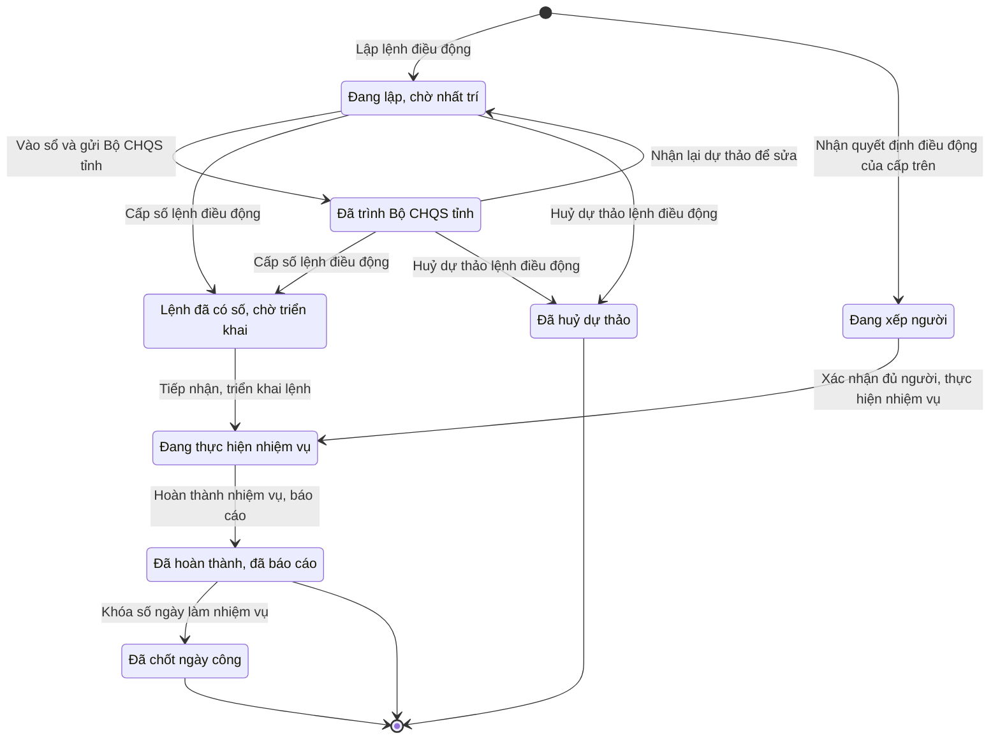

# qt-13a · Điều động lực lượng khi bình thường

<!-- máy sinh: tom-tat -->
> **Hồ sơ:** Lệnh điều động (`DeploymentOrder`)
>
> **Trong sổ phạm vi:** 13a · Điều động lực lượng khi bình thường (tầng 2)
>
> 24 bước · 8 chặng · 4 vai · 5 bảng quyết định · 0 hạn · 24 khớp nối.
>
> **Nguồn:** sổ nghiệp vụ `qt-13a` · khai báo của app: `dqtv-app/core/processes/deployment/workflow/deployment.yaml`. Các bảng do máy sinh từ nguồn này.
<!-- hết: tom-tat -->

<!-- viết tay: dien-giai -->
## Diễn giải

*Phần này viết tay, diễn giải lại điều các bảng bên dưới ghi.*

### Quy trình này để làm gì

Quy trình theo dõi một **Lệnh điều động** (tên gọi trên hệ: "Chặng 3 — Điều động làm nhiệm vụ"): lập dự thảo, xin đủ nhất trí, ký lệnh, cấp số, triển khai, báo cáo kết quả, rồi khoá số ngày và lập trợ cấp ngày công. Có bốn loại nhiệm vụ: phòng chống thiên tai; tìm kiếm, cứu nạn; phối hợp giữ gìn an ninh; bảo vệ môi trường. Người dùng đã chốt một quy trình điều động dùng chung cho xã, tỉnh, quân khu, "người nhất trí là tham số theo cấp".

Hồ sơ đi qua các chặng: *Đang lập, chờ nhất trí* → *Chờ ký tờ trình* → *Tờ trình đã ký, chờ vào sổ* → *Đã trình Bộ CHQS tỉnh* → *Đã ký lệnh, chờ cấp số* → *Lệnh đã có số, chờ triển khai* → *Đang thực hiện nhiệm vụ* → *Đã hoàn thành, đã báo cáo*; có thêm chặng *Đã huỷ dự thảo*.

### Khi nào bắt đầu

Có hai cửa vào, người dùng đã chốt cả hai.

- **Đơn vị tự lập lệnh:** Chỉ huy trưởng Ban CHQS xã bấm **Lập lệnh điều động**, nhập nhiệm vụ, từ ngày, đến ngày, địa bàn, `unitIds`, `taskingId`. Hồ sơ vào chặng *Đang lập, chờ nhất trí*, nối tới Chiến sĩ dân quân tự vệ (16.enlistment) và Nhiệm vụ trên giao (1). Bước này là lập lệnh trong hệ, không đòi bản chụp.
- **Chấp hành quyết định của cấp trên:** Trợ lý Tác huấn bấm **Nhận quyết định điều động của cấp trên**, chọn quyết định trong sổ văn bản đến, nhập cấp quyết định — cấp chi chế độ và cùng các ô trên. Hồ sơ vào thẳng *Đang thực hiện nhiệm vụ*, nối tới Văn bản đến (1.incoming-document) và Nhiệm vụ trên giao (1). Bước này đòi điều kiện `decisionTaskingAssigned` (xem "Điều kiện chặn").

### Diễn ra thế nào

**Chặng "Đang lập, chờ nhất trí".** Chỉ huy trưởng **Sửa dự thảo lệnh điều động** khi cần. Trợ lý Tác huấn ghi ý kiến ký ngoài hệ: **Xác nhận nhất trí của Chủ tịch UBND xã, đính kèm ảnh** (phải nhập `decisionNumber`, `subject`, `signedBy`, `signedDate`, `legalBasis`, `scanPath`), hoặc **Chủ tịch UBND xã không nhất trí** (phải ghi ý kiến); cả hai bước hồ sơ đứng yên. Có nhất trí rồi thì Trợ lý Tác huấn bấm **Trình ký tờ trình điều động**, gắn tờ trình PDF; hệ tạo một Văn bản đi và hồ sơ sang *Chờ ký tờ trình*.

**Chặng "Chờ ký tờ trình" và "Tờ trình đã ký, chờ vào sổ".** Chỉ huy trưởng bấm **Đối chiếu bản ký và ký tờ trình** để sang *Tờ trình đã ký, chờ vào sổ*, rồi Nhân viên văn thư bấm **Vào sổ và gửi Bộ CHQS tỉnh** (gắn bản chụp tờ trình đã ký; nơi nhận `province_military_command`), hồ sơ sang *Đã trình Bộ CHQS tỉnh*. Ở cả hai chặng, Chỉ huy trưởng có thể **Trả lại tờ trình** (ghi cần sửa gì), hồ sơ về *Đang lập, chờ nhất trí*.

**Chặng "Đã trình Bộ CHQS tỉnh".** Chỉ huy trưởng thuộc cấp trên của chủ hồ sơ bấm **Nhất trí lệnh điều động** hoặc **Không nhất trí** (phải ghi ý kiến); hồ sơ đứng yên, chỉ ghi thời điểm. Khi cấp trên không nhất trí, Chỉ huy trưởng thuộc đơn vị chủ hồ sơ **Nhận lại dự thảo để sửa** (hồ sơ về *Đang lập, chờ nhất trí*) hoặc **Huỷ dự thảo lệnh điều động**.

**Ký lệnh và cấp số.** Chỉ huy trưởng bấm **Ký lệnh điều động** từ *Đã trình Bộ CHQS tỉnh* hoặc từ *Đang lập, chờ nhất trí*; hồ sơ sang *Đã ký lệnh, chờ cấp số*. Chỉ huy trưởng ký trên hệ, không đòi bản chụp. Nhân viên văn thư bấm **Cấp số lệnh điều động** (hồ sơ sang *Lệnh đã có số, chờ triển khai*), rồi Trợ lý Tác huấn bấm **Tiếp nhận, triển khai lệnh** để sang *Đang thực hiện nhiệm vụ*. Hai chặng ký và cấp số do người dùng chốt thêm: "CHT ký lệnh điều động + văn thư cấp số sau khi đủ hai nhất trí", bỏ ô gõ số lệnh lúc lập dự thảo.

**Huỷ.** **Huỷ dự thảo lệnh điều động** (Chỉ huy trưởng, phải ghi lý do huỷ) làm được từ *Đang lập, chờ nhất trí* và *Đã trình Bộ CHQS tỉnh*; hồ sơ sang *Đã huỷ dự thảo*.

**Chặng "Đang thực hiện nhiệm vụ"** — hồ sơ đứng yên: Trợ lý Tác huấn **Ghi nhận phối hợp lực lượng** (nhập lĩnh vực phối hợp, `forceIds`; lặp được; tạo một Lần phối hợp lực lượng); Chỉ huy trưởng **Đề nghị UBND huy động** (nhập đề nghị cấp nào, nhu cầu cần huy động; lặp được; tạo một Lần đề nghị huy động lực lượng); Trợ lý Tác huấn **Ghi kết quả huy động** (đã huy động, không huy động, hoặc chưa trả lời). Xong việc, Trợ lý Tác huấn bấm **Hoàn thành nhiệm vụ, báo cáo**, phải ghi kết quả; hồ sơ sang *Đã hoàn thành, đã báo cáo*.

**Chặng "Đã hoàn thành, đã báo cáo"** — hồ sơ đứng yên: Trợ lý Tác huấn **Khóa số ngày làm nhiệm vụ** (gắn bảng ngày công; ghi tổng ngày công, nhiệm vụ nguy hiểm); Trợ lý Quân lực **Lập đề nghị trợ cấp ngày công**; và hệ thống tự làm bước **Ghi điều động vào hồ sơ chiến sĩ**.

### Kết thúc và để lại gì

Có hai chặng kết thúc: *Đã hoàn thành, đã báo cáo* (vẫn còn ba bước làm được) và *Đã huỷ dự thảo*. Từ hồ sơ này, quy trình 12b mở ra **Hồ sơ chế độ chính sách** bằng bước `raiseAllowanceFromMission`. Trong lúc đi, hồ sơ gắn một **Văn bản đi** (1.outgoing-document) ở bước trình ký tờ trình.

### Điều kiện chặn

- **Người làm.** 18 bước đòi người làm thuộc đơn vị chủ hồ sơ. Hai bước nhất trí / không nhất trí đòi người thuộc cấp trên của chủ hồ sơ.
- **Cửa vào thứ hai** (`decisionTaskingAssigned`): phải có một hồ sơ qt-1 đang ở chặng `ASSIGNED` hoặc `BROKEN_DOWN`, đã có nối `raisesTasking`, `handlerRole` bằng `AC-TLTH`, và người đang làm thuộc đơn vị chủ của hồ sơ qt-1 ấy.
- **Nhất trí của Chủ tịch UBND** là việc ngoài hệ (`communeChairman`), hệ chỉ ghi kết quả: một quyết định ký ngoài hệ `deploymentAuthorizedBy`, người ký `commune_chairman`. Phải có ô này mới trình ký tờ trình, ký tờ trình và ký lệnh được; đã ghi rồi thì không ghi lần nữa được. Riêng bước ký tờ trình còn phải có người thứ hai kiểm.
- **Bảng `deployment-consenters`**, xét ở bước ký lệnh, dò từ trên xuống: cấp quyết định là Quân khu thì cho qua, dù cấp trên đã nhất trí hay chưa; cấp quyết định là Cấp xã hoặc Cấp tỉnh thì phải đã có cấp trên nhất trí, thiếu thì bước dừng với kết quả `superior_consent_missing`; mọi trường hợp còn lại cũng dừng với kết quả ấy.
- **Thứ tự buộc bằng "phải có trước":** nhận lại dự thảo để sửa đòi đã có cấp trên không nhất trí; triển khai đòi đã có số lệnh; ghi kết quả huy động đòi đã đề nghị huy động; lập đề nghị trợ cấp đòi đã khoá số ngày và có cấp quyết định — cấp chi chế độ.
- **Không làm lần hai được:** khoá số ngày, lập đề nghị trợ cấp ("lập lần hai là chi đúp cho cùng số ngày"), ghi vào hồ sơ chiến sĩ ("sẽ cộng dồn sai số ngày").
- **Đề nghị UBND huy động** là việc ngoài hệ (`communeChairman`), hệ nhận về kết quả đề nghị; nơi nhận `commune_chairman`, `province_chairman`.
- Quy trình không đặt hạn nào.
<!-- hết viết tay -->

## 1. Đường đi ngắn nhất qua các chặng

<!-- máy sinh: luong-chinh -->
Đường ít bước nhất từ lúc mở hồ sơ tới chặng kết thúc xa nhất. Máy chọn theo số chặng, không theo ý nghĩa nghiệp vụ — trình tự công việc thật xem phần Diễn giải và bảng "Việc làm ở từng chặng" ở mục 6.

| # | Ai làm | Làm gì | Hồ sơ sang chặng |
|---|---|---|---|
| 1 | Trợ lý Tác huấn | Nhận quyết định điều động của cấp trên | Đang xếp người |
| 2 | Trợ lý Tác huấn | Xác nhận đủ người, thực hiện nhiệm vụ | Đang thực hiện nhiệm vụ |
| 3 | Trợ lý Tác huấn | Hoàn thành nhiệm vụ, báo cáo | Đã hoàn thành, đã báo cáo |
| 4 | Trợ lý Tác huấn | Khóa số ngày làm nhiệm vụ | Đã chốt ngày công |

<!-- hết: luong-chinh -->

## 2. Hồ sơ và việc nó để lại

<!-- máy sinh: muc-tieu -->
**App gọi quy trình này là:** Chặng 3 — Điều động làm nhiệm vụ.

**Khi mở, hồ sơ này ghi mối nối tới:**
- Chiến sĩ dân quân tự vệ (16.enlistment) — bước `proposeDeployment`, khớp nối `deploysMember`
- Chiến sĩ dân quân tự vệ (16.enlistment) — bước `receiveUpperDeploymentDecision`, khớp nối `deploysMember`
- Nhiệm vụ trên giao (1) — bước `proposeDeployment`, khớp nối `deploymentOrderServesTasking`
- Nhiệm vụ trên giao (1) — bước `receiveUpperDeploymentDecision`, khớp nối `deploymentOrderServesTasking`
- Văn bản đến (1.incoming-document) — bước `receiveUpperDeploymentDecision`, khớp nối `deploymentFromIncomingDocument`
- Vụ việc ứng phó (20) — bước `proposeDeployment`, khớp nối `arisesFromCase`
- Đơn vị dân quân tự vệ (29) — bước `proposeDeployment`, khớp nối `deploysUnit`
- Đơn vị dân quân tự vệ (29) — bước `receiveUpperDeploymentDecision`, khớp nối `deploysUnit`

**Hồ sơ này để lại cho quy trình khác** (bước tạo hồ sơ của quy trình kia ghi mối nối về đây):
- Bảng thanh toán trợ cấp (12a) — bước `openBenefitPaymentBatch`, khớp nối `batchFromOrder`
- Hồ sơ chế độ chính sách (12b) — bước `raiseAllowanceFromMission`, khớp nối `arisesFrom`
- Vụ việc kỷ luật (D15) — bước `openDisciplineFromSource`, khớp nối `disciplineFromDeployment`
- Vụ việc vi phạm hành chính (10) — bước `openViolationFromSource`, khớp nối `violationFromDeployment`
- Đề nghị cấp kinh phí (4.funding-request) — bước `estimateCommuneFundingRequest`, khớp nối `fundingRequestFromDeployment`
- Đề nghị cấp kinh phí (4.funding-request) — bước `estimateProvinceFundingRequest`, khớp nối `fundingRequestFromDeployment`
<!-- hết: muc-tieu -->

## 3. Khởi phát và kết thúc

<!-- máy sinh: khoi-phat -->
**2 cửa vào** — bước mở hồ sơ:

| Bước mở | Ai mở | Hồ sơ vào chặng | App bắt buộc nhập |
|---|---|---|---|
| Lập lệnh điều động | Chỉ huy trưởng Ban CHQS xã | Đang lập, chờ nhất trí | nhiệm vụ, từ ngày, đến ngày, địa bàn, `unitIds`, `taskingId` |
| Nhận quyết định điều động của cấp trên | Trợ lý Tác huấn | Đang xếp người | `incomingDocumentId`, cấp quyết định — cấp chi chế độ, nhiệm vụ, từ ngày, đến ngày, địa bàn, `unitIds`, `taskingId` |

**Kết thúc:** *Đã hoàn thành, đã báo cáo* (`COMPLETED`), *Đã chốt ngày công* (`DAYS_LOCKED`), *Đã huỷ dự thảo* (`CANCELLED`)
<!-- hết: khoi-phat -->

## 4. Vai trò

<!-- máy sinh: vai-tro -->
| Vai trong sổ | Tên trong app | Điều kiện | Làm những bước |
|---|---|---|---|
| `commander` | Chỉ huy trưởng Ban CHQS xã |  | Lập lệnh điều động · Sửa dự thảo lệnh điều động · Nhận lại dự thảo để sửa · Huỷ dự thảo lệnh điều động |
| `operator` | Trợ lý Tác huấn |  | Xác nhận nhất trí của Chủ tịch UBND xã, đính kèm ảnh · Trình ký tờ trình điều động · Trình ký lệnh điều động · Chủ tịch UBND xã không nhất trí · Tiếp nhận, triển khai lệnh · Nhận quyết định điều động của cấp trên · Xếp người theo quyết định · Xác nhận đủ người, thực hiện nhiệm vụ · Ghi nhận phối hợp lực lượng · Trình ký đề nghị UBND huy động · Ghi kết quả huy động · Hoàn thành nhiệm vụ, báo cáo · Khóa số ngày làm nhiệm vụ · Đề nghị xử lý vi phạm người không chấp hành điều động |
| `clerk` | Nhân viên văn thư |  | Vào sổ và gửi Bộ CHQS tỉnh · Cấp số lệnh điều động |
| `commander` | Chỉ huy trưởng Ban CHQS xã | thuộc cấp trên của chủ hồ sơ (`actorInSuperiorUnit`, công thức ở mục 7) | Nhất trí lệnh điều động |
| `operator` | Trợ lý Tác huấn | thuộc cấp trên của chủ hồ sơ (`actorInSuperiorUnit`, công thức ở mục 7) | Trình ký văn bản không nhất trí lệnh điều động |
| `system` | Hệ thống tự làm |  | Không nhất trí · Đề nghị UBND huy động |

*"Tên trong app" là tên app đặt cho mã chủ thể của vai. Hồ sơ thuộc đơn vị cấp khác thì người làm là người giữ vai ấy ở đơn vị nêu trong cột "Điều kiện" (nếu sổ có ghi) và ở cột "Người làm phải thuộc" của bảng "Theo khai báo của app" (mục 7).*
<!-- hết: vai-tro -->

## 5. Nhánh phụ

<!-- máy sinh: nhanh-phu -->
**Bước khác đưa hồ sơ sang chặng mới** — đường song song, rẽ nhánh hoặc kết thúc sớm:

| Bước | Ai làm | Từ chặng | Sang chặng |
|---|---|---|---|
| Vào sổ và gửi Bộ CHQS tỉnh | Nhân viên văn thư | Đang lập, chờ nhất trí | Đã trình Bộ CHQS tỉnh |
| Cấp số lệnh điều động | Nhân viên văn thư | Đã trình Bộ CHQS tỉnh, Đang lập, chờ nhất trí | Lệnh đã có số, chờ triển khai |
| Huỷ dự thảo lệnh điều động | Chỉ huy trưởng Ban CHQS xã | Đang lập, chờ nhất trí, Đã trình Bộ CHQS tỉnh | Đã huỷ dự thảo |
| Tiếp nhận, triển khai lệnh | Trợ lý Tác huấn | Lệnh đã có số, chờ triển khai | Đang thực hiện nhiệm vụ |

**Quay lại một chặng hồ sơ đã đi qua** (tính theo đường ngắn nhất từ lúc mở):

| Bước | Ai làm | Từ chặng | Về chặng |
|---|---|---|---|
| Nhận lại dự thảo để sửa | Chỉ huy trưởng Ban CHQS xã | Đã trình Bộ CHQS tỉnh | Đang lập, chờ nhất trí |

**Làm trong lúc hồ sơ đứng yên ở một chặng** — ghi nhận, bổ sung:

| Bước | Ai làm | Ở chặng |
|---|---|---|
| Xác nhận nhất trí của Chủ tịch UBND xã, đính kèm ảnh | Trợ lý Tác huấn | Đang lập, chờ nhất trí |
| Trình ký tờ trình điều động | Trợ lý Tác huấn | Đang lập, chờ nhất trí |
| Nhất trí lệnh điều động | Chỉ huy trưởng Ban CHQS xã (thuộc cấp trên của chủ hồ sơ) | Đã trình Bộ CHQS tỉnh |
| Trình ký văn bản không nhất trí lệnh điều động | Trợ lý Tác huấn (thuộc cấp trên của chủ hồ sơ) | Đã trình Bộ CHQS tỉnh |
| Không nhất trí *(lặp được)* | Hệ thống tự làm | Đã trình Bộ CHQS tỉnh |
| Trình ký lệnh điều động | Trợ lý Tác huấn | Đã trình Bộ CHQS tỉnh, Đang lập, chờ nhất trí |
| Sửa dự thảo lệnh điều động | Chỉ huy trưởng Ban CHQS xã | Đang lập, chờ nhất trí |
| Chủ tịch UBND xã không nhất trí | Trợ lý Tác huấn | Đang lập, chờ nhất trí |
| Xếp người theo quyết định *(lặp được)* | Trợ lý Tác huấn | Đang xếp người |
| Ghi nhận phối hợp lực lượng *(lặp được)* | Trợ lý Tác huấn | Đang thực hiện nhiệm vụ |
| Trình ký đề nghị UBND huy động *(lặp được)* | Trợ lý Tác huấn | Đang thực hiện nhiệm vụ |
| Đề nghị UBND huy động *(lặp được)* | Hệ thống tự làm | Đang thực hiện nhiệm vụ |
| Ghi kết quả huy động | Trợ lý Tác huấn | Đang thực hiện nhiệm vụ |
| Đề nghị xử lý vi phạm người không chấp hành điều động | Trợ lý Tác huấn | Đang thực hiện nhiệm vụ, Đã hoàn thành, đã báo cáo, Đã chốt ngày công |

**Cửa vào khác:** 2 bước cùng mở hồ sơ — xem mục 3.

<!-- hết: nhanh-phu -->

## 6. Các chặng và việc làm ở từng chặng

<!-- máy sinh: chang -->
| Chặng | Tên hiển thị | Vào bằng bước | Kết thúc? |
|---|---|---|---|
| `PROPOSED` | Đang lập, chờ nhất trí | Lập lệnh điều động · Nhận lại dự thảo để sửa |  |
| `AWAITING_PROVINCE` | Đã trình Bộ CHQS tỉnh | Vào sổ và gửi Bộ CHQS tỉnh |  |
| `ORDER_ISSUED` | Lệnh đã có số, chờ triển khai | Cấp số lệnh điều động |  |
| `STAFFING` | Đang xếp người | Nhận quyết định điều động của cấp trên |  |
| `IN_PROGRESS` | Đang thực hiện nhiệm vụ | Tiếp nhận, triển khai lệnh · Xác nhận đủ người, thực hiện nhiệm vụ |  |
| `COMPLETED` | Đã hoàn thành, đã báo cáo | Hoàn thành nhiệm vụ, báo cáo | **kết thúc** — vẫn còn bước làm được |
| `DAYS_LOCKED` | Đã chốt ngày công | Khóa số ngày làm nhiệm vụ | **kết thúc** — vẫn còn bước làm được |
| `CANCELLED` | Đã huỷ dự thảo | Huỷ dự thảo lệnh điều động | **kết thúc** |

### Việc làm ở từng chặng

Hồ sơ đang ở chặng nào thì làm được những bước nào.

| Hồ sơ đang ở chặng | Bước làm tại chặng (hồ sơ đứng yên) | Bước đưa hồ sơ sang chặng khác |
|---|---|---|
| **Đang lập, chờ nhất trí** | Xác nhận nhất trí của Chủ tịch UBND xã, đính kèm ảnh — Trợ lý Tác huấn Trình ký tờ trình điều động — Trợ lý Tác huấn Trình ký lệnh điều động — Trợ lý Tác huấn Sửa dự thảo lệnh điều động — Chỉ huy trưởng Ban CHQS xã Chủ tịch UBND xã không nhất trí — Trợ lý Tác huấn | Vào sổ và gửi Bộ CHQS tỉnh — Nhân viên văn thư → *Đã trình Bộ CHQS tỉnh* Cấp số lệnh điều động — Nhân viên văn thư → *Lệnh đã có số, chờ triển khai* Huỷ dự thảo lệnh điều động — Chỉ huy trưởng Ban CHQS xã → *Đã huỷ dự thảo* |
| **Đã trình Bộ CHQS tỉnh** | Nhất trí lệnh điều động — Chỉ huy trưởng Ban CHQS xã (thuộc cấp trên của chủ hồ sơ) Trình ký văn bản không nhất trí lệnh điều động — Trợ lý Tác huấn (thuộc cấp trên của chủ hồ sơ) Không nhất trí (lặp được) — Hệ thống tự làm Trình ký lệnh điều động — Trợ lý Tác huấn | Cấp số lệnh điều động — Nhân viên văn thư → *Lệnh đã có số, chờ triển khai* Nhận lại dự thảo để sửa — Chỉ huy trưởng Ban CHQS xã → *Đang lập, chờ nhất trí* Huỷ dự thảo lệnh điều động — Chỉ huy trưởng Ban CHQS xã → *Đã huỷ dự thảo* |
| **Lệnh đã có số, chờ triển khai** | — | Tiếp nhận, triển khai lệnh — Trợ lý Tác huấn → *Đang thực hiện nhiệm vụ* |
| **Đang xếp người** | Xếp người theo quyết định (lặp được) — Trợ lý Tác huấn | Xác nhận đủ người, thực hiện nhiệm vụ — Trợ lý Tác huấn → *Đang thực hiện nhiệm vụ* |
| **Đang thực hiện nhiệm vụ** | Ghi nhận phối hợp lực lượng (lặp được) — Trợ lý Tác huấn Trình ký đề nghị UBND huy động (lặp được) — Trợ lý Tác huấn Đề nghị UBND huy động (lặp được) — Hệ thống tự làm Ghi kết quả huy động — Trợ lý Tác huấn Đề nghị xử lý vi phạm người không chấp hành điều động — Trợ lý Tác huấn | Hoàn thành nhiệm vụ, báo cáo — Trợ lý Tác huấn → *Đã hoàn thành, đã báo cáo* |
| **Đã hoàn thành, đã báo cáo** | Đề nghị xử lý vi phạm người không chấp hành điều động — Trợ lý Tác huấn | Khóa số ngày làm nhiệm vụ — Trợ lý Tác huấn → *Đã chốt ngày công* |
| **Đã chốt ngày công** | Đề nghị xử lý vi phạm người không chấp hành điều động — Trợ lý Tác huấn | — (kết thúc) |
| **Đã huỷ dự thảo** | — | — (kết thúc) |
<!-- hết: chang -->

## 7. Bảng bước

<!-- máy sinh: buoc -->
| # | Bước | Mã bước | Ai thực hiện | Từ chặng | Sang chặng | Phải có trước | Ghi lại |
|---|---|---|---|---|---|---|---|
| 1 | Lập lệnh điều động | `proposeDeployment` | Chỉ huy trưởng Ban CHQS xã | — (mở hồ sơ) | `PROPOSED` | — | mã tỉnh, mã xã, nhiệm vụ, nội dung, căn cứ ban hành, từ ngày, đến ngày, địa bàn, quân số, nối tới Chiến sĩ dân quân tự vệ, nối tới Nhiệm vụ trên giao, đơn vị chủ hồ sơ, cấp quyết định — cấp chi chế độ, cấp trên của chủ hồ sơ, nối tới Đơn vị dân quân tự vệ, nối tới Vụ việc ứng phó, lý do huy động người đang vướng việc, người đang vướng việc khác, `id` |
| 2 | Xác nhận nhất trí của Chủ tịch UBND xã, đính kèm ảnh | `recordDeploymentConsent` | Trợ lý Tác huấn | `PROPOSED` | giữ nguyên | người làm thuộc đơn vị chủ hồ sơ, `recordDeploymentConsentFromIncomingDocumentUsable` | chủ tịch UBND nhất trí lúc, nối tới Văn bản đến |
| 3 | Trình ký tờ trình điều động | `requestDeploymentSignature` | Trợ lý Tác huấn | `PROPOSED` | giữ nguyên | chủ tịch UBND nhất trí lúc, người làm thuộc đơn vị chủ hồ sơ, `fundingEstimateAttached`, `noDeploymentOrderSubmittedDocumentOpen` | nối tới Văn bản đi |
| 4 | Vào sổ và gửi Bộ CHQS tỉnh | `submitDeployment` | Nhân viên văn thư | `PROPOSED` | `AWAITING_PROVINCE` | người làm thuộc đơn vị chủ hồ sơ, `deploymentOrderSubmittedDocumentIssued`, chủ tịch UBND nhất trí lúc | nối `submissionDeliveredAs`; **xoá:** cấp trên không nhất trí lúc |
| 5 | Nhất trí lệnh điều động | `approveDeployment` | Chỉ huy trưởng Ban CHQS xã (thuộc cấp trên của chủ hồ sơ) | `AWAITING_PROVINCE` | giữ nguyên | người làm thuộc cấp trên của chủ hồ sơ, `submissionDistributedAtReceiver`, `noRejectDeploymentDocumentOpen`, `provinceNotRefused` | cấp trên nhất trí lúc |
| 6 | Trình ký văn bản không nhất trí lệnh điều động | `requestRejectDeploymentSignature` | Trợ lý Tác huấn (thuộc cấp trên của chủ hồ sơ) | `AWAITING_PROVINCE` | giữ nguyên | `submissionDistributedAtReceiver`, `noRejectDeploymentDocumentOpen`, người làm thuộc cấp trên của chủ hồ sơ, `provinceNotConsented` | nối tới Văn bản đi |
| 7 | Không nhất trí | `rejectDeployment` | Hệ thống tự làm | `AWAITING_PROVINCE` | giữ nguyên | `rejectDeploymentDocumentIssued` | cấp trên không nhất trí lúc, nối `returnDeliveredAs` |
| 8 | Trình ký lệnh điều động | `requestDeploymentOrderSignature` | Trợ lý Tác huấn | `AWAITING_PROVINCE`, `PROPOSED` | giữ nguyên | chủ tịch UBND nhất trí lúc, cấp quyết định — cấp chi chế độ, người làm thuộc đơn vị chủ hồ sơ, `noDeploymentOrderDocumentOpen`, `superiorConsentCleared` | nối tới Văn bản đi |
| 9 | Cấp số lệnh điều động | `issueDeploymentOrder` | Nhân viên văn thư | `AWAITING_PROVINCE`, `PROPOSED` | `ORDER_ISSUED` | người làm thuộc đơn vị chủ hồ sơ, `deploymentOrderDocumentIssued` | — |
| 10 | Sửa dự thảo lệnh điều động | `editDeployment` | Chỉ huy trưởng Ban CHQS xã | `PROPOSED` | giữ nguyên | người làm thuộc đơn vị chủ hồ sơ | địa bàn, nội dung, quân số, nhiệm vụ, nối tới Đơn vị dân quân tự vệ, nối tới Chiến sĩ dân quân tự vệ; **xoá:** chủ tịch UBND nhất trí lúc |
| 11 | Chủ tịch UBND xã không nhất trí | `recordConsentRefusal` | Trợ lý Tác huấn | `PROPOSED` | giữ nguyên | người làm thuộc đơn vị chủ hồ sơ, `recordConsentRefusalFromIncomingDocumentUsable` | nối tới Văn bản đến |
| 12 | Nhận lại dự thảo để sửa | `reviseDeployment` | Chỉ huy trưởng Ban CHQS xã | `AWAITING_PROVINCE` | `PROPOSED` | người làm thuộc đơn vị chủ hồ sơ, cấp trên không nhất trí lúc, `provinceNotConsented` | —; **xoá:** chủ tịch UBND nhất trí lúc |
| 13 | Huỷ dự thảo lệnh điều động | `cancelDeployment` | Chỉ huy trưởng Ban CHQS xã | `PROPOSED`, `AWAITING_PROVINCE` | `CANCELLED` | người làm thuộc đơn vị chủ hồ sơ | huỷ lúc, lý do huỷ |
| 14 | Tiếp nhận, triển khai lệnh | `startDeployment` | Trợ lý Tác huấn | `ORDER_ISSUED` | `IN_PROGRESS` | `deploymentOrderDocumentIssued`, người làm thuộc đơn vị chủ hồ sơ | bắt đầu triển khai lúc |
| 15 | Nhận quyết định điều động của cấp trên | `receiveUpperDeploymentDecision` | Trợ lý Tác huấn | — (mở hồ sơ) | `STAFFING` | `decisionTaskingAssigned`, `deploymentFromIncomingDocumentUsable`, `decisionDocumentFromUpper` | đơn vị chủ hồ sơ, nối tới Văn bản đến, nối tới Nhiệm vụ trên giao, cấp quyết định — cấp chi chế độ, nhận quyết định cấp trên lúc, cấp trên của chủ hồ sơ, địa bàn, quân số, nối tới Đơn vị dân quân tự vệ, nối tới Chiến sĩ dân quân tự vệ, `id`, lý do huy động người đang vướng việc, người đang vướng việc khác, từ ngày, đến ngày |
| 16 | Xếp người theo quyết định | `setDeploymentRoster` | Trợ lý Tác huấn | `STAFFING` | giữ nguyên | người làm thuộc đơn vị chủ hồ sơ | nối tới Chiến sĩ dân quân tự vệ, quân số đã xếp, nối tới Nhiệm vụ trên giao, lý do huy động người đang vướng việc, người đang vướng việc khác |
| 17 | Xác nhận đủ người, thực hiện nhiệm vụ | `confirmDeploymentRoster` | Trợ lý Tác huấn | `STAFFING` | `IN_PROGRESS` | `rosterMatchesDecision`, người làm thuộc đơn vị chủ hồ sơ | xác nhận đủ người lúc, bắt đầu triển khai lúc |
| 18 | Ghi nhận phối hợp lực lượng | `recordCoordination` | Trợ lý Tác huấn | `IN_PROGRESS` | giữ nguyên | người làm thuộc đơn vị chủ hồ sơ | lĩnh vực phối hợp, nối tới Lần phối hợp lực lượng, nối tới Lực lượng đóng trên địa bàn |
| 19 | Trình ký đề nghị UBND huy động | `requestMobilizationRequestSignature` | Trợ lý Tác huấn | `IN_PROGRESS` | giữ nguyên | người làm thuộc đơn vị chủ hồ sơ, `noMobilizationRequestDocumentOpen` | nối `mobilizationRequestByDocument` |
| 20 | Đề nghị UBND huy động | `requestMobilization` | Hệ thống tự làm | `IN_PROGRESS` | giữ nguyên | `mobilizationRequestDocumentIssued` | đề nghị huy động lúc, nối tới Lần đề nghị huy động lực lượng, nối tới Lực lượng đóng trên địa bàn |
| 21 | Ghi kết quả huy động | `recordMobilizationOutcome` | Trợ lý Tác huấn | `IN_PROGRESS` | giữ nguyên | đề nghị huy động lúc, người làm thuộc đơn vị chủ hồ sơ | kết quả đề nghị, lực lượng thực đến, ghi chú |
| 22 | Hoàn thành nhiệm vụ, báo cáo | `completeDeployment` | Trợ lý Tác huấn | `IN_PROGRESS` | `COMPLETED` | người làm thuộc đơn vị chủ hồ sơ | `completedAt`, kết quả |
| 23 | Khóa số ngày làm nhiệm vụ | `lockMissionDays` | Trợ lý Tác huấn | `COMPLETED` | `DAYS_LOCKED` | người làm thuộc đơn vị chủ hồ sơ | tổng ngày công, nhiệm vụ nguy hiểm, nối tới Ngày công của một người trong nhiệm vụ, nối `missionDayOfMember` |
| 24 | Đề nghị xử lý vi phạm người không chấp hành điều động | `proposeDeploymentViolationHandling` | Trợ lý Tác huấn | `IN_PROGRESS`, `COMPLETED`, `DAYS_LOCKED` | giữ nguyên | người làm thuộc đơn vị chủ hồ sơ | nối `violatingMember`, nối `handlingDisciplinaryCase`, nối `handlingViolationCase` |

### Khi không đạt điều kiện

Mặc định: không đúng người, hồ sơ không ở đúng chặng, hoặc thiếu thứ "phải có trước" thì bước bị chặn, hồ sơ giữ nguyên. Bảng dưới chỉ kê những bước có kết quả riêng.

| # | Bước | Kết quả riêng |
|---|---|---|
| 1 | Lập lệnh điều động | bước dừng lại, hồ sơ giữ nguyên khi kết quả xét là: `BUSY_SAME_DAYS`, `BUSY_NEEDS_REASON` |
| 7 | Không nhất trí | bước này không do người nào bấm |
| 8 | Trình ký lệnh điều động | bước dừng lại, hồ sơ giữ nguyên khi kết quả xét là: `superior_consent_missing` |
| 15 | Nhận quyết định điều động của cấp trên | bước dừng lại, hồ sơ giữ nguyên khi kết quả xét là: `BUSY_SAME_DAYS`, `BUSY_NEEDS_REASON` |
| 16 | Xếp người theo quyết định | bước dừng lại, hồ sơ giữ nguyên khi kết quả xét là: `BUSY_SAME_DAYS`, `BUSY_NEEDS_REASON` |
| 20 | Đề nghị UBND huy động | bước này không do người nào bấm |
| 21 | Ghi kết quả huy động | bước dừng lại, hồ sơ giữ nguyên khi kết quả xét là: `REQUEST_MUST_BE_CHOSEN` |

### Điều kiện "phải có trước" bằng lời

Cột "Phải có trước" ở bảng bước có hai loại: ô dữ liệu thường (bước chỉ đòi ô ấy đã có giá trị) và điều kiện hệ tự xét. Bảng này diễn các điều kiện hệ tự xét theo đúng công thức sổ ghi; số ở cột cuối là số thứ tự bước.

| Điều kiện | Đúng khi | Bước đòi |
|---|---|---|
| `actorInOwnerUnit` | người đang làm là người của đơn vị ghi ở ô đơn vị chủ hồ sơ của hồ sơ này (theo danh mục người của đơn vị, `dm.unit-staff`) | 2, 3, 4, 8, 9, 10, 11, 12, 13, 14, 16, 17, 18, 19, 21, 22, 23, 24 |
| `recordDeploymentConsentFromIncomingDocumentUsable` | có hồ sơ Việc luật giao kèm văn bản đến, đi — Văn bản đến (qt-1.incoming-document) chính là hồ sơ ghi ở ô nối `recordDeploymentConsentFromIncomingDocument` của hồ sơ đang làm mà hồ sơ ấy đang ở chặng `RECEIVED` hoặc `DISTRIBUTED` | 2 |
| `fundingEstimateAttached` | có hồ sơ Ngân sách dự toán → quyết toán — Đề nghị cấp kinh phí (qt-4.funding-request) có ô nối `fundingRequestFromDeployment` trỏ về chính hồ sơ đang làm mà KHÔNG (hồ sơ ấy đang ở chặng `CANCELLED`) | 3 |
| `noDeploymentOrderSubmittedDocumentOpen` | KHÔNG (có hồ sơ Việc luật giao kèm văn bản đến, đi — Văn bản đi (qt-1.outgoing-document) chính là hồ sơ ghi ở ô nối `deploymentOrderSubmittedByDocument` của hồ sơ đang làm mà hồ sơ ấy đang ở chặng `DRAFT` hoặc `PENDING_SIGNATURE` hoặc `SIGNED`) | 3 |
| `deploymentOrderSubmittedDocumentIssued` | có hồ sơ Việc luật giao kèm văn bản đến, đi — Văn bản đi (qt-1.outgoing-document) chính là hồ sơ ghi ở ô nối `deploymentOrderSubmittedByDocument` của hồ sơ đang làm mà hồ sơ ấy đang ở chặng `ISSUED` | 4 |
| `actorInSuperiorUnit` | người đang làm là người của một đơn vị nằm trong ô cấp trên của chủ hồ sơ của hồ sơ này (theo danh mục người của đơn vị, `dm.unit-staff`) | 5, 6 |
| `submissionDistributedAtReceiver` | có hồ sơ Việc luật giao kèm văn bản đến, đi — Văn bản đến (qt-1.incoming-document) chính là hồ sơ ghi ở ô nối `submissionDeliveredAs` của hồ sơ đang làm mà hồ sơ ấy đang ở chặng `DISTRIBUTED` | 5, 6 |
| `noRejectDeploymentDocumentOpen` | KHÔNG (có hồ sơ Việc luật giao kèm văn bản đến, đi — Văn bản đi (qt-1.outgoing-document) chính là hồ sơ ghi ở ô nối `rejectDeploymentByDocument` của hồ sơ đang làm mà hồ sơ ấy đang ở chặng `DRAFT` hoặc `PENDING_SIGNATURE` hoặc `SIGNED`) | 5, 6 |
| `provinceNotRefused` | KHÔNG (đã có cấp trên không nhất trí lúc) | 5 |
| `provinceNotConsented` | KHÔNG (đã có cấp trên nhất trí lúc) | 6, 12 |
| `rejectDeploymentDocumentIssued` | có hồ sơ Việc luật giao kèm văn bản đến, đi — Văn bản đi (qt-1.outgoing-document) chính là hồ sơ ghi ở ô nối `rejectDeploymentByDocument` của hồ sơ đang làm mà hồ sơ ấy đang ở chặng `ISSUED` | 7 |
| `noDeploymentOrderDocumentOpen` | KHÔNG (có hồ sơ Việc luật giao kèm văn bản đến, đi — Văn bản đi (qt-1.outgoing-document) chính là hồ sơ ghi ở ô nối `deploymentOrderByDocument` của hồ sơ đang làm mà hồ sơ ấy đang ở chặng `DRAFT` hoặc `PENDING_SIGNATURE` hoặc `SIGNED`) | 8 |
| `superiorConsentCleared` | đã có cấp trên nhất trí lúc | 8 |
| `deploymentOrderDocumentIssued` | có hồ sơ Việc luật giao kèm văn bản đến, đi — Văn bản đi (qt-1.outgoing-document) chính là hồ sơ ghi ở ô nối `deploymentOrderByDocument` của hồ sơ đang làm mà hồ sơ ấy đang ở chặng `ISSUED` | 9, 14 |
| `recordConsentRefusalFromIncomingDocumentUsable` | có hồ sơ Việc luật giao kèm văn bản đến, đi — Văn bản đến (qt-1.incoming-document) chính là hồ sơ ghi ở ô nối `recordConsentRefusalFromIncomingDocument` của hồ sơ đang làm mà hồ sơ ấy đang ở chặng `RECEIVED` hoặc `DISTRIBUTED` | 11 |
| `decisionTaskingAssigned` | có hồ sơ Việc luật giao kèm văn bản đến, đi (qt-1) (gọi là r) mà hồ sơ ấy đang ở chặng `ASSIGNED` hoặc `BROKEN_DOWN` VÀ đã có nối `raisesTasking` VÀ `handlerRole` của hồ sơ r ấy bằng `AC-TLTH` VÀ `workKind` của hồ sơ r ấy bằng `force_employment` VÀ người đang làm là người của đơn vị ghi ở ô đơn vị chủ hồ sơ của hồ sơ r ấy (theo danh mục người của đơn vị, `dm.unit-staff`) | 15 |
| `deploymentFromIncomingDocumentUsable` | có hồ sơ Việc luật giao kèm văn bản đến, đi — Văn bản đến (qt-1.incoming-document) chính là hồ sơ ghi ở ô nối `deploymentFromIncomingDocument` của hồ sơ đang làm mà hồ sơ ấy đang ở chặng `RECEIVED` hoặc `DISTRIBUTED` | 15 |
| `decisionDocumentFromUpper` | có hồ sơ Việc luật giao kèm văn bản đến, đi — Văn bản đến (qt-1.incoming-document) chính là hồ sơ ghi ở ô nối `deploymentFromIncomingDocument` của hồ sơ đang làm mà hồ sơ ấy đang ở chặng `RECEIVED` hoặc `DISTRIBUTED` VÀ `senderLevel` là `province` hoặc `region` hoặc `central` | 15 |
| `rosterMatchesDecision` | quân số đã xếp bằng quân số | 17 |
| `noMobilizationRequestDocumentOpen` | KHÔNG (có hồ sơ Việc luật giao kèm văn bản đến, đi — Văn bản đi (qt-1.outgoing-document) chính là hồ sơ ghi ở ô nối `mobilizationRequestByDocument` của hồ sơ đang làm mà hồ sơ ấy đang ở chặng `DRAFT` hoặc `PENDING_SIGNATURE` hoặc `SIGNED`) | 19 |
| `mobilizationRequestDocumentIssued` | có hồ sơ Việc luật giao kèm văn bản đến, đi — Văn bản đi (qt-1.outgoing-document) chính là hồ sơ ghi ở ô nối `mobilizationRequestByDocument` của hồ sơ đang làm mà hồ sơ ấy đang ở chặng `ISSUED` | 20 |
| `busySameDaysOnOrder` | có hồ sơ Điều động lực lượng khi bình thường (qt-13a) (gọi là c) mà hồ sơ ấy đang ở chặng `IN_PROGRESS` VÀ có hồ sơ `dm.militia-unit` (gọi là u) mà `id` của hồ sơ u ấy nằm trong nối tới Đơn vị dân quân tự vệ của hồ sơ này VÀ `id` của hồ sơ u ấy nằm trong nối tới Đơn vị dân quân tự vệ của hồ sơ c ấy | đầu vào bảng quyết định (mục 8) |
| `busyOnOpenCaseInWindow` | có hồ sơ Vụ việc ứng phó (qt-20) (gọi là c) mà KHÔNG (hồ sơ ấy đang ở chặng `CLOSED` hoặc `DAYS_LOCKED` hoặc `DAYS_APPROVED`) VÀ có hồ sơ `dm.militia-unit` (gọi là u) mà `id` của hồ sơ u ấy nằm trong nối tới Đơn vị dân quân tự vệ của hồ sơ này VÀ `id` của hồ sơ u ấy nằm trong nối `respondsWithUnit` của hồ sơ c ấy | đầu vào bảng quyết định (mục 8) |
| `busyInTrainingSameDays` | có hồ sơ Đợt tập trung: huấn luyện, diễn tập, tập huấn, hội thi (qt-14) (gọi là c) mà hồ sơ ấy đang ở chặng `SUMMONED` hoặc `IN_PROGRESS` VÀ `{"le": [{"fact": "startDate", "on": "c"}, {"fact": "endDate", "on": "self"}]}` VÀ `{"le": [{"fact": "startDate", "on": "self"}, {"fact": "endDate", "on": "c"}]}` VÀ có hồ sơ Sổ đăng ký người theo diện — Chiến sĩ dân quân tự vệ (qt-16.enlistment) (gọi là m) mà `id` của hồ sơ m ấy nằm trong nối tới Chiến sĩ dân quân tự vệ của hồ sơ này VÀ `id` của hồ sơ m ấy nằm trong nối `summons` của hồ sơ c ấy | đầu vào bảng quyết định (mục 8) |
| `severalMobilizationRequestsAwaitingReply` | `{"counted": "requestMobilization", "atLeast": 2, "resetOn": ["recordMobilizationOutcome"]}` | đầu vào bảng quyết định (mục 8) |

### Theo khai báo của app

Người làm phải thuộc đơn vị nào, ô người dùng phải nhập, bước có lặp được không, và căn cứ pháp lý — lấy từ khai báo quy trình trong app.

| # | Bước | Người làm phải thuộc | Bắt buộc nhập | Nhập nếu có | Lặp được | Căn cứ |
|---|---|---|---|---|---|---|
| 1 | Lập lệnh điều động |  | nhiệm vụ, từ ngày, đến ngày, địa bàn, `unitIds`, `taskingId` | lý do huy động người đang vướng việc, người đang vướng việc khác, nội dung, căn cứ ban hành |  | L48/2019/QH14 Đ.32 k1 g (sửa bởi L98/2025) |
| 2 | Xác nhận nhất trí của Chủ tịch UBND xã, đính kèm ảnh | đơn vị chủ hồ sơ | văn bản đến là văn bản nhất trí của Chủ tịch UBND xã | — |  | 50_MAU_KY_NGOAI_HE_THONG.md §D · L48/2019/QH14 Đ.32 k1 g |
| 3 | Trình ký tờ trình điều động | đơn vị chủ hồ sơ | tờ trình (PDF) | — |  | L48/2019/QH14 Đ.32 k1 g; NĐ30/2020/NĐ-CP Đ.10, Đ.13 |
| 4 | Vào sổ và gửi Bộ CHQS tỉnh | đơn vị chủ hồ sơ | — | — |  | L48/2019/QH14 Đ.32 k1 g (sửa bởi L98/2025); NĐ30/2020/NĐ-CP Đ.18, Đ.19 |
| 5 | Nhất trí lệnh điều động | cấp trên của chủ hồ sơ | `approverUnit` | lý do không nhất trí (để trống thì lấy trích yếu của văn bản đến) |  | L48/2019/QH14 Đ.32 k1 g |
| 6 | Trình ký văn bản không nhất trí lệnh điều động | cấp trên của chủ hồ sơ | — | dự thảo văn bản (PDF) |  | L48/2019/QH14 Đ.32 k1 g; NĐ30/2020/NĐ-CP Đ.13 |
| 7 | Không nhất trí |  | `approverUnit` | lý do không nhất trí (để trống thì lấy trích yếu của văn bản đến) | có | L48/2019/QH14 Đ.32 k1 g |
| 8 | Trình ký lệnh điều động | đơn vị chủ hồ sơ | — | lệnh điều động (PDF) |  | L48/2019/QH14 Đ.32 k1 g; NĐ30/2020/NĐ-CP Đ.13 |
| 9 | Cấp số lệnh điều động | đơn vị chủ hồ sơ | — | — |  | NĐ30/2020/NĐ-CP Đ.15 |
| 10 | Sửa dự thảo lệnh điều động | đơn vị chủ hồ sơ | — | `unitIds`, nhiệm vụ, địa bàn, nội dung, từ ngày, đến ngày, lý do huy động người đang vướng việc, quân số |  | L48/2019/QH14 Đ.32 k1 g (sửa bởi L98/2025) |
| 11 | Chủ tịch UBND xã không nhất trí | đơn vị chủ hồ sơ | văn bản đến là văn bản không nhất trí của Chủ tịch UBND xã | lý do không nhất trí (để trống thì lấy trích yếu của văn bản đến) |  | L48/2019/QH14 Đ.32 k1 g (sửa bởi L98/2025) |
| 12 | Nhận lại dự thảo để sửa | đơn vị chủ hồ sơ | — | — |  | L48/2019/QH14 Đ.32 k1 g (sửa bởi L98/2025) |
| 13 | Huỷ dự thảo lệnh điều động | đơn vị chủ hồ sơ | lý do huỷ | — |  | L48/2019/QH14 Đ.32 k1 g (sửa bởi L98/2025) |
| 14 | Tiếp nhận, triển khai lệnh | đơn vị chủ hồ sơ | — | — |  | L48/2019/QH14 Đ.32 |
| 15 | Nhận quyết định điều động của cấp trên |  | quyết định của cấp trên trong sổ văn bản đến, cấp quyết định — cấp chi chế độ, nhiệm vụ, từ ngày, đến ngày, địa bàn, `unitIds`, `taskingId` | nội dung, lý do huy động người đang vướng việc, người đang vướng việc khác, quân số |  | L48/2019/QH14 Đ.32 k1 b, đ; Đ.34 k3 |
| 16 | Xếp người theo quyết định | đơn vị chủ hồ sơ | chiến sĩ đi làm nhiệm vụ | việc tuyển chọn của xã (nếu danh sách nộp lại từ đó), lý do huy động người đang vướng việc, người đang vướng việc khác | có | L48/2019/QH14 Đ.32 |
| 17 | Xác nhận đủ người, thực hiện nhiệm vụ | đơn vị chủ hồ sơ | — | — |  | L48/2019/QH14 Đ.32 |
| 18 | Ghi nhận phối hợp lực lượng | đơn vị chủ hồ sơ | lĩnh vực phối hợp, `forceIds` | nội dung phối hợp | có | L48/2019/QH14 Đ.31; NĐ02/2020/NĐ-CP — 16 lĩnh vực phối hợp |
| 19 | Trình ký đề nghị UBND huy động | đơn vị chủ hồ sơ | đề nghị cấp, nhu cầu cần huy động, dự thảo văn bản đề nghị (PDF) | `forceIds` | có | L18/2023/QH15 Đ.21 k2; NĐ30/2020/NĐ-CP Đ.13 |
| 20 | Đề nghị UBND huy động | đơn vị chủ hồ sơ | — | đề nghị cấp, nhu cầu cần huy động, `forceIds` | có | L18/2023/QH15 Đ.21 k2; Đ.3 k4 (bốn tại chỗ) |
| 21 | Ghi kết quả huy động | đơn vị chủ hồ sơ | kết quả đề nghị | lực lượng thực đến, ghi chú |  | L18/2023/QH15 Đ.21 k2 |
| 22 | Hoàn thành nhiệm vụ, báo cáo | đơn vị chủ hồ sơ | kết quả | — |  | L48/2019/QH14 Đ.32 |
| 23 | Khóa số ngày làm nhiệm vụ | đơn vị chủ hồ sơ | bảng ngày công | nhiệm vụ nguy hiểm |  | L48/2019/QH14 Đ.34 k1 a; NĐ72/2020/NĐ-CP Đ.11 |
| 24 | Đề nghị xử lý vi phạm người không chấp hành điều động | đơn vị chủ hồ sơ | chiến sĩ vi phạm, xử lý bằng, ngày vi phạm, ngày phát hiện, mô tả hành vi vi phạm | hành vi (NĐ218), nhóm hành vi (TT81), thời hiệu, ngày vi phạm mới (nếu có) |  | sổ qt-13a · NĐ218/2025/NĐ-CP Đ.19 k1; TT81/VBHN-BQP Đ.11 |
| — | Lập đề nghị trợ cấp ngày công (`raiseMissionAllowances`) | đơn vị chủ hồ sơ | — | — |  | L48/2019/QH14 Đ.34 k1 a · NĐ72/2020/NĐ-CP Đ.11 · Quyết định 1126/QĐ-TM Đ.10 k1 |
| — | Ghi điều động vào hồ sơ chiến sĩ (`recordDeploymentInProfile`) | đơn vị chủ hồ sơ | — | — |  | L48/2019/QH14 Đ.30–32 |

### Điều kiện và ghi chú app khai cho từng bước

Lấy từ khai báo quy trình trong app. Lời trong ngoặc kép là câu app hiện cho người dùng. Chức danh người ký ngoài hệ app chỉ khai bằng mã.

| # | Bước | Điều kiện, ghi chú |
|---|---|---|
| 1 | Lập lệnh điều động | · không đòi bản chụp — app ghi: "Bước LẬP lệnh trong hệ thống, chưa có bản ký; bản gốc đã ký được đính ở bước recordDeploymentConsent" |
| 2 | Xác nhận nhất trí của Chủ tịch UBND xã, đính kèm ảnh | · không làm được khi đã có ô "chủ tịch UBND nhất trí lúc" — app báo: "lệnh này đã ghi nhận nhất trí của Chủ tịch UBND rồi" · bước này ghi một quyết định ký NGOÀI hệ (`deploymentAuthorizedBy`), người ký: `commune_chairman`, `province_chairman` · không đòi bản chụp — app ghi: "bản số hoá lấy từ văn bản đến văn thư đã vào sổ (tầng đọc chép `scanPath` của văn bản ấy), không tải ảnh ở bước này" |
| 3 | Trình ký tờ trình điều động | · phải đã có ô "chủ tịch UBND nhất trí lúc" — thiếu thì app báo: "chưa ghi nhận nhất trí của Chủ tịch UBND — gắn bản đã ký rồi mới trình ký tờ trình" · tạo thêm một hồ sơ con: Văn bản đi (`OutgoingDocument`) |
| 4 | Vào sổ và gửi Bộ CHQS tỉnh | · phải đã có ô "chủ tịch UBND nhất trí lúc" — thiếu thì app báo: "Chưa có nhất trí của Chủ tịch UBND xã" · app khai nơi nhận: `province_military_command` |
| 5 | Nhất trí lệnh điều động | · không làm được khi đã có ô "cấp trên không nhất trí lúc" — app báo: "cấp trên đã ra văn bản không nhất trí lệnh này ở lượt trình này — không nhất trí rồi thì không bấm Nhất trí nữa" · bước này là một quyết định trong hệ, kết quả: đồng ý |
| 6 | Trình ký văn bản không nhất trí lệnh điều động | · không làm được khi đã có ô "cấp trên nhất trí lúc" — app báo: "cấp trên đã nhất trí lệnh này — không đổi sang không nhất trí được" |
| 7 | Không nhất trí | · bước này là một quyết định trong hệ, kết quả: từ chối, phải ghi ô "lý do không nhất trí (để trống thì lấy trích yếu của văn bản đến)" |
| 9 | Cấp số lệnh điều động | · không đòi bản chụp — app ghi: "Bước của hệ — số lệnh là số của văn bản đi đã phát hành ở Sổ văn bản đi" |
| 11 | Chủ tịch UBND xã không nhất trí | · bước này là một quyết định trong hệ, kết quả: từ chối, phải ghi ô "lý do không nhất trí (để trống thì lấy trích yếu của văn bản đến)" |
| 12 | Nhận lại dự thảo để sửa | · phải đã có ô "cấp trên không nhất trí lúc" — thiếu thì app báo: "Bộ CHQS tỉnh chưa có ý kiến không nhất trí ở lượt trình này" · không làm được khi đã có ô "cấp trên nhất trí lúc" — app báo: "cấp trên đã nhất trí lệnh này — xã không nhận lại dự thảo để sửa nữa" · phải có quyết định `deploymentApproval` với kết quả `reject` |
| 14 | Tiếp nhận, triển khai lệnh | · phải đã có ô "số lệnh" — thiếu thì app báo: "lệnh chưa có số — văn thư cấp số rồi mới triển khai" |
| 15 | Nhận quyết định điều động của cấp trên | · không đòi bản chụp — app ghi: "Quyết định của cấp trên đã nằm trong sổ văn bản đến (kèm bản chụp) — bước này nối hồ sơ vào dòng sổ ấy" |
| 16 | Xếp người theo quyết định | · không đòi bản chụp — app ghi: "Danh sách người đi là dữ liệu của xã, không phải văn bản ký — quyết định của cấp trên đã nằm trong sổ văn bản đến" |
| 17 | Xác nhận đủ người, thực hiện nhiệm vụ | · không đòi bản chụp — app ghi: "Xác nhận trong hệ — không có văn bản ký mới" |
| 18 | Ghi nhận phối hợp lực lượng | · tạo thêm một hồ sơ con: Lần phối hợp lực lượng (`CoordinationRecord`) |
| 20 | Đề nghị UBND huy động | · tạo thêm một hồ sơ con: Lần đề nghị huy động lực lượng (`MobilizationRequest`) |
| 21 | Ghi kết quả huy động | · phải đã có ô "đề nghị huy động lúc" — thiếu thì app báo: "chưa đề nghị UBND huy động thì chưa có kết quả để ghi nhận" |
| 23 | Khóa số ngày làm nhiệm vụ | · không làm được khi đã có ô "khóa số ngày lúc" — app báo: "số ngày làm nhiệm vụ của lệnh này đã khóa rồi — đây là căn cứ chi trả, sửa lại phải nêu lý do" |
| — | Lập đề nghị trợ cấp ngày công | · phải đã có ô "khóa số ngày lúc" — thiếu thì app báo: "chưa khóa số ngày thì chưa có căn cứ tính trợ cấp — khóa số ngày tham gia trước" · không làm được khi đã có `benefitsRaisedAt` — app báo: "nhiệm vụ này đã phát sinh hồ sơ trợ cấp ngày công rồi — lập lần hai là chi đúp cho cùng số ngày" |
| — | Ghi điều động vào hồ sơ chiến sĩ | · không làm được khi đã có `profileRecordedAt` — app báo: "lệnh này đã ghi vào hồ sơ chiến sĩ rồi — ghi lần hai sẽ cộng dồn sai số ngày làm nhiệm vụ" |
<!-- hết: buoc -->

## 8. Bảng quyết định, hạn, việc ngoài hệ

<!-- máy sinh: quyet-dinh -->
**Bảng `busy-deployment-roster`** — xét ở bước *Xếp người theo quyết định*; đầu vào: `busySameDaysOnOrder`, `busyOnOpenCaseInWindow`, `busyInTrainingSameDays`, lý do huy động người đang vướng việc. 16 dòng, dò từ trên xuống, dòng đầu tiên khớp thì dừng.

| Thứ tự dò (số sổ ghi) | Dòng | Khi | Thì |
|---|---|---|---|
| 0 | `same-days` | đã có `busySameDaysOnOrder` và đã có `busyOnOpenCaseInWindow` và đã có `busyInTrainingSameDays` và đã có lý do huy động người đang vướng việc | `BUSY_SAME_DAYS` |
| 1 | `same-days-c1t1r0` | đã có `busySameDaysOnOrder` và đã có `busyOnOpenCaseInWindow` và đã có `busyInTrainingSameDays` và chưa có lý do huy động người đang vướng việc | `BUSY_SAME_DAYS` |
| 2 | `same-days-c1t0r1` | đã có `busySameDaysOnOrder` và đã có `busyOnOpenCaseInWindow` và chưa có `busyInTrainingSameDays` và đã có lý do huy động người đang vướng việc | `BUSY_SAME_DAYS` |
| 3 | `same-days-c1t0r0` | đã có `busySameDaysOnOrder` và đã có `busyOnOpenCaseInWindow` và chưa có `busyInTrainingSameDays` và chưa có lý do huy động người đang vướng việc | `BUSY_SAME_DAYS` |
| 4 | `same-days-c0t1r1` | đã có `busySameDaysOnOrder` và chưa có `busyOnOpenCaseInWindow` và đã có `busyInTrainingSameDays` và đã có lý do huy động người đang vướng việc | `BUSY_SAME_DAYS` |
| 5 | `same-days-c0t1r0` | đã có `busySameDaysOnOrder` và chưa có `busyOnOpenCaseInWindow` và đã có `busyInTrainingSameDays` và chưa có lý do huy động người đang vướng việc | `BUSY_SAME_DAYS` |
| 6 | `same-days-c0t0r1` | đã có `busySameDaysOnOrder` và chưa có `busyOnOpenCaseInWindow` và chưa có `busyInTrainingSameDays` và đã có lý do huy động người đang vướng việc | `BUSY_SAME_DAYS` |
| 7 | `same-days-c0t0r0` | đã có `busySameDaysOnOrder` và chưa có `busyOnOpenCaseInWindow` và chưa có `busyInTrainingSameDays` và chưa có lý do huy động người đang vướng việc | `BUSY_SAME_DAYS` |
| 8 | `approve-c1t1r1` | chưa có `busySameDaysOnOrder` và đã có `busyOnOpenCaseInWindow` và đã có `busyInTrainingSameDays` và đã có lý do huy động người đang vướng việc | cho qua |
| 9 | `needs-reason-c1t1` | chưa có `busySameDaysOnOrder` và đã có `busyOnOpenCaseInWindow` và đã có `busyInTrainingSameDays` và chưa có lý do huy động người đang vướng việc | `BUSY_NEEDS_REASON` |
| 10 | `approve-c1t0r1` | chưa có `busySameDaysOnOrder` và đã có `busyOnOpenCaseInWindow` và chưa có `busyInTrainingSameDays` và đã có lý do huy động người đang vướng việc | cho qua |
| 11 | `open-case-no-reason` | chưa có `busySameDaysOnOrder` và đã có `busyOnOpenCaseInWindow` và chưa có `busyInTrainingSameDays` và chưa có lý do huy động người đang vướng việc | `BUSY_NEEDS_REASON` |
| 12 | `approve-c0t1r1` | chưa có `busySameDaysOnOrder` và chưa có `busyOnOpenCaseInWindow` và đã có `busyInTrainingSameDays` và đã có lý do huy động người đang vướng việc | cho qua |
| 13 | `training-no-reason` | chưa có `busySameDaysOnOrder` và chưa có `busyOnOpenCaseInWindow` và đã có `busyInTrainingSameDays` và chưa có lý do huy động người đang vướng việc | `BUSY_NEEDS_REASON` |
| 14 | `reasoned` | chưa có `busySameDaysOnOrder` và chưa có `busyOnOpenCaseInWindow` và chưa có `busyInTrainingSameDays` và đã có lý do huy động người đang vướng việc | cho qua |
| 15 | `free` | chưa có `busySameDaysOnOrder` và chưa có `busyOnOpenCaseInWindow` và chưa có `busyInTrainingSameDays` và chưa có lý do huy động người đang vướng việc | cho qua |

**Bảng `busy-propose-deployment`** — xét ở bước *Lập lệnh điều động*; đầu vào: `busySameDaysOnOrder`, `busyOnOpenCaseInWindow`, `busyInTrainingSameDays`, lý do huy động người đang vướng việc. 16 dòng, dò từ trên xuống, dòng đầu tiên khớp thì dừng.

| Thứ tự dò (số sổ ghi) | Dòng | Khi | Thì |
|---|---|---|---|
| 0 | `same-days` | đã có `busySameDaysOnOrder` và đã có `busyOnOpenCaseInWindow` và đã có `busyInTrainingSameDays` và đã có lý do huy động người đang vướng việc | `BUSY_SAME_DAYS` |
| 1 | `same-days-c1t1r0` | đã có `busySameDaysOnOrder` và đã có `busyOnOpenCaseInWindow` và đã có `busyInTrainingSameDays` và chưa có lý do huy động người đang vướng việc | `BUSY_SAME_DAYS` |
| 2 | `same-days-c1t0r1` | đã có `busySameDaysOnOrder` và đã có `busyOnOpenCaseInWindow` và chưa có `busyInTrainingSameDays` và đã có lý do huy động người đang vướng việc | `BUSY_SAME_DAYS` |
| 3 | `same-days-c1t0r0` | đã có `busySameDaysOnOrder` và đã có `busyOnOpenCaseInWindow` và chưa có `busyInTrainingSameDays` và chưa có lý do huy động người đang vướng việc | `BUSY_SAME_DAYS` |
| 4 | `same-days-c0t1r1` | đã có `busySameDaysOnOrder` và chưa có `busyOnOpenCaseInWindow` và đã có `busyInTrainingSameDays` và đã có lý do huy động người đang vướng việc | `BUSY_SAME_DAYS` |
| 5 | `same-days-c0t1r0` | đã có `busySameDaysOnOrder` và chưa có `busyOnOpenCaseInWindow` và đã có `busyInTrainingSameDays` và chưa có lý do huy động người đang vướng việc | `BUSY_SAME_DAYS` |
| 6 | `same-days-c0t0r1` | đã có `busySameDaysOnOrder` và chưa có `busyOnOpenCaseInWindow` và chưa có `busyInTrainingSameDays` và đã có lý do huy động người đang vướng việc | `BUSY_SAME_DAYS` |
| 7 | `same-days-c0t0r0` | đã có `busySameDaysOnOrder` và chưa có `busyOnOpenCaseInWindow` và chưa có `busyInTrainingSameDays` và chưa có lý do huy động người đang vướng việc | `BUSY_SAME_DAYS` |
| 8 | `approve-c1t1r1` | chưa có `busySameDaysOnOrder` và đã có `busyOnOpenCaseInWindow` và đã có `busyInTrainingSameDays` và đã có lý do huy động người đang vướng việc | cho qua |
| 9 | `needs-reason-c1t1` | chưa có `busySameDaysOnOrder` và đã có `busyOnOpenCaseInWindow` và đã có `busyInTrainingSameDays` và chưa có lý do huy động người đang vướng việc | `BUSY_NEEDS_REASON` |
| 10 | `approve-c1t0r1` | chưa có `busySameDaysOnOrder` và đã có `busyOnOpenCaseInWindow` và chưa có `busyInTrainingSameDays` và đã có lý do huy động người đang vướng việc | cho qua |
| 11 | `open-case-no-reason` | chưa có `busySameDaysOnOrder` và đã có `busyOnOpenCaseInWindow` và chưa có `busyInTrainingSameDays` và chưa có lý do huy động người đang vướng việc | `BUSY_NEEDS_REASON` |
| 12 | `approve-c0t1r1` | chưa có `busySameDaysOnOrder` và chưa có `busyOnOpenCaseInWindow` và đã có `busyInTrainingSameDays` và đã có lý do huy động người đang vướng việc | cho qua |
| 13 | `training-no-reason` | chưa có `busySameDaysOnOrder` và chưa có `busyOnOpenCaseInWindow` và đã có `busyInTrainingSameDays` và chưa có lý do huy động người đang vướng việc | `BUSY_NEEDS_REASON` |
| 14 | `reasoned` | chưa có `busySameDaysOnOrder` và chưa có `busyOnOpenCaseInWindow` và chưa có `busyInTrainingSameDays` và đã có lý do huy động người đang vướng việc | cho qua |
| 15 | `free` | chưa có `busySameDaysOnOrder` và chưa có `busyOnOpenCaseInWindow` và chưa có `busyInTrainingSameDays` và chưa có lý do huy động người đang vướng việc | cho qua |

**Bảng `busy-upper-decision`** — xét ở bước *Nhận quyết định điều động của cấp trên*; đầu vào: `busySameDaysOnOrder`, `busyOnOpenCaseInWindow`, `busyInTrainingSameDays`, lý do huy động người đang vướng việc. 16 dòng, dò từ trên xuống, dòng đầu tiên khớp thì dừng.

| Thứ tự dò (số sổ ghi) | Dòng | Khi | Thì |
|---|---|---|---|
| 0 | `same-days` | đã có `busySameDaysOnOrder` và đã có `busyOnOpenCaseInWindow` và đã có `busyInTrainingSameDays` và đã có lý do huy động người đang vướng việc | `BUSY_SAME_DAYS` |
| 1 | `same-days-c1t1r0` | đã có `busySameDaysOnOrder` và đã có `busyOnOpenCaseInWindow` và đã có `busyInTrainingSameDays` và chưa có lý do huy động người đang vướng việc | `BUSY_SAME_DAYS` |
| 2 | `same-days-c1t0r1` | đã có `busySameDaysOnOrder` và đã có `busyOnOpenCaseInWindow` và chưa có `busyInTrainingSameDays` và đã có lý do huy động người đang vướng việc | `BUSY_SAME_DAYS` |
| 3 | `same-days-c1t0r0` | đã có `busySameDaysOnOrder` và đã có `busyOnOpenCaseInWindow` và chưa có `busyInTrainingSameDays` và chưa có lý do huy động người đang vướng việc | `BUSY_SAME_DAYS` |
| 4 | `same-days-c0t1r1` | đã có `busySameDaysOnOrder` và chưa có `busyOnOpenCaseInWindow` và đã có `busyInTrainingSameDays` và đã có lý do huy động người đang vướng việc | `BUSY_SAME_DAYS` |
| 5 | `same-days-c0t1r0` | đã có `busySameDaysOnOrder` và chưa có `busyOnOpenCaseInWindow` và đã có `busyInTrainingSameDays` và chưa có lý do huy động người đang vướng việc | `BUSY_SAME_DAYS` |
| 6 | `same-days-c0t0r1` | đã có `busySameDaysOnOrder` và chưa có `busyOnOpenCaseInWindow` và chưa có `busyInTrainingSameDays` và đã có lý do huy động người đang vướng việc | `BUSY_SAME_DAYS` |
| 7 | `same-days-c0t0r0` | đã có `busySameDaysOnOrder` và chưa có `busyOnOpenCaseInWindow` và chưa có `busyInTrainingSameDays` và chưa có lý do huy động người đang vướng việc | `BUSY_SAME_DAYS` |
| 8 | `approve-c1t1r1` | chưa có `busySameDaysOnOrder` và đã có `busyOnOpenCaseInWindow` và đã có `busyInTrainingSameDays` và đã có lý do huy động người đang vướng việc | cho qua |
| 9 | `needs-reason-c1t1` | chưa có `busySameDaysOnOrder` và đã có `busyOnOpenCaseInWindow` và đã có `busyInTrainingSameDays` và chưa có lý do huy động người đang vướng việc | `BUSY_NEEDS_REASON` |
| 10 | `approve-c1t0r1` | chưa có `busySameDaysOnOrder` và đã có `busyOnOpenCaseInWindow` và chưa có `busyInTrainingSameDays` và đã có lý do huy động người đang vướng việc | cho qua |
| 11 | `open-case-no-reason` | chưa có `busySameDaysOnOrder` và đã có `busyOnOpenCaseInWindow` và chưa có `busyInTrainingSameDays` và chưa có lý do huy động người đang vướng việc | `BUSY_NEEDS_REASON` |
| 12 | `approve-c0t1r1` | chưa có `busySameDaysOnOrder` và chưa có `busyOnOpenCaseInWindow` và đã có `busyInTrainingSameDays` và đã có lý do huy động người đang vướng việc | cho qua |
| 13 | `training-no-reason` | chưa có `busySameDaysOnOrder` và chưa có `busyOnOpenCaseInWindow` và đã có `busyInTrainingSameDays` và chưa có lý do huy động người đang vướng việc | `BUSY_NEEDS_REASON` |
| 14 | `reasoned` | chưa có `busySameDaysOnOrder` và chưa có `busyOnOpenCaseInWindow` và chưa có `busyInTrainingSameDays` và đã có lý do huy động người đang vướng việc | cho qua |
| 15 | `free` | chưa có `busySameDaysOnOrder` và chưa có `busyOnOpenCaseInWindow` và chưa có `busyInTrainingSameDays` và chưa có lý do huy động người đang vướng việc | cho qua |

**Bảng `choose-mobilization-request`** — xét ở bước *Ghi kết quả huy động*; đầu vào: `severalMobilizationRequestsAwaitingReply`, `mobilizationRequestChosen`. 3 dòng, dò từ trên xuống, dòng đầu tiên khớp thì dừng.

| Thứ tự dò (số sổ ghi) | Dòng | Khi | Thì |
|---|---|---|---|
| 0 | `single` | chưa có `severalMobilizationRequestsAwaitingReply` và chưa có `mobilizationRequestChosen` | cho qua |
| 1 | `chosen` | đã có `mobilizationRequestChosen` | cho qua |
| 2 | `must-choose` | đã có `severalMobilizationRequestsAwaitingReply` và chưa có `mobilizationRequestChosen` | `REQUEST_MUST_BE_CHOSEN` |

**Bảng `deployment-consenters`** — xét ở bước *Trình ký lệnh điều động*; đầu vào: cấp quyết định — cấp chi chế độ, cấp trên nhất trí lúc. 5 dòng, dò từ trên xuống, dòng đầu tiên khớp thì dừng.

| Thứ tự dò (số sổ ghi) | Dòng | Khi | Thì |
|---|---|---|---|
| 1 | `region-without-superior-consent` | cấp quyết định — cấp chi chế độ là Quân khu (`region`) và chưa có cấp trên nhất trí lúc | cho qua |
| 2 | `region-chairman-only` | cấp quyết định — cấp chi chế độ là Quân khu (`region`) | cho qua |
| 3 | `superior-consent-missing` | cấp quyết định — cấp chi chế độ là Cấp xã (`commune`) hoặc Cấp tỉnh (`province`) và chưa có cấp trên nhất trí lúc | `superior_consent_missing` |
| 4 | `with-superior-consent` | cấp quyết định — cấp chi chế độ là Cấp xã (`commune`) hoặc Cấp tỉnh (`province`) và đã có cấp trên nhất trí lúc | cho qua |
| 5 | `otherwise` | mọi trường hợp còn lại | `superior_consent_missing` |

<!-- hết: quyet-dinh -->

## 9. Dữ liệu của hồ sơ

<!-- máy sinh: du-lieu -->
Các ô mà bước trong sổ ghi hoặc đòi. Số trong hai cột cuối là số thứ tự bước ở bảng bước (mục 7).

| Ô dữ liệu | Mã | Kiểu (app) | Giá trị cho phép | Loại ô (sổ) | Bước ghi | Bước đòi | Mô tả trong app |
|---|---|---|---|---|---|---|---|
| mã tỉnh | `provinceCode` | chữ |  | lưu trên hồ sơ (`stored`) | 1 | — | Mã tỉnh — dùng lọc phạm vi theo hàng; rỗng khi hồ sơ thuộc quân khu hoặc Bộ Quốc phòng |
| mã xã | `communeCode` | chữ |  | lưu trên hồ sơ (`stored`) | 1 | — | Mã xã — rỗng khi lệnh do cấp tỉnh tự lập |
| nhiệm vụ | `missionType` | chọn một | Phòng chống thiên tai (`disaster_response`), Tìm kiếm, cứu nạn (`search_and_rescue`), Phối hợp giữ gìn an ninh (`security_support`), Bảo vệ môi trường (`environment_protection`) | đưa vào ở bước (`input`) | 1, 10 | — | Loại nhiệm vụ. Demo KHÔNG dùng nhiệm vụ chiến đấu, sẵn sàng chiến đấu — TT43/2020 thuộc diện mật |
| nội dung | `missionDetail` | chữ |  | đưa vào ở bước (`input`) | 1, 10 | — | Nội dung nhiệm vụ |
| căn cứ ban hành | `orderBasis` | chọn một | Quyết định huy động (`mobilization_decision`), Quyết định điều động làm nhiệm vụ (`deployment_decision`), Kế hoạch do cấp có thẩm quyền phê duyệt (`approved_plan`) | đưa vào ở bước (`input`) | 1 | — | Căn cứ ban hành — NĐ72/2020 Đ.11: quyết định huy động / quyết định điều động / thực hiện nhiệm vụ theo kế hoạch do cấp có thẩm quyền phê duyệt |
| từ ngày | `startDate` | ngày |  | đưa vào ở bước (`input`) | 1, 15 | — | Từ ngày |
| đến ngày | `endDate` | ngày |  | đưa vào ở bước (`input`) | 1, 15 | — | Đến ngày |
| địa bàn | `area` | chữ |  | đưa vào ở bước (`input`) | 1, 10, 15 | — | Địa bàn thực hiện |
| quân số | `deployedCount` | số |  | đưa vào ở bước (`input`) | 1, 10, 15 | — | Quân số điều động — con số THẬT là số cạnh deploysMember |
| đơn vị chủ hồ sơ | `ownerUnit` |  |  | lưu trên hồ sơ (`stored`) | 1, 15 | — |  |
| cấp quyết định — cấp chi chế độ | `decidingLevel` | chọn một | Cấp xã (`commune`), Cấp tỉnh (`province`), Quân khu (`region`) | lưu trên hồ sơ (`stored`) | 1, 15 | 8 | Cấp quyết định điều động — cũng là cấp bảo đảm chế độ (L48/2019 Đ.34 k3). Lệnh xã tự lập: cấp xã; quyết định cấp trên: tỉnh hoặc quân khu |
| cấp trên của chủ hồ sơ | `superiorUnits` |  |  | hệ suy ra (`derived`) | 1, 15 | — |  |
| lý do huy động người đang vướng việc | `busyReason` | chữ |  | đưa vào ở bước (`input`) | 1, 15, 16 | — | Lý do vẫn huy động người đang vướng việc khác |
| người đang vướng việc khác | `busyWho` | chữ |  | lưu trên hồ sơ (`stored`) | 1, 15, 16 | — | Ai đang vướng việc gì lúc huy động — máy ghi, không gõ tay |
| — | `id` |  |  | lưu trên hồ sơ (`stored`) | 1, 15 | — |  |
| chủ tịch UBND nhất trí lúc | `chairmanConsentAt` | ngày giờ |  | lưu trên hồ sơ (`stored`) | 2 | 3, 4, 8 | Thời điểm ghi nhận nhất trí của Chủ tịch UBND — bản ký ngoài hệ, trợ lý gắn bản chụp |
| cấp trên nhất trí lúc | `provinceConsentAt` | ngày giờ | có hay chưa | lưu trên hồ sơ (`stored`) | 5 | — | Thời điểm cấp trên trực tiếp nhất trí trên hệ — L48/2019 Đ.32 k1 g |
| cấp trên không nhất trí lúc | `provinceRefusedAt` | ngày giờ |  | lưu trên hồ sơ (`stored`) | 7 | 12 | Thời điểm cấp trên trực tiếp không nhất trí trên hệ — L48/2019 Đ.32 k1 g |
| huỷ lúc | `cancelledAt` | ngày giờ |  | lưu trên hồ sơ (`stored`) | 13 | — | Thời điểm huỷ dự thảo lệnh |
| lý do huỷ | `cancelReason` | chữ |  | đưa vào ở bước (`input`) | 13 | — | Vì sao dự thảo không thành — Đ.32 k1 g đòi đủ hai nhất trí mới có quyền điều động |
| bắt đầu triển khai lúc | `startedAt` | ngày giờ |  | lưu trên hồ sơ (`stored`) | 14, 17 | — | Thời điểm tiếp nhận, triển khai lệnh |
| nhận quyết định cấp trên lúc | `upperDecisionReceivedAt` | ngày giờ | có hay chưa | lưu trên hồ sơ (`stored`) | 15 | — | Thời điểm xã nhận quyết định điều động của cấp trên |
| quân số đã xếp | `rosterCount` | số |  | lưu trên hồ sơ (`stored`) | 16 | — | Số người trong danh sách xã đã xếp cho quyết định của cấp trên — sổ qt-13a rosterCount |
| xác nhận đủ người lúc | `rosterConfirmedAt` | ngày giờ |  | lưu trên hồ sơ (`stored`) | 17 | — | Thời điểm xác nhận danh sách đủ số người theo quyết định của cấp trên — sổ qt-13a rosterConfirmedAt |
| lĩnh vực phối hợp | `coordinationField` | chọn một | Bảo vệ biên giới quốc gia (`border`), Bảo vệ hải đảo, vùng biển (`navy`), Phối hợp Cảnh sát biển (`coast_guard`), Bảo vệ ngư trường, ngư dân (`fishery`), Bảo vệ vùng trời (`air_defence`), Giữ gìn an ninh, trật tự thường xuyên (`police_routine`), Tranh chấp, khiếu kiện đông người (`police_dispute`), Phòng, chống tội phạm (`police_crime`), Tình trạng khẩn cấp về an ninh (`emergency_security`), Tình trạng khẩn cấp về quốc phòng (`emergency_defence`), Thiết quân luật, giới nghiêm (`martial_law`), Tình trạng chiến tranh (`wartime`), Phòng chống thiên tai, cứu nạn (`disaster`), Phòng, chống dịch bệnh (`epidemic`), Bảo vệ rừng (`forest`), Bảo vệ môi trường (`environment`), Tuyên truyền, vận động nhân dân; chính sách xã hội (`public_outreach`) | đưa vào ở bước (`input`) | 18 | — | Lĩnh vực phối hợp — 16 lĩnh vực NĐ02/2020 |
| đề nghị huy động lúc | `mobilizationRequestedAt` | ngày giờ |  | lưu trên hồ sơ (`stored`) | 20 | 21 | Thời điểm đề nghị UBND huy động — Luật PTDS 18/2023 Đ.21 k2 |
| kết quả đề nghị | `mobilizationOutcome` | chọn một | Đã huy động (`granted`), Không huy động (`refused`), Chưa trả lời (`no_reply`) | đưa vào ở bước (`input`) | 21 | — | Kết quả. ⚠️ Nhánh TỪ CHỐI phải ghi — bỏ trống thì không lập được báo cáo 'đề nghị bao nhiêu, được đáp ứng bao nhiêu' |
| lực lượng thực đến, ghi chú | `mobilizationNote` | chữ |  | đưa vào ở bước (`input`) | 21 | — | Lực lượng thực đến, ghi chú của UBND |
| — | `completedAt` | ngày giờ |  | lưu trên hồ sơ (`stored`) | 22 | — | Thời điểm hoàn thành nhiệm vụ |
| kết quả | `resultSummary` | chữ |  | đưa vào ở bước (`input`) | 22 | — | Báo cáo kết quả thực hiện nhiệm vụ |
| tổng ngày công | `totalManDays` | số |  | lưu trên hồ sơ (`stored`) | 23 | — | Tổng ngày công của nhiệm vụ |
| nhiệm vụ nguy hiểm | `hazardousMission` | chọn một | Có (`yes`), Không (`no`) | đưa vào ở bước (`input`) | 23 | — | Nhiệm vụ nguy hiểm — trợ cấp ngày công +≥50%, NĐ72 Đ.11 điểm a |
| người làm thuộc đơn vị chủ hồ sơ | `actorInOwnerUnit` |  | có hay chưa | hệ suy ra (`derived`) | — | 2, 3, 4, 8, 9, 10, 11, 12, 13, 14, 16, 17, 18, 19, 21, 22, 23, 24 |  |
| — | `recordDeploymentConsentFromIncomingDocumentUsable` |  | có hay chưa | hệ suy ra (`derived`) | — | 2 |  |
| — | `fundingEstimateAttached` |  |  | hệ suy ra (`derived`) | — | 3 |  |
| — | `noDeploymentOrderSubmittedDocumentOpen` |  | có hay chưa | hệ suy ra (`derived`) | — | 3 |  |
| — | `deploymentOrderSubmittedDocumentIssued` |  | có hay chưa | hệ suy ra (`derived`) | — | 4 |  |
| người làm thuộc cấp trên của chủ hồ sơ | `actorInSuperiorUnit` |  | có hay chưa | hệ suy ra (`derived`) | — | 5, 6 |  |
| — | `submissionDistributedAtReceiver` |  | có hay chưa | hệ suy ra (`derived`) | — | 5, 6 |  |
| — | `noRejectDeploymentDocumentOpen` |  | có hay chưa | hệ suy ra (`derived`) | — | 5, 6 |  |
| — | `provinceNotRefused` |  | có hay chưa | hệ suy ra (`derived`) | — | 5 |  |
| — | `provinceNotConsented` |  | có hay chưa | hệ suy ra (`derived`) | — | 6, 12 |  |
| — | `rejectDeploymentDocumentIssued` |  | có hay chưa | hệ suy ra (`derived`) | — | 7 |  |
| — | `noDeploymentOrderDocumentOpen` |  | có hay chưa | hệ suy ra (`derived`) | — | 8 |  |
| — | `superiorConsentCleared` |  | có hay chưa | hệ suy ra (`derived`) | — | 8 |  |
| — | `deploymentOrderDocumentIssued` |  | có hay chưa | hệ suy ra (`derived`) | — | 9, 14 |  |
| — | `recordConsentRefusalFromIncomingDocumentUsable` |  | có hay chưa | hệ suy ra (`derived`) | — | 11 |  |
| — | `decisionTaskingAssigned` |  | có hay chưa | hệ suy ra (`derived`) | — | 15 |  |
| — | `deploymentFromIncomingDocumentUsable` |  | có hay chưa | hệ suy ra (`derived`) | — | 15 |  |
| — | `decisionDocumentFromUpper` |  | có hay chưa | hệ suy ra (`derived`) | — | 15 |  |
| — | `rosterMatchesDecision` |  | có hay chưa | hệ suy ra (`derived`) | — | 17 |  |
| — | `noMobilizationRequestDocumentOpen` |  | có hay chưa | hệ suy ra (`derived`) | — | 19 |  |
| — | `mobilizationRequestDocumentIssued` |  | có hay chưa | hệ suy ra (`derived`) | — | 20 |  |
| — | `busySameDaysOnOrder` |  | có hay chưa | hệ suy ra (`derived`) | — | — |  |
| — | `busyOnOpenCaseInWindow` |  | có hay chưa | hệ suy ra (`derived`) | — | — |  |
| — | `busyInTrainingSameDays` |  | có hay chưa | hệ suy ra (`derived`) | — | — |  |
| — | `severalMobilizationRequestsAwaitingReply` |  | có hay chưa | hệ suy ra (`derived`) | — | — |  |
| — | `mobilizationRequestChosen` |  |  | đưa vào ở bước (`input`) | — | — |  |

58 ô. Cột "Loại ô" là cách sổ phân loại ô, in kèm đúng chữ của sổ; ô nào người dùng phải nhập xem bảng "Theo khai báo của app" ở mục 7.
<!-- hết: du-lieu -->

## 10. Khớp nối với quy trình khác

<!-- máy sinh: khop-noi -->
| Quy trình kia | Hồ sơ kia | Quan hệ | Nội dung (mô tả trong app) | Bước ghi mối nối | Tên ô nối |
|---|---|---|---|---|---|
| 1 | Nhiệm vụ trên giao | hồ sơ này **mở ra có nối tới** hồ sơ kia | Việc gốc mà lệnh điều động này thực hiện — tờ trình đề nghị phê chuẩn và mọi văn bản đi sinh từ hồ sơ kế thừa… | 13a·proposeDeployment ⊕, 13a·receiveUpperDeploymentDecision ⊕ | `deploymentOrderServesTasking` |
| 1 | Nhiệm vụ trên giao | gắn với nhau ở một bước giữa chừng | Việc tuyển chọn của xã mà danh sách người đi được nộp lại từ đó — sổ qt-13a link.rosterFromSelectionTasking | 13a·setDeploymentRoster | `rosterFromSelectionTasking` |
| 1.incoming-document | Văn bản đến | hồ sơ này **mở ra có nối tới** hồ sơ kia | Quyết định điều động của cấp trên trong sổ văn bản đến mà xã chấp hành — sổ qt-13a link.deploymentFromIncomin… | 13a·receiveUpperDeploymentDecision ⊕ | `deploymentFromIncomingDocument` |
| 1.incoming-document | Văn bản đến | có nối | Văn bản không nhất trí đến sổ văn bản đến của đơn vị lập lệnh — sổ qt-13a `link.returnDeliveredAs` | — | `deploymentReturnDeliveredAs` |
| 1.incoming-document | Văn bản đến | có nối | Tờ trình lệnh điều động ở sổ văn bản đến của Bộ CHQS tỉnh — sổ qt-13a link.submissionDeliveredAs | — | `deploymentSubmissionDeliveredAs` |
| 1.incoming-document | Văn bản đến | gắn với nhau ở một bước giữa chừng | Văn bản không nhất trí điều động của Chủ tịch UBND cấp xã — văn bản đến đã vào sổ (L48/2019/QH14 Đ.32 k1 g) | 13a·recordConsentRefusal | `recordConsentRefusalFromIncomingDocument` |
| 1.incoming-document | Văn bản đến | gắn với nhau ở một bước giữa chừng | Văn bản nhất trí điều động của Chủ tịch UBND cấp xã — văn bản đến đã vào sổ (L48/2019/QH14 Đ.32 k1 g) | 13a·recordDeploymentConsent | `recordDeploymentConsentFromIncomingDocument` |
| 1.outgoing-document | Văn bản đi | gắn với nhau ở một bước giữa chừng | Văn bản lệnh điều động ở Sổ văn bản đi — mỗi lượt trình một tờ (NĐ30/2020/NĐ-CP Điều 13, Điều 18) | 13a·requestDeploymentOrderSignature | `deploymentOrderByDocument` |
| 1.outgoing-document | Văn bản đi | có nối | Văn bản đề nghị Chủ tịch UBND huy động ở Sổ văn bản đi — sổ qt-13a link.mobilizationRequestByDocument (L18/20… | — | `deploymentOrderMobilizationRequestDocument` |
| 1.outgoing-document | Văn bản đi | gắn với nhau ở một bước giữa chừng | Tờ trình đi kèm mỗi lượt trình lệnh điều động — văn bản đi của Ban CHQS, đã ký và vào sổ (NĐ30/2020/NĐ-CP Điề… | 13a·requestDeploymentSignature | `deploymentOrderSubmittedByDocument` |
| 1.outgoing-document | Văn bản đi | gắn với nhau ở một bước giữa chừng | Văn bản không nhất trí lệnh điều động của cấp trên trực tiếp (L48/2019/QH14 Đ.32 k1 g) | 13a·requestRejectDeploymentSignature | `rejectDeploymentByDocument` |
| 10 | Vụ việc vi phạm hành chính | gắn với nhau ở một bước giữa chừng | Vụ vi phạm hành chính (qt-10) mở từ đề nghị xử lý vi phạm trên hồ sơ này — sổ qt-13a | 13a·proposeDeploymentViolationHandling | `deploymentOrderHandlingViolationCase` |
| 10 | Vụ việc vi phạm hành chính | hồ sơ kia **mở ra từ** hồ sơ này | Vụ vi phạm mở từ lệnh điều động (qt-13a) — NĐ218 Đ.19 | 10·openViolationFromSource ⊕ | `violationFromDeployment` |
| 12a | Bảng thanh toán trợ cấp | hồ sơ kia **mở ra từ** hồ sơ này | Bảng thanh toán lập từ một lệnh điều động — NĐ72/2020 Đ.11 căn cứ thứ nhất và thứ hai | 12a·openBenefitPaymentBatch ⊕ | `batchFromOrder` |
| 12b | Hồ sơ chế độ chính sách | hồ sơ kia **mở ra từ** hồ sơ này | Phát sinh khi làm nhiệm vụ theo lệnh nào | 12b·raiseAllowanceFromMission ⊕ | `arisesFrom` |
| 16.enlistment | Chiến sĩ dân quân tự vệ | gắn với nhau ở một bước giữa chừng | Chiến sĩ bị đề nghị xử lý vi phạm vì không chấp hành lệnh điều động — sổ qt-13a | 13a·proposeDeploymentViolationHandling | `deploymentOrderViolatingMember` |
| 16.enlistment | Chiến sĩ dân quân tự vệ | hồ sơ này **mở ra có nối tới** hồ sơ kia | Điều động quân số | 13a·editDeployment, 13a·proposeDeployment ⊕, 13a·receiveUpperDeploymentDecision ⊕, 13a·setDeploymentRoster | `deploysMember` |
| 20 | Vụ việc ứng phó | hồ sơ này **mở ra có nối tới** hồ sơ kia | Lệnh điều động phát sinh từ vụ việc ứng phó — tái dùng luồng điều động của Chặng 3 | 13a·proposeDeployment ⊕ | `arisesFromCase` |
| 29 | Đơn vị dân quân tự vệ | hồ sơ này **mở ra có nối tới** hồ sơ kia | Đơn vị được điều động — một lệnh có thể điều động nhiều đơn vị | 13a·editDeployment, 13a·proposeDeployment ⊕, 13a·receiveUpperDeploymentDecision ⊕ | `deploysUnit` |
| 4.funding-request | Đề nghị cấp kinh phí | hồ sơ kia **mở ra từ** hồ sơ này | Đề nghị cấp kinh phí phát sinh từ lệnh điều động nào — E27 US-16, US-18 | 4.funding-request·estimateCommuneFundingRequest ⊕, 4.funding-request·estimateProvinceFundingRequest ⊕ | `fundingRequestFromDeployment` |
| D15 | Vụ việc kỷ luật | gắn với nhau ở một bước giữa chừng | Hồ sơ kỷ luật (qt-D15) mở từ đề nghị xử lý vi phạm trên hồ sơ này — sổ qt-13a | 13a·proposeDeploymentViolationHandling | `deploymentOrderHandlingDisciplinaryCase` |
| D15 | Vụ việc kỷ luật | hồ sơ kia **mở ra từ** hồ sơ này | Vụ việc kỷ luật mở từ lệnh điều động (qt-13a) — TT81 Đ.11, Đ.12 | D15·openDisciplineFromSource ⊕ | `disciplineFromDeployment` |
| stationed-force | Lực lượng đóng trên địa bàn | gắn với nhau ở một bước giữa chừng | Nhiệm vụ có phối hợp, hoặc đã đề nghị UBND huy động lực lượng này — NĐ02/2020 Đ.4; Luật PTDS Đ.21 k2 | 13a·recordCoordination, 13a·requestMobilization | `coordinatesWith` |
| sổ ngày công | Ngày công của một người trong nhiệm vụ | gắn với nhau ở một bước giữa chừng | Ngày công thuộc lệnh điều động nào | 13a·lockMissionDays | `missionDayOfOrder` |

24 khớp nối. ⊕ là bước tạo hồ sơ.
<!-- hết: khop-noi -->

## 11. Thông tin chung

<!-- máy sinh: thong-tin -->
| | |
|---|---|
| **Mã trong sổ** | `qt-13a` |
| **Quy trình trong app** | `deployment` (`workflow/deployment.yaml`) — mặt công tác: `operations` |
| **Hồ sơ** | Lệnh điều động (`DeploymentOrder`) |
| **Căn cứ pháp lý từng bước** | cột "Căn cứ" ở bảng "Theo khai báo của app", mục 7 |
<!-- hết: thong-tin -->
