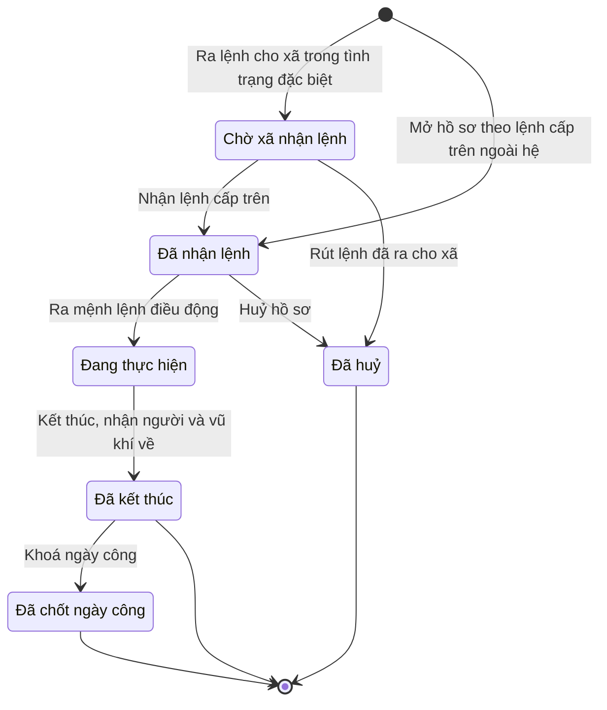

# qt-13b · Điều động trong tình trạng đặc biệt

<!-- máy sinh: tom-tat -->
> **Hồ sơ:** Điều động trong tình trạng đặc biệt (`SpecialDeployment`)
>
> **Trong sổ phạm vi:** 13b · Điều động trong tình trạng đặc biệt (tầng 2)
>
> 14 bước · 6 chặng · 5 vai · 0 bảng quyết định · 0 hạn · 8 khớp nối.
>
> **Nguồn:** sổ nghiệp vụ `qt-13b` · khai báo của app: `dqtv-app/core/processes/special-deployment/workflow/special-deployment.yaml`. Các bảng do máy sinh từ nguồn này.
<!-- hết: tom-tat -->

<!-- viết tay: dien-giai -->
## Diễn giải

*Phần này viết tay, diễn giải lại điều các bảng bên dưới ghi.*

### Quy trình này để làm gì

Ban CHQS xã theo dõi một lần **điều động trong tình trạng đặc biệt** theo lệnh của cấp có thẩm quyền: nhận lệnh, Chỉ huy trưởng ra mệnh lệnh điều động, bố trí người, báo cáo tình hình trong lúc làm, nhận người và vũ khí về, rồi khoá ngày công và lập chế độ. Có sáu tình trạng (từ tình trạng khẩn cấp về quốc phòng tới giới nghiêm, chiến tranh) và sáu loại cấp ra lệnh.

Hồ sơ đi qua các chặng: *Chờ xã nhận lệnh* → *Đã nhận lệnh* → *Đang thực hiện* → *Đã kết thúc*; có thêm chặng *Đã huỷ*.

### Khi nào bắt đầu

Người dùng đã chốt: lệnh cấp trên đến xã bằng hai đường, cùng một hồ sơ.

- **Lệnh ra trên hệ:** Bộ CHQS cấp tỉnh bấm **Ra lệnh cho xã trong tình trạng đặc biệt**, nhập xã nhận lệnh, tình trạng, cấp ra lệnh, lệnh cấp trên và cấp ra lệnh — cấp chi chế độ. Hồ sơ vào chặng *Chờ xã nhận lệnh*; ở xã, Trợ lý Tác huấn bấm **Nhận lệnh cấp trên** để sang *Đã nhận lệnh*.
- **Lệnh đến ngoài hệ** (lệnh miệng, điện thoại, điện, hoặc khi mạng đứt): xã tự bấm **Mở hồ sơ theo lệnh cấp trên ngoài hệ**, nhập cùng các ô trên (trừ xã nhận lệnh). Hồ sơ vào thẳng *Đã nhận lệnh*. Lệnh miệng thì ghi ai ra lệnh, lúc nào, qua đường nào.

### Diễn ra thế nào

**Chặng "Đã nhận lệnh".** Chỉ huy trưởng Ban CHQS xã bấm **Ra mệnh lệnh điều động**: chọn chiến sĩ được điều động, ghi địa bàn làm nhiệm vụ; vũ khí, trang bị, phương tiện nhập nếu có. Hồ sơ sang *Đang thực hiện*. Người dùng đã chốt đây là hậu kiểm: ra lệnh là người đi ngay, bản ký và số văn thư làm sau.

**Chặng "Đang thực hiện"** — các việc làm trong lúc hồ sơ đứng yên:

- **Bố trí người, vị trí, trạm** (Chỉ huy trưởng) — ghi bố trí người vào vị trí, trạm, chốt; lặp được.
- **Ký mệnh lệnh điều động** (Chỉ huy trưởng) — gắn bản chụp mệnh lệnh đã ký; đã ký rồi thì không ký lại.
- **Cấp số mệnh lệnh điều động** (Nhân viên văn thư) — phải ký rồi mới cấp số được; đã có số thì không cấp lại.
- **Báo cáo tình hình lên Bộ CHQS tỉnh** (Trợ lý Tác huấn) — nhập nội dung báo cáo; văn bản báo cáo gắn nếu đã vào sổ văn bản đi; lặp được.

Ra khỏi chặng này có hai đường. **Kết thúc, nhận người và vũ khí về** (Trợ lý Tác huấn) đòi đã ký và đã có số mệnh lệnh, phải ghi kết quả; hồ sơ sang *Đã kết thúc*. **Huỷ hồ sơ** (Chỉ huy trưởng) phải ghi lý do huỷ; hồ sơ sang *Đã huỷ*. Người dùng thêm bước huỷ cho đúng tình huống mệnh lệnh không được ký, cấp số nên hồ sơ không đi tiếp được; hồ sơ huỷ thì không khoá ngày công, không lập chế độ.

**Hai việc gắn, làm được ở cả ba chặng "Đã nhận lệnh", "Đang thực hiện", "Đã kết thúc"** (Trợ lý Tác huấn): **Gắn vào vụ việc ứng phó** và **Gắn văn bản lệnh cấp trên** — chọn văn bản trong sổ văn bản đến, gắn sau.

**Chặng "Đã kết thúc".** Trợ lý Tác huấn bấm **Khoá ngày công**. Sau đó Trợ lý Quân lực bấm **Lập hồ sơ chế độ ngày công** — phải khoá ngày công trước và phải có cấp ra lệnh — cấp chi chế độ. Mỗi bước chỉ làm một lần (lập lần hai là "chi đúp"). Hồ sơ đứng yên ở *Đã kết thúc*.

### Kết thúc và để lại gì

Hồ sơ kết thúc ở chặng *Đã kết thúc*; ở chặng này vẫn còn bốn bước làm được (hai bước gắn, khoá ngày công, lập hồ sơ chế độ). Hồ sơ gắn với **Vụ việc ứng phó** (20) và **Văn bản đến** (1.incoming-document) ở hai bước gắn nêu trên, và với **Văn bản đi** (1.outgoing-document) ở bước báo cáo tình hình. Hồ sơ trợ cấp ngày công (12b) phát sinh từ lần điều động này, căn cứ là các dòng ngày công của từng người trong nhiệm vụ.

### Điều kiện chặn

- Mọi bước trừ hai bước mở: người làm phải thuộc đơn vị chủ hồ sơ. Sai người, sai chặng, thiếu thứ phải có trước thì bước bị chặn, hồ sơ giữ nguyên.
- Thứ tự bắt buộc: ký → cấp số → kết thúc; khoá ngày công → lập hồ sơ chế độ.
- Báo cáo kết quả không phải điều kiện để đóng hồ sơ.
- Bước huỷ: phải ghi lý do huỷ.
<!-- hết viết tay -->

## 1. Đường đi ngắn nhất qua các chặng

<!-- máy sinh: luong-chinh -->
Đường ít bước nhất từ lúc mở hồ sơ tới chặng kết thúc xa nhất. Máy chọn theo số chặng, không theo ý nghĩa nghiệp vụ — trình tự công việc thật xem phần Diễn giải và bảng "Việc làm ở từng chặng" ở mục 6.

| # | Ai làm | Làm gì | Hồ sơ sang chặng |
|---|---|---|---|
| 1 | Trợ lý Tác huấn (`orderReceiver`) | Mở hồ sơ theo lệnh cấp trên ngoài hệ | Đã nhận lệnh |
| 2 | Chỉ huy trưởng Ban CHQS xã | Ra mệnh lệnh điều động | Đang thực hiện |
| 3 | Trợ lý Tác huấn (`operator`) | Kết thúc, nhận người và vũ khí về | Đã kết thúc |
| 4 | Trợ lý Tác huấn (`operator`) | Khoá ngày công | Đã chốt ngày công |

<!-- hết: luong-chinh -->

## 2. Hồ sơ và việc nó để lại

<!-- máy sinh: muc-tieu -->
**App gọi quy trình này là:** Điều động trong tình trạng đặc biệt.

**Khi mở, hồ sơ này ghi mối nối tới:**
- Văn bản đến (1.incoming-document) — bước `receiveSuperiorOrder`, khớp nối `specialDeploymentFromIncomingDocument`

**Hồ sơ này để lại cho quy trình khác** (bước tạo hồ sơ của quy trình kia ghi mối nối về đây):
- Hồ sơ chế độ chính sách (12b) — bước `raiseAllowanceFromSpecialDeployment`, khớp nối `claimArisesFromSpecialDeployment`
- Đề nghị cấp kinh phí (4.funding-request) — bước `estimateCommuneFundingRequest`, khớp nối `fundingRequestFromSpecialDeployment`
- Đề nghị cấp kinh phí (4.funding-request) — bước `estimateProvinceFundingRequest`, khớp nối `fundingRequestFromSpecialDeployment`
<!-- hết: muc-tieu -->

## 3. Khởi phát và kết thúc

<!-- máy sinh: khoi-phat -->
**2 cửa vào** — bước mở hồ sơ:

| Bước mở | Ai mở | Hồ sơ vào chặng | App bắt buộc nhập |
|---|---|---|---|
| Ra lệnh cho xã trong tình trạng đặc biệt | Bộ CHQS cấp tỉnh | Chờ xã nhận lệnh | mã xã, tình trạng, cấp ra lệnh, lệnh cấp trên, cấp ra lệnh — cấp chi chế độ |
| Mở hồ sơ theo lệnh cấp trên ngoài hệ | Trợ lý Tác huấn (`orderReceiver`) | Đã nhận lệnh | `documentId`, tình trạng, cấp ra lệnh, cấp ra lệnh — cấp chi chế độ |

**Kết thúc:** *Đã kết thúc* (`COMPLETED`), *Đã chốt ngày công* (`DAYS_LOCKED`), *Đã huỷ* (`CANCELLED`)
<!-- hết: khoi-phat -->

## 4. Vai trò

<!-- máy sinh: vai-tro -->
| Vai trong sổ | Tên trong app | Điều kiện | Làm những bước |
|---|---|---|---|
| `upperCommand` | Bộ CHQS cấp tỉnh |  | Ra lệnh cho xã trong tình trạng đặc biệt |
| `orderReceiver` | Trợ lý Tác huấn (`orderReceiver`) |  | Nhận lệnh cấp trên · Mở hồ sơ theo lệnh cấp trên ngoài hệ |
| `upperCommand` | Bộ CHQS cấp tỉnh | thuộc cấp trên của chủ hồ sơ (`actorInSuperiorUnit`, công thức ở mục 7) | Rút lệnh đã ra cho xã |
| `commander` | Chỉ huy trưởng Ban CHQS xã |  | Ra mệnh lệnh điều động · Bố trí người, vị trí, trạm · Huỷ hồ sơ |
| `operator` | Trợ lý Tác huấn (`operator`) |  | Trình ký mệnh lệnh điều động · Trình ký báo cáo tình hình lên Bộ CHQS tỉnh · Gắn vào vụ việc ứng phó · Gắn văn bản lệnh cấp trên · Kết thúc, nhận người và vũ khí về · Khoá ngày công |
| `system` | Hệ thống tự làm |  | Báo cáo tình hình lên Bộ CHQS tỉnh |

*"Tên trong app" là tên app đặt cho mã chủ thể của vai. Hồ sơ thuộc đơn vị cấp khác thì người làm là người giữ vai ấy ở đơn vị nêu trong cột "Điều kiện" (nếu sổ có ghi) và ở cột "Người làm phải thuộc" của bảng "Theo khai báo của app" (mục 7).*
<!-- hết: vai-tro -->

## 5. Nhánh phụ

<!-- máy sinh: nhanh-phu -->
**Bước khác đưa hồ sơ sang chặng mới** — đường song song, rẽ nhánh hoặc kết thúc sớm:

| Bước | Ai làm | Từ chặng | Sang chặng |
|---|---|---|---|
| Nhận lệnh cấp trên | Trợ lý Tác huấn (`orderReceiver`) | Chờ xã nhận lệnh | Đã nhận lệnh |
| Rút lệnh đã ra cho xã | Bộ CHQS cấp tỉnh (thuộc cấp trên của chủ hồ sơ) | Chờ xã nhận lệnh | Đã huỷ |
| Huỷ hồ sơ | Chỉ huy trưởng Ban CHQS xã | Đã nhận lệnh | Đã huỷ |

**Làm trong lúc hồ sơ đứng yên ở một chặng** — ghi nhận, bổ sung:

| Bước | Ai làm | Ở chặng |
|---|---|---|
| Bố trí người, vị trí, trạm *(lặp được)* | Chỉ huy trưởng Ban CHQS xã | Đang thực hiện |
| Trình ký mệnh lệnh điều động | Trợ lý Tác huấn (`operator`) | Đang thực hiện |
| Trình ký báo cáo tình hình lên Bộ CHQS tỉnh *(lặp được)* | Trợ lý Tác huấn (`operator`) | Đang thực hiện |
| Báo cáo tình hình lên Bộ CHQS tỉnh *(lặp được)* | Hệ thống tự làm | Đang thực hiện |
| Gắn vào vụ việc ứng phó | Trợ lý Tác huấn (`operator`) | Đã nhận lệnh, Đang thực hiện, Đã kết thúc, Đã chốt ngày công |
| Gắn văn bản lệnh cấp trên *(lặp được)* | Trợ lý Tác huấn (`operator`) | Đã nhận lệnh, Đang thực hiện, Đã kết thúc, Đã chốt ngày công |

**Cửa vào khác:** 2 bước cùng mở hồ sơ — xem mục 3.

<!-- hết: nhanh-phu -->

## 6. Các chặng và việc làm ở từng chặng

<!-- máy sinh: chang -->
| Chặng | Tên hiển thị | Vào bằng bước | Kết thúc? |
|---|---|---|---|
| `PENDING_RECEIPT` | Chờ xã nhận lệnh | Ra lệnh cho xã trong tình trạng đặc biệt |  |
| `RECEIVED` | Đã nhận lệnh | Nhận lệnh cấp trên · Mở hồ sơ theo lệnh cấp trên ngoài hệ |  |
| `IN_PROGRESS` | Đang thực hiện | Ra mệnh lệnh điều động |  |
| `COMPLETED` | Đã kết thúc | Kết thúc, nhận người và vũ khí về | **kết thúc** — vẫn còn bước làm được |
| `DAYS_LOCKED` | Đã chốt ngày công | Khoá ngày công | **kết thúc** — vẫn còn bước làm được |
| `CANCELLED` | Đã huỷ | Rút lệnh đã ra cho xã · Huỷ hồ sơ | **kết thúc** |

### Việc làm ở từng chặng

Hồ sơ đang ở chặng nào thì làm được những bước nào.

| Hồ sơ đang ở chặng | Bước làm tại chặng (hồ sơ đứng yên) | Bước đưa hồ sơ sang chặng khác |
|---|---|---|
| **Chờ xã nhận lệnh** | — | Nhận lệnh cấp trên — Trợ lý Tác huấn (`orderReceiver`) → *Đã nhận lệnh* Rút lệnh đã ra cho xã — Bộ CHQS cấp tỉnh (thuộc cấp trên của chủ hồ sơ) → *Đã huỷ* |
| **Đã nhận lệnh** | Gắn vào vụ việc ứng phó — Trợ lý Tác huấn (`operator`) Gắn văn bản lệnh cấp trên (lặp được) — Trợ lý Tác huấn (`operator`) | Ra mệnh lệnh điều động — Chỉ huy trưởng Ban CHQS xã → *Đang thực hiện* Huỷ hồ sơ — Chỉ huy trưởng Ban CHQS xã → *Đã huỷ* |
| **Đang thực hiện** | Bố trí người, vị trí, trạm (lặp được) — Chỉ huy trưởng Ban CHQS xã Trình ký mệnh lệnh điều động — Trợ lý Tác huấn (`operator`) Trình ký báo cáo tình hình lên Bộ CHQS tỉnh (lặp được) — Trợ lý Tác huấn (`operator`) Báo cáo tình hình lên Bộ CHQS tỉnh (lặp được) — Hệ thống tự làm Gắn vào vụ việc ứng phó — Trợ lý Tác huấn (`operator`) Gắn văn bản lệnh cấp trên (lặp được) — Trợ lý Tác huấn (`operator`) | Kết thúc, nhận người và vũ khí về — Trợ lý Tác huấn (`operator`) → *Đã kết thúc* |
| **Đã kết thúc** | Gắn vào vụ việc ứng phó — Trợ lý Tác huấn (`operator`) Gắn văn bản lệnh cấp trên (lặp được) — Trợ lý Tác huấn (`operator`) | Khoá ngày công — Trợ lý Tác huấn (`operator`) → *Đã chốt ngày công* |
| **Đã chốt ngày công** | Gắn vào vụ việc ứng phó — Trợ lý Tác huấn (`operator`) Gắn văn bản lệnh cấp trên (lặp được) — Trợ lý Tác huấn (`operator`) | — (kết thúc) |
| **Đã huỷ** | — | — (kết thúc) |
<!-- hết: chang -->

## 7. Bảng bước

<!-- máy sinh: buoc -->
| # | Bước | Mã bước | Ai thực hiện | Từ chặng | Sang chặng | Phải có trước | Ghi lại |
|---|---|---|---|---|---|---|---|
| 1 | Ra lệnh cho xã trong tình trạng đặc biệt | `issueSuperiorOrderInSystem` | Bộ CHQS cấp tỉnh | — (mở hồ sơ) | `PENDING_RECEIPT` | — | đơn vị chủ hồ sơ, cấp trên của chủ hồ sơ, tình trạng, cấp ra lệnh, lệnh cấp trên, cấp ra lệnh — cấp chi chế độ, cấp trên ra lệnh lúc, `id` |
| 2 | Nhận lệnh cấp trên | `acknowledgeSuperiorOrder` | Trợ lý Tác huấn (`orderReceiver`) | `PENDING_RECEIPT` | `RECEIVED` | người làm thuộc đơn vị chủ hồ sơ | xã nhận lệnh lúc |
| 3 | Rút lệnh đã ra cho xã | `withdrawSuperiorOrder` | Bộ CHQS cấp tỉnh (thuộc cấp trên của chủ hồ sơ) | `PENDING_RECEIPT` | `CANCELLED` | lý do huỷ, người làm thuộc cấp trên của chủ hồ sơ | lý do huỷ, huỷ lúc |
| 4 | Mở hồ sơ theo lệnh cấp trên ngoài hệ | `receiveSuperiorOrder` | Trợ lý Tác huấn (`orderReceiver`) | — (mở hồ sơ) | `RECEIVED` | `specialDeploymentFromIncomingDocumentUsable` | đơn vị chủ hồ sơ, cấp trên của chủ hồ sơ, tình trạng, cấp ra lệnh, lệnh cấp trên, cấp ra lệnh — cấp chi chế độ, xã nhận lệnh lúc, nối tới Văn bản đến, `id` |
| 5 | Ra mệnh lệnh điều động | `issueSpecialDeploymentOrder` | Chỉ huy trưởng Ban CHQS xã | `RECEIVED` | `IN_PROGRESS` | người làm thuộc đơn vị chủ hồ sơ | quân số, vũ khí, trang bị, phương tiện, địa bàn làm nhiệm vụ, ra mệnh lệnh lúc, nối tới Chiến sĩ dân quân tự vệ |
| 6 | Bố trí người, vị trí, trạm | `assignPersonnelAndPosts` | Chỉ huy trưởng Ban CHQS xã | `IN_PROGRESS` | giữ nguyên | người làm thuộc đơn vị chủ hồ sơ | quân số, bố trí vị trí, trạm, nối tới Chiến sĩ dân quân tự vệ |
| 7 | Trình ký mệnh lệnh điều động | `requestSpecialDeploymentOrderSignature` | Trợ lý Tác huấn (`operator`) | `IN_PROGRESS` | giữ nguyên | người làm thuộc đơn vị chủ hồ sơ, `noSpecialDeploymentOrderDocumentOpen` | nối tới Văn bản đi |
| 8 | Trình ký báo cáo tình hình lên Bộ CHQS tỉnh | `requestReportSituationToProvinceSignature` | Trợ lý Tác huấn (`operator`) | `IN_PROGRESS` | giữ nguyên | `noSpecialDeploymentSituationReportDocumentOpen`, người làm thuộc đơn vị chủ hồ sơ | nối tới Văn bản đi |
| 9 | Báo cáo tình hình lên Bộ CHQS tỉnh | `reportSituationToProvince` | Hệ thống tự làm | `IN_PROGRESS` | giữ nguyên | — | báo cáo tình hình lúc |
| 10 | Gắn vào vụ việc ứng phó | `linkResponseCase` | Trợ lý Tác huấn (`operator`) | `RECEIVED`, `IN_PROGRESS`, `COMPLETED`, `DAYS_LOCKED` | giữ nguyên | người làm thuộc đơn vị chủ hồ sơ | nối tới Vụ việc ứng phó |
| 11 | Gắn văn bản lệnh cấp trên | `linkSuperiorOrderDocument` | Trợ lý Tác huấn (`operator`) | `RECEIVED`, `IN_PROGRESS`, `COMPLETED`, `DAYS_LOCKED` | giữ nguyên | người làm thuộc đơn vị chủ hồ sơ, `specialDeploymentFromIncomingDocumentUsable` | lệnh cấp trên, nối tới Văn bản đến |
| 12 | Kết thúc, nhận người và vũ khí về | `completeSpecialDeployment` | Trợ lý Tác huấn (`operator`) | `IN_PROGRESS` | `COMPLETED` | `specialDeploymentOrderDocumentIssued`, người làm thuộc đơn vị chủ hồ sơ | kết thúc lúc, nhận người, vũ khí về lúc, kết quả, lý do kết thúc sớm |
| 13 | Huỷ hồ sơ | `cancelSpecialDeployment` | Chỉ huy trưởng Ban CHQS xã | `RECEIVED` | `CANCELLED` | lý do huỷ, người làm thuộc đơn vị chủ hồ sơ | lý do huỷ, huỷ lúc |
| 14 | Khoá ngày công | `lockSpecialDeploymentDays` | Trợ lý Tác huấn (`operator`) | `COMPLETED` | `DAYS_LOCKED` | người làm thuộc đơn vị chủ hồ sơ | tổng ngày công, nối tới Ngày công của một người trong nhiệm vụ, nối `missionDayOfMember` |

### Khi không đạt điều kiện

Mặc định: không đúng người, hồ sơ không ở đúng chặng, hoặc thiếu thứ "phải có trước" thì bước bị chặn, hồ sơ giữ nguyên. Bảng dưới chỉ kê những bước có kết quả riêng.

| # | Bước | Kết quả riêng |
|---|---|---|
| 9 | Báo cáo tình hình lên Bộ CHQS tỉnh | bước này không do người nào bấm |

### Điều kiện "phải có trước" bằng lời

Cột "Phải có trước" ở bảng bước có hai loại: ô dữ liệu thường (bước chỉ đòi ô ấy đã có giá trị) và điều kiện hệ tự xét. Bảng này diễn các điều kiện hệ tự xét theo đúng công thức sổ ghi; số ở cột cuối là số thứ tự bước.

| Điều kiện | Đúng khi | Bước đòi |
|---|---|---|
| `actorInOwnerUnit` | người đang làm là người của đơn vị ghi ở ô đơn vị chủ hồ sơ của hồ sơ này (theo danh mục người của đơn vị, `dm.unit-staff`) | 2, 5, 6, 7, 8, 10, 11, 12, 13, 14 |
| `actorInSuperiorUnit` | người đang làm là người của một đơn vị nằm trong ô cấp trên của chủ hồ sơ của hồ sơ này (theo danh mục người của đơn vị, `dm.unit-staff`) | 3 |
| `specialDeploymentFromIncomingDocumentUsable` | có hồ sơ Việc luật giao kèm văn bản đến, đi — Văn bản đến (qt-1.incoming-document) chính là hồ sơ ghi ở ô nối `specialDeploymentFromIncomingDocument` của hồ sơ đang làm mà hồ sơ ấy đang ở chặng `RECEIVED` hoặc `DISTRIBUTED` | 4, 11 |
| `noSpecialDeploymentOrderDocumentOpen` | KHÔNG (có hồ sơ Việc luật giao kèm văn bản đến, đi — Văn bản đi (qt-1.outgoing-document) chính là hồ sơ ghi ở ô nối `specialDeploymentOrderByDocument` của hồ sơ đang làm mà hồ sơ ấy đang ở chặng `DRAFT` hoặc `PENDING_SIGNATURE` hoặc `SIGNED`) | 7 |
| `noSpecialDeploymentSituationReportDocumentOpen` | KHÔNG (có hồ sơ Việc luật giao kèm văn bản đến, đi — Văn bản đi (qt-1.outgoing-document) chính là hồ sơ ghi ở ô nối `specialDeploymentSituationReport` của hồ sơ đang làm mà hồ sơ ấy đang ở chặng `DRAFT` hoặc `PENDING_SIGNATURE` hoặc `SIGNED`) | 8 |
| `specialDeploymentOrderDocumentIssued` | có hồ sơ Việc luật giao kèm văn bản đến, đi — Văn bản đi (qt-1.outgoing-document) chính là hồ sơ ghi ở ô nối `specialDeploymentOrderByDocument` của hồ sơ đang làm mà hồ sơ ấy đang ở chặng `ISSUED` | 12 |

### Theo khai báo của app

Người làm phải thuộc đơn vị nào, ô người dùng phải nhập, bước có lặp được không, và căn cứ pháp lý — lấy từ khai báo quy trình trong app.

| # | Bước | Người làm phải thuộc | Bắt buộc nhập | Nhập nếu có | Lặp được | Căn cứ |
|---|---|---|---|---|---|---|
| 1 | Ra lệnh cho xã trong tình trạng đặc biệt |  | xã nhận lệnh, tình trạng, cấp ra lệnh, lệnh cấp trên, cấp ra lệnh — cấp chi chế độ | — |  | L48/2019/QH14 Đ.32 k2 |
| 2 | Nhận lệnh cấp trên | đơn vị chủ hồ sơ | — | — |  | L48/2019/QH14 Đ.32 k2 |
| 3 | Rút lệnh đã ra cho xã | cấp trên của chủ hồ sơ | lý do huỷ | — |  | L48/2019/QH14 Đ.32 k2 |
| 4 | Mở hồ sơ theo lệnh cấp trên ngoài hệ |  | văn bản lệnh trong sổ văn bản đến, tình trạng, cấp ra lệnh, cấp ra lệnh — cấp chi chế độ | lệnh cấp trên |  | L48/2019/QH14 Đ.32 k2; NĐ30/2020/NĐ-CP Đ.21, Đ.22 |
| 5 | Ra mệnh lệnh điều động | đơn vị chủ hồ sơ | chiến sĩ được điều động, địa bàn làm nhiệm vụ, vũ khí, trang bị, phương tiện | — |  | L48/2019/QH14 Đ.32 k2 |
| 6 | Bố trí người, vị trí, trạm | đơn vị chủ hồ sơ | bố trí vị trí, trạm | thêm chiến sĩ | có | L48/2019/QH14 Đ.32 k2 |
| 7 | Trình ký mệnh lệnh điều động | đơn vị chủ hồ sơ | dự thảo mệnh lệnh điều động (PDF) | — |  | L48/2019/QH14 Đ.32 k2; NĐ30/2020/NĐ-CP Đ.13 |
| 8 | Trình ký báo cáo tình hình lên Bộ CHQS tỉnh | đơn vị chủ hồ sơ | dự thảo báo cáo tình hình (PDF) | — | có | L48/2019/QH14 Đ.32 k2; NĐ30/2020/NĐ-CP Đ.13 |
| 9 | Báo cáo tình hình lên Bộ CHQS tỉnh |  | — | — | có | L48/2019/QH14 Đ.32 k2; NĐ30/2020/NĐ-CP Đ.18 |
| 10 | Gắn vào vụ việc ứng phó | đơn vị chủ hồ sơ | vụ việc ứng phó | — |  | L48/2019/QH14 Đ.32 k2 |
| 11 | Gắn văn bản lệnh cấp trên | đơn vị chủ hồ sơ | văn bản trong sổ văn bản đến | lệnh cấp trên | có | NĐ30/2020/NĐ-CP Đ.21 |
| 12 | Kết thúc, nhận người và vũ khí về | đơn vị chủ hồ sơ | kết quả | lý do kết thúc sớm |  | L48/2019/QH14 Đ.32 k2 |
| 13 | Huỷ hồ sơ | đơn vị chủ hồ sơ | lý do huỷ | — |  | L48/2019/QH14 Đ.32 k2 |
| 14 | Khoá ngày công | đơn vị chủ hồ sơ | — | — |  | L48/2019/QH14 Đ.34 k1 a; NĐ72/2020/NĐ-CP Đ.11 |
| — | Lập hồ sơ chế độ ngày công (`raiseSpecialDeploymentAllowances`) | đơn vị chủ hồ sơ | — | — |  | L48/2019/QH14 Đ.34 k1 a; NĐ72/2020/NĐ-CP Đ.11, Đ.14 k5 |

### Điều kiện và ghi chú app khai cho từng bước

Lấy từ khai báo quy trình trong app. Lời trong ngoặc kép là câu app hiện cho người dùng. Chức danh người ký ngoài hệ app chỉ khai bằng mã.

| # | Bước | Điều kiện, ghi chú |
|---|---|---|
| 1 | Ra lệnh cho xã trong tình trạng đặc biệt | · không đòi bản chụp — app ghi: "Lệnh cấp trên ra TRÊN HỆ — bản giấy (nếu có) gắn ở bước linkSuperiorOrderDocument" |
| 3 | Rút lệnh đã ra cho xã | · không đòi bản chụp — app ghi: "Cấp trên rút lệnh đã ra trên hệ khi xã chưa nhận — chưa có ai đi, chưa có văn bản nào ký ở xã" |
| 4 | Mở hồ sơ theo lệnh cấp trên ngoài hệ | · không đòi bản chụp — app ghi: "Văn bản lệnh đã nằm trong sổ văn bản đến — chọn ở ô văn bản, không tải lên lại" |
| 5 | Ra mệnh lệnh điều động | · không đòi bản chụp — app ghi: "Hậu kiểm (người dùng 30/9/2026): ra lệnh là đi — bản ký đính ở bước signSpecialDeploymentOrder" |
| 13 | Huỷ hồ sơ | · không đòi bản chụp — app ghi: "Đóng một hồ sơ chưa ai đi — không có văn bản nào ký" |
| 14 | Khoá ngày công | · không làm được khi đã có ô "khoá ngày công lúc" — app báo: "ngày công của lần điều động này đã khoá rồi — đây là căn cứ chi trả" |
| — | Lập hồ sơ chế độ ngày công | · phải đã có ô "khoá ngày công lúc" — thiếu thì app báo: "chưa khoá ngày công thì chưa có căn cứ lập chế độ — khoá ngày công trước" · không làm được khi đã có ô "lập hồ sơ chế độ lúc" — app báo: "lần điều động này đã lập hồ sơ chế độ rồi — lập lần hai là chi đúp" |
<!-- hết: buoc -->

## 8. Bảng quyết định, hạn, việc ngoài hệ

<!-- máy sinh: quyet-dinh -->

<!-- hết: quyet-dinh -->

## 9. Dữ liệu của hồ sơ

<!-- máy sinh: du-lieu -->
Các ô mà bước trong sổ ghi hoặc đòi. Số trong hai cột cuối là số thứ tự bước ở bảng bước (mục 7).

| Ô dữ liệu | Mã | Kiểu (app) | Giá trị cho phép | Loại ô (sổ) | Bước ghi | Bước đòi | Mô tả trong app |
|---|---|---|---|---|---|---|---|
| đơn vị chủ hồ sơ | `ownerUnit` |  |  | lưu trên hồ sơ (`stored`) | 1, 4 | — |  |
| cấp trên của chủ hồ sơ | `superiorUnits` |  |  | hệ suy ra (`derived`) | 1, 4 | — |  |
| tình trạng | `specialState` | chọn một | Tình trạng khẩn cấp về quốc phòng (`defence_emergency`), Tình trạng khẩn cấp về an ninh (`security_emergency`), Tình trạng khẩn cấp về thảm hoạ (`disaster_emergency`), Thiết quân luật (`martial_law`), Giới nghiêm (`curfew`), Tình trạng chiến tranh (`war`) | lưu trên hồ sơ (`stored`) | 1, 4 | — | Tình trạng đặc biệt — L48/2019 Đ.32 k2; Luật Quốc phòng Đ.24 k2 c; Luật Tình trạng khẩn cấp 104/2025 |
| cấp ra lệnh | `issuingAuthority` | chọn một | Quân khu (`military_region`), Ban chỉ huy tình trạng khẩn cấp tỉnh (`province_emergency_board`), Uỷ ban quân sự xã (`commune_military_committee`), UBND xã — lệnh giới nghiêm (`commune_committee_curfew`), UBND tỉnh — lệnh giới nghiêm (`province_committee_curfew`), Chỉ huy cấp trên (Bộ CHQS tỉnh) (`superior_command`) | lưu trên hồ sơ (`stored`) | 1, 4 | — | Ai ra lệnh — quân khu, Ban chỉ huy khẩn cấp tỉnh, Uỷ ban quân sự xã, UBND xã/tỉnh (giới nghiêm), chỉ huy cấp trên |
| lệnh cấp trên | `upperOrderRef` | chữ | có hay chưa | lưu trên hồ sơ (`stored`) | 1, 4, 11 | — | Số, ký hiệu lệnh cấp trên — lệnh miệng thì ghi ai ra lệnh, lúc nào, qua đường nào |
| cấp ra lệnh — cấp chi chế độ | `decidingLevel` | chọn một | Cấp xã (`commune`), Cấp tỉnh (`province`), Trung ương (`central`) | lưu trên hồ sơ (`stored`) | 1, 4 | — | Cấp ra lệnh — cũng là cấp bảo đảm kinh phí chế độ (sổ qt-13b: cấp chi là cấp ra lệnh) |
| cấp trên ra lệnh lúc | `issuedToCommuneAt` | ngày giờ | có hay chưa | lưu trên hồ sơ (`stored`) | 1 | — | Thời điểm cấp trên ra lệnh trên hệ cho xã |
| — | `id` |  |  | lưu trên hồ sơ (`stored`) | 1, 4 | — |  |
| xã nhận lệnh lúc | `receivedAt` | ngày giờ | có hay chưa | lưu trên hồ sơ (`stored`) | 2, 4 | — | Thời điểm xã nhận lệnh |
| lý do huỷ | `cancelReason` | chữ |  | đưa vào ở bước (`input`) | 3, 13 | 3, 13 | Lý do huỷ hồ sơ |
| huỷ lúc | `cancelledAt` | ngày giờ |  | lưu trên hồ sơ (`stored`) | 3, 13 | — | Thời điểm huỷ hồ sơ |
| quân số | `deployedCount` | số | có hay chưa | lưu trên hồ sơ (`stored`) | 5, 6 | — | Quân số điều động — con số THẬT là số cạnh specialDeploysMember |
| vũ khí, trang bị, phương tiện | `weaponsAndEquipment` | chữ | có hay chưa | lưu trên hồ sơ (`stored`) | 5 | — | Vũ khí, trang bị, phương tiện mang theo |
| địa bàn làm nhiệm vụ | `missionArea` | chữ | có hay chưa | lưu trên hồ sơ (`stored`) | 5 | — | Địa bàn, vị trí làm nhiệm vụ |
| ra mệnh lệnh lúc | `orderedAt` | ngày giờ | có hay chưa | lưu trên hồ sơ (`stored`) | 5 | — | Thời điểm Chỉ huy trưởng ra mệnh lệnh — người đi ngay |
| bố trí vị trí, trạm | `postAssignment` | chữ | có hay chưa | lưu trên hồ sơ (`stored`) | 6 | — | Bố trí người vào vị trí, trạm, chốt |
| báo cáo tình hình lúc | `situationReportedAt` | ngày giờ | có hay chưa | lưu trên hồ sơ (`stored`) | 9 | — | Thời điểm văn thư phát hành báo cáo tình hình gần nhất lên Bộ CHQS tỉnh — mọi tờ ở cạnh báo cáo |
| kết thúc lúc | `completedAt` | ngày giờ | có hay chưa | lưu trên hồ sơ (`stored`) | 12 | — | Thời điểm kết thúc nhiệm vụ |
| nhận người, vũ khí về lúc | `returnedAt` | ngày giờ | có hay chưa | lưu trên hồ sơ (`stored`) | 12 | — | Thời điểm nhận người, vũ khí, phương tiện về |
| kết quả | `resultSummary` | chữ | có hay chưa | lưu trên hồ sơ (`stored`) | 12 | — | Kết quả thực hiện nhiệm vụ |
| lý do kết thúc sớm | `earlyEndReason` | chữ |  | đưa vào ở bước (`input`) | 12 | — | Lý do kết thúc sớm — người dùng 15/10/2026: đã có người đi thì không huỷ mà kết thúc sớm kèm lý do |
| tổng ngày công | `totalManDays` | số | có hay chưa | lưu trên hồ sơ (`stored`) | 14 | — | Tổng ngày công của nhiệm vụ |
| người làm thuộc đơn vị chủ hồ sơ | `actorInOwnerUnit` |  | có hay chưa | hệ suy ra (`derived`) | — | 2, 5, 6, 7, 8, 10, 11, 12, 13, 14 |  |
| người làm thuộc cấp trên của chủ hồ sơ | `actorInSuperiorUnit` |  | có hay chưa | hệ suy ra (`derived`) | — | 3 |  |
| — | `specialDeploymentFromIncomingDocumentUsable` |  | có hay chưa | hệ suy ra (`derived`) | — | 4, 11 |  |
| — | `noSpecialDeploymentOrderDocumentOpen` |  | có hay chưa | hệ suy ra (`derived`) | — | 7 |  |
| — | `noSpecialDeploymentSituationReportDocumentOpen` |  | có hay chưa | hệ suy ra (`derived`) | — | 8 |  |
| — | `specialDeploymentOrderDocumentIssued` |  | có hay chưa | hệ suy ra (`derived`) | — | 12 |  |

28 ô. Cột "Loại ô" là cách sổ phân loại ô, in kèm đúng chữ của sổ; ô nào người dùng phải nhập xem bảng "Theo khai báo của app" ở mục 7.
<!-- hết: du-lieu -->

## 10. Khớp nối với quy trình khác

<!-- máy sinh: khop-noi -->
| Quy trình kia | Hồ sơ kia | Quan hệ | Nội dung (mô tả trong app) | Bước ghi mối nối | Tên ô nối |
|---|---|---|---|---|---|
| 1.incoming-document | Văn bản đến | hồ sơ này **mở ra có nối tới** hồ sơ kia | Văn bản lệnh cấp trên trong sổ văn bản đến — chọn lúc mở hồ sơ theo lệnh ngoài hệ, gắn thêm về sau | 13b·linkSuperiorOrderDocument, 13b·receiveSuperiorOrder ⊕ | `specialDeploymentFromIncomingDocument` |
| 1.outgoing-document | Văn bản đi | gắn với nhau ở một bước giữa chừng | Văn bản mệnh lệnh điều động ở Sổ văn bản đi — sổ qt-13b link.specialDeploymentOrderByDocument (NĐ30/2020/NĐ-C… | 13b·requestSpecialDeploymentOrderSignature | `specialDeploymentOrderByDocument` |
| 1.outgoing-document | Văn bản đi | gắn với nhau ở một bước giữa chừng | Văn bản báo cáo tình hình lên Bộ CHQS tỉnh — sổ qt-13b link.specialDeploymentSituationReport (A3.2, 28/10/202… | 13b·requestReportSituationToProvinceSignature | `specialDeploymentSituationReport` |
| 12b | Hồ sơ chế độ chính sách | hồ sơ kia **mở ra từ** hồ sơ này | Hồ sơ trợ cấp ngày công phát sinh từ lần điều động trong tình trạng đặc biệt — qt-13b | 12b·raiseAllowanceFromSpecialDeployment ⊕ | `claimArisesFromSpecialDeployment` |
| 16.enlistment | Chiến sĩ dân quân tự vệ | gắn với nhau ở một bước giữa chừng | Chiến sĩ được điều động theo mệnh lệnh trong tình trạng đặc biệt — sổ qt-13b link.deploysMember | 13b·assignPersonnelAndPosts, 13b·issueSpecialDeploymentOrder | `specialDeploysMember` |
| 20 | Vụ việc ứng phó | gắn với nhau ở một bước giữa chừng | Điều động gắn vào vụ việc ứng phó qt-20 — người dùng 30/9/2026 phương án (A) | 13b·linkResponseCase | `specialDeploymentForCase` |
| 4.funding-request | Đề nghị cấp kinh phí | hồ sơ kia **mở ra từ** hồ sơ này | Dự trù kinh phí phát sinh từ lần điều động trong tình trạng đặc biệt nào — NĐ72/2020 Đ.11, L48/2019 Đ.34 k3 | 4.funding-request·estimateCommuneFundingRequest ⊕, 4.funding-request·estimateProvinceFundingRequest ⊕ | `fundingRequestFromSpecialDeployment` |
| sổ ngày công | Ngày công của một người trong nhiệm vụ | gắn với nhau ở một bước giữa chừng | Dòng ngày công thuộc lần điều động trong tình trạng đặc biệt nào — căn cứ chi trợ cấp ngày công | 13b·lockSpecialDeploymentDays | `missionDayOfSpecialDeployment` |

8 khớp nối. ⊕ là bước tạo hồ sơ.
<!-- hết: khop-noi -->

## 11. Thông tin chung

<!-- máy sinh: thong-tin -->
| | |
|---|---|
| **Mã trong sổ** | `qt-13b` |
| **Quy trình trong app** | `special-deployment` (`workflow/special-deployment.yaml`) — mặt công tác: `operations` |
| **Hồ sơ** | Điều động trong tình trạng đặc biệt (`SpecialDeployment`) |
| **Căn cứ pháp lý từng bước** | cột "Căn cứ" ở bảng "Theo khai báo của app", mục 7 |
<!-- hết: thong-tin -->
