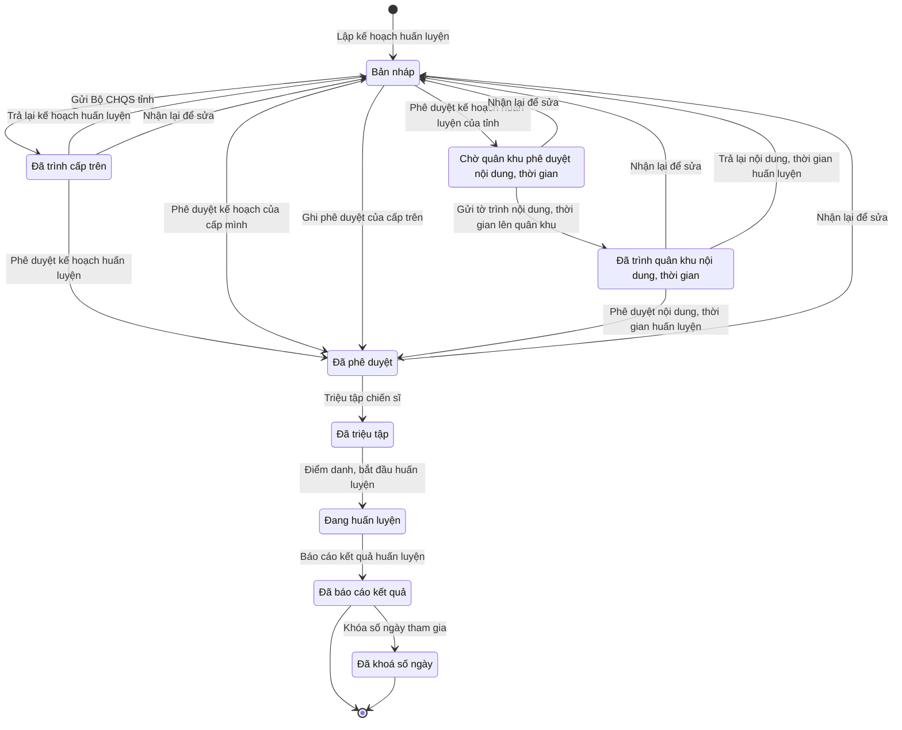

# qt-14 · Đợt tập trung: huấn luyện, diễn tập, tập huấn, hội thi

<!-- máy sinh: tom-tat -->
> **Hồ sơ:** Sự kiện — huấn luyện, hội thi, diễn tập, hội nghị (`TrainingEvent`)
>
> **Trong sổ phạm vi:** 14 · Đợt tập trung: huấn luyện, diễn tập, tập huấn, hội thi (tầng 1)
>
> 31 bước · 9 chặng · 7 vai · 2 bảng quyết định · 0 hạn · 27 khớp nối.
>
> **Nguồn:** sổ nghiệp vụ `qt-14` · khai báo của app: `dqtv-app/core/processes/training/workflow/training.yaml`. Các bảng do máy sinh từ nguồn này.
<!-- hết: tom-tat -->

<!-- viết tay: dien-giai -->
## Diễn giải

*Phần này viết tay, diễn giải lại điều các bảng bên dưới ghi.*

### Quy trình này để làm gì

Đơn vị tổ chức theo dõi một **đợt tập trung** — có năm loại: huấn luyện, tập huấn/bồi dưỡng, hội thi, hội thao, diễn tập — từ lúc lập kế hoạch tới lúc báo cáo kết quả và chốt ngày công. Người làm chính là Trợ lý Tác huấn; Chỉ huy trưởng ký tờ trình và duyệt kết quả; Bộ CHQS cấp tỉnh phê duyệt kế hoạch và kiểm tra.

Hồ sơ đi qua bảy chặng: *Bản nháp* → *Chờ ký tờ trình* → *Đã ký, chờ gửi* → *Đã trình cấp trên* → *Đã triệu tập* → *Đang huấn luyện* → *Đã báo cáo kết quả*.

### Khi nào bắt đầu

Trợ lý Tác huấn bấm **Lập kế hoạch huấn luyện**, bắt buộc nhập tên đợt, loại, cấp tổ chức, từ ngày, đến ngày, `planTargetIds` và `taskingId`; có đạn thật – thuốc nổ hay không, chương trình áp dụng và `planDocumentIds` là ô nhập nếu có. Hồ sơ mở ra có nối tới **Chỉ tiêu** (quy trình 2) và **Nhiệm vụ trên giao** (quy trình 1).

Bước mở bị chặn (`level-not-allowed`) nếu loại đợt không hợp với cấp tổ chức — xem "Điều kiện chặn".

### Diễn ra thế nào

**Chặng "Bản nháp".** Trợ lý Tác huấn **Sửa kế hoạch** nếu cần, rồi bấm **Trình ký tờ trình kế hoạch huấn luyện**, kèm tờ trình (PDF); hồ sơ sang *Chờ ký tờ trình*.

**Chặng "Chờ ký tờ trình" và "Đã ký, chờ gửi".** Chỉ huy trưởng Ban CHQS xã bấm **Ký tờ trình** (sang *Đã ký, chờ gửi*), hoặc **Trả lại tờ trình** kèm cần sửa gì — trả được ở cả hai chặng, hồ sơ về *Bản nháp*. Nhân viên văn thư bấm **Gửi Bộ CHQS tỉnh**, kèm tờ trình đã ký, đã ghi số; hồ sơ sang *Đã trình cấp trên*. Nơi nhận tờ trình là `province_military_command`.

**Việc làm được suốt từ "Bản nháp" tới "Đã trình cấp trên":** Trợ lý Tác huấn bấm **Xác nhận văn bản cho phép dùng đạn thật, đính kèm ảnh** — bắt buộc nhập `decisionNumber`, `subject`, `signedBy`, `signedDate`, `legalBasis`, `scanPath`. Đây là quyết định ký ngoài hệ, người ký là `defence_minister` hoặc `general_staff_chief`; bước này chỉ làm một lần.

**Chặng "Đã trình cấp trên".** Bộ CHQS cấp tỉnh (phải là người của một đơn vị nằm trong ô cấp trên của chủ hồ sơ) bấm **Phê duyệt kế hoạch huấn luyện** hoặc **Trả lại để bổ sung**; cả hai không đổi chặng; trả lại thì phải ghi `opinion`. Bị trả thì Trợ lý Tác huấn bấm **Nhận lại để sửa**, hồ sơ về *Bản nháp*. Được duyệt thì:

- Nhân viên quân khí kiêm thủ kho bấm **Xác nhận bảo đảm vật chất**; Nhân viên tài chính kiêm hậu cần bấm **Xác nhận bảo đảm kinh phí**. Cả hai làm được ở chặng này hoặc chặng *Đã triệu tập*, mỗi bước một lần.
- Trợ lý Tác huấn bấm **Triệu tập chiến sĩ**; hồ sơ sang *Đã triệu tập*. Có người đang vướng việc khác thì ghi lý do vẫn huy động.

**Chặng "Đã triệu tập" và "Đang huấn luyện".** Trợ lý Tác huấn bấm **Điểm danh, bắt đầu huấn luyện** — phải đã có đủ hai xác nhận bảo đảm vật chất và bảo đảm kinh phí; nhập `trainingDate` và bảng điểm danh. Bước đưa hồ sơ sang *Đang huấn luyện* và lặp được ở chặng ấy. Hết đợt, Trợ lý Tác huấn bấm **Báo cáo kết quả huấn luyện**: xếp loại, nội dung báo cáo, chỉ lệnh huấn luyện làm căn cứ xếp loại; hồ sơ sang *Đã báo cáo kết quả*.

Làm được từ *Đã triệu tập* trở đi, kể cả sau khi báo cáo: **Lập dự trù kinh phí** (Nhân viên tài chính kiêm hậu cần) và **Ghi nhận kiểm tra công tác tổ chức** (Bộ CHQS cấp tỉnh; lặp được).

Làm được từ *Đang huấn luyện* trở đi: **Khóa số ngày tham gia** (Trợ lý Tác huấn; phải đã điểm danh), rồi **Lập đề nghị trợ cấp ngày công** (Trợ lý Quân lực; phải đã khoá).

**Chặng "Đã báo cáo kết quả"** — hồ sơ đứng yên, còn các việc, mỗi việc làm một lần:

- **Duyệt kết quả huấn luyện** (Chỉ huy trưởng) — phải có xếp loại.
- **Ghi kết quả vào hồ sơ chiến sĩ** (Trợ lý Quân lực).
- **Dựng dự thảo văn bản báo cáo kết quả** (Trợ lý Tác huấn).
- **Ghi giải hội thi, hội thao** (Trợ lý Tác huấn) — phải có xếp loại, số quyết định trao giải và bản quyết định đã ký; chỉ làm khi loại là Hội thi hoặc Hội thao.
- **Ghi giấy chứng nhận tập huấn** (Trợ lý Tác huấn) — ai được cấp, nơi cấp.

### Kết thúc và để lại gì

Hồ sơ kết thúc ở *Đã báo cáo kết quả*. Theo mục 10, từ đợt này mở ra **Hồ sơ chế độ chính sách** (12b) cho trợ cấp ngày công, **Phiếu cấp phát huấn luyện** (D11) và **Dòng quyết định về một người** (C1) khi lớp tập huấn cấp giấy chứng nhận cho tuyên truyền viên. Giữa chừng, đợt gắn với **Chiến sĩ dân quân tự vệ** ở bước triệu tập và với **Văn bản đi** ở bước trình ký.

### Điều kiện chặn

- Bảng `organizer-level` (xét lúc lập kế hoạch): huấn luyện do xã, cơ quan – tổ chức hoặc tỉnh tổ chức; tập huấn chỉ tỉnh, quân khu, Bộ; hội thi và hội thao không có cấp xã; diễn tập cấp nào cũng được. Sai thì chặn.
- Người làm phải thuộc đơn vị chủ hồ sơ; ba bước của vai Bộ CHQS cấp tỉnh thì phải thuộc cấp trên của chủ hồ sơ — người của một đơn vị nằm trong ô cấp trên của chủ hồ sơ. Bước lập kế hoạch không giới hạn đơn vị. Sai người, sai chặng, thiếu thứ phải có trước thì chặn, hồ sơ giữ nguyên.
- Thứ tự bắt buộc: phê duyệt → triệu tập, bảo đảm vật chất, bảo đảm kinh phí; đủ hai bảo đảm → điểm danh; điểm danh → khoá ngày → lập đề nghị trợ cấp. Ba bước sau phê duyệt đòi kết quả phê duyệt là `approve`, bước nhận lại để sửa đòi kết quả `reject`.
- Phê duyệt kế hoạch: phải đã có `liveAmmoAuthorizedAt`.
- Theo loại: báo cáo kết quả, duyệt kết quả, ghi kết quả vào hồ sơ chiến sĩ, dựng dự thảo văn bản chỉ làm được với năm loại huấn luyện, tập huấn, hội thi, hội thao, diễn tập; ghi giải chỉ với hội thi, hội thao.
<!-- hết viết tay -->

## 1. Đường đi ngắn nhất qua các chặng

<!-- máy sinh: luong-chinh -->
Đường ít bước nhất từ lúc mở hồ sơ tới chặng kết thúc xa nhất. Máy chọn theo số chặng, không theo ý nghĩa nghiệp vụ — trình tự công việc thật xem phần Diễn giải và bảng "Việc làm ở từng chặng" ở mục 6.

| # | Ai làm | Làm gì | Hồ sơ sang chặng |
|---|---|---|---|
| 1 | Trợ lý Tác huấn | Lập kế hoạch huấn luyện | Bản nháp |
| 2 | Bộ CHQS cấp tỉnh | Phê duyệt kế hoạch của cấp mình | Đã phê duyệt |
| 3 | Trợ lý Tác huấn | Triệu tập chiến sĩ | Đã triệu tập |
| 4 | Trợ lý Tác huấn | Điểm danh, bắt đầu huấn luyện | Đang huấn luyện |
| 5 | Trợ lý Tác huấn | Báo cáo kết quả huấn luyện | Đã báo cáo kết quả |
| 6 | Trợ lý Tác huấn | Khóa số ngày tham gia | Đã khoá số ngày |

<!-- hết: luong-chinh -->

## 2. Hồ sơ và việc nó để lại

<!-- máy sinh: muc-tieu -->
**App gọi quy trình này là:** Chặng 2 — Huấn luyện, hội nghị.

**Khi mở, hồ sơ này ghi mối nối tới:**
- Chỉ tiêu (2) — bước `createTrainingPlan`, khớp nối `trainingUnderTarget`
- Kế hoạch, văn kiện (2) — bước `createTrainingPlan`, khớp nối `trainingUnderPlan`
- Nhiệm vụ trên giao (1) — bước `createTrainingPlan`, khớp nối `trainingEventServesTasking`

**Hồ sơ này để lại cho quy trình khác** (bước tạo hồ sơ của quy trình kia ghi mối nối về đây):
- Bảng thanh toán trợ cấp (12a) — bước `openBenefitPaymentBatch`, khớp nối `batchFromEvent`
- Hồ sơ chế độ chính sách (12b) — bước `raiseAllowanceFromEvent`, khớp nối `arisesFromEvent`
- Phiếu cấp phát huấn luyện (D11.training-allocation) — bước `openTrainingAllocation`, khớp nối `allocationForEvent`
- Vụ việc kỷ luật (D15) — bước `openDisciplineFromSource`, khớp nối `disciplineFromTraining`
- Vụ việc vi phạm hành chính (10) — bước `openViolationFromSource`, khớp nối `violationFromTraining`
- Đề nghị cấp kinh phí (4.funding-request) — bước `estimateCommuneFundingRequest`, khớp nối `fundingRequestFromTraining`
- Đề nghị cấp kinh phí (4.funding-request) — bước `estimateProvinceFundingRequest`, khớp nối `fundingRequestFromTraining`
<!-- hết: muc-tieu -->

## 3. Khởi phát và kết thúc

<!-- máy sinh: khoi-phat -->
**1 cửa vào** — bước mở hồ sơ:

| Bước mở | Ai mở | Hồ sơ vào chặng | App bắt buộc nhập |
|---|---|---|---|
| Lập kế hoạch huấn luyện | Trợ lý Tác huấn | Bản nháp | tên đợt, loại, cấp tổ chức, từ ngày, đến ngày, `planTargetIds`, `taskingId`, có đạn thật, thuốc nổ |

**Kết thúc:** *Đã báo cáo kết quả* (`REPORTED`), *Đã khoá số ngày* (`DAYS_LOCKED`)
<!-- hết: khoi-phat -->

## 4. Vai trò

<!-- máy sinh: vai-tro -->
| Vai trong sổ | Tên trong app | Điều kiện | Làm những bước |
|---|---|---|---|
| `operator` | Trợ lý Tác huấn |  | Lập kế hoạch huấn luyện · Sửa kế hoạch · Trình ký tờ trình kế hoạch huấn luyện · Xác nhận văn bản cho phép dùng đạn thật · Ghi phê duyệt của cấp trên · Trình ký văn bản trả lại kế hoạch huấn luyện · Nhận lại để sửa · Trình ký tờ trình nội dung, thời gian huấn luyện · Triệu tập chiến sĩ · Điểm danh, bắt đầu huấn luyện · Báo cáo kết quả huấn luyện · Khóa số ngày tham gia · Dựng dự thảo văn bản báo cáo kết quả · Trình ký quyết định trao giải hội thi, hội thao · Ghi giấy chứng nhận tập huấn · Đề nghị xử lý vi phạm người vắng huấn luyện |
| `clerk` | Nhân viên văn thư |  | Gửi Bộ CHQS tỉnh |
| `approver` | Bộ CHQS cấp tỉnh |  | Phê duyệt kế hoạch huấn luyện · Phê duyệt kế hoạch của cấp mình |
| `system` | Hệ thống tự làm |  | Phê duyệt kế hoạch huấn luyện của tỉnh · Trả lại kế hoạch huấn luyện · Gửi tờ trình nội dung, thời gian lên quân khu · Trả lại nội dung, thời gian huấn luyện · Ghi giải hội thi, hội thao — quyết định đã phát hành |
| `approver` | Bộ CHQS cấp tỉnh | thuộc cấp trên của chủ hồ sơ (`actorInSuperiorUnit`, công thức ở mục 7) | Phê duyệt nội dung, thời gian huấn luyện · Ghi nhận kiểm tra công tác tổ chức |
| `operator` | Trợ lý Tác huấn | thuộc cấp trên của chủ hồ sơ (`actorInSuperiorUnit`, công thức ở mục 7) | Trình ký văn bản trả lại nội dung, thời gian huấn luyện |
| `quartermaster` | Nhân viên quân khí kiêm thủ kho |  | Xác nhận bảo đảm vật chất |
| `finance` | Nhân viên tài chính kiêm hậu cần |  | Lập dự trù kinh phí · Xác nhận bảo đảm kinh phí |
| `verifier` | Chỉ huy trưởng Ban CHQS xã |  | Duyệt kết quả huấn luyện |

*"Tên trong app" là tên app đặt cho mã chủ thể của vai. Hồ sơ thuộc đơn vị cấp khác thì người làm là người giữ vai ấy ở đơn vị nêu trong cột "Điều kiện" (nếu sổ có ghi) và ở cột "Người làm phải thuộc" của bảng "Theo khai báo của app" (mục 7).*
<!-- hết: vai-tro -->

## 5. Nhánh phụ

<!-- máy sinh: nhanh-phu -->
**Bước khác đưa hồ sơ sang chặng mới** — đường song song, rẽ nhánh hoặc kết thúc sớm:

| Bước | Ai làm | Từ chặng | Sang chặng |
|---|---|---|---|
| Gửi Bộ CHQS tỉnh | Nhân viên văn thư | Bản nháp | Đã trình cấp trên |
| Phê duyệt kế hoạch huấn luyện | Bộ CHQS cấp tỉnh | Đã trình cấp trên | Đã phê duyệt |
| Phê duyệt kế hoạch huấn luyện của tỉnh | Hệ thống tự làm | Bản nháp | Chờ quân khu phê duyệt nội dung, thời gian |
| Ghi phê duyệt của cấp trên | Trợ lý Tác huấn | Bản nháp | Đã phê duyệt |
| Gửi tờ trình nội dung, thời gian lên quân khu | Hệ thống tự làm | Chờ quân khu phê duyệt nội dung, thời gian | Đã trình quân khu nội dung, thời gian |
| Phê duyệt nội dung, thời gian huấn luyện | Bộ CHQS cấp tỉnh (thuộc cấp trên của chủ hồ sơ) | Đã trình quân khu nội dung, thời gian | Đã phê duyệt |

**Quay lại một chặng hồ sơ đã đi qua** (tính theo đường ngắn nhất từ lúc mở):

| Bước | Ai làm | Từ chặng | Về chặng |
|---|---|---|---|
| Trả lại kế hoạch huấn luyện | Hệ thống tự làm | Đã trình cấp trên | Bản nháp |
| Nhận lại để sửa | Trợ lý Tác huấn | Đã trình cấp trên, Chờ quân khu phê duyệt nội dung, thời gian, Đã phê duyệt, Đã trình quân khu nội dung, thời gian | Bản nháp |
| Trả lại nội dung, thời gian huấn luyện | Hệ thống tự làm | Đã trình quân khu nội dung, thời gian | Bản nháp |

**Làm trong lúc hồ sơ đứng yên ở một chặng** — ghi nhận, bổ sung:

| Bước | Ai làm | Ở chặng |
|---|---|---|
| Sửa kế hoạch | Trợ lý Tác huấn | Bản nháp |
| Trình ký tờ trình kế hoạch huấn luyện | Trợ lý Tác huấn | Bản nháp |
| Xác nhận văn bản cho phép dùng đạn thật | Trợ lý Tác huấn | Bản nháp, Đã trình cấp trên |
| Trình ký văn bản trả lại kế hoạch huấn luyện | Trợ lý Tác huấn | Đã trình cấp trên |
| Trình ký tờ trình nội dung, thời gian huấn luyện | Trợ lý Tác huấn | Chờ quân khu phê duyệt nội dung, thời gian |
| Trình ký văn bản trả lại nội dung, thời gian huấn luyện | Trợ lý Tác huấn (thuộc cấp trên của chủ hồ sơ) | Đã trình quân khu nội dung, thời gian |
| Xác nhận bảo đảm vật chất | Nhân viên quân khí kiêm thủ kho | Đã phê duyệt, Đã triệu tập |
| Lập dự trù kinh phí | Nhân viên tài chính kiêm hậu cần | Bản nháp, Đã trình cấp trên, Đã triệu tập, Đang huấn luyện, Đã báo cáo kết quả, Chờ quân khu phê duyệt nội dung, thời gian, Đã phê duyệt, Đã trình quân khu nội dung, thời gian, Đã khoá số ngày |
| Xác nhận bảo đảm kinh phí | Nhân viên tài chính kiêm hậu cần | Đã phê duyệt, Đã triệu tập |
| Duyệt kết quả huấn luyện | Chỉ huy trưởng Ban CHQS xã | Đã báo cáo kết quả, Đã khoá số ngày |
| Dựng dự thảo văn bản báo cáo kết quả | Trợ lý Tác huấn | Đã báo cáo kết quả, Đã khoá số ngày |
| Trình ký quyết định trao giải hội thi, hội thao | Trợ lý Tác huấn | Đã báo cáo kết quả, Đã khoá số ngày |
| Ghi giải hội thi, hội thao — quyết định đã phát hành | Hệ thống tự làm | Đã báo cáo kết quả, Đã khoá số ngày |
| Ghi giấy chứng nhận tập huấn | Trợ lý Tác huấn | Đã báo cáo kết quả, Đã khoá số ngày |
| Ghi nhận kiểm tra công tác tổ chức *(lặp được)* | Bộ CHQS cấp tỉnh (thuộc cấp trên của chủ hồ sơ) | Đã triệu tập, Đang huấn luyện, Đã báo cáo kết quả, Đã khoá số ngày |
| Đề nghị xử lý vi phạm người vắng huấn luyện | Trợ lý Tác huấn | Đã triệu tập, Đang huấn luyện, Đã báo cáo kết quả, Đã khoá số ngày |

<!-- hết: nhanh-phu -->

## 6. Các chặng và việc làm ở từng chặng

<!-- máy sinh: chang -->
| Chặng | Tên hiển thị | Vào bằng bước | Kết thúc? |
|---|---|---|---|
| `DRAFT` | Bản nháp | Lập kế hoạch huấn luyện · Trả lại kế hoạch huấn luyện · Nhận lại để sửa · Trả lại nội dung, thời gian huấn luyện |  |
| `SUBMITTED` | Đã trình cấp trên | Gửi Bộ CHQS tỉnh |  |
| `PROGRAMME_PENDING` | Chờ quân khu phê duyệt nội dung, thời gian | Phê duyệt kế hoạch huấn luyện của tỉnh |  |
| `PROGRAMME_SUBMITTED` | Đã trình quân khu nội dung, thời gian | Gửi tờ trình nội dung, thời gian lên quân khu |  |
| `APPROVED` | Đã phê duyệt | Phê duyệt kế hoạch huấn luyện · Phê duyệt kế hoạch của cấp mình · Ghi phê duyệt của cấp trên · Phê duyệt nội dung, thời gian huấn luyện |  |
| `SUMMONED` | Đã triệu tập | Triệu tập chiến sĩ |  |
| `IN_PROGRESS` | Đang huấn luyện | Điểm danh, bắt đầu huấn luyện |  |
| `REPORTED` | Đã báo cáo kết quả | Báo cáo kết quả huấn luyện | **kết thúc** — vẫn còn bước làm được |
| `DAYS_LOCKED` | Đã khoá số ngày | Khóa số ngày tham gia | **kết thúc** — vẫn còn bước làm được |

### Việc làm ở từng chặng

Hồ sơ đang ở chặng nào thì làm được những bước nào.

| Hồ sơ đang ở chặng | Bước làm tại chặng (hồ sơ đứng yên) | Bước đưa hồ sơ sang chặng khác |
|---|---|---|
| **Bản nháp** | Sửa kế hoạch — Trợ lý Tác huấn Trình ký tờ trình kế hoạch huấn luyện — Trợ lý Tác huấn Xác nhận văn bản cho phép dùng đạn thật — Trợ lý Tác huấn Lập dự trù kinh phí — Nhân viên tài chính kiêm hậu cần | Gửi Bộ CHQS tỉnh — Nhân viên văn thư → *Đã trình cấp trên* Phê duyệt kế hoạch huấn luyện của tỉnh — Hệ thống tự làm → *Chờ quân khu phê duyệt nội dung, thời gian* Phê duyệt kế hoạch của cấp mình — Bộ CHQS cấp tỉnh → *Đã phê duyệt* Ghi phê duyệt của cấp trên — Trợ lý Tác huấn → *Đã phê duyệt* |
| **Đã trình cấp trên** | Xác nhận văn bản cho phép dùng đạn thật — Trợ lý Tác huấn Trình ký văn bản trả lại kế hoạch huấn luyện — Trợ lý Tác huấn Lập dự trù kinh phí — Nhân viên tài chính kiêm hậu cần | Phê duyệt kế hoạch huấn luyện — Bộ CHQS cấp tỉnh → *Đã phê duyệt* Trả lại kế hoạch huấn luyện — Hệ thống tự làm → *Bản nháp* Nhận lại để sửa — Trợ lý Tác huấn → *Bản nháp* |
| **Chờ quân khu phê duyệt nội dung, thời gian** | Trình ký tờ trình nội dung, thời gian huấn luyện — Trợ lý Tác huấn Lập dự trù kinh phí — Nhân viên tài chính kiêm hậu cần | Nhận lại để sửa — Trợ lý Tác huấn → *Bản nháp* Gửi tờ trình nội dung, thời gian lên quân khu — Hệ thống tự làm → *Đã trình quân khu nội dung, thời gian* |
| **Đã trình quân khu nội dung, thời gian** | Trình ký văn bản trả lại nội dung, thời gian huấn luyện — Trợ lý Tác huấn (thuộc cấp trên của chủ hồ sơ) Lập dự trù kinh phí — Nhân viên tài chính kiêm hậu cần | Nhận lại để sửa — Trợ lý Tác huấn → *Bản nháp* Phê duyệt nội dung, thời gian huấn luyện — Bộ CHQS cấp tỉnh (thuộc cấp trên của chủ hồ sơ) → *Đã phê duyệt* Trả lại nội dung, thời gian huấn luyện — Hệ thống tự làm → *Bản nháp* |
| **Đã phê duyệt** | Xác nhận bảo đảm vật chất — Nhân viên quân khí kiêm thủ kho Lập dự trù kinh phí — Nhân viên tài chính kiêm hậu cần Xác nhận bảo đảm kinh phí — Nhân viên tài chính kiêm hậu cần | Nhận lại để sửa — Trợ lý Tác huấn → *Bản nháp* Triệu tập chiến sĩ — Trợ lý Tác huấn → *Đã triệu tập* |
| **Đã triệu tập** | Xác nhận bảo đảm vật chất — Nhân viên quân khí kiêm thủ kho Lập dự trù kinh phí — Nhân viên tài chính kiêm hậu cần Xác nhận bảo đảm kinh phí — Nhân viên tài chính kiêm hậu cần Ghi nhận kiểm tra công tác tổ chức (lặp được) — Bộ CHQS cấp tỉnh (thuộc cấp trên của chủ hồ sơ) Đề nghị xử lý vi phạm người vắng huấn luyện — Trợ lý Tác huấn | Điểm danh, bắt đầu huấn luyện — Trợ lý Tác huấn → *Đang huấn luyện* |
| **Đang huấn luyện** | Lập dự trù kinh phí — Nhân viên tài chính kiêm hậu cần Điểm danh, bắt đầu huấn luyện (lặp được) — Trợ lý Tác huấn Ghi nhận kiểm tra công tác tổ chức (lặp được) — Bộ CHQS cấp tỉnh (thuộc cấp trên của chủ hồ sơ) Đề nghị xử lý vi phạm người vắng huấn luyện — Trợ lý Tác huấn | Báo cáo kết quả huấn luyện — Trợ lý Tác huấn → *Đã báo cáo kết quả* |
| **Đã báo cáo kết quả** | Lập dự trù kinh phí — Nhân viên tài chính kiêm hậu cần Duyệt kết quả huấn luyện — Chỉ huy trưởng Ban CHQS xã Dựng dự thảo văn bản báo cáo kết quả — Trợ lý Tác huấn Trình ký quyết định trao giải hội thi, hội thao — Trợ lý Tác huấn Ghi giải hội thi, hội thao — quyết định đã phát hành — Hệ thống tự làm Ghi giấy chứng nhận tập huấn — Trợ lý Tác huấn Ghi nhận kiểm tra công tác tổ chức (lặp được) — Bộ CHQS cấp tỉnh (thuộc cấp trên của chủ hồ sơ) Đề nghị xử lý vi phạm người vắng huấn luyện — Trợ lý Tác huấn | Khóa số ngày tham gia — Trợ lý Tác huấn → *Đã khoá số ngày* |
| **Đã khoá số ngày** | Lập dự trù kinh phí — Nhân viên tài chính kiêm hậu cần Duyệt kết quả huấn luyện — Chỉ huy trưởng Ban CHQS xã Dựng dự thảo văn bản báo cáo kết quả — Trợ lý Tác huấn Trình ký quyết định trao giải hội thi, hội thao — Trợ lý Tác huấn Ghi giải hội thi, hội thao — quyết định đã phát hành — Hệ thống tự làm Ghi giấy chứng nhận tập huấn — Trợ lý Tác huấn Ghi nhận kiểm tra công tác tổ chức (lặp được) — Bộ CHQS cấp tỉnh (thuộc cấp trên của chủ hồ sơ) Đề nghị xử lý vi phạm người vắng huấn luyện — Trợ lý Tác huấn | — (kết thúc) |
<!-- hết: chang -->

## 7. Bảng bước

<!-- máy sinh: buoc -->
| # | Bước | Mã bước | Ai thực hiện | Từ chặng | Sang chặng | Phải có trước | Ghi lại |
|---|---|---|---|---|---|---|---|
| 1 | Lập kế hoạch huấn luyện | `createTrainingPlan` | Trợ lý Tác huấn | — (mở hồ sơ) | `DRAFT` | `taskingAssigned`, `trainingPlanDocumentUsable`, `programmeFitsEventType`, `liveAmmunitionChosen` | nối tới Chỉ tiêu, nối tới Nhiệm vụ trên giao, tên đợt, loại, cấp tổ chức, từ ngày, đến ngày, có đạn thật, thuốc nổ, đơn vị chủ hồ sơ, nối tới Kế hoạch, văn kiện, `id`, chương trình áp dụng, năm của đợt |
| 2 | Sửa kế hoạch | `editTrainingPlan` | Trợ lý Tác huấn | `DRAFT` | giữ nguyên | người làm thuộc đơn vị chủ hồ sơ | nối tới Chỉ tiêu |
| 3 | Trình ký tờ trình kế hoạch huấn luyện | `requestTrainingPlanSignature` | Trợ lý Tác huấn | `DRAFT` | giữ nguyên | người làm thuộc đơn vị chủ hồ sơ, `ownUnitSigningApplies`, `fundingEstimateCleared`, `noTrainingEventSubmittedDocumentOpen` | nối tới Văn bản đi |
| 4 | Gửi Bộ CHQS tỉnh | `submitTrainingPlan` | Nhân viên văn thư | `DRAFT` | `SUBMITTED` | người làm thuộc đơn vị chủ hồ sơ, `numberedSubmissionRequired`, `trainingEventSubmittedDocumentIssued` | nối tới Văn bản đến |
| 5 | Xác nhận văn bản cho phép dùng đạn thật | `recordLiveAmmoAuthorization` | Trợ lý Tác huấn | `DRAFT`, `SUBMITTED` | giữ nguyên | người làm thuộc đơn vị chủ hồ sơ, `recordLiveAmmoAuthorizationFromIncomingDocumentUsable`, `liveAmmoNotYetAuthorized` | `liveAmmoAuthorizedAt`, nối tới Văn bản đến |
| 6 | Phê duyệt kế hoạch huấn luyện | `approveTrainingPlan` | Bộ CHQS cấp tỉnh | `SUBMITTED` | `APPROVED` | `liveAmmoCleared`, `actorInApprovingUnit`, `organizedNotByProvince`, `submissionDistributedAtReceiver` | `trainingApproval` |
| 7 | Phê duyệt kế hoạch huấn luyện của tỉnh | `approveProvinceTrainingPlan` | Hệ thống tự làm | `DRAFT` | `PROGRAMME_PENDING` | `liveAmmoCleared`, `organizedByProvince`, người làm thuộc đơn vị chủ hồ sơ, `trainingEventSubmittedDocumentIssued` | `trainingApproval` |
| 8 | Phê duyệt kế hoạch của cấp mình | `approveOwnEventPlan` | Bộ CHQS cấp tỉnh | `DRAFT` | `APPROVED` | `liveAmmoCleared`, `organizedByRegionOrMinistry`, người làm thuộc đơn vị chủ hồ sơ, `organizerDecidesContent`, `trainingEventSubmittedDocumentIssued` | `trainingApproval` |
| 9 | Ghi phê duyệt của cấp trên | `recordSuperiorTrainingApproval` | Trợ lý Tác huấn | `DRAFT` | `APPROVED` | người làm thuộc đơn vị chủ hồ sơ, `refresherNeedsSuperiorApproval`, `recordSuperiorTrainingApprovalFromIncomingDocumentUsable`, `trainingEventSubmittedDocumentIssued` | nối tới Văn bản đến, `trainingApproval` |
| 10 | Trình ký văn bản trả lại kế hoạch huấn luyện | `requestReturnTrainingPlanSignature` | Trợ lý Tác huấn | `SUBMITTED` | giữ nguyên | `submissionDistributedAtReceiver`, `noReturnTrainingPlanDocumentOpen`, `actorInApprovingUnit` | nối tới Văn bản đi |
| 11 | Trả lại kế hoạch huấn luyện | `returnTrainingPlan` | Hệ thống tự làm | `SUBMITTED` | `DRAFT` | `returnTrainingPlanDocumentIssued` | nối tới Văn bản đến, nối tới Phê duyệt của cấp trên; **xoá:** `trainingApproval`, cấp trên trực tiếp phê duyệt nội dung, thời gian lúc, xác nhận bảo đảm kinh phí lúc, `materialsConfirmedAt`, `liveAmmoAuthorizedAt` |
| 12 | Nhận lại để sửa | `reviseTrainingPlan` | Trợ lý Tác huấn | `SUBMITTED`, `PROGRAMME_PENDING`, `APPROVED`, `PROGRAMME_SUBMITTED` | `DRAFT` | người làm thuộc đơn vị chủ hồ sơ | —; **xoá:** `trainingApproval`, cấp trên trực tiếp phê duyệt nội dung, thời gian lúc, xác nhận bảo đảm kinh phí lúc, `materialsConfirmedAt`, `liveAmmoAuthorizedAt`, nối tới Văn bản đến, số kế hoạch, ngày ban hành kế hoạch, tờ trình nội dung, thời gian tới quân khu lúc |
| 13 | Trình ký tờ trình nội dung, thời gian huấn luyện | `requestTrainingProgrammeSignature` | Trợ lý Tác huấn | `PROGRAMME_PENDING` | giữ nguyên | `organizedByProvince`, người làm thuộc đơn vị chủ hồ sơ, `noSubmitTrainingProgrammeDocumentOpen` | nối tới Văn bản đi |
| 14 | Gửi tờ trình nội dung, thời gian lên quân khu | `submitTrainingProgramme` | Hệ thống tự làm | `PROGRAMME_PENDING` | `PROGRAMME_SUBMITTED` | `trainingProgrammeDocumentIssued` | nối tới Văn bản đến |
| 15 | Phê duyệt nội dung, thời gian huấn luyện | `approveTrainingProgramme` | Bộ CHQS cấp tỉnh (thuộc cấp trên của chủ hồ sơ) | `PROGRAMME_SUBMITTED` | `APPROVED` | người làm thuộc cấp trên của chủ hồ sơ, `programmeSubmissionDistributedAtReceiver` | cấp trên trực tiếp phê duyệt nội dung, thời gian lúc |
| 16 | Trình ký văn bản trả lại nội dung, thời gian huấn luyện | `requestReturnTrainingProgrammeSignature` | Trợ lý Tác huấn (thuộc cấp trên của chủ hồ sơ) | `PROGRAMME_SUBMITTED` | giữ nguyên | `programmeSubmissionDistributedAtReceiver`, `noReturnTrainingProgrammeDocumentOpen`, người làm thuộc cấp trên của chủ hồ sơ | lý do cấp trên trực tiếp trả lại nội dung, thời gian, nối tới Văn bản đi |
| 17 | Trả lại nội dung, thời gian huấn luyện | `returnTrainingProgramme` | Hệ thống tự làm | `PROGRAMME_SUBMITTED` | `DRAFT` | `returnTrainingProgrammeDocumentIssued` | nối tới Văn bản đến; **xoá:** `trainingApproval`, cấp trên trực tiếp phê duyệt nội dung, thời gian lúc, xác nhận bảo đảm kinh phí lúc, `materialsConfirmedAt`, `liveAmmoAuthorizedAt`, `returnTrainingProgrammeSignatureRequestedAt`, `returnTrainingProgrammeSignedAt`, nối tới Văn bản đến, số kế hoạch, ngày ban hành kế hoạch, tờ trình nội dung, thời gian tới quân khu lúc |
| 18 | Triệu tập chiến sĩ | `summonMembers` | Trợ lý Tác huấn | `APPROVED` | `SUMMONED` | người làm thuộc đơn vị chủ hồ sơ, `summonCandidatesAvailable` | nối tới Chiến sĩ dân quân tự vệ, số người triệu tập |
| 19 | Xác nhận bảo đảm vật chất | `confirmMaterials` | Nhân viên quân khí kiêm thủ kho | `APPROVED`, `SUMMONED` | giữ nguyên | người làm thuộc đơn vị chủ hồ sơ | `materialsConfirmedAt` |
| 20 | Lập dự trù kinh phí | `estimateTrainingFunding` | Nhân viên tài chính kiêm hậu cần | `DRAFT`, `SUBMITTED`, `SUMMONED`, `IN_PROGRESS`, `REPORTED`, `PROGRAMME_PENDING`, `APPROVED`, `PROGRAMME_SUBMITTED`, `DAYS_LOCKED` | giữ nguyên | người làm thuộc đơn vị chủ hồ sơ, `organizedByCommuneOrProvince`, `fundingEstimateNotRaised` | lập dự trù kinh phí lúc |
| 21 | Xác nhận bảo đảm kinh phí | `confirmFunding` | Nhân viên tài chính kiêm hậu cần | `APPROVED`, `SUMMONED` | giữ nguyên | người làm thuộc đơn vị chủ hồ sơ | xác nhận bảo đảm kinh phí lúc |
| 22 | Điểm danh, bắt đầu huấn luyện | `recordAttendance` | Trợ lý Tác huấn | `SUMMONED`, `IN_PROGRESS` | `IN_PROGRESS` | `materialsConfirmedAt`, xác nhận bảo đảm kinh phí lúc, người làm thuộc đơn vị chủ hồ sơ | `attendanceRecordedAt`, số người có mặt, nối tới Ngày huấn luyện, hội nghị, nối `attendanceOfMember` (Dòng điểm danh → Chiến sĩ dân quân tự vệ), nối `absenceOfDay` (Lượt vắng trong ngày → Ngày huấn luyện, hội nghị) |
| 23 | Báo cáo kết quả huấn luyện | `reportTrainingResult` | Trợ lý Tác huấn | `IN_PROGRESS` | `REPORTED` | người làm thuộc đơn vị chủ hồ sơ | xếp loại, nội dung báo cáo kết quả, chỉ lệnh huấn luyện làm căn cứ xếp loại, `reportedAt` |
| 24 | Duyệt kết quả huấn luyện | `approveTrainingResult` | Chỉ huy trưởng Ban CHQS xã | `REPORTED`, `DAYS_LOCKED` | giữ nguyên | xếp loại, người làm thuộc đơn vị chủ hồ sơ | chỉ huy trưởng duyệt kết quả lúc |
| 25 | Khóa số ngày tham gia | `lockTrainingDays` | Trợ lý Tác huấn | `REPORTED` | `DAYS_LOCKED` | người làm thuộc đơn vị chủ hồ sơ | nối `attendanceOfMember` (Dòng điểm danh → Chiến sĩ dân quân tự vệ) |
| 26 | Dựng dự thảo văn bản báo cáo kết quả | `draftTrainingResultReport` | Trợ lý Tác huấn | `REPORTED`, `DAYS_LOCKED` | giữ nguyên | người làm thuộc đơn vị chủ hồ sơ | `subject`, `content`, `format`, `documentType`, `draftedByRole`, đã dựng dự thảo văn bản báo cáo kết quả lúc, nối tới Văn bản đi |
| 27 | Trình ký quyết định trao giải hội thi, hội thao | `requestPrizeDecisionSignature` | Trợ lý Tác huấn | `REPORTED`, `DAYS_LOCKED` | giữ nguyên | xếp loại, người làm thuộc đơn vị chủ hồ sơ, `prizesApplyToEvent`, `noPrizeDecisionDocumentOpen` | giải đã xếp, nối tới Văn bản đi |
| 28 | Ghi giải hội thi, hội thao — quyết định đã phát hành | `awardCompetitionPrizes` | Hệ thống tự làm | `REPORTED`, `DAYS_LOCKED` | giữ nguyên | `prizeDecisionDocumentIssued` | ghi giải lúc |
| 29 | Ghi giấy chứng nhận tập huấn | `recordTrainingCertificates` | Trợ lý Tác huấn | `REPORTED`, `DAYS_LOCKED` | giữ nguyên | người làm thuộc đơn vị chủ hồ sơ | người được cấp chứng nhận, nơi cấp chứng nhận, ghi chứng nhận lúc |
| 30 | Ghi nhận kiểm tra công tác tổ chức | `recordOversight` | Bộ CHQS cấp tỉnh (thuộc cấp trên của chủ hồ sơ) | `SUMMONED`, `IN_PROGRESS`, `REPORTED`, `DAYS_LOCKED` | giữ nguyên | người làm thuộc cấp trên của chủ hồ sơ | ngày cấp trên kiểm tra, nối tới Lần kiểm tra công tác tổ chức |
| 31 | Đề nghị xử lý vi phạm người vắng huấn luyện | `proposeTrainingViolationHandling` | Trợ lý Tác huấn | `SUMMONED`, `IN_PROGRESS`, `REPORTED`, `DAYS_LOCKED` | giữ nguyên | người làm thuộc đơn vị chủ hồ sơ | nối `violatingMember` |

### Khi không đạt điều kiện

Mặc định: không đúng người, hồ sơ không ở đúng chặng, hoặc thiếu thứ "phải có trước" thì bước bị chặn, hồ sơ giữ nguyên. Bảng dưới chỉ kê những bước có kết quả riêng.

| # | Bước | Kết quả riêng |
|---|---|---|
| 1 | Lập kế hoạch huấn luyện | bước dừng lại, hồ sơ giữ nguyên khi kết quả xét là: `level-not-allowed` |
| 11 | Trả lại kế hoạch huấn luyện | bước này không do người nào bấm |
| 14 | Gửi tờ trình nội dung, thời gian lên quân khu | bước này không do người nào bấm |
| 17 | Trả lại nội dung, thời gian huấn luyện | bước này không do người nào bấm |
| 18 | Triệu tập chiến sĩ | bước dừng lại, hồ sơ giữ nguyên khi kết quả xét là: `BUSY_SAME_DAYS`, `BUSY_NEEDS_REASON`, `MEMBER_NOT_IN_PROGRAMME`; nhánh `busy-noted`: hồ sơ sang *Đã triệu tập*, ghi thêm lý do huy động người đang vướng việc, người đang vướng việc khác; nhánh `none-busy`: hồ sơ sang *Đã triệu tập* |
| 28 | Ghi giải hội thi, hội thao — quyết định đã phát hành | bước này không do người nào bấm |
| 31 | Đề nghị xử lý vi phạm người vắng huấn luyện | nhánh `both`: hồ sơ giữ nguyên chặng, ghi thêm nối `handlingViolationCase`, nối `handlingDisciplinaryCase`; nhánh `discipline`: hồ sơ giữ nguyên chặng, ghi thêm nối `handlingDisciplinaryCase`; nhánh `penalty`: hồ sơ giữ nguyên chặng, ghi thêm nối `handlingViolationCase` |

### Điều kiện "phải có trước" bằng lời

Cột "Phải có trước" ở bảng bước có hai loại: ô dữ liệu thường (bước chỉ đòi ô ấy đã có giá trị) và điều kiện hệ tự xét. Bảng này diễn các điều kiện hệ tự xét theo đúng công thức sổ ghi; số ở cột cuối là số thứ tự bước.

| Điều kiện | Đúng khi | Bước đòi |
|---|---|---|
| `taskingAssigned` | đã có nối tới Chỉ tiêu HOẶC có hồ sơ Việc luật giao kèm văn bản đến, đi (qt-1) chính là hồ sơ ghi ở ô nối `trainingEventServesTasking` của hồ sơ đang làm mà hồ sơ ấy đang ở chặng `ASSIGNED` hoặc `BROKEN_DOWN` | 1 |
| `trainingPlanDocumentUsable` | cấp tổ chức là Cấp quân khu (`region`) hoặc Bộ Quốc phòng (`ministry`) HOẶC có hồ sơ Kế hoạch lập → thẩm định → phê chuẩn → rà soát (qt-2) (gọi là r) chính là hồ sơ ghi ở ô nối `trainingUnderPlan` của hồ sơ đang làm mà hồ sơ ấy đang ở chặng `APPROVED` hoặc `IN_FORCE` VÀ `docType` của hồ sơ r ấy bằng `training_plan` VÀ `planYear` của hồ sơ r ấy bằng năm của đợt của hồ sơ này VÀ người đang làm là người của đơn vị ghi ở ô đơn vị chủ hồ sơ của hồ sơ r ấy (theo danh mục người của đơn vị, `dm.unit-staff`) | 1 |
| `programmeFitsEventType` | KHÔNG (đã có chương trình áp dụng VÀ loại là Hội thi (`contest`) hoặc Hội thao (`sports`) hoặc Diễn tập (`exercise`)) | 1 |
| `liveAmmunitionChosen` | đã có có đạn thật, thuốc nổ | 1 |
| `actorInOwnerUnit` | người đang làm là người của đơn vị ghi ở ô đơn vị chủ hồ sơ của hồ sơ này (theo danh mục người của đơn vị, `dm.unit-staff`) | 2, 3, 4, 5, 7, 8, 9, 12, 13, 18, 19, 20, 21, 22, 23, 24, 25, 26, 27, 29, 31 |
| `ownUnitSigningApplies` | cấp tổ chức là Cấp xã (`commune`) hoặc Ban CHQS cơ quan, tổ chức (`org`) hoặc Cấp tỉnh (`province`) HOẶC (cấp tổ chức là Cấp quân khu (`region`) hoặc Bộ Quốc phòng (`ministry`) VÀ KHÔNG (loại là Huấn luyện (`training`))) | 3 |
| `fundingEstimateCleared` | KHÔNG (cấp tổ chức là Cấp xã (`commune`) hoặc Cấp tỉnh (`province`)) HOẶC (đã có lập dự trù kinh phí lúc VÀ có hồ sơ Ngân sách dự toán → quyết toán — Đề nghị cấp kinh phí (qt-4.funding-request) có ô nối `fundingRequestFromTraining` trỏ về chính hồ sơ đang làm mà KHÔNG (hồ sơ ấy đang ở chặng `CANCELLED`)) | 3 |
| `noTrainingEventSubmittedDocumentOpen` | KHÔNG (có hồ sơ Việc luật giao kèm văn bản đến, đi — Văn bản đi (qt-1.outgoing-document) chính là hồ sơ ghi ở ô nối `trainingEventSubmittedByDocument` của hồ sơ đang làm mà hồ sơ ấy đang ở chặng `DRAFT` hoặc `PENDING_SIGNATURE` hoặc `SIGNED`) | 3 |
| `numberedSubmissionRequired` | KHÔNG (cấp tổ chức là Cấp tỉnh (`province`) hoặc Cấp quân khu (`region`) hoặc Bộ Quốc phòng (`ministry`)) | 4 |
| `trainingEventSubmittedDocumentIssued` | có hồ sơ Việc luật giao kèm văn bản đến, đi — Văn bản đi (qt-1.outgoing-document) chính là hồ sơ ghi ở ô nối `trainingEventSubmittedByDocument` của hồ sơ đang làm mà hồ sơ ấy đang ở chặng `ISSUED` | 4, 7, 8, 9 |
| `recordLiveAmmoAuthorizationFromIncomingDocumentUsable` | có hồ sơ Việc luật giao kèm văn bản đến, đi — Văn bản đến (qt-1.incoming-document) chính là hồ sơ ghi ở ô nối `recordLiveAmmoAuthorizationFromIncomingDocument` của hồ sơ đang làm mà hồ sơ ấy đang ở chặng `RECEIVED` hoặc `DISTRIBUTED` | 5 |
| `liveAmmoNotYetAuthorized` | KHÔNG (đã có `liveAmmoAuthorizedAt`) | 5 |
| `liveAmmoCleared` | KHÔNG (có đạn thật, thuốc nổ là Có (`yes`)) HOẶC đã có `liveAmmoAuthorizedAt` | 6, 7, 8 |
| `actorInApprovingUnit` | người đang làm là người của một đơn vị nằm trong ô cấp trên của chủ hồ sơ của hồ sơ này (theo danh mục người của đơn vị, `dm.unit-staff`) | 6, 10 |
| `organizedNotByProvince` | KHÔNG (cấp tổ chức là Cấp tỉnh (`province`)) | 6 |
| `submissionDistributedAtReceiver` | có hồ sơ Việc luật giao kèm văn bản đến, đi — Văn bản đến (qt-1.incoming-document) chính là hồ sơ ghi ở ô nối `trainingSubmissionDeliveredAs` của hồ sơ đang làm mà hồ sơ ấy đang ở chặng `DISTRIBUTED` | 6, 10 |
| `organizedByProvince` | cấp tổ chức là Cấp tỉnh (`province`) | 7, 13 |
| `organizedByRegionOrMinistry` | cấp tổ chức là Cấp quân khu (`region`) hoặc Bộ Quốc phòng (`ministry`) | 8 |
| `organizerDecidesContent` | loại là Hội thi (`contest`) hoặc Hội thao (`sports`) hoặc Diễn tập (`exercise`) | 8 |
| `refresherNeedsSuperiorApproval` | cấp tổ chức là Cấp quân khu (`region`) hoặc Bộ Quốc phòng (`ministry`) VÀ loại là Tập huấn, bồi dưỡng (`refresher`) | 9 |
| `recordSuperiorTrainingApprovalFromIncomingDocumentUsable` | có hồ sơ Việc luật giao kèm văn bản đến, đi — Văn bản đến (qt-1.incoming-document) chính là hồ sơ ghi ở ô nối `recordSuperiorTrainingApprovalFromIncomingDocument` của hồ sơ đang làm mà hồ sơ ấy đang ở chặng `RECEIVED` hoặc `DISTRIBUTED` | 9 |
| `noReturnTrainingPlanDocumentOpen` | KHÔNG (có hồ sơ Việc luật giao kèm văn bản đến, đi — Văn bản đi (qt-1.outgoing-document) chính là hồ sơ ghi ở ô nối `returnTrainingPlanByDocument` của hồ sơ đang làm mà hồ sơ ấy đang ở chặng `DRAFT` hoặc `PENDING_SIGNATURE` hoặc `SIGNED`) | 10 |
| `returnTrainingPlanDocumentIssued` | có hồ sơ Việc luật giao kèm văn bản đến, đi — Văn bản đi (qt-1.outgoing-document) chính là hồ sơ ghi ở ô nối `returnTrainingPlanByDocument` của hồ sơ đang làm mà hồ sơ ấy đang ở chặng `ISSUED` | 11 |
| `noSubmitTrainingProgrammeDocumentOpen` | KHÔNG (có hồ sơ Việc luật giao kèm văn bản đến, đi — Văn bản đi (qt-1.outgoing-document) chính là hồ sơ ghi ở ô nối `submitTrainingProgrammeByDocument` của hồ sơ đang làm mà hồ sơ ấy đang ở chặng `DRAFT` hoặc `PENDING_SIGNATURE` hoặc `SIGNED`) | 13 |
| `trainingProgrammeDocumentIssued` | có hồ sơ Việc luật giao kèm văn bản đến, đi — Văn bản đi (qt-1.outgoing-document) chính là hồ sơ ghi ở ô nối `submitTrainingProgrammeByDocument` của hồ sơ đang làm mà hồ sơ ấy đang ở chặng `ISSUED` | 14 |
| `actorInSuperiorUnit` | người đang làm là người của một đơn vị nằm trong ô cấp trên của chủ hồ sơ của hồ sơ này (theo danh mục người của đơn vị, `dm.unit-staff`) | 15, 16, 30 |
| `programmeSubmissionDistributedAtReceiver` | có hồ sơ Việc luật giao kèm văn bản đến, đi — Văn bản đến (qt-1.incoming-document) chính là hồ sơ ghi ở ô nối `trainingProgrammeSubmissionDeliveredAs` của hồ sơ đang làm mà hồ sơ ấy đang ở chặng `DISTRIBUTED` | 15, 16 |
| `noReturnTrainingProgrammeDocumentOpen` | KHÔNG (có hồ sơ Việc luật giao kèm văn bản đến, đi — Văn bản đi (qt-1.outgoing-document) chính là hồ sơ ghi ở ô nối `returnTrainingProgrammeByDocument` của hồ sơ đang làm mà hồ sơ ấy đang ở chặng `DRAFT` hoặc `PENDING_SIGNATURE` hoặc `SIGNED`) | 16 |
| `returnTrainingProgrammeDocumentIssued` | có hồ sơ Việc luật giao kèm văn bản đến, đi — Văn bản đi (qt-1.outgoing-document) chính là hồ sơ ghi ở ô nối `returnTrainingProgrammeByDocument` của hồ sơ đang làm mà hồ sơ ấy đang ở chặng `ISSUED` | 17 |
| `summonCandidatesAvailable` | cấp tổ chức là Cấp xã (`commune`) hoặc Ban CHQS cơ quan, tổ chức (`org`) HOẶC có hồ sơ Đợt tập trung: huấn luyện, diễn tập, tập huấn, hội thi — Dân quân tham gia huấn luyện do cấp trên tổ chức (qt-14.training-nomination) là hồ sơ con của hồ sơ đang làm mà hồ sơ ấy đang ở chặng `NOMINATED` | 18 |
| `organizedByCommuneOrProvince` | cấp tổ chức là Cấp xã (`commune`) hoặc Cấp tỉnh (`province`) | 20 |
| `fundingEstimateNotRaised` | KHÔNG (đã có lập dự trù kinh phí lúc) | 20 |
| `prizesApplyToEvent` | loại là Hội thi (`contest`) hoặc Hội thao (`sports`) | 27 |
| `noPrizeDecisionDocumentOpen` | KHÔNG (có hồ sơ Việc luật giao kèm văn bản đến, đi — Văn bản đi (qt-1.outgoing-document) chính là hồ sơ ghi ở ô nối `prizeDecisionByDocument` của hồ sơ đang làm mà hồ sơ ấy đang ở chặng `DRAFT` hoặc `PENDING_SIGNATURE` hoặc `SIGNED`) | 27 |
| `prizeDecisionDocumentIssued` | có hồ sơ Việc luật giao kèm văn bản đến, đi — Văn bản đi (qt-1.outgoing-document) chính là hồ sơ ghi ở ô nối `prizeDecisionByDocument` của hồ sơ đang làm mà hồ sơ ấy đang ở chặng `ISSUED` | 28 |

### Theo khai báo của app

Người làm phải thuộc đơn vị nào, ô người dùng phải nhập, bước có lặp được không, và căn cứ pháp lý — lấy từ khai báo quy trình trong app.

| # | Bước | Người làm phải thuộc | Bắt buộc nhập | Nhập nếu có | Lặp được | Căn cứ |
|---|---|---|---|---|---|---|
| 1 | Lập kế hoạch huấn luyện |  | tên đợt, loại, cấp tổ chức, từ ngày, đến ngày, `planTargetIds`, `taskingId`, có đạn thật, thuốc nổ | chương trình áp dụng, `planDocumentIds` |  | L48/2019/QH14 Đ.28 |
| 2 | Sửa kế hoạch | đơn vị chủ hồ sơ | — | tên đợt, từ ngày, đến ngày, có đạn thật, thuốc nổ, chương trình áp dụng, `planTargetIds` |  | L48/2019/QH14 Đ.28 |
| 3 | Trình ký tờ trình kế hoạch huấn luyện | đơn vị chủ hồ sơ | tờ trình (PDF) | — |  | TT78/VBHN-BQP Đ.7 k2 c; NĐ30/2020/NĐ-CP Đ.10, Đ.13 |
| 4 | Gửi Bộ CHQS tỉnh | đơn vị chủ hồ sơ | — | — |  | TT78/VBHN-BQP Đ.7 k2 c; NĐ30/2020/NĐ-CP Đ.18, Đ.19 |
| 5 | Xác nhận văn bản cho phép dùng đạn thật | đơn vị chủ hồ sơ | văn bản cho phép trong sổ văn bản đến, `signedBy` | `signedDate`, `guidanceRef`, `decisionNumber`, `subject`, `legalBasis`, `scanPath` |  | TT78/VBHN-BQP Đ.7 k2 d · 50_MAU_KY_NGOAI_HE_THONG.md §D |
| 6 | Phê duyệt kế hoạch huấn luyện | cấp trên của chủ hồ sơ | `approverUnit` | `documentNumber`, lý do trả lại — đơn vị biết sửa gì |  | TT78/VBHN-BQP Đ.7 k2 c |
| 7 | Phê duyệt kế hoạch huấn luyện của tỉnh | đơn vị chủ hồ sơ | `approverUnit` | `documentNumber`, lý do trả lại — đơn vị biết sửa gì |  | TT78/VBHN-BQP Đ.7 k2 a |
| 8 | Phê duyệt kế hoạch của cấp mình | đơn vị chủ hồ sơ | `approverUnit` | `documentNumber`, lý do trả lại — đơn vị biết sửa gì |  | TT69/2020/TT-BQP Đ.8 k4 (sửa TT47/2024) |
| 9 | Ghi phê duyệt của cấp trên | đơn vị chủ hồ sơ | văn bản phê duyệt của cấp trên trong sổ văn bản đến | `approverUnit`, `documentNumber`, lý do trả lại — đơn vị biết sửa gì |  | TT69/2020/TT-BQP Đ.3 k4 (sửa TT47/2024) |
| 10 | Trình ký văn bản trả lại kế hoạch huấn luyện | cấp trên của chủ hồ sơ | dự thảo văn bản trả lại (PDF) | lý do trả lại — đơn vị biết sửa gì |  | TT69/2020/TT-BQP Đ.7 k2 c; NĐ30/2020/NĐ-CP Đ.13 |
| 11 | Trả lại kế hoạch huấn luyện |  | `approverUnit` | lý do trả lại — đơn vị biết sửa gì |  | TT69/2020/TT-BQP Đ.7 k2 c; NĐ30/2020/NĐ-CP Đ.18 |
| 12 | Nhận lại để sửa | đơn vị chủ hồ sơ | — | — |  | TT78/VBHN-BQP Đ.7 k2 c |
| 13 | Trình ký tờ trình nội dung, thời gian huấn luyện | đơn vị chủ hồ sơ | tờ trình nội dung, thời gian (PDF) | — |  | TT69/2020/TT-BQP Đ.6 k2 b (sửa TT83/2025); NĐ30/2020/NĐ-CP Đ.13 |
| 14 | Gửi tờ trình nội dung, thời gian lên quân khu |  | — | — |  | NĐ30/2020/NĐ-CP Đ.18 |
| 15 | Phê duyệt nội dung, thời gian huấn luyện | cấp trên của chủ hồ sơ | — | — |  | TT78/VBHN-BQP Đ.7 |
| 16 | Trình ký văn bản trả lại nội dung, thời gian huấn luyện | cấp trên của chủ hồ sơ | lý do cấp trên trực tiếp trả lại nội dung, thời gian, dự thảo văn bản trả lại (PDF) | — |  | TT69/2020/TT-BQP Đ.6 k2 b; NĐ30/2020/NĐ-CP Đ.13 |
| 17 | Trả lại nội dung, thời gian huấn luyện |  | lý do cấp trên trực tiếp trả lại nội dung, thời gian | — |  | TT69/2020/TT-BQP Đ.6 k2 b; NĐ30/2020/NĐ-CP Đ.18 |
| 18 | Triệu tập chiến sĩ | đơn vị chủ hồ sơ | — | `unitIds`, lý do huy động người đang vướng việc, người đang vướng việc khác |  | TT69/2020/TT-BQP |
| 19 | Xác nhận bảo đảm vật chất | đơn vị chủ hồ sơ | — | vật chất, thao trường đã chuẩn bị |  | TT69/2020/TT-BQP Đ.10 · QĐ1126/QĐ-TM Đ.12 k2 |
| 20 | Lập dự trù kinh phí | đơn vị chủ hồ sơ | — | — |  | TT43/2020/TT-BQP Đ.3 k1 h; L48/2019/QH14 Đ.38 k2; QĐ1126/QĐ-TM Đ.16 k4 |
| 21 | Xác nhận bảo đảm kinh phí | đơn vị chủ hồ sơ | — | kinh phí đã bảo đảm |  | TT78/VBHN-BQP Đ.5 k2 c · L48/2019/QH14 Đ.38 k2 · QĐ1126/QĐ-TM Đ.16 k4 |
| 22 | Điểm danh, bắt đầu huấn luyện | đơn vị chủ hồ sơ | `trainingDate`, bảng điểm danh | `nightDuty`, `holidayDuty`, `hazardDuty` | có | L48/2019/QH14 Đ.28 |
| 23 | Báo cáo kết quả huấn luyện | đơn vị chủ hồ sơ | xếp loại, nội dung báo cáo kết quả, chỉ lệnh huấn luyện làm căn cứ xếp loại | — |  | TT69/2020/TT-BQP |
| 24 | Duyệt kết quả huấn luyện | đơn vị chủ hồ sơ | — | ý kiến của Chỉ huy trưởng |  | QĐ1126/QĐ-TM Đ.2 k3 · Đ.8 k2, Đ.8 k4 |
| 25 | Khóa số ngày tham gia | đơn vị chủ hồ sơ | — | bảng ngày công theo người |  | L48/2019/QH14 Đ.28 k1, Đ.34 k1 a; NĐ72/2020/NĐ-CP Đ.11 |
| 26 | Dựng dự thảo văn bản báo cáo kết quả | đơn vị chủ hồ sơ | — | — |  | Nghị định 30/2020/NĐ-CP Điều 10 |
| 27 | Trình ký quyết định trao giải hội thi, hội thao | đơn vị chủ hồ sơ | giải đã xếp | dự thảo quyết định trao giải (PDF) |  | TT69/2020/TT-BQP Đ.8; NĐ30/2020/NĐ-CP Đ.13 |
| 28 | Ghi giải hội thi, hội thao — quyết định đã phát hành |  | — | — |  | TT69/2020/TT-BQP Đ.8 |
| 29 | Ghi giấy chứng nhận tập huấn | đơn vị chủ hồ sơ | người được cấp chứng nhận, nơi cấp chứng nhận | — |  | TT69/2020/TT-BQP |
| 30 | Ghi nhận kiểm tra công tác tổ chức | cấp trên của chủ hồ sơ | ngày cấp trên kiểm tra, cơ quan kiểm tra, nhận xét của cấp trên | — | có | TT69/2020/TT-BQP |
| 31 | Đề nghị xử lý vi phạm người vắng huấn luyện | đơn vị chủ hồ sơ | chiến sĩ vi phạm, xử lý bằng, ngày vi phạm, ngày phát hiện, mô tả hành vi vi phạm | hành vi (NĐ218), nhóm hành vi (TT81), thời hiệu, ngày vi phạm mới (nếu có) |  | sổ qt-14 · NĐ218/2025/NĐ-CP Đ.18 k1; TT81/VBHN-BQP Đ.17 |
| — | Lập đề nghị trợ cấp ngày công (`raiseEventAllowances`) | đơn vị chủ hồ sơ | — | — |  | L48/2019/QH14 Đ.34 k1 a · NĐ72/2020/NĐ-CP Đ.11 · Quyết định 1126/QĐ-TM Đ.10 k1 |
| — | Ghi kết quả vào hồ sơ chiến sĩ (`recordTrainingInProfile`) | đơn vị chủ hồ sơ | — | — |  | L48/2019/QH14 Đ.27 |

### Điều kiện và ghi chú app khai cho từng bước

Lấy từ khai báo quy trình trong app. Lời trong ngoặc kép là câu app hiện cho người dùng. Chức danh người ký ngoài hệ app chỉ khai bằng mã.

| # | Bước | Điều kiện, ghi chú |
|---|---|---|
| 3 | Trình ký tờ trình kế hoạch huấn luyện | · tạo thêm một hồ sơ con: Văn bản đi (`OutgoingDocument`) |
| 4 | Gửi Bộ CHQS tỉnh | · chỉ làm được khi ô "cấp tổ chức" không là Cấp tỉnh (`province`) hoặc Cấp quân khu (`region`) hoặc Bộ Quốc phòng (`ministry`) — ngoài ra app báo: "kế hoạch của cấp tỉnh trở lên do người chỉ huy của chính cấp ấy phê duyệt — không lập tờ trình có số gửi cấp trên" · app khai nơi nhận: `province_military_command` |
| 5 | Xác nhận văn bản cho phép dùng đạn thật | · không làm được khi đã có `liveAmmoAuthorizedAt` — app báo: "Đợt này đã có văn bản cho phép dùng đạn thật rồi" · bước này ghi một quyết định ký NGOÀI hệ (`trainingAuthorizedBy`), người ký: `defence_minister`, `general_staff_chief` |
| 6 | Phê duyệt kế hoạch huấn luyện | · chỉ làm được khi ô "cấp tổ chức" không là Cấp tỉnh (`province`) hoặc Cấp quân khu (`region`) hoặc Bộ Quốc phòng (`ministry`) · bước này là một quyết định trong hệ, kết quả: đồng ý |
| 7 | Phê duyệt kế hoạch huấn luyện của tỉnh | · chỉ làm được khi ô "cấp tổ chức" là Cấp tỉnh (`province`) — ngoài ra app báo: "chỉ đợt do Bộ CHQS cấp tỉnh chủ trì mới qua nhịp quân khu phê duyệt nội dung, thời gian" · bước này là một quyết định trong hệ, kết quả: đồng ý |
| 8 | Phê duyệt kế hoạch của cấp mình | · chỉ làm được khi ô "cấp tổ chức" là Cấp quân khu (`region`) hoặc Bộ Quốc phòng (`ministry`) — ngoài ra app báo: "chỉ đợt do quân khu, Bộ chủ trì mới do người chỉ huy của chính cấp ấy phê duyệt rồi thực hiện ngay" · bước này là một quyết định trong hệ, kết quả: đồng ý |
| 9 | Ghi phê duyệt của cấp trên | · chỉ làm được khi ô "cấp tổ chức" là Cấp quân khu (`region`) hoặc Bộ Quốc phòng (`ministry`) · bước này là một quyết định trong hệ, kết quả: đồng ý |
| 11 | Trả lại kế hoạch huấn luyện | · bước này là một quyết định trong hệ, kết quả: từ chối, phải ghi ô "lý do trả lại — đơn vị biết sửa gì" |
| 13 | Trình ký tờ trình nội dung, thời gian huấn luyện | · chỉ làm được khi ô "cấp tổ chức" là Cấp tỉnh (`province`) — ngoài ra app báo: "chỉ đợt do Bộ CHQS cấp tỉnh chủ trì mới báo cáo cấp trên trực tiếp phê duyệt nội dung, thời gian" |
| 14 | Gửi tờ trình nội dung, thời gian lên quân khu | · không làm được khi đã có ô "tờ trình nội dung, thời gian tới quân khu lúc" — app báo: "tờ trình nội dung, thời gian đã gửi quân khu" |
| 15 | Phê duyệt nội dung, thời gian huấn luyện | · chỉ làm được khi ô "cấp tổ chức" là Cấp tỉnh (`province`) — ngoài ra app báo: "chỉ đợt do Bộ CHQS cấp tỉnh chủ trì mới báo cáo cấp trên trực tiếp phê duyệt nội dung, thời gian" · không làm được khi đã có ô "cấp trên trực tiếp phê duyệt nội dung, thời gian lúc" — app báo: "nội dung, thời gian huấn luyện của đợt này đã được phê duyệt rồi" · phải có quyết định `trainingApproval` với kết quả `approve` — app báo: "chờ Chỉ huy trưởng Bộ CHQS tỉnh phê duyệt kế hoạch rồi quân khu mới phê duyệt nội dung, thời gian" |
| 17 | Trả lại nội dung, thời gian huấn luyện | · chỉ làm được khi ô "cấp tổ chức" là Cấp tỉnh (`province`) — ngoài ra app báo: "chỉ đợt do Bộ CHQS cấp tỉnh chủ trì mới báo cáo cấp trên trực tiếp phê duyệt nội dung, thời gian" |
| 18 | Triệu tập chiến sĩ | · phải có quyết định `trainingApproval` với kết quả `approve` |
| 19 | Xác nhận bảo đảm vật chất | · không làm được khi đã có `materialsConfirmedAt` — app báo: "đợt này đã xác nhận bảo đảm vật chất rồi" · phải có quyết định `trainingApproval` với kết quả `approve` — app báo: "chờ Bộ CHQS tỉnh phê duyệt kế hoạch rồi mới chuẩn bị vật chất" |
| 20 | Lập dự trù kinh phí | · chỉ làm được khi ô "cấp tổ chức" là Cấp xã (`commune`) hoặc Cấp tỉnh (`province`) — ngoài ra app báo: "đợt của quân khu, Bộ, cơ quan tổ chức không lập dự trù từ dự toán xã, tỉnh" · không làm được khi đã có ô "lập dự trù kinh phí lúc" — app báo: "đợt này đã có dự trù kinh phí — cần thêm thì bấm Lập thêm dự trù kinh phí" |
| 21 | Xác nhận bảo đảm kinh phí | · không làm được khi đã có ô "xác nhận bảo đảm kinh phí lúc" — app báo: "đợt này đã xác nhận bảo đảm kinh phí rồi" · phải có quyết định `trainingApproval` với kết quả `approve` — app báo: "chờ Bộ CHQS tỉnh phê duyệt kế hoạch rồi mới bảo đảm kinh phí" |
| 22 | Điểm danh, bắt đầu huấn luyện | · phải đã có `materialsConfirmedAt` — thiếu thì app báo: "chưa xác nhận bảo đảm vật chất — Nhân viên quân khí kiêm thủ kho phải xác nhận trước (Thông tư 78 Điều 5 khoản 2 điểm c)" · tạo thêm một hồ sơ con: Ngày huấn luyện, hội nghị (`TrainingDay`) |
| 23 | Báo cáo kết quả huấn luyện | · chỉ làm được khi ô "loại" là Huấn luyện (`training`) hoặc Tập huấn, bồi dưỡng (`refresher`) hoặc Hội thi (`contest`) hoặc Hội thao (`sports`) hoặc Diễn tập (`exercise`) — ngoài ra app báo: "đây là giao ban, hội nghị — không xếp loại kết quả huấn luyện. Khép lại bằng biên bản, kết luận của người chủ trì" |
| 24 | Duyệt kết quả huấn luyện | · chỉ làm được khi ô "loại" là Huấn luyện (`training`) hoặc Tập huấn, bồi dưỡng (`refresher`) hoặc Hội thi (`contest`) hoặc Hội thao (`sports`) hoặc Diễn tập (`exercise`) — ngoài ra app báo: "đây là giao ban, hội nghị — không có kết quả huấn luyện để duyệt" · phải đã có ô "xếp loại" — thiếu thì app báo: "chưa báo cáo kết quả thì chưa có gì để duyệt — Trợ lý Tác huấn báo cáo trước (Quyết định 1126/QĐ-TM Điều 8 khoản 2)" · không làm được khi đã có ô "chỉ huy trưởng duyệt kết quả lúc" — app báo: "kết quả đợt này đã duyệt rồi — duyệt lần hai sẽ chạy lại cả ba việc phía sau" |
| 25 | Khóa số ngày tham gia | · phải đã có `attendanceRecordedAt` — thiếu thì app báo: "chưa điểm danh thì chưa có số ngày để khóa" · không làm được khi đã có `daysLockedAt` — app báo: "số ngày của đợt này đã khóa rồi — đây là căn cứ chi trả trợ cấp ngày công, sửa lại phải nêu lý do" |
| 26 | Dựng dự thảo văn bản báo cáo kết quả | · chỉ làm được khi ô "loại" là Huấn luyện (`training`) hoặc Tập huấn, bồi dưỡng (`refresher`) hoặc Hội thi (`contest`) hoặc Hội thao (`sports`) hoặc Diễn tập (`exercise`) — ngoài ra app báo: "đây là giao ban, hội nghị — không có báo cáo kết quả huấn luyện để soạn văn bản" · không làm được khi đã có ô "đã dựng dự thảo văn bản báo cáo kết quả lúc" — app báo: "đợt này đã có dự thảo văn bản báo cáo kết quả rồi" |
| 27 | Trình ký quyết định trao giải hội thi, hội thao | · chỉ làm được khi ô "loại" là Hội thi (`contest`) hoặc Hội thao (`sports`) — ngoài ra app báo: "chỉ hội thi, hội thao mới xếp giải" · phải đã có ô "xếp loại" — thiếu thì app báo: "chưa báo cáo kết quả thì chưa xếp giải được — báo cáo kết quả trước" |
| 29 | Ghi giấy chứng nhận tập huấn | · không làm được khi đã có ô "ghi chứng nhận lúc" — app báo: "đợt này đã ghi giấy chứng nhận rồi" |
| 30 | Ghi nhận kiểm tra công tác tổ chức | · tạo thêm một hồ sơ con: Lần kiểm tra công tác tổ chức (`OversightVisit`) |
| — | Lập đề nghị trợ cấp ngày công | · phải đã có `daysLockedAt` — thiếu thì app báo: "chưa khóa số ngày thì chưa có căn cứ tính trợ cấp — khóa số ngày tham gia trước" · không làm được khi đã có `benefitsRaisedAt` — app báo: "đợt này đã phát sinh hồ sơ trợ cấp ngày công rồi — lập lần hai là chi đúp cho cùng số ngày" |
| — | Ghi kết quả vào hồ sơ chiến sĩ | · chỉ làm được khi ô "loại" là Huấn luyện (`training`) hoặc Tập huấn, bồi dưỡng (`refresher`) hoặc Hội thi (`contest`) hoặc Hội thao (`sports`) hoặc Diễn tập (`exercise`) — ngoài ra app báo: "đây là giao ban, hội nghị — không có kết quả huấn luyện để ghi vào hồ sơ chiến sĩ" · không làm được khi đã có `profileRecordedAt` — app báo: "kết quả đợt này đã ghi vào hồ sơ chiến sĩ rồi — ghi lần hai sẽ cộng dồn sai số ngày huấn luyện" |
<!-- hết: buoc -->

## 8. Bảng quyết định, hạn, việc ngoài hệ

<!-- máy sinh: quyet-dinh -->
**Bảng `busy-summon-members`** — xét ở bước *Triệu tập chiến sĩ*; đầu vào: `busySameDaysOnOrder`, `busyOnOpenCaseInWindow`, `busyInTrainingSameDays`, lý do huy động người đang vướng việc. 16 dòng, dò từ trên xuống, dòng đầu tiên khớp thì dừng.

| Thứ tự dò (số sổ ghi) | Dòng | Khi | Thì |
|---|---|---|---|
| 0 | `same-days` | đã có `busySameDaysOnOrder` và đã có `busyOnOpenCaseInWindow` và đã có `busyInTrainingSameDays` và đã có lý do huy động người đang vướng việc | `BUSY_SAME_DAYS` |
| 1 | `same-days-c1t1r0` | đã có `busySameDaysOnOrder` và đã có `busyOnOpenCaseInWindow` và đã có `busyInTrainingSameDays` và chưa có lý do huy động người đang vướng việc | `BUSY_SAME_DAYS` |
| 2 | `same-days-c1t0r1` | đã có `busySameDaysOnOrder` và đã có `busyOnOpenCaseInWindow` và chưa có `busyInTrainingSameDays` và đã có lý do huy động người đang vướng việc | `BUSY_SAME_DAYS` |
| 3 | `same-days-c1t0r0` | đã có `busySameDaysOnOrder` và đã có `busyOnOpenCaseInWindow` và chưa có `busyInTrainingSameDays` và chưa có lý do huy động người đang vướng việc | `BUSY_SAME_DAYS` |
| 4 | `same-days-c0t1r1` | đã có `busySameDaysOnOrder` và chưa có `busyOnOpenCaseInWindow` và đã có `busyInTrainingSameDays` và đã có lý do huy động người đang vướng việc | `BUSY_SAME_DAYS` |
| 5 | `same-days-c0t1r0` | đã có `busySameDaysOnOrder` và chưa có `busyOnOpenCaseInWindow` và đã có `busyInTrainingSameDays` và chưa có lý do huy động người đang vướng việc | `BUSY_SAME_DAYS` |
| 6 | `same-days-c0t0r1` | đã có `busySameDaysOnOrder` và chưa có `busyOnOpenCaseInWindow` và chưa có `busyInTrainingSameDays` và đã có lý do huy động người đang vướng việc | `BUSY_SAME_DAYS` |
| 7 | `same-days-c0t0r0` | đã có `busySameDaysOnOrder` và chưa có `busyOnOpenCaseInWindow` và chưa có `busyInTrainingSameDays` và chưa có lý do huy động người đang vướng việc | `BUSY_SAME_DAYS` |
| 8 | `approve-c1t1r1` | chưa có `busySameDaysOnOrder` và đã có `busyOnOpenCaseInWindow` và đã có `busyInTrainingSameDays` và đã có lý do huy động người đang vướng việc | cho qua |
| 9 | `needs-reason-c1t1` | chưa có `busySameDaysOnOrder` và đã có `busyOnOpenCaseInWindow` và đã có `busyInTrainingSameDays` và chưa có lý do huy động người đang vướng việc | `BUSY_NEEDS_REASON` |
| 10 | `approve-c1t0r1` | chưa có `busySameDaysOnOrder` và đã có `busyOnOpenCaseInWindow` và chưa có `busyInTrainingSameDays` và đã có lý do huy động người đang vướng việc | cho qua |
| 11 | `open-case-no-reason` | chưa có `busySameDaysOnOrder` và đã có `busyOnOpenCaseInWindow` và chưa có `busyInTrainingSameDays` và chưa có lý do huy động người đang vướng việc | `BUSY_NEEDS_REASON` |
| 12 | `approve-c0t1r1` | chưa có `busySameDaysOnOrder` và chưa có `busyOnOpenCaseInWindow` và đã có `busyInTrainingSameDays` và đã có lý do huy động người đang vướng việc | cho qua |
| 13 | `training-no-reason` | chưa có `busySameDaysOnOrder` và chưa có `busyOnOpenCaseInWindow` và đã có `busyInTrainingSameDays` và chưa có lý do huy động người đang vướng việc | `BUSY_NEEDS_REASON` |
| 14 | `reasoned` | chưa có `busySameDaysOnOrder` và chưa có `busyOnOpenCaseInWindow` và chưa có `busyInTrainingSameDays` và đã có lý do huy động người đang vướng việc | cho qua |
| 15 | `free` | chưa có `busySameDaysOnOrder` và chưa có `busyOnOpenCaseInWindow` và chưa có `busyInTrainingSameDays` và chưa có lý do huy động người đang vướng việc | cho qua |

**Bảng `organizer-level`** — xét ở bước *Lập kế hoạch huấn luyện*; đầu vào: loại, cấp tổ chức. 11 dòng, dòng đầu tiên khớp thì dừng.

| Thứ tự dò (số sổ ghi) | Dòng | Khi | Thì |
|---|---|---|---|
| — | `contest-allowed` | loại là Hội thi (`contest`) và cấp tổ chức là Ban CHQS cơ quan, tổ chức (`org`) hoặc Cấp tỉnh (`province`) hoặc Cấp quân khu (`region`) hoặc Bộ Quốc phòng (`ministry`) | cho qua |
| — | `contest-not-allowed` | loại là Hội thi (`contest`) và cấp tổ chức là Cấp xã (`commune`) | `level-not-allowed` |
| — | `event-type-not-recorded` | chưa có loại | `level-not-allowed` |
| — | `exercise-allowed` | loại là Diễn tập (`exercise`) và cấp tổ chức là Cấp xã (`commune`) hoặc Ban CHQS cơ quan, tổ chức (`org`) hoặc Cấp tỉnh (`province`) hoặc Cấp quân khu (`region`) hoặc Bộ Quốc phòng (`ministry`) | cho qua |
| — | `organizer-level-not-recorded` | đã có loại và chưa có cấp tổ chức | `level-not-allowed` |
| — | `refresher-allowed` | loại là Tập huấn, bồi dưỡng (`refresher`) và cấp tổ chức là Cấp tỉnh (`province`) hoặc Cấp quân khu (`region`) hoặc Bộ Quốc phòng (`ministry`) | cho qua |
| — | `refresher-not-allowed` | loại là Tập huấn, bồi dưỡng (`refresher`) và cấp tổ chức là Cấp xã (`commune`) hoặc Ban CHQS cơ quan, tổ chức (`org`) | `level-not-allowed` |
| — | `sports-allowed` | loại là Hội thao (`sports`) và cấp tổ chức là Ban CHQS cơ quan, tổ chức (`org`) hoặc Cấp tỉnh (`province`) hoặc Cấp quân khu (`region`) hoặc Bộ Quốc phòng (`ministry`) | cho qua |
| — | `sports-not-allowed` | loại là Hội thao (`sports`) và cấp tổ chức là Cấp xã (`commune`) | `level-not-allowed` |
| — | `training-allowed` | loại là Huấn luyện (`training`) và cấp tổ chức là Cấp xã (`commune`) hoặc Ban CHQS cơ quan, tổ chức (`org`) hoặc Cấp tỉnh (`province`) | cho qua |
| — | `training-not-allowed` | loại là Huấn luyện (`training`) và cấp tổ chức là Cấp quân khu (`region`) hoặc Bộ Quốc phòng (`ministry`) | `level-not-allowed` |

<!-- hết: quyet-dinh -->

## 9. Dữ liệu của hồ sơ

<!-- máy sinh: du-lieu -->
Các ô mà bước trong sổ ghi hoặc đòi. Số trong hai cột cuối là số thứ tự bước ở bảng bước (mục 7).

| Ô dữ liệu | Mã | Kiểu (app) | Giá trị cho phép | Loại ô (sổ) | Bước ghi | Bước đòi | Mô tả trong app |
|---|---|---|---|---|---|---|---|
| tên đợt | `eventName` | chữ |  | đưa vào ở bước (`input`) | 1 | — | Tên đợt |
| loại | `eventType` | chọn một | Huấn luyện (`training`), Tập huấn, bồi dưỡng (`refresher`), Hội thi (`contest`), Hội thao (`sports`), Diễn tập (`exercise`) | đưa vào ở bước (`input`) | 1 | — | Huấn luyện, hội thi, hội thao, diễn tập, tập huấn/bồi dưỡng, giao ban, hội nghị sơ kết, tổng kết |
| cấp tổ chức | `organizerLevel` | chọn một | Cấp xã (`commune`), Ban CHQS cơ quan, tổ chức (`org`), Cấp tỉnh (`province`), Cấp quân khu (`region`), Bộ Quốc phòng (`ministry`) | đưa vào ở bước (`input`) | 1 | — | Cấp tổ chức huấn luyện — TT78/VBHN-BQP Đ.7 k1. Ràng buộc theo eventType, kiểm ở guard |
| từ ngày | `startDate` | ngày |  | đưa vào ở bước (`input`) | 1 | — | Từ ngày |
| đến ngày | `endDate` | ngày |  | đưa vào ở bước (`input`) | 1 | — | Đến ngày |
| có đạn thật, thuốc nổ | `liveAmmunition` | chọn một | Có (`yes`), Không (`no`) | đưa vào ở bước (`input`) | 1 | — | Có sử dụng thuốc nổ, lựu đạn hoặc bắn đạn thật — kế hoạch loại này KHÔNG đi đường duyệt thường, TT78/VBHN Đ.7 k2 d |
| đơn vị chủ hồ sơ | `ownerUnit` |  |  | lưu trên hồ sơ (`stored`) | 1 | — |  |
| — | `id` |  |  | lưu trên hồ sơ (`stored`) | 1 | — |  |
| chương trình áp dụng | `programmeKey` | chọn một | Dân quân tự vệ năm thứ nhất (`first_year`), Dân quân tự vệ cơ động, từ năm thứ hai (`later_mobile`), Dân quân tự vệ tại chỗ, từ năm thứ hai (`later_at_place`), Phòng không, pháo binh, trinh sát, thông tin, công binh, phòng hóa, y tế (`later_specialist`), Dân quân tự vệ biển, từ năm thứ hai (`later_sea`), Dân quân thường trực, hải đội dân quân thường trực (`standing`), Tập huấn chức vụ chỉ huy (`cadre_briefing`), Bồi dưỡng chức vụ chỉ huy (`cadre_refresher`) | đưa vào ở bước (`input`) | 1 | — | Chương trình đợt này dạy — TT47/2024 Phụ lục III, IV, V. Quyết định ai đủ tư cách được triệu tập |
| năm của đợt | `trainingYear` | số |  | lưu trên hồ sơ (`stored`) | 1 | — | Năm của đợt — theo ngày bắt đầu, so với năm kế hoạch của văn kiện |
| — | `liveAmmoAuthorizedAt` | ngày |  | lưu trên hồ sơ (`stored`) | 5 | — | Ngày xác nhận đã có văn bản cho phép của Bộ trưởng BQP / Tổng TMT — TT78/VBHN Đ.7 k2 d |
| — | `trainingApproval` |  |  | lưu trên hồ sơ (`stored`) | 6, 7, 8, 9 | — |  |
| cấp trên trực tiếp phê duyệt nội dung, thời gian lúc | `programmeApprovedAt` | ngày giờ |  | lưu trên hồ sơ (`stored`) | 15 | — | Thời điểm cấp trên trực tiếp (quân khu) phê duyệt nội dung, thời gian huấn luyện của đợt do tỉnh chủ trì — TT78/VBHN-BQP Đ.7 |
| lý do cấp trên trực tiếp trả lại nội dung, thời gian | `programmeReturnReason` | chữ |  | đưa vào ở bước (`input`) | 16 | — | Lý do cấp trên trực tiếp (quân khu) trả lại nội dung, thời gian huấn luyện — xoá khi quân khu phê duyệt |
| số người triệu tập | `summonedCount` | số |  | lưu trên hồ sơ (`stored`) | 18 | — | Số người triệu tập |
| — | `materialsConfirmedAt` | ngày giờ |  | lưu trên hồ sơ (`stored`) | 19 | 22 | Thời điểm xác nhận đã bảo đảm vật chất |
| lập dự trù kinh phí lúc | `fundingEstimateRaisedAt` | ngày giờ |  | lưu trên hồ sơ (`stored`) | 20 | — | Thời điểm đã lập dự trù kinh phí cho đợt — hồ sơ nằm ở FundingRequest, đây chỉ là dấu trên hồ sơ nguồn |
| xác nhận bảo đảm kinh phí lúc | `fundingConfirmedAt` | ngày giờ |  | lưu trên hồ sơ (`stored`) | 21 | 22 | Thời điểm xác nhận đã bảo đảm kinh phí cho đợt — TT78 Đ.5 k2 c |
| — | `attendanceRecordedAt` | ngày giờ |  | lưu trên hồ sơ (`stored`) | 22 | — | Thời điểm điểm danh |
| số người có mặt | `presentCount` | số |  | lưu trên hồ sơ (`stored`) | 22 | — | Số người có mặt — con số THẬT là số dòng trong attendance |
| xếp loại | `resultGrade` | chọn một | Giỏi (`excellent`), Khá (`good`), Trung bình (`fair`), Không đạt (`fail`) | lưu trên hồ sơ (`stored`) | 23 | 24, 27 | Kết quả chung của đợt — giỏi, khá, trung bình, không đạt |
| nội dung báo cáo kết quả | `resultSummary` | chữ |  | đưa vào ở bước (`input`) | 23 | — | Nội dung báo cáo kết quả — TT69/2020 |
| chỉ lệnh huấn luyện làm căn cứ xếp loại | `gradeBasisRef` | chữ |  | đưa vào ở bước (`input`) | 23 | — | Chỉ lệnh huấn luyện năm mà xếp loại này căn cứ vào — TT69/2020 không tự quy định tiêu chí |
| — | `reportedAt` | ngày giờ |  | lưu trên hồ sơ (`stored`) | 23 | — | Thời điểm báo cáo kết quả |
| chỉ huy trưởng duyệt kết quả lúc | `resultApprovedAt` | ngày giờ |  | lưu trên hồ sơ (`stored`) | 24 | — | Thời điểm Chỉ huy trưởng duyệt kết quả huấn luyện — QĐ1126/QĐ-TM Đ.2 k3, Đ.8 k2 |
| — | `subject` |  |  | lưu trên hồ sơ (`stored`) | 26 | — |  |
| — | `content` |  |  | lưu trên hồ sơ (`stored`) | 26 | — |  |
| — | `format` |  |  | lưu trên hồ sơ (`stored`) | 26 | — |  |
| — | `documentType` |  |  | lưu trên hồ sơ (`stored`) | 26 | — |  |
| — | `draftedByRole` |  |  | lưu trên hồ sơ (`stored`) | 26 | — |  |
| đã dựng dự thảo văn bản báo cáo kết quả lúc | `reportDocumentDraftedAt` | ngày giờ |  | lưu trên hồ sơ (`stored`) | 26 | — | Thời điểm đã tự động dựng dự thảo văn bản đi báo cáo kết quả cho đợt này — Nghị định 30/2020 Điều 10 |
| giải đã xếp | `prizes` | chữ |  | đưa vào ở bước (`input`) | 27 | — | Giải đã xếp của hội thi, hội thao — giải nào, đội hay cá nhân nào |
| ghi giải lúc | `prizesAwardedAt` | ngày giờ |  | lưu trên hồ sơ (`stored`) | 28 | — | Thời điểm ghi giải hội thi, hội thao |
| người được cấp chứng nhận | `trainingCertificateHolders` | chữ |  | đưa vào ở bước (`input`) | 29 | — | Những người được cấp giấy chứng nhận tập huấn của đợt |
| nơi cấp chứng nhận | `trainingCertificateIssuer` | chữ |  | đưa vào ở bước (`input`) | 29 | — | Nơi cấp giấy chứng nhận tập huấn |
| ghi chứng nhận lúc | `trainingCertificatesRecordedAt` | ngày giờ |  | lưu trên hồ sơ (`stored`) | 29 | — | Thời điểm ghi giấy chứng nhận tập huấn của đợt |
| ngày cấp trên kiểm tra | `oversightAt` | ngày |  | đưa vào ở bước (`input`) | 30 | — | Ngày cấp trên kiểm tra công tác tổ chức |
| — | `taskingAssigned` |  | có hay chưa | hệ suy ra (`derived`) | — | 1 |  |
| — | `trainingPlanDocumentUsable` |  | có hay chưa | hệ suy ra (`derived`) | — | 1 |  |
| — | `programmeFitsEventType` |  | có hay chưa | hệ suy ra (`derived`) | — | 1 |  |
| — | `liveAmmunitionChosen` |  | có hay chưa | hệ suy ra (`derived`) | — | 1 |  |
| người làm thuộc đơn vị chủ hồ sơ | `actorInOwnerUnit` |  | có hay chưa | hệ suy ra (`derived`) | — | 2, 3, 4, 5, 7, 8, 9, 12, 13, 18, 19, 20, 21, 22, 23, 24, 25, 26, 27, 29, 31 |  |
| — | `ownUnitSigningApplies` |  | có hay chưa | hệ suy ra (`derived`) | — | 3 |  |
| — | `fundingEstimateCleared` |  | có hay chưa | hệ suy ra (`derived`) | — | 3 |  |
| — | `noTrainingEventSubmittedDocumentOpen` |  | có hay chưa | hệ suy ra (`derived`) | — | 3 |  |
| — | `numberedSubmissionRequired` |  |  | hệ suy ra (`derived`) | — | 4 |  |
| — | `trainingEventSubmittedDocumentIssued` |  | có hay chưa | hệ suy ra (`derived`) | — | 4, 7, 8, 9 |  |
| — | `recordLiveAmmoAuthorizationFromIncomingDocumentUsable` |  | có hay chưa | hệ suy ra (`derived`) | — | 5 |  |
| — | `liveAmmoNotYetAuthorized` |  | có hay chưa | hệ suy ra (`derived`) | — | 5 |  |
| — | `liveAmmoCleared` |  |  | hệ suy ra (`derived`) | — | 6, 7, 8 |  |
| — | `actorInApprovingUnit` |  | có hay chưa | hệ suy ra (`derived`) | — | 6, 10 |  |
| — | `organizedNotByProvince` |  | có hay chưa | hệ suy ra (`derived`) | — | 6 |  |
| — | `submissionDistributedAtReceiver` |  | có hay chưa | hệ suy ra (`derived`) | — | 6, 10 |  |
| — | `organizedByProvince` |  |  | hệ suy ra (`derived`) | — | 7, 13 |  |
| — | `organizedByRegionOrMinistry` |  | có hay chưa | hệ suy ra (`derived`) | — | 8 |  |
| — | `organizerDecidesContent` |  | có hay chưa | hệ suy ra (`derived`) | — | 8 |  |
| — | `refresherNeedsSuperiorApproval` |  | có hay chưa | hệ suy ra (`derived`) | — | 9 |  |
| — | `recordSuperiorTrainingApprovalFromIncomingDocumentUsable` |  | có hay chưa | hệ suy ra (`derived`) | — | 9 |  |
| — | `noReturnTrainingPlanDocumentOpen` |  | có hay chưa | hệ suy ra (`derived`) | — | 10 |  |
| — | `returnTrainingPlanDocumentIssued` |  | có hay chưa | hệ suy ra (`derived`) | — | 11 |  |
| — | `noSubmitTrainingProgrammeDocumentOpen` |  | có hay chưa | hệ suy ra (`derived`) | — | 13 |  |
| — | `trainingProgrammeDocumentIssued` |  | có hay chưa | hệ suy ra (`derived`) | — | 14 |  |
| người làm thuộc cấp trên của chủ hồ sơ | `actorInSuperiorUnit` |  | có hay chưa | hệ suy ra (`derived`) | — | 15, 16, 30 |  |
| — | `programmeSubmissionDistributedAtReceiver` |  | có hay chưa | hệ suy ra (`derived`) | — | 15, 16 |  |
| — | `noReturnTrainingProgrammeDocumentOpen` |  | có hay chưa | hệ suy ra (`derived`) | — | 16 |  |
| — | `returnTrainingProgrammeDocumentIssued` |  | có hay chưa | hệ suy ra (`derived`) | — | 17 |  |
| — | `summonCandidatesAvailable` |  | có hay chưa | hệ suy ra (`derived`) | — | 18 |  |
| — | `organizedByCommuneOrProvince` |  |  | hệ suy ra (`derived`) | — | 20 |  |
| — | `fundingEstimateNotRaised` |  | có hay chưa | hệ suy ra (`derived`) | — | 20 |  |
| — | `prizesApplyToEvent` |  | có hay chưa | hệ suy ra (`derived`) | — | 27 |  |
| — | `noPrizeDecisionDocumentOpen` |  | có hay chưa | hệ suy ra (`derived`) | — | 27 |  |
| — | `prizeDecisionDocumentIssued` |  | có hay chưa | hệ suy ra (`derived`) | — | 28 |  |
| — | `busySameDaysOnOrder` |  | có hay chưa | hệ suy ra (`derived`) | — | — |  |
| — | `busyOnOpenCaseInWindow` |  | có hay chưa | hệ suy ra (`derived`) | — | — |  |
| — | `busyInTrainingSameDays` |  | có hay chưa | hệ suy ra (`derived`) | — | — |  |
| lý do huy động người đang vướng việc | `busyReason` | chữ |  | đưa vào ở bước (`input`) | — | — | Lý do vẫn huy động người đang vướng việc khác |

76 ô. Cột "Loại ô" là cách sổ phân loại ô, in kèm đúng chữ của sổ; ô nào người dùng phải nhập xem bảng "Theo khai báo của app" ở mục 7.
<!-- hết: du-lieu -->

## 10. Khớp nối với quy trình khác

<!-- máy sinh: khop-noi -->
| Quy trình kia | Hồ sơ kia | Quan hệ | Nội dung (mô tả trong app) | Bước ghi mối nối | Tên ô nối |
|---|---|---|---|---|---|
| 1 | Nhiệm vụ trên giao | hồ sơ này **mở ra có nối tới** hồ sơ kia | Việc gốc mà đợt huấn luyện này thực hiện — KHÔNG suy từ `trainingUnderTarget` vì chỉ tiêu là số nhiều (docs/1… | 14·createTrainingPlan ⊕ | `trainingEventServesTasking` |
| 1.incoming-document | Văn bản đến | gắn với nhau ở một bước giữa chừng | Văn bản cho phép dùng đạn thật của Bộ trưởng BQP / Tổng Tham mưu trưởng — chọn trong sổ văn bản đến (sổ qt-14… | 14·recordLiveAmmoAuthorization | `recordLiveAmmoAuthorizationFromIncomingDocument` |
| 1.incoming-document | Văn bản đến | gắn với nhau ở một bước giữa chừng | Văn bản phê duyệt của cấp trên trực tiếp cho tập huấn, bồi dưỡng của quân khu, Bộ — chọn trong sổ văn bản đến… | 14·recordSuperiorTrainingApproval | `recordSuperiorTrainingApprovalFromIncomingDocument` |
| 1.incoming-document | Văn bản đến | gắn với nhau ở một bước giữa chừng | Tờ trình nội dung, thời gian của tỉnh ở sổ văn bản đến của quân khu (sổ qt-14) | 14·submitTrainingProgramme | `trainingProgrammeSubmissionDeliveredAs` |
| 1.incoming-document | Văn bản đến | gắn với nhau ở một bước giữa chừng | Văn bản trả lại kế hoạch / nội dung chương trình ở sổ văn bản đến của đơn vị chủ đợt (sổ qt-14 link.trainingR… | 14·returnTrainingPlan, 14·returnTrainingProgramme | `trainingReturnDeliveredAs` |
| 1.incoming-document | Văn bản đến | gắn với nhau ở một bước giữa chừng | Tờ trình kế hoạch của xã, cơ quan tổ chức ở sổ văn bản đến của Bộ CHQS tỉnh (sổ qt-14 link.trainingSubmission… | 14·submitTrainingPlan | `trainingSubmissionDeliveredAs` |
| 1.outgoing-document | Văn bản đi | gắn với nhau ở một bước giữa chừng | Văn bản quyết định trao giải hội thi, hội thao — văn bản đi của cấp tổ chức (sổ qt-14 link.prizeDecisionByDoc… | 14·requestPrizeDecisionSignature | `prizeDecisionByDocument` |
| 1.outgoing-document | Văn bản đi | gắn với nhau ở một bước giữa chừng | Văn bản đi báo cáo kết quả huấn luyện, dựng tự động ngay sau khi khép đợt | 14·draftTrainingResultReport | `reportDocumentOfTrainingEvent` |
| 1.outgoing-document | Văn bản đi | gắn với nhau ở một bước giữa chừng | Văn bản trả lại kế hoạch huấn luyện — văn bản đi của Bộ CHQS tỉnh (sổ qt-14 link.returnTrainingPlanByDocument) | 14·requestReturnTrainingPlanSignature | `returnTrainingPlanByDocument` |
| 1.outgoing-document | Văn bản đi | gắn với nhau ở một bước giữa chừng | Văn bản trả lại nội dung, thời gian huấn luyện — văn bản đi của quân khu (sổ qt-14) | 14·requestReturnTrainingProgrammeSignature | `returnTrainingProgrammeByDocument` |
| 1.outgoing-document | Văn bản đi | gắn với nhau ở một bước giữa chừng | Tờ trình nội dung, thời gian huấn luyện của tỉnh lên quân khu — văn bản đi của Bộ CHQS tỉnh (sổ qt-14) | 14·requestTrainingProgrammeSignature | `submitTrainingProgrammeByDocument` |
| 1.outgoing-document | Văn bản đi | gắn với nhau ở một bước giữa chừng | Tờ trình đi kèm mỗi lượt trình đợt huấn luyện — văn bản đi của Ban CHQS, đã ký và vào sổ (NĐ30/2020/NĐ-CP Điề… | 14·requestTrainingPlanSignature | `trainingEventSubmittedByDocument` |
| 10 | Vụ việc vi phạm hành chính | gắn với nhau ở một bước giữa chừng | Vụ vi phạm hành chính (qt-10) mở từ đề nghị xử lý vi phạm trên hồ sơ này — sổ qt-14 | 14·proposeTrainingViolationHandling | `trainingEventHandlingViolationCase` |
| 10 | Vụ việc vi phạm hành chính | hồ sơ kia **mở ra từ** hồ sơ này | Vụ vi phạm mở từ đợt tập trung huấn luyện (qt-14) — NĐ218 Đ.18 | 10·openViolationFromSource ⊕ | `violationFromTraining` |
| 12a | Bảng thanh toán trợ cấp | hồ sơ kia **mở ra từ** hồ sơ này | Bảng thanh toán lập từ một đợt huấn luyện — NĐ72/2020 Đ.11 | 12a·openBenefitPaymentBatch ⊕ | `batchFromEvent` |
| 12b | Hồ sơ chế độ chính sách | hồ sơ kia **mở ra từ** hồ sơ này | Hồ sơ trợ cấp ngày công phát sinh từ đợt huấn luyện nào — Luật Đ.34 k1 a | 12b·raiseAllowanceFromEvent ⊕ | `arisesFromEvent` |
| 16.enlistment | Chiến sĩ dân quân tự vệ | gắn với nhau ở một bước giữa chừng | Dòng điểm danh của chiến sĩ nào — thay cho `memberId` từng nằm trong ô json | 14·lockTrainingDays, 14·recordAttendance | `attendanceOfMember` |
| 16.enlistment | Chiến sĩ dân quân tự vệ | gắn với nhau ở một bước giữa chừng | Triệu tập tham gia đợt — điểm chốt chặng 2 | 14·summonMembers | `summons` |
| 16.enlistment | Chiến sĩ dân quân tự vệ | gắn với nhau ở một bước giữa chừng | Chiến sĩ bị đề nghị xử lý vi phạm vì vắng huấn luyện không lý do — sổ qt-14 | 14·proposeTrainingViolationHandling | `trainingEventViolatingMember` |
| 2 | Kế hoạch, văn kiện | hồ sơ này **mở ra có nối tới** hồ sơ kia | Đợt huấn luyện này thực hiện kế hoạch huấn luyện chiến đấu của Bộ Chỉ huy quân sự cấp tỉnh — NQ66.12/2026 Đ.4… | 14·createTrainingPlan ⊕ | `trainingUnderPlan` |
| 2 | Chỉ tiêu | hồ sơ này **mở ra có nối tới** hồ sơ kia | Đợt huấn luyện này thực hiện dòng chỉ tiêu huấn luyện nào của cấp mình — TT78/VBHN-BQP Đ.7 k2; NQ66.12/2026 Đ… | 14·createTrainingPlan ⊕, 14·editTrainingPlan | `trainingUnderTarget` |
| 4.funding-request | Đề nghị cấp kinh phí | hồ sơ kia **mở ra từ** hồ sơ này | Đề nghị cấp kinh phí phát sinh từ đợt huấn luyện nào — E27 US-16, US-18 | 4.funding-request·estimateCommuneFundingRequest ⊕, 4.funding-request·estimateProvinceFundingRequest ⊕ | `fundingRequestFromTraining` |
| C1 | Dòng quyết định về một người | có nối | Lớp tập huấn trên hệ cấp giấy chứng nhận cho tuyên truyền viên — VBHN83 Đ.4 k4 | — | `propagandistCertificateFromTraining` |
| D11.training-allocation | Phiếu cấp phát huấn luyện | hồ sơ kia **mở ra từ** hồ sơ này | Phiếu cấp phát cho đợt huấn luyện nào — cửa đạn thật đọc liveAmmoAuthorizedAt của đợt | D11.training-allocation·openTrainingAllocation ⊕ | `allocationForEvent` |
| D15 | Vụ việc kỷ luật | hồ sơ kia **mở ra từ** hồ sơ này | Vụ việc kỷ luật mở từ đợt tập trung huấn luyện (qt-14) — TT81 Đ.17 | D15·openDisciplineFromSource ⊕ | `disciplineFromTraining` |
| D15 | Vụ việc kỷ luật | gắn với nhau ở một bước giữa chừng | Hồ sơ kỷ luật (qt-D15) mở từ đề nghị xử lý vi phạm trên hồ sơ này — sổ qt-14 | 14·proposeTrainingViolationHandling | `trainingEventHandlingDisciplinaryCase` |
| stationed-force | Lực lượng đóng trên địa bàn | có nối | KHÔNG DÙNG — diễn tập chung với đơn vị đứng chân trên địa bàn (mã gốc B055); chưa use case nào trong 60_ nói… | — | `exercisesWith` |

27 khớp nối. ⊕ là bước tạo hồ sơ.
<!-- hết: khop-noi -->

## 11. Thông tin chung

<!-- máy sinh: thong-tin -->
| | |
|---|---|
| **Mã trong sổ** | `qt-14` |
| **Quy trình trong app** | `training` (`workflow/training.yaml`) — mặt công tác: `training-education` |
| **Hồ sơ** | Sự kiện — huấn luyện, hội thi, diễn tập, hội nghị (`TrainingEvent`) |
| **Cùng mã quy trình** | [qt-14.training-nomination](qt-14.training-nomination.html) |
| **Căn cứ pháp lý từng bước** | cột "Căn cứ" ở bảng "Theo khai báo của app", mục 7 |
<!-- hết: thong-tin -->
