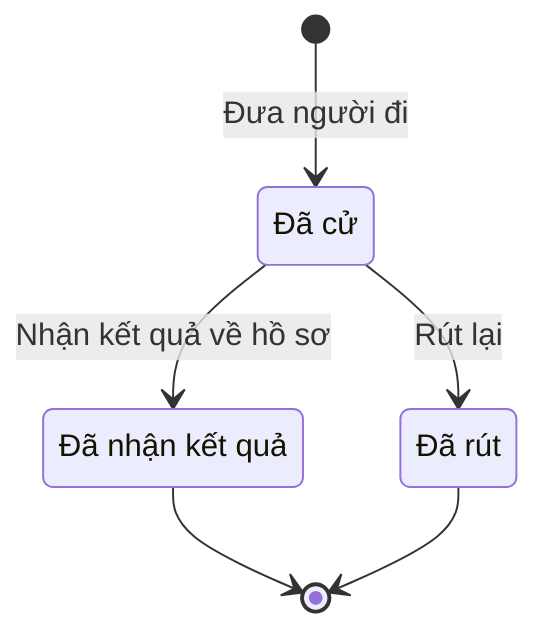

# qt-14.training-nomination · Đợt tập trung: huấn luyện, diễn tập, tập huấn, hội thi — Dân quân tham gia huấn luyện do cấp trên tổ chức

<!-- máy sinh: tom-tat -->
> **Hồ sơ:** Dân quân tham gia huấn luyện do cấp trên tổ chức (`TrainingNomination`)
>
> **Trong sổ phạm vi:** 14 · Đợt tập trung: huấn luyện, diễn tập, tập huấn, hội thi — hồ sơ phụ training-nomination (tầng 1)
>
> 3 bước · 3 chặng · 2 vai · 0 bảng quyết định · 0 hạn · 2 khớp nối.
>
> **Nguồn:** sổ nghiệp vụ `qt-14.training-nomination` · khai báo của app: `dqtv-app/core/processes/training/workflow/training-nomination.yaml`. Các bảng do máy sinh từ nguồn này.
<!-- hết: tom-tat -->

<!-- viết tay: dien-giai -->
## Diễn giải

*Phần này viết tay, diễn giải lại điều các bảng bên dưới ghi.*

### Quy trình này để làm gì

Xã ghi lại việc **cử một chiến sĩ đi đợt huấn luyện do cấp trên tổ chức**, và nhận kết quả của người ấy về hồ sơ. Mỗi hồ sơ là một người được cử theo một dòng chỉ tiêu cử người của xã. Hồ sơ có ba chặng: *Đã cử*, rồi kết thúc ở *Đã nhận kết quả* hoặc *Đã rút*. Đăng ký đội dự hội thi, hội thao cũng dùng lại đường cử người này, không có bước riêng.

### Khi nào bắt đầu

Trợ lý Tác huấn bấm **Đưa người đi**. Bắt buộc nhập `planTargetIds`, `memberIds` và ngày cử; ghi chú, tên đội, nội dung dự thi nhập nếu có. Hồ sơ mở ra có nối tới **Chiến sĩ dân quân tự vệ** (16.enlistment) và **Chỉ tiêu** (2), vào thẳng chặng *Đã cử*: xã đã cử, tỉnh lấy vào danh sách triệu tập của đợt. Họ tên chiến sĩ và tên chỉ tiêu được chép vào hồ sơ lúc cử, để tỉnh đọc không cần sang hồ sơ xã.

### Diễn ra thế nào

**Chặng "Đã cử"** — có hai đường ra, đều là kết thúc:

- **Rút lại** (Trợ lý Tác huấn): phải ghi lý do rút. Hồ sơ sang *Đã rút*; người ấy không còn trong danh sách.
- **Nhận kết quả về hồ sơ** (Trợ lý Quân lực): ghi kết quả của người được cử (giỏi, khá, trung bình, không đạt) và thời điểm nhận. Hồ sơ sang *Đã nhận kết quả*. Kết quả này lấy theo kết quả đợt do cấp tổ chức ghi.

### Kết thúc và để lại gì

Hồ sơ kết thúc ở *Đã nhận kết quả* hoặc *Đã rút*. Hồ sơ giữ hai mối nối, đều ghi lúc mở: tới chiến sĩ được cử và tới chỉ tiêu cử người đi huấn luyện của xã.

### Điều kiện chặn

- Hai bước sau bước mở: người làm phải thuộc đơn vị chủ hồ sơ.
- Sai người hoặc sai chặng thì bước bị chặn, hồ sơ giữ nguyên.
- Bước rút: bắt buộc nhập lý do rút.
<!-- hết viết tay -->

## 1. Đường đi ngắn nhất qua các chặng

<!-- máy sinh: luong-chinh -->
Đường ít bước nhất từ lúc mở hồ sơ tới chặng kết thúc xa nhất. Máy chọn theo số chặng, không theo ý nghĩa nghiệp vụ — trình tự công việc thật xem phần Diễn giải và bảng "Việc làm ở từng chặng" ở mục 6.

| # | Ai làm | Làm gì | Hồ sơ sang chặng |
|---|---|---|---|
| 1 | Trợ lý Tác huấn | Đưa người đi | Đã cử |
| 2 | Trợ lý Quân lực | Nhận kết quả về hồ sơ | Đã nhận kết quả |

<!-- hết: luong-chinh -->

## 2. Hồ sơ và việc nó để lại

<!-- máy sinh: muc-tieu -->
**App gọi quy trình này là:** Dân quân tham gia huấn luyện do cấp trên tổ chức.

**Khi mở, hồ sơ này ghi mối nối tới:**
- Chiến sĩ dân quân tự vệ (16.enlistment) — bước `nominateForTraining`, khớp nối `nominatedMember`
- Chỉ tiêu (2) — bước `nominateForTraining`, khớp nối `nominationUnderTarget`
<!-- hết: muc-tieu -->

## 3. Khởi phát và kết thúc

<!-- máy sinh: khoi-phat -->
**1 cửa vào** — bước mở hồ sơ:

| Bước mở | Ai mở | Hồ sơ vào chặng | App bắt buộc nhập |
|---|---|---|---|
| Đưa người đi | Trợ lý Tác huấn | Đã cử | `planTargetIds`, `memberIds`, ngày cử |

**Kết thúc:** *Đã nhận kết quả* (`RESULT_RECEIVED`), *Đã rút* (`WITHDRAWN`)
<!-- hết: khoi-phat -->

## 4. Vai trò

<!-- máy sinh: vai-tro -->
| Vai trong sổ | Tên trong app | Điều kiện | Làm những bước |
|---|---|---|---|
| `operator` | Trợ lý Tác huấn |  | Đưa người đi · Rút lại |
| `recorder` | Trợ lý Quân lực |  | Nhận kết quả về hồ sơ |

*"Tên trong app" là tên app đặt cho mã chủ thể của vai. Hồ sơ thuộc đơn vị cấp khác thì người làm là người giữ vai ấy ở đơn vị nêu trong cột "Điều kiện" (nếu sổ có ghi) và ở cột "Người làm phải thuộc" của bảng "Theo khai báo của app" (mục 7).*
<!-- hết: vai-tro -->

## 5. Nhánh phụ

<!-- máy sinh: nhanh-phu -->
**Bước khác đưa hồ sơ sang chặng mới** — đường song song, rẽ nhánh hoặc kết thúc sớm:

| Bước | Ai làm | Từ chặng | Sang chặng |
|---|---|---|---|
| Rút lại | Trợ lý Tác huấn | Đã cử | Đã rút |

<!-- hết: nhanh-phu -->

## 6. Các chặng và việc làm ở từng chặng

<!-- máy sinh: chang -->
| Chặng | Tên hiển thị | Vào bằng bước | Kết thúc? |
|---|---|---|---|
| `NOMINATED` | Đã cử | Đưa người đi |  |
| `RESULT_RECEIVED` | Đã nhận kết quả | Nhận kết quả về hồ sơ | **kết thúc** |
| `WITHDRAWN` | Đã rút | Rút lại | **kết thúc** |

### Việc làm ở từng chặng

Hồ sơ đang ở chặng nào thì làm được những bước nào.

| Hồ sơ đang ở chặng | Bước làm tại chặng (hồ sơ đứng yên) | Bước đưa hồ sơ sang chặng khác |
|---|---|---|
| **Đã cử** | — | Rút lại — Trợ lý Tác huấn → *Đã rút* Nhận kết quả về hồ sơ — Trợ lý Quân lực → *Đã nhận kết quả* |
| **Đã nhận kết quả** | — | — (kết thúc) |
| **Đã rút** | — | — (kết thúc) |
<!-- hết: chang -->

## 7. Bảng bước

<!-- máy sinh: buoc -->
| # | Bước | Mã bước | Ai thực hiện | Từ chặng | Sang chặng | Phải có trước | Ghi lại |
|---|---|---|---|---|---|---|---|
| 1 | Đưa người đi | `nominateForTraining` | Trợ lý Tác huấn | — (mở hồ sơ) | `NOMINATED` | — | mã tỉnh, mã xã, `planTargetId`, `memberId`, chiến sĩ được cử, dòng chỉ tiêu huấn luyện, ngày cử, ghi chú, nối tới Chỉ tiêu, nối tới Chiến sĩ dân quân tự vệ, tên đội, nội dung dự thi, đơn vị chủ hồ sơ |
| 2 | Rút lại | `withdrawNomination` | Trợ lý Tác huấn | `NOMINATED` | `WITHDRAWN` | người làm thuộc đơn vị chủ hồ sơ | lý do rút |
| 3 | Nhận kết quả về hồ sơ | `receiveNominationResult` | Trợ lý Quân lực | `NOMINATED` | `RESULT_RECEIVED` | người làm thuộc đơn vị chủ hồ sơ | kết quả, nhận kết quả lúc |

### Khi không đạt điều kiện

Mặc định: không đúng người, hồ sơ không ở đúng chặng, hoặc thiếu thứ "phải có trước" thì bước bị chặn, hồ sơ giữ nguyên. Bảng dưới chỉ kê những bước có kết quả riêng.

Không bước nào có kết quả riêng — tất cả theo mặc định.

### Điều kiện "phải có trước" bằng lời

Cột "Phải có trước" ở bảng bước có hai loại: ô dữ liệu thường (bước chỉ đòi ô ấy đã có giá trị) và điều kiện hệ tự xét. Bảng này diễn các điều kiện hệ tự xét theo đúng công thức sổ ghi; số ở cột cuối là số thứ tự bước.

| Điều kiện | Đúng khi | Bước đòi |
|---|---|---|
| `actorInOwnerUnit` | người đang làm là người của đơn vị ghi ở ô đơn vị chủ hồ sơ của hồ sơ này (theo danh mục người của đơn vị, `dm.unit-staff`) | 2, 3 |

### Theo khai báo của app

Người làm phải thuộc đơn vị nào, ô người dùng phải nhập, bước có lặp được không, và căn cứ pháp lý — lấy từ khai báo quy trình trong app.

| # | Bước | Người làm phải thuộc | Bắt buộc nhập | Nhập nếu có | Lặp được | Căn cứ |
|---|---|---|---|---|---|---|
| 1 | Đưa người đi |  | `planTargetIds`, `memberIds`, ngày cử | ghi chú, tên đội, nội dung dự thi |  | TT78/VBHN-BQP Đ.7 k1 b; TT87/2011/TT-BQP |
| 2 | Rút lại | đơn vị chủ hồ sơ | lý do rút | — |  | TT78/VBHN-BQP Đ.7 k1 b |
| 3 | Nhận kết quả về hồ sơ | đơn vị chủ hồ sơ | kết quả | — |  | L48/2019/QH14 Đ.27 |
<!-- hết: buoc -->

## 8. Bảng quyết định, hạn, việc ngoài hệ

<!-- máy sinh: quyet-dinh -->

<!-- hết: quyet-dinh -->

## 9. Dữ liệu của hồ sơ

<!-- máy sinh: du-lieu -->
Các ô mà bước trong sổ ghi hoặc đòi. Số trong hai cột cuối là số thứ tự bước ở bảng bước (mục 7).

| Ô dữ liệu | Mã | Kiểu (app) | Giá trị cho phép | Loại ô (sổ) | Bước ghi | Bước đòi | Mô tả trong app |
|---|---|---|---|---|---|---|---|
| mã tỉnh | `provinceCode` | chữ |  | lưu trên hồ sơ (`stored`) | 1 | — | Mã tỉnh — dùng lọc phạm vi theo hàng |
| mã xã | `communeCode` | chữ |  | lưu trên hồ sơ (`stored`) | 1 | — | Mã xã cử người |
| — | `planTargetId` | chữ |  | lưu trên hồ sơ (`stored`) | 1 | — | id chỉ tiêu cử người của xã mà hồ sơ này thực hiện |
| — | `memberId` | chữ |  | lưu trên hồ sơ (`stored`) | 1 | — | id hồ sơ chiến sĩ được cử |
| chiến sĩ được cử | `memberName` | chữ |  | lưu trên hồ sơ (`stored`) | 1 | — | Họ tên chiến sĩ được cử — chép lúc cử để tỉnh đọc không cần với sang hồ sơ xã |
| dòng chỉ tiêu huấn luyện | `targetName` | chữ |  | lưu trên hồ sơ (`stored`) | 1 | — | Tên chỉ tiêu cử người — chép lúc cử |
| ngày cử | `nominatedAt` | ngày |  | đưa vào ở bước (`input`) | 1 | — | Ngày xã cử |
| ghi chú | `note` | chữ |  | đưa vào ở bước (`input`) | 1 | — | Ghi chú |
| tên đội | `teamName` | chữ |  | đưa vào ở bước (`input`) | 1 | — | Tên đội dự hội thi, hội thao |
| nội dung dự thi | `contestContent` | chữ |  | đưa vào ở bước (`input`) | 1 | — | Nội dung dự thi |
| đơn vị chủ hồ sơ | `ownerUnit` |  |  | lưu trên hồ sơ (`stored`) | 1 | — |  |
| lý do rút | `withdrawReason` | chữ |  | đưa vào ở bước (`input`) | 2 | — | Lý do rút — bắt buộc khi rút |
| kết quả | `resultGrade` | chọn một | Giỏi (`excellent`), Khá (`good`), Trung bình (`fair`), Không đạt (`fail`) | lưu trên hồ sơ (`stored`) | 3 | — | Kết quả của người được cử, theo kết quả đợt do cấp tổ chức ghi |
| nhận kết quả lúc | `resultReceivedAt` | ngày giờ |  | lưu trên hồ sơ (`stored`) | 3 | — | Thời điểm xã nhận kết quả về hồ sơ |
| người làm thuộc đơn vị chủ hồ sơ | `actorInOwnerUnit` |  | có hay chưa | hệ suy ra (`derived`) | — | 2, 3 |  |

15 ô. Cột "Loại ô" là cách sổ phân loại ô, in kèm đúng chữ của sổ; ô nào người dùng phải nhập xem bảng "Theo khai báo của app" ở mục 7.
<!-- hết: du-lieu -->

## 10. Khớp nối với quy trình khác

<!-- máy sinh: khop-noi -->
| Quy trình kia | Hồ sơ kia | Quan hệ | Nội dung (mô tả trong app) | Bước ghi mối nối | Tên ô nối |
|---|---|---|---|---|---|
| 16.enlistment | Chiến sĩ dân quân tự vệ | hồ sơ này **mở ra có nối tới** hồ sơ kia | Chiến sĩ được cử đi đợt huấn luyện do cấp trên tổ chức | 14.training-nomination·nominateForTraining ⊕ | `nominatedMember` |
| 2 | Chỉ tiêu | hồ sơ này **mở ra có nối tới** hồ sơ kia | Hồ sơ cử người thực hiện chỉ tiêu cử người đi huấn luyện của xã — TT78/VBHN-BQP Đ.7 k1 b | 14.training-nomination·nominateForTraining ⊕ | `nominationUnderTarget` |

2 khớp nối. ⊕ là bước tạo hồ sơ.
<!-- hết: khop-noi -->

## 11. Thông tin chung

<!-- máy sinh: thong-tin -->
| | |
|---|---|
| **Mã trong sổ** | `qt-14.training-nomination` |
| **Quy trình trong app** | `training` (`workflow/training-nomination.yaml`) — mặt công tác: `training-education` |
| **Hồ sơ** | Dân quân tham gia huấn luyện do cấp trên tổ chức (`TrainingNomination`) |
| **Cùng mã quy trình** | [qt-14](qt-14.html) |
| **Căn cứ pháp lý từng bước** | cột "Căn cứ" ở bảng "Theo khai báo của app", mục 7 |
<!-- hết: thong-tin -->
