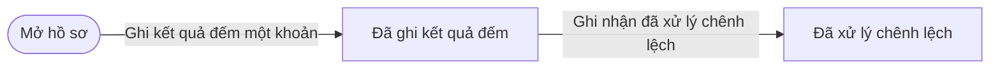
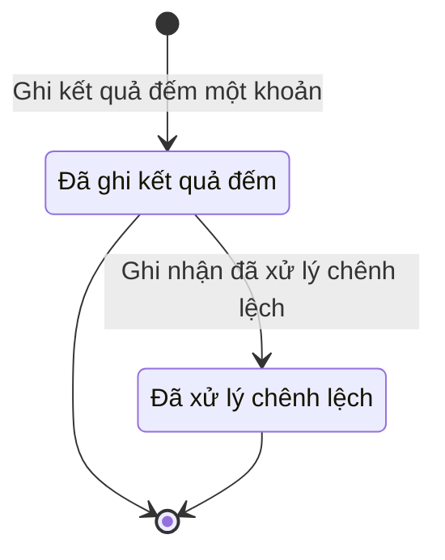

# qt-15.count-line · Kiểm kê

<!-- máy sinh: tom-tat -->
> **Hồ sơ:** Dòng đếm kiểm kê (`InventoryCountLine`)
>
> **Trong sổ phạm vi:** 15 · Kiểm kê — hồ sơ phụ count-line: dòng kiểm (tầng 1)
>
> 3 bước · 2 chặng · 2 vai · 0 bảng quyết định · 0 hạn · 2 khớp nối.
>
> **Nguồn:** sổ nghiệp vụ `qt-15.count-line` · khai báo của app: `dqtv-app/core/processes/inventory-check/workflow/count-line.yaml`. Các bảng do máy sinh từ nguồn này.
<!-- hết: tom-tat -->

## 1. Đường đi ngắn nhất qua các chặng

<!-- máy sinh: luong-chinh -->
Đường ít bước nhất từ lúc mở hồ sơ tới chặng kết thúc xa nhất. Máy chọn theo số chặng, không theo ý nghĩa nghiệp vụ — trình tự công việc thật xem phần Diễn giải và bảng "Việc làm ở từng chặng" ở mục 6.

| # | Ai làm | Làm gì | Hồ sơ sang chặng |
|---|---|---|---|
| 1 | Nhân viên quân khí kiêm thủ kho | Ghi kết quả đếm một khoản | Đã ghi kết quả đếm |
| 2 | Hệ thống tự làm | Ghi nhận đã xử lý chênh lệch | Đã xử lý chênh lệch |

<!-- hết: luong-chinh -->

## 2. Hồ sơ và việc nó để lại

<!-- máy sinh: muc-tieu -->
**App gọi quy trình này là:** Dòng kiểm kê.

**Khi mở, hồ sơ này ghi mối nối tới:**
- Trang bị, phương tiện (D12) — bước `recordCountLine`, khớp nối `countOfEquipment`

**Hồ sơ này để lại cho quy trình khác** (bước tạo hồ sơ của quy trình kia ghi mối nối về đây):
- Trang bị, phương tiện (D12) — bước `registerFromInventory`, khớp nối `followsCountLine`
<!-- hết: muc-tieu -->

## 3. Khởi phát và kết thúc

<!-- máy sinh: khoi-phat -->
**1 cửa vào** — bước mở hồ sơ:

| Bước mở | Ai mở | Hồ sơ vào chặng | App bắt buộc nhập |
|---|---|---|---|
| Ghi kết quả đếm một khoản | Nhân viên quân khí kiêm thủ kho | Đã ghi kết quả đếm | đợt kiểm kê, nhóm trang bị, số thực đếm |

**Kết thúc:** *Đã ghi kết quả đếm* (`COUNTED`), *Đã xử lý chênh lệch* (`SETTLED`)
<!-- hết: khoi-phat -->

## 4. Vai trò

<!-- máy sinh: vai-tro -->
| Vai trong sổ | Tên trong app | Điều kiện | Làm những bước |
|---|---|---|---|
| `quartermaster` | Nhân viên quân khí kiêm thủ kho |  | Ghi kết quả đếm một khoản · Sửa kết quả đếm |
| `system` | Hệ thống tự làm |  | Ghi nhận đã xử lý chênh lệch |

*"Tên trong app" là tên app đặt cho mã chủ thể của vai. Hồ sơ thuộc đơn vị cấp khác thì người làm là người giữ vai ấy ở đơn vị nêu trong cột "Điều kiện" (nếu sổ có ghi) và ở cột "Người làm phải thuộc" của bảng "Theo khai báo của app" (mục 7).*
<!-- hết: vai-tro -->

## 5. Nhánh phụ

<!-- máy sinh: nhanh-phu -->
**Làm trong lúc hồ sơ đứng yên ở một chặng** — ghi nhận, bổ sung:

| Bước | Ai làm | Ở chặng |
|---|---|---|
| Sửa kết quả đếm | Nhân viên quân khí kiêm thủ kho | Đã ghi kết quả đếm |

<!-- hết: nhanh-phu -->

## 6. Các chặng và việc làm ở từng chặng

<!-- máy sinh: chang -->
| Chặng | Tên hiển thị | Vào bằng bước | Kết thúc? |
|---|---|---|---|
| `COUNTED` | Đã ghi kết quả đếm | Ghi kết quả đếm một khoản | **kết thúc** — vẫn còn bước làm được |
| `SETTLED` | Đã xử lý chênh lệch | Ghi nhận đã xử lý chênh lệch | **kết thúc** |

### Việc làm ở từng chặng

Hồ sơ đang ở chặng nào thì làm được những bước nào.

| Hồ sơ đang ở chặng | Bước làm tại chặng (hồ sơ đứng yên) | Bước đưa hồ sơ sang chặng khác |
|---|---|---|
| **Đã ghi kết quả đếm** | Sửa kết quả đếm — Nhân viên quân khí kiêm thủ kho | Ghi nhận đã xử lý chênh lệch — Hệ thống tự làm → *Đã xử lý chênh lệch* |
| **Đã xử lý chênh lệch** | — | — (kết thúc) |
<!-- hết: chang -->

## 7. Bảng bước

<!-- máy sinh: buoc -->
| # | Bước | Mã bước | Ai thực hiện | Từ chặng | Sang chặng | Phải có trước | Ghi lại |
|---|---|---|---|---|---|---|---|
| 1 | Ghi kết quả đếm một khoản | `recordCountLine` | Nhân viên quân khí kiêm thủ kho | — (mở hồ sơ) | `COUNTED` | `actorInCheckOwnerUnit`, `checkOpenForCounting`, `causeGivenIfDiscrepant` | `id`, đơn vị chủ hồ sơ, nối tới Đợt kiểm kê, nối tới Trang bị, phương tiện, nhóm trang bị, số thực đếm, tình trạng, nguyên nhân chênh lệch |
| 2 | Sửa kết quả đếm | `editCountLine` | Nhân viên quân khí kiêm thủ kho | `COUNTED` | giữ nguyên | người làm thuộc đơn vị chủ hồ sơ, `checkOpenForCounting`, `causeGivenIfDiscrepant` | số thực đếm, tình trạng, nguyên nhân chênh lệch |
| 3 | Ghi nhận đã xử lý chênh lệch | `settleCountLine` | Hệ thống tự làm | `COUNTED` | `SETTLED` | `lineDiscrepant`, `checkApprovedForLine` | — |

### Khi không đạt điều kiện

Mặc định: không đúng người, hồ sơ không ở đúng chặng, hoặc thiếu thứ "phải có trước" thì bước bị chặn, hồ sơ giữ nguyên. Bảng dưới chỉ kê những bước có kết quả riêng.

| # | Bước | Kết quả riêng |
|---|---|---|
| 3 | Ghi nhận đã xử lý chênh lệch | bước này không do người nào bấm |

### Điều kiện "phải có trước" bằng lời

Cột "Phải có trước" ở bảng bước có hai loại: ô dữ liệu thường (bước chỉ đòi ô ấy đã có giá trị) và điều kiện hệ tự xét. Bảng này diễn các điều kiện hệ tự xét theo đúng công thức sổ ghi; số ở cột cuối là số thứ tự bước.

| Điều kiện | Đúng khi | Bước đòi |
|---|---|---|
| `actorInCheckOwnerUnit` | có hồ sơ Kiểm kê (qt-15) (gọi là chk) chính là hồ sơ ghi ở ô nối `lineOfCheck` của hồ sơ đang làm mà người đang làm là người của đơn vị ghi ở ô đơn vị chủ hồ sơ của hồ sơ chk ấy (theo danh mục người của đơn vị, `dm.unit-staff`) | 1 |
| `checkOpenForCounting` | có hồ sơ Kiểm kê (qt-15) chính là hồ sơ ghi ở ô nối `lineOfCheck` của hồ sơ đang làm mà hồ sơ ấy đang ở chặng `OPEN` | 1, 2 |
| `causeGivenIfDiscrepant` | KHÔNG ((đã có nối tới Trang bị, phương tiện VÀ KHÔNG (`{"ge": [{"fact": "countedQuantity"}, {"fact": "bookQuantity"}]}`)) HOẶC (nhóm trang bị là Vũ khí (`weapon`) hoặc Trang bị kỹ thuật (`technical_equipment`) VÀ (KHÔNG (đã có nối tới Trang bị, phương tiện) HOẶC KHÔNG (`{"le": [{"fact": "countedQuantity"}, {"fact": "bookQuantity"}]}`))) HOẶC tình trạng là Cần sửa (`needs_repair`) hoặc Hỏng (`unserviceable`)) HOẶC đã có nguyên nhân chênh lệch | 1, 2 |
| `actorInOwnerUnit` | người đang làm là người của đơn vị ghi ở ô đơn vị chủ hồ sơ của hồ sơ này (theo danh mục người của đơn vị, `dm.unit-staff`) | 2 |
| `lineDiscrepant` | (đã có nối tới Trang bị, phương tiện VÀ KHÔNG (`{"ge": [{"fact": "countedQuantity"}, {"fact": "bookQuantity"}]}`)) HOẶC (nhóm trang bị là Vũ khí (`weapon`) hoặc Trang bị kỹ thuật (`technical_equipment`) VÀ (KHÔNG (đã có nối tới Trang bị, phương tiện) HOẶC KHÔNG (`{"le": [{"fact": "countedQuantity"}, {"fact": "bookQuantity"}]}`))) HOẶC tình trạng là Cần sửa (`needs_repair`) hoặc Hỏng (`unserviceable`) | 3 |
| `checkApprovedForLine` | có hồ sơ Kiểm kê (qt-15) chính là hồ sơ ghi ở ô nối `lineOfCheck` của hồ sơ đang làm mà hồ sơ ấy đang ở chặng `APPROVED` | 3 |

### Theo khai báo của app

Người làm phải thuộc đơn vị nào, ô người dùng phải nhập, bước có lặp được không, và căn cứ pháp lý — lấy từ khai báo quy trình trong app.

| # | Bước | Người làm phải thuộc | Bắt buộc nhập | Nhập nếu có | Lặp được | Căn cứ |
|---|---|---|---|---|---|---|
| 1 | Ghi kết quả đếm một khoản |  | đợt kiểm kê, nhóm trang bị, số thực đếm | khoản trang bị trên sổ, tình trạng, nguyên nhân chênh lệch |  | QĐ1126/QĐ-TM Đ.12 k4 · sổ qt-15.count-line (27/10/2026) |
| 2 | Sửa kết quả đếm | đơn vị chủ hồ sơ | số thực đếm | tình trạng, nguyên nhân chênh lệch |  | QĐ1126/QĐ-TM Đ.12 k4 · sổ qt-15.count-line (27/10/2026) |
| 3 | Ghi nhận đã xử lý chênh lệch |  | — | — |  | sổ qt-15.count-line (27/10/2026) |
<!-- hết: buoc -->

## 8. Bảng quyết định, hạn, việc ngoài hệ

<!-- máy sinh: quyet-dinh -->

<!-- hết: quyet-dinh -->

## 9. Dữ liệu của hồ sơ

<!-- máy sinh: du-lieu -->
Các ô mà bước trong sổ ghi hoặc đòi. Số trong hai cột cuối là số thứ tự bước ở bảng bước (mục 7).

| Ô dữ liệu | Mã | Kiểu (app) | Giá trị cho phép | Loại ô (sổ) | Bước ghi | Bước đòi | Mô tả trong app |
|---|---|---|---|---|---|---|---|
| — | `id` |  |  | lưu trên hồ sơ (`stored`) | 1 | — |  |
| đơn vị chủ hồ sơ | `ownerUnit` |  |  | lưu trên hồ sơ (`stored`) | 1 | — |  |
| nhóm trang bị | `countedItemCategory` | chọn một | Vũ khí (`weapon`), Trang bị kỹ thuật (`technical_equipment`), Thiết bị dạy học (`teaching_equipment`), Mô hình học cụ (`teaching_model`), Trang phục (`uniform`) | đưa vào ở bước (`input`) | 1 | — | Nhóm trang bị của khoản đếm |
| số thực đếm | `countedQuantity` | số |  | đưa vào ở bước (`input`) | 1, 2 | — | Số thực đếm — vũ khí, trang bị: có mặt hay không (số có mặt) |
| tình trạng | `condition` | chọn một | Dùng được (`serviceable`), Cần sửa (`needs_repair`), Hỏng (`unserviceable`) | đưa vào ở bước (`input`) | 1, 2 | — | Tình trạng khi đếm |
| nguyên nhân chênh lệch | `discrepancyCause` | chữ | có hay chưa | đưa vào ở bước (`input`) | 1, 2 | — | Nguyên nhân chênh lệch — bắt buộc khi dòng có chênh lệch |
| — | `actorInCheckOwnerUnit` |  | có hay chưa | hệ suy ra (`derived`) | — | 1 |  |
| — | `checkOpenForCounting` |  | có hay chưa | hệ suy ra (`derived`) | — | 1, 2 |  |
| — | `causeGivenIfDiscrepant` |  | có hay chưa | hệ suy ra (`derived`) | — | 1, 2 |  |
| người làm thuộc đơn vị chủ hồ sơ | `actorInOwnerUnit` |  | có hay chưa | hệ suy ra (`derived`) | — | 2 |  |
| — | `lineDiscrepant` |  | có hay chưa | hệ suy ra (`derived`) | — | 3 |  |
| — | `checkApprovedForLine` |  | có hay chưa | hệ suy ra (`derived`) | — | 3 |  |

12 ô. Cột "Loại ô" là cách sổ phân loại ô, in kèm đúng chữ của sổ; ô nào người dùng phải nhập xem bảng "Theo khai báo của app" ở mục 7.
<!-- hết: du-lieu -->

## 10. Khớp nối với quy trình khác

<!-- máy sinh: khop-noi -->
| Quy trình kia | Hồ sơ kia | Quan hệ | Nội dung (mô tả trong app) | Bước ghi mối nối | Tên ô nối |
|---|---|---|---|---|---|
| D12 | Trang bị, phương tiện | hồ sơ này **mở ra có nối tới** hồ sơ kia | Dòng đếm soi khoản trang bị nào — đối chiếu sổ với thực tế | 15.count-line·recordCountLine ⊕ | `countOfEquipment` |
| D12 | Trang bị, phương tiện | hồ sơ kia **mở ra từ** hồ sơ này | Dòng kiểm kê có chênh lệch mà việc này xử lý — sổ qt-D12 link.followsCountLine | D12·registerFromInventory ⊕, D12·reportIncident, D12·retireByDisposal, D12·sendToMaintenance | `followsCountLine` |

2 khớp nối. ⊕ là bước tạo hồ sơ.

**Ô nối giữa các hồ sơ cùng mã quy trình, hoặc tới danh mục nền:** `lineOfCheck` (Dòng đếm kiểm kê → Đợt kiểm kê) — bước Ghi kết quả đếm một khoản.
<!-- hết: khop-noi -->

## 11. Thông tin chung

<!-- máy sinh: thong-tin -->
| | |
|---|---|
| **Mã trong sổ** | `qt-15.count-line` |
| **Quy trình trong app** | `inventory-check` (`workflow/count-line.yaml`) — mặt công tác: `logistics-technical` |
| **Hồ sơ** | Dòng đếm kiểm kê (`InventoryCountLine`) |
| **Cùng mã quy trình** | [qt-15](qt-15.html) |
| **Căn cứ pháp lý từng bước** | cột "Căn cứ" ở bảng "Theo khai báo của app", mục 7 |
<!-- hết: thong-tin -->
