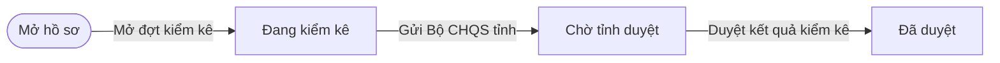
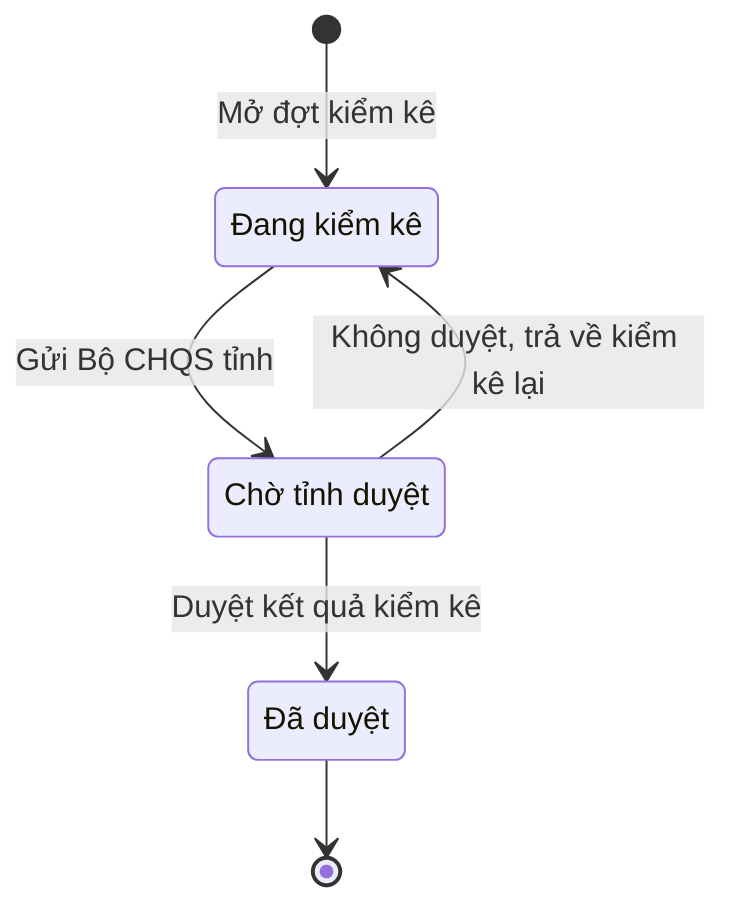

# qt-15 · Kiểm kê

<!-- máy sinh: tom-tat -->
> **Hồ sơ:** Đợt kiểm kê (`InventoryCheck`)
>
> **Trong sổ phạm vi:** 15 · Kiểm kê (tầng 1)
>
> 6 bước · 3 chặng · 6 vai · 0 bảng quyết định · 0 hạn · 7 khớp nối.
>
> **Nguồn:** sổ nghiệp vụ `qt-15` · khai báo của app: `dqtv-app/core/processes/inventory-check/workflow/inventory-check.yaml`. Các bảng do máy sinh từ nguồn này.
<!-- hết: tom-tat -->

<!-- viết tay: dien-giai -->
## Diễn giải

*Phần này viết tay, diễn giải lại điều các bảng bên dưới ghi.*

### Quy trình này để làm gì

Xã mở một **đợt kiểm kê** để đếm trang bị thực có của một đơn vị, đối chiếu với sổ, rồi trình kết quả lên Bộ CHQS tỉnh duyệt. Chỉ huy trưởng Ban CHQS xã mở đợt và ký tờ trình; Nhân viên quân khí kiêm thủ kho đếm và trình; Nhân viên văn thư gửi; Bộ CHQS cấp tỉnh duyệt hoặc trả về.

Hồ sơ đi qua năm chặng: *Đang kiểm kê* → *Chờ ký tờ trình* → *Đã ký, chờ gửi* → *Chờ tỉnh duyệt* → *Đã duyệt*. Bị trả lại ở đâu thì cũng quay về *Đang kiểm kê*.

### Khi nào bắt đầu

Chỉ huy trưởng bấm **Mở đợt kiểm kê**. Bắt buộc nhập tên đợt, mốc kiểm kê, `unitId` và `taskingId`. Hồ sơ mở ra có nối tới Đơn vị dân quân tự vệ (quy trình 29) và Nhiệm vụ trên giao (quy trình 1).

### Diễn ra thế nào

**Chặng "Đang kiểm kê"** — thủ kho bấm **Ghi kết quả đếm một khoản** (lặp được), mỗi lần tạo một Dòng đếm kiểm kê: bắt buộc nhập `equipmentId`, `booked`, `counted`; `grade`, `countNote`, `countedItemCategory` là ô nhập nếu có. Mỗi dòng đếm nối tới khoản trang bị nó soi (quy trình D12). Đếm xong, thủ kho bấm **Trình ký tờ trình kết quả kiểm kê** → *Chờ ký tờ trình*; bắt buộc đính tờ trình, ghi nhận chênh lệch chung của đợt là ô nhập nếu có; hồ sơ nối tới một Văn bản đi.

**Chặng "Chờ ký tờ trình"** — Chỉ huy trưởng **Ký tờ trình** → *Đã ký, chờ gửi*, hoặc **Trả lại tờ trình** → về *Đang kiểm kê* (phải ghi cần sửa gì).

**Chặng "Đã ký, chờ gửi"** — Nhân viên văn thư bấm **Gửi Bộ CHQS tỉnh** → *Chờ tỉnh duyệt*; bắt buộc đính tờ trình đã ký, đã ghi số; nơi nhận là `province_military_command`. Chỉ huy trưởng vẫn trả lại tờ trình được từ chặng này.

**Chặng "Chờ tỉnh duyệt"** — Bộ CHQS cấp tỉnh chọn một trong hai:

- **Duyệt kết quả kiểm kê** → *Đã duyệt*; phải ghi cơ quan duyệt, ý kiến là tuỳ có.
- **Không duyệt, trả về kiểm kê lại** → về *Đang kiểm kê*; phải ghi vì sao trả về.

Hai bước này do người của một đơn vị nằm trong ô cấp trên của chủ hồ sơ bấm.

**Chặng "Đã duyệt"** — thủ kho có thể bấm **Đề nghị thanh lý** (lặp được): bắt buộc nhập `batchId`; bước nối đợt kiểm kê với một Đợt thu hồi, thanh lý (quy trình D14) và ghi lúc đề nghị. Hồ sơ đứng yên.

### Kết thúc và để lại gì

Hồ sơ kết thúc ở chặng *Đã duyệt*. Các mối nối sang quy trình khác: **Đợt thu hồi, thanh lý** (D14) mà kết quả kiểm kê đề nghị; **Trang bị, phương tiện** (D12) qua từng dòng đếm; **Văn bản đi** (1.outgoing-document) là tờ trình.

### Điều kiện chặn

- Sáu bước đếm, trình ký, ký, trả lại tờ trình, gửi, đề nghị thanh lý: người làm phải thuộc đơn vị chủ hồ sơ. Hai bước duyệt và không duyệt: người làm phải thuộc cấp trên của chủ hồ sơ.
- Bấm một bước không được phép (không đúng người, hồ sơ chưa tới chặng ấy, thiếu thông tin bắt buộc) thì bị chặn, hồ sơ giữ nguyên. Nhiều lỗi cùng lúc thì báo theo thứ tự: quyền → chặng → thông tin.
<!-- hết viết tay -->

## 1. Đường đi ngắn nhất qua các chặng

<!-- máy sinh: luong-chinh -->
Đường ít bước nhất từ lúc mở hồ sơ tới chặng kết thúc xa nhất. Máy chọn theo số chặng, không theo ý nghĩa nghiệp vụ — trình tự công việc thật xem phần Diễn giải và bảng "Việc làm ở từng chặng" ở mục 6.

| # | Ai làm | Làm gì | Hồ sơ sang chặng |
|---|---|---|---|
| 1 | Chỉ huy trưởng Ban CHQS xã | Mở đợt kiểm kê | Đang kiểm kê |
| 2 | Nhân viên văn thư | Gửi Bộ CHQS tỉnh | Chờ tỉnh duyệt |
| 3 | Bộ CHQS cấp tỉnh (thuộc cấp trên của chủ hồ sơ) | Duyệt kết quả kiểm kê | Đã duyệt |

<!-- hết: luong-chinh -->

## 2. Hồ sơ và việc nó để lại

<!-- máy sinh: muc-tieu -->
**App gọi quy trình này là:** Đợt kiểm kê.

**Khi mở, hồ sơ này ghi mối nối tới:**
- Nhiệm vụ trên giao (1) — bước `openInventoryCheck`, khớp nối `inventoryCheckServesTasking`
- Đơn vị dân quân tự vệ (29) — bước `openInventoryCheck`, khớp nối `checkedByUnit`
<!-- hết: muc-tieu -->

## 3. Khởi phát và kết thúc

<!-- máy sinh: khoi-phat -->
**1 cửa vào** — bước mở hồ sơ:

| Bước mở | Ai mở | Hồ sơ vào chặng | App bắt buộc nhập |
|---|---|---|---|
| Mở đợt kiểm kê | Chỉ huy trưởng Ban CHQS xã | Đang kiểm kê | tên đợt, mốc kiểm kê, `unitId`, `taskingId` |

**Kết thúc:** *Đã duyệt* (`APPROVED`)
<!-- hết: khoi-phat -->

## 4. Vai trò

<!-- máy sinh: vai-tro -->
| Vai trong sổ | Tên trong app | Điều kiện | Làm những bước |
|---|---|---|---|
| `commander` | Chỉ huy trưởng Ban CHQS xã |  | Mở đợt kiểm kê |
| `quartermaster` | Nhân viên quân khí kiêm thủ kho |  | Trình ký tờ trình kết quả kiểm kê |
| `clerk` | Nhân viên văn thư |  | Gửi Bộ CHQS tỉnh |
| `approver` | Bộ CHQS cấp tỉnh | thuộc cấp trên của chủ hồ sơ (`actorInSuperiorUnit`, công thức ở mục 7) | Duyệt kết quả kiểm kê |
| `operator` | Ban Dân quân tự vệ, Bộ CHQS cấp tỉnh | thuộc cấp trên của chủ hồ sơ (`actorInSuperiorUnit`, công thức ở mục 7) | Trình ký văn bản trả về kết quả kiểm kê |
| `system` | Hệ thống tự làm |  | Không duyệt, trả về kiểm kê lại |

*"Tên trong app" là tên app đặt cho mã chủ thể của vai. Hồ sơ thuộc đơn vị cấp khác thì người làm là người giữ vai ấy ở đơn vị nêu trong cột "Điều kiện" (nếu sổ có ghi) và ở cột "Người làm phải thuộc" của bảng "Theo khai báo của app" (mục 7).*
<!-- hết: vai-tro -->

## 5. Nhánh phụ

<!-- máy sinh: nhanh-phu -->
**Quay lại một chặng hồ sơ đã đi qua** (tính theo đường ngắn nhất từ lúc mở):

| Bước | Ai làm | Từ chặng | Về chặng |
|---|---|---|---|
| Không duyệt, trả về kiểm kê lại | Hệ thống tự làm | Chờ tỉnh duyệt | Đang kiểm kê |

**Làm trong lúc hồ sơ đứng yên ở một chặng** — ghi nhận, bổ sung:

| Bước | Ai làm | Ở chặng |
|---|---|---|
| Trình ký tờ trình kết quả kiểm kê | Nhân viên quân khí kiêm thủ kho | Đang kiểm kê |
| Trình ký văn bản trả về kết quả kiểm kê | Ban Dân quân tự vệ, Bộ CHQS cấp tỉnh (thuộc cấp trên của chủ hồ sơ) | Chờ tỉnh duyệt |

<!-- hết: nhanh-phu -->

## 6. Các chặng và việc làm ở từng chặng

<!-- máy sinh: chang -->
| Chặng | Tên hiển thị | Vào bằng bước | Kết thúc? |
|---|---|---|---|
| `OPEN` | Đang kiểm kê | Mở đợt kiểm kê · Không duyệt, trả về kiểm kê lại |  |
| `SUBMITTED` | Chờ tỉnh duyệt | Gửi Bộ CHQS tỉnh |  |
| `APPROVED` | Đã duyệt | Duyệt kết quả kiểm kê | **kết thúc** |

### Việc làm ở từng chặng

Hồ sơ đang ở chặng nào thì làm được những bước nào.

| Hồ sơ đang ở chặng | Bước làm tại chặng (hồ sơ đứng yên) | Bước đưa hồ sơ sang chặng khác |
|---|---|---|
| **Đang kiểm kê** | Trình ký tờ trình kết quả kiểm kê — Nhân viên quân khí kiêm thủ kho | Gửi Bộ CHQS tỉnh — Nhân viên văn thư → *Chờ tỉnh duyệt* |
| **Chờ tỉnh duyệt** | Trình ký văn bản trả về kết quả kiểm kê — Ban Dân quân tự vệ, Bộ CHQS cấp tỉnh (thuộc cấp trên của chủ hồ sơ) | Duyệt kết quả kiểm kê — Bộ CHQS cấp tỉnh (thuộc cấp trên của chủ hồ sơ) → *Đã duyệt* Không duyệt, trả về kiểm kê lại — Hệ thống tự làm → *Đang kiểm kê* |
| **Đã duyệt** | — | — (kết thúc) |
<!-- hết: chang -->

## 7. Bảng bước

<!-- máy sinh: buoc -->
| # | Bước | Mã bước | Ai thực hiện | Từ chặng | Sang chặng | Phải có trước | Ghi lại |
|---|---|---|---|---|---|---|---|
| 1 | Mở đợt kiểm kê | `openInventoryCheck` | Chỉ huy trưởng Ban CHQS xã | — (mở hồ sơ) | `OPEN` | `taskingAssigned` | `id`, mã tỉnh, mã xã, tên đợt, mốc kiểm kê, nối tới Đơn vị dân quân tự vệ, nối tới Nhiệm vụ trên giao, đơn vị chủ hồ sơ |
| 2 | Trình ký tờ trình kết quả kiểm kê | `requestInventoryCheckSignature` | Nhân viên quân khí kiêm thủ kho | `OPEN` | giữ nguyên | người làm thuộc đơn vị chủ hồ sơ, `noInventoryCheckSubmittedDocumentOpen`, `hasCountLine` | nối tới Văn bản đi |
| 3 | Gửi Bộ CHQS tỉnh | `submitInventoryCheck` | Nhân viên văn thư | `OPEN` | `SUBMITTED` | người làm thuộc đơn vị chủ hồ sơ, `inventoryCheckSubmittedDocumentIssued` | trình duyệt lúc, nối `submissionDeliveredAs` |
| 4 | Duyệt kết quả kiểm kê | `approveInventoryCheck` | Bộ CHQS cấp tỉnh (thuộc cấp trên của chủ hồ sơ) | `SUBMITTED` | `APPROVED` | người làm thuộc cấp trên của chủ hồ sơ, `submissionDistributedAtReceiver` | tỉnh duyệt lúc, cơ quan duyệt, ý kiến khi duyệt |
| 5 | Trình ký văn bản trả về kết quả kiểm kê | `requestRejectInventoryCheckSignature` | Ban Dân quân tự vệ, Bộ CHQS cấp tỉnh (thuộc cấp trên của chủ hồ sơ) | `SUBMITTED` | giữ nguyên | `submissionDistributedAtReceiver`, `noRejectInventoryCheckDocumentOpen`, người làm thuộc cấp trên của chủ hồ sơ | vì sao trả về, nối tới Văn bản đi |
| 6 | Không duyệt, trả về kiểm kê lại | `rejectInventoryCheck` | Hệ thống tự làm | `SUBMITTED` | `OPEN` | `rejectInventoryCheckDocumentIssued` | trả về lúc, nối `returnDeliveredAs` |

### Khi không đạt điều kiện

Mặc định: không đúng người, hồ sơ không ở đúng chặng, hoặc thiếu thứ "phải có trước" thì bước bị chặn, hồ sơ giữ nguyên. Bảng dưới chỉ kê những bước có kết quả riêng.

| # | Bước | Kết quả riêng |
|---|---|---|
| 6 | Không duyệt, trả về kiểm kê lại | bước này không do người nào bấm |

### Điều kiện "phải có trước" bằng lời

Cột "Phải có trước" ở bảng bước có hai loại: ô dữ liệu thường (bước chỉ đòi ô ấy đã có giá trị) và điều kiện hệ tự xét. Bảng này diễn các điều kiện hệ tự xét theo đúng công thức sổ ghi; số ở cột cuối là số thứ tự bước.

| Điều kiện | Đúng khi | Bước đòi |
|---|---|---|
| `taskingAssigned` | có hồ sơ Việc luật giao kèm văn bản đến, đi (qt-1) chính là hồ sơ ghi ở ô nối `inventoryCheckServesTasking` của hồ sơ đang làm mà hồ sơ ấy đang ở chặng `ASSIGNED` hoặc `BROKEN_DOWN` | 1 |
| `actorInOwnerUnit` | người đang làm là người của đơn vị ghi ở ô đơn vị chủ hồ sơ của hồ sơ này (theo danh mục người của đơn vị, `dm.unit-staff`) | 2, 3 |
| `noInventoryCheckSubmittedDocumentOpen` | KHÔNG (có hồ sơ Việc luật giao kèm văn bản đến, đi — Văn bản đi (qt-1.outgoing-document) chính là hồ sơ ghi ở ô nối `inventoryCheckSubmittedByDocument` của hồ sơ đang làm mà hồ sơ ấy đang ở chặng `DRAFT` hoặc `PENDING_SIGNATURE` hoặc `SIGNED`) | 2 |
| `hasCountLine` | có hồ sơ Kiểm kê — Dòng đếm kiểm kê (qt-15.count-line) có ô nối `lineOfCheck` trỏ về chính hồ sơ đang làm | 2 |
| `inventoryCheckSubmittedDocumentIssued` | có hồ sơ Việc luật giao kèm văn bản đến, đi — Văn bản đi (qt-1.outgoing-document) chính là hồ sơ ghi ở ô nối `inventoryCheckSubmittedByDocument` của hồ sơ đang làm mà hồ sơ ấy đang ở chặng `ISSUED` | 3 |
| `actorInSuperiorUnit` | người đang làm là người của một đơn vị nằm trong ô cấp trên của chủ hồ sơ của hồ sơ này (theo danh mục người của đơn vị, `dm.unit-staff`) | 4, 5 |
| `submissionDistributedAtReceiver` | có hồ sơ Việc luật giao kèm văn bản đến, đi — Văn bản đến (qt-1.incoming-document) chính là hồ sơ ghi ở ô nối `submissionDeliveredAs` của hồ sơ đang làm mà hồ sơ ấy đang ở chặng `DISTRIBUTED` | 4, 5 |
| `noRejectInventoryCheckDocumentOpen` | KHÔNG (có hồ sơ Việc luật giao kèm văn bản đến, đi — Văn bản đi (qt-1.outgoing-document) chính là hồ sơ ghi ở ô nối `rejectInventoryCheckByDocument` của hồ sơ đang làm mà hồ sơ ấy đang ở chặng `DRAFT` hoặc `PENDING_SIGNATURE` hoặc `SIGNED`) | 5 |
| `rejectInventoryCheckDocumentIssued` | có hồ sơ Việc luật giao kèm văn bản đến, đi — Văn bản đi (qt-1.outgoing-document) chính là hồ sơ ghi ở ô nối `rejectInventoryCheckByDocument` của hồ sơ đang làm mà hồ sơ ấy đang ở chặng `ISSUED` | 6 |

### Theo khai báo của app

Người làm phải thuộc đơn vị nào, ô người dùng phải nhập, bước có lặp được không, và căn cứ pháp lý — lấy từ khai báo quy trình trong app.

| # | Bước | Người làm phải thuộc | Bắt buộc nhập | Nhập nếu có | Lặp được | Căn cứ |
|---|---|---|---|---|---|---|
| 1 | Mở đợt kiểm kê |  | tên đợt, mốc kiểm kê, `unitId`, `taskingId` | — |  | QĐ1126/QĐ-TM Đ.12 k4; QC20.6.2025 |
| 2 | Trình ký tờ trình kết quả kiểm kê | đơn vị chủ hồ sơ | tờ trình (PDF) | — |  | QĐ1126/QĐ-TM Đ.12 k4; NĐ30/2020/NĐ-CP Đ.10, Đ.13 |
| 3 | Gửi Bộ CHQS tỉnh | đơn vị chủ hồ sơ | — | — |  | QĐ1126/QĐ-TM Đ.12 k4; NĐ30/2020/NĐ-CP Đ.18, Đ.19 |
| 4 | Duyệt kết quả kiểm kê | cấp trên của chủ hồ sơ | cơ quan duyệt | ý kiến khi duyệt |  | QC20.6.2025 |
| 5 | Trình ký văn bản trả về kết quả kiểm kê | cấp trên của chủ hồ sơ | vì sao trả về | dự thảo văn bản (PDF) |  | QC20.6.2025 · NĐ30/2020/NĐ-CP Đ.13 |
| 6 | Không duyệt, trả về kiểm kê lại |  | — | — |  | QC20.6.2025 |
| — | Đề nghị thanh lý (`proposeDisposalFromInventory`) | đơn vị chủ hồ sơ | `batchId` | — | có | QC20.6.2025 (836-838) |

### Điều kiện và ghi chú app khai cho từng bước

Lấy từ khai báo quy trình trong app. Lời trong ngoặc kép là câu app hiện cho người dùng. Chức danh người ký ngoài hệ app chỉ khai bằng mã.

| # | Bước | Điều kiện, ghi chú |
|---|---|---|
| 2 | Trình ký tờ trình kết quả kiểm kê | · tạo thêm một hồ sơ con: Văn bản đi (`OutgoingDocument`) |
| 3 | Gửi Bộ CHQS tỉnh | · app khai nơi nhận: `province_military_command` |
<!-- hết: buoc -->

## 8. Bảng quyết định, hạn, việc ngoài hệ

<!-- máy sinh: quyet-dinh -->

<!-- hết: quyet-dinh -->

## 9. Dữ liệu của hồ sơ

<!-- máy sinh: du-lieu -->
Các ô mà bước trong sổ ghi hoặc đòi. Số trong hai cột cuối là số thứ tự bước ở bảng bước (mục 7).

| Ô dữ liệu | Mã | Kiểu (app) | Giá trị cho phép | Loại ô (sổ) | Bước ghi | Bước đòi | Mô tả trong app |
|---|---|---|---|---|---|---|---|
| — | `id` |  |  | lưu trên hồ sơ (`stored`) | 1 | — |  |
| mã tỉnh | `provinceCode` | chữ |  | lưu trên hồ sơ (`stored`) | 1 | — | Mã tỉnh — dùng lọc phạm vi theo hàng; rỗng khi hồ sơ thuộc quân khu hoặc Bộ Quốc phòng |
| mã xã | `communeCode` | chữ |  | lưu trên hồ sơ (`stored`) | 1 | — | Mã xã |
| tên đợt | `checkName` | chữ |  | đưa vào ở bước (`input`) | 1 | — | Tên đợt kiểm kê |
| mốc kiểm kê | `checkDate` | ngày |  | đưa vào ở bước (`input`) | 1 | — | Mốc kiểm kê (vd 00 giờ 01/01 hằng năm) — Quy chế làm việc của Cục DQTV (6/2025) Đ.37 k4, quy định nội bộ Cục |
| đơn vị chủ hồ sơ | `ownerUnit` |  |  | lưu trên hồ sơ (`stored`) | 1 | — |  |
| trình duyệt lúc | `submittedAt` | ngày giờ |  | lưu trên hồ sơ (`stored`) | 3 | — | Thời điểm trình CHT tỉnh duyệt |
| tỉnh duyệt lúc | `approvedAt` | ngày giờ |  | lưu trên hồ sơ (`stored`) | 4 | — | Thời điểm tỉnh duyệt kết quả kiểm kê |
| cơ quan duyệt | `approverUnit` | chữ |  | đưa vào ở bước (`input`) | 4 | — | Cơ quan tỉnh duyệt kết quả |
| ý kiến khi duyệt | `approverOpinion` | chữ |  | đưa vào ở bước (`input`) | 4 | — | Ý kiến khi duyệt |
| vì sao trả về | `rejectionReason` | chữ |  | đưa vào ở bước (`input`) | 5 | — | Vì sao trả về |
| trả về lúc | `rejectedAt` | ngày giờ |  | lưu trên hồ sơ (`stored`) | 6 | — | Thời điểm tỉnh trả về (không duyệt) |
| — | `taskingAssigned` |  | có hay chưa | hệ suy ra (`derived`) | — | 1 |  |
| người làm thuộc đơn vị chủ hồ sơ | `actorInOwnerUnit` |  | có hay chưa | hệ suy ra (`derived`) | — | 2, 3 |  |
| — | `noInventoryCheckSubmittedDocumentOpen` |  | có hay chưa | hệ suy ra (`derived`) | — | 2 |  |
| — | `hasCountLine` |  | có hay chưa | hệ suy ra (`derived`) | — | 2 |  |
| — | `inventoryCheckSubmittedDocumentIssued` |  | có hay chưa | hệ suy ra (`derived`) | — | 3 |  |
| người làm thuộc cấp trên của chủ hồ sơ | `actorInSuperiorUnit` |  | có hay chưa | hệ suy ra (`derived`) | — | 4, 5 |  |
| — | `submissionDistributedAtReceiver` |  | có hay chưa | hệ suy ra (`derived`) | — | 4, 5 |  |
| — | `noRejectInventoryCheckDocumentOpen` |  | có hay chưa | hệ suy ra (`derived`) | — | 5 |  |
| — | `rejectInventoryCheckDocumentIssued` |  | có hay chưa | hệ suy ra (`derived`) | — | 6 |  |

21 ô. Cột "Loại ô" là cách sổ phân loại ô, in kèm đúng chữ của sổ; ô nào người dùng phải nhập xem bảng "Theo khai báo của app" ở mục 7.
<!-- hết: du-lieu -->

## 10. Khớp nối với quy trình khác

<!-- máy sinh: khop-noi -->
| Quy trình kia | Hồ sơ kia | Quan hệ | Nội dung (mô tả trong app) | Bước ghi mối nối | Tên ô nối |
|---|---|---|---|---|---|
| 1 | Nhiệm vụ trên giao | hồ sơ này **mở ra có nối tới** hồ sơ kia | Việc gốc mà đợt kiểm kê này thực hiện — biên bản, tờ trình sinh từ hồ sơ kế thừa việc này (docs/123 §T, chốt… | 15·openInventoryCheck ⊕ | `inventoryCheckServesTasking` |
| 1.incoming-document | Văn bản đến | có nối | Văn bản trả về ở sổ văn bản đến của Ban CHQS xã — sổ qt-15 link.returnDeliveredAs | — | `inventoryCheckReturnDeliveredAs` |
| 1.incoming-document | Văn bản đến | có nối | Tờ trình kết quả kiểm kê ở sổ văn bản đến của Bộ CHQS tỉnh — sổ qt-15 link.submissionDeliveredAs | — | `inventoryCheckSubmissionDeliveredAs` |
| 1.outgoing-document | Văn bản đi | gắn với nhau ở một bước giữa chừng | Tờ trình đi kèm mỗi lượt trình đợt kiểm kê — văn bản đi của Ban CHQS, đã ký và vào sổ (NĐ30/2020/NĐ-CP Điều 1… | 15·requestInventoryCheckSignature | `inventoryCheckSubmittedByDocument` |
| 1.outgoing-document | Văn bản đi | gắn với nhau ở một bước giữa chừng | Văn bản không duyệt, trả về kết quả kiểm kê — văn bản đi của Bộ CHQS tỉnh | 15·requestRejectInventoryCheckSignature | `rejectInventoryCheckByDocument` |
| 29 | Đơn vị dân quân tự vệ | hồ sơ này **mở ra có nối tới** hồ sơ kia | Đợt kiểm kê soát kho của đơn vị nào | 15·openInventoryCheck ⊕ | `checkedByUnit` |
| D14 | Đợt thu hồi, thanh lý | có nối | Đợt thanh lý mà kết quả kiểm kê này đề nghị | — | `inventoryCheckSpawnsDisposal` |

7 khớp nối. ⊕ là bước tạo hồ sơ.
<!-- hết: khop-noi -->

## 11. Thông tin chung

<!-- máy sinh: thong-tin -->
| | |
|---|---|
| **Mã trong sổ** | `qt-15` |
| **Quy trình trong app** | `inventory-check` (`workflow/inventory-check.yaml`) — mặt công tác: `logistics-technical` |
| **Hồ sơ** | Đợt kiểm kê (`InventoryCheck`) |
| **Cùng mã quy trình** | [qt-15.count-line](qt-15.count-line.html) |
| **Căn cứ pháp lý từng bước** | cột "Căn cứ" ở bảng "Theo khai báo của app", mục 7 |
<!-- hết: thong-tin -->
