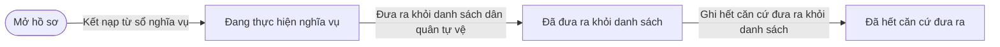
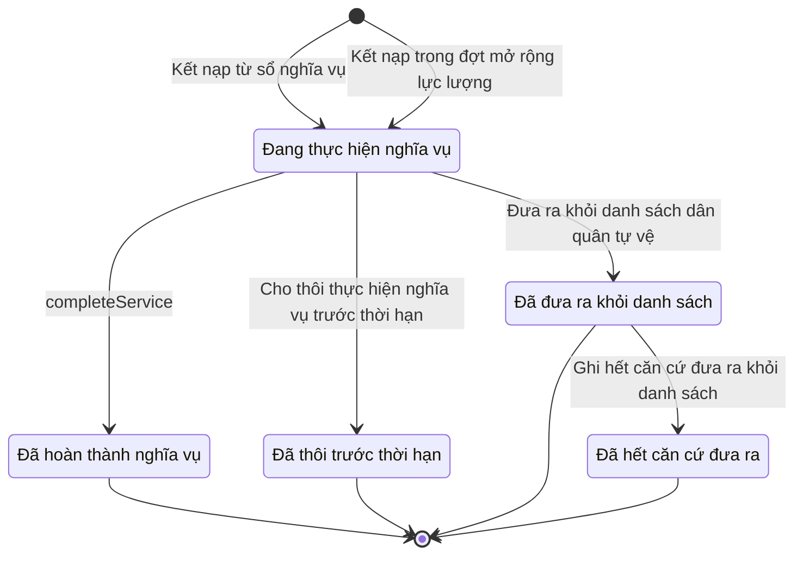

# qt-16.enlistment · Sổ đăng ký người theo diện — Chiến sĩ dân quân tự vệ

<!-- máy sinh: tom-tat -->
> **Hồ sơ:** Chiến sĩ dân quân tự vệ (`MilitiaMember`)
>
> **Trong sổ phạm vi:** 16 · Sổ đăng ký người theo diện — hồ sơ phụ enlistment (tầng 1)
>
> 17 bước · 5 chặng · 3 vai · 3 bảng quyết định · 0 hạn · 40 khớp nối.
>
> **Nguồn:** sổ nghiệp vụ `qt-16.enlistment` · khai báo của app: `dqtv-app/core/processes/militia-enlistment/workflow/enlistment.yaml`. Các bảng do máy sinh từ nguồn này.
<!-- hết: tom-tat -->

<!-- viết tay: dien-giai -->
## Diễn giải

*Phần này viết tay, diễn giải lại điều các bảng bên dưới ghi.*

### Quy trình này để làm gì

Theo dõi **một lần tham gia dân quân tự vệ của một người** (hồ sơ *Chiến sĩ dân quân tự vệ*), từ lúc kết nạp tới lúc lần tham gia ấy khép lại. Quy trình còn được gọi là "Chặng 1 — Vào lực lượng".

Hồ sơ đi qua các chặng: *Đang thực hiện nghĩa vụ*, rồi khép ở một trong ba chặng *Đã hoàn thành nghĩa vụ*, *Đã thôi trước thời hạn*, *Đã đưa ra khỏi danh sách*; từ *Đã đưa ra khỏi danh sách* còn sang được *Đã hết căn cứ đưa ra* (được tham gia lại). Gần như mọi việc trong quy trình làm ở chặng *Đang thực hiện nghĩa vụ*.

### Khi nào bắt đầu

Hai cửa vào, đều do Chỉ huy trưởng Ban CHQS xã bấm, hồ sơ vào chặng *Đang thực hiện nghĩa vụ*:

- **Kết nạp từ sổ nghĩa vụ** — đòi `personInRegister`: hồ sơ Sổ đăng ký người theo diện (qt-16) không ở chặng `LEFT`. Phải nhập công dân, loại, chỉ tiêu, đơn vị, ngày bắt đầu nghĩa vụ. Hồ sơ mở ra có nối tới **Chỉ tiêu** (quy trình 2) và **Đơn vị dân quân tự vệ** (quy trình 29).
- **Kết nạp trong đợt mở rộng lực lượng** — đòi `personInRegister` và thêm `parentCallableInExpansion`: hồ sơ Sổ đăng ký người theo diện (qt-16) đã có `callableInExpansion`. Phải nhập đợt mở rộng và nhóm nguồn, không phải nhập chỉ tiêu. Hồ sơ nối tới **Đơn vị dân quân tự vệ** (29) và **Đợt mở rộng lực lượng** (D5).

### Diễn ra thế nào

**Chặng "Đang thực hiện nghĩa vụ"** — các việc ghi nhận, hồ sơ đứng yên, không buộc thứ tự:

- **Xác nhận quyết định đã ký, đính kèm ảnh** (Trợ lý Quân lực) — phải nhập số quyết định, người ký, ngày ký, căn cứ và ảnh chụp; lặp được. Bước này ghi một quyết định ký ngoài hệ (`memberAuthorizedBy`), người ký là `commune_chairman` hoặc `province_military_command`.
- **Chuyển sang đơn vị khác** (Trợ lý Quân lực) — ghi đơn vị mới và một lần chuyển đơn vị; lặp được.
- **Ghi nhận tai nạn khi làm nhiệm vụ** (Trợ lý Quân lực) — ghi ngày và diễn biến tai nạn; lặp được.
- **Ghi nhận tạm vắng** (Trợ lý Quân lực) — tạm vắng từ ngày nào, lý do, dự kiến trở lại, nơi đến; lặp được. **Kết thúc tạm vắng, trở lại đơn vị** ghi ngày trở lại.
- **Đề nghị khen thưởng** (Trợ lý Quân lực) — ngày đề nghị, danh hiệu, thành tích; lặp được.
- **Kéo dài độ tuổi, thời hạn thực hiện nghĩa vụ** (Chỉ huy trưởng Ban CHQS xã) — đòi `unusedExtensionDecision`: có hồ sơ Dòng quyết định kéo dài (`qt-16.service-extension-decision`) cùng hồ sơ mẹ với hồ sơ này, đang ở chặng `VERIFIED`; ghi kéo dài tới ngày nào; lặp được.

**Ba đường khép lần tham gia**, đều từ chặng *Đang thực hiện nghĩa vụ*:

- `completeService` (Hệ thống tự làm, không do người nào bấm) — đòi `coveredByDecidedCompletionBatch`: có hồ sơ Công nhận hoàn thành nghĩa vụ theo lô (qt-D3) mà mối nối Đợt hoàn thành nghĩa vụ của nó trỏ về chính hồ sơ này, và hồ sơ ấy đang ở chặng `DECIDED` hoặc `COMPLETED`; ghi ngày hoàn thành nghĩa vụ; hồ sơ sang *Đã hoàn thành nghĩa vụ*.
- **Cho thôi thực hiện nghĩa vụ trước thời hạn** (Chỉ huy trưởng Ban CHQS xã) — đòi `unusedEarlyExitDecision`: có hồ sơ Dòng quyết định cho thôi, đưa ra khỏi danh sách (`qt-16.service-exit-decision`) cùng hồ sơ mẹ với hồ sơ này, đang ở chặng `VERIFIED` và `exitKind` là `early_exit`; ghi ngày hoàn thành nghĩa vụ và căn cứ thôi trước thời hạn; hồ sơ sang *Đã thôi trước thời hạn*.
- **Đưa ra khỏi danh sách dân quân tự vệ** (Chỉ huy trưởng Ban CHQS xã) — đòi `unusedRemovalDecision`: có hồ sơ Dòng quyết định cho thôi, đưa ra khỏi danh sách (`qt-16.service-exit-decision`) cùng hồ sơ mẹ với hồ sơ này, đang ở chặng `VERIFIED` và `exitKind` là `removal`; ghi ngày hoàn thành nghĩa vụ và căn cứ đưa ra; hồ sơ sang *Đã đưa ra khỏi danh sách*.

Cả ba đường đều xoá mối nối tới Đơn vị dân quân tự vệ.

**Chặng "Đã đưa ra khỏi danh sách"** — **Ghi hết căn cứ đưa ra khỏi danh sách** (Trợ lý Quân lực) ghi ngày hết căn cứ, hồ sơ sang *Đã hết căn cứ đưa ra*.

**Ở mọi chặng** — `applyDisciplineDecision` (Trợ lý Quân lực): đòi đã có hình thức kỷ luật và `disciplineEffectiveFrom`; ghi hai ô ấy vào hồ sơ và nối tới một Đợt chịu kỷ luật; hồ sơ đứng yên.

### Kết thúc và để lại gì

Hồ sơ kết thúc ở bốn chặng: *Đã hoàn thành nghĩa vụ*, *Đã thôi trước thời hạn*, *Đã đưa ra khỏi danh sách*, *Đã hết căn cứ đưa ra*. Ở cả bốn chặng vẫn làm được `applyDisciplineDecision`.

Rất nhiều hồ sơ của quy trình khác mở ra từ hồ sơ chiến sĩ (mục 10): chức vụ chỉ huy (30), cử đi huấn luyện do cấp trên tổ chức (14), hồ sơ khen thưởng và Kỷ niệm chương (8), hồ sơ chế độ chính sách và bồi thường thiệt hại (12b), lệnh điều động (13a), trang phục cá nhân (D11), sự cố trang phục (D13), vụ việc kỷ luật (D15), đăng ký tham gia phong trào (7), đợt hoàn thành nghĩa vụ (D3), đề nghị công nhận hoàn thành nghĩa vụ quân sự tại ngũ (D4). Chiến sĩ còn được gắn vào đợt triệu tập huấn luyện (14), dòng trang bị cấp phát (D11) và danh sách kèm tờ trình của văn bản đi (1).

### Điều kiện chặn

- Mọi bước sau khi kết nạp (trừ bước xác nhận quyết định đã ký và bước hệ tự làm): người làm phải thuộc đơn vị ghi ở ô đơn vị chủ hồ sơ.
- Sai người, sai chặng, thiếu thứ phải có trước thì bước bị chặn, hồ sơ giữ nguyên.
- Ba bước cho thôi, đưa ra, kéo dài chỉ làm được khi đã có hồ sơ quyết định tương ứng, cùng hồ sơ mẹ với hồ sơ này, ở chặng `VERIFIED`; `completeService` chỉ chạy khi có hồ sơ Công nhận hoàn thành nghĩa vụ theo lô (qt-D3) trỏ về hồ sơ này đang ở `DECIDED` hoặc `COMPLETED`.
- Việc ngoài hệ: ranh giới `commune-chairman-signature`, người làm `communeChairman`. Hệ nhận về `decisionScanPath`; không được thì chặn, hồ sơ giữ nguyên.
<!-- hết viết tay -->

## 1. Đường đi ngắn nhất qua các chặng

<!-- máy sinh: luong-chinh -->
Đường ít bước nhất từ lúc mở hồ sơ tới chặng kết thúc xa nhất. Máy chọn theo số chặng, không theo ý nghĩa nghiệp vụ — trình tự công việc thật xem phần Diễn giải và bảng "Việc làm ở từng chặng" ở mục 6.

| # | Ai làm | Làm gì | Hồ sơ sang chặng |
|---|---|---|---|
| 1 | Chỉ huy trưởng Ban CHQS xã | Kết nạp từ sổ nghĩa vụ | Đang thực hiện nghĩa vụ |
| 2 | Hệ thống tự làm | Đưa ra khỏi danh sách dân quân tự vệ | Đã đưa ra khỏi danh sách |
| 3 | Trợ lý Quân lực | Ghi hết căn cứ đưa ra khỏi danh sách | Đã hết căn cứ đưa ra |

<!-- hết: luong-chinh -->

## 2. Hồ sơ và việc nó để lại

<!-- máy sinh: muc-tieu -->
**App gọi quy trình này là:** Chặng 1 — Vào lực lượng.

**Khi mở, hồ sơ này ghi mối nối tới:**
- Chỉ tiêu (2) — bước `admitFromPool`, khớp nối `memberUnderTarget`
- Đơn vị dân quân tự vệ (29) — bước `admitFromPool`, khớp nối `assignedToUnit`
- Đơn vị dân quân tự vệ (29) — bước `admitInExpansion`, khớp nối `assignedToUnit`
- Đợt mở rộng lực lượng (D5) — bước `admitInExpansion`, khớp nối `memberCalledInExpansion`

**Hồ sơ này để lại cho quy trình khác** (bước tạo hồ sơ của quy trình kia ghi mối nối về đây):
- Chức vụ chỉ huy dân quân tự vệ (30) — bước `openTenureFromEstablishment`, khớp nối `tenureHeldBy`
- Chức vụ chỉ huy dân quân tự vệ (30) — bước `planTenure`, khớp nối `tenureHeldBy`
- Dân quân tham gia huấn luyện do cấp trên tổ chức (14.training-nomination) — bước `nominateForTraining`, khớp nối `nominatedMember`
- Hồ sơ Kỷ niệm chương "Vì sự nghiệp vũ trang quần chúng" (8.medal) — bước `proposeMedal`, khớp nối `medalCaseForMember`
- Hồ sơ bồi thường thiệt hại (12b.compensation) — bước `fileCompensation`, khớp nối `compensationCaseFor`
- Hồ sơ chế độ chính sách (12b) — bước `raiseAllowanceFromServiceRecognition`, khớp nối `claimFor`
- Hồ sơ chế độ chính sách (12b) — bước `submitClaim`, khớp nối `claimFor`
- Hồ sơ khen thưởng (8) — bước `recordMemberSelection`, khớp nối `awardCaseForMember`
- Lệnh điều động (13a) — bước `proposeDeployment`, khớp nối `deploysMember`
- Lệnh điều động (13a) — bước `receiveUpperDeploymentDecision`, khớp nối `deploysMember`
- Sự cố trang phục (D13) — bước `reportUniformIncident`, khớp nối `incidentOfMember`
- Trang phục cá nhân (D11) — bước `issueToMember`, khớp nối `memberUniformOf`
- Vụ việc kỷ luật (D15) — bước `openDisciplinaryCase`, khớp nối `disciplinaryCaseFor`
- Vụ việc kỷ luật (D15) — bước `openDisciplineFromSource`, khớp nối `disciplinaryCaseFor`
- Vụ việc kỷ luật (D15) — bước `openDisciplineFromSource`, khớp nối `disciplineFromEnlistment`
- Vụ việc vi phạm hành chính (10) — bước `openViolationFromSource`, khớp nối `violationFromEnlistment`
- Vụ việc vi phạm hành chính (10) — bước `openViolationFromSource`, khớp nối `violatorMember`
- Đề nghị công nhận hoàn thành nghĩa vụ quân sự tại ngũ (D4) — bước `draftServiceRecognitionProposal`, khớp nối `recognitionProposalCovers`
- Đợt hoàn thành nghĩa vụ (D3) — bước `gatherServiceCompletionBatch`, khớp nối `serviceCompletionCoversMember`
<!-- hết: muc-tieu -->

## 3. Khởi phát và kết thúc

<!-- máy sinh: khoi-phat -->
**2 cửa vào** — bước mở hồ sơ:

| Bước mở | Ai mở | Hồ sơ vào chặng | App bắt buộc nhập |
|---|---|---|---|
| Kết nạp từ sổ nghĩa vụ | Chỉ huy trưởng Ban CHQS xã | Đang thực hiện nghĩa vụ | `citizenId`, `planTargetIds`, `unitId`, bắt đầu nghĩa vụ |
| Kết nạp trong đợt mở rộng lực lượng | Chỉ huy trưởng Ban CHQS xã | Đang thực hiện nghĩa vụ | `citizenId`, `unitId`, bắt đầu nghĩa vụ, `expansionId`, nhóm nguồn khi mở rộng lực lượng |

**Kết thúc:** *Đã hoàn thành nghĩa vụ* (`COMPLETED`), *Đã thôi trước thời hạn* (`DISCHARGED_EARLY`), *Đã đưa ra khỏi danh sách* (`REMOVED`), *Đã hết căn cứ đưa ra* (`REMOVAL_CLEARED`)
<!-- hết: khoi-phat -->

## 4. Vai trò

<!-- máy sinh: vai-tro -->
| Vai trong sổ | Tên trong app | Điều kiện | Làm những bước |
|---|---|---|---|
| `verifier` | Chỉ huy trưởng Ban CHQS xã |  | Kết nạp từ sổ nghĩa vụ · Kết nạp trong đợt mở rộng lực lượng |
| `operator` | Trợ lý Quân lực |  | Xác nhận quyết định đã ký, đính kèm ảnh · Chuyển sang đơn vị khác · Ghi nhận tai nạn khi làm nhiệm vụ · Ghi nhận tạm vắng · Kết thúc tạm vắng, trở lại đơn vị · Đề nghị khen thưởng · Ghi hết căn cứ đưa ra khỏi danh sách · Đề nghị xử lý vi phạm tự ý thôi nghĩa vụ |
| `system` | Hệ thống tự làm |  | Cho thôi thực hiện nghĩa vụ trước thời hạn · Đưa ra khỏi danh sách dân quân tự vệ · Cắm cờ chờ quyết định cho thôi, đưa ra khỏi danh sách · Gỡ cờ chờ quyết định cho thôi — căn cứ không còn · Kéo dài độ tuổi, thời hạn thực hiện nghĩa vụ · `applyDisciplineDecision` · `completeService` |

*"Tên trong app" là tên app đặt cho mã chủ thể của vai. Hồ sơ thuộc đơn vị cấp khác thì người làm là người giữ vai ấy ở đơn vị nêu trong cột "Điều kiện" (nếu sổ có ghi) và ở cột "Người làm phải thuộc" của bảng "Theo khai báo của app" (mục 7).*

**Ngoài hệ** (hệ chỉ ghi kết quả, xem mục 8): `communeChairman`.
<!-- hết: vai-tro -->

## 5. Nhánh phụ

<!-- máy sinh: nhanh-phu -->
**Bước khác đưa hồ sơ sang chặng mới** — đường song song, rẽ nhánh hoặc kết thúc sớm:

| Bước | Ai làm | Từ chặng | Sang chặng |
|---|---|---|---|
| Cho thôi thực hiện nghĩa vụ trước thời hạn | Hệ thống tự làm | Đang thực hiện nghĩa vụ | Đã thôi trước thời hạn |
| `completeService` | Hệ thống tự làm | Đang thực hiện nghĩa vụ | Đã hoàn thành nghĩa vụ |

**Làm trong lúc hồ sơ đứng yên ở một chặng** — ghi nhận, bổ sung:

| Bước | Ai làm | Ở chặng |
|---|---|---|
| Xác nhận quyết định đã ký, đính kèm ảnh *(lặp được)* | Trợ lý Quân lực | Đang thực hiện nghĩa vụ |
| Chuyển sang đơn vị khác *(lặp được)* | Trợ lý Quân lực | Đang thực hiện nghĩa vụ |
| Ghi nhận tai nạn khi làm nhiệm vụ *(lặp được)* | Trợ lý Quân lực | Đang thực hiện nghĩa vụ |
| Cắm cờ chờ quyết định cho thôi, đưa ra khỏi danh sách | Hệ thống tự làm | Đang thực hiện nghĩa vụ |
| Gỡ cờ chờ quyết định cho thôi — căn cứ không còn | Hệ thống tự làm | Đang thực hiện nghĩa vụ |
| Ghi nhận tạm vắng *(lặp được)* | Trợ lý Quân lực | Đang thực hiện nghĩa vụ |
| Kết thúc tạm vắng, trở lại đơn vị | Trợ lý Quân lực | Đang thực hiện nghĩa vụ |
| Đề nghị khen thưởng *(lặp được)* | Trợ lý Quân lực | Đang thực hiện nghĩa vụ |
| Kéo dài độ tuổi, thời hạn thực hiện nghĩa vụ *(lặp được)* | Hệ thống tự làm | Đang thực hiện nghĩa vụ |
| Đề nghị xử lý vi phạm tự ý thôi nghĩa vụ | Trợ lý Quân lực | Đang thực hiện nghĩa vụ |
| `applyDisciplineDecision` | Hệ thống tự làm | Đang thực hiện nghĩa vụ, Đã hoàn thành nghĩa vụ, Đã thôi trước thời hạn, Đã đưa ra khỏi danh sách, Đã hết căn cứ đưa ra |

**Cửa vào khác:** 2 bước cùng mở hồ sơ — xem mục 3.

<!-- hết: nhanh-phu -->

## 6. Các chặng và việc làm ở từng chặng

<!-- máy sinh: chang -->
| Chặng | Tên hiển thị | Vào bằng bước | Kết thúc? |
|---|---|---|---|
| `SERVING` | Đang thực hiện nghĩa vụ | Kết nạp từ sổ nghĩa vụ · Kết nạp trong đợt mở rộng lực lượng |  |
| `COMPLETED` | Đã hoàn thành nghĩa vụ | `completeService` | **kết thúc** — vẫn còn bước làm được |
| `DISCHARGED_EARLY` | Đã thôi trước thời hạn | Cho thôi thực hiện nghĩa vụ trước thời hạn | **kết thúc** — vẫn còn bước làm được |
| `REMOVED` | Đã đưa ra khỏi danh sách | Đưa ra khỏi danh sách dân quân tự vệ | **kết thúc** — vẫn còn bước làm được |
| `REMOVAL_CLEARED` | Đã hết căn cứ đưa ra | Ghi hết căn cứ đưa ra khỏi danh sách | **kết thúc** — vẫn còn bước làm được |

### Việc làm ở từng chặng

Hồ sơ đang ở chặng nào thì làm được những bước nào.

| Hồ sơ đang ở chặng | Bước làm tại chặng (hồ sơ đứng yên) | Bước đưa hồ sơ sang chặng khác |
|---|---|---|
| **Đang thực hiện nghĩa vụ** | Xác nhận quyết định đã ký, đính kèm ảnh (lặp được) — Trợ lý Quân lực Chuyển sang đơn vị khác (lặp được) — Trợ lý Quân lực Ghi nhận tai nạn khi làm nhiệm vụ (lặp được) — Trợ lý Quân lực Cắm cờ chờ quyết định cho thôi, đưa ra khỏi danh sách — Hệ thống tự làm Gỡ cờ chờ quyết định cho thôi — căn cứ không còn — Hệ thống tự làm Ghi nhận tạm vắng (lặp được) — Trợ lý Quân lực Kết thúc tạm vắng, trở lại đơn vị — Trợ lý Quân lực Đề nghị khen thưởng (lặp được) — Trợ lý Quân lực Kéo dài độ tuổi, thời hạn thực hiện nghĩa vụ (lặp được) — Hệ thống tự làm Đề nghị xử lý vi phạm tự ý thôi nghĩa vụ — Trợ lý Quân lực `applyDisciplineDecision` — Hệ thống tự làm | Cho thôi thực hiện nghĩa vụ trước thời hạn — Hệ thống tự làm → *Đã thôi trước thời hạn* Đưa ra khỏi danh sách dân quân tự vệ — Hệ thống tự làm → *Đã đưa ra khỏi danh sách* `completeService` — Hệ thống tự làm → *Đã hoàn thành nghĩa vụ* |
| **Đã hoàn thành nghĩa vụ** | `applyDisciplineDecision` — Hệ thống tự làm | — (kết thúc) |
| **Đã thôi trước thời hạn** | `applyDisciplineDecision` — Hệ thống tự làm | — (kết thúc) |
| **Đã đưa ra khỏi danh sách** | `applyDisciplineDecision` — Hệ thống tự làm | Ghi hết căn cứ đưa ra khỏi danh sách — Trợ lý Quân lực → *Đã hết căn cứ đưa ra* |
| **Đã hết căn cứ đưa ra** | `applyDisciplineDecision` — Hệ thống tự làm | — (kết thúc) |
<!-- hết: chang -->

## 7. Bảng bước

<!-- máy sinh: buoc -->
| # | Bước | Mã bước | Ai thực hiện | Từ chặng | Sang chặng | Phải có trước | Ghi lại |
|---|---|---|---|---|---|---|---|
| 1 | Kết nạp từ sổ nghĩa vụ | `admitFromPool` | Chỉ huy trưởng Ban CHQS xã | — (mở hồ sơ) | `SERVING` | `personInRegister`, `targetUnitEstablished`, `targetUnitNotDissolving` | `id`, nối tới Chỉ tiêu, nối tới Đơn vị dân quân tự vệ, đơn vị chủ hồ sơ, làm thường trực từ ngày |
| 2 | Kết nạp trong đợt mở rộng lực lượng | `admitInExpansion` | Chỉ huy trưởng Ban CHQS xã | — (mở hồ sơ) | `SERVING` | `personInRegister`, `parentCallableInExpansion`, `targetUnitEstablished`, `targetUnitNotDissolving` | `id`, nối tới Công dân trong độ tuổi, nối tới Cơ sở dân quân tự vệ, đơn vị chủ hồ sơ, nối tới Đơn vị dân quân tự vệ, bắt đầu nghĩa vụ, nhóm nguồn khi mở rộng lực lượng, nối tới Đợt mở rộng lực lượng, làm thường trực từ ngày |
| 3 | Xác nhận quyết định đã ký, đính kèm ảnh | `recordSignedDecision` | Trợ lý Quân lực | `SERVING` | giữ nguyên | `recordSignedDecisionFromIncomingDocumentUsable` | nối tới Quyết định ký ngoài hệ thống, nối tới Văn bản đến |
| 4 | Chuyển sang đơn vị khác | `transferUnit` | Trợ lý Quân lực | `SERVING` | giữ nguyên | người làm thuộc đơn vị chủ hồ sơ, `targetUnitEstablished`, `targetUnitNotDissolving` | nối tới Đơn vị dân quân tự vệ, nối tới Lần chuyển đơn vị |
| 5 | Ghi nhận tai nạn khi làm nhiệm vụ | `recordDutyAccident` | Trợ lý Quân lực | `SERVING` | giữ nguyên | người làm thuộc đơn vị chủ hồ sơ | ngày tai nạn, nối tới Vụ tai nạn khi làm nhiệm vụ |
| 6 | Cho thôi thực hiện nghĩa vụ trước thời hạn | `dischargeEarly` | Hệ thống tự làm | `SERVING` | `DISCHARGED_EARLY` | `unusedEarlyExitDecision` | hoàn thành nghĩa vụ, căn cứ thôi trước thời hạn, diễn giải căn cứ; **xoá:** nối tới Đơn vị dân quân tự vệ |
| 7 | Đưa ra khỏi danh sách dân quân tự vệ | `removeFromList` | Hệ thống tự làm | `SERVING` | `REMOVED` | `unusedRemovalDecision` | hoàn thành nghĩa vụ, căn cứ đưa ra khỏi danh sách, diễn giải căn cứ; **xoá:** nối tới Đơn vị dân quân tự vệ |
| 8 | Cắm cờ chờ quyết định cho thôi, đưa ra khỏi danh sách | `flagExitDecisionDue` | Hệ thống tự làm | `SERVING` | giữ nguyên | `exitGroundArisenOnSystem`, `exitDueNotRaised`, `exitDueSource` | căn cứ chờ quyết định cho thôi, đưa ra, ngày phát sinh căn cứ chờ quyết định |
| 9 | Gỡ cờ chờ quyết định cho thôi — căn cứ không còn | `clearExitDecisionDue` | Hệ thống tự làm | `SERVING` | giữ nguyên | căn cứ chờ quyết định cho thôi, đưa ra | —; **xoá:** căn cứ chờ quyết định cho thôi, đưa ra, ngày phát sinh căn cứ chờ quyết định, nối tới Quyết định gọi nhập ngũ |
| 10 | Ghi nhận tạm vắng | `recordAbsence` | Trợ lý Quân lực | `SERVING` | giữ nguyên | người làm thuộc đơn vị chủ hồ sơ | nối tới Đợt tạm vắng, tạm vắng từ ngày, dự kiến trở lại, lý do tạm vắng, nơi đến khi tạm vắng |
| 11 | Kết thúc tạm vắng, trở lại đơn vị | `endAbsence` | Trợ lý Quân lực | `SERVING` | giữ nguyên | người làm thuộc đơn vị chủ hồ sơ | ngày trở lại |
| 12 | Đề nghị khen thưởng | `proposeCommendation` | Trợ lý Quân lực | `SERVING` | giữ nguyên | người làm thuộc đơn vị chủ hồ sơ | ngày đề nghị khen thưởng, nối tới Lần đề nghị khen thưởng |
| 13 | Kéo dài độ tuổi, thời hạn thực hiện nghĩa vụ | `extendService` | Hệ thống tự làm | `SERVING` | giữ nguyên | `unusedExtensionDecision` | ngày quyết định kéo dài, kéo dài thời hạn tới, nối tới Lần kéo dài độ tuổi, thời hạn nghĩa vụ |
| 14 | Ghi hết căn cứ đưa ra khỏi danh sách | `clearRemoval` | Trợ lý Quân lực | `REMOVED` | `REMOVAL_CLEARED` | người làm thuộc đơn vị chủ hồ sơ | ngày hết căn cứ |
| 15 | Đề nghị xử lý vi phạm tự ý thôi nghĩa vụ | `proposeDutyAbandonmentHandling` | Trợ lý Quân lực | `SERVING` | giữ nguyên | người làm thuộc đơn vị chủ hồ sơ, xử lý bằng | nối `violatingMember` |
| 16 | `applyDisciplineDecision` | `applyDisciplineDecision` | Hệ thống tự làm | `SERVING`, `COMPLETED`, `DISCHARGED_EARLY`, `REMOVED`, `REMOVAL_CLEARED` | giữ nguyên | `disciplineAnnouncedOnCase` | nối tới Đợt chịu kỷ luật, hình thức kỷ luật, `disciplineEffectiveFrom` |
| 17 | `completeService` | `completeService` | Hệ thống tự làm | `SERVING` | `COMPLETED` | — | hoàn thành nghĩa vụ; **xoá:** nối tới Đơn vị dân quân tự vệ |

### Khi không đạt điều kiện

Mặc định: không đúng người, hồ sơ không ở đúng chặng, hoặc thiếu thứ "phải có trước" thì bước bị chặn, hồ sơ giữ nguyên. Bảng dưới chỉ kê những bước có kết quả riêng.

| # | Bước | Kết quả riêng |
|---|---|---|
| 4 | Chuyển sang đơn vị khác | nhánh `leave-standing`: hồ sơ giữ nguyên chặng, ghi thêm rời thường trực ngày; nhánh `to-standing`: hồ sơ giữ nguyên chặng, ghi thêm làm thường trực từ ngày |
| 6 | Cho thôi thực hiện nghĩa vụ trước thời hạn | bước này không do người nào bấm |
| 7 | Đưa ra khỏi danh sách dân quân tự vệ | bước này không do người nào bấm |
| 8 | Cắm cờ chờ quyết định cho thôi, đưa ra khỏi danh sách | bước dừng lại, hồ sơ giữ nguyên khi kết quả xét là: `no-source`; nhánh `from-admission`: hồ sơ giữ nguyên chặng, ghi thêm nối tới Thí sinh sơ tuyển vào trường Quân đội; nhánh `from-call`: hồ sơ giữ nguyên chặng, ghi thêm nối tới Quyết định gọi nhập ngũ; nhánh `from-case`: hồ sơ giữ nguyên chặng, ghi thêm nối tới Vụ việc kỷ luật; bước này không do người nào bấm |
| 9 | Gỡ cờ chờ quyết định cho thôi — căn cứ không còn | bước này không do người nào bấm |
| 13 | Kéo dài độ tuổi, thời hạn thực hiện nghĩa vụ | bước này không do người nào bấm |
| 15 | Đề nghị xử lý vi phạm tự ý thôi nghĩa vụ | bước dừng lại, hồ sơ giữ nguyên khi kết quả xét là: `no-choice`; nhánh `both`: hồ sơ giữ nguyên chặng, ghi thêm nối `handlingViolationCase`, nối `handlingDisciplinaryCase`; nhánh `discipline`: hồ sơ giữ nguyên chặng, ghi thêm nối `handlingDisciplinaryCase`; nhánh `penalty`: hồ sơ giữ nguyên chặng, ghi thêm nối `handlingViolationCase` |
| 16 | `applyDisciplineDecision` | bước này không do người nào bấm |
| 17 | `completeService` | bước này không do người nào bấm |

### Điều kiện "phải có trước" bằng lời

Cột "Phải có trước" ở bảng bước có hai loại: ô dữ liệu thường (bước chỉ đòi ô ấy đã có giá trị) và điều kiện hệ tự xét. Bảng này diễn các điều kiện hệ tự xét theo đúng công thức sổ ghi; số ở cột cuối là số thứ tự bước.

| Điều kiện | Đúng khi | Bước đòi |
|---|---|---|
| `personInRegister` | KHÔNG (hồ sơ Sổ đăng ký người theo diện (qt-16) đang ở chặng `LEFT` hoặc `TRAINING_LISTED` hoặc `IN_ARMY`) | 1, 2 |
| `targetUnitEstablished` | có hồ sơ `dm.militia-unit` chính là hồ sơ ghi ở `unitId` của hồ sơ đang làm mà `unitStatus` là `ESTABLISHED` | 1, 2, 4 |
| `targetUnitNotDissolving` | không có hồ sơ Giải thể tổ chức (qt-31) có ô nối `dissolutionOfUnit` trùng với `unitId` của hồ sơ đang làm mà hồ sơ ấy đang ở chặng `SUBMITTED` hoặc `ACCEPTED` | 1, 2, 4 |
| `parentCallableInExpansion` | đã có `callableInExpansion` ở hồ sơ Sổ đăng ký người theo diện (qt-16) | 2 |
| `recordSignedDecisionFromIncomingDocumentUsable` | có hồ sơ Việc luật giao kèm văn bản đến, đi — Văn bản đến (qt-1.incoming-document) chính là hồ sơ ghi ở ô nối `recordSignedDecisionFromIncomingDocument` của hồ sơ đang làm mà hồ sơ ấy đang ở chặng `RECEIVED` hoặc `DISTRIBUTED` | 3 |
| `actorInOwnerUnit` | người đang làm là người của đơn vị ghi ở ô đơn vị chủ hồ sơ của hồ sơ này (theo danh mục người của đơn vị, `dm.unit-staff`) | 4, 5, 10, 11, 12, 14, 15 |
| `unusedEarlyExitDecision` | có hồ sơ Dòng quyết định cho thôi, đưa ra khỏi danh sách (qt-16.service-exit-decision) cùng hồ sơ mẹ với hồ sơ đang làm (`siblings`) mà hồ sơ ấy đang ở chặng `VERIFIED` VÀ `exitKind` là `early_exit` | 6 |
| `unusedRemovalDecision` | có hồ sơ Dòng quyết định cho thôi, đưa ra khỏi danh sách (qt-16.service-exit-decision) cùng hồ sơ mẹ với hồ sơ đang làm (`siblings`) mà hồ sơ ấy đang ở chặng `VERIFIED` VÀ `exitKind` là `removal` | 7 |
| `exitDueNotRaised` | KHÔNG (đã có căn cứ chờ quyết định cho thôi, đưa ra) | 8 |
| `unusedExtensionDecision` | có hồ sơ Dòng quyết định kéo dài (qt-16.service-extension-decision) cùng hồ sơ mẹ với hồ sơ đang làm (`siblings`) mà hồ sơ ấy đang ở chặng `VERIFIED` | 13 |

### Theo khai báo của app

Người làm phải thuộc đơn vị nào, ô người dùng phải nhập, bước có lặp được không, và căn cứ pháp lý — lấy từ khai báo quy trình trong app.

| # | Bước | Người làm phải thuộc | Bắt buộc nhập | Nhập nếu có | Lặp được | Căn cứ |
|---|---|---|---|---|---|---|
| 1 | Kết nạp từ sổ nghĩa vụ |  | `citizenId`, `planTargetIds`, `unitId`, bắt đầu nghĩa vụ | `registrationId`, đoàn viên, đảng viên, dân tộc thiểu số, đã phục viên, xuất ngũ (PVXN) |  | L48/2019/QH14 Đ.10 k2 b, k4 · Đ.15 |
| 2 | Kết nạp trong đợt mở rộng lực lượng |  | `citizenId`, `unitId`, bắt đầu nghĩa vụ, `expansionId`, nhóm nguồn khi mở rộng lực lượng | `registrationId`, đoàn viên, đảng viên, dân tộc thiểu số, đã phục viên, xuất ngũ (PVXN) |  | L48/2019/QH14 Đ.16 k1 · Đ.10 k4 |
| 3 | Xác nhận quyết định đã ký, đính kèm ảnh |  | `memberId`, quyết định đã ký trong sổ văn bản đến, `subject`, `signedBy`, `legalBasis` | — | có | 50_MAU_KY_NGOAI_HE_THONG.md §D |
| 4 | Chuyển sang đơn vị khác | đơn vị chủ hồ sơ | `memberId`, `unitId`, `transferAt`, `transferReason` | — | có | L48/2019/QH14 Đ.15 |
| 5 | Ghi nhận tai nạn khi làm nhiệm vụ | đơn vị chủ hồ sơ | `memberId`, ngày tai nạn, diễn biến tai nạn | — | có | NĐ72/2020/NĐ-CP Đ.14 |
| 6 | Cho thôi thực hiện nghĩa vụ trước thời hạn | đơn vị chủ hồ sơ | `memberId`, `exitDecisionId`, trường hợp ghi trên quyết định, hoàn thành nghĩa vụ, ngày áp dụng | diễn giải căn cứ |  | L48/2019/QH14 Đ.12 k1 |
| 7 | Đưa ra khỏi danh sách dân quân tự vệ | đơn vị chủ hồ sơ | `memberId`, `exitDecisionId`, trường hợp ghi trên quyết định, hoàn thành nghĩa vụ, ngày áp dụng | diễn giải căn cứ |  | L48/2019/QH14 Đ.12 k2 |
| 8 | Cắm cờ chờ quyết định cho thôi, đưa ra khỏi danh sách |  | căn cứ chờ quyết định cho thôi, đưa ra, ngày phát sinh căn cứ chờ quyết định | `conscriptionCallId`, `admissionId`, `disciplinaryCaseId` |  | L48/2019/QH14 Đ.12 k1 d, đ · k2 c |
| 9 | Gỡ cờ chờ quyết định cho thôi — căn cứ không còn |  | vì sao gỡ cờ | `conscriptionCallId` |  | L48/2019/QH14 Đ.12 k1 d |
| 10 | Ghi nhận tạm vắng | đơn vị chủ hồ sơ | `memberId`, tạm vắng từ ngày, lý do tạm vắng | dự kiến trở lại, nơi đến khi tạm vắng | có | L48/2019/QH14 Đ.9 k2 b |
| 11 | Kết thúc tạm vắng, trở lại đơn vị | đơn vị chủ hồ sơ | `memberId`, ngày trở lại | — |  | L48/2019/QH14 Đ.9 k2 b |
| 12 | Đề nghị khen thưởng | đơn vị chủ hồ sơ | `memberId`, ngày đề nghị khen thưởng, danh hiệu đề nghị, thành tích | — | có | L48/2019/QH14 Đ.46 |
| 13 | Kéo dài độ tuổi, thời hạn thực hiện nghĩa vụ | đơn vị chủ hồ sơ | `memberId`, `extensionDecisionId`, kéo dài đến hết ngày, ngày quyết định kéo dài, ngày áp dụng | căn cứ kéo dài | có | L48/2019/QH14 Đ.8 k3 (sửa bởi L98/2025 Đ.10 k1) |
| 14 | Ghi hết căn cứ đưa ra khỏi danh sách | đơn vị chủ hồ sơ | `memberId`, ngày hết căn cứ | diễn giải căn cứ |  | L48/2019/QH14 Đ.12 k2 · Đ.9 k1 |
| 15 | Đề nghị xử lý vi phạm tự ý thôi nghĩa vụ | đơn vị chủ hồ sơ | xử lý bằng, ngày vi phạm, ngày phát hiện, mô tả hành vi vi phạm | hành vi (NĐ218), nhóm hành vi (TT81), thời hiệu, ngày vi phạm mới (nếu có) |  | sổ qt-16.enlistment · NĐ218/2025/NĐ-CP Đ.17 k3; TT81/VBHN-BQP Đ.18 |
| — | Hoàn thành nghĩa vụ theo đợt (`completeServiceInBatch`) |  | hoàn thành nghĩa vụ, `batchId` | — |  | L48/2019/QH14 Đ.13 |

### Điều kiện và ghi chú app khai cho từng bước

Lấy từ khai báo quy trình trong app. Lời trong ngoặc kép là câu app hiện cho người dùng. Chức danh người ký ngoài hệ app chỉ khai bằng mã.

| # | Bước | Điều kiện, ghi chú |
|---|---|---|
| 3 | Xác nhận quyết định đã ký, đính kèm ảnh | · bước này ghi một quyết định ký NGOÀI hệ (`memberAuthorizedBy`), người ký: `commune_chairman`, `province_military_command` · không đòi bản chụp — app ghi: "bản số hoá lấy từ văn bản đến văn thư đã vào sổ (tầng đọc chép `scanPath` của văn bản ấy), không tải ảnh ở bước này" |
| 4 | Chuyển sang đơn vị khác | · tạo thêm một hồ sơ con: Lần chuyển đơn vị (`UnitTransfer`) |
| 5 | Ghi nhận tai nạn khi làm nhiệm vụ | · tạo thêm một hồ sơ con: Vụ tai nạn khi làm nhiệm vụ (`DutyAccident`) |
| 8 | Cắm cờ chờ quyết định cho thôi, đưa ra khỏi danh sách | · không làm được khi đã có ô "căn cứ chờ quyết định cho thôi, đưa ra" — app báo: "Lần tham gia này đã có cờ chờ quyết định cho thôi, đưa ra khỏi danh sách" |
| 9 | Gỡ cờ chờ quyết định cho thôi — căn cứ không còn | · phải đã có ô "căn cứ chờ quyết định cho thôi, đưa ra" — thiếu thì app báo: "Lần tham gia này không có cờ chờ quyết định cho thôi, đưa ra" |
| 10 | Ghi nhận tạm vắng | · tạo thêm một hồ sơ con: Đợt tạm vắng (`AbsencePeriod`) |
| 12 | Đề nghị khen thưởng | · tạo thêm một hồ sơ con: Lần đề nghị khen thưởng (`CommendationProposal`) |
| 13 | Kéo dài độ tuổi, thời hạn thực hiện nghĩa vụ | · tạo thêm một hồ sơ con: Lần kéo dài độ tuổi, thời hạn nghĩa vụ (`ServiceExtension`) |
<!-- hết: buoc -->

## 8. Bảng quyết định, hạn, việc ngoài hệ

<!-- máy sinh: quyet-dinh -->
**Bảng `exit-due-source`** — xét ở bước *Cắm cờ chờ quyết định cho thôi, đưa ra khỏi danh sách*; đầu vào: `exitDueSource`. 4 dòng, dò từ trên xuống, dòng đầu tiên khớp thì dừng.

| Thứ tự dò (số sổ ghi) | Dòng | Khi | Thì |
|---|---|---|---|
| 1 | `from-case` | `exitDueSource` là `disciplinary_case` | `from-case` |
| 2 | `from-call` | `exitDueSource` là `conscription_call` | `from-call` |
| 3 | `from-admission` | `exitDueSource` là `admission` | `from-admission` |
| 4 | `no-source` | chưa có `exitDueSource` | `no-source` |

**Bảng `handling-choice`** — xét ở bước *Đề nghị xử lý vi phạm tự ý thôi nghĩa vụ*; đầu vào: xử lý bằng. 4 dòng, dò từ trên xuống, dòng đầu tiên khớp thì dừng.

| Thứ tự dò (số sổ ghi) | Dòng | Khi | Thì |
|---|---|---|---|
| 1 | `penalty` | xử lý bằng là `penalty` | `penalty` |
| 2 | `discipline` | xử lý bằng là `discipline` | `discipline` |
| 3 | `both` | xử lý bằng là `both` | `both` |
| 4 | `no-choice` | chưa có xử lý bằng | `no-choice` |

**Bảng `transfer-target-standing`** — xét ở bước *Chuyển sang đơn vị khác*; đầu vào: `targetUnitStanding`, loại. 6 dòng, dò từ trên xuống, dòng đầu tiên khớp thì dừng.

| Thứ tự dò (số sổ ghi) | Dòng | Khi | Thì |
|---|---|---|---|
| 1 | `to-standing` | `targetUnitStanding` là `standing` | `to-standing` |
| 2 | `leave-standing` | `targetUnitStanding` là `not_standing` và loại là Thường trực (`standing`) | `leave-standing` |
| 3 | `not-standing` | `targetUnitStanding` là `not_standing` | cho qua |
| 4 | `unknown` | chưa có `targetUnitStanding` | cho qua |
| 5 | `to-standing-type-unset` | `targetUnitStanding` là `standing` và chưa có loại | `to-standing` |
| 6 | `not-standing-type-unset` | `targetUnitStanding` là `not_standing` và chưa có loại | cho qua |

**Việc làm ngoài hệ, hệ chỉ ghi kết quả:**

| Ranh giới | Ai làm | Hệ gửi ra | Hệ nhận về | Không được thì |
|---|---|---|---|---|
| `commune-chairman-signature` | `communeChairman` | — | `decisionScanPath` | chặn, hồ sơ giữ nguyên |
<!-- hết: quyet-dinh -->

## 9. Dữ liệu của hồ sơ

<!-- máy sinh: du-lieu -->
Các ô mà bước trong sổ ghi hoặc đòi. Số trong hai cột cuối là số thứ tự bước ở bảng bước (mục 7).

| Ô dữ liệu | Mã | Kiểu (app) | Giá trị cho phép | Loại ô (sổ) | Bước ghi | Bước đòi | Mô tả trong app |
|---|---|---|---|---|---|---|---|
| — | `id` |  |  | lưu trên hồ sơ (`stored`) | 1, 2 | — |  |
| đơn vị chủ hồ sơ | `ownerUnit` |  |  | lưu trên hồ sơ (`stored`) | 1, 2 | — |  |
| làm thường trực từ ngày | `standingSince` | ngày |  | lưu trên hồ sơ (`stored`) | 1, 2 | — | Ngày bắt đầu làm nhiệm vụ dân quân thường trực — mốc đếm 24 tháng của L78/2015 Đ.4 k4 a |
| bắt đầu nghĩa vụ | `serviceStartDate` | ngày |  | đưa vào ở bước (`input`) | 2 | — | Ngày bắt đầu thực hiện nghĩa vụ |
| nhóm nguồn khi mở rộng lực lượng | `expansionSourceGroup` | chọn một | Đã hoàn thành nghĩa vụ — gọi lại (`recall`), Công dân chưa tham gia Dân quân tự vệ (`new_citizen`), Quân nhân dự bị chưa xếp vào đơn vị dự bị động viên (`unassigned_reserve`) | lưu trên hồ sơ (`stored`) | 2 | — | Lần tham gia này vào từ nhóm nguồn nào khi mở rộng lực lượng — L48 Đ.2 k6 |
| ngày tai nạn | `accidentDate` | ngày |  | đưa vào ở bước (`input`) | 5 | — | Ngày xảy ra vụ tai nạn GẦN NHẤT — lịch sử đầy đủ ở DutyAccident |
| hoàn thành nghĩa vụ | `serviceEndDate` | ngày |  | lưu trên hồ sơ (`stored`) | 6, 7, 17 | — | Ngày hoàn thành nghĩa vụ |
| căn cứ thôi trước thời hạn | `earlyExitGround` | chọn một | Mang thai hoặc nuôi con dưới 36 tháng tuổi (`maternity`), Không đủ sức khoẻ thực hiện nhiệm vụ (`unfit`), Hoàn cảnh gia đình khó khăn đột xuất, có xác nhận (`hardship`), Có lệnh gọi nhập ngũ, gọi vào Công an nhân dân, hoặc quyết định tuyển dụng (`conscripted`), Vào học, đi lao động, học tập, làm việc ở nước ngoài (`schooling`) | lưu trên hồ sơ (`stored`) | 6 | — | Căn cứ thôi trước thời hạn — Luật Đ.12 k1, năm trường hợp |
| diễn giải căn cứ | `exitNote` | chữ |  | đưa vào ở bước (`input`) | 6, 7 | — | Diễn giải kèm theo căn cứ — chép từ quyết định |
| căn cứ đưa ra khỏi danh sách | `removalGround` | chọn một | Chết, hoặc bị Toà án tuyên bố mất tích, đã chết (`deceased`), Bị khởi tố bị can (`prosecuted`), Bị tước danh hiệu dân quân tự vệ (`stripped`), Bị đưa vào cơ sở giáo dục bắt buộc (`reform_school`), Nghiện ma tuý, hoặc bị đưa vào cơ sở cai nghiện bắt buộc (`addiction`), Bị giáo dục tại xã, phường, thị trấn (`commune_education`) | lưu trên hồ sơ (`stored`) | 7 | — | Căn cứ đưa ra khỏi danh sách — Luật Đ.12 k2, sáu trường hợp |
| căn cứ chờ quyết định cho thôi, đưa ra | `exitDueGround` | chọn một | Có lệnh gọi nhập ngũ, gọi vào Công an nhân dân, hoặc quyết định tuyển dụng (`conscripted_or_recruited`), Vào học, đi lao động, học tập, làm việc ở nước ngoài (`schooling_or_abroad`), Bị tước danh hiệu dân quân tự vệ (`title_revoked`) | lưu trên hồ sơ (`stored`) | 8 | 9 | Căn cứ cho thôi / đưa ra vừa phát sinh trên hệ — chờ quyết định của Chủ tịch UBND cấp xã (Luật Đ.12) |
| ngày phát sinh căn cứ chờ quyết định | `exitDueRaisedAt` | ngày |  | lưu trên hồ sơ (`stored`) | 8 | — | Ngày hệ cắm cờ chờ quyết định cho thôi / đưa ra |
| tạm vắng từ ngày | `absenceFrom` | ngày |  | đưa vào ở bước (`input`) | 10 | — | Tạm vắng từ ngày |
| dự kiến trở lại | `absenceUntil` | ngày |  | đưa vào ở bước (`input`) | 10 | — | Dự kiến trở lại |
| lý do tạm vắng | `absenceReason` | chữ |  | đưa vào ở bước (`input`) | 10 | — | Lý do tạm vắng — Luật Đ.9 k2 b |
| nơi đến khi tạm vắng | `absenceDestination` |  |  | đưa vào ở bước (`input`) | 10 | — |  |
| ngày trở lại | `absenceEndedAt` | ngày |  | đưa vào ở bước (`input`) | 11 | — | Ngày thực tế trở lại |
| ngày đề nghị khen thưởng | `commendationProposedAt` | ngày |  | đưa vào ở bước (`input`) | 12 | — | Ngày đề nghị khen thưởng |
| ngày quyết định kéo dài | `extendedAt` | ngày |  | lưu trên hồ sơ (`stored`) | 13 | — | Ngày quyết định kéo dài |
| kéo dài thời hạn tới | `serviceExtendedUntil` | ngày |  | lưu trên hồ sơ (`stored`) | 13 | — | Được kéo dài thời hạn thực hiện nghĩa vụ tới hết ngày này — quyết định Chủ tịch xã, Luật Đ.8 k2, k3 |
| ngày hết căn cứ | `removalClearedAt` | ngày |  | đưa vào ở bước (`input`) | 14 | — | Ngày hết căn cứ đưa ra khỏi danh sách |
| hình thức kỷ luật | `disciplineForm` | chọn một | Khiển trách (`reprimand`), Cảnh cáo (`warning`), Giáng chức (`demotion`), Cách chức (`dismissal`) | lưu trên hồ sơ (`stored`) | 16 | — | Hình thức kỷ luật — TT75/2020, cùng bộ từ với vụ việc kỷ luật |
| — | `disciplineEffectiveFrom` |  |  | đưa vào ở bước (`input`) | 16 | — |  |
| — | `personInRegister` |  | có hay chưa | hệ suy ra (`derived`) | — | 1, 2 |  |
| — | `targetUnitEstablished` |  | có hay chưa | hệ suy ra (`derived`) | — | 1, 2, 4 |  |
| — | `targetUnitNotDissolving` |  | có hay chưa | hệ suy ra (`derived`) | — | 1, 2, 4 |  |
| — | `parentCallableInExpansion` |  | có hay chưa | hệ suy ra (`derived`) | — | 2 |  |
| — | `recordSignedDecisionFromIncomingDocumentUsable` |  | có hay chưa | hệ suy ra (`derived`) | — | 3 |  |
| người làm thuộc đơn vị chủ hồ sơ | `actorInOwnerUnit` |  | có hay chưa | hệ suy ra (`derived`) | — | 4, 5, 10, 11, 12, 14, 15 |  |
| — | `unusedEarlyExitDecision` |  | có hay chưa | hệ suy ra (`derived`) | — | 6 |  |
| — | `unusedRemovalDecision` |  | có hay chưa | hệ suy ra (`derived`) | — | 7 |  |
| — | `exitGroundArisenOnSystem` |  |  | đưa vào ở bước (`input`) | — | 8 |  |
| — | `exitDueNotRaised` |  | có hay chưa | hệ suy ra (`derived`) | — | 8 |  |
| — | `exitDueSource` |  | `conscription_call`, `admission`, `disciplinary_case` | đưa vào ở bước (`input`) | — | 8 |  |
| — | `unusedExtensionDecision` |  | có hay chưa | hệ suy ra (`derived`) | — | 13 |  |
| xử lý bằng | `handling` |  | `penalty`, `discipline`, `both` | đưa vào ở bước (`input`) | — | 15 |  |
| — | `disciplineAnnouncedOnCase` |  |  | đưa vào ở bước (`input`) | — | 16 |  |
| — | `targetUnitStanding` |  | `standing`, `not_standing` | hệ suy ra (`derived`) | — | — |  |
| loại | `militiaType` | chọn một | Tại chỗ (`local`), Cơ động (`mobile`), Thường trực (`standing`), Biển (`maritime`), Binh chủng (`specialist`) | hệ suy ra (`derived`) | — | — | Thành phần DQTV — Luật Đ.6, năm khoản. Lực lượng (dân quân hay tự vệ) KHÔNG ở đây, suy từ MilitiaBase.forceType |

39 ô. Cột "Loại ô" là cách sổ phân loại ô, in kèm đúng chữ của sổ; ô nào người dùng phải nhập xem bảng "Theo khai báo của app" ở mục 7.
<!-- hết: du-lieu -->

## 10. Khớp nối với quy trình khác

<!-- máy sinh: khop-noi -->
| Quy trình kia | Hồ sơ kia | Quan hệ | Nội dung (mô tả trong app) | Bước ghi mối nối | Tên ô nối |
|---|---|---|---|---|---|
| 1.incoming-document | Văn bản đến | gắn với nhau ở một bước giữa chừng | Quyết định cho thôi, đưa ra khỏi danh sách, kéo dài, hoàn thành nghĩa vụ đã ký — văn bản trong sổ văn bản đến… | 16.enlistment·recordSignedDecision | `recordSignedDecisionFromIncomingDocument` |
| 1.outgoing-document | Văn bản đi | gắn với nhau ở một bước giữa chừng | Chiến sĩ có tên trong danh sách kèm tờ trình (QĐ2910/2020 thủ tục số 3, mẫu 4 — nhóm II đơn vị) | 29·requestUnitSignature | `submissionListsMember` |
| 10 | Vụ việc vi phạm hành chính | gắn với nhau ở một bước giữa chừng | Vụ việc vi phạm hành chính (qt-10) mở từ đề nghị xử lý vi phạm tự ý bỏ nghĩa vụ — NĐ218/2025/NĐ-CP Đ.17 k3 | 16.enlistment·proposeDutyAbandonmentHandling | `memberHandlingViolationCase` |
| 10 | Vụ việc vi phạm hành chính | hồ sơ kia **mở ra từ** hồ sơ này | Vụ vi phạm mở từ hồ sơ chiến sĩ tự ý thôi nghĩa vụ (qt-16) — NĐ218 Đ.17 k3 | 10·openViolationFromSource ⊕ | `violationFromEnlistment` |
| 10 | Vụ việc vi phạm hành chính | hồ sơ kia **mở ra từ** hồ sơ này | Chiến sĩ dân quân tự vệ vi phạm — hồ sơ mở từ đề nghị ở hồ sơ nguồn (sổ qt-10) | 10·openViolationFromSource ⊕ | `violatorMember` |
| 12b | Hồ sơ chế độ chính sách | hồ sơ kia **mở ra từ** hồ sơ này | Hồ sơ chế độ của chiến sĩ nào | 12b·raiseAllowanceFromServiceRecognition ⊕, 12b·submitClaim ⊕ | `claimFor` |
| 12b.compensation | Hồ sơ bồi thường thiệt hại | hồ sơ kia **mở ra từ** hồ sơ này | Hồ sơ bồi thường thiệt hại của chiến sĩ nào — TT75/2020/TT-BQP Điều 7 | 12b.compensation·fileCompensation ⊕ | `compensationCaseFor` |
| 13a | Lệnh điều động | gắn với nhau ở một bước giữa chừng | Chiến sĩ bị đề nghị xử lý vi phạm vì không chấp hành lệnh điều động — sổ qt-13a | 13a·proposeDeploymentViolationHandling | `deploymentOrderViolatingMember` |
| 13a | Lệnh điều động | hồ sơ kia **mở ra từ** hồ sơ này | Điều động quân số | 13a·editDeployment, 13a·proposeDeployment ⊕, 13a·receiveUpperDeploymentDecision ⊕, 13a·setDeploymentRoster | `deploysMember` |
| 13b | Điều động trong tình trạng đặc biệt | gắn với nhau ở một bước giữa chừng | Chiến sĩ được điều động theo mệnh lệnh trong tình trạng đặc biệt — sổ qt-13b link.deploysMember | 13b·assignPersonnelAndPosts, 13b·issueSpecialDeploymentOrder | `specialDeploysMember` |
| 14 | Dòng điểm danh | gắn với nhau ở một bước giữa chừng | Dòng điểm danh của chiến sĩ nào — thay cho `memberId` từng nằm trong ô json | 14·lockTrainingDays, 14·recordAttendance | `attendanceOfMember` |
| 14 | Sự kiện — huấn luyện, hội thi, diễn tập, hội nghị | gắn với nhau ở một bước giữa chừng | Triệu tập tham gia đợt — điểm chốt chặng 2 | 14·summonMembers | `summons` |
| 14 | Sự kiện — huấn luyện, hội thi, diễn tập, hội nghị | gắn với nhau ở một bước giữa chừng | Chiến sĩ bị đề nghị xử lý vi phạm vì vắng huấn luyện không lý do — sổ qt-14 | 14·proposeTrainingViolationHandling | `trainingEventViolatingMember` |
| 14.training-nomination | Dân quân tham gia huấn luyện do cấp trên tổ chức | hồ sơ kia **mở ra từ** hồ sơ này | Chiến sĩ được cử đi đợt huấn luyện do cấp trên tổ chức | 14.training-nomination·nominateForTraining ⊕ | `nominatedMember` |
| 17.conscription-call | Quyết định gọi nhập ngũ | có nối | Cờ chờ quyết định cho thôi — quyết định gọi nhập ngũ của người đã giao quân (Luật Đ.12 k1 d) | — | `exitDueSourceConscriptionCall` |
| 2 | Chỉ tiêu | hồ sơ này **mở ra có nối tới** hồ sơ kia | Người này kết nạp theo chỉ tiêu số lượng dân quân được giao — L48/2019/QH14 Đ.38 k2 (tuyển chọn, tổ chức xây… | 16.enlistment·admitFromPool ⊕ | `memberUnderTarget` |
| 20 | Lượt có mặt tại vụ việc ứng phó | gắn với nhau ở một bước giữa chừng | Lượt có mặt của chiến sĩ nào — nền để đếm ngày công của vụ việc | 20·commitForce | `caseAttendanceOfMember` |
| 20 | Vụ việc ứng phó | gắn với nhau ở một bước giữa chừng | Chiến sĩ bị đề nghị xử lý vi phạm vì không chấp hành điều động ứng phó — sổ qt-20 | 20·proposeCaseViolationHandling | `responseCaseViolatingMember` |
| 29 | Đơn vị dân quân tự vệ | hồ sơ này **mở ra có nối tới** hồ sơ kia | Biên chế vào đơn vị — điểm chốt chặng 1 | 16.enlistment·admitFromPool ⊕, 16.enlistment·admitInExpansion ⊕, 16.enlistment·transferUnit | `assignedToUnit` |
| 30 | Chức vụ chỉ huy dân quân tự vệ | hồ sơ kia **mở ra từ** hồ sơ này | Ai giữ chức vụ chỉ huy này — Đ.19 k2, người giữ đều là dân quân | 30·editTenure, 30·openTenureFromEstablishment ⊕, 30·planTenure ⊕ · đòi: 30·disciplineTenure | `tenureHeldBy` |
| 36 | Thí sinh sơ tuyển vào trường Quân đội | có nối | Cờ chờ quyết định cho thôi — hồ sơ trúng tuyển trường Quân đội hệ quân sự (Luật Đ.12 k1 đ) | — | `exitDueSourceAdmission` |
| 7 | Phong trào thi đua | gắn với nhau ở một bước giữa chừng | Cá nhân xuất sắc được lựa chọn khi tổng kết phong trào — 23/VBHN-BQP Đ.6 k4 a | 7·issueCampaignSummary | `summaryOutstandingMember` |
| 8 | Hồ sơ khen thưởng | hồ sơ kia **mở ra từ** hồ sơ này | Hồ sơ khen thưởng của chiến sĩ nào — Luật Thi đua, khen thưởng | 8·recordMemberSelection ⊕ | `awardCaseForMember` |
| 8.medal | Hồ sơ Kỷ niệm chương "Vì sự nghiệp vũ trang quần chúng" | hồ sơ kia **mở ra từ** hồ sơ này | Hồ sơ Kỷ niệm chương của chiến sĩ nào — TUỲ CHỌN, chỉ có khi cá nhân là chiến sĩ/chỉ huy DQTV có bản ghi Mili… | 8.medal·proposeMedal ⊕, 8.medal·requestReviseMedalSignature | `medalCaseForMember` |
| D11 | Dòng trang bị cấp phát | gắn với nhau ở một bước giữa chừng | Chiến sĩ KÝ NHẬN khẩu vũ khí trong đợt cấp phát — sổ cấp phát theo người (TT76 mục II-IV; TT81 Đ.24 quy trách… | D11.training-allocation·addAllocationLine | `issuedToMember` |
| D11 | Trang phục cá nhân | hồ sơ kia **mở ra từ** hồ sơ này | Chiến sĩ được cấp trang phục cá nhân — E09 (L48/2019 Đ.24; TT04/2015 Đ.5 k5 b) | D11·issueToMember ⊕ | `memberUniformOf` |
| D12 | Trang bị, phương tiện | gắn với nhau ở một bước giữa chừng | Chiến sĩ bị đề nghị xử lý kỷ luật vì làm mất, hư hỏng khoản trang bị — TT81 Đ.25 | D12·proposeEquipmentLossDiscipline | `equipmentViolatingMember` |
| D13 | Sự cố trang phục | hồ sơ kia **mở ra từ** hồ sơ này | Sự cố mất/hỏng trang phục của chiến sĩ nào — E09 (TT04/2015 Đ.5 k7 c) | D13·reportUniformIncident ⊕ | `incidentOfMember` |
| D13 | Sự cố mất, hư hỏng | gắn với nhau ở một bước giữa chừng | Chiến sĩ đã ký nhận khoản bị mất, hư hỏng — quy trách nhiệm cá nhân (TT81 Đ.24), là đầu mối mở hồ sơ bồi thườ… | D11.training-allocation·closeAllocation, D12·reportIncident | `incidentResponsibleMember` |
| D13 | Sự cố trang phục | gắn với nhau ở một bước giữa chừng | Chiến sĩ bị đề nghị xử lý kỷ luật vì làm mất, hỏng trang phục — TT81 Đ.30 | D13·proposeUniformLossDiscipline | `uniformIncidentViolatingMember` |
| D15 | Vụ việc kỷ luật | hồ sơ kia **mở ra từ** hồ sơ này | Vụ việc kỷ luật của chiến sĩ nào — TT75/2020/TT-BQP | D15·openDisciplinaryCase ⊕, D15·openDisciplineFromSource ⊕ | `disciplinaryCaseFor` |
| D15 | Vụ việc kỷ luật | hồ sơ kia **mở ra từ** hồ sơ này | Vụ việc kỷ luật mở từ hồ sơ chiến sĩ tự ý thôi nghĩa vụ (qt-16) — TT81 Đ.18 | D15·openDisciplineFromSource ⊕ | `disciplineFromEnlistment` |
| D15 | Vụ việc kỷ luật | có nối | Cờ chờ quyết định đưa ra — vụ kỷ luật tước danh hiệu đã quyết (Luật Đ.12 k2 c) | — | `exitDueSourceDisciplinaryCase` |
| D15 | Vụ việc kỷ luật | gắn với nhau ở một bước giữa chừng | Hồ sơ kỷ luật (qt-D15) mở từ đề nghị xử lý vi phạm tự ý bỏ nghĩa vụ trên lần tham gia — TT81 Đ.18 | 16.enlistment·proposeDutyAbandonmentHandling | `memberHandlingDisciplinaryCase` |
| D16 | Tệp lưu trữ | có nối | Tệp là ảnh chụp đơn xin tạm hoãn đính trên hồ sơ chiến sĩ | — | `fileOfMember` |
| D3 | Đợt hoàn thành nghĩa vụ | hồ sơ kia **mở ra từ** hồ sơ này | Đồng chí trong đợt — chỉ người đã phục vụ đủ thời hạn (L48/2019/QH14 Đ.8 k2, Đ.13 k1) | D3·gatherServiceCompletionBatch ⊕ | `serviceCompletionCoversMember` |
| D4 | Đề nghị công nhận hoàn thành nghĩa vụ quân sự tại ngũ | hồ sơ kia **mở ra từ** hồ sơ này | Chiến sĩ có tên trong bản trình đề nghị công nhận hoàn thành nghĩa vụ quân sự tại ngũ (L78/2015/QH13 Điều 4 k… | D4·draftServiceRecognitionProposal ⊕ | `recognitionProposalCovers` |
| D5 | Đợt mở rộng lực lượng | hồ sơ này **mở ra có nối tới** hồ sơ kia | Lần tham gia Dân quân tự vệ này vào từ đợt mở rộng lực lượng nào | 16.enlistment·admitInExpansion ⊕ | `memberCalledInExpansion` |
| system-onboarding | Đợt khởi tạo hiện trạng | gắn với nhau ở một bước giữa chừng | Chiến sĩ đang phục vụ vào hệ qua đợt khởi tạo hiện trạng nào — không phải qua tuyển, nên không nối chỉ tiêu | system-onboarding·confirmOnboarding | `memberOnboardedIn` |
| sổ ngày công | Ngày công của một người trong nhiệm vụ | gắn với nhau ở một bước giữa chừng | Ngày công của chiến sĩ nào — nền của trợ cấp ngày công | 13a·lockMissionDays, 13b·lockSpecialDeploymentDays, 20·lockCaseDays | `missionDayOfMember` |

40 khớp nối. ⊕ là bước tạo hồ sơ.

**Ô nối giữa các hồ sơ cùng mã quy trình, hoặc tới danh mục nền:** `belongsToBase` (Chiến sĩ dân quân tự vệ → Cơ sở dân quân tự vệ) — bước Kết nạp từ sổ nghĩa vụ, Kết nạp trong đợt mở rộng lực lượng; `derivedFromCitizen` (Chiến sĩ dân quân tự vệ → Công dân trong độ tuổi) — bước Kết nạp từ sổ nghĩa vụ, Kết nạp trong đợt mở rộng lực lượng; `exitDecisionOfMember` (Dòng quyết định cho thôi, đưa ra khỏi danh sách → Chiến sĩ dân quân tự vệ) — bước Cho thôi thực hiện nghĩa vụ trước thời hạn, Đưa ra khỏi danh sách dân quân tự vệ; `extensionDecisionOfMember` (Dòng quyết định kéo dài → Chiến sĩ dân quân tự vệ) — bước Kéo dài độ tuổi, thời hạn thực hiện nghĩa vụ; `memberOfRegistration` (Chiến sĩ dân quân tự vệ → Sổ nghĩa vụ) — bước Kết nạp từ sổ nghĩa vụ, Kết nạp trong đợt mở rộng lực lượng.
<!-- hết: khop-noi -->

## 11. Thông tin chung

<!-- máy sinh: thong-tin -->
| | |
|---|---|
| **Mã trong sổ** | `qt-16.enlistment` |
| **Quy trình trong app** | `militia-enlistment` (`workflow/enlistment.yaml`) — mặt công tác: `personnel` |
| **Hồ sơ** | Chiến sĩ dân quân tự vệ (`MilitiaMember`) |
| **Cùng mã quy trình** | [qt-16](qt-16.html), [qt-16.gdqp-category](qt-16.gdqp-category.html), [qt-16.gdqp-certificate](qt-16.gdqp-certificate.html), [qt-16.military-registration](qt-16.military-registration.html), [qt-16.position-held](qt-16.position-held.html), [qt-16.registration-decision](qt-16.registration-decision.html), [qt-16.reserve-registration](qt-16.reserve-registration.html), [qt-16.service-exit-decision](qt-16.service-exit-decision.html), [qt-16.service-extension-decision](qt-16.service-extension-decision.html) |
| **Căn cứ pháp lý từng bước** | cột "Căn cứ" ở bảng "Theo khai báo của app", mục 7 |
<!-- hết: thong-tin -->
