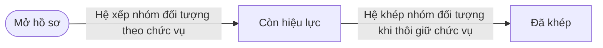
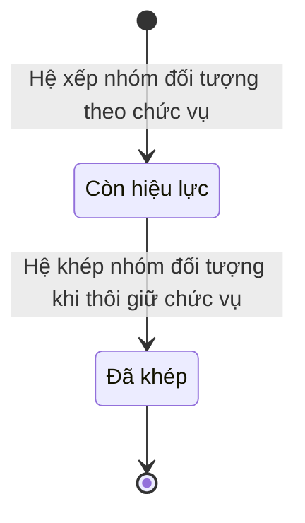

# qt-16.gdqp-category · Nhóm đối tượng bồi dưỡng của người

<!-- máy sinh: tom-tat -->
> **Hồ sơ:** Nhóm đối tượng bồi dưỡng của người (`TraineeGroup`)
>
> 2 bước · 2 chặng · 1 vai · 0 bảng quyết định · 0 hạn · 1 khớp nối.
>
> **Nguồn:** sổ nghiệp vụ `qt-16.gdqp-category` · khai báo của app: `dqtv-app/core/processes/gdqp-refresher/workflow/trainee-group.yaml`. Các bảng do máy sinh từ nguồn này.
<!-- hết: tom-tat -->

<!-- viết tay: dien-giai -->
## Diễn giải

*Phần này viết tay, diễn giải lại điều các bảng bên dưới ghi.*

### Quy trình này để làm gì

Mỗi hồ sơ là **một dòng nhóm đối tượng bồi dưỡng của một người**: người ấy thuộc nhóm đối tượng nào, căn cứ chức vụ gì, theo văn bản nào, từ ngày nào. Dòng chỉ có hai chặng: *Còn hiệu lực* (người thuộc diện bồi dưỡng của nhóm này) và *Đã khép* (thôi thuộc diện, giữ lịch sử).

### Khi nào bắt đầu

Có hai cửa vào, đều đưa dòng vào chặng *Còn hiệu lực*:

- **Ghi nhóm đối tượng** — Trợ lý Tác huấn ghi theo danh sách. Bắt buộc nhập người, nhóm đối tượng, văn bản căn cứ, cấp lập, mã đơn vị; căn cứ chức vụ, ngày thuộc diện, kỳ danh sách, nguồn là ô nhập nếu có. Bước đòi đã có văn bản căn cứ, `listUnit`, `listLevel`, và người làm phải là người của đơn vị ghi ở ô `listUnit` (`actorInListUnit`).
- `deriveTrainingCategory` — Hệ thống tự làm; ghi nhóm đối tượng, căn cứ chức vụ, ngày thuộc diện và nguồn.

Ô "nguồn" có hai giá trị: danh sách cơ quan gửi, hoặc chức vụ trên hệ.

### Diễn ra thế nào

**Chặng "Còn hiệu lực"** — không có việc nào làm trong lúc dòng đứng yên. Chỉ có hai bước khép dòng:

- **Khép nhóm đối tượng** (Trợ lý Tác huấn) — ghi ngày khép, lý do khép và văn bản căn cứ; người làm phải là người của đơn vị ghi ở ô `listUnit`. Lý do khép chọn trong bốn giá trị: thôi giữ chức vụ, đổi chức vụ · chuyển công tác khỏi đơn vị · từ trần · ghi nhầm.
- `endDerivedTrainingCategory` (Hệ thống tự làm) — ghi ngày khép và lý do khép.

**Chặng "Đã khép"** — không còn bước nào.

### Kết thúc và để lại gì

Dòng kết thúc ở chặng *Đã khép*, giữ lại lịch sử. Mỗi dòng nhóm đối tượng nối tới người thuộc diện bồi dưỡng kiến thức QP&AN mà nó thuộc về (quy trình G1).

### Điều kiện chặn

- Bảng quyết định `category-at-level`, xét ở bước ghi nhóm đối tượng, có 10 dòng, dò từ trên xuống: chưa có nhóm đối tượng thì chặn (`group_missing`); chưa có `listLevel` thì chặn (`level_missing`); mỗi giá trị `listLevel` chỉ cho qua một số nhóm — `commune`: Đối tượng 4 — trên địa bàn xã, Tương đương đối tượng 4, Già làng, trưởng họ tộc; `agencyOnCommune`: Đối tượng 4 — thuộc quyền cơ quan đóng trên xã; `province`: Đối tượng 3, Tương đương đối tượng 3, Chức sắc, chức việc tôn giáo; nhà hoạt động văn hoá, xã hội, khoa học, nghệ thuật (gọi tắt: chức sắc, nhà hoạt động); `militaryRegion`: Đối tượng 2; `capitalCommand`: Đối tượng 2, Đối tượng 3, Tương đương đối tượng 3, chức sắc, nhà hoạt động; `hcmCommand`: Đối tượng 3, Tương đương đối tượng 3, chức sắc, nhà hoạt động; `central`: Đối tượng 1. Mọi cặp còn lại bị chặn (`group_not_for_level`).
- Hai bước do người bấm (ghi và khép) đều đòi người làm thuộc đơn vị ghi ở ô `listUnit`.
- Sai người, sai chặng, thiếu thứ phải có trước thì bước bị chặn, dòng giữ nguyên.
<!-- hết viết tay -->

## 1. Đường đi ngắn nhất qua các chặng

<!-- máy sinh: luong-chinh -->
Đường ít bước nhất từ lúc mở hồ sơ tới chặng kết thúc xa nhất. Máy chọn theo số chặng, không theo ý nghĩa nghiệp vụ — trình tự công việc thật xem phần Diễn giải và bảng "Việc làm ở từng chặng" ở mục 6.

| # | Ai làm | Làm gì | Hồ sơ sang chặng |
|---|---|---|---|
| 1 | Hệ thống tự làm | Hệ xếp nhóm đối tượng theo chức vụ | Còn hiệu lực |
| 2 | Hệ thống tự làm | Hệ khép nhóm đối tượng khi thôi giữ chức vụ | Đã khép |

<!-- hết: luong-chinh -->

## 2. Hồ sơ và việc nó để lại

<!-- máy sinh: muc-tieu -->
**App gọi quy trình này là:** Nhóm đối tượng bồi dưỡng của người.

**Khi mở, hồ sơ này ghi mối nối tới:**
- Người thuộc diện bồi dưỡng kiến thức QP&AN (G1) — bước `deriveTrainingCategory`, khớp nối `groupOfTrainee`
<!-- hết: muc-tieu -->

## 3. Khởi phát và kết thúc

<!-- máy sinh: khoi-phat -->
**1 cửa vào** — bước mở hồ sơ:

| Bước mở | Ai mở | Hồ sơ vào chặng | App bắt buộc nhập |
|---|---|---|---|
| Hệ xếp nhóm đối tượng theo chức vụ | Hệ thống tự làm | Còn hiệu lực | `traineeId`, `positionId`, nhóm đối tượng, văn bản căn cứ, cấp lập, mã đơn vị |

**Kết thúc:** *Đã khép* (`ENDED`)
<!-- hết: khoi-phat -->

## 4. Vai trò

<!-- máy sinh: vai-tro -->
| Vai trong sổ | Tên trong app | Điều kiện | Làm những bước |
|---|---|---|---|
| `system` | Hệ thống tự làm |  | Hệ xếp nhóm đối tượng theo chức vụ · Hệ khép nhóm đối tượng khi thôi giữ chức vụ |

*"Tên trong app" là tên app đặt cho mã chủ thể của vai. Hồ sơ thuộc đơn vị cấp khác thì người làm là người giữ vai ấy ở đơn vị nêu trong cột "Điều kiện" (nếu sổ có ghi) và ở cột "Người làm phải thuộc" của bảng "Theo khai báo của app" (mục 7).*
<!-- hết: vai-tro -->

## 5. Nhánh phụ

<!-- máy sinh: nhanh-phu -->
Không có bước nào ngoài luồng chính.
<!-- hết: nhanh-phu -->

## 6. Các chặng và việc làm ở từng chặng

<!-- máy sinh: chang -->
| Chặng | Tên hiển thị | Vào bằng bước | Kết thúc? |
|---|---|---|---|
| `ACTIVE` | Còn hiệu lực | Hệ xếp nhóm đối tượng theo chức vụ |  |
| `ENDED` | Đã khép | Hệ khép nhóm đối tượng khi thôi giữ chức vụ | **kết thúc** |

### Việc làm ở từng chặng

Hồ sơ đang ở chặng nào thì làm được những bước nào.

| Hồ sơ đang ở chặng | Bước làm tại chặng (hồ sơ đứng yên) | Bước đưa hồ sơ sang chặng khác |
|---|---|---|
| **Còn hiệu lực** | — | Hệ khép nhóm đối tượng khi thôi giữ chức vụ — Hệ thống tự làm → *Đã khép* |
| **Đã khép** | — | — (kết thúc) |
<!-- hết: chang -->

## 7. Bảng bước

<!-- máy sinh: buoc -->
| # | Bước | Mã bước | Ai thực hiện | Từ chặng | Sang chặng | Phải có trước | Ghi lại |
|---|---|---|---|---|---|---|---|
| 1 | Hệ xếp nhóm đối tượng theo chức vụ | `deriveTrainingCategory` | Hệ thống tự làm | — (mở hồ sơ) | `ACTIVE` | — | nối `fromPosition`, nhóm đối tượng, thuộc diện từ, nguồn |
| 2 | Hệ khép nhóm đối tượng khi thôi giữ chức vụ | `endDerivedTrainingCategory` | Hệ thống tự làm | `ACTIVE` | `ENDED` | — | khép ngày, lý do khép |

### Khi không đạt điều kiện

Mặc định: không đúng người, hồ sơ không ở đúng chặng, hoặc thiếu thứ "phải có trước" thì bước bị chặn, hồ sơ giữ nguyên. Bảng dưới chỉ kê những bước có kết quả riêng.

| # | Bước | Kết quả riêng |
|---|---|---|
| 1 | Hệ xếp nhóm đối tượng theo chức vụ | bước này không do người nào bấm |
| 2 | Hệ khép nhóm đối tượng khi thôi giữ chức vụ | bước này không do người nào bấm |

### Điều kiện "phải có trước" bằng lời

Cột "Phải có trước" ở bảng bước có hai loại: ô dữ liệu thường (bước chỉ đòi ô ấy đã có giá trị) và điều kiện hệ tự xét. Bảng này diễn các điều kiện hệ tự xét theo đúng công thức sổ ghi; số ở cột cuối là số thứ tự bước.

Không bước nào đòi điều kiện hệ tự xét — mọi thứ "phải có trước" đều là ô dữ liệu thường.

### Theo khai báo của app

Người làm phải thuộc đơn vị nào, ô người dùng phải nhập, bước có lặp được không, và căn cứ pháp lý — lấy từ khai báo quy trình trong app.

| # | Bước | Người làm phải thuộc | Bắt buộc nhập | Nhập nếu có | Lặp được | Căn cứ |
|---|---|---|---|---|---|---|
| 1 | Hệ xếp nhóm đối tượng theo chức vụ |  | `traineeId`, `positionId`, nhóm đối tượng, văn bản căn cứ, cấp lập, mã đơn vị | căn cứ chức vụ, thuộc diện từ, mã tỉnh, mã xã, chủ hồ sơ cấp trên |  | VBHN53/VBHN-BQP Đ.2 (NĐ13/2014 sửa bởi NĐ139/2020) — nhóm đối tượng theo chức vụ đang giữ |
| 2 | Hệ khép nhóm đối tượng khi thôi giữ chức vụ |  | lý do khép | khép ngày |  | VBHN53/VBHN-BQP Đ.2 — thôi giữ chức vụ thì thôi thuộc diện |
| — | Ghi nhóm đối tượng (`recordTrainingCategory`) |  | `traineeId`, nhóm đối tượng, văn bản căn cứ, cấp lập, mã đơn vị | căn cứ chức vụ, thuộc diện từ, kỳ danh sách, nguồn, mã tỉnh, mã xã, chủ hồ sơ cấp trên |  | VBHN53/VBHN-BQP Đ.2 |
| — | Khép nhóm đối tượng (`endTrainingCategory`) | đơn vị chủ hồ sơ | khép ngày, lý do khép, văn bản khép dòng | — |  | VBHN53/VBHN-BQP Đ.2 — thôi giữ chức vụ thì thôi thuộc diện |
<!-- hết: buoc -->

## 8. Bảng quyết định, hạn, việc ngoài hệ

<!-- máy sinh: quyet-dinh -->

<!-- hết: quyet-dinh -->

## 9. Dữ liệu của hồ sơ

<!-- máy sinh: du-lieu -->
Các ô mà bước trong sổ ghi hoặc đòi. Số trong hai cột cuối là số thứ tự bước ở bảng bước (mục 7).

| Ô dữ liệu | Mã | Kiểu (app) | Giá trị cho phép | Loại ô (sổ) | Bước ghi | Bước đòi | Mô tả trong app |
|---|---|---|---|---|---|---|---|
| nhóm đối tượng | `traineeGroup` | chọn một | Đối tượng 1 (`group_1`), Đối tượng 2 (`group_2`), Đối tượng 3 (`group_3`), Đối tượng 4 — trên địa bàn xã (`group_4_commune`), Đối tượng 4 — thuộc quyền cơ quan đóng trên xã (`group_4_agency`), Tương đương đối tượng 3 (`equivalent_3`), Tương đương đối tượng 4 (`equivalent_4`), Chức sắc, chức việc tôn giáo; nhà hoạt động văn hoá, xã hội, khoa học, nghệ thuật (`religious_or_cultural_figure`), Già làng, trưởng họ tộc (`village_elder_or_clan_head`) | hệ suy ra (`derived`) | 1 | — | Nhóm đối tượng — VBHN53 Đ.2 k1, k2, k3 |
| thuộc diện từ | `validFrom` | ngày |  | hệ suy ra (`derived`) | 1 | — | Thuộc diện từ ngày |
| nguồn | `source` | chọn một | Danh sách cơ quan gửi (`agency_list`), Chức vụ trên hệ (`position_on_system`) | lưu trên hồ sơ (`stored`) | 1 | — | Nguồn: danh sách cơ quan gửi · chức vụ trên hệ |
| khép ngày | `endedAt` | ngày |  | hệ suy ra (`derived`) | 2 | — | Ngày khép dòng |
| lý do khép | `endReason` | chọn một | Thôi giữ chức vụ, đổi chức vụ (`position_changed`), Chuyển công tác khỏi đơn vị (`moved_away`), Từ trần (`deceased`), Ghi nhầm (`recorded_in_error`) | lưu trên hồ sơ (`stored`) | 2 | — | Lý do khép dòng nhóm đối tượng |

5 ô. Cột "Loại ô" là cách sổ phân loại ô, in kèm đúng chữ của sổ; ô nào người dùng phải nhập xem bảng "Theo khai báo của app" ở mục 7.
<!-- hết: du-lieu -->

## 10. Khớp nối với quy trình khác

<!-- máy sinh: khop-noi -->
| Quy trình kia | Hồ sơ kia | Quan hệ | Nội dung (mô tả trong app) | Bước ghi mối nối | Tên ô nối |
|---|---|---|---|---|---|
| G1 | Người thuộc diện bồi dưỡng kiến thức QP&AN | hồ sơ này **mở ra có nối tới** hồ sơ kia | Dòng nhóm đối tượng của người nào — sổ qt-16.gdqp-category là con của qt-16 | 16.gdqp-category·deriveTrainingCategory ⊕ | `groupOfTrainee` |

1 khớp nối. ⊕ là bước tạo hồ sơ.

**Ô nối giữa các hồ sơ cùng mã quy trình, hoặc tới danh mục nền:** `groupFromPosition` (Nhóm đối tượng bồi dưỡng của người → Chức vụ của công dân) — bước Hệ xếp nhóm đối tượng theo chức vụ.
<!-- hết: khop-noi -->

## 11. Thông tin chung

<!-- máy sinh: thong-tin -->
| | |
|---|---|
| **Mã trong sổ** | `qt-16.gdqp-category` |
| **Quy trình trong app** | `gdqp-refresher` (`workflow/trainee-group.yaml`) — mặt công tác: `personnel` |
| **Hồ sơ** | Nhóm đối tượng bồi dưỡng của người (`TraineeGroup`) |
| **Cùng mã quy trình** | [qt-16](qt-16.html), [qt-16.enlistment](qt-16.enlistment.html), [qt-16.gdqp-certificate](qt-16.gdqp-certificate.html), [qt-16.military-registration](qt-16.military-registration.html), [qt-16.position-held](qt-16.position-held.html), [qt-16.registration-decision](qt-16.registration-decision.html), [qt-16.reserve-registration](qt-16.reserve-registration.html), [qt-16.service-exit-decision](qt-16.service-exit-decision.html), [qt-16.service-extension-decision](qt-16.service-extension-decision.html) |
| **Căn cứ pháp lý từng bước** | cột "Căn cứ" ở bảng "Theo khai báo của app", mục 7 |
<!-- hết: thong-tin -->
