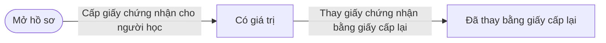
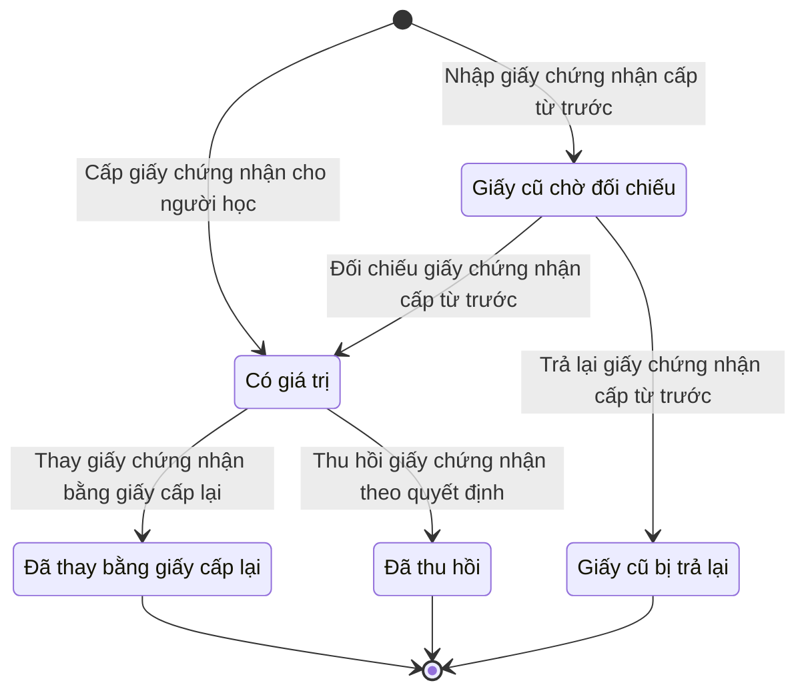

# qt-16.gdqp-certificate · Giấy chứng nhận hoàn thành bồi dưỡng kiến thức QP&AN

<!-- máy sinh: tom-tat -->
> **Hồ sơ:** Giấy chứng nhận hoàn thành bồi dưỡng kiến thức QP&AN (`GdqpCertificate`)
>
> 6 bước · 5 chặng · 3 vai · 1 bảng quyết định · 0 hạn · 5 khớp nối.
>
> **Nguồn:** sổ nghiệp vụ `qt-16.gdqp-certificate` · khai báo của app: `dqtv-app/core/processes/gdqp-refresher/workflow/gdqp-certificate.yaml`. Các bảng do máy sinh từ nguồn này.
<!-- hết: tom-tat -->

<!-- viết tay: dien-giai -->
## Diễn giải

*Phần này viết tay, diễn giải lại điều các bảng bên dưới ghi.*

### Quy trình này để làm gì

Mỗi hồ sơ là **một giấy chứng nhận hoàn thành bồi dưỡng kiến thức QP&AN của một người**: số hiệu, chương trình, ngày cấp. Giấy ở chặng *Có giá trị* nghĩa là người này đã được bồi dưỡng chương trình của giấy.

Giấy đi qua các chặng: *Có giá trị*, rồi có thể kết thúc ở *Đã thay bằng giấy cấp lại* hoặc *Đã thu hồi*. Giấy cấp từ trước khi dùng hệ đi đường riêng: *Giấy cũ chờ đối chiếu* → *Có giá trị*, hoặc → *Giấy cũ bị trả lại*.

### Khi nào bắt đầu

Hai cửa vào:

- **Cấp giấy chứng nhận cho người học** — Hệ thống tự làm, không đòi gì trước; giấy vào thẳng chặng *Có giá trị*. Bước ghi số hiệu, chương trình, ngày cấp, nguồn; các ô bắt buộc còn có người học, cấp lập, mã đơn vị.
- **Nhập giấy chứng nhận cấp từ trước** — Trợ lý Tác huấn nhập; giấy vào chặng *Giấy cũ chờ đối chiếu*. Phải có người ký cấp, `certificateScan`, và đạt `actorInManagingOrIssuingUnit`: người làm là người của đơn vị chủ hồ sơ Sổ đăng ký người theo diện (qt-16) của người đó, hoặc của đơn vị ghi ở ô đơn vị cấp. Còn phải nhập đơn vị cấp, cấp lập, mã đơn vị.

### Diễn ra thế nào

**Chặng "Giấy cũ chờ đối chiếu"** — Chỉ huy trưởng Ban CHQS xã làm một trong hai việc, đều phải đạt `actorInManagingOrIssuingUnit` như bước nhập:

- **Đối chiếu giấy chứng nhận cấp từ trước** — người đối chiếu phải khác người đã nhập (`notRecorder`). Giấy sang *Có giá trị*.
- **Trả lại giấy chứng nhận cấp từ trước** — ghi lý do trả lại. Giấy sang *Giấy cũ bị trả lại* và kết thúc: đối chiếu không đạt thì giấy không tính; nhập lại nếu cần.

**Chặng "Có giá trị"** — hai bước, đều do Hệ thống tự làm:

- **Thay giấy chứng nhận bằng giấy cấp lại** — phải đạt `reissuedByRequest`: có hồ sơ Cấp lại giấy chứng nhận (qt-G2) mà nối `replacedCertificate` của hồ sơ ấy trỏ về chính giấy này, và hồ sơ ấy đang ở chặng `REISSUED`; ghi ngày thay. Giấy sang *Đã thay bằng giấy cấp lại*.
- **Thu hồi giấy chứng nhận theo quyết định** — phải đạt `revokedByDecision`: có hồ sơ Thu hồi, huỷ giấy chứng nhận (qt-G3) có nối trỏ về chính giấy này, và hồ sơ ấy đang ở chặng `REVOKED`; ghi ngày thu hồi. Giấy sang *Đã thu hồi*; người này lại thuộc danh sách chưa bồi dưỡng.

### Kết thúc và để lại gì

Ba chặng kết thúc: *Đã thay bằng giấy cấp lại*, *Đã thu hồi*, *Giấy cũ bị trả lại*. Chặng *Có giá trị* không phải chặng kết thúc.

Hồ sơ của quy trình khác mở ra từ giấy này: **Đề nghị cấp lại, bản sao, chỉnh sửa giấy chứng nhận** (G2) và **Hồ sơ thu hồi, huỷ bỏ giấy chứng nhận** (G3). Bước cấp lại của G2 còn nối đề nghị với giấy mới cấp lại. Giấy nối tới khoá bồi dưỡng mà nó được cấp theo và tới người thuộc diện bồi dưỡng mang giấy (G1).

### Điều kiện chặn

- Sai người, sai chặng, thiếu thứ phải có trước thì bước bị chặn, giấy giữ nguyên. Không bước nào có kết quả chặn riêng.
- Người nhập và người đối chiếu giấy cũ phải là hai người khác nhau; cả ba bước về giấy cũ chỉ người của đơn vị chủ hồ sơ sổ đăng ký (qt-16) hoặc đơn vị cấp giấy mới làm được.
- Giấy chỉ bị thay khi hồ sơ cấp lại (qt-G2) đã ở `REISSUED`, chỉ bị thu hồi khi hồ sơ thu hồi (qt-G3) đã ở `REVOKED`.
- Bước cấp giấy cho người học không cần bản chụp: giấy do hệ cấp theo quyết định cấp giấy của khoá, bản quét quyết định đã đính ở bước Ghi quyết định cấp giấy chứng nhận.
<!-- hết viết tay -->

## 1. Đường đi ngắn nhất qua các chặng

<!-- máy sinh: luong-chinh -->
Đường ít bước nhất từ lúc mở hồ sơ tới chặng kết thúc xa nhất. Máy chọn theo số chặng, không theo ý nghĩa nghiệp vụ — trình tự công việc thật xem phần Diễn giải và bảng "Việc làm ở từng chặng" ở mục 6.

| # | Ai làm | Làm gì | Hồ sơ sang chặng |
|---|---|---|---|
| 1 | Hệ thống tự làm | Cấp giấy chứng nhận cho người học | Có giá trị |
| 2 | Hệ thống tự làm | Thay giấy chứng nhận bằng giấy cấp lại | Đã thay bằng giấy cấp lại |

<!-- hết: luong-chinh -->

## 2. Hồ sơ và việc nó để lại

<!-- máy sinh: muc-tieu -->
**App gọi quy trình này là:** Giấy chứng nhận bồi dưỡng kiến thức QP&AN.

**Khi mở, hồ sơ này ghi mối nối tới:**
- Người thuộc diện bồi dưỡng kiến thức QP&AN (G1) — bước `recordPriorCertificate`, khớp nối `certificateOfTrainee`

**Hồ sơ này để lại cho quy trình khác** (bước tạo hồ sơ của quy trình kia ghi mối nối về đây):
- Hồ sơ thu hồi, huỷ bỏ giấy chứng nhận (G3) — bước `recordRevocationGround`, khớp nối `revokedCertificate`
- Đề nghị cấp lại, bản sao, chỉnh sửa giấy chứng nhận (G2) — bước `receiveReissueRequest`, khớp nối `requestForCertificate`
<!-- hết: muc-tieu -->

## 3. Khởi phát và kết thúc

<!-- máy sinh: khoi-phat -->
**2 cửa vào** — bước mở hồ sơ:

| Bước mở | Ai mở | Hồ sơ vào chặng | App bắt buộc nhập |
|---|---|---|---|
| Cấp giấy chứng nhận cho người học | Hệ thống tự làm | Có giá trị | `traineeId`, số hiệu, chương trình, ngày cấp, nguồn, cấp lập, mã đơn vị |
| Nhập giấy chứng nhận cấp từ trước | Trợ lý Tác huấn | Giấy cũ chờ đối chiếu | `traineeId`, số hiệu, chương trình, ngày cấp, người ký cấp, đơn vị cấp, giấy chứng nhận (bản quét), cấp lập, mã đơn vị |

**Kết thúc:** *Đã thay bằng giấy cấp lại* (`REPLACED`), *Đã thu hồi* (`REVOKED`), *Giấy cũ bị trả lại* (`PRIOR_RETURNED`)
<!-- hết: khoi-phat -->

## 4. Vai trò

<!-- máy sinh: vai-tro -->
| Vai trong sổ | Tên trong app | Điều kiện | Làm những bước |
|---|---|---|---|
| `system` | Hệ thống tự làm |  | Cấp giấy chứng nhận cho người học · Thay giấy chứng nhận bằng giấy cấp lại · Thu hồi giấy chứng nhận theo quyết định |
| `operator` | Trợ lý Tác huấn |  | Nhập giấy chứng nhận cấp từ trước |
| `verifier` | Chỉ huy trưởng Ban CHQS xã |  | Đối chiếu giấy chứng nhận cấp từ trước · Trả lại giấy chứng nhận cấp từ trước |

*"Tên trong app" là tên app đặt cho mã chủ thể của vai. Hồ sơ thuộc đơn vị cấp khác thì người làm là người giữ vai ấy ở đơn vị nêu trong cột "Điều kiện" (nếu sổ có ghi) và ở cột "Người làm phải thuộc" của bảng "Theo khai báo của app" (mục 7).*
<!-- hết: vai-tro -->

## 5. Nhánh phụ

<!-- máy sinh: nhanh-phu -->
**Bước khác đưa hồ sơ sang chặng mới** — đường song song, rẽ nhánh hoặc kết thúc sớm:

| Bước | Ai làm | Từ chặng | Sang chặng |
|---|---|---|---|
| Đối chiếu giấy chứng nhận cấp từ trước | Chỉ huy trưởng Ban CHQS xã | Giấy cũ chờ đối chiếu | Có giá trị |
| Trả lại giấy chứng nhận cấp từ trước | Chỉ huy trưởng Ban CHQS xã | Giấy cũ chờ đối chiếu | Giấy cũ bị trả lại |
| Thu hồi giấy chứng nhận theo quyết định | Hệ thống tự làm | Có giá trị | Đã thu hồi |

**Cửa vào khác:** 2 bước cùng mở hồ sơ — xem mục 3.

<!-- hết: nhanh-phu -->

## 6. Các chặng và việc làm ở từng chặng

<!-- máy sinh: chang -->
| Chặng | Tên hiển thị | Vào bằng bước | Kết thúc? |
|---|---|---|---|
| `ISSUED` | Có giá trị | Cấp giấy chứng nhận cho người học · Đối chiếu giấy chứng nhận cấp từ trước |  |
| `RECORDED` | Giấy cũ chờ đối chiếu | Nhập giấy chứng nhận cấp từ trước |  |
| `REPLACED` | Đã thay bằng giấy cấp lại | Thay giấy chứng nhận bằng giấy cấp lại | **kết thúc** |
| `REVOKED` | Đã thu hồi | Thu hồi giấy chứng nhận theo quyết định | **kết thúc** |
| `PRIOR_RETURNED` | Giấy cũ bị trả lại | Trả lại giấy chứng nhận cấp từ trước | **kết thúc** |

### Việc làm ở từng chặng

Hồ sơ đang ở chặng nào thì làm được những bước nào.

| Hồ sơ đang ở chặng | Bước làm tại chặng (hồ sơ đứng yên) | Bước đưa hồ sơ sang chặng khác |
|---|---|---|
| **Có giá trị** | — | Thay giấy chứng nhận bằng giấy cấp lại — Hệ thống tự làm → *Đã thay bằng giấy cấp lại* Thu hồi giấy chứng nhận theo quyết định — Hệ thống tự làm → *Đã thu hồi* |
| **Giấy cũ chờ đối chiếu** | — | Đối chiếu giấy chứng nhận cấp từ trước — Chỉ huy trưởng Ban CHQS xã → *Có giá trị* Trả lại giấy chứng nhận cấp từ trước — Chỉ huy trưởng Ban CHQS xã → *Giấy cũ bị trả lại* |
| **Đã thay bằng giấy cấp lại** | — | — (kết thúc) |
| **Đã thu hồi** | — | — (kết thúc) |
| **Giấy cũ bị trả lại** | — | — (kết thúc) |
<!-- hết: chang -->

## 7. Bảng bước

<!-- máy sinh: buoc -->
| # | Bước | Mã bước | Ai thực hiện | Từ chặng | Sang chặng | Phải có trước | Ghi lại |
|---|---|---|---|---|---|---|---|
| 1 | Cấp giấy chứng nhận cho người học | `issueLearnerCertificate` | Hệ thống tự làm | — (mở hồ sơ) | `ISSUED` | — | `id`, số hiệu, chương trình, ngày cấp, nguồn |
| 2 | Nhập giấy chứng nhận cấp từ trước | `recordPriorCertificate` | Trợ lý Tác huấn | — (mở hồ sơ) | `RECORDED` | người ký cấp, `certificateScan`, `actorInManagingUnit` | `id`, nối tới Người thuộc diện bồi dưỡng kiến thức QP&AN, số hiệu, chương trình, ngày cấp, người ký cấp, đơn vị cấp, `certificateScan`, người nhập |
| 3 | Đối chiếu giấy chứng nhận cấp từ trước | `verifyPriorCertificate` | Chỉ huy trưởng Ban CHQS xã | `RECORDED` | `ISSUED` | `notRecorder`, `actorInManagingUnit` | — |
| 4 | Trả lại giấy chứng nhận cấp từ trước | `returnPriorCertificate` | Chỉ huy trưởng Ban CHQS xã | `RECORDED` | `PRIOR_RETURNED` | `actorInManagingUnit` | lý do trả lại |
| 5 | Thay giấy chứng nhận bằng giấy cấp lại | `replaceLearnerCertificate` | Hệ thống tự làm | `ISSUED` | `REPLACED` | `reissuedByRequest` | thay ngày |
| 6 | Thu hồi giấy chứng nhận theo quyết định | `revokeLearnerCertificate` | Hệ thống tự làm | `ISSUED` | `REVOKED` | `revokedByDecision` | thu hồi ngày |

### Khi không đạt điều kiện

Mặc định: không đúng người, hồ sơ không ở đúng chặng, hoặc thiếu thứ "phải có trước" thì bước bị chặn, hồ sơ giữ nguyên. Bảng dưới chỉ kê những bước có kết quả riêng.

| # | Bước | Kết quả riêng |
|---|---|---|
| 1 | Cấp giấy chứng nhận cho người học | nhánh `from-course`: hồ sơ sang *Có giá trị*, ghi thêm nối tới Khoá bồi dưỡng kiến thức QP&AN; nhánh `reissue`: hồ sơ sang *Có giá trị*, ghi thêm nối tới Đề nghị cấp lại, bản sao, chỉnh sửa giấy chứng nhận; bước này không do người nào bấm |
| 5 | Thay giấy chứng nhận bằng giấy cấp lại | bước này không do người nào bấm |
| 6 | Thu hồi giấy chứng nhận theo quyết định | bước này không do người nào bấm |

### Điều kiện "phải có trước" bằng lời

Cột "Phải có trước" ở bảng bước có hai loại: ô dữ liệu thường (bước chỉ đòi ô ấy đã có giá trị) và điều kiện hệ tự xét. Bảng này diễn các điều kiện hệ tự xét theo đúng công thức sổ ghi; số ở cột cuối là số thứ tự bước.

| Điều kiện | Đúng khi | Bước đòi |
|---|---|---|
| `actorInManagingUnit` | người đang làm là người của đơn vị ghi ở ô đơn vị chủ hồ sơ của hồ sơ này (theo danh mục người của đơn vị, `dm.unit-staff`) | 2, 3, 4 |
| `notRecorder` | KHÔNG (người nhập là chính người đang làm) | 3 |
| `reissuedByRequest` | có hồ sơ Cấp lại giấy chứng nhận (qt-G2) có ô nối `requestForCertificate` trỏ về chính hồ sơ đang làm mà hồ sơ ấy đang ở chặng `REISSUED` | 5 |
| `revokedByDecision` | có hồ sơ Thu hồi, huỷ giấy chứng nhận (qt-G3) có ô nối `revokedCertificate` trỏ về chính hồ sơ đang làm mà hồ sơ ấy đang ở chặng `REVOKED` | 6 |

### Theo khai báo của app

Người làm phải thuộc đơn vị nào, ô người dùng phải nhập, bước có lặp được không, và căn cứ pháp lý — lấy từ khai báo quy trình trong app.

| # | Bước | Người làm phải thuộc | Bắt buộc nhập | Nhập nếu có | Lặp được | Căn cứ |
|---|---|---|---|---|---|---|
| 1 | Cấp giấy chứng nhận cho người học |  | `traineeId`, số hiệu, chương trình, ngày cấp, nguồn, cấp lập, mã đơn vị | `courseId`, `requestId`, người ký cấp, đơn vị cấp, mã tỉnh, mã xã, chủ hồ sơ cấp trên |  | Luật GDQPAN Đ.18 k4 · VBHN53/VBHN-BQP Đ.5 k2 |
| 2 | Nhập giấy chứng nhận cấp từ trước |  | `traineeId`, số hiệu, chương trình, ngày cấp, người ký cấp, đơn vị cấp, bản quét giấy chứng nhận, cấp lập, mã đơn vị | người nhập, mã tỉnh, mã xã, chủ hồ sơ cấp trên |  | docs/ba câu D6 — nhập ngược người đã có giấy còn giá trị |
| 3 | Đối chiếu giấy chứng nhận cấp từ trước | đơn vị chủ hồ sơ | — | — |  | Sổ qt-16.gdqp-certificate — người đối chiếu khác người nhập |
| 4 | Trả lại giấy chứng nhận cấp từ trước | đơn vị chủ hồ sơ | lý do trả lại | — |  | Sổ qt-16.gdqp-certificate — người dùng chốt 7/10/2026 |
| 5 | Thay giấy chứng nhận bằng giấy cấp lại |  | — | thay ngày |  | TT10/2026/TT-BGDĐT Đ.14 k3c, k5 |
| 6 | Thu hồi giấy chứng nhận theo quyết định |  | — | thu hồi ngày |  | TT10/2026/TT-BGDĐT Đ.16 k3 |

### Điều kiện và ghi chú app khai cho từng bước

Lấy từ khai báo quy trình trong app. Lời trong ngoặc kép là câu app hiện cho người dùng. Chức danh người ký ngoài hệ app chỉ khai bằng mã.

| # | Bước | Điều kiện, ghi chú |
|---|---|---|
| 1 | Cấp giấy chứng nhận cho người học | · không đòi bản chụp — app ghi: "Giấy do HỆ cấp theo quyết định cấp giấy của khoá — bản quét quyết định đã đính ở bước Ghi quyết định cấp giấy chứng nhận" |
<!-- hết: buoc -->

## 8. Bảng quyết định, hạn, việc ngoài hệ

<!-- máy sinh: quyet-dinh -->
**Bảng `certificate-source`** — xét ở bước *Cấp giấy chứng nhận cho người học*; đầu vào: nguồn. 2 dòng, dò từ trên xuống, dòng đầu tiên khớp thì dừng.

| Thứ tự dò (số sổ ghi) | Dòng | Khi | Thì |
|---|---|---|---|
| 1 | `from-course` | nguồn là Cấp theo khoá (`course`) | `from-course` |
| 2 | `reissue` | nguồn là Cấp lại (`reissue`) | `reissue` |

<!-- hết: quyet-dinh -->

## 9. Dữ liệu của hồ sơ

<!-- máy sinh: du-lieu -->
Các ô mà bước trong sổ ghi hoặc đòi. Số trong hai cột cuối là số thứ tự bước ở bảng bước (mục 7).

| Ô dữ liệu | Mã | Kiểu (app) | Giá trị cho phép | Loại ô (sổ) | Bước ghi | Bước đòi | Mô tả trong app |
|---|---|---|---|---|---|---|---|
| — | `id` |  |  | lưu trên hồ sơ (`stored`) | 1, 2 | — |  |
| số hiệu | `certificateNumber` | chữ |  | đưa vào ở bước (`input`) | 1, 2 | — | Số hiệu giấy chứng nhận |
| chương trình | `programme` | chọn một | Chương trình đối tượng 1 (`group_1`), Chương trình đối tượng 2 (`group_2`), Chương trình đối tượng 3 và tương đương (`group_3_and_equivalent`), Chương trình đối tượng 4 và tương đương (`group_4_and_equivalent`), Chương trình cho chức sắc, chức việc tôn giáo, nhà hoạt động văn hoá, xã hội (`religious_or_cultural_figure`), Chương trình cho già làng, trưởng họ tộc (`village_elder_or_clan_head`) | đưa vào ở bước (`input`) | 1, 2 | — | Chương trình bồi dưỡng của giấy |
| ngày cấp | `issuedAt` | ngày |  | đưa vào ở bước (`input`) | 1, 2 | — | Ngày cấp |
| nguồn | `certificateSource` | chọn một | Cấp theo khoá (`course`), Cấp lại (`reissue`) | lưu trên hồ sơ (`stored`) | 1 | — | Nguồn: cấp theo khoá · cấp lại (G2) · giấy cấp từ trước nhập vào |
| người ký cấp | `issuerName` | chữ |  | đưa vào ở bước (`input`) | 2 | 2 | Người ký cấp (chức danh, họ tên) |
| đơn vị cấp | `issuingUnit` | chữ |  | đưa vào ở bước (`input`) | 2 | — | Đơn vị cấp giấy |
| — | `certificateScan` |  |  | đưa vào ở bước (`input`) | 2 | 2 |  |
| người nhập | `recordedBy` | chữ |  | lưu trên hồ sơ (`stored`) | 2 | — | Người nhập giấy cũ |
| lý do trả lại | `returnReason` | chữ |  | đưa vào ở bước (`input`) | 4 | — | Lý do trả lại giấy cấp từ trước khi đối chiếu |
| thay ngày | `replacedAt` | ngày |  | lưu trên hồ sơ (`stored`) | 5 | — | Ngày bị thay bằng giấy cấp lại |
| thu hồi ngày | `revokedAt` | ngày |  | lưu trên hồ sơ (`stored`) | 6 | — | Ngày bị thu hồi |
| — | `actorInManagingUnit` |  |  | hệ suy ra (`derived`) | — | 2, 3, 4 |  |
| — | `notRecorder` |  | có hay chưa | hệ suy ra (`derived`) | — | 3 |  |
| — | `reissuedByRequest` |  | có hay chưa | hệ suy ra (`derived`) | — | 5 |  |
| — | `revokedByDecision` |  | có hay chưa | hệ suy ra (`derived`) | — | 6 |  |

16 ô. Cột "Loại ô" là cách sổ phân loại ô, in kèm đúng chữ của sổ; ô nào người dùng phải nhập xem bảng "Theo khai báo của app" ở mục 7.
<!-- hết: du-lieu -->

## 10. Khớp nối với quy trình khác

<!-- máy sinh: khop-noi -->
| Quy trình kia | Hồ sơ kia | Quan hệ | Nội dung (mô tả trong app) | Bước ghi mối nối | Tên ô nối |
|---|---|---|---|---|---|
| G1 | Khoá bồi dưỡng kiến thức QP&AN | có nối | Giấy cấp theo khoá nào — sổ qt-16.gdqp-certificate tham chiếu qt-G1 | — | `certificateFromCourse` |
| G1 | Người thuộc diện bồi dưỡng kiến thức QP&AN | hồ sơ này **mở ra có nối tới** hồ sơ kia | Giấy chứng nhận của người nào — sổ qt-16.gdqp-certificate là con của qt-16 | 16.gdqp-certificate·recordPriorCertificate ⊕ | `certificateOfTrainee` |
| G2 | Đề nghị cấp lại, bản sao, chỉnh sửa giấy chứng nhận | có nối | Giấy mới cấp lại — sổ link.replacedCertificate (TT10 Đ.13 k2c: số hiệu mới) | — | `reissuedCertificate` |
| G2 | Đề nghị cấp lại, bản sao, chỉnh sửa giấy chứng nhận | hồ sơ kia **mở ra từ** hồ sơ này | Đề nghị cho giấy nào — sổ link.requestForCertificate | G2·receiveReissueRequest ⊕ | `requestForCertificate` |
| G3 | Hồ sơ thu hồi, huỷ bỏ giấy chứng nhận | hồ sơ kia **mở ra từ** hồ sơ này | Hồ sơ thu hồi giấy nào — sổ link.revokedCertificate | G3·recordRevocationGround ⊕ | `revokedCertificate` |

5 khớp nối. ⊕ là bước tạo hồ sơ.
<!-- hết: khop-noi -->

## 11. Thông tin chung

<!-- máy sinh: thong-tin -->
| | |
|---|---|
| **Mã trong sổ** | `qt-16.gdqp-certificate` |
| **Quy trình trong app** | `gdqp-refresher` (`workflow/gdqp-certificate.yaml`) — mặt công tác: `personnel` |
| **Hồ sơ** | Giấy chứng nhận hoàn thành bồi dưỡng kiến thức QP&AN (`GdqpCertificate`) |
| **Cùng mã quy trình** | [qt-16](qt-16.html), [qt-16.enlistment](qt-16.enlistment.html), [qt-16.gdqp-category](qt-16.gdqp-category.html), [qt-16.military-registration](qt-16.military-registration.html), [qt-16.position-held](qt-16.position-held.html), [qt-16.registration-decision](qt-16.registration-decision.html), [qt-16.reserve-registration](qt-16.reserve-registration.html), [qt-16.service-exit-decision](qt-16.service-exit-decision.html), [qt-16.service-extension-decision](qt-16.service-extension-decision.html) |
| **Căn cứ pháp lý từng bước** | cột "Căn cứ" ở bảng "Theo khai báo của app", mục 7 |
<!-- hết: thong-tin -->
