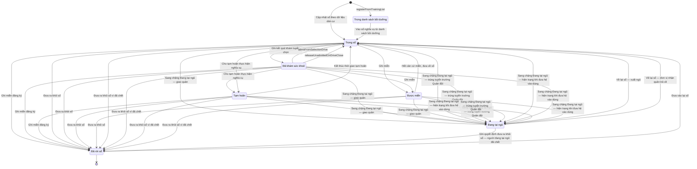

# qt-16 · Sổ đăng ký người theo diện

<!-- máy sinh: tom-tat -->
> **Hồ sơ:** Sổ nghĩa vụ (`DutyRegistration`)
>
> **Trong sổ phạm vi:** 16 · Sổ đăng ký người theo diện (tầng 1)
>
> 23 bước · 7 chặng · 3 vai · 0 bảng quyết định · 0 hạn · 13 khớp nối.
>
> **Nguồn:** sổ nghiệp vụ `qt-16` · khai báo của app: `dqtv-app/core/processes/militia-enlistment/workflow/duty-registration.yaml`. Các bảng do máy sinh từ nguồn này.
<!-- hết: tom-tat -->

<!-- viết tay: dien-giai -->
## Diễn giải

*Phần này viết tay, diễn giải lại điều các bảng bên dưới ghi.*

### Quy trình này để làm gì

Quy trình giữ **Sổ nghĩa vụ**: mỗi dòng là một công dân, kèm diện đăng ký của người đó (bốn diện). Dòng sổ cho biết người ấy đang ở đâu: còn trong sổ, đã khám sức khoẻ, đang tạm hoãn, được miễn, hay đã rời sổ.

Hồ sơ đi qua các chặng: *Trong sổ* → *Đã khám sức khoẻ*, có thể rẽ sang *Tạm hoãn* hoặc *Được miễn* rồi quay lại *Trong sổ*, và kết thúc ở *Đã rời sổ* (giữ lại để tra cứu). Còn một chặng thứ sáu là `TRAINING_LISTED`.

### Khi nào bắt đầu

Hai cửa vào, cả hai do Hệ thống tự làm:

- **Cập nhật sổ theo dữ liệu dân cư** — mở dòng sổ ở chặng *Trong sổ*; đòi điều kiện `personResidesInCommune`: (`hasValidTemporaryResidence` là `yes` và `temporaryCommune` bằng mã xã), hoặc (`hasValidTemporaryResidence` không là `yes` và `permanentCommune` bằng mã xã). Bước ghi ngày ghi vào sổ.
- `registerFromTrainingList` — mở hồ sơ thẳng vào chặng `TRAINING_LISTED`, ghi họ và tên, `nationalIdNumber`, `dateOfBirth`, `listWorkbook`.

### Diễn ra thế nào

**Chặng "Trong sổ"**

- `examineInSelectionDrive` (Trợ lý Quân lực) — ghi ngày khám, kết quả khám, loại sức khoẻ; phải có giấy xác nhận sức khoẻ và `eligibleForSelection` — đúng khi không có hồ sơ Chiến sĩ dân quân tự vệ (qt-16.enlistment) nào là hồ sơ con của hồ sơ đang làm mà đang ở chặng `SERVING` hoặc `REMOVED`. Hồ sơ sang *Đã khám sức khoẻ*.
- **Tiếp nhận đơn xin tạm hoãn của công dân** (Trợ lý Quân lực) — ghi ngày nộp đơn và tệp đơn (ảnh hoặc tài liệu, bắt buộc có); hồ sơ đứng yên, lặp được.
- **Cho tạm hoãn thực hiện nghĩa vụ** (Chỉ huy trưởng Ban CHQS xã) — phải có ngày nộp đơn ở bước trên và `unusedDefermentDecision` — đúng khi có hồ sơ `qt-16.registration-decision` là hồ sơ con của hồ sơ đang làm, đang ở chặng `VERIFIED` và loại quyết định là `deferment`. Hồ sơ sang *Tạm hoãn*.
- **Ghi miễn** (Chỉ huy trưởng) — phải có `unusedExemptionDecision` — như trên nhưng loại `exemption`; hồ sơ sang *Được miễn*.
- **Ghi miễn đăng ký** (Chỉ huy trưởng) — cũng đòi `unusedExemptionDecision`, nhưng hồ sơ sang thẳng *Đã rời sổ*, ghi căn cứ và lý do rời sổ.
- **Ghi quyết định kéo dài độ tuổi** (Chỉ huy trưởng) — ghi kéo dài tới ngày nào, số quyết định, ảnh chụp quyết định (quyết định ký ngoài hệ); hồ sơ đứng yên, lặp được.

**Chặng "Đã khám sức khoẻ"** — làm được mọi việc như chặng *Trong sổ* (trừ khám), thêm hai đường quay về *Trong sổ*:

- `admitFromSelectionDrive` (Chỉ huy trưởng) — phải đạt `medicalPassed` (kết quả khám là Đạt; và hoặc `proposedUnitType` không là `standing`, hoặc loại sức khoẻ là Loại 1, Loại 2 hoặc Loại 3) và `eligibleForSelection`; ghi ngày kết nạp.
- `releaseUnadmittedOnDriveClose` (Hệ thống tự làm) — bước xoá kết quả khám và loại sức khoẻ.

**Chặng "Tạm hoãn"** — **Kết thúc thời gian tạm hoãn** (Trợ lý Quân lực) đưa hồ sơ về *Trong sổ*; phải nhập vì sao hết căn cứ tạm hoãn, bước xoá ngày nộp đơn và đơn xin tạm hoãn. Ở chặng này vẫn ghi được quyết định kéo dài độ tuổi và ghi miễn đăng ký.

**Chặng "Được miễn"** — **Hết căn cứ miễn, đưa về sổ** (Chỉ huy trưởng) đưa hồ sơ về *Trong sổ*; phải có ảnh chụp giấy làm căn cứ, ghi ngày và lý do hết căn cứ.

**Rời sổ** — làm được từ cả bốn chặng trên:

- **Đưa ra khỏi sổ** (Trợ lý Quân lực) — ghi căn cứ và lý do rời sổ; căn cứ rời sổ bắt buộc nhập.
- **Đưa ra khỏi sổ vì đã chết** (Chỉ huy trưởng) — đòi `diedPerExitDecision`: có hồ sơ Dòng quyết định cho thôi, đưa ra khỏi danh sách (qt-16.service-exit-decision) là hồ sơ con của hồ sơ đang làm, đang ở chặng `USED` và `exitGround` là `deceased`.

Cả hai bước này và bước ghi miễn đăng ký đều đòi `noOpenMilitiaService`: không có hồ sơ Chiến sĩ dân quân tự vệ (qt-16.enlistment) nào là hồ sơ con của hồ sơ đang làm mà đang ở chặng `SERVING`.

**Chặng "Đã rời sổ"** — hai đường về *Trong sổ*: **Đưa vào lại sổ** (Trợ lý Quân lực; ghi ngày, ảnh chụp giấy làm căn cứ) và `returnToPool` (Hệ thống tự làm; đòi căn cứ rời sổ là "Có quyết định gọi nhập ngũ" hoặc "Hết độ tuổi thực hiện nghĩa vụ", và `personResidesInCommune`).

### Kết thúc và để lại gì

Hồ sơ kết thúc ở hai chặng: *Đã rời sổ* và `TRAINING_LISTED`. Từ *Đã rời sổ* vẫn có đường quay về *Trong sổ*.

Hồ sơ của quy trình khác mở ra từ dòng sổ này (mục 10): **Dòng quyết định về một người** (C1), **Nhân sự Ban chỉ huy quân sự cấp xã** (30), **Quyết định gọi nhập ngũ** (17), **Thí sinh sơ tuyển vào trường Quân đội** (36), **Trình độ đào tạo, bồi dưỡng**. Dòng sổ còn được gắn vào **Người trong đợt tuyển quân** (17), **Kỳ tuyển chọn** (D2, kèm đơn vị dự kiến biên chế) và **Đợt mở rộng lực lượng** (D5).

### Điều kiện chặn

- Mười hai bước do người làm đều đòi người làm thuộc đơn vị chủ hồ sơ. Sai người, sai chặng, thiếu thứ phải có trước thì bước bị chặn, hồ sơ giữ nguyên. Không bước nào có kết quả chặn riêng.
- Quy trình này không có bảng quyết định và không có hạn.
- Rời sổ và ghi miễn đăng ký: bị chặn khi hồ sơ đang làm còn hồ sơ con Chiến sĩ dân quân tự vệ (qt-16.enlistment) đang ở chặng `SERVING` (`noOpenMilitiaService`).
- Cho tạm hoãn: phải đã tiếp nhận đơn (có ngày nộp đơn). Ba bước cho tạm hoãn, ghi miễn, ghi miễn đăng ký phải nhập `decisionId` — "dùng quyết định đã đối chiếu ở bước trước".
- Tiếp nhận đơn phải có tệp đơn; hết căn cứ miễn và kéo dài độ tuổi phải có ảnh chụp giấy, quyết định làm căn cứ.
- Công thức bằng lời của các điều kiện hệ tự xét ở mục 7.
<!-- hết viết tay -->

## 1. Đường đi ngắn nhất qua các chặng

<!-- máy sinh: luong-chinh -->
Đường ít bước nhất từ lúc mở hồ sơ tới chặng kết thúc xa nhất. Máy chọn theo số chặng, không theo ý nghĩa nghiệp vụ — trình tự công việc thật xem phần Diễn giải và bảng "Việc làm ở từng chặng" ở mục 6.

| # | Ai làm | Làm gì | Hồ sơ sang chặng |
|---|---|---|---|
| 1 | Hệ thống tự làm | Cập nhật sổ theo dữ liệu dân cư | Trong sổ |
| 2 | Chỉ huy trưởng Ban CHQS xã | Ghi miễn đăng ký | Đã rời sổ |

<!-- hết: luong-chinh -->

## 2. Hồ sơ và việc nó để lại

<!-- máy sinh: muc-tieu -->
**App gọi quy trình này là:** Sổ nghĩa vụ.

**Khi mở, hồ sơ này ghi mối nối tới:**
- Người thuộc diện bồi dưỡng kiến thức QP&AN (G1) — bước `registerFromTrainingList`, khớp nối `gdqpTraineeIsCitizen`

**Hồ sơ này để lại cho quy trình khác** (bước tạo hồ sơ của quy trình kia ghi mối nối về đây):
- Dòng quyết định về một người (C1) — bước `recordPersonDutyDecision`, khớp nối `personDecisionOfRegistration`
- Học viên đào tạo Chỉ huy trưởng (18) — bước `recordStudyingTrainee`, khớp nối `traineeIsCitizen`
- Nhân sự Ban chỉ huy quân sự cấp xã (30.commune-command) — bước `assignPosition`, khớp nối `assignmentHeldBy`
- Quyết định gọi nhập ngũ (17.conscription-call) — bước `openCallFromOnboarding`, khớp nối `callOfCitizen`
- Quyết định gọi nhập ngũ (17.conscription-call) — bước `recordConscriptionCall`, khớp nối `callOfCitizen`
- Thí sinh sơ tuyển vào trường Quân đội (36) — bước `registerCandidate`, khớp nối `candidateCitizen`
- Trình độ đào tạo, bồi dưỡng (cadre-qualification) — bước `recordQualificationFromGraduation`, khớp nối `qualificationOf`
- Trình độ đào tạo, bồi dưỡng (cadre-qualification) — bước `recordQualification`, khớp nối `qualificationOf`
<!-- hết: muc-tieu -->

## 3. Khởi phát và kết thúc

<!-- máy sinh: khoi-phat -->
**2 cửa vào** — bước mở hồ sơ:

| Bước mở | Ai mở | Hồ sơ vào chặng | App bắt buộc nhập |
|---|---|---|---|
| Cập nhật sổ theo dữ liệu dân cư | Hệ thống tự làm | Trong sổ | ngày ghi vào sổ |
| `registerFromTrainingList` | Hệ thống tự làm | Trong danh sách bồi dưỡng | — |

**Kết thúc:** *Đã rời sổ* (`LEFT`)
<!-- hết: khoi-phat -->

## 4. Vai trò

<!-- máy sinh: vai-tro -->
| Vai trong sổ | Tên trong app | Điều kiện | Làm những bước |
|---|---|---|---|
| `system` | Hệ thống tự làm |  | Cập nhật sổ theo dữ liệu dân cư · Vào sổ nghĩa vụ từ danh sách bồi dưỡng · Sang chặng Đang tại ngũ — giao quân · Sang chặng Đang tại ngũ — trúng tuyển trường Quân đội · Sang chặng Đang tại ngũ — hiện trạng khi đưa hệ vào dùng · Về lại sổ — xuất ngũ · Về lại sổ — đơn vị nhận quân trả về · `registerFromTrainingList` · `releaseUnadmittedOnDriveClose` |
| `operator` | Trợ lý Quân lực |  | Tiếp nhận đơn xin tạm hoãn của công dân · Kết thúc thời gian tạm hoãn · Ghi kết quả khám tuyển chọn · Ghi đơn vị dự kiến cho người đã khám · Đưa ra khỏi sổ · Ghi quyết định đưa ra khỏi sổ — người đang tại ngũ đã chết · Đưa vào lại sổ |
| `verifier` | Chỉ huy trưởng Ban CHQS xã |  | Cho tạm hoãn thực hiện nghĩa vụ · Ghi miễn · Ghi miễn đăng ký · Hết căn cứ miễn, đưa về sổ · Ghi quyết định kéo dài độ tuổi · Đưa ra khỏi sổ vì đã chết · `admitFromSelectionDrive` |

*"Tên trong app" là tên app đặt cho mã chủ thể của vai. Hồ sơ thuộc đơn vị cấp khác thì người làm là người giữ vai ấy ở đơn vị nêu trong cột "Điều kiện" (nếu sổ có ghi) và ở cột "Người làm phải thuộc" của bảng "Theo khai báo của app" (mục 7).*
<!-- hết: vai-tro -->

## 5. Nhánh phụ

<!-- máy sinh: nhanh-phu -->
**Bước khác đưa hồ sơ sang chặng mới** — đường song song, rẽ nhánh hoặc kết thúc sớm:

| Bước | Ai làm | Từ chặng | Sang chặng |
|---|---|---|---|
| Vào sổ nghĩa vụ từ danh sách bồi dưỡng | Hệ thống tự làm | Trong danh sách bồi dưỡng | Trong sổ |
| Cho tạm hoãn thực hiện nghĩa vụ | Chỉ huy trưởng Ban CHQS xã | Đã khám sức khoẻ, Trong sổ | Tạm hoãn |
| Ghi miễn | Chỉ huy trưởng Ban CHQS xã | Trong sổ, Đã khám sức khoẻ | Được miễn |
| Ghi kết quả khám tuyển chọn | Trợ lý Quân lực | Trong sổ | Đã khám sức khoẻ |
| Đưa ra khỏi sổ | Trợ lý Quân lực | Trong sổ, Đã khám sức khoẻ, Tạm hoãn, Được miễn | Đã rời sổ |
| Đưa ra khỏi sổ vì đã chết | Chỉ huy trưởng Ban CHQS xã | Trong sổ, Đã khám sức khoẻ, Tạm hoãn, Được miễn | Đã rời sổ |
| Ghi quyết định đưa ra khỏi sổ — người đang tại ngũ đã chết | Trợ lý Quân lực | Đang tại ngũ | Đã rời sổ |
| Sang chặng Đang tại ngũ — giao quân | Hệ thống tự làm | Trong sổ, Đã khám sức khoẻ, Tạm hoãn, Được miễn | Đang tại ngũ |
| Sang chặng Đang tại ngũ — trúng tuyển trường Quân đội | Hệ thống tự làm | Trong sổ, Đã khám sức khoẻ, Tạm hoãn, Được miễn | Đang tại ngũ |
| Sang chặng Đang tại ngũ — hiện trạng khi đưa hệ vào dùng | Hệ thống tự làm | Trong sổ, Đã khám sức khoẻ, Tạm hoãn, Được miễn | Đang tại ngũ |

**Quay lại một chặng hồ sơ đã đi qua** (tính theo đường ngắn nhất từ lúc mở):

| Bước | Ai làm | Từ chặng | Về chặng |
|---|---|---|---|
| Kết thúc thời gian tạm hoãn | Trợ lý Quân lực | Tạm hoãn | Trong sổ |
| Hết căn cứ miễn, đưa về sổ | Chỉ huy trưởng Ban CHQS xã | Được miễn | Trong sổ |
| Về lại sổ — xuất ngũ | Hệ thống tự làm | Đang tại ngũ | Trong sổ |
| Về lại sổ — đơn vị nhận quân trả về | Hệ thống tự làm | Đang tại ngũ | Trong sổ |
| Đưa vào lại sổ | Trợ lý Quân lực | Đã rời sổ | Trong sổ |
| `admitFromSelectionDrive` | Chỉ huy trưởng Ban CHQS xã | Đã khám sức khoẻ | Trong sổ |
| `releaseUnadmittedOnDriveClose` | Hệ thống tự làm | Đã khám sức khoẻ | Trong sổ |

**Làm trong lúc hồ sơ đứng yên ở một chặng** — ghi nhận, bổ sung:

| Bước | Ai làm | Ở chặng |
|---|---|---|
| Tiếp nhận đơn xin tạm hoãn của công dân *(lặp được)* | Trợ lý Quân lực | Trong sổ, Đã khám sức khoẻ |
| Ghi quyết định kéo dài độ tuổi *(lặp được)* | Chỉ huy trưởng Ban CHQS xã | Trong sổ, Đã khám sức khoẻ, Tạm hoãn |
| Ghi đơn vị dự kiến cho người đã khám *(lặp được)* | Trợ lý Quân lực | Đã khám sức khoẻ |

**Cửa vào khác:** 2 bước cùng mở hồ sơ — xem mục 3.

<!-- hết: nhanh-phu -->

## 6. Các chặng và việc làm ở từng chặng

<!-- máy sinh: chang -->
| Chặng | Tên hiển thị | Vào bằng bước | Kết thúc? |
|---|---|---|---|
| `IN_POOL` | Trong sổ | Cập nhật sổ theo dữ liệu dân cư · Vào sổ nghĩa vụ từ danh sách bồi dưỡng · Kết thúc thời gian tạm hoãn · Hết căn cứ miễn, đưa về sổ · Về lại sổ — xuất ngũ · Về lại sổ — đơn vị nhận quân trả về · Đưa vào lại sổ · `admitFromSelectionDrive` · `releaseUnadmittedOnDriveClose` |  |
| `EXAMINED` | Đã khám sức khoẻ | Ghi kết quả khám tuyển chọn |  |
| `DEFERRED` | Tạm hoãn | Cho tạm hoãn thực hiện nghĩa vụ |  |
| `EXEMPTED` | Được miễn | Ghi miễn |  |
| `IN_ARMY` | Đang tại ngũ | Sang chặng Đang tại ngũ — giao quân · Sang chặng Đang tại ngũ — trúng tuyển trường Quân đội · Sang chặng Đang tại ngũ — hiện trạng khi đưa hệ vào dùng |  |
| `LEFT` | Đã rời sổ | Ghi miễn đăng ký · Đưa ra khỏi sổ · Đưa ra khỏi sổ vì đã chết · Ghi quyết định đưa ra khỏi sổ — người đang tại ngũ đã chết | **kết thúc** — vẫn còn bước làm được |
| `TRAINING_LISTED` | Trong danh sách bồi dưỡng | `registerFromTrainingList` |  |

### Việc làm ở từng chặng

Hồ sơ đang ở chặng nào thì làm được những bước nào.

| Hồ sơ đang ở chặng | Bước làm tại chặng (hồ sơ đứng yên) | Bước đưa hồ sơ sang chặng khác |
|---|---|---|
| **Trong sổ** | Tiếp nhận đơn xin tạm hoãn của công dân (lặp được) — Trợ lý Quân lực Ghi quyết định kéo dài độ tuổi (lặp được) — Chỉ huy trưởng Ban CHQS xã | Cho tạm hoãn thực hiện nghĩa vụ — Chỉ huy trưởng Ban CHQS xã → *Tạm hoãn* Ghi miễn — Chỉ huy trưởng Ban CHQS xã → *Được miễn* Ghi miễn đăng ký — Chỉ huy trưởng Ban CHQS xã → *Đã rời sổ* Ghi kết quả khám tuyển chọn — Trợ lý Quân lực → *Đã khám sức khoẻ* Đưa ra khỏi sổ — Trợ lý Quân lực → *Đã rời sổ* Đưa ra khỏi sổ vì đã chết — Chỉ huy trưởng Ban CHQS xã → *Đã rời sổ* Sang chặng Đang tại ngũ — giao quân — Hệ thống tự làm → *Đang tại ngũ* Sang chặng Đang tại ngũ — trúng tuyển trường Quân đội — Hệ thống tự làm → *Đang tại ngũ* Sang chặng Đang tại ngũ — hiện trạng khi đưa hệ vào dùng — Hệ thống tự làm → *Đang tại ngũ* |
| **Đã khám sức khoẻ** | Tiếp nhận đơn xin tạm hoãn của công dân (lặp được) — Trợ lý Quân lực Ghi quyết định kéo dài độ tuổi (lặp được) — Chỉ huy trưởng Ban CHQS xã Ghi đơn vị dự kiến cho người đã khám (lặp được) — Trợ lý Quân lực | Cho tạm hoãn thực hiện nghĩa vụ — Chỉ huy trưởng Ban CHQS xã → *Tạm hoãn* Ghi miễn — Chỉ huy trưởng Ban CHQS xã → *Được miễn* Ghi miễn đăng ký — Chỉ huy trưởng Ban CHQS xã → *Đã rời sổ* Đưa ra khỏi sổ — Trợ lý Quân lực → *Đã rời sổ* Đưa ra khỏi sổ vì đã chết — Chỉ huy trưởng Ban CHQS xã → *Đã rời sổ* Sang chặng Đang tại ngũ — giao quân — Hệ thống tự làm → *Đang tại ngũ* Sang chặng Đang tại ngũ — trúng tuyển trường Quân đội — Hệ thống tự làm → *Đang tại ngũ* Sang chặng Đang tại ngũ — hiện trạng khi đưa hệ vào dùng — Hệ thống tự làm → *Đang tại ngũ* `admitFromSelectionDrive` — Chỉ huy trưởng Ban CHQS xã → *Trong sổ* `releaseUnadmittedOnDriveClose` — Hệ thống tự làm → *Trong sổ* |
| **Tạm hoãn** | Ghi quyết định kéo dài độ tuổi (lặp được) — Chỉ huy trưởng Ban CHQS xã | Kết thúc thời gian tạm hoãn — Trợ lý Quân lực → *Trong sổ* Ghi miễn đăng ký — Chỉ huy trưởng Ban CHQS xã → *Đã rời sổ* Đưa ra khỏi sổ — Trợ lý Quân lực → *Đã rời sổ* Đưa ra khỏi sổ vì đã chết — Chỉ huy trưởng Ban CHQS xã → *Đã rời sổ* Sang chặng Đang tại ngũ — giao quân — Hệ thống tự làm → *Đang tại ngũ* Sang chặng Đang tại ngũ — trúng tuyển trường Quân đội — Hệ thống tự làm → *Đang tại ngũ* Sang chặng Đang tại ngũ — hiện trạng khi đưa hệ vào dùng — Hệ thống tự làm → *Đang tại ngũ* |
| **Được miễn** | — | Hết căn cứ miễn, đưa về sổ — Chỉ huy trưởng Ban CHQS xã → *Trong sổ* Đưa ra khỏi sổ — Trợ lý Quân lực → *Đã rời sổ* Đưa ra khỏi sổ vì đã chết — Chỉ huy trưởng Ban CHQS xã → *Đã rời sổ* Sang chặng Đang tại ngũ — giao quân — Hệ thống tự làm → *Đang tại ngũ* Sang chặng Đang tại ngũ — trúng tuyển trường Quân đội — Hệ thống tự làm → *Đang tại ngũ* Sang chặng Đang tại ngũ — hiện trạng khi đưa hệ vào dùng — Hệ thống tự làm → *Đang tại ngũ* |
| **Đang tại ngũ** | — | Ghi quyết định đưa ra khỏi sổ — người đang tại ngũ đã chết — Trợ lý Quân lực → *Đã rời sổ* Về lại sổ — xuất ngũ — Hệ thống tự làm → *Trong sổ* Về lại sổ — đơn vị nhận quân trả về — Hệ thống tự làm → *Trong sổ* |
| **Đã rời sổ** | — | Đưa vào lại sổ — Trợ lý Quân lực → *Trong sổ* |
| **Trong danh sách bồi dưỡng** | — | Vào sổ nghĩa vụ từ danh sách bồi dưỡng — Hệ thống tự làm → *Trong sổ* |
<!-- hết: chang -->

## 7. Bảng bước

<!-- máy sinh: buoc -->
| # | Bước | Mã bước | Ai thực hiện | Từ chặng | Sang chặng | Phải có trước | Ghi lại |
|---|---|---|---|---|---|---|---|
| 1 | Cập nhật sổ theo dữ liệu dân cư | `syncFromCitizenData` | Hệ thống tự làm | — (mở hồ sơ) | `IN_POOL` | `personResidesInCommune`, `personInDutyAge`, `noPersonRecordYet` | `id`, diện, nối tới Công dân trong độ tuổi, mã tỉnh, mã xã, họ và tên, `nationalIdNumber`, ngày ghi vào sổ, `residenceChangedInPopulationData`, đơn vị chủ hồ sơ, `permanentCommune`, `temporaryCommune`, `hasValidTemporaryResidence` |
| 2 | Vào sổ nghĩa vụ từ danh sách bồi dưỡng | `enterDutyRegisterFromTrainingList` | Hệ thống tự làm | `TRAINING_LISTED` | `IN_POOL` | `personResidesInCommune`, `personInDutyAge` | diện, nối tới Công dân trong độ tuổi, ngày ghi vào sổ, `permanentCommune`, `temporaryCommune`, `hasValidTemporaryResidence` |
| 3 | Tiếp nhận đơn xin tạm hoãn của công dân | `requestPoolDeferment` | Trợ lý Quân lực | `IN_POOL`, `EXAMINED` | giữ nguyên | `defermentRequestFileEntered`, người làm thuộc đơn vị chủ hồ sơ | ngày nộp đơn tạm hoãn, đơn xin tạm hoãn (ảnh hoặc tài liệu) |
| 4 | Cho tạm hoãn thực hiện nghĩa vụ | `grantPoolDeferment` | Chỉ huy trưởng Ban CHQS xã | `EXAMINED`, `IN_POOL` | `DEFERRED` | `unusedDefermentDecision`, ngày nộp đơn tạm hoãn, người làm thuộc đơn vị chủ hồ sơ | trường hợp tạm hoãn |
| 5 | Kết thúc thời gian tạm hoãn | `endPoolDeferment` | Trợ lý Quân lực | `DEFERRED` | `IN_POOL` | người làm thuộc đơn vị chủ hồ sơ, `defermentEndReason` | `defermentEndedAt`, `defermentEndReason` |
| 6 | Ghi miễn | `exemptRegistration` | Chỉ huy trưởng Ban CHQS xã | `IN_POOL`, `EXAMINED` | `EXEMPTED` | `unusedExemptionDecision`, người làm thuộc đơn vị chủ hồ sơ | căn cứ miễn, lý do rời sổ |
| 7 | Ghi miễn đăng ký | `exemptFromRegistrationDuty` | Chỉ huy trưởng Ban CHQS xã | `IN_POOL`, `EXAMINED`, `DEFERRED` | `LEFT` | `unusedExemptionDecision`, người làm thuộc đơn vị chủ hồ sơ, `noOpenMilitiaService` | căn cứ miễn, căn cứ rời sổ, lý do rời sổ |
| 8 | Hết căn cứ miễn, đưa về sổ | `endPoolExemption` | Chỉ huy trưởng Ban CHQS xã | `EXEMPTED` | `IN_POOL` | ảnh chụp giấy làm căn cứ hết miễn, người làm thuộc đơn vị chủ hồ sơ | ngày hết căn cứ miễn, vì sao hết căn cứ miễn, ảnh chụp giấy làm căn cứ hết miễn |
| 9 | Ghi quyết định kéo dài độ tuổi | `extendDutyAge` | Chỉ huy trưởng Ban CHQS xã | `IN_POOL`, `EXAMINED`, `DEFERRED` | giữ nguyên | người làm thuộc đơn vị chủ hồ sơ, nối tới Văn bản đến, `ageExtensionFromIncomingDocumentUsable` | kéo dài độ tuổi tới, nối tới Văn bản đến |
| 10 | Ghi kết quả khám tuyển chọn | `examineInSelectionDrive` | Trợ lý Quân lực | `IN_POOL` | `EXAMINED` | giấy xác nhận sức khoẻ, người làm thuộc đơn vị chủ hồ sơ, `eligibleForSelection` | ngày khám, kết quả khám, loại sức khoẻ, giấy xác nhận sức khoẻ |
| 11 | Ghi đơn vị dự kiến cho người đã khám | `assignCandidateUnit` | Trợ lý Quân lực | `EXAMINED` | giữ nguyên | người làm thuộc đơn vị chủ hồ sơ | nối `proposedUnit` |
| 12 | Đưa ra khỏi sổ | `leavePool` | Trợ lý Quân lực | `IN_POOL`, `EXAMINED`, `DEFERRED`, `EXEMPTED` | `LEFT` | người làm thuộc đơn vị chủ hồ sơ, `noOpenMilitiaService`, `transferNoteAttached` | căn cứ rời sổ, lý do rời sổ |
| 13 | Đưa ra khỏi sổ vì đã chết | `leavePoolOnDeath` | Chỉ huy trưởng Ban CHQS xã | `IN_POOL`, `EXAMINED`, `DEFERRED`, `EXEMPTED` | `LEFT` | `diedPerExitDecision`, `noOpenMilitiaService`, người làm thuộc đơn vị chủ hồ sơ | căn cứ rời sổ, lý do rời sổ |
| 14 | Ghi quyết định đưa ra khỏi sổ — người đang tại ngũ đã chết | `leavePoolInArmyOnDeath` | Trợ lý Quân lực | `IN_ARMY` | `LEFT` | người làm thuộc đơn vị chủ hồ sơ, giấy xác nhận đã chết — giấy báo tử của đơn vị hoặc trích lục khai tử (số, ngày), nối tới Văn bản đến, `armyDeathDecisionFromIncomingDocumentUsable`, `noOpenMilitiaService` | căn cứ rời sổ, lý do rời sổ, nối tới Văn bản đến |
| 15 | Sang chặng Đang tại ngũ — giao quân | `enterArmyService` | Hệ thống tự làm | `IN_POOL`, `EXAMINED`, `DEFERRED`, `EXEMPTED` | `IN_ARMY` | `handedOverInConscription` | ngày vào tại ngũ |
| 16 | Sang chặng Đang tại ngũ — trúng tuyển trường Quân đội | `enterArmyServiceByAdmission` | Hệ thống tự làm | `IN_POOL`, `EXAMINED`, `DEFERRED`, `EXEMPTED` | `IN_ARMY` | `admittedToMilitarySchool` | ngày vào tại ngũ |
| 17 | Sang chặng Đang tại ngũ — hiện trạng khi đưa hệ vào dùng | `enterArmyServiceFromOnboarding` | Hệ thống tự làm | `IN_POOL`, `EXAMINED`, `DEFERRED`, `EXEMPTED` | `IN_ARMY` | `inServiceOnboardingConfirmed` | ngày vào tại ngũ |
| 18 | Về lại sổ — xuất ngũ | `returnFromArmyService` | Hệ thống tự làm | `IN_ARMY` | `IN_POOL` | `dischargeIntakeRecorded` | ngày thôi tại ngũ, về lại sổ |
| 19 | Về lại sổ — đơn vị nhận quân trả về | `returnFromArmyOnUnitReturn` | Hệ thống tự làm | `IN_ARMY` | `IN_POOL` | `returnedByReceivingUnit` | ngày thôi tại ngũ, về lại sổ |
| 20 | Đưa vào lại sổ | `reopenRegistration` | Trợ lý Quân lực | `LEFT` | `IN_POOL` | người làm thuộc đơn vị chủ hồ sơ, `notLeftOverAge` | ngày đưa vào lại sổ, ảnh chụp giấy làm căn cứ đưa vào lại, ghi chú |
| 21 | `admitFromSelectionDrive` | `admitFromSelectionDrive` | Chỉ huy trưởng Ban CHQS xã | `EXAMINED` | `IN_POOL` | `medicalPassed`, người làm thuộc đơn vị chủ hồ sơ, `eligibleForSelection` | ngày kết nạp |
| 22 | `registerFromTrainingList` | `registerFromTrainingList` | Hệ thống tự làm | — (mở hồ sơ) | `TRAINING_LISTED` | `noPersonRecordYet`, `listIdentityMatchesCitizen` | `id`, họ và tên, `nationalIdNumber`, `dateOfBirth`, đơn vị chủ hồ sơ, mã tỉnh, mã xã, ngày dựng hồ sơ từ danh sách bồi dưỡng, `listWorkbook`, nối `gdqpTraineeIsCitizen` |
| 23 | `releaseUnadmittedOnDriveClose` | `releaseUnadmittedOnDriveClose` | Hệ thống tự làm | `EXAMINED` | `IN_POOL` | — | —; **xoá:** kết quả khám, loại sức khoẻ |

### Khi không đạt điều kiện

Mặc định: không đúng người, hồ sơ không ở đúng chặng, hoặc thiếu thứ "phải có trước" thì bước bị chặn, hồ sơ giữ nguyên. Bảng dưới chỉ kê những bước có kết quả riêng.

| # | Bước | Kết quả riêng |
|---|---|---|
| 1 | Cập nhật sổ theo dữ liệu dân cư | bước này không do người nào bấm |
| 2 | Vào sổ nghĩa vụ từ danh sách bồi dưỡng | bước này không do người nào bấm |
| 15 | Sang chặng Đang tại ngũ — giao quân | bước này không do người nào bấm |
| 16 | Sang chặng Đang tại ngũ — trúng tuyển trường Quân đội | bước này không do người nào bấm |
| 17 | Sang chặng Đang tại ngũ — hiện trạng khi đưa hệ vào dùng | bước này không do người nào bấm |
| 18 | Về lại sổ — xuất ngũ | bước này không do người nào bấm |
| 19 | Về lại sổ — đơn vị nhận quân trả về | bước này không do người nào bấm |
| 22 | `registerFromTrainingList` | bước này không do người nào bấm |
| 23 | `releaseUnadmittedOnDriveClose` | bước này không do người nào bấm |

### Điều kiện "phải có trước" bằng lời

Cột "Phải có trước" ở bảng bước có hai loại: ô dữ liệu thường (bước chỉ đòi ô ấy đã có giá trị) và điều kiện hệ tự xét. Bảng này diễn các điều kiện hệ tự xét theo đúng công thức sổ ghi; số ở cột cuối là số thứ tự bước.

| Điều kiện | Đúng khi | Bước đòi |
|---|---|---|
| `personResidesInCommune` | (`hasValidTemporaryResidence` là `yes` VÀ `temporaryCommune` bằng mã xã) HOẶC (KHÔNG (`hasValidTemporaryResidence` là `yes`) VÀ `permanentCommune` bằng mã xã) | 1, 2 |
| `noPersonRecordYet` | không có hồ sơ Sổ đăng ký người theo diện (qt-16) có `nationalIdNumber` trùng với `nationalIdNumber` của hồ sơ đang làm | 1, 22 |
| `actorInOwnerUnit` | người đang làm là người của đơn vị ghi ở ô đơn vị chủ hồ sơ của hồ sơ này (theo danh mục người của đơn vị, `dm.unit-staff`) | 3, 4, 5, 6, 7, 8, 9, 10, 11, 12, 13, 14, 20, 21 |
| `unusedDefermentDecision` | có hồ sơ Sổ nghĩa vụ (qt-16.registration-decision) là hồ sơ con của hồ sơ đang làm mà hồ sơ ấy đang ở chặng `VERIFIED` VÀ loại quyết định là `deferment` | 4 |
| `unusedExemptionDecision` | có hồ sơ Sổ nghĩa vụ (qt-16.registration-decision) là hồ sơ con của hồ sơ đang làm mà hồ sơ ấy đang ở chặng `VERIFIED` VÀ loại quyết định là `exemption` | 6, 7 |
| `noOpenMilitiaService` | không có hồ sơ Sổ đăng ký người theo diện — Chiến sĩ dân quân tự vệ (qt-16.enlistment) là hồ sơ con của hồ sơ đang làm mà hồ sơ ấy đang ở chặng `SERVING` | 7, 12, 13, 14 |
| `ageExtensionFromIncomingDocumentUsable` | có hồ sơ Việc luật giao kèm văn bản đến, đi — Văn bản đến (qt-1.incoming-document) chính là hồ sơ ghi ở ô nối `ageExtensionFromIncomingDocument` của hồ sơ đang làm mà hồ sơ ấy đang ở chặng `RECEIVED` hoặc `DISTRIBUTED` | 9 |
| `eligibleForSelection` | không có hồ sơ Sổ đăng ký người theo diện — Chiến sĩ dân quân tự vệ (qt-16.enlistment) là hồ sơ con của hồ sơ đang làm mà hồ sơ ấy đang ở chặng `SERVING` hoặc `REMOVED` | 10, 21 |
| `transferNoteAttached` | KHÔNG (căn cứ rời sổ là Chuyển nơi cư trú (`moved_away`)) HOẶC không có hồ sơ Đăng ký quân nhân dự bị (qt-16.reserve-registration) là hồ sơ con của hồ sơ đang làm mà hồ sơ ấy đang ở chặng `REGISTERED` | 12 |
| `diedPerExitDecision` | có hồ sơ Dòng quyết định cho thôi, đưa ra khỏi danh sách (qt-16.service-exit-decision) là hồ sơ con của hồ sơ đang làm mà hồ sơ ấy đang ở chặng `USED` VÀ `exitGround` là `deceased` | 13 |
| `armyDeathDecisionFromIncomingDocumentUsable` | có hồ sơ Việc luật giao kèm văn bản đến, đi — Văn bản đến (qt-1.incoming-document) chính là hồ sơ ghi ở ô nối `armyDeathDecisionFromIncomingDocument` của hồ sơ đang làm mà hồ sơ ấy đang ở chặng `RECEIVED` hoặc `DISTRIBUTED` | 14 |
| `notLeftOverAge` | KHÔNG (căn cứ rời sổ là Hết độ tuổi thực hiện nghĩa vụ (`over_age`)) | 20 |
| `medicalPassed` | kết quả khám là Đạt (`pass`) VÀ (KHÔNG (`proposedUnitType` là `standing`) HOẶC loại sức khoẻ là Loại 1 (`1`) hoặc Loại 2 (`2`) hoặc Loại 3 (`3`)) | 21 |
| `listIdentityMatchesCitizen` | có hồ sơ `dm.citizen` có `nationalIdNumber` trùng với `nationalIdNumber` của hồ sơ đang làm và có họ và tên trùng với họ và tên của hồ sơ đang làm và có `dateOfBirth` trùng với `dateOfBirth` của hồ sơ đang làm | 22 |

### Theo khai báo của app

Người làm phải thuộc đơn vị nào, ô người dùng phải nhập, bước có lặp được không, và căn cứ pháp lý — lấy từ khai báo quy trình trong app.

| # | Bước | Người làm phải thuộc | Bắt buộc nhập | Nhập nếu có | Lặp được | Căn cứ |
|---|---|---|---|---|---|---|
| 1 | Cập nhật sổ theo dữ liệu dân cư |  | ngày ghi vào sổ | công dân vừa đủ tuổi, chưa có dòng sổ, dòng sổ của người đã hết độ tuổi, dòng sổ đã khám đạt, chuyển diện đủ điều kiện, dòng sổ của người đã hoàn thành nghĩa vụ, vào nguồn mở rộng, dòng sổ của người rời sổ vì nhập ngũ hoặc hết tuổi, nay về lại |  | L48/2019/QH14 Đ.8 k1 · Đ.9 k1 a, b · TT77/2020/TT-BQP Đ.4 k1 |
| 2 | Vào sổ nghĩa vụ từ danh sách bồi dưỡng |  | ngày ghi vào sổ | diện, xã nơi cư trú khi vào sổ (người đã chuyển xã), tỉnh nơi cư trú khi vào sổ (người đã chuyển xã) |  | L48/2019/QH14 Đ.8 k1 · Đ.9 k1 a, b · TT77/2020/TT-BQP Đ.4 k1 |
| 3 | Tiếp nhận đơn xin tạm hoãn của công dân | đơn vị chủ hồ sơ | ngày nộp đơn tạm hoãn, đơn xin tạm hoãn (ảnh hoặc tài liệu) | trường hợp tạm hoãn | có | L48/2019/QH14 Đ.11 k1 |
| 4 | Cho tạm hoãn thực hiện nghĩa vụ | đơn vị chủ hồ sơ | `decisionId` | trường hợp tạm hoãn |  | L48/2019/QH14 Đ.11 k1 · k4 |
| 5 | Kết thúc thời gian tạm hoãn | đơn vị chủ hồ sơ | vì sao hết căn cứ tạm hoãn | — |  | L48/2019/QH14 Đ.11 k1 |
| 6 | Ghi miễn | đơn vị chủ hồ sơ | `decisionId` | lý do rời sổ, căn cứ miễn |  | L48/2019/QH14 Đ.9 k1 c · Đ.11 k2 |
| 7 | Ghi miễn đăng ký | đơn vị chủ hồ sơ | `decisionId` | lý do rời sổ, căn cứ miễn |  | L48/2019/QH14 Đ.9 k1 c |
| 8 | Hết căn cứ miễn, đưa về sổ | đơn vị chủ hồ sơ | vì sao hết căn cứ miễn, ảnh chụp giấy làm căn cứ hết miễn | — |  | L48/2019/QH14 Đ.11 k2 |
| 9 | Ghi quyết định kéo dài độ tuổi | đơn vị chủ hồ sơ | kéo dài độ tuổi tới, quyết định kéo dài độ tuổi trong sổ văn bản đến | — | có | L48/2019/QH14 Đ.8 k1 · k3 |
| 10 | Ghi kết quả khám tuyển chọn | đơn vị chủ hồ sơ | kỳ tuyển chọn, kết quả khám, ngày khám, giấy xác nhận sức khoẻ | loại sức khoẻ |  | TT77/2020/TT-BQP Đ.3 k2 🔒 |
| 11 | Ghi đơn vị dự kiến cho người đã khám | đơn vị chủ hồ sơ | đơn vị dự kiến | đơn vị dự kiến trước (khi đổi) | có | L48/2019/QH14 Đ.10 k4 · TT77/2020/TT-BQP Phụ lục (sổ quản lý Dân quân tự vệ) |
| 12 | Đưa ra khỏi sổ | đơn vị chủ hồ sơ | căn cứ rời sổ | lý do rời sổ, số giấy giới thiệu di chuyển (chuyển đi), giấy giới thiệu di chuyển (bắt buộc khi người còn trong sổ quân nhân dự bị) |  | L48/2019/QH14 Đ.8 k1 · Đ.9 k1 b · L78/2015/QH13 Đ.17 k2 a (sửa bởi L98/2025/QH15 Đ.4 k6) |
| 13 | Đưa ra khỏi sổ vì đã chết | đơn vị chủ hồ sơ | — | — |  | L48/2019/QH14 Đ.12 k2 a · Đ.8 k1 |
| 14 | Ghi quyết định đưa ra khỏi sổ — người đang tại ngũ đã chết | đơn vị chủ hồ sơ | quyết định của Chủ tịch UBND xã trong sổ văn bản đến, giấy xác nhận đã chết — giấy báo tử của đơn vị hoặc trích lục khai tử (số, ngày) | — |  | L78/2015/QH13 Đ.19 k1 a · L98/2025/QH15 Đ.4 k7 |
| 15 | Sang chặng Đang tại ngũ — giao quân |  | ngày vào tại ngũ | hồ sơ căn cứ ở quy trình nguồn |  | L78/2015/QH13 Đ.34 k6 · L48/2019/QH14 Đ.12 k1 d |
| 16 | Sang chặng Đang tại ngũ — trúng tuyển trường Quân đội |  | ngày vào tại ngũ | hồ sơ căn cứ ở quy trình nguồn |  | L78/2015/QH13 Đ.34 k6 · L48/2019/QH14 Đ.12 k1 d |
| 17 | Sang chặng Đang tại ngũ — hiện trạng khi đưa hệ vào dùng |  | ngày vào tại ngũ | hồ sơ căn cứ ở quy trình nguồn |  | L48/2019/QH14 Đ.12 k1 d |
| 18 | Về lại sổ — xuất ngũ |  | ngày thôi tại ngũ, về lại sổ | hồ sơ căn cứ ở quy trình nguồn |  | L78/2015/QH13 Đ.44 k2, Đ.45 |
| 19 | Về lại sổ — đơn vị nhận quân trả về |  | ngày thôi tại ngũ, về lại sổ | hồ sơ căn cứ ở quy trình nguồn |  | L48/2019/QH14 Đ.12 k1 d |
| 20 | Đưa vào lại sổ | đơn vị chủ hồ sơ | ngày đưa vào lại sổ, ảnh chụp giấy làm căn cứ đưa vào lại | ghi chú |  | L48/2019/QH14 Đ.9 k1 |
| — | Dựng hồ sơ người từ danh sách bồi dưỡng (`registerPersonFromTrainingList`) |  | `citizenId`, họ và tên, mã xã, ngày dựng hồ sơ từ danh sách bồi dưỡng | mã tỉnh, tệp Excel danh sách bồi dưỡng |  | QĐ1861/QĐ-TTg Đ.1 k2 a · Luật GDQPAN Đ.45 · TT10/2026/TT-BGDĐT Đ.13 k1 c |
| — | Rời sổ vì quá độ tuổi — người trong danh sách bồi dưỡng (`leaveTrainingListOverAge`) |  | — | — |  | L48/2019/QH14 Đ.8 k1 |
| — | Nhận danh sách quân nhân dự bị (`importReserveSoldiers`) |  | danh sách đã khớp số căn cước với kho dân cư, ngày ghi vào sổ | nguồn danh sách |  | L48/2019/QH14 Đ.10 k3 · L53/2019/QH14 Đ.3 k2 |
| — | Xác nhận quyết định miễn, tạm hoãn đã ký, đính kèm ảnh (`recordDecisionRow`) |  | quyết định đã ký trong sổ văn bản đến, `signedBy`, `legalBasis`, loại quyết định | ngày ký (chỉ khi sổ văn bản đến chưa ghi), `subject`, số căn cước những người khác có tên trong quyết định (mỗi số một dòng), trường hợp tạm hoãn (quyết định tạm hoãn), trường hợp miễn (quyết định miễn), `decisionGround` | có | 50_MAU_KY_NGOAI_HE_THONG.md §D · L48/2019/QH14 Đ.9 k1 c · Đ.11 k2 · Đ.11 k4 |
| — | Đối chiếu quyết định đã ký (`verifyDecisionRow`) |  | `decisionId` | — | có | 50_MAU_KY_NGOAI_HE_THONG.md §C biện pháp 2 |

### Điều kiện và ghi chú app khai cho từng bước

Lấy từ khai báo quy trình trong app. Lời trong ngoặc kép là câu app hiện cho người dùng. Chức danh người ký ngoài hệ app chỉ khai bằng mã.

| # | Bước | Điều kiện, ghi chú |
|---|---|---|
| 4 | Cho tạm hoãn thực hiện nghĩa vụ | · phải đã có ô "ngày nộp đơn tạm hoãn" — thiếu thì app báo: "Chưa có đơn xin tạm hoãn của công dân — tiếp nhận đơn trước, kèm ảnh bản gốc" · không đòi bản chụp — app ghi: "dùng quyết định đã đối chiếu ở bước trước — ảnh bản đã ký nằm trên quyết định ấy" |
| 6 | Ghi miễn | · không đòi bản chụp — app ghi: "dùng quyết định đã đối chiếu ở bước trước — ảnh bản đã ký nằm trên quyết định ấy" |
| 7 | Ghi miễn đăng ký | · không đòi bản chụp — app ghi: "dùng quyết định đã đối chiếu ở bước trước — ảnh bản đã ký nằm trên quyết định ấy" |
| — | Xác nhận quyết định miễn, tạm hoãn đã ký, đính kèm ảnh | · bước này ghi một quyết định ký NGOÀI hệ (`registrationAuthorizedBy`), người ký: `commune_chairman` |
| — | Đối chiếu quyết định đã ký | · không đòi bản chụp — app ghi: "đối chiếu ảnh bản đã ký mà Trợ lý đã đính — bước này không đính thêm giấy" |
<!-- hết: buoc -->

## 8. Bảng quyết định, hạn, việc ngoài hệ

<!-- máy sinh: quyet-dinh -->

<!-- hết: quyet-dinh -->

## 9. Dữ liệu của hồ sơ

<!-- máy sinh: du-lieu -->
Các ô mà bước trong sổ ghi hoặc đòi. Số trong hai cột cuối là số thứ tự bước ở bảng bước (mục 7).

| Ô dữ liệu | Mã | Kiểu (app) | Giá trị cho phép | Loại ô (sổ) | Bước ghi | Bước đòi | Mô tả trong app |
|---|---|---|---|---|---|---|---|
| — | `id` |  |  | lưu trên hồ sơ (`stored`) | 1, 22 | — |  |
| diện | `category` | chọn một | Trong độ tuổi thực hiện nghĩa vụ (`in_age`), Đủ điều kiện thực hiện nghĩa vụ (`qualified`), Đã hoàn thành nghĩa vụ, còn trong độ tuổi (`completed_service`), Quân nhân dự bị chưa sắp xếp vào đơn vị dự bị động viên (`reserve_soldier`) | lưu trên hồ sơ (`stored`) | 1, 2 | — | Diện đăng ký — bốn diện của sổ quản lý công dân thực hiện nghĩa vụ |
| mã tỉnh | `provinceCode` | chữ |  | lưu trên hồ sơ (`stored`) | 1, 22 | — | Mã tỉnh — dùng lọc phạm vi theo hàng |
| mã xã | `communeCode` | chữ |  | đưa vào ở bước (`input`) | 1, 22 | — | Mã xã |
| họ và tên | `fullName` | chữ |  | đưa vào ở bước (`input`) | 1, 22 | — | Họ và tên — chép từ hồ sơ công dân lúc ghi vào sổ |
| — | `nationalIdNumber` |  |  | đưa vào ở bước (`input`) | 1, 22 | — |  |
| ngày ghi vào sổ | `registeredAt` | ngày |  | đưa vào ở bước (`input`) | 1, 2 | — | Ngày ghi vào sổ nghĩa vụ |
| — | `residenceChangedInPopulationData` |  |  | đưa vào ở bước (`input`) | 1 | — |  |
| đơn vị chủ hồ sơ | `ownerUnit` |  |  | lưu trên hồ sơ (`stored`) | 1, 22 | — |  |
| — | `permanentCommune` |  |  | đưa vào ở bước (`input`) | 1, 2 | — |  |
| — | `temporaryCommune` |  |  | đưa vào ở bước (`input`) | 1, 2 | — |  |
| — | `hasValidTemporaryResidence` |  | `yes`, `no` | đưa vào ở bước (`input`) | 1, 2 | — |  |
| ngày nộp đơn tạm hoãn | `defermentRequestDate` | ngày |  | đưa vào ở bước (`input`) | 3 | 4 | Ngày công dân nộp đơn đề nghị tạm hoãn — Luật Đ.11 k4 |
| đơn xin tạm hoãn (ảnh hoặc tài liệu) | `defermentRequestScanPath` | tệp |  | lưu trên hồ sơ (`stored`) | 3 | — | Đơn xin tạm hoãn của công dân — ảnh chụp hoặc tài liệu (sổ `qt-16` 1/10/2026) |
| trường hợp tạm hoãn | `defermentGround` | chọn một | Phụ nữ mang thai hoặc nuôi con dưới 36 tháng tuổi; nam giới một mình nuôi con dưới 36 tháng tuổi (`pregnant_or_infant`), Không đủ sức khỏe thực hiện nhiệm vụ của Dân quân tự vệ (`unfit_health`), Có chồng hoặc vợ là sĩ quan, quân nhân chuyên nghiệp, công chức, viên chức, công nhân quốc phòng, hạ sĩ quan, binh sĩ đang phục vụ trong Quân đội nhân dân (`spouse_military`), Có chồng hoặc vợ là sĩ quan, hạ sĩ quan, chiến sĩ, công nhân công an đang phục vụ trong Công an nhân dân (`spouse_police`), Có chồng hoặc vợ là cán bộ, công chức, viên chức, thanh niên xung phong được điều động đến công tác, làm việc ở vùng có điều kiện kinh tế - xã hội đặc biệt khó khăn theo quy định của pháp luật (`spouse_hardship_area`), Lao động duy nhất trong hộ nghèo, hộ cận nghèo; người phải trực tiếp nuôi dưỡng thân nhân không còn khả năng lao động hoặc chưa đến tuổi lao động; người trong hộ gia đình bị thiệt hại nặng về người và tài sản do tai nạn, thiên tai, dịch bệnh nguy hiểm gây ra được Chủ tịch Ủy ban nhân dân cấp xã, người đứng đầu cơ quan, tổ chức nơi công dân cư trú hoặc làm việc xác nhận (`sole_breadwinner_or_carer`), Vợ hoặc chồng, một con của thương binh, bệnh binh, người bị nhiễm chất độc da cam suy giảm khả năng lao động từ 61% đến 80% (`war_invalid_family_61_80`), Người đang học tại trường của cơ quan nhà nước, tổ chức chính trị, tổ chức chính trị - xã hội, cơ sở giáo dục thuộc hệ thống giáo dục quốc dân; người đang lao động, học tập, làm việc ở nước ngoài (`studying_or_abroad`) | lưu trên hồ sơ (`stored`) | 4 | — | Trường hợp tạm hoãn — một trong tám trường hợp Luật Đ.11 khoản 1; chọn trong danh mục, không gõ tự do |
| — | `defermentEndedAt` |  |  | lưu trên hồ sơ (`stored`) | 5 | — |  |
| — | `defermentEndReason` |  |  | đưa vào ở bước (`input`) | 5 | 5 |  |
| căn cứ miễn | `poolExemptionGround` | chọn một | Người khuyết tật (`disability`), Người mắc bệnh hiểm nghèo (`critical_illness`), Người mắc bệnh tâm thần (`mental_illness`), Vợ hoặc chồng, con của liệt sĩ (`martyr_family`), Vợ hoặc chồng, con của thương binh, bệnh binh, người nhiễm chất độc da cam suy giảm khả năng lao động từ 81% trở lên (`severe_invalid_family`), Quân nhân dự bị đã được sắp xếp vào đơn vị dự bị động viên (`reserve_unit`), Người trực tiếp nuôi dưỡng Bà mẹ Việt Nam anh hùng hoặc người suy giảm khả năng lao động từ 81% trở lên (`caregiver`), Người làm công tác cơ yếu (`cipher_work`) | lưu trên hồ sơ (`stored`) | 6, 7 | — | Căn cứ miễn — L48 Đ.9 k1 c (miễn đăng ký) và Đ.11 k2 (miễn thực hiện nghĩa vụ) |
| lý do rời sổ | `leftReason` | chữ |  | đưa vào ở bước (`input`) | 6, 7, 12, 13, 14 | — | Vì sao rời sổ — quá tuổi, chuyển nơi cư trú, được miễn đăng ký |
| căn cứ rời sổ | `leftGround` | chọn một | Hết độ tuổi thực hiện nghĩa vụ (`over_age`), Chuyển nơi cư trú (`moved_away`), Chết (`deceased`), Lý do khác (`other`), Được miễn đăng ký (`registration_exempt`) | đưa vào ở bước (`input`) | 7, 12, 13, 14 | — | Căn cứ rời sổ — danh mục; sổ tự chảy đọc ô này để biết ai được đưa vào lại |
| ngày hết căn cứ miễn | `exemptionEndedAt` | ngày |  | lưu trên hồ sơ (`stored`) | 8 | — | Ngày hết căn cứ miễn, về lại Trong sổ |
| vì sao hết căn cứ miễn | `exemptionEndReason` | chữ |  | đưa vào ở bước (`input`) | 8 | — | Vì sao hết căn cứ miễn |
| ảnh chụp giấy làm căn cứ hết miễn | `exemptionEndScanPath` | tệp |  | đưa vào ở bước (`input`) | 8 | 8 | Ảnh chụp giấy làm căn cứ hết miễn |
| kéo dài độ tuổi tới | `ageExtendedUntil` | ngày |  | đưa vào ở bước (`input`) | 9 | — | Kéo dài độ tuổi thực hiện nghĩa vụ tới hết ngày này |
| ngày khám | `medicalExamDate` | ngày |  | đưa vào ở bước (`input`) | 10 | — | Ngày khám sức khoẻ |
| kết quả khám | `medicalResult` | chọn một | Đạt (`pass`), Không đạt (`fail`) | lưu trên hồ sơ (`stored`) | 10 | — | Kết quả khám sức khoẻ — Luật Đ.10 khoản 1 điểm c |
| loại sức khoẻ | `medicalGrade` | chọn một | Loại 1 (`1`), Loại 2 (`2`), Loại 3 (`3`), Loại 4 (`4`), Loại 5 (`5`), Loại 6 (`6`) | lưu trên hồ sơ (`stored`) | 10 | — | Loại sức khoẻ theo kết luận của y tế, thang 6 loại của pháp luật về khám sức khoẻ nghĩa vụ quân sự; L78/2015/QH13 Đ.40 k5 gọi là kết quả phân loại sức khoẻ |
| giấy xác nhận sức khoẻ | `medicalCertScanPath` | tệp |  | đưa vào ở bước (`input`) | 10 | 10 | Ảnh chụp giấy xác nhận sức khoẻ của cơ sở y tế cho lượt khám này |
| ngày vào tại ngũ | `armyEnteredAt` | ngày |  | lưu trên hồ sơ (`stored`) | 15, 16, 17 | — | Ngày vào tại ngũ — giao quân, trúng tuyển trường Quân đội hệ quân sự, hoặc ghi hiện trạng khi đưa hệ vào dùng |
| ngày thôi tại ngũ, về lại sổ | `armyReturnedAt` | ngày |  | lưu trên hồ sơ (`stored`) | 18, 19 | — | Ngày thôi tại ngũ về lại sổ — tiếp nhận xuất ngũ, hoặc đơn vị nhận quân trả về |
| ngày đưa vào lại sổ | `reopenedAt` | ngày |  | đưa vào ở bước (`input`) | 20 | — | Ngày đưa vào lại sổ |
| ảnh chụp giấy làm căn cứ đưa vào lại | `reopenScanPath` | tệp |  | đưa vào ở bước (`input`) | 20 | — | Ảnh chụp giấy làm căn cứ đưa vào lại sổ |
| ghi chú | `note` | chữ |  | đưa vào ở bước (`input`) | 20 | — | Ghi chú |
| ngày kết nạp | `enlistedAt` | ngày |  | lưu trên hồ sơ (`stored`) | 21 | — | Ngày kết nạp vào Dân quân tự vệ |
| — | `dateOfBirth` |  |  | đưa vào ở bước (`input`) | 22 | — |  |
| ngày dựng hồ sơ từ danh sách bồi dưỡng | `listedForTrainingAt` | ngày |  | lưu trên hồ sơ (`stored`) | 22 | — | Ngày hồ sơ người được dựng từ danh sách bồi dưỡng kiến thức QP&AN — người chưa có hồ sơ người nào |
| — | `listWorkbook` |  |  | đưa vào ở bước (`input`) | 22 | — |  |
| — | `personResidesInCommune` |  | có hay chưa | hệ suy ra (`derived`) | — | 1, 2 |  |
| — | `personInDutyAge` |  |  | đưa vào ở bước (`input`) | — | 1, 2 |  |
| — | `noPersonRecordYet` |  | có hay chưa | hệ suy ra (`derived`) | — | 1, 22 |  |
| — | `defermentRequestFileEntered` |  |  | đưa vào ở bước (`input`) | — | 3 |  |
| người làm thuộc đơn vị chủ hồ sơ | `actorInOwnerUnit` |  | có hay chưa | hệ suy ra (`derived`) | — | 3, 4, 5, 6, 7, 8, 9, 10, 11, 12, 13, 14, 20, 21 |  |
| — | `unusedDefermentDecision` |  | có hay chưa | hệ suy ra (`derived`) | — | 4 |  |
| — | `unusedExemptionDecision` |  | có hay chưa | hệ suy ra (`derived`) | — | 6, 7 |  |
| — | `noOpenMilitiaService` |  | có hay chưa | hệ suy ra (`derived`) | — | 7, 12, 13, 14 |  |
| — | `ageExtensionFromIncomingDocumentUsable` |  | có hay chưa | hệ suy ra (`derived`) | — | 9 |  |
| — | `eligibleForSelection` |  | có hay chưa | hệ suy ra (`derived`) | — | 10, 21 |  |
| — | `transferNoteAttached` |  | có hay chưa | hệ suy ra (`derived`) | — | 12 |  |
| — | `diedPerExitDecision` |  | có hay chưa | hệ suy ra (`derived`) | — | 13 |  |
| giấy xác nhận đã chết — giấy báo tử của đơn vị hoặc trích lục khai tử (số, ngày) | `deathEvidence` |  |  | đưa vào ở bước (`input`) | — | 14 |  |
| — | `armyDeathDecisionFromIncomingDocumentUsable` |  | có hay chưa | hệ suy ra (`derived`) | — | 14 |  |
| — | `handedOverInConscription` |  |  | đưa vào ở bước (`input`) | — | 15 |  |
| — | `admittedToMilitarySchool` |  |  | đưa vào ở bước (`input`) | — | 16 |  |
| — | `inServiceOnboardingConfirmed` |  |  | đưa vào ở bước (`input`) | — | 17 |  |
| — | `dischargeIntakeRecorded` |  |  | đưa vào ở bước (`input`) | — | 18 |  |
| — | `returnedByReceivingUnit` |  |  | đưa vào ở bước (`input`) | — | 19 |  |
| — | `notLeftOverAge` |  | có hay chưa | hệ suy ra (`derived`) | — | 20 |  |
| — | `medicalPassed` |  | có hay chưa | hệ suy ra (`derived`) | — | 21 |  |
| — | `listIdentityMatchesCitizen` |  | có hay chưa | hệ suy ra (`derived`) | — | 22 |  |

59 ô. Cột "Loại ô" là cách sổ phân loại ô, in kèm đúng chữ của sổ; ô nào người dùng phải nhập xem bảng "Theo khai báo của app" ở mục 7.
<!-- hết: du-lieu -->

## 10. Khớp nối với quy trình khác

<!-- máy sinh: khop-noi -->
| Quy trình kia | Hồ sơ kia | Quan hệ | Nội dung (mô tả trong app) | Bước ghi mối nối | Tên ô nối |
|---|---|---|---|---|---|
| 1.incoming-document | Văn bản đến | gắn với nhau ở một bước giữa chừng | Quyết định kéo dài độ tuổi thực hiện nghĩa vụ DQTV ghi từ văn bản đến nào — mỗi lần kéo dài một cạnh (L48 Đ.8… | 16·extendDutyAge · đòi: 16·extendDutyAge | `ageExtensionFromIncomingDocument` |
| 1.incoming-document | Văn bản đến | gắn với nhau ở một bước giữa chừng | Quyết định của Chủ tịch UBND xã đưa người đang tại ngũ đã chết ra khỏi sổ — ghi từ văn bản đến nào | 16·leavePoolInArmyOnDeath · đòi: 16·leavePoolInArmyOnDeath | `armyDeathDecisionFromIncomingDocument` |
| 17 | Người trong đợt tuyển quân | gắn với nhau ở một bước giữa chừng | Người trong đợt là công dân nào — chọn từ kho, không gõ tay | 17·preScreenCitizen · đòi: 17·preScreenCitizen | `driveCitizen` |
| 17.conscription-call | Quyết định gọi nhập ngũ | hồ sơ kia **mở ra từ** hồ sơ này | Quyết định gọi nhập ngũ gọi công dân nào — chọn từ kho, không gõ tay | 17.conscription-call·openCallFromOnboarding ⊕, 17.conscription-call·recordConscriptionCall ⊕ | `callOfCitizen` |
| 18 | Học viên đào tạo Chỉ huy trưởng | hồ sơ kia **mở ra từ** hồ sơ này | Học viên là công dân nào trong dữ liệu dân cư — để nhận ra học viên đang cam kết khi họ rời ghế | 18·linkTraineeCitizen, 18·recordStudyingTrainee ⊕ | `traineeIsCitizen` |
| 29 | Đơn vị dân quân tự vệ | gắn với nhau ở một bước giữa chừng | Đơn vị dự kiến biên chế người được xét trong kỳ tuyển chọn — ghi cạnh số quyết định tuyển chọn, Luật Đ.10 k4 | D2·assignCandidateUnits, D2·reassignStrandedCandidateUnit | `candidateProposedUnit` |
| 30.commune-command | Nhân sự Ban chỉ huy quân sự cấp xã | hồ sơ kia **mở ra từ** hồ sơ này | Ai giữ chức danh Ban chỉ huy quân sự cấp xã — Luật DQTV Đ.20 k1, QĐ1126 | 30.commune-command·assignPosition ⊕ | `assignmentHeldBy` |
| 36 | Thí sinh sơ tuyển vào trường Quân đội | hồ sơ kia **mở ra từ** hồ sơ này | Thí sinh là công dân nào | 36·registerCandidate ⊕ | `candidateCitizen` |
| C1 | Dòng quyết định về một người | hồ sơ kia **mở ra từ** hồ sơ này | Dòng quyết định về một người thuộc hồ sơ người nào — một người nhiều quyết định trong đời (76_ người làm gốc) | C1·recordPersonDutyDecision ⊕ · đòi: C1·recordPersonDutyDecision | `personDecisionOfRegistration` |
| D2 | Kỳ tuyển chọn | gắn với nhau ở một bước giữa chừng | Dòng sổ nghĩa vụ được xét trong những kỳ tuyển chọn nào | D2·addCandidates | `candidateInDrive` |
| D5 | Đợt mở rộng lực lượng | gắn với nhau ở một bước giữa chừng | Dòng sổ nghĩa vụ được gọi trong đợt mở rộng nào — Luật Đ.13 k2 lập ra sổ ấy đúng để sẵn sàng mở rộng | D5·addExpansionCandidates · đòi: D5·requestExpansionListSignature | `calledInExpansion` |
| G1 | Người thuộc diện bồi dưỡng kiến thức QP&AN | hồ sơ này **mở ra có nối tới** hồ sơ kia | Người thuộc diện bồi dưỡng là công dân nào trong dữ liệu dân cư — tra theo số định danh, không đoán theo họ t… | 16·registerFromTrainingList ⊕ | `gdqpTraineeIsCitizen` |
| cadre-qualification | Trình độ đào tạo, bồi dưỡng | hồ sơ kia **mở ra từ** hồ sơ này | Trình độ này của ai — một người nhiều dòng, mỗi loại trình độ một dòng | cadre-qualification·recordQualification ⊕, cadre-qualification·recordQualificationFromGraduation ⊕ | `qualificationOf` |

13 khớp nối. ⊕ là bước tạo hồ sơ.
<!-- hết: khop-noi -->

## 11. Thông tin chung

<!-- máy sinh: thong-tin -->
| | |
|---|---|
| **Mã trong sổ** | `qt-16` |
| **Quy trình trong app** | `militia-enlistment` (`workflow/duty-registration.yaml`) — mặt công tác: `personnel` |
| **Hồ sơ** | Sổ nghĩa vụ (`DutyRegistration`) |
| **Cùng mã quy trình** | [qt-16.enlistment](qt-16.enlistment.html), [qt-16.gdqp-category](qt-16.gdqp-category.html), [qt-16.gdqp-certificate](qt-16.gdqp-certificate.html), [qt-16.military-registration](qt-16.military-registration.html), [qt-16.position-held](qt-16.position-held.html), [qt-16.registration-decision](qt-16.registration-decision.html), [qt-16.reserve-registration](qt-16.reserve-registration.html), [qt-16.service-exit-decision](qt-16.service-exit-decision.html), [qt-16.service-extension-decision](qt-16.service-extension-decision.html) |
| **Căn cứ pháp lý từng bước** | cột "Căn cứ" ở bảng "Theo khai báo của app", mục 7 |
<!-- hết: thong-tin -->
