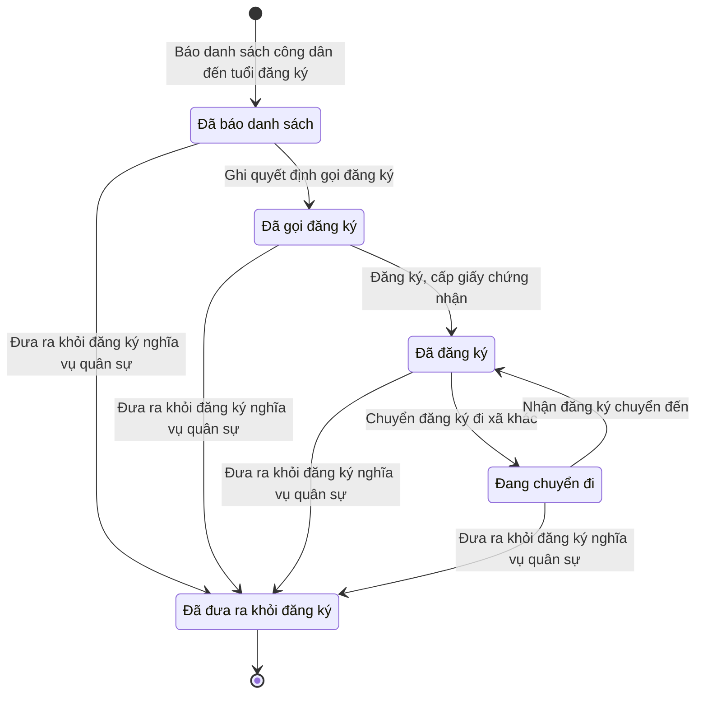

# qt-16.military-registration · Đăng ký nghĩa vụ quân sự

<!-- máy sinh: tom-tat -->
> **Hồ sơ:** Đăng ký nghĩa vụ quân sự (`MilitaryRegistration`)
>
> 7 bước · 5 chặng · 2 vai · 0 bảng quyết định · 0 hạn · 2 khớp nối.
>
> **Nguồn:** sổ nghiệp vụ `qt-16.military-registration` · khai báo của app: `dqtv-app/core/processes/militia-enlistment/workflow/military-registration.yaml`. Các bảng do máy sinh từ nguồn này.
<!-- hết: tom-tat -->

<!-- viết tay: dien-giai -->
## Diễn giải

*Phần này viết tay, diễn giải lại điều các bảng bên dưới ghi.*

### Quy trình này để làm gì

Ban CHQS xã theo dõi **việc đăng ký nghĩa vụ quân sự của một công dân**: từ lúc có tên trong danh sách công dân đến tuổi đăng ký, được gọi đăng ký, đăng ký và nhận giấy chứng nhận, cho tới khi chuyển đi xã khác hoặc bị đưa ra khỏi đăng ký.

Hồ sơ đi qua các chặng: *Đã báo danh sách* → *Đã gọi đăng ký* → *Đã đăng ký*; từ đó có thể sang *Đang chuyển đi* rồi về lại *Đã đăng ký*; kết thúc ở *Đã đưa ra khỏi đăng ký*.

### Khi nào bắt đầu

Chỉ huy trưởng Ban CHQS xã bấm **Báo danh sách công dân đến tuổi đăng ký**, bắt buộc nhập công dân và bản danh sách đã báo. Hồ sơ mở ra nối tới công dân trong độ tuổi và vào chặng *Đã báo danh sách*.

### Diễn ra thế nào

**Chặng "Đã báo danh sách"** — Trợ lý Quân lực bấm **Ghi quyết định gọi đăng ký**: phải có số quyết định và ảnh chụp quyết định đã ký (quyết định của Chủ tịch Uỷ ban nhân dân cấp xã, ký ngoài hệ), và `notCompletedMilitaryService`: hồ sơ Sổ đăng ký người theo diện (qt-16) của người đó không mang `completedMilitaryService`. Hồ sơ sang *Đã gọi đăng ký*.

**Chặng "Đã gọi đăng ký"** — Trợ lý Quân lực bấm **Đăng ký, cấp giấy chứng nhận**: phải có số giấy chứng nhận đăng ký và hình thức đăng ký (trực tiếp hoặc trực tuyến). Bước này không đòi bản chụp giấy: giấy chứng nhận đăng ký do chính Ban CHQS xã cấp và giao công dân giữ. Hồ sơ sang *Đã đăng ký*.

**Ở hai chặng "Đã gọi đăng ký" và "Đã đăng ký"** — Chỉ huy trưởng Ban CHQS xã bấm **Báo cáo kết quả đăng ký**: phải có bản báo cáo kết quả; hồ sơ đứng yên; lặp được.

**Chặng "Đã đăng ký"** — Trợ lý Quân lực bấm **Chuyển đăng ký đi xã khác**: phải có mã xã nơi chuyển đến. Hồ sơ sang *Đang chuyển đi*.

**Chặng "Đang chuyển đi"** — Trợ lý Quân lực bấm **Nhận đăng ký chuyển đến**: ghi ngày nhận, hồ sơ về lại *Đã đăng ký*.

**Kết thúc sớm** — từ cả bốn chặng trên, Trợ lý Quân lực bấm **Đưa ra khỏi đăng ký nghĩa vụ quân sự**: phải có ảnh chụp giấy làm căn cứ; ghi căn cứ đưa ra và lý do. Hồ sơ sang *Đã đưa ra khỏi đăng ký*.

### Kết thúc và để lại gì

Hồ sơ kết thúc ở chặng *Đã đưa ra khỏi đăng ký*. Chặng *Đã đăng ký* không phải chặng kết thúc.

Hồ sơ giữ ô nối tới công dân trong độ tuổi (`militaryRegistrationOfCitizen`), ghi từ bước mở.

### Điều kiện chặn

- Mọi bước trừ bước mở đòi người làm thuộc đơn vị ghi ở ô đơn vị chủ hồ sơ.
- Quyết định gọi đăng ký chỉ ghi được khi hồ sơ qt-16 của người đó không mang `completedMilitaryService`.
- Sai người, sai chặng, thiếu thứ phải có trước thì bước bị chặn, hồ sơ giữ nguyên. Không bước nào có kết quả chặn riêng.
<!-- hết viết tay -->

## 1. Đường đi ngắn nhất qua các chặng

<!-- máy sinh: luong-chinh -->
Đường ít bước nhất từ lúc mở hồ sơ tới chặng kết thúc xa nhất. Máy chọn theo số chặng, không theo ý nghĩa nghiệp vụ — trình tự công việc thật xem phần Diễn giải và bảng "Việc làm ở từng chặng" ở mục 6.

| # | Ai làm | Làm gì | Hồ sơ sang chặng |
|---|---|---|---|
| 1 | Chỉ huy trưởng Ban CHQS xã | Báo danh sách công dân đến tuổi đăng ký | Đã báo danh sách |
| 2 | Trợ lý Quân lực | Đưa ra khỏi đăng ký nghĩa vụ quân sự | Đã đưa ra khỏi đăng ký |

<!-- hết: luong-chinh -->

## 2. Hồ sơ và việc nó để lại

<!-- máy sinh: muc-tieu -->
**App gọi quy trình này là:** Đăng ký nghĩa vụ quân sự.
<!-- hết: muc-tieu -->

## 3. Khởi phát và kết thúc

<!-- máy sinh: khoi-phat -->
**1 cửa vào** — bước mở hồ sơ:

| Bước mở | Ai mở | Hồ sơ vào chặng | App bắt buộc nhập |
|---|---|---|---|
| Báo danh sách công dân đến tuổi đăng ký | Chỉ huy trưởng Ban CHQS xã | Đã báo danh sách | `citizenId`, bản danh sách công dân đến tuổi đăng ký đã báo |

**Kết thúc:** *Đã đưa ra khỏi đăng ký* (`REMOVED`)
<!-- hết: khoi-phat -->

## 4. Vai trò

<!-- máy sinh: vai-tro -->
| Vai trong sổ | Tên trong app | Điều kiện | Làm những bước |
|---|---|---|---|
| `verifier` | Chỉ huy trưởng Ban CHQS xã |  | Báo danh sách công dân đến tuổi đăng ký · Báo cáo kết quả đăng ký |
| `operator` | Trợ lý Quân lực |  | Ghi quyết định gọi đăng ký · Đăng ký, cấp giấy chứng nhận · Chuyển đăng ký đi xã khác · Nhận đăng ký chuyển đến · Đưa ra khỏi đăng ký nghĩa vụ quân sự |

*"Tên trong app" là tên app đặt cho mã chủ thể của vai. Hồ sơ thuộc đơn vị cấp khác thì người làm là người giữ vai ấy ở đơn vị nêu trong cột "Điều kiện" (nếu sổ có ghi) và ở cột "Người làm phải thuộc" của bảng "Theo khai báo của app" (mục 7).*
<!-- hết: vai-tro -->

## 5. Nhánh phụ

<!-- máy sinh: nhanh-phu -->
**Bước khác đưa hồ sơ sang chặng mới** — đường song song, rẽ nhánh hoặc kết thúc sớm:

| Bước | Ai làm | Từ chặng | Sang chặng |
|---|---|---|---|
| Ghi quyết định gọi đăng ký | Trợ lý Quân lực | Đã báo danh sách | Đã gọi đăng ký |
| Đăng ký, cấp giấy chứng nhận | Trợ lý Quân lực | Đã gọi đăng ký | Đã đăng ký |
| Chuyển đăng ký đi xã khác | Trợ lý Quân lực | Đã đăng ký | Đang chuyển đi |

**Quay lại một chặng hồ sơ đã đi qua** (tính theo đường ngắn nhất từ lúc mở):

| Bước | Ai làm | Từ chặng | Về chặng |
|---|---|---|---|
| Nhận đăng ký chuyển đến | Trợ lý Quân lực | Đang chuyển đi | Đã đăng ký |

**Làm trong lúc hồ sơ đứng yên ở một chặng** — ghi nhận, bổ sung:

| Bước | Ai làm | Ở chặng |
|---|---|---|
| Báo cáo kết quả đăng ký *(lặp được)* | Chỉ huy trưởng Ban CHQS xã | Đã đăng ký, Đã gọi đăng ký |

<!-- hết: nhanh-phu -->

## 6. Các chặng và việc làm ở từng chặng

<!-- máy sinh: chang -->
| Chặng | Tên hiển thị | Vào bằng bước | Kết thúc? |
|---|---|---|---|
| `LISTED` | Đã báo danh sách | Báo danh sách công dân đến tuổi đăng ký |  |
| `CALLED` | Đã gọi đăng ký | Ghi quyết định gọi đăng ký |  |
| `REGISTERED` | Đã đăng ký | Đăng ký, cấp giấy chứng nhận · Nhận đăng ký chuyển đến |  |
| `TRANSFERRING` | Đang chuyển đi | Chuyển đăng ký đi xã khác |  |
| `REMOVED` | Đã đưa ra khỏi đăng ký | Đưa ra khỏi đăng ký nghĩa vụ quân sự | **kết thúc** |

### Việc làm ở từng chặng

Hồ sơ đang ở chặng nào thì làm được những bước nào.

| Hồ sơ đang ở chặng | Bước làm tại chặng (hồ sơ đứng yên) | Bước đưa hồ sơ sang chặng khác |
|---|---|---|
| **Đã báo danh sách** | — | Ghi quyết định gọi đăng ký — Trợ lý Quân lực → *Đã gọi đăng ký* Đưa ra khỏi đăng ký nghĩa vụ quân sự — Trợ lý Quân lực → *Đã đưa ra khỏi đăng ký* |
| **Đã gọi đăng ký** | Báo cáo kết quả đăng ký (lặp được) — Chỉ huy trưởng Ban CHQS xã | Đăng ký, cấp giấy chứng nhận — Trợ lý Quân lực → *Đã đăng ký* Đưa ra khỏi đăng ký nghĩa vụ quân sự — Trợ lý Quân lực → *Đã đưa ra khỏi đăng ký* |
| **Đã đăng ký** | Báo cáo kết quả đăng ký (lặp được) — Chỉ huy trưởng Ban CHQS xã | Chuyển đăng ký đi xã khác — Trợ lý Quân lực → *Đang chuyển đi* Đưa ra khỏi đăng ký nghĩa vụ quân sự — Trợ lý Quân lực → *Đã đưa ra khỏi đăng ký* |
| **Đang chuyển đi** | — | Nhận đăng ký chuyển đến — Trợ lý Quân lực → *Đã đăng ký* Đưa ra khỏi đăng ký nghĩa vụ quân sự — Trợ lý Quân lực → *Đã đưa ra khỏi đăng ký* |
| **Đã đưa ra khỏi đăng ký** | — | — (kết thúc) |
<!-- hết: chang -->

## 7. Bảng bước

<!-- máy sinh: buoc -->
| # | Bước | Mã bước | Ai thực hiện | Từ chặng | Sang chặng | Phải có trước | Ghi lại |
|---|---|---|---|---|---|---|---|
| 1 | Báo danh sách công dân đến tuổi đăng ký | `reportRegistrationList` | Chỉ huy trưởng Ban CHQS xã | — (mở hồ sơ) | `LISTED` | bản danh sách đã báo, `actorInPersonCommune` | nối tới Công dân trong độ tuổi, bản danh sách đã báo, ngày báo danh sách, đơn vị chủ hồ sơ, mã xã |
| 2 | Ghi quyết định gọi đăng ký | `recordRegistrationCallDecision` | Trợ lý Quân lực | `LISTED` | `CALLED` | người làm thuộc đơn vị chủ hồ sơ, `notCompletedMilitaryService`, nối tới Văn bản đến, `registrationCallFromIncomingDocumentUsable` | ngày ghi quyết định gọi đăng ký, nối tới Văn bản đến |
| 3 | Đăng ký, cấp giấy chứng nhận | `issueRegistrationCertificate` | Trợ lý Quân lực | `CALLED` | `REGISTERED` | số giấy chứng nhận đăng ký, hình thức đăng ký, người làm thuộc đơn vị chủ hồ sơ | số giấy chứng nhận đăng ký, hình thức đăng ký, ngày đăng ký |
| 4 | Báo cáo kết quả đăng ký | `reportRegistrationResult` | Chỉ huy trưởng Ban CHQS xã | `REGISTERED`, `CALLED` | giữ nguyên | người làm thuộc đơn vị chủ hồ sơ | ngày báo cáo kết quả đăng ký |
| 5 | Chuyển đăng ký đi xã khác | `transferRegistrationCategory` | Trợ lý Quân lực | `REGISTERED` | `TRANSFERRING` | mã xã nơi chuyển đến, người làm thuộc đơn vị chủ hồ sơ, số giấy giới thiệu di chuyển | mã xã nơi chuyển đến, ngày chuyển đăng ký đi, số giấy giới thiệu di chuyển, `destinationUnit` |
| 6 | Nhận đăng ký chuyển đến | `receiveTransferredRegistration` | Trợ lý Quân lực | `TRANSFERRING` | `REGISTERED` | `actorInDestinationCommune`, số giấy giới thiệu công dân xuất trình, hình thức nhận chuyển đến, `transferIntroMatches` | ngày nhận đăng ký chuyển đến, số giấy giới thiệu công dân xuất trình, hình thức nhận chuyển đến, đơn vị chủ hồ sơ |
| 7 | Đưa ra khỏi đăng ký nghĩa vụ quân sự | `removeFromMilitaryRegistration` | Trợ lý Quân lực | `LISTED`, `CALLED`, `REGISTERED`, `TRANSFERRING` | `REMOVED` | `militaryRemovalFromIncomingDocumentUsable`, người làm thuộc đơn vị chủ hồ sơ | căn cứ đưa ra, vì sao đưa ra, nối tới Văn bản đến, ngày đưa ra khỏi đăng ký |

### Khi không đạt điều kiện

Mặc định: không đúng người, hồ sơ không ở đúng chặng, hoặc thiếu thứ "phải có trước" thì bước bị chặn, hồ sơ giữ nguyên. Bảng dưới chỉ kê những bước có kết quả riêng.

Không bước nào có kết quả riêng — tất cả theo mặc định.

### Điều kiện "phải có trước" bằng lời

Cột "Phải có trước" ở bảng bước có hai loại: ô dữ liệu thường (bước chỉ đòi ô ấy đã có giá trị) và điều kiện hệ tự xét. Bảng này diễn các điều kiện hệ tự xét theo đúng công thức sổ ghi; số ở cột cuối là số thứ tự bước.

| Điều kiện | Đúng khi | Bước đòi |
|---|---|---|
| `actorInPersonCommune` | người đang làm là người của đơn vị ghi ở ô đơn vị chủ hồ sơ của Sổ đăng ký người theo diện (qt-16) (theo danh mục người của đơn vị, `dm.unit-staff`) | 1 |
| `actorInOwnerUnit` | người đang làm là người của đơn vị ghi ở ô đơn vị chủ hồ sơ của hồ sơ này (theo danh mục người của đơn vị, `dm.unit-staff`) | 2, 3, 4, 5, 7 |
| `notCompletedMilitaryService` | KHÔNG (đã có `completedMilitaryService` ở hồ sơ Sổ đăng ký người theo diện (qt-16)) | 2 |
| `registrationCallFromIncomingDocumentUsable` | có hồ sơ Việc luật giao kèm văn bản đến, đi — Văn bản đến (qt-1.incoming-document) chính là hồ sơ ghi ở ô nối `registrationCallFromIncomingDocument` của hồ sơ đang làm mà hồ sơ ấy đang ở chặng `RECEIVED` hoặc `DISTRIBUTED` | 2 |
| `actorInDestinationCommune` | người đang làm là người của đơn vị ghi ở ô `destinationUnit` của hồ sơ này (theo danh mục người của đơn vị, `dm.unit-staff`) | 6 |
| `transferIntroMatches` | số giấy giới thiệu công dân xuất trình bằng số giấy giới thiệu di chuyển | 6 |
| `militaryRemovalFromIncomingDocumentUsable` | có hồ sơ Việc luật giao kèm văn bản đến, đi — Văn bản đến (qt-1.incoming-document) chính là hồ sơ ghi ở ô nối `militaryRemovalFromIncomingDocument` của hồ sơ đang làm mà hồ sơ ấy đang ở chặng `RECEIVED` hoặc `DISTRIBUTED` | 7 |

### Theo khai báo của app

Người làm phải thuộc đơn vị nào, ô người dùng phải nhập, bước có lặp được không, và căn cứ pháp lý — lấy từ khai báo quy trình trong app.

| # | Bước | Người làm phải thuộc | Bắt buộc nhập | Nhập nếu có | Lặp được | Căn cứ |
|---|---|---|---|---|---|---|
| 1 | Báo danh sách công dân đến tuổi đăng ký |  | `citizenId`, bản danh sách đã báo | — |  | L78/2015/QH13 Đ.16 |
| 2 | Ghi quyết định gọi đăng ký | đơn vị chủ hồ sơ | quyết định gọi đăng ký trong sổ văn bản đến | — |  | L78/2015/QH13 Đ.16 |
| 3 | Đăng ký, cấp giấy chứng nhận | đơn vị chủ hồ sơ | số giấy chứng nhận đăng ký, hình thức đăng ký | — |  | L78/2015/QH13 Đ.16 |
| 4 | Báo cáo kết quả đăng ký | đơn vị chủ hồ sơ | — | — | có | L78/2015/QH13 Đ.16 |
| 5 | Chuyển đăng ký đi xã khác | đơn vị chủ hồ sơ | mã xã nơi chuyển đến, số giấy giới thiệu di chuyển | — |  | L78/2015/QH13 Đ.19 |
| 6 | Nhận đăng ký chuyển đến | `destinationUnit` | số giấy giới thiệu công dân xuất trình, hình thức nhận chuyển đến | — |  | L78/2015/QH13 Đ.19 |
| 7 | Đưa ra khỏi đăng ký nghĩa vụ quân sự | đơn vị chủ hồ sơ | căn cứ đưa ra, quyết định đưa ra khỏi danh sách đăng ký của Chủ tịch UBND xã (sổ văn bản đến) | vì sao đưa ra |  | L78/2015/QH13 Đ.16, Đ.19 |

### Điều kiện và ghi chú app khai cho từng bước

Lấy từ khai báo quy trình trong app. Lời trong ngoặc kép là câu app hiện cho người dùng. Chức danh người ký ngoài hệ app chỉ khai bằng mã.

| # | Bước | Điều kiện, ghi chú |
|---|---|---|
| 3 | Đăng ký, cấp giấy chứng nhận | · không đòi bản chụp — app ghi: "Giấy chứng nhận đăng ký do chính Ban CHQS xã cấp và giao công dân giữ — hệ ghi số giấy và hình thức đăng ký; sổ tri thức qt-16 không đòi bản quét" |
| 7 | Đưa ra khỏi đăng ký nghĩa vụ quân sự | · không đòi bản chụp — app ghi: "quyết định đưa ra là văn bản đến văn thư đã vào sổ — trợ lý chọn, tầng dịch vụ chép bản số hoá của văn bản ấy" |
<!-- hết: buoc -->

## 8. Bảng quyết định, hạn, việc ngoài hệ

<!-- máy sinh: quyet-dinh -->

<!-- hết: quyet-dinh -->

## 9. Dữ liệu của hồ sơ

<!-- máy sinh: du-lieu -->
Các ô mà bước trong sổ ghi hoặc đòi. Số trong hai cột cuối là số thứ tự bước ở bảng bước (mục 7).

| Ô dữ liệu | Mã | Kiểu (app) | Giá trị cho phép | Loại ô (sổ) | Bước ghi | Bước đòi | Mô tả trong app |
|---|---|---|---|---|---|---|---|
| bản danh sách công dân đến tuổi đăng ký đã báo | `registrationListScanPath` | tệp |  | đưa vào ở bước (`input`) | 1 | 1 | Bản danh sách công dân đến tuổi đăng ký đã báo cấp trên — tháng 1 (dòng chuyển từ dữ liệu trước 4/10/2026 có thể thiếu) |
| ngày báo danh sách | `registrationListReportedAt` | ngày |  | lưu trên hồ sơ (`stored`) | 1 | — | Ngày báo danh sách |
| đơn vị chủ hồ sơ | `ownerUnit` |  |  | lưu trên hồ sơ (`stored`) | 1, 6 | — |  |
| mã xã | `communeCode` | chữ |  | đưa vào ở bước (`input`) | 1 | — | Mã xã giữ đăng ký |
| ngày ghi quyết định gọi đăng ký | `calledAt` | ngày |  | lưu trên hồ sơ (`stored`) | 2 | — | Ngày ghi quyết định gọi đăng ký |
| số giấy chứng nhận đăng ký | `registrationCertificateNumber` | chữ |  | đưa vào ở bước (`input`) | 3 | 3 | Số giấy chứng nhận đăng ký |
| hình thức đăng ký | `registrationChannel` | chọn một | Trực tiếp (`in_person`), Trực tuyến (`online`) | đưa vào ở bước (`input`) | 3 | 3 | Hình thức đăng ký — trực tiếp hoặc trực tuyến |
| ngày đăng ký | `registeredOn` | ngày |  | lưu trên hồ sơ (`stored`) | 3 | — | Ngày đăng ký, cấp giấy chứng nhận |
| ngày báo cáo kết quả đăng ký | `resultReportedAt` | ngày |  | lưu trên hồ sơ (`stored`) | 4 | — | Ngày báo cáo kết quả đăng ký |
| xã nơi chuyển đến | `destinationCommune` | chữ |  | đưa vào ở bước (`input`) | 5 | 5 | Mã xã nơi công dân chuyển đến |
| ngày chuyển đăng ký đi | `transferredOutAt` | ngày |  | lưu trên hồ sơ (`stored`) | 5 | — | Ngày chuyển đăng ký đi |
| số giấy giới thiệu di chuyển | `transferIntroNumber` | chữ |  | đưa vào ở bước (`input`) | 5 | 5 | Số giấy giới thiệu di chuyển nơi đi cấp khi chuyển đăng ký |
| — | `destinationUnit` | chữ |  | lưu trên hồ sơ (`stored`) | 5 | — | Đơn vị (Ban CHQS xã) nơi công dân chuyển đến — id trong danh mục đơn vị (OrgUnit) |
| ngày nhận đăng ký chuyển đến | `transferReceivedAt` | ngày |  | lưu trên hồ sơ (`stored`) | 6 | — | Ngày xã nơi đến nhận đăng ký |
| số giấy giới thiệu công dân xuất trình | `presentedTransferIntroNumber` | chữ |  | đưa vào ở bước (`input`) | 6 | 6 | Số giấy giới thiệu di chuyển công dân xuất trình ở xã nơi đến — phải khớp số nơi đi cấp |
| hình thức nhận chuyển đến | `transferArrivalChannel` | chọn một | Trực tuyến (`online`), Trực tiếp (`in_person`) | đưa vào ở bước (`input`) | 6 | 6 | Công dân đến đăng ký ở xã nơi đến trực tiếp hay trực tuyến |
| căn cứ đưa ra | `removalGround` | chữ |  | đưa vào ở bước (`input`) | 7 | — | Căn cứ đưa ra khỏi đăng ký — chép từ giấy |
| vì sao đưa ra | `removalReason` | chữ |  | đưa vào ở bước (`input`) | 7 | — | Vì sao đưa ra khỏi đăng ký |
| ngày đưa ra khỏi đăng ký | `removedAt` | ngày |  | lưu trên hồ sơ (`stored`) | 7 | — | Ngày đưa ra khỏi đăng ký |
| — | `actorInPersonCommune` |  | có hay chưa | hệ suy ra (`derived`) | — | 1 |  |
| người làm thuộc đơn vị chủ hồ sơ | `actorInOwnerUnit` |  | có hay chưa | hệ suy ra (`derived`) | — | 2, 3, 4, 5, 7 |  |
| — | `notCompletedMilitaryService` |  | có hay chưa | hệ suy ra (`derived`) | — | 2 |  |
| — | `registrationCallFromIncomingDocumentUsable` |  | có hay chưa | hệ suy ra (`derived`) | — | 2 |  |
| — | `actorInDestinationCommune` |  | có hay chưa | hệ suy ra (`derived`) | — | 6 |  |
| — | `transferIntroMatches` |  | có hay chưa | hệ suy ra (`derived`) | — | 6 |  |
| — | `militaryRemovalFromIncomingDocumentUsable` |  | có hay chưa | hệ suy ra (`derived`) | — | 7 |  |

26 ô. Cột "Loại ô" là cách sổ phân loại ô, in kèm đúng chữ của sổ; ô nào người dùng phải nhập xem bảng "Theo khai báo của app" ở mục 7.
<!-- hết: du-lieu -->

## 10. Khớp nối với quy trình khác

<!-- máy sinh: khop-noi -->
| Quy trình kia | Hồ sơ kia | Quan hệ | Nội dung (mô tả trong app) | Bước ghi mối nối | Tên ô nối |
|---|---|---|---|---|---|
| 1.incoming-document | Văn bản đến | gắn với nhau ở một bước giữa chừng | Quyết định đưa ra khỏi danh sách đăng ký nghĩa vụ quân sự của Chủ tịch UBND xã — văn bản trong sổ văn bản đến… | 16.military-registration·removeFromMilitaryRegistration | `militaryRemovalFromIncomingDocument` |
| 1.incoming-document | Văn bản đến | gắn với nhau ở một bước giữa chừng | Quyết định gọi đăng ký nghĩa vụ quân sự ghi từ văn bản đến nào (L78 Đ.16) | 16.military-registration·recordRegistrationCallDecision · đòi: 16.military-registration·recordRegistrationCallDecision | `registrationCallFromIncomingDocument` |

2 khớp nối. ⊕ là bước tạo hồ sơ.

**Ô nối giữa các hồ sơ cùng mã quy trình, hoặc tới danh mục nền:** `militaryRegistrationOfCitizen` (Đăng ký nghĩa vụ quân sự → Công dân trong độ tuổi) — bước Báo danh sách công dân đến tuổi đăng ký.
<!-- hết: khop-noi -->

## 11. Thông tin chung

<!-- máy sinh: thong-tin -->
| | |
|---|---|
| **Mã trong sổ** | `qt-16.military-registration` |
| **Quy trình trong app** | `militia-enlistment` (`workflow/military-registration.yaml`) — mặt công tác: `personnel` |
| **Hồ sơ** | Đăng ký nghĩa vụ quân sự (`MilitaryRegistration`) |
| **Cùng mã quy trình** | [qt-16](qt-16.html), [qt-16.enlistment](qt-16.enlistment.html), [qt-16.gdqp-category](qt-16.gdqp-category.html), [qt-16.gdqp-certificate](qt-16.gdqp-certificate.html), [qt-16.position-held](qt-16.position-held.html), [qt-16.registration-decision](qt-16.registration-decision.html), [qt-16.reserve-registration](qt-16.reserve-registration.html), [qt-16.service-exit-decision](qt-16.service-exit-decision.html), [qt-16.service-extension-decision](qt-16.service-extension-decision.html) |
| **Căn cứ pháp lý từng bước** | cột "Căn cứ" ở bảng "Theo khai báo của app", mục 7 |
<!-- hết: thong-tin -->
