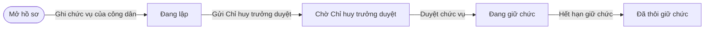
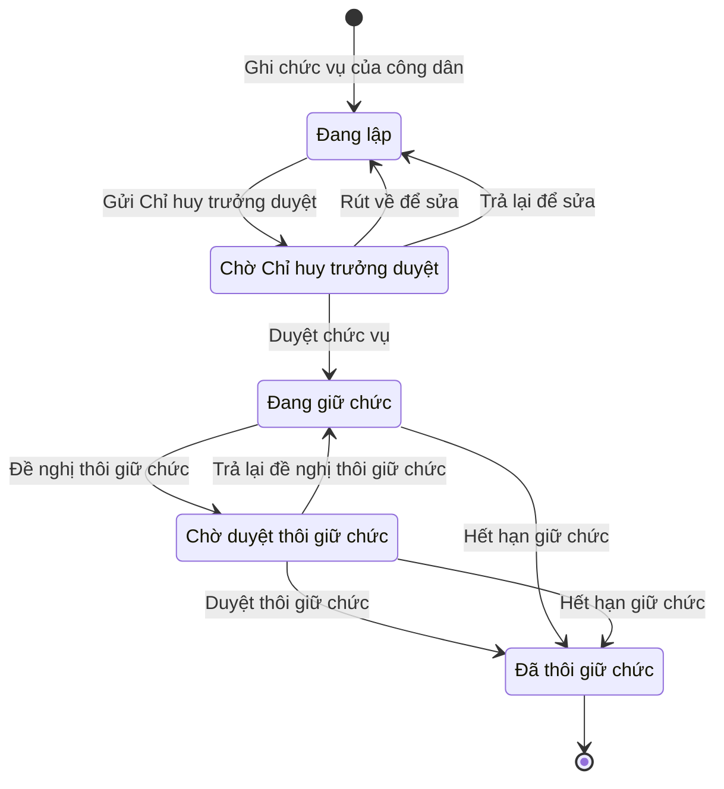

# qt-16.position-held

<!-- máy sinh: tom-tat -->
> **Hồ sơ:** Chức vụ của công dân (`PositionHeld`)
>
> 9 bước · 5 chặng · 3 vai · 1 bảng quyết định · 1 hạn · 0 khớp nối.
>
> **Nguồn:** sổ nghiệp vụ `qt-16.position-held` · khai báo của app: `dqtv-app/core/processes/position-held/workflow/position-held.yaml`. Các bảng do máy sinh từ nguồn này.
<!-- hết: tom-tat -->

## 1. Đường đi ngắn nhất qua các chặng

<!-- máy sinh: luong-chinh -->
Đường ít bước nhất từ lúc mở hồ sơ tới chặng kết thúc xa nhất. Máy chọn theo số chặng, không theo ý nghĩa nghiệp vụ — trình tự công việc thật xem phần Diễn giải và bảng "Việc làm ở từng chặng" ở mục 6.

| # | Ai làm | Làm gì | Hồ sơ sang chặng |
|---|---|---|---|
| 1 | Trợ lý Quân lực | Ghi chức vụ của công dân | Đang lập |
| 2 | Trợ lý Quân lực | Gửi Chỉ huy trưởng duyệt | Chờ Chỉ huy trưởng duyệt |
| 3 | Chỉ huy trưởng Ban CHQS xã | Duyệt chức vụ | Đang giữ chức |
| 4 | Hệ thống tự làm | Hết hạn giữ chức | Đã thôi giữ chức |

<!-- hết: luong-chinh -->

## 2. Hồ sơ và việc nó để lại

<!-- máy sinh: muc-tieu -->
**App gọi quy trình này là:** Chức vụ của công dân.
<!-- hết: muc-tieu -->

## 3. Khởi phát và kết thúc

<!-- máy sinh: khoi-phat -->
**1 cửa vào** — bước mở hồ sơ:

| Bước mở | Ai mở | Hồ sơ vào chặng | App bắt buộc nhập |
|---|---|---|---|
| Ghi chức vụ của công dân | Trợ lý Quân lực | Đang lập | công dân (hồ sơ người), chức vụ, giữ chức từ ngày, văn bản làm căn cứ |

**Kết thúc:** *Đã thôi giữ chức* (`ENDED`)
<!-- hết: khoi-phat -->

## 4. Vai trò

<!-- máy sinh: vai-tro -->
| Vai trong sổ | Tên trong app | Điều kiện | Làm những bước |
|---|---|---|---|
| `personnel` | Trợ lý Quân lực |  | Ghi chức vụ của công dân · Gửi Chỉ huy trưởng duyệt · Rút về để sửa · Đề nghị thôi giữ chức |
| `commander` | Chỉ huy trưởng Ban CHQS xã |  | Trả lại để sửa · Duyệt chức vụ · Trả lại đề nghị thôi giữ chức · Duyệt thôi giữ chức |
| `system` | Hệ thống tự làm |  | Hết hạn giữ chức |

*"Tên trong app" là tên app đặt cho mã chủ thể của vai. Hồ sơ thuộc đơn vị cấp khác thì người làm là người giữ vai ấy ở đơn vị nêu trong cột "Điều kiện" (nếu sổ có ghi) và ở cột "Người làm phải thuộc" của bảng "Theo khai báo của app" (mục 7).*
<!-- hết: vai-tro -->

## 5. Nhánh phụ

<!-- máy sinh: nhanh-phu -->
**Bước khác đưa hồ sơ sang chặng mới** — đường song song, rẽ nhánh hoặc kết thúc sớm:

| Bước | Ai làm | Từ chặng | Sang chặng |
|---|---|---|---|
| Đề nghị thôi giữ chức | Trợ lý Quân lực | Đang giữ chức | Chờ duyệt thôi giữ chức |
| Duyệt thôi giữ chức | Chỉ huy trưởng Ban CHQS xã | Chờ duyệt thôi giữ chức | Đã thôi giữ chức |

**Quay lại một chặng hồ sơ đã đi qua** (tính theo đường ngắn nhất từ lúc mở):

| Bước | Ai làm | Từ chặng | Về chặng |
|---|---|---|---|
| Rút về để sửa | Trợ lý Quân lực | Chờ Chỉ huy trưởng duyệt | Đang lập |
| Trả lại để sửa | Chỉ huy trưởng Ban CHQS xã | Chờ Chỉ huy trưởng duyệt | Đang lập |
| Trả lại đề nghị thôi giữ chức | Chỉ huy trưởng Ban CHQS xã | Chờ duyệt thôi giữ chức | Đang giữ chức |

<!-- hết: nhanh-phu -->

## 6. Các chặng và việc làm ở từng chặng

<!-- máy sinh: chang -->
| Chặng | Tên hiển thị | Vào bằng bước | Kết thúc? |
|---|---|---|---|
| `DRAFT` | Đang lập | Ghi chức vụ của công dân · Rút về để sửa · Trả lại để sửa |  |
| `PENDING_APPROVAL` | Chờ Chỉ huy trưởng duyệt | Gửi Chỉ huy trưởng duyệt |  |
| `ACTIVE` | Đang giữ chức | Duyệt chức vụ · Trả lại đề nghị thôi giữ chức |  |
| `ENDING` | Chờ duyệt thôi giữ chức | Đề nghị thôi giữ chức |  |
| `ENDED` | Đã thôi giữ chức | Duyệt thôi giữ chức · Hết hạn giữ chức | **kết thúc** |

### Việc làm ở từng chặng

Hồ sơ đang ở chặng nào thì làm được những bước nào.

| Hồ sơ đang ở chặng | Bước làm tại chặng (hồ sơ đứng yên) | Bước đưa hồ sơ sang chặng khác |
|---|---|---|
| **Đang lập** | — | Gửi Chỉ huy trưởng duyệt — Trợ lý Quân lực → *Chờ Chỉ huy trưởng duyệt* |
| **Chờ Chỉ huy trưởng duyệt** | — | Rút về để sửa — Trợ lý Quân lực → *Đang lập* Trả lại để sửa — Chỉ huy trưởng Ban CHQS xã → *Đang lập* Duyệt chức vụ — Chỉ huy trưởng Ban CHQS xã → *Đang giữ chức* |
| **Đang giữ chức** | — | Đề nghị thôi giữ chức — Trợ lý Quân lực → *Chờ duyệt thôi giữ chức* Hết hạn giữ chức — Hệ thống tự làm → *Đã thôi giữ chức* |
| **Chờ duyệt thôi giữ chức** | — | Trả lại đề nghị thôi giữ chức — Chỉ huy trưởng Ban CHQS xã → *Đang giữ chức* Duyệt thôi giữ chức — Chỉ huy trưởng Ban CHQS xã → *Đã thôi giữ chức* Hết hạn giữ chức — Hệ thống tự làm → *Đã thôi giữ chức* |
| **Đã thôi giữ chức** | — | — (kết thúc) |
<!-- hết: chang -->

## 7. Bảng bước

<!-- máy sinh: buoc -->
| # | Bước | Mã bước | Ai thực hiện | Từ chặng | Sang chặng | Phải có trước | Ghi lại |
|---|---|---|---|---|---|---|---|
| 1 | Ghi chức vụ của công dân | `recordPosition` | Trợ lý Quân lực | — (mở hồ sơ) | `DRAFT` | `actorInPersonUnit` | `id`, chức vụ, giữ chức từ ngày, giữ chức đến ngày, văn bản làm căn cứ, đơn vị chủ hồ sơ |
| 2 | Gửi Chỉ huy trưởng duyệt | `submitPositionForApproval` | Trợ lý Quân lực | `DRAFT` | `PENDING_APPROVAL` | người làm thuộc đơn vị chủ hồ sơ | — |
| 3 | Rút về để sửa | `withdrawPositionSubmission` | Trợ lý Quân lực | `PENDING_APPROVAL` | `DRAFT` | người làm thuộc đơn vị chủ hồ sơ | — |
| 4 | Trả lại để sửa | `returnPosition` | Chỉ huy trưởng Ban CHQS xã | `PENDING_APPROVAL` | `DRAFT` | người làm thuộc đơn vị chủ hồ sơ | — |
| 5 | Duyệt chức vụ | `approvePosition` | Chỉ huy trưởng Ban CHQS xã | `PENDING_APPROVAL` | `ACTIVE` | người làm thuộc đơn vị chủ hồ sơ | — |
| 6 | Đề nghị thôi giữ chức | `endPosition` | Trợ lý Quân lực | `ACTIVE` | `ENDING` | người làm thuộc đơn vị chủ hồ sơ | giữ chức đến ngày |
| 7 | Trả lại đề nghị thôi giữ chức | `returnEndPosition` | Chỉ huy trưởng Ban CHQS xã | `ENDING` | `ACTIVE` | người làm thuộc đơn vị chủ hồ sơ | — |
| 8 | Duyệt thôi giữ chức | `approveEndPosition` | Chỉ huy trưởng Ban CHQS xã | `ENDING` | `ENDED` | người làm thuộc đơn vị chủ hồ sơ | — |
| 9 | Hết hạn giữ chức | `expirePosition` | Hệ thống tự làm | `ACTIVE`, `ENDING` | `ENDED` | — | — |

### Khi không đạt điều kiện

Mặc định: không đúng người, hồ sơ không ở đúng chặng, hoặc thiếu thứ "phải có trước" thì bước bị chặn, hồ sơ giữ nguyên. Bảng dưới chỉ kê những bước có kết quả riêng.

| # | Bước | Kết quả riêng |
|---|---|---|
| 9 | Hết hạn giữ chức | bước này không do người nào bấm |

### Điều kiện "phải có trước" bằng lời

Cột "Phải có trước" ở bảng bước có hai loại: ô dữ liệu thường (bước chỉ đòi ô ấy đã có giá trị) và điều kiện hệ tự xét. Bảng này diễn các điều kiện hệ tự xét theo đúng công thức sổ ghi; số ở cột cuối là số thứ tự bước.

| Điều kiện | Đúng khi | Bước đòi |
|---|---|---|
| `actorInPersonUnit` | người đang làm là người của đơn vị ghi ở ô đơn vị chủ hồ sơ của Sổ đăng ký người theo diện (qt-16) (theo danh mục người của đơn vị, `dm.unit-staff`) | 1 |
| `actorInOwnerUnit` | người đang làm là người của đơn vị ghi ở ô đơn vị chủ hồ sơ của hồ sơ này (theo danh mục người của đơn vị, `dm.unit-staff`) | 2, 3, 4, 5, 6, 7, 8 |

### Theo khai báo của app

Người làm phải thuộc đơn vị nào, ô người dùng phải nhập, bước có lặp được không, và căn cứ pháp lý — lấy từ khai báo quy trình trong app.

| # | Bước | Người làm phải thuộc | Bắt buộc nhập | Nhập nếu có | Lặp được | Căn cứ |
|---|---|---|---|---|---|---|
| 1 | Ghi chức vụ của công dân |  | công dân (hồ sơ người), chức vụ, giữ chức từ ngày, văn bản làm căn cứ | giữ chức đến ngày |  | sổ nghiệp vụ qt-16.position-held · step:recordPosition |
| 2 | Gửi Chỉ huy trưởng duyệt | đơn vị chủ hồ sơ | — | — |  | sổ nghiệp vụ qt-16.position-held · step:submitPositionForApproval |
| 3 | Rút về để sửa | đơn vị chủ hồ sơ | — | — |  | sổ nghiệp vụ qt-16.position-held · step:withdrawPositionSubmission |
| 4 | Trả lại để sửa | đơn vị chủ hồ sơ | — | — |  | sổ nghiệp vụ qt-16.position-held · step:returnPosition |
| 5 | Duyệt chức vụ | đơn vị chủ hồ sơ | — | — |  | sổ nghiệp vụ qt-16.position-held · step:approvePosition |
| 6 | Đề nghị thôi giữ chức | đơn vị chủ hồ sơ | giữ chức đến ngày | — |  | sổ nghiệp vụ qt-16.position-held · step:endPosition |
| 7 | Trả lại đề nghị thôi giữ chức | đơn vị chủ hồ sơ | — | — |  | sổ nghiệp vụ qt-16.position-held · step:returnEndPosition |
| 8 | Duyệt thôi giữ chức | đơn vị chủ hồ sơ | — | — |  | sổ nghiệp vụ qt-16.position-held · step:approveEndPosition |
| 9 | Hết hạn giữ chức |  | — | — |  | sổ nghiệp vụ qt-16.position-held · step:expirePosition |
<!-- hết: buoc -->

## 8. Bảng quyết định, hạn, việc ngoài hệ

<!-- máy sinh: quyet-dinh -->
**Bảng `group-of-position`** — xét ở bước *—*; đầu vào: chức vụ. 9 dòng, dòng đầu tiên khớp thì dừng.

| Thứ tự dò (số sổ ghi) | Dòng | Khi | Thì |
|---|---|---|---|
| — | `equivalent-3` | chức vụ là Người quản lý ngoài nhà nước — tương đương nhóm 3 (`non_state_manager_equivalent_3`) | `equivalent_3` |
| — | `equivalent-4` | chức vụ là Người quản lý ngoài nhà nước — tương đương nhóm 4 (`non_state_manager_equivalent_4`) | `equivalent_4` |
| — | `group-1` | chức vụ là Cán bộ do Bộ Chính trị, Ban Bí thư quản lý (`politburo_or_secretariat_managed`) hoặc Người do Chủ tịch nước, Thủ tướng Chính phủ bổ nhiệm (`president_or_pm_appointed_official`) hoặc Đại biểu Quốc hội (`national_assembly_deputy`) hoặc Sĩ quan cấp tướng (`general_officer`) | `group_1` |
| — | `group-2` | chức vụ là Uỷ viên Ban Thường vụ Tỉnh uỷ (`provincial_party_standing_committee`) hoặc Lãnh đạo cấp sở (`department_level_leader`) hoặc Đại biểu Hội đồng nhân dân cấp tỉnh (`provincial_council_deputy`) | `group_2` |
| — | `group-3` | chức vụ là Đại biểu Hội đồng nhân dân cấp xã (`commune_council_deputy`) hoặc Lãnh đạo cấp phòng (`division_level_leader`) | `group_3` |
| — | `group-4-agency` | chức vụ là Cán bộ cơ quan trung ương, tỉnh đóng trên địa bàn xã (`central_or_provincial_agency_staff_in_commune_area`) | `group_4_agency` |
| — | `group-4-commune` | chức vụ là Cán bộ, công chức cấp xã (`commune_official`) hoặc Trưởng thôn, trưởng đoàn thể (`village_or_union_head`) hoặc Đảng viên (`party_member`) | `group_4_commune` |
| — | `religious-or-cultural-figure` | chức vụ là Chức sắc tôn giáo (`religious_dignitary`) hoặc Chức việc tôn giáo (`religious_official`) hoặc Nhân sĩ văn hoá, khoa học xã hội, nghệ thuật (`cultural_social_science_art_figure`) | `religious_or_cultural_figure` |
| — | `village-elder-or-clan-head` | chức vụ là Già làng (`village_elder`) hoặc Trưởng dòng họ (`clan_head`) | `village_elder_or_clan_head` |

| Hạn | Tính từ | Thời hạn | Quá hạn thì |
|---|---|---|---|
| `positionExpiry` | `{"fact": "validTo"}` | 0 ngày | hệ làm bước Hết hạn giữ chức |

<!-- hết: quyet-dinh -->

## 9. Dữ liệu của hồ sơ

<!-- máy sinh: du-lieu -->
Các ô mà bước trong sổ ghi hoặc đòi. Số trong hai cột cuối là số thứ tự bước ở bảng bước (mục 7).

| Ô dữ liệu | Mã | Kiểu (app) | Giá trị cho phép | Loại ô (sổ) | Bước ghi | Bước đòi | Mô tả trong app |
|---|---|---|---|---|---|---|---|
| — | `id` |  |  | lưu trên hồ sơ (`stored`) | 1 | — |  |
| chức vụ | `positionKind` | chọn một | Cán bộ do Bộ Chính trị, Ban Bí thư quản lý (`politburo_or_secretariat_managed`), Người do Chủ tịch nước, Thủ tướng Chính phủ bổ nhiệm (`president_or_pm_appointed_official`), Đại biểu Quốc hội (`national_assembly_deputy`), Sĩ quan cấp tướng (`general_officer`), Uỷ viên Ban Thường vụ Tỉnh uỷ (`provincial_party_standing_committee`), Lãnh đạo cấp sở (`department_level_leader`), Đại biểu Hội đồng nhân dân cấp tỉnh (`provincial_council_deputy`), Đại biểu Hội đồng nhân dân cấp xã (`commune_council_deputy`), Lãnh đạo cấp phòng (`division_level_leader`), Cán bộ cơ quan trung ương, tỉnh đóng trên địa bàn xã (`central_or_provincial_agency_staff_in_commune_area`), Cán bộ, công chức cấp xã (`commune_official`), Trưởng thôn, trưởng đoàn thể (`village_or_union_head`), Đảng viên (`party_member`), Người quản lý ngoài nhà nước — tương đương nhóm 3 (`non_state_manager_equivalent_3`), Người quản lý ngoài nhà nước — tương đương nhóm 4 (`non_state_manager_equivalent_4`), Chức sắc tôn giáo (`religious_dignitary`), Chức việc tôn giáo (`religious_official`), Nhân sĩ văn hoá, khoa học xã hội, nghệ thuật (`cultural_social_science_art_figure`), Già làng (`village_elder`), Trưởng dòng họ (`clan_head`) | đưa vào ở bước (`input`) | 1 | — | Loại chức vụ — sổ qt-16.position-held `fact:positionKind` |
| giữ chức từ ngày | `validFrom` | ngày |  | đưa vào ở bước (`input`) | 1 | — | Ngày bắt đầu giữ chức |
| giữ chức đến ngày | `validTo` | ngày |  | đưa vào ở bước (`input`) | 1, 6 | — | Ngày hết hạn giữ chức — tới ngày ấy hệ tự khép chức vụ (`expirePosition`) |
| văn bản làm căn cứ | `basisDocument` | chữ |  | đưa vào ở bước (`input`) | 1 | — | Văn bản làm căn cứ giữ chức (số, ngày, cơ quan ban hành) |
| đơn vị chủ hồ sơ | `ownerUnit` |  |  | lưu trên hồ sơ (`stored`) | 1 | — |  |
| — | `actorInPersonUnit` |  | có hay chưa | hệ suy ra (`derived`) | — | 1 |  |
| người làm thuộc đơn vị chủ hồ sơ | `actorInOwnerUnit` |  | có hay chưa | hệ suy ra (`derived`) | — | 2, 3, 4, 5, 6, 7, 8 |  |

8 ô. Cột "Loại ô" là cách sổ phân loại ô, in kèm đúng chữ của sổ; ô nào người dùng phải nhập xem bảng "Theo khai báo của app" ở mục 7.
<!-- hết: du-lieu -->

## 10. Khớp nối với quy trình khác

<!-- máy sinh: khop-noi -->

**Ô nối giữa các hồ sơ cùng mã quy trình, hoặc tới danh mục nền:** `positionHeldOfRegistration` (Chức vụ của công dân → Sổ nghĩa vụ) — bước Ghi chức vụ của công dân.
<!-- hết: khop-noi -->

## 11. Thông tin chung

<!-- máy sinh: thong-tin -->
| | |
|---|---|
| **Mã trong sổ** | `qt-16.position-held` |
| **Quy trình trong app** | `position-held` (`workflow/position-held.yaml`) — mặt công tác: `personnel` |
| **Hồ sơ** | Chức vụ của công dân (`PositionHeld`) |
| **Cùng mã quy trình** | [qt-16](qt-16.html), [qt-16.enlistment](qt-16.enlistment.html), [qt-16.gdqp-category](qt-16.gdqp-category.html), [qt-16.gdqp-certificate](qt-16.gdqp-certificate.html), [qt-16.military-registration](qt-16.military-registration.html), [qt-16.registration-decision](qt-16.registration-decision.html), [qt-16.reserve-registration](qt-16.reserve-registration.html), [qt-16.service-exit-decision](qt-16.service-exit-decision.html), [qt-16.service-extension-decision](qt-16.service-extension-decision.html) |
| **Căn cứ pháp lý từng bước** | cột "Căn cứ" ở bảng "Theo khai báo của app", mục 7 |
<!-- hết: thong-tin -->
