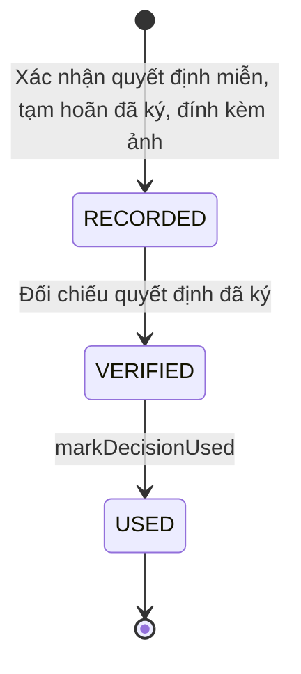

# qt-16.registration-decision · qt-16.registration-decision

<!-- máy sinh: tom-tat -->
> **Hồ sơ:** Sổ nghĩa vụ (`DutyRegistration`)
>
> 3 bước · 3 chặng · 2 vai · 1 bảng quyết định · 0 hạn · 6 khớp nối.
>
> **Nguồn:** sổ nghiệp vụ `qt-16.registration-decision` · khai báo của app: `dqtv-app/core/processes/militia-enlistment/workflow/duty-registration.yaml`. Các bảng do máy sinh từ nguồn này.
<!-- hết: tom-tat -->

<!-- viết tay: dien-giai -->
## Diễn giải

*Phần này viết tay, diễn giải lại điều các bảng bên dưới ghi.*

### Quy trình này để làm gì

Mỗi hồ sơ là một **dòng quyết định** gắn với một hồ sơ Sổ đăng ký người theo diện (qt-16), gồm ba ô: loại quyết định (`decisionKind`: `deferment` hoặc `exemption`), trường hợp (`decisionGround`) và điểm căn cứ (`decisionBasisPoint`). Dòng đi qua ba chặng: `RECORDED` → `VERIFIED` → `USED`.

### Khi nào bắt đầu

Vai `operator` làm bước `recordDecisionRow`, dòng vào chặng `RECORDED`. Bước đòi đủ ba ô loại, trường hợp, điểm căn cứ; người làm là người của đơn vị ghi ở ô đơn vị chủ hồ sơ của hồ sơ qt-16; và `parentInPoolOrExamined`: hồ sơ qt-16 đang ở chặng `IN_POOL` hoặc `EXAMINED`. Bước ghi lại ba ô ấy cùng ô `recordedBy`.

### Diễn ra thế nào

**Chặng `RECORDED`** — vai `verifier` làm bước `verifyDecisionRow`, dòng sang `VERIFIED`. Người làm phải thuộc đơn vị chủ hồ sơ của hồ sơ qt-16 và không được là chính người ghi ở ô `recordedBy` (`notRecorder`).

**Chặng `VERIFIED`** — vai `verifier` làm bước `markDecisionUsed`, dòng sang `USED`. Chỉ đòi người làm thuộc đơn vị chủ hồ sơ của hồ sơ qt-16.

### Kết thúc và để lại gì

Dòng kết thúc ở chặng `USED`.

### Điều kiện chặn

- Bảng quyết định `decision-basis`, xét ở bước `recordDecisionRow`, có 17 dòng: mỗi trường hợp chỉ đi với đúng một điểm căn cứ. Tám trường hợp của loại `deferment` đi với tám điểm `D11K1a` … `D11K1h`; tám trường hợp của loại `exemption` đi với `D9K1c` (ba trường hợp `disability`, `critical_illness`, `mental_illness` dùng chung điểm này) hoặc `D11K2a` … `D11K2dd`. Mọi bộ ba không khớp bị chặn với kết quả `basis_mismatch`.
- Dòng chỉ ghi được khi hồ sơ qt-16 đang ở chặng `IN_POOL` hoặc `EXAMINED`; người đối chiếu không được là người ghi ở ô `recordedBy`.
- Sai người, sai chặng, thiếu thứ phải có trước thì bước bị chặn, dòng giữ nguyên.
<!-- hết viết tay -->

## 1. Đường đi ngắn nhất qua các chặng

<!-- máy sinh: luong-chinh -->
Đường ít bước nhất từ lúc mở hồ sơ tới chặng kết thúc xa nhất. Máy chọn theo số chặng, không theo ý nghĩa nghiệp vụ — trình tự công việc thật xem phần Diễn giải và bảng "Việc làm ở từng chặng" ở mục 6.

| # | Ai làm | Làm gì | Hồ sơ sang chặng |
|---|---|---|---|
| 1 | Trợ lý Quân lực | Xác nhận quyết định miễn, tạm hoãn đã ký, đính kèm ảnh | `RECORDED` |
| 2 | Chỉ huy trưởng Ban CHQS xã | Đối chiếu quyết định đã ký | `VERIFIED` |
| 3 | Chỉ huy trưởng Ban CHQS xã | `markDecisionUsed` | `USED` |

<!-- hết: luong-chinh -->

## 2. Hồ sơ và việc nó để lại

<!-- máy sinh: muc-tieu -->
**App gọi quy trình này là:** Sổ nghĩa vụ.

**Hồ sơ này để lại cho quy trình khác** (bước tạo hồ sơ của quy trình kia ghi mối nối về đây):
- Dòng quyết định về một người (C1) — bước `recordPersonDutyDecision`, khớp nối `personDecisionOfRegistration`
<!-- hết: muc-tieu -->

## 3. Khởi phát và kết thúc

<!-- máy sinh: khoi-phat -->
**1 cửa vào** — bước mở hồ sơ:

| Bước mở | Ai mở | Hồ sơ vào chặng | App bắt buộc nhập |
|---|---|---|---|
| Xác nhận quyết định miễn, tạm hoãn đã ký, đính kèm ảnh | Trợ lý Quân lực | `RECORDED` | `incomingDocumentId`, `signedBy`, `legalBasis`, loại quyết định |

**Kết thúc:** *`USED`* (`USED`)
<!-- hết: khoi-phat -->

## 4. Vai trò

<!-- máy sinh: vai-tro -->
| Vai trong sổ | Tên trong app | Điều kiện | Làm những bước |
|---|---|---|---|
| `operator` | Trợ lý Quân lực |  | Xác nhận quyết định miễn, tạm hoãn đã ký, đính kèm ảnh |
| `verifier` | Chỉ huy trưởng Ban CHQS xã |  | Đối chiếu quyết định đã ký · `markDecisionUsed` |

*"Tên trong app" là tên app đặt cho mã chủ thể của vai. Hồ sơ thuộc đơn vị cấp khác thì người làm là người giữ vai ấy ở đơn vị nêu trong cột "Điều kiện" (nếu sổ có ghi) và ở cột "Người làm phải thuộc" của bảng "Theo khai báo của app" (mục 7).*
<!-- hết: vai-tro -->

## 5. Nhánh phụ

<!-- máy sinh: nhanh-phu -->
Không có bước nào ngoài luồng chính.
<!-- hết: nhanh-phu -->

## 6. Các chặng và việc làm ở từng chặng

<!-- máy sinh: chang -->
| Chặng | Tên hiển thị | Vào bằng bước | Kết thúc? |
|---|---|---|---|
| `RECORDED` | — | Xác nhận quyết định miễn, tạm hoãn đã ký, đính kèm ảnh |  |
| `VERIFIED` | — | Đối chiếu quyết định đã ký |  |
| `USED` | — | `markDecisionUsed` | **kết thúc** |

### Việc làm ở từng chặng

Hồ sơ đang ở chặng nào thì làm được những bước nào.

| Hồ sơ đang ở chặng | Bước làm tại chặng (hồ sơ đứng yên) | Bước đưa hồ sơ sang chặng khác |
|---|---|---|
| **`RECORDED`** | — | Đối chiếu quyết định đã ký — Chỉ huy trưởng Ban CHQS xã → *`VERIFIED`* |
| **`VERIFIED`** | — | `markDecisionUsed` — Chỉ huy trưởng Ban CHQS xã → *`USED`* |
| **`USED`** | — | — (kết thúc) |
<!-- hết: chang -->

## 7. Bảng bước

<!-- máy sinh: buoc -->
| # | Bước | Mã bước | Ai thực hiện | Từ chặng | Sang chặng | Phải có trước | Ghi lại |
|---|---|---|---|---|---|---|---|
| 1 | Xác nhận quyết định miễn, tạm hoãn đã ký, đính kèm ảnh | `recordDecisionRow` | Trợ lý Quân lực | — (mở hồ sơ) | `RECORDED` | loại quyết định, `decisionGround`, `decisionBasisPoint`, người làm thuộc đơn vị chủ hồ sơ, `parentInPoolOrExamined`, nối `registrationDecisionFromIncomingDocument`, `registrationDecisionFromIncomingDocumentUsable` | loại quyết định, `decisionGround`, `decisionBasisPoint`, `recordedBy`, nối `registrationDecisionFromIncomingDocument` |
| 2 | Đối chiếu quyết định đã ký | `verifyDecisionRow` | Chỉ huy trưởng Ban CHQS xã | `RECORDED` | `VERIFIED` | người làm thuộc đơn vị chủ hồ sơ, `notRecorder` | — |
| 3 | `markDecisionUsed` | `markDecisionUsed` | Chỉ huy trưởng Ban CHQS xã | `VERIFIED` | `USED` | người làm thuộc đơn vị chủ hồ sơ | — |

### Khi không đạt điều kiện

Mặc định: không đúng người, hồ sơ không ở đúng chặng, hoặc thiếu thứ "phải có trước" thì bước bị chặn, hồ sơ giữ nguyên. Bảng dưới chỉ kê những bước có kết quả riêng.

| # | Bước | Kết quả riêng |
|---|---|---|
| 1 | Xác nhận quyết định miễn, tạm hoãn đã ký, đính kèm ảnh | bước dừng lại, hồ sơ giữ nguyên khi kết quả xét là: `basis_mismatch` |

### Điều kiện "phải có trước" bằng lời

Cột "Phải có trước" ở bảng bước có hai loại: ô dữ liệu thường (bước chỉ đòi ô ấy đã có giá trị) và điều kiện hệ tự xét. Bảng này diễn các điều kiện hệ tự xét theo đúng công thức sổ ghi; số ở cột cuối là số thứ tự bước.

| Điều kiện | Đúng khi | Bước đòi |
|---|---|---|
| `actorInOwnerUnit` | người đang làm là người của đơn vị ghi ở ô đơn vị chủ hồ sơ của Sổ đăng ký người theo diện (qt-16) (theo danh mục người của đơn vị, `dm.unit-staff`) | 1, 2, 3 |
| `parentInPoolOrExamined` | hồ sơ Sổ đăng ký người theo diện (qt-16) đang ở chặng `IN_POOL` hoặc `EXAMINED` | 1 |
| `registrationDecisionFromIncomingDocumentUsable` | có hồ sơ Việc luật giao kèm văn bản đến, đi — Văn bản đến (qt-1.incoming-document) chính là hồ sơ ghi ở ô nối `registrationDecisionFromIncomingDocument` của hồ sơ đang làm mà hồ sơ ấy đang ở chặng `RECEIVED` hoặc `DISTRIBUTED` | 1 |
| `notRecorder` | KHÔNG (`recordedBy` là chính người đang làm) | 2 |

### Theo khai báo của app

Người làm phải thuộc đơn vị nào, ô người dùng phải nhập, bước có lặp được không, và căn cứ pháp lý — lấy từ khai báo quy trình trong app.

| # | Bước | Người làm phải thuộc | Bắt buộc nhập | Nhập nếu có | Lặp được | Căn cứ |
|---|---|---|---|---|---|---|
| 1 | Xác nhận quyết định miễn, tạm hoãn đã ký, đính kèm ảnh |  | quyết định đã ký trong sổ văn bản đến, `signedBy`, `legalBasis`, loại quyết định | ngày ký (chỉ khi sổ văn bản đến chưa ghi), `subject`, số căn cước những người khác có tên trong quyết định (mỗi số một dòng), trường hợp tạm hoãn (quyết định tạm hoãn), trường hợp miễn (quyết định miễn), `decisionGround` | có | 50_MAU_KY_NGOAI_HE_THONG.md §D · L48/2019/QH14 Đ.9 k1 c · Đ.11 k2 · Đ.11 k4 |
| 2 | Đối chiếu quyết định đã ký |  | `decisionId` | — | có | 50_MAU_KY_NGOAI_HE_THONG.md §C biện pháp 2 |
| — | Cập nhật sổ theo dữ liệu dân cư (`syncFromCitizenData`) |  | ngày ghi vào sổ | công dân vừa đủ tuổi, chưa có dòng sổ, dòng sổ của người đã hết độ tuổi, dòng sổ đã khám đạt, chuyển diện đủ điều kiện, dòng sổ của người đã hoàn thành nghĩa vụ, vào nguồn mở rộng, dòng sổ của người rời sổ vì nhập ngũ hoặc hết tuổi, nay về lại |  | L48/2019/QH14 Đ.8 k1 · Đ.9 k1 a, b · TT77/2020/TT-BQP Đ.4 k1 |
| — | Dựng hồ sơ người từ danh sách bồi dưỡng (`registerPersonFromTrainingList`) |  | `citizenId`, họ và tên, mã xã, ngày dựng hồ sơ từ danh sách bồi dưỡng | mã tỉnh, tệp Excel danh sách bồi dưỡng |  | QĐ1861/QĐ-TTg Đ.1 k2 a · Luật GDQPAN Đ.45 · TT10/2026/TT-BGDĐT Đ.13 k1 c |
| — | Vào sổ nghĩa vụ từ danh sách bồi dưỡng (`enterDutyRegisterFromTrainingList`) |  | ngày ghi vào sổ | diện, xã nơi cư trú khi vào sổ (người đã chuyển xã), tỉnh nơi cư trú khi vào sổ (người đã chuyển xã) |  | L48/2019/QH14 Đ.8 k1 · Đ.9 k1 a, b · TT77/2020/TT-BQP Đ.4 k1 |
| — | Rời sổ vì quá độ tuổi — người trong danh sách bồi dưỡng (`leaveTrainingListOverAge`) |  | — | — |  | L48/2019/QH14 Đ.8 k1 |
| — | Nhận danh sách quân nhân dự bị (`importReserveSoldiers`) |  | danh sách đã khớp số căn cước với kho dân cư, ngày ghi vào sổ | nguồn danh sách |  | L48/2019/QH14 Đ.10 k3 · L53/2019/QH14 Đ.3 k2 |
| — | Tiếp nhận đơn xin tạm hoãn của công dân (`requestPoolDeferment`) | đơn vị chủ hồ sơ | ngày nộp đơn tạm hoãn, đơn xin tạm hoãn (ảnh hoặc tài liệu) | trường hợp tạm hoãn | có | L48/2019/QH14 Đ.11 k1 |
| — | Cho tạm hoãn thực hiện nghĩa vụ (`grantPoolDeferment`) | đơn vị chủ hồ sơ | `decisionId` | trường hợp tạm hoãn |  | L48/2019/QH14 Đ.11 k1 · k4 |
| — | Kết thúc thời gian tạm hoãn (`endPoolDeferment`) | đơn vị chủ hồ sơ | vì sao hết căn cứ tạm hoãn | — |  | L48/2019/QH14 Đ.11 k1 |
| — | Ghi miễn (`exemptRegistration`) | đơn vị chủ hồ sơ | `decisionId` | lý do rời sổ, căn cứ miễn |  | L48/2019/QH14 Đ.9 k1 c · Đ.11 k2 |
| — | Ghi miễn đăng ký (`exemptFromRegistrationDuty`) | đơn vị chủ hồ sơ | `decisionId` | lý do rời sổ, căn cứ miễn |  | L48/2019/QH14 Đ.9 k1 c |
| — | Hết căn cứ miễn, đưa về sổ (`endPoolExemption`) | đơn vị chủ hồ sơ | vì sao hết căn cứ miễn, ảnh chụp giấy làm căn cứ hết miễn | — |  | L48/2019/QH14 Đ.11 k2 |
| — | Ghi quyết định kéo dài độ tuổi (`extendDutyAge`) | đơn vị chủ hồ sơ | kéo dài độ tuổi tới, quyết định kéo dài độ tuổi trong sổ văn bản đến | — | có | L48/2019/QH14 Đ.8 k1 · k3 |
| — | Ghi kết quả khám tuyển chọn (`examineInSelectionDrive`) | đơn vị chủ hồ sơ | kỳ tuyển chọn, kết quả khám, ngày khám, giấy xác nhận sức khoẻ | loại sức khoẻ |  | TT77/2020/TT-BQP Đ.3 k2 🔒 |
| — | Ghi đơn vị dự kiến cho người đã khám (`assignCandidateUnit`) | đơn vị chủ hồ sơ | đơn vị dự kiến | đơn vị dự kiến trước (khi đổi) | có | L48/2019/QH14 Đ.10 k4 · TT77/2020/TT-BQP Phụ lục (sổ quản lý Dân quân tự vệ) |
| — | Đưa ra khỏi sổ (`leavePool`) | đơn vị chủ hồ sơ | căn cứ rời sổ | lý do rời sổ, số giấy giới thiệu di chuyển (chuyển đi), giấy giới thiệu di chuyển (bắt buộc khi người còn trong sổ quân nhân dự bị) |  | L48/2019/QH14 Đ.8 k1 · Đ.9 k1 b · L78/2015/QH13 Đ.17 k2 a (sửa bởi L98/2025/QH15 Đ.4 k6) |
| — | Đưa ra khỏi sổ vì đã chết (`leavePoolOnDeath`) | đơn vị chủ hồ sơ | — | — |  | L48/2019/QH14 Đ.12 k2 a · Đ.8 k1 |
| — | Ghi quyết định đưa ra khỏi sổ — người đang tại ngũ đã chết (`leavePoolInArmyOnDeath`) | đơn vị chủ hồ sơ | quyết định của Chủ tịch UBND xã trong sổ văn bản đến, giấy xác nhận đã chết — giấy báo tử của đơn vị hoặc trích lục khai tử (số, ngày) | — |  | L78/2015/QH13 Đ.19 k1 a · L98/2025/QH15 Đ.4 k7 |
| — | Sang chặng Đang tại ngũ — giao quân (`enterArmyService`) |  | ngày vào tại ngũ | hồ sơ căn cứ ở quy trình nguồn |  | L78/2015/QH13 Đ.34 k6 · L48/2019/QH14 Đ.12 k1 d |
| — | Sang chặng Đang tại ngũ — trúng tuyển trường Quân đội (`enterArmyServiceByAdmission`) |  | ngày vào tại ngũ | hồ sơ căn cứ ở quy trình nguồn |  | L78/2015/QH13 Đ.34 k6 · L48/2019/QH14 Đ.12 k1 d |
| — | Sang chặng Đang tại ngũ — hiện trạng khi đưa hệ vào dùng (`enterArmyServiceFromOnboarding`) |  | ngày vào tại ngũ | hồ sơ căn cứ ở quy trình nguồn |  | L48/2019/QH14 Đ.12 k1 d |
| — | Về lại sổ — xuất ngũ (`returnFromArmyService`) |  | ngày thôi tại ngũ, về lại sổ | hồ sơ căn cứ ở quy trình nguồn |  | L78/2015/QH13 Đ.44 k2, Đ.45 |
| — | Về lại sổ — đơn vị nhận quân trả về (`returnFromArmyOnUnitReturn`) |  | ngày thôi tại ngũ, về lại sổ | hồ sơ căn cứ ở quy trình nguồn |  | L48/2019/QH14 Đ.12 k1 d |
| — | Đưa vào lại sổ (`reopenRegistration`) | đơn vị chủ hồ sơ | ngày đưa vào lại sổ, ảnh chụp giấy làm căn cứ đưa vào lại | ghi chú |  | L48/2019/QH14 Đ.9 k1 |

### Điều kiện và ghi chú app khai cho từng bước

Lấy từ khai báo quy trình trong app. Lời trong ngoặc kép là câu app hiện cho người dùng. Chức danh người ký ngoài hệ app chỉ khai bằng mã.

| # | Bước | Điều kiện, ghi chú |
|---|---|---|
| 1 | Xác nhận quyết định miễn, tạm hoãn đã ký, đính kèm ảnh | · bước này ghi một quyết định ký NGOÀI hệ (`registrationAuthorizedBy`), người ký: `commune_chairman` |
| 2 | Đối chiếu quyết định đã ký | · không đòi bản chụp — app ghi: "đối chiếu ảnh bản đã ký mà Trợ lý đã đính — bước này không đính thêm giấy" |
| — | Cho tạm hoãn thực hiện nghĩa vụ | · phải đã có ô "ngày nộp đơn tạm hoãn" — thiếu thì app báo: "Chưa có đơn xin tạm hoãn của công dân — tiếp nhận đơn trước, kèm ảnh bản gốc" · không đòi bản chụp — app ghi: "dùng quyết định đã đối chiếu ở bước trước — ảnh bản đã ký nằm trên quyết định ấy" |
| — | Ghi miễn | · không đòi bản chụp — app ghi: "dùng quyết định đã đối chiếu ở bước trước — ảnh bản đã ký nằm trên quyết định ấy" |
| — | Ghi miễn đăng ký | · không đòi bản chụp — app ghi: "dùng quyết định đã đối chiếu ở bước trước — ảnh bản đã ký nằm trên quyết định ấy" |
<!-- hết: buoc -->

## 8. Bảng quyết định, hạn, việc ngoài hệ

<!-- máy sinh: quyet-dinh -->
**Bảng `decision-basis`** — xét ở bước *Xác nhận quyết định miễn, tạm hoãn đã ký, đính kèm ảnh*; đầu vào: loại quyết định, `decisionGround`, `decisionBasisPoint`. 17 dòng, dò từ trên xuống, dòng đầu tiên khớp thì dừng.

| Thứ tự dò (số sổ ghi) | Dòng | Khi | Thì |
|---|---|---|---|
| 1 | `pregnant_or_infant` | loại quyết định là `deferment` và `decisionGround` là `pregnant_or_infant` và `decisionBasisPoint` là `D11K1a` | cho qua |
| 2 | `unfit_health` | loại quyết định là `deferment` và `decisionGround` là `unfit_health` và `decisionBasisPoint` là `D11K1b` | cho qua |
| 3 | `spouse_military` | loại quyết định là `deferment` và `decisionGround` là `spouse_military` và `decisionBasisPoint` là `D11K1c` | cho qua |
| 4 | `spouse_police` | loại quyết định là `deferment` và `decisionGround` là `spouse_police` và `decisionBasisPoint` là `D11K1d` | cho qua |
| 5 | `spouse_hardship_area` | loại quyết định là `deferment` và `decisionGround` là `spouse_hardship_area` và `decisionBasisPoint` là `D11K1dd` | cho qua |
| 6 | `sole_breadwinner_or_carer` | loại quyết định là `deferment` và `decisionGround` là `sole_breadwinner_or_carer` và `decisionBasisPoint` là `D11K1e` | cho qua |
| 7 | `war_invalid_family_61_80` | loại quyết định là `deferment` và `decisionGround` là `war_invalid_family_61_80` và `decisionBasisPoint` là `D11K1g` | cho qua |
| 8 | `studying_or_abroad` | loại quyết định là `deferment` và `decisionGround` là `studying_or_abroad` và `decisionBasisPoint` là `D11K1h` | cho qua |
| 9 | `disability` | loại quyết định là `exemption` và `decisionGround` là `disability` và `decisionBasisPoint` là `D9K1c` | cho qua |
| 10 | `critical_illness` | loại quyết định là `exemption` và `decisionGround` là `critical_illness` và `decisionBasisPoint` là `D9K1c` | cho qua |
| 11 | `mental_illness` | loại quyết định là `exemption` và `decisionGround` là `mental_illness` và `decisionBasisPoint` là `D9K1c` | cho qua |
| 12 | `martyr_family` | loại quyết định là `exemption` và `decisionGround` là `martyr_family` và `decisionBasisPoint` là `D11K2a` | cho qua |
| 13 | `severe_invalid_family` | loại quyết định là `exemption` và `decisionGround` là `severe_invalid_family` và `decisionBasisPoint` là `D11K2b` | cho qua |
| 14 | `reserve_unit` | loại quyết định là `exemption` và `decisionGround` là `reserve_unit` và `decisionBasisPoint` là `D11K2c` | cho qua |
| 15 | `caregiver` | loại quyết định là `exemption` và `decisionGround` là `caregiver` và `decisionBasisPoint` là `D11K2d` | cho qua |
| 16 | `cipher_work` | loại quyết định là `exemption` và `decisionGround` là `cipher_work` và `decisionBasisPoint` là `D11K2dd` | cho qua |
| 17 | `otherwise` | mọi trường hợp còn lại | `basis_mismatch` |

<!-- hết: quyet-dinh -->

## 9. Dữ liệu của hồ sơ

<!-- máy sinh: du-lieu -->
Các ô mà bước trong sổ ghi hoặc đòi. Số trong hai cột cuối là số thứ tự bước ở bảng bước (mục 7).

| Ô dữ liệu | Mã | Kiểu (app) | Giá trị cho phép | Loại ô (sổ) | Bước ghi | Bước đòi | Mô tả trong app |
|---|---|---|---|---|---|---|---|
| loại quyết định | `decisionKind` |  | `deferment`, `exemption` | đưa vào ở bước (`input`) | 1 | 1 |  |
| — | `decisionGround` |  | `pregnant_or_infant`, `unfit_health`, `spouse_military`, `spouse_police`, `spouse_hardship_area`, `sole_breadwinner_or_carer`, `war_invalid_family_61_80`, `studying_or_abroad`, `disability`, `critical_illness`, `mental_illness`, `martyr_family`, `severe_invalid_family`, `reserve_unit`, `caregiver`, `cipher_work` | đưa vào ở bước (`input`) | 1 | 1 |  |
| — | `decisionBasisPoint` |  | `D11K1a`, `D11K1b`, `D11K1c`, `D11K1d`, `D11K1dd`, `D11K1e`, `D11K1g`, `D11K1h`, `D11K2a`, `D11K2b`, `D11K2c`, `D11K2d`, `D11K2dd`, `D9K1c`, `other` | đưa vào ở bước (`input`) | 1 | 1 |  |
| — | `recordedBy` |  |  | lưu trên hồ sơ (`stored`) | 1 | — |  |
| người làm thuộc đơn vị chủ hồ sơ | `actorInOwnerUnit` |  |  | hệ suy ra (`derived`) | — | 1, 2, 3 |  |
| — | `parentInPoolOrExamined` |  | có hay chưa | hệ suy ra (`derived`) | — | 1 |  |
| — | `registrationDecisionFromIncomingDocumentUsable` |  | có hay chưa | hệ suy ra (`derived`) | — | 1 |  |
| — | `notRecorder` |  | có hay chưa | hệ suy ra (`derived`) | — | 2 |  |

8 ô. Cột "Loại ô" là cách sổ phân loại ô, in kèm đúng chữ của sổ; ô nào người dùng phải nhập xem bảng "Theo khai báo của app" ở mục 7.
<!-- hết: du-lieu -->

## 10. Khớp nối với quy trình khác

<!-- máy sinh: khop-noi -->
| Quy trình kia | Hồ sơ kia | Quan hệ | Nội dung (mô tả trong app) | Bước ghi mối nối | Tên ô nối |
|---|---|---|---|---|---|
| 1.incoming-document | Văn bản đến | gắn với nhau ở một bước giữa chừng | Quyết định kéo dài độ tuổi thực hiện nghĩa vụ DQTV ghi từ văn bản đến nào — mỗi lần kéo dài một cạnh (L48 Đ.8… | 16·extendDutyAge · đòi: 16·extendDutyAge | `ageExtensionFromIncomingDocument` |
| 1.incoming-document | Văn bản đến | gắn với nhau ở một bước giữa chừng | Quyết định của Chủ tịch UBND xã đưa người đang tại ngũ đã chết ra khỏi sổ — ghi từ văn bản đến nào | 16·leavePoolInArmyOnDeath · đòi: 16·leavePoolInArmyOnDeath | `armyDeathDecisionFromIncomingDocument` |
| 29 | Đơn vị dân quân tự vệ | gắn với nhau ở một bước giữa chừng | Đơn vị dự kiến biên chế người được xét trong kỳ tuyển chọn — ghi cạnh số quyết định tuyển chọn, Luật Đ.10 k4 | D2·assignCandidateUnits, D2·reassignStrandedCandidateUnit | `candidateProposedUnit` |
| C1 | Dòng quyết định về một người | hồ sơ kia **mở ra từ** hồ sơ này | Dòng quyết định về một người thuộc hồ sơ người nào — một người nhiều quyết định trong đời (76_ người làm gốc) | C1·recordPersonDutyDecision ⊕ · đòi: C1·recordPersonDutyDecision | `personDecisionOfRegistration` |
| D2 | Kỳ tuyển chọn | gắn với nhau ở một bước giữa chừng | Dòng sổ nghĩa vụ được xét trong những kỳ tuyển chọn nào | D2·addCandidates | `candidateInDrive` |
| D5 | Đợt mở rộng lực lượng | gắn với nhau ở một bước giữa chừng | Dòng sổ nghĩa vụ được gọi trong đợt mở rộng nào — Luật Đ.13 k2 lập ra sổ ấy đúng để sẵn sàng mở rộng | D5·addExpansionCandidates · đòi: D5·requestExpansionListSignature | `calledInExpansion` |

6 khớp nối. ⊕ là bước tạo hồ sơ.
<!-- hết: khop-noi -->

## 11. Thông tin chung

<!-- máy sinh: thong-tin -->
| | |
|---|---|
| **Mã trong sổ** | `qt-16.registration-decision` |
| **Quy trình trong app** | `militia-enlistment` (`workflow/duty-registration.yaml`) — mặt công tác: `personnel` |
| **Hồ sơ** | Sổ nghĩa vụ (`DutyRegistration`) |
| **Cùng mã quy trình** | [qt-16](qt-16.html), [qt-16.enlistment](qt-16.enlistment.html), [qt-16.gdqp-category](qt-16.gdqp-category.html), [qt-16.gdqp-certificate](qt-16.gdqp-certificate.html), [qt-16.military-registration](qt-16.military-registration.html), [qt-16.position-held](qt-16.position-held.html), [qt-16.reserve-registration](qt-16.reserve-registration.html), [qt-16.service-exit-decision](qt-16.service-exit-decision.html), [qt-16.service-extension-decision](qt-16.service-extension-decision.html) |
| **Căn cứ pháp lý từng bước** | cột "Căn cứ" ở bảng "Theo khai báo của app", mục 7 |
<!-- hết: thong-tin -->
