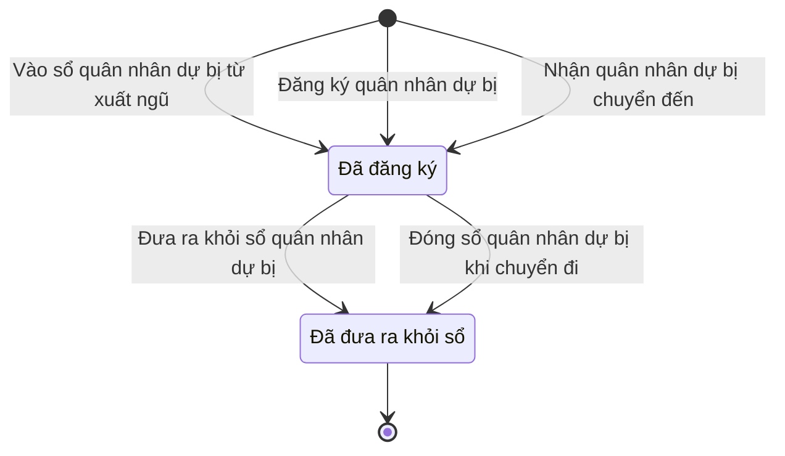

# qt-16.reserve-registration · Đăng ký quân nhân dự bị

<!-- máy sinh: tom-tat -->
> **Hồ sơ:** Đăng ký quân nhân dự bị (`ReserveRegistration`)
>
> 7 bước · 2 chặng · 2 vai · 1 bảng quyết định · 0 hạn · 7 khớp nối.
>
> **Nguồn:** sổ nghiệp vụ `qt-16.reserve-registration` · khai báo của app: `dqtv-app/core/processes/militia-enlistment/workflow/reserve-registration.yaml`. Các bảng do máy sinh từ nguồn này.
<!-- hết: tom-tat -->

<!-- viết tay: dien-giai -->
## Diễn giải

*Phần này viết tay, diễn giải lại điều các bảng bên dưới ghi.*

### Quy trình này để làm gì

Mỗi hồ sơ là **một dòng đăng ký ngạch dự bị của một người** trong sổ quân nhân dự bị của xã: vào sổ từ đâu, số giấy chứng nhận đăng ký quân nhân dự bị, phiếu quân nhân dự bị, ngày đăng ký. Dòng chỉ có hai chặng: *Đã đăng ký* (đang trong sổ quân nhân dự bị của xã) và *Đã đưa ra khỏi sổ* (giữ lại để tra cứu).

### Khi nào bắt đầu

Ba cửa vào, ứng với ba giá trị của ô "vào sổ từ"; cả ba đưa dòng vào chặng *Đã đăng ký*:

- **Vào sổ quân nhân dự bị từ xuất ngũ** — Hệ thống tự làm; dòng mở ra nối tới hồ sơ **Tiếp nhận quân nhân xuất ngũ** (quy trình 27).
- **Đăng ký quân nhân dự bị** — Trợ lý Quân lực ghi khi người đó đăng ký trực tiếp.
- **Nhận quân nhân dự bị chuyển đến** — Trợ lý Quân lực ghi khi người đó chuyển từ nơi khác đến.

Cả ba đều đòi `personInRegister` (hồ sơ Sổ đăng ký người theo diện, qt-16, không ở chặng `LEFT`) và `noOtherOpenReserveLine` (không có dòng `qt-16.reserve-registration` nào cùng hồ sơ mẹ với dòng đang làm mà đang ở chặng `REGISTERED`). Hai bước do Trợ lý Quân lực làm còn đòi số giấy chứng nhận, người làm là người của đơn vị ghi ở ô đơn vị chủ hồ sơ của hồ sơ qt-16, và `registeredAtNotAfterToday` (ô `registeredAtInFuture` không phải `yes`). Cả ba bước bắt buộc nhập như nhau: dòng sổ của người đó (`registrationId`), ngày đăng ký, số giấy chứng nhận, phiếu quân nhân dự bị.

### Diễn ra thế nào

**Chặng "Đã đăng ký"** — không có việc nào làm trong lúc dòng đứng yên. Bước duy nhất là **Đưa ra khỏi sổ quân nhân dự bị** (Trợ lý Quân lực): phải có căn cứ đưa ra (hết hạn tuổi phục vụ trong ngạch dự bị, chuyển đi nơi khác, chết, lý do khác), ảnh chụp giấy làm căn cứ, và người làm thuộc đơn vị chủ hồ sơ của hồ sơ qt-16; bước ghi lại ngày đưa ra. Dòng sang *Đã đưa ra khỏi sổ*.

**Chặng "Đã đưa ra khỏi sổ"** — không còn bước nào.

### Kết thúc và để lại gì

Dòng kết thúc ở chặng *Đã đưa ra khỏi sổ*.

Hồ sơ của quy trình khác mở ra có ghi tên quân nhân dự bị này: **Đợt huy động lực lượng dự bị động viên** (22) và **Đợt gọi quân nhân dự bị** (35). Dòng đăng ký còn được gắn vào **Dòng sắp xếp** (34) khi thêm dòng sắp xếp và vào **Người trong đợt gọi** (35) khi rà soát người trong đợt gọi; **Người trong đợt huy động** (22) cũng nối về dòng đăng ký ngạch dự bị của người ấy.

### Điều kiện chặn

- Sai người, sai chặng, thiếu thứ phải có trước thì bước bị chặn, dòng giữ nguyên. Không bước nào có kết quả chặn riêng.
- Không mở được dòng mới khi đã có dòng đăng ký dự bị khác cùng hồ sơ mẹ đang ở chặng *Đã đăng ký*, hoặc khi hồ sơ qt-16 đã ở chặng `LEFT`.
- Ba bước do Trợ lý Quân lực làm đòi người làm thuộc đơn vị chủ hồ sơ của hồ sơ qt-16.
<!-- hết viết tay -->

## 1. Đường đi ngắn nhất qua các chặng

<!-- máy sinh: luong-chinh -->
Đường ít bước nhất từ lúc mở hồ sơ tới chặng kết thúc xa nhất. Máy chọn theo số chặng, không theo ý nghĩa nghiệp vụ — trình tự công việc thật xem phần Diễn giải và bảng "Việc làm ở từng chặng" ở mục 6.

| # | Ai làm | Làm gì | Hồ sơ sang chặng |
|---|---|---|---|
| 1 | Hệ thống tự làm | Vào sổ quân nhân dự bị từ xuất ngũ | Đã đăng ký |
| 2 | Trợ lý Quân lực | Đưa ra khỏi sổ quân nhân dự bị | Đã đưa ra khỏi sổ |

<!-- hết: luong-chinh -->

## 2. Hồ sơ và việc nó để lại

<!-- máy sinh: muc-tieu -->
**App gọi quy trình này là:** Đăng ký quân nhân dự bị.

**Khi mở, hồ sơ này ghi mối nối tới:**
- Tiếp nhận quân nhân xuất ngũ (27) — bước `registerReserveFromDischarge`, khớp nối `registeredFromDischarge`

**Hồ sơ này để lại cho quy trình khác** (bước tạo hồ sơ của quy trình kia ghi mối nối về đây):
- Người trong đợt huy động (22) — bước `prepareMobilizationOrder`, khớp nối `mobilizedReservist`
- Đợt gọi quân nhân dự bị (35) — bước `receiveUpperReserveCall`, khớp nối `callCoversReservist`
- Đợt huy động lực lượng dự bị động viên (22) — bước `prepareMobilizationOrder`, khớp nối `orderCoversReservist`
<!-- hết: muc-tieu -->

## 3. Khởi phát và kết thúc

<!-- máy sinh: khoi-phat -->
**3 cửa vào** — bước mở hồ sơ:

| Bước mở | Ai mở | Hồ sơ vào chặng | App bắt buộc nhập |
|---|---|---|---|
| Vào sổ quân nhân dự bị từ xuất ngũ | Hệ thống tự làm | Đã đăng ký | `registrationId`, ngày đăng ký, số giấy chứng nhận đăng ký QNDB, phiếu quân nhân dự bị |
| Đăng ký quân nhân dự bị | Trợ lý Quân lực | Đã đăng ký | `registrationId`, ngày đăng ký, số giấy chứng nhận đăng ký QNDB, phiếu quân nhân dự bị |
| Nhận quân nhân dự bị chuyển đến | Trợ lý Quân lực | Đã đăng ký | `registrationId`, ngày đăng ký, số giấy chứng nhận đăng ký QNDB, phiếu quân nhân dự bị |

**Kết thúc:** *Đã đưa ra khỏi sổ* (`REMOVED`)
<!-- hết: khoi-phat -->

## 4. Vai trò

<!-- máy sinh: vai-tro -->
| Vai trong sổ | Tên trong app | Điều kiện | Làm những bước |
|---|---|---|---|
| `system` | Hệ thống tự làm |  | Vào sổ quân nhân dự bị từ xuất ngũ · Đóng sổ quân nhân dự bị khi chuyển đi · Ghi người đã chết — mở việc trình Chủ tịch xã quyết định |
| `operator` | Trợ lý Quân lực |  | Đăng ký quân nhân dự bị · Nhận quân nhân dự bị chuyển đến · Đưa ra khỏi sổ quân nhân dự bị · Ghi thời gian đã huấn luyện trước khi có hệ |

*"Tên trong app" là tên app đặt cho mã chủ thể của vai. Hồ sơ thuộc đơn vị cấp khác thì người làm là người giữ vai ấy ở đơn vị nêu trong cột "Điều kiện" (nếu sổ có ghi) và ở cột "Người làm phải thuộc" của bảng "Theo khai báo của app" (mục 7).*
<!-- hết: vai-tro -->

## 5. Nhánh phụ

<!-- máy sinh: nhanh-phu -->
**Bước khác đưa hồ sơ sang chặng mới** — đường song song, rẽ nhánh hoặc kết thúc sớm:

| Bước | Ai làm | Từ chặng | Sang chặng |
|---|---|---|---|
| Đóng sổ quân nhân dự bị khi chuyển đi | Hệ thống tự làm | Đã đăng ký | Đã đưa ra khỏi sổ |

**Làm trong lúc hồ sơ đứng yên ở một chặng** — ghi nhận, bổ sung:

| Bước | Ai làm | Ở chặng |
|---|---|---|
| Ghi thời gian đã huấn luyện trước khi có hệ | Trợ lý Quân lực | Đã đăng ký |
| Ghi người đã chết — mở việc trình Chủ tịch xã quyết định | Hệ thống tự làm | Đã đăng ký |

**Cửa vào khác:** 3 bước cùng mở hồ sơ — xem mục 3.

<!-- hết: nhanh-phu -->

## 6. Các chặng và việc làm ở từng chặng

<!-- máy sinh: chang -->
| Chặng | Tên hiển thị | Vào bằng bước | Kết thúc? |
|---|---|---|---|
| `REGISTERED` | Đã đăng ký | Vào sổ quân nhân dự bị từ xuất ngũ · Đăng ký quân nhân dự bị · Nhận quân nhân dự bị chuyển đến |  |
| `REMOVED` | Đã đưa ra khỏi sổ | Đưa ra khỏi sổ quân nhân dự bị · Đóng sổ quân nhân dự bị khi chuyển đi | **kết thúc** |

### Việc làm ở từng chặng

Hồ sơ đang ở chặng nào thì làm được những bước nào.

| Hồ sơ đang ở chặng | Bước làm tại chặng (hồ sơ đứng yên) | Bước đưa hồ sơ sang chặng khác |
|---|---|---|
| **Đã đăng ký** | Ghi thời gian đã huấn luyện trước khi có hệ — Trợ lý Quân lực Ghi người đã chết — mở việc trình Chủ tịch xã quyết định — Hệ thống tự làm | Đưa ra khỏi sổ quân nhân dự bị — Trợ lý Quân lực → *Đã đưa ra khỏi sổ* Đóng sổ quân nhân dự bị khi chuyển đi — Hệ thống tự làm → *Đã đưa ra khỏi sổ* |
| **Đã đưa ra khỏi sổ** | — | — (kết thúc) |
<!-- hết: chang -->

## 7. Bảng bước

<!-- máy sinh: buoc -->
| # | Bước | Mã bước | Ai thực hiện | Từ chặng | Sang chặng | Phải có trước | Ghi lại |
|---|---|---|---|---|---|---|---|
| 1 | Vào sổ quân nhân dự bị từ xuất ngũ | `registerReserveFromDischarge` | Hệ thống tự làm | — (mở hồ sơ) | `REGISTERED` | `personInRegister`, `noOtherOpenReserveLine` | vào sổ từ, số giấy chứng nhận đăng ký QNDB, phiếu quân nhân dự bị, ngày đăng ký, mã xã, nối tới Tiếp nhận quân nhân xuất ngũ |
| 2 | Đăng ký quân nhân dự bị | `registerReserveDirect` | Trợ lý Quân lực | — (mở hồ sơ) | `REGISTERED` | `personInRegister`, `noOtherOpenReserveLine`, số giấy chứng nhận đăng ký QNDB, người làm thuộc đơn vị chủ hồ sơ, `registeredAtNotAfterToday` | vào sổ từ, số giấy chứng nhận đăng ký QNDB, phiếu quân nhân dự bị, ngày đăng ký, mã xã, `registeredAtInFuture` |
| 3 | Nhận quân nhân dự bị chuyển đến | `receiveReserveTransferIn` | Trợ lý Quân lực | — (mở hồ sơ) | `REGISTERED` | `personInRegister`, `noOtherOpenReserveLine`, số giấy chứng nhận đăng ký QNDB, người làm thuộc đơn vị chủ hồ sơ, `registeredAtNotAfterToday` | vào sổ từ, số giấy chứng nhận đăng ký QNDB, phiếu quân nhân dự bị, ngày đăng ký, mã xã, `registeredAtInFuture` |
| 4 | Đưa ra khỏi sổ quân nhân dự bị | `removeReserveRegistration` | Trợ lý Quân lực | `REGISTERED` | `REMOVED` | căn cứ đưa ra, người làm thuộc đơn vị chủ hồ sơ, `reserveRemovalFromIncomingDocumentUsable` | căn cứ đưa ra, ngày đưa ra khỏi sổ, nối tới Văn bản đến |
| 5 | Đóng sổ quân nhân dự bị khi chuyển đi | `removeReserveOnTransferAway` | Hệ thống tự làm | `REGISTERED` | `REMOVED` | — | căn cứ đưa ra, ngày đưa ra khỏi sổ |
| 6 | Ghi thời gian đã huấn luyện trước khi có hệ | `recordPriorTraining` | Trợ lý Quân lực | `REGISTERED` | giữ nguyên | người làm thuộc đơn vị chủ hồ sơ | đã huấn luyện trước khi có hệ (tháng), căn cứ thời gian huấn luyện trước khi có hệ |
| 7 | Ghi người đã chết — mở việc trình Chủ tịch xã quyết định | `flagReserveDeathRemovalDue` | Hệ thống tự làm | `REGISTERED` | giữ nguyên | `deathNotYetConfirmed` | ngày có xác nhận công dân chết, giấy xác nhận công dân chết |

### Khi không đạt điều kiện

Mặc định: không đúng người, hồ sơ không ở đúng chặng, hoặc thiếu thứ "phải có trước" thì bước bị chặn, hồ sơ giữ nguyên. Bảng dưới chỉ kê những bước có kết quả riêng.

| # | Bước | Kết quả riêng |
|---|---|---|
| 1 | Vào sổ quân nhân dự bị từ xuất ngũ | bước này không do người nào bấm |
| 4 | Đưa ra khỏi sổ quân nhân dự bị | bước dừng lại, hồ sơ giữ nguyên khi kết quả xét là: `paper_missing`, `transfer_not_removal` |
| 5 | Đóng sổ quân nhân dự bị khi chuyển đi | bước này không do người nào bấm |
| 7 | Ghi người đã chết — mở việc trình Chủ tịch xã quyết định | bước này không do người nào bấm |

### Điều kiện "phải có trước" bằng lời

Cột "Phải có trước" ở bảng bước có hai loại: ô dữ liệu thường (bước chỉ đòi ô ấy đã có giá trị) và điều kiện hệ tự xét. Bảng này diễn các điều kiện hệ tự xét theo đúng công thức sổ ghi; số ở cột cuối là số thứ tự bước.

| Điều kiện | Đúng khi | Bước đòi |
|---|---|---|
| `personInRegister` | KHÔNG (hồ sơ Sổ đăng ký người theo diện (qt-16) đang ở chặng `LEFT`) | 1, 2, 3 |
| `noOtherOpenReserveLine` | không có hồ sơ Đăng ký quân nhân dự bị (qt-16.reserve-registration) cùng hồ sơ mẹ với hồ sơ đang làm (`siblings`) mà hồ sơ ấy đang ở chặng `REGISTERED` | 1, 2, 3 |
| `actorInOwnerUnit` | người đang làm là người của đơn vị ghi ở ô đơn vị chủ hồ sơ của Sổ đăng ký người theo diện (qt-16) (theo danh mục người của đơn vị, `dm.unit-staff`) | 2, 3, 4, 6 |
| `registeredAtNotAfterToday` | KHÔNG (`registeredAtInFuture` là `yes`) | 2, 3 |
| `reserveRemovalFromIncomingDocumentUsable` | có hồ sơ Việc luật giao kèm văn bản đến, đi — Văn bản đến (qt-1.incoming-document) chính là hồ sơ ghi ở ô nối `reserveRemovalFromIncomingDocument` của hồ sơ đang làm mà hồ sơ ấy đang ở chặng `RECEIVED` hoặc `DISTRIBUTED` | 4 |
| `deathNotYetConfirmed` | KHÔNG (đã có ngày có xác nhận công dân chết) | 7 |

### Theo khai báo của app

Người làm phải thuộc đơn vị nào, ô người dùng phải nhập, bước có lặp được không, và căn cứ pháp lý — lấy từ khai báo quy trình trong app.

| # | Bước | Người làm phải thuộc | Bắt buộc nhập | Nhập nếu có | Lặp được | Căn cứ |
|---|---|---|---|---|---|---|
| 1 | Vào sổ quân nhân dự bị từ xuất ngũ |  | `registrationId`, ngày đăng ký, số giấy chứng nhận đăng ký QNDB, phiếu quân nhân dự bị | `intakeId`, ghi chú nguồn |  | L78/2015/QH13 Đ.45 |
| 2 | Đăng ký quân nhân dự bị | đơn vị chủ hồ sơ | `registrationId`, ngày đăng ký, số giấy chứng nhận đăng ký QNDB, phiếu quân nhân dự bị | ghi chú nguồn |  | L78/2015/QH13 Đ.18 k1, k2, k3 |
| 3 | Nhận quân nhân dự bị chuyển đến | đơn vị chủ hồ sơ | `registrationId`, ngày đăng ký, số giấy chứng nhận đăng ký QNDB, phiếu quân nhân dự bị | ghi chú nguồn |  | L78/2015/QH13 Đ.17 |
| 4 | Đưa ra khỏi sổ quân nhân dự bị | đơn vị chủ hồ sơ | căn cứ đưa ra, quyết định của Chủ tịch UBND xã trong sổ văn bản đến | vì sao đưa ra |  | L78/2015/QH13 Đ.17, Đ.18, Đ.19 k1 a · L98/2025/QH15 Đ.4 k7 |
| 5 | Đóng sổ quân nhân dự bị khi chuyển đi |  | ảnh chụp giấy làm căn cứ | vì sao đưa ra |  | L78/2015/QH13 Đ.17 k2 a · L98/2025/QH15 Đ.4 k6 · NĐ220/2025 Đ.7 k5 |
| 6 | Ghi thời gian đã huấn luyện trước khi có hệ |  | đã huấn luyện trước khi có hệ (tháng), căn cứ thời gian huấn luyện trước khi có hệ | — |  | L78/2015/QH13 Đ.27 k1 a |
| 7 | Ghi người đã chết — mở việc trình Chủ tịch xã quyết định |  | ngày có xác nhận công dân chết, giấy xác nhận công dân chết | — |  | L78/2015/QH13 Đ.19 k1 a · L98/2025/QH15 Đ.4 k7 |

### Điều kiện và ghi chú app khai cho từng bước

Lấy từ khai báo quy trình trong app. Lời trong ngoặc kép là câu app hiện cho người dùng. Chức danh người ký ngoài hệ app chỉ khai bằng mã.

| # | Bước | Điều kiện, ghi chú |
|---|---|---|
| 5 | Đóng sổ quân nhân dự bị khi chuyển đi | · không đòi bản chụp — app ghi: "Giấy giới thiệu di chuyển đã đính ở bước rời sổ vì chuyển đi — chép sang dòng" |
| 7 | Ghi người đã chết — mở việc trình Chủ tịch xã quyết định | · không làm được khi đã có ô "ngày có xác nhận công dân chết" — app báo: "dòng này đã ghi người đã chết — việc trình Chủ tịch xã quyết định đã mở" |
<!-- hết: buoc -->

## 8. Bảng quyết định, hạn, việc ngoài hệ

<!-- máy sinh: quyet-dinh -->
**Bảng `removal-paper`** — xét ở bước *Đưa ra khỏi sổ quân nhân dự bị*; đầu vào: căn cứ đưa ra, `reserveRemovalFromIncomingDocumentUsable`. 3 dòng, dò từ trên xuống, dòng đầu tiên khớp thì dừng.

| Thứ tự dò (số sổ ghi) | Dòng | Khi | Thì |
|---|---|---|---|
| 1 | `no-decision` | căn cứ đưa ra là Hết hạn tuổi phục vụ trong ngạch dự bị (`over_reserve_age`) hoặc Thuộc đối tượng không được đăng ký nghĩa vụ quân sự (Luật NVQS Điều 13 khoản 1) (`barred_from_registration`) hoặc Thuộc đối tượng miễn đăng ký nghĩa vụ quân sự (Luật NVQS Điều 14) (`exempt_from_registration`) hoặc Chết (`deceased`) và chưa có `reserveRemovalFromIncomingDocumentUsable` | `paper_missing` |
| 2 | `transfer-away` | căn cứ đưa ra là Chuyển đi nơi khác (giấy giới thiệu di chuyển) (`moved_away`) | `transfer_not_removal` |
| 9 | `otherwise` | mọi trường hợp còn lại | cho qua |

<!-- hết: quyet-dinh -->

## 9. Dữ liệu của hồ sơ

<!-- máy sinh: du-lieu -->
Các ô mà bước trong sổ ghi hoặc đòi. Số trong hai cột cuối là số thứ tự bước ở bảng bước (mục 7).

| Ô dữ liệu | Mã | Kiểu (app) | Giá trị cho phép | Loại ô (sổ) | Bước ghi | Bước đòi | Mô tả trong app |
|---|---|---|---|---|---|---|---|
| vào sổ từ | `registrationSource` | chọn một | Xuất ngũ về địa phương (`discharge`), Chuyển đến từ địa phương khác (`transfer_in`), Đăng ký trực tiếp (`direct`) | đưa vào ở bước (`input`) | 1, 2, 3 | — | Vào sổ quân nhân dự bị từ đâu — xuất ngũ (qt-27), đăng ký trực tiếp, nhận chuyển đến |
| số giấy chứng nhận đăng ký QNDB | `reserveCertificateNumber` | chữ |  | đưa vào ở bước (`input`) | 1, 2, 3 | 2, 3 | Số giấy chứng nhận đăng ký quân nhân dự bị |
| phiếu quân nhân dự bị | `reserveCardScan` | tệp |  | đưa vào ở bước (`input`) | 1, 2, 3 | — | Bản quét phiếu quân nhân dự bị |
| ngày đăng ký | `registeredAt` | ngày |  | đưa vào ở bước (`input`) | 1, 2, 3 | — | Ngày đăng ký ngạch dự bị |
| mã xã | `communeCode` | chữ |  | đưa vào ở bước (`input`) | 1, 2, 3 | — | Mã xã giữ sổ quân nhân dự bị |
| — | `registeredAtInFuture` |  | `yes`, `no` | đưa vào ở bước (`input`) | 2, 3 | — |  |
| căn cứ đưa ra | `removalGround` | chọn một | Hết hạn tuổi phục vụ trong ngạch dự bị (`over_reserve_age`), Thuộc đối tượng không được đăng ký nghĩa vụ quân sự (Luật NVQS Điều 13 khoản 1) (`barred_from_registration`), Thuộc đối tượng miễn đăng ký nghĩa vụ quân sự (Luật NVQS Điều 14) (`exempt_from_registration`), Chết (`deceased`), Chuyển đi nơi khác (giấy giới thiệu di chuyển) (`moved_away`) | đưa vào ở bước (`input`) | 4, 5 | 4 | Căn cứ đưa ra khỏi sổ quân nhân dự bị — bốn căn cứ L78 Đ.19 k1 (quyết định của Chủ tịch UBND xã), hoặc chuyển đi (N8); `other` chỉ còn ở dòng ghi trước 18/10/2026, không bước nào ghi nữa |
| ngày đưa ra khỏi sổ | `removedAt` | ngày |  | lưu trên hồ sơ (`stored`) | 4, 5 | — | Ngày đưa ra khỏi sổ quân nhân dự bị |
| đã huấn luyện trước khi có hệ (tháng) | `priorTrainingMonths` | số |  | đưa vào ở bước (`input`) | 6 | — | Số tháng đã huấn luyện trước khi có hệ — chép từ giấy tờ cũ |
| căn cứ thời gian huấn luyện trước khi có hệ | `priorTrainingBasis` | chữ |  | đưa vào ở bước (`input`) | 6 | — | Căn cứ: phiếu quân nhân dự bị, sổ đăng ký, quyết định gọi huấn luyện… |
| ngày có xác nhận công dân chết | `deathConfirmedOn` | ngày |  | lưu trên hồ sơ (`stored`) | 7 | — | Ngày có xác nhận công dân chết của cấp có thẩm quyền — mốc tính hạn 05 ngày báo cáo Chủ tịch UBND cấp xã quyết định (L78 Đ.19 k2 sửa bởi L98/2025) |
| giấy xác nhận công dân chết | `deathEvidence` | chữ |  | lưu trên hồ sơ (`stored`) | 7 | — | Giấy xác nhận công dân chết mà hệ đã thấy — trích lục khai tử, giấy báo tử, quyết định đưa ra khỏi danh sách DQTV |
| — | `personInRegister` |  | có hay chưa | hệ suy ra (`derived`) | — | 1, 2, 3 |  |
| — | `noOtherOpenReserveLine` |  | có hay chưa | hệ suy ra (`derived`) | — | 1, 2, 3 |  |
| người làm thuộc đơn vị chủ hồ sơ | `actorInOwnerUnit` |  | có hay chưa | hệ suy ra (`derived`) | — | 2, 3, 4, 6 |  |
| — | `registeredAtNotAfterToday` |  | có hay chưa | hệ suy ra (`derived`) | — | 2, 3 |  |
| — | `reserveRemovalFromIncomingDocumentUsable` |  | có hay chưa | hệ suy ra (`derived`) | — | 4 |  |
| — | `deathNotYetConfirmed` |  | có hay chưa | hệ suy ra (`derived`) | — | 7 |  |

18 ô. Cột "Loại ô" là cách sổ phân loại ô, in kèm đúng chữ của sổ; ô nào người dùng phải nhập xem bảng "Theo khai báo của app" ở mục 7.
<!-- hết: du-lieu -->

## 10. Khớp nối với quy trình khác

<!-- máy sinh: khop-noi -->
| Quy trình kia | Hồ sơ kia | Quan hệ | Nội dung (mô tả trong app) | Bước ghi mối nối | Tên ô nối |
|---|---|---|---|---|---|
| 1.incoming-document | Văn bản đến | gắn với nhau ở một bước giữa chừng | Quyết định của Chủ tịch UBND xã đưa quân nhân dự bị đã chết ra khỏi danh sách đăng ký NVQS — ghi từ văn bản đ… | 16.reserve-registration·removeReserveRegistration | `reserveRemovalFromIncomingDocument` |
| 22 | Người trong đợt huy động | hồ sơ kia **mở ra từ** hồ sơ này | Người trong đợt huy động là quân nhân dự bị nào — dòng đăng ký ngạch dự bị của người ấy | 22·prepareMobilizationOrder ⊕, 22·revisePreparedOrders | `mobilizedReservist` |
| 22 | Đợt huy động lực lượng dự bị động viên | hồ sơ kia **mở ra từ** hồ sơ này | Bộ lệnh lập sẵn có tên những quân nhân dự bị nào | 22·prepareMobilizationOrder ⊕, 22·revisePreparedOrders | `orderCoversReservist` |
| 27 | Tiếp nhận quân nhân xuất ngũ | hồ sơ này **mở ra có nối tới** hồ sơ kia | Dòng đăng ký ngạch dự bị sinh từ hồ sơ tiếp nhận xuất ngũ nào (qt-27) | 16.reserve-registration·registerReserveFromDischarge ⊕ | `registeredFromDischarge` |
| 34 | Dòng sắp xếp | gắn với nhau ở một bước giữa chừng | Dòng này xếp quân nhân dự bị nào — dòng đăng ký ngạch dự bị của người ấy | 34·addArrangementLine | `reserveMember` |
| 35 | Đợt gọi quân nhân dự bị | hồ sơ kia **mở ra từ** hồ sơ này | Lệnh gọi của cấp trên có tên những quân nhân dự bị nào | 35·receiveCallForNomination, 35·receiveUpperReserveCall ⊕ | `callCoversReservist` |
| 35 | Người trong đợt gọi | gắn với nhau ở một bước giữa chừng | Người trong đợt gọi là quân nhân dự bị nào — dòng đăng ký ngạch dự bị của người ấy | 35·screenReserveCandidates | `candidateReservist` |

7 khớp nối. ⊕ là bước tạo hồ sơ.

**Ô nối giữa các hồ sơ cùng mã quy trình, hoặc tới danh mục nền:** `reserveRegistrationOfRegistration` (Đăng ký quân nhân dự bị → Sổ nghĩa vụ) — bước Vào sổ quân nhân dự bị từ xuất ngũ, Đăng ký quân nhân dự bị, Nhận quân nhân dự bị chuyển đến.
<!-- hết: khop-noi -->

## 11. Thông tin chung

<!-- máy sinh: thong-tin -->
| | |
|---|---|
| **Mã trong sổ** | `qt-16.reserve-registration` |
| **Quy trình trong app** | `militia-enlistment` (`workflow/reserve-registration.yaml`) — mặt công tác: `personnel` |
| **Hồ sơ** | Đăng ký quân nhân dự bị (`ReserveRegistration`) |
| **Cùng mã quy trình** | [qt-16](qt-16.html), [qt-16.enlistment](qt-16.enlistment.html), [qt-16.gdqp-category](qt-16.gdqp-category.html), [qt-16.gdqp-certificate](qt-16.gdqp-certificate.html), [qt-16.military-registration](qt-16.military-registration.html), [qt-16.position-held](qt-16.position-held.html), [qt-16.registration-decision](qt-16.registration-decision.html), [qt-16.service-exit-decision](qt-16.service-exit-decision.html), [qt-16.service-extension-decision](qt-16.service-extension-decision.html) |
| **Căn cứ pháp lý từng bước** | cột "Căn cứ" ở bảng "Theo khai báo của app", mục 7 |
<!-- hết: thong-tin -->
