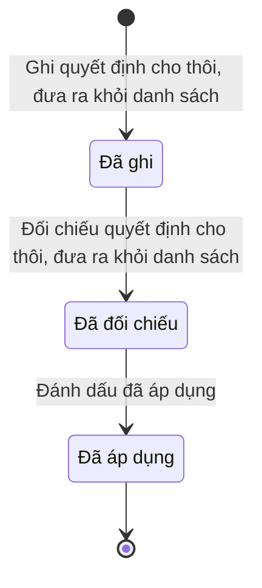

# qt-16.service-exit-decision · Dòng quyết định cho thôi, đưa ra khỏi danh sách

<!-- máy sinh: tom-tat -->
> **Hồ sơ:** Dòng quyết định cho thôi, đưa ra khỏi danh sách (`ServiceExitEntry`)
>
> 3 bước · 3 chặng · 2 vai · 2 bảng quyết định · 0 hạn · 4 khớp nối.
>
> **Nguồn:** sổ nghiệp vụ `qt-16.service-exit-decision` · khai báo của app: `dqtv-app/core/processes/militia-enlistment/workflow/service-exit-decision.yaml`. Các bảng do máy sinh từ nguồn này.
<!-- hết: tom-tat -->

<!-- viết tay: dien-giai -->
## Diễn giải

*Phần này viết tay, diễn giải lại điều các bảng bên dưới ghi.*

### Quy trình này để làm gì

Mỗi hồ sơ là **một dòng quyết định cho thôi trước thời hạn hoặc đưa ra khỏi danh sách, ghi cho một người**: loại quyết định, trường hợp của người đó, điểm căn cứ, số quyết định của Chủ tịch Uỷ ban nhân dân cấp xã, bản chụp quyết định đã ký và nguồn chứng cứ.

Dòng có ba chặng: *Đã ghi* (trợ lý đã ghi, chờ Chỉ huy trưởng đối chiếu bản gốc) → *Đã đối chiếu* (chờ áp dụng cho lần tham gia) → *Đã áp dụng* (đã dùng cho bước cho thôi hoặc đưa ra khỏi danh sách). Bước đối chiếu còn một nhánh đưa dòng thẳng từ *Đã ghi* sang *Đã áp dụng* (xem dưới).

### Khi nào bắt đầu

Trợ lý Quân lực bấm **Ghi quyết định cho thôi, đưa ra khỏi danh sách**. Phải có đủ: loại quyết định, trường hợp, căn cứ, số quyết định, bản chụp quyết định đã ký, nguồn chứng cứ; `personHasOpenService` — có hồ sơ Chiến sĩ dân quân tự vệ (`qt-16.enlistment`) cùng hồ sơ mẹ với dòng này, đang ở chặng `SERVING`; người làm là người của đơn vị ghi ở ô đơn vị chủ hồ sơ của Sổ đăng ký người theo diện (qt-16). Bước này ghi ô người ghi.

Nguồn chứng cứ chọn một trong bốn: lệnh gọi nhập ngũ ghi trên hệ, vụ việc kỷ luật trên hệ, dữ liệu dân cư, giấy tờ kèm theo. Khi mở, dòng có thể nối tới **Quyết định gọi nhập ngũ** (quy trình 17) hoặc **Vụ việc kỷ luật** (D15); bản chụp giấy tờ chứng cứ và ngày ký là ô nhập nếu có.

### Diễn ra thế nào

**Chặng "Đã ghi"** — Chỉ huy trưởng Ban CHQS xã bấm **Đối chiếu quyết định cho thôi, đưa ra khỏi danh sách**. Người đối chiếu phải khác người đã ghi dòng (`notRecorder`) và thuộc đơn vị chủ hồ sơ của hồ sơ qt-16. Dòng sang *Đã đối chiếu*; riêng nhánh `applied` thì dòng sang thẳng *Đã áp dụng*. Bảng `verify-apply` cho kết quả `applied` khi đã có `personHasOpenService`, cho qua trong trường hợp còn lại.

**Chặng "Đã đối chiếu"** — Chỉ huy trưởng Ban CHQS xã bấm **Đánh dấu đã áp dụng**. Dòng sang *Đã áp dụng*. Bước này không ghi thêm ô nào.

Không có đường quay lại.

### Kết thúc và để lại gì

Dòng kết thúc ở chặng *Đã áp dụng*. Dòng có hai khớp nối sang quy trình khác, đều ghi lúc mở dòng (nêu ở trên). Không hồ sơ nào của quy trình khác mở ra từ dòng này.

### Điều kiện chặn

- Bảng `exit-basis`, xét ở bước ghi, 12 dòng: mỗi trường hợp chỉ đi với đúng một điểm căn cứ. Loại "cho thôi thực hiện nghĩa vụ trước thời hạn" có năm trường hợp (mang thai hoặc nuôi con dưới 36 tháng tuổi; không đủ sức khoẻ; hoàn cảnh gia đình khó khăn đột xuất; có lệnh gọi nhập ngũ, gọi vào Công an nhân dân hoặc quyết định tuyển dụng; vào học, đi lao động, học tập, làm việc ở nước ngoài) đi với Điều 12 khoản 1 điểm a–đ; loại "đưa ra khỏi danh sách dân quân tự vệ" có sáu trường hợp (chết hoặc bị tuyên bố mất tích, đã chết; bị khởi tố bị can; bị tước danh hiệu; bị đưa vào cơ sở giáo dục bắt buộc; nghiện ma tuý; bị giáo dục tại xã) đi với Điều 12 khoản 2 điểm a–e. Bộ ba không khớp bị chặn với kết quả `basis_mismatch`.
- Bảng `verify-apply`, xét ở bước đối chiếu, hai dòng: đã có `personHasOpenService` thì kết quả là `applied` (dòng sang *Đã áp dụng*); trường hợp còn lại thì cho qua.
- Dòng chỉ ghi được khi có hồ sơ `qt-16.enlistment` cùng hồ sơ mẹ với dòng này đang ở `SERVING`; người đối chiếu phải khác người ghi.
- Ở cả ba bước, người làm phải thuộc đơn vị chủ hồ sơ.
- Sai người, sai chặng, thiếu thứ phải có trước thì bước bị chặn, dòng giữ nguyên.
<!-- hết viết tay -->

## 1. Đường đi ngắn nhất qua các chặng

<!-- máy sinh: luong-chinh -->
Đường ít bước nhất từ lúc mở hồ sơ tới chặng kết thúc xa nhất. Máy chọn theo số chặng, không theo ý nghĩa nghiệp vụ — trình tự công việc thật xem phần Diễn giải và bảng "Việc làm ở từng chặng" ở mục 6.

| # | Ai làm | Làm gì | Hồ sơ sang chặng |
|---|---|---|---|
| 1 | Trợ lý Quân lực | Ghi quyết định cho thôi, đưa ra khỏi danh sách | Đã ghi |
| 2 | Chỉ huy trưởng Ban CHQS xã | Đối chiếu quyết định cho thôi, đưa ra khỏi danh sách | Đã đối chiếu |
| 3 | Chỉ huy trưởng Ban CHQS xã | Đánh dấu đã áp dụng | Đã áp dụng |

<!-- hết: luong-chinh -->

## 2. Hồ sơ và việc nó để lại

<!-- máy sinh: muc-tieu -->
**App gọi quy trình này là:** Dòng quyết định cho thôi, đưa ra khỏi danh sách.

**Khi mở, hồ sơ này ghi mối nối tới:**
- Văn bản đến (1.incoming-document) — bước `recordExitDecisionRow`, khớp nối `exitDecisionFromIncomingDocument`
<!-- hết: muc-tieu -->

## 3. Khởi phát và kết thúc

<!-- máy sinh: khoi-phat -->
**1 cửa vào** — bước mở hồ sơ:

| Bước mở | Ai mở | Hồ sơ vào chặng | App bắt buộc nhập |
|---|---|---|---|
| Ghi quyết định cho thôi, đưa ra khỏi danh sách | Trợ lý Quân lực | Đã ghi | `registrationId`, loại quyết định, trường hợp, căn cứ, quyết định đã ký trong sổ văn bản đến, nguồn chứng cứ |

**Kết thúc:** *Đã áp dụng* (`USED`)
<!-- hết: khoi-phat -->

## 4. Vai trò

<!-- máy sinh: vai-tro -->
| Vai trong sổ | Tên trong app | Điều kiện | Làm những bước |
|---|---|---|---|
| `operator` | Trợ lý Quân lực |  | Ghi quyết định cho thôi, đưa ra khỏi danh sách |
| `verifier` | Chỉ huy trưởng Ban CHQS xã |  | Đối chiếu quyết định cho thôi, đưa ra khỏi danh sách · Đánh dấu đã áp dụng |

*"Tên trong app" là tên app đặt cho mã chủ thể của vai. Hồ sơ thuộc đơn vị cấp khác thì người làm là người giữ vai ấy ở đơn vị nêu trong cột "Điều kiện" (nếu sổ có ghi) và ở cột "Người làm phải thuộc" của bảng "Theo khai báo của app" (mục 7).*
<!-- hết: vai-tro -->

## 5. Nhánh phụ

<!-- máy sinh: nhanh-phu -->
Không có bước nào ngoài luồng chính.
<!-- hết: nhanh-phu -->

## 6. Các chặng và việc làm ở từng chặng

<!-- máy sinh: chang -->
| Chặng | Tên hiển thị | Vào bằng bước | Kết thúc? |
|---|---|---|---|
| `RECORDED` | Đã ghi | Ghi quyết định cho thôi, đưa ra khỏi danh sách |  |
| `VERIFIED` | Đã đối chiếu | Đối chiếu quyết định cho thôi, đưa ra khỏi danh sách |  |
| `USED` | Đã áp dụng | Đánh dấu đã áp dụng | **kết thúc** |

### Việc làm ở từng chặng

Hồ sơ đang ở chặng nào thì làm được những bước nào.

| Hồ sơ đang ở chặng | Bước làm tại chặng (hồ sơ đứng yên) | Bước đưa hồ sơ sang chặng khác |
|---|---|---|
| **Đã ghi** | — | Đối chiếu quyết định cho thôi, đưa ra khỏi danh sách — Chỉ huy trưởng Ban CHQS xã → *Đã đối chiếu* |
| **Đã đối chiếu** | — | Đánh dấu đã áp dụng — Chỉ huy trưởng Ban CHQS xã → *Đã áp dụng* |
| **Đã áp dụng** | — | — (kết thúc) |
<!-- hết: chang -->

## 7. Bảng bước

<!-- máy sinh: buoc -->
| # | Bước | Mã bước | Ai thực hiện | Từ chặng | Sang chặng | Phải có trước | Ghi lại |
|---|---|---|---|---|---|---|---|
| 1 | Ghi quyết định cho thôi, đưa ra khỏi danh sách | `recordExitDecisionRow` | Trợ lý Quân lực | — (mở hồ sơ) | `RECORDED` | loại quyết định, trường hợp, căn cứ, nguồn chứng cứ, `personHasOpenService`, người làm thuộc đơn vị chủ hồ sơ, nối tới Văn bản đến, `exitDecisionFromIncomingDocumentUsable` | loại quyết định, trường hợp, căn cứ, nguồn chứng cứ, bản chụp giấy tờ chứng cứ, người ghi, nối tới Văn bản đến |
| 2 | Đối chiếu quyết định cho thôi, đưa ra khỏi danh sách | `verifyExitDecisionRow` | Chỉ huy trưởng Ban CHQS xã | `RECORDED` | `VERIFIED` | người làm thuộc đơn vị chủ hồ sơ, `notRecorder` | — |
| 3 | Đánh dấu đã áp dụng | `markExitDecisionUsed` | Chỉ huy trưởng Ban CHQS xã | `VERIFIED` | `USED` | người làm thuộc đơn vị chủ hồ sơ | — |

### Khi không đạt điều kiện

Mặc định: không đúng người, hồ sơ không ở đúng chặng, hoặc thiếu thứ "phải có trước" thì bước bị chặn, hồ sơ giữ nguyên. Bảng dưới chỉ kê những bước có kết quả riêng.

| # | Bước | Kết quả riêng |
|---|---|---|
| 1 | Ghi quyết định cho thôi, đưa ra khỏi danh sách | bước dừng lại, hồ sơ giữ nguyên khi kết quả xét là: `basis_mismatch`, `evidence_invalid`, `no-evidence`; nhánh `from-admission`: hồ sơ sang *Đã ghi*, ghi thêm nối tới Thí sinh sơ tuyển vào trường Quân đội; nhánh `from-call`: hồ sơ sang *Đã ghi*, ghi thêm nối tới Quyết định gọi nhập ngũ; nhánh `from-case`: hồ sơ sang *Đã ghi*, ghi thêm nối tới Vụ việc kỷ luật |
| 2 | Đối chiếu quyết định cho thôi, đưa ra khỏi danh sách | nhánh `applied`: hồ sơ sang *Đã áp dụng* |

### Điều kiện "phải có trước" bằng lời

Cột "Phải có trước" ở bảng bước có hai loại: ô dữ liệu thường (bước chỉ đòi ô ấy đã có giá trị) và điều kiện hệ tự xét. Bảng này diễn các điều kiện hệ tự xét theo đúng công thức sổ ghi; số ở cột cuối là số thứ tự bước.

| Điều kiện | Đúng khi | Bước đòi |
|---|---|---|
| `personHasOpenService` | có hồ sơ Sổ đăng ký người theo diện — Chiến sĩ dân quân tự vệ (qt-16.enlistment) cùng hồ sơ mẹ với hồ sơ đang làm (`siblings`) mà hồ sơ ấy đang ở chặng `SERVING` | 1 |
| `actorInOwnerUnit` | người đang làm là người của đơn vị ghi ở ô đơn vị chủ hồ sơ của Sổ đăng ký người theo diện (qt-16) (theo danh mục người của đơn vị, `dm.unit-staff`) | 1, 2, 3 |
| `exitDecisionFromIncomingDocumentUsable` | có hồ sơ Việc luật giao kèm văn bản đến, đi — Văn bản đến (qt-1.incoming-document) chính là hồ sơ ghi ở ô nối `exitDecisionFromIncomingDocument` của hồ sơ đang làm mà hồ sơ ấy đang ở chặng `RECEIVED` hoặc `DISTRIBUTED` | 1 |
| `notRecorder` | KHÔNG (người ghi là chính người đang làm) | 2 |
| `evidenceValid` | (nguồn chứng cứ là Lệnh gọi nhập ngũ ghi trên hệ (`conscription_call`) VÀ có hồ sơ Tuyển quân, giao quân — Quyết định gọi nhập ngũ (qt-17.conscription-call) chính là hồ sơ ghi ở ô nối `exitCausedByConscriptionCall` của hồ sơ đang làm mà hồ sơ ấy đang ở chặng `CALLED`) HOẶC (nguồn chứng cứ là Trúng tuyển trường Quân đội ghi trên hệ (`military_school_admission`) VÀ có hồ sơ Sơ tuyển tuyển sinh quân sự tại xã (qt-36) chính là hồ sơ ghi ở ô nối `exitCausedByAdmission` của hồ sơ đang làm mà hồ sơ ấy đang ở chặng `ADMITTED`) HOẶC (nguồn chứng cứ là Vụ việc kỷ luật trên hệ (`disciplinary_case`) VÀ có hồ sơ Xử lý kỷ luật DQTV (qt-D15) chính là hồ sơ ghi ở ô nối `exitCausedByDisciplinaryCase` của hồ sơ đang làm mà hồ sơ ấy đang ở chặng `DECIDED` VÀ `disciplinaryForm` là `title_revocation`) HOẶC KHÔNG (nguồn chứng cứ là Lệnh gọi nhập ngũ ghi trên hệ (`conscription_call`) hoặc Trúng tuyển trường Quân đội ghi trên hệ (`military_school_admission`) hoặc Vụ việc kỷ luật trên hệ (`disciplinary_case`)) | đầu vào bảng quyết định (mục 8) |

### Theo khai báo của app

Người làm phải thuộc đơn vị nào, ô người dùng phải nhập, bước có lặp được không, và căn cứ pháp lý — lấy từ khai báo quy trình trong app.

| # | Bước | Người làm phải thuộc | Bắt buộc nhập | Nhập nếu có | Lặp được | Căn cứ |
|---|---|---|---|---|---|---|
| 1 | Ghi quyết định cho thôi, đưa ra khỏi danh sách | đơn vị chủ hồ sơ | `registrationId`, loại quyết định, trường hợp, căn cứ, quyết định đã ký trong sổ văn bản đến, nguồn chứng cứ | bản chụp giấy tờ chứng cứ, `conscriptionCallId`, `disciplinaryCaseId`, `admissionId` |  | L48/2019/QH14 Đ.12 k1, k2, k3 |
| 2 | Đối chiếu quyết định cho thôi, đưa ra khỏi danh sách | đơn vị chủ hồ sơ | — | — |  | L48/2019/QH14 Đ.12 k3 |
| 3 | Đánh dấu đã áp dụng | đơn vị chủ hồ sơ | — | — |  | L48/2019/QH14 Đ.12 k3 |
<!-- hết: buoc -->

## 8. Bảng quyết định, hạn, việc ngoài hệ

<!-- máy sinh: quyet-dinh -->
**Bảng `exit-basis`** — xét ở bước *Ghi quyết định cho thôi, đưa ra khỏi danh sách*; đầu vào: loại quyết định, trường hợp, căn cứ, nguồn chứng cứ, `evidenceValid`. 20 dòng, dò từ trên xuống, dòng đầu tiên khớp thì dừng.

| Thứ tự dò (số sổ ghi) | Dòng | Khi | Thì |
|---|---|---|---|
| -6 | `evidence-call-wrong-ground` | nguồn chứng cứ là Lệnh gọi nhập ngũ ghi trên hệ (`conscription_call`) và trường hợp là Mang thai hoặc nuôi con dưới 36 tháng tuổi (`maternity`) hoặc Không đủ sức khoẻ thực hiện nhiệm vụ (`unfit_health`) hoặc Hoàn cảnh gia đình khó khăn đột xuất, có xác nhận (`hardship`) hoặc Vào học, đi lao động, học tập, làm việc ở nước ngoài (`schooling_or_abroad`) hoặc Chết, hoặc bị Toà án tuyên bố mất tích, đã chết (`deceased`) hoặc Bị khởi tố bị can (`prosecuted`) hoặc Bị tước danh hiệu dân quân tự vệ (`title_revoked`) hoặc Bị đưa vào cơ sở giáo dục bắt buộc (`compulsory_education`) hoặc Nghiện ma tuý, hoặc bị đưa vào cơ sở cai nghiện bắt buộc (`drug_addiction`) hoặc Bị giáo dục tại xã, phường, thị trấn (`commune_education`) | `evidence_invalid` |
| -4 | `evidence-admission-wrong-ground` | nguồn chứng cứ là Trúng tuyển trường Quân đội ghi trên hệ (`military_school_admission`) và trường hợp là Mang thai hoặc nuôi con dưới 36 tháng tuổi (`maternity`) hoặc Không đủ sức khoẻ thực hiện nhiệm vụ (`unfit_health`) hoặc Hoàn cảnh gia đình khó khăn đột xuất, có xác nhận (`hardship`) hoặc Có lệnh gọi nhập ngũ, gọi vào Công an nhân dân, hoặc quyết định tuyển dụng (`conscripted_or_recruited`) hoặc Chết, hoặc bị Toà án tuyên bố mất tích, đã chết (`deceased`) hoặc Bị khởi tố bị can (`prosecuted`) hoặc Bị tước danh hiệu dân quân tự vệ (`title_revoked`) hoặc Bị đưa vào cơ sở giáo dục bắt buộc (`compulsory_education`) hoặc Nghiện ma tuý, hoặc bị đưa vào cơ sở cai nghiện bắt buộc (`drug_addiction`) hoặc Bị giáo dục tại xã, phường, thị trấn (`commune_education`) | `evidence_invalid` |
| -2 | `evidence-case-wrong-ground` | nguồn chứng cứ là Vụ việc kỷ luật trên hệ (`disciplinary_case`) và trường hợp là Mang thai hoặc nuôi con dưới 36 tháng tuổi (`maternity`) hoặc Không đủ sức khoẻ thực hiện nhiệm vụ (`unfit_health`) hoặc Hoàn cảnh gia đình khó khăn đột xuất, có xác nhận (`hardship`) hoặc Có lệnh gọi nhập ngũ, gọi vào Công an nhân dân, hoặc quyết định tuyển dụng (`conscripted_or_recruited`) hoặc Vào học, đi lao động, học tập, làm việc ở nước ngoài (`schooling_or_abroad`) hoặc Chết, hoặc bị Toà án tuyên bố mất tích, đã chết (`deceased`) hoặc Bị khởi tố bị can (`prosecuted`) hoặc Bị đưa vào cơ sở giáo dục bắt buộc (`compulsory_education`) hoặc Nghiện ma tuý, hoặc bị đưa vào cơ sở cai nghiện bắt buộc (`drug_addiction`) hoặc Bị giáo dục tại xã, phường, thị trấn (`commune_education`) | `evidence_invalid` |
| -1 | `evidence-not-valid` | nguồn chứng cứ là Lệnh gọi nhập ngũ ghi trên hệ (`conscription_call`) hoặc Trúng tuyển trường Quân đội ghi trên hệ (`military_school_admission`) hoặc Vụ việc kỷ luật trên hệ (`disciplinary_case`) và chưa có `evidenceValid` | `evidence_invalid` |
| 0 | `no-evidence` | chưa có nguồn chứng cứ | `no-evidence` |
| 1 | `maternity` | loại quyết định là Cho thôi thực hiện nghĩa vụ trước thời hạn (`early_exit`) và trường hợp là Mang thai hoặc nuôi con dưới 36 tháng tuổi (`maternity`) và căn cứ là Điều 12 khoản 1 điểm a (`D12K1a`) | cho qua |
| 2 | `unfit_health` | loại quyết định là Cho thôi thực hiện nghĩa vụ trước thời hạn (`early_exit`) và trường hợp là Không đủ sức khoẻ thực hiện nhiệm vụ (`unfit_health`) và căn cứ là Điều 12 khoản 1 điểm b (`D12K1b`) | cho qua |
| 3 | `hardship` | loại quyết định là Cho thôi thực hiện nghĩa vụ trước thời hạn (`early_exit`) và trường hợp là Hoàn cảnh gia đình khó khăn đột xuất, có xác nhận (`hardship`) và căn cứ là Điều 12 khoản 1 điểm c (`D12K1c`) | cho qua |
| 4 | `conscripted_or_recruited` | loại quyết định là Cho thôi thực hiện nghĩa vụ trước thời hạn (`early_exit`) và trường hợp là Có lệnh gọi nhập ngũ, gọi vào Công an nhân dân, hoặc quyết định tuyển dụng (`conscripted_or_recruited`) và căn cứ là Điều 12 khoản 1 điểm d (`D12K1d`) và nguồn chứng cứ là Dữ liệu dân cư (`population_data`) hoặc Giấy tờ kèm theo (`attached_paper`) | cho qua |
| 5 | `schooling_or_abroad` | loại quyết định là Cho thôi thực hiện nghĩa vụ trước thời hạn (`early_exit`) và trường hợp là Vào học, đi lao động, học tập, làm việc ở nước ngoài (`schooling_or_abroad`) và căn cứ là Điều 12 khoản 1 điểm đ (`D12K1dd`) và nguồn chứng cứ là Dữ liệu dân cư (`population_data`) hoặc Giấy tờ kèm theo (`attached_paper`) | cho qua |
| 6 | `deceased` | loại quyết định là Đưa ra khỏi danh sách dân quân tự vệ (`removal`) và trường hợp là Chết, hoặc bị Toà án tuyên bố mất tích, đã chết (`deceased`) và căn cứ là Điều 12 khoản 2 điểm a (`D12K2a`) | cho qua |
| 7 | `prosecuted` | loại quyết định là Đưa ra khỏi danh sách dân quân tự vệ (`removal`) và trường hợp là Bị khởi tố bị can (`prosecuted`) và căn cứ là Điều 12 khoản 2 điểm b (`D12K2b`) | cho qua |
| 8 | `title_revoked` | loại quyết định là Đưa ra khỏi danh sách dân quân tự vệ (`removal`) và trường hợp là Bị tước danh hiệu dân quân tự vệ (`title_revoked`) và căn cứ là Điều 12 khoản 2 điểm c (`D12K2c`) và nguồn chứng cứ là Dữ liệu dân cư (`population_data`) hoặc Giấy tờ kèm theo (`attached_paper`) | cho qua |
| 9 | `compulsory_education` | loại quyết định là Đưa ra khỏi danh sách dân quân tự vệ (`removal`) và trường hợp là Bị đưa vào cơ sở giáo dục bắt buộc (`compulsory_education`) và căn cứ là Điều 12 khoản 2 điểm d (`D12K2d`) | cho qua |
| 10 | `drug_addiction` | loại quyết định là Đưa ra khỏi danh sách dân quân tự vệ (`removal`) và trường hợp là Nghiện ma tuý, hoặc bị đưa vào cơ sở cai nghiện bắt buộc (`drug_addiction`) và căn cứ là Điều 12 khoản 2 điểm đ (`D12K2dd`) | cho qua |
| 11 | `commune_education` | loại quyết định là Đưa ra khỏi danh sách dân quân tự vệ (`removal`) và trường hợp là Bị giáo dục tại xã, phường, thị trấn (`commune_education`) và căn cứ là Điều 12 khoản 2 điểm e (`D12K2e`) | cho qua |
| 12 | `conscripted_or_recruited-from-call` | loại quyết định là Cho thôi thực hiện nghĩa vụ trước thời hạn (`early_exit`) và trường hợp là Có lệnh gọi nhập ngũ, gọi vào Công an nhân dân, hoặc quyết định tuyển dụng (`conscripted_or_recruited`) và căn cứ là Điều 12 khoản 1 điểm d (`D12K1d`) và nguồn chứng cứ là Lệnh gọi nhập ngũ ghi trên hệ (`conscription_call`) | `from-call` |
| 13 | `schooling_or_abroad-from-admission` | loại quyết định là Cho thôi thực hiện nghĩa vụ trước thời hạn (`early_exit`) và trường hợp là Vào học, đi lao động, học tập, làm việc ở nước ngoài (`schooling_or_abroad`) và căn cứ là Điều 12 khoản 1 điểm đ (`D12K1dd`) và nguồn chứng cứ là Trúng tuyển trường Quân đội ghi trên hệ (`military_school_admission`) | `from-admission` |
| 14 | `title_revoked-from-case` | loại quyết định là Đưa ra khỏi danh sách dân quân tự vệ (`removal`) và trường hợp là Bị tước danh hiệu dân quân tự vệ (`title_revoked`) và căn cứ là Điều 12 khoản 2 điểm c (`D12K2c`) và nguồn chứng cứ là Vụ việc kỷ luật trên hệ (`disciplinary_case`) | `from-case` |
| 99 | `otherwise` | mọi trường hợp còn lại | `basis_mismatch` |

**Bảng `verify-apply`** — xét ở bước *Đối chiếu quyết định cho thôi, đưa ra khỏi danh sách*; đầu vào: `personHasOpenService`. 2 dòng, dòng đầu tiên khớp thì dừng.

| Thứ tự dò (số sổ ghi) | Dòng | Khi | Thì |
|---|---|---|---|
| — | `applied` | đã có `personHasOpenService` | `applied` |
| — | `hold` | chưa có `personHasOpenService` | cho qua |

<!-- hết: quyet-dinh -->

## 9. Dữ liệu của hồ sơ

<!-- máy sinh: du-lieu -->
Các ô mà bước trong sổ ghi hoặc đòi. Số trong hai cột cuối là số thứ tự bước ở bảng bước (mục 7).

| Ô dữ liệu | Mã | Kiểu (app) | Giá trị cho phép | Loại ô (sổ) | Bước ghi | Bước đòi | Mô tả trong app |
|---|---|---|---|---|---|---|---|
| loại quyết định | `exitKind` | chọn một | Cho thôi thực hiện nghĩa vụ trước thời hạn (`early_exit`), Đưa ra khỏi danh sách dân quân tự vệ (`removal`) | đưa vào ở bước (`input`) | 1 | 1 | Cho thôi trước thời hạn (Đ.12 k1) hay đưa ra khỏi danh sách (Đ.12 k2) |
| trường hợp | `exitGround` | chọn một | Mang thai hoặc nuôi con dưới 36 tháng tuổi (`maternity`), Không đủ sức khoẻ thực hiện nhiệm vụ (`unfit_health`), Hoàn cảnh gia đình khó khăn đột xuất, có xác nhận (`hardship`), Có lệnh gọi nhập ngũ, gọi vào Công an nhân dân, hoặc quyết định tuyển dụng (`conscripted_or_recruited`), Vào học, đi lao động, học tập, làm việc ở nước ngoài (`schooling_or_abroad`), Chết, hoặc bị Toà án tuyên bố mất tích, đã chết (`deceased`), Bị khởi tố bị can (`prosecuted`), Bị tước danh hiệu dân quân tự vệ (`title_revoked`), Bị đưa vào cơ sở giáo dục bắt buộc (`compulsory_education`), Nghiện ma tuý, hoặc bị đưa vào cơ sở cai nghiện bắt buộc (`drug_addiction`), Bị giáo dục tại xã, phường, thị trấn (`commune_education`) | đưa vào ở bước (`input`) | 1 | 1 | Trường hợp của người này ghi trong quyết định — Luật Đ.12 |
| căn cứ | `exitBasisPoint` | chọn một | Điều 12 khoản 1 điểm a (`D12K1a`), Điều 12 khoản 1 điểm b (`D12K1b`), Điều 12 khoản 1 điểm c (`D12K1c`), Điều 12 khoản 1 điểm d (`D12K1d`), Điều 12 khoản 1 điểm đ (`D12K1dd`), Điều 12 khoản 2 điểm a (`D12K2a`), Điều 12 khoản 2 điểm b (`D12K2b`), Điều 12 khoản 2 điểm c (`D12K2c`), Điều 12 khoản 2 điểm d (`D12K2d`), Điều 12 khoản 2 điểm đ (`D12K2dd`), Điều 12 khoản 2 điểm e (`D12K2e`) | đưa vào ở bước (`input`) | 1 | 1 | Điểm căn cứ ghi trên quyết định — bảng exit-basis của sổ qt-16 |
| nguồn chứng cứ | `evidenceSource` | chọn một | Lệnh gọi nhập ngũ ghi trên hệ (`conscription_call`), Trúng tuyển trường Quân đội ghi trên hệ (`military_school_admission`), Vụ việc kỷ luật trên hệ (`disciplinary_case`), Dữ liệu dân cư (`population_data`), Giấy tờ kèm theo (`attached_paper`) | đưa vào ở bước (`input`) | 1 | 1 | Trường hợp dựa trên chứng cứ nào |
| bản chụp giấy tờ chứng cứ | `evidenceScanPath` | tệp |  | đưa vào ở bước (`input`) | 1 | — | Bản chụp giấy tờ chứng cứ — khi chứng cứ là giấy kèm theo |
| người ghi | `recordedBy` | chữ |  | lưu trên hồ sơ (`stored`) | 1 | — | Người ghi dòng quyết định — đối chiếu phải là người khác |
| — | `personHasOpenService` |  | có hay chưa | hệ suy ra (`derived`) | — | 1 |  |
| người làm thuộc đơn vị chủ hồ sơ | `actorInOwnerUnit` |  | có hay chưa | hệ suy ra (`derived`) | — | 1, 2, 3 |  |
| — | `exitDecisionFromIncomingDocumentUsable` |  | có hay chưa | hệ suy ra (`derived`) | — | 1 |  |
| — | `notRecorder` |  | có hay chưa | hệ suy ra (`derived`) | — | 2 |  |
| — | `evidenceValid` |  | có hay chưa | hệ suy ra (`derived`) | — | — |  |

11 ô. Cột "Loại ô" là cách sổ phân loại ô, in kèm đúng chữ của sổ; ô nào người dùng phải nhập xem bảng "Theo khai báo của app" ở mục 7.
<!-- hết: du-lieu -->

## 10. Khớp nối với quy trình khác

<!-- máy sinh: khop-noi -->
| Quy trình kia | Hồ sơ kia | Quan hệ | Nội dung (mô tả trong app) | Bước ghi mối nối | Tên ô nối |
|---|---|---|---|---|---|
| 1.incoming-document | Văn bản đến | hồ sơ này **mở ra có nối tới** hồ sơ kia | Dòng cho thôi / đưa ra ghi từ văn bản đến nào — quyết định Chủ tịch UBND xã đã ký, văn thư đã vào sổ | 16.service-exit-decision·recordExitDecisionRow ⊕ · đòi: 16.service-exit-decision·recordExitDecisionRow | `exitDecisionFromIncomingDocument` |
| 17.conscription-call | Quyết định gọi nhập ngũ | có nối | Cho thôi vì có lệnh gọi nhập ngũ — chứng cứ là quyết định gọi nhập ngũ đã ghi trên hệ (Luật Đ.12 k1 d) | — | `exitCausedByConscriptionCall` |
| 36 | Thí sinh sơ tuyển vào trường Quân đội | có nối | Cho thôi vì vào học — chứng cứ là hồ sơ trúng tuyển trường Quân đội trên hệ (Luật Đ.12 k1 đ) | — | `exitCausedByAdmission` |
| D15 | Vụ việc kỷ luật | có nối | Đưa ra vì bị tước danh hiệu — chứng cứ là vụ việc kỷ luật trên hệ (Luật Đ.12 k2 c) | — | `exitCausedByDisciplinaryCase` |

4 khớp nối. ⊕ là bước tạo hồ sơ.

**Ô nối giữa các hồ sơ cùng mã quy trình, hoặc tới danh mục nền:** `exitDecisionOfRegistration` (Dòng quyết định cho thôi, đưa ra khỏi danh sách → Sổ nghĩa vụ) — bước Ghi quyết định cho thôi, đưa ra khỏi danh sách; `exitDecisionSheet` (Dòng quyết định cho thôi, đưa ra khỏi danh sách → Quyết định ký ngoài hệ thống) — bước Ghi quyết định cho thôi, đưa ra khỏi danh sách.
<!-- hết: khop-noi -->

## 11. Thông tin chung

<!-- máy sinh: thong-tin -->
| | |
|---|---|
| **Mã trong sổ** | `qt-16.service-exit-decision` |
| **Quy trình trong app** | `militia-enlistment` (`workflow/service-exit-decision.yaml`) — mặt công tác: `personnel` |
| **Hồ sơ** | Dòng quyết định cho thôi, đưa ra khỏi danh sách (`ServiceExitEntry`) |
| **Cùng mã quy trình** | [qt-16](qt-16.html), [qt-16.enlistment](qt-16.enlistment.html), [qt-16.gdqp-category](qt-16.gdqp-category.html), [qt-16.gdqp-certificate](qt-16.gdqp-certificate.html), [qt-16.military-registration](qt-16.military-registration.html), [qt-16.position-held](qt-16.position-held.html), [qt-16.registration-decision](qt-16.registration-decision.html), [qt-16.reserve-registration](qt-16.reserve-registration.html), [qt-16.service-extension-decision](qt-16.service-extension-decision.html) |
| **Căn cứ pháp lý từng bước** | cột "Căn cứ" ở bảng "Theo khai báo của app", mục 7 |
<!-- hết: thong-tin -->
