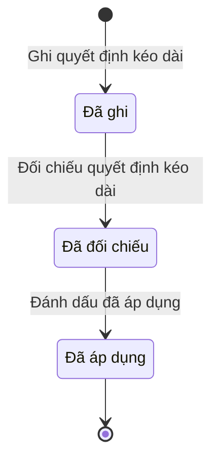

# qt-16.service-extension-decision · Dòng quyết định kéo dài

<!-- máy sinh: tom-tat -->
> **Hồ sơ:** Dòng quyết định kéo dài (`ServiceExtensionEntry`)
>
> 3 bước · 3 chặng · 2 vai · 0 bảng quyết định · 0 hạn · 1 khớp nối.
>
> **Nguồn:** sổ nghiệp vụ `qt-16.service-extension-decision` · khai báo của app: `dqtv-app/core/processes/militia-enlistment/workflow/service-extension-decision.yaml`. Các bảng do máy sinh từ nguồn này.
<!-- hết: tom-tat -->

<!-- viết tay: dien-giai -->
## Diễn giải

*Phần này viết tay, diễn giải lại điều các bảng bên dưới ghi.*

### Quy trình này để làm gì

Mỗi hồ sơ là **một dòng quyết định kéo dài ghi cho một người**: số quyết định của Chủ tịch Uỷ ban nhân dân cấp xã, bản chụp quyết định đã ký, hạn mới của người đó (kéo dài đến hết ngày nào) và nhóm của người đó.

Dòng đi thẳng qua ba chặng: *Đã ghi* (trợ lý đã ghi, chờ Chỉ huy trưởng đối chiếu bản gốc) → *Đã đối chiếu* (chờ ghi hạn mới vào lần tham gia) → *Đã áp dụng* (hạn mới đã ghi vào lần tham gia).

### Khi nào bắt đầu

Trợ lý Quân lực bấm **Ghi quyết định kéo dài**. Phải có đủ: số quyết định, bản chụp quyết định đã ký, kéo dài đến hết ngày, nhóm; `personHasOpenService` — có hồ sơ Chiến sĩ dân quân tự vệ (`qt-16.enlistment`) cùng hồ sơ mẹ với dòng đang làm mà hồ sơ ấy đang ở chặng `SERVING`; người làm là người của đơn vị ghi ở ô đơn vị chủ hồ sơ của Sổ đăng ký người theo diện (qt-16). Ngày ký là ô nhập nếu có. Bước ghi lại người ghi.

Ô "nhóm" chọn một trong bốn: Dân quân (`regular`), Dân quân biển, Tự vệ, Chỉ huy đơn vị dân quân tự vệ. Ba nhóm sau không chịu trần 2 năm.

### Diễn ra thế nào

**Chặng "Đã ghi"** — Chỉ huy trưởng Ban CHQS xã bấm **Đối chiếu quyết định kéo dài**. Người đối chiếu phải khác người đã ghi dòng (`notRecorder`) và thuộc đơn vị chủ hồ sơ của hồ sơ qt-16. Dòng sang *Đã đối chiếu*.

**Chặng "Đã đối chiếu"** — Chỉ huy trưởng Ban CHQS xã bấm **Đánh dấu đã áp dụng**. Dòng sang *Đã áp dụng*.

### Kết thúc và để lại gì

Dòng kết thúc ở chặng *Đã áp dụng*, để lại số quyết định, bản chụp quyết định và hạn mới của người đó. Dòng nối với Sổ nghĩa vụ của người ấy và với quyết định ký ngoài hệ thống, đều ghi ở bước ghi quyết định kéo dài.

### Điều kiện chặn

- Bước ghi quyết định kéo dài dừng lại, không mở dòng, khi kết quả xét là `over_cap` (tổng kéo dài quá trần 2 năm; dân quân biển, tự vệ, chỉ huy đơn vị không chịu trần này) hoặc `over_age` (vượt độ tuổi).
- Dòng chỉ ghi được khi có hồ sơ `qt-16.enlistment` cùng hồ sơ mẹ với dòng ấy đang ở `SERVING`; người đối chiếu phải khác người ghi.
- Cả ba bước: người làm phải thuộc đơn vị chủ hồ sơ của Sổ đăng ký người theo diện (qt-16).
- Sai người, sai chặng, thiếu thứ phải có trước thì bước bị chặn, dòng giữ nguyên.
<!-- hết viết tay -->

## 1. Đường đi ngắn nhất qua các chặng

<!-- máy sinh: luong-chinh -->
Đường ít bước nhất từ lúc mở hồ sơ tới chặng kết thúc xa nhất. Máy chọn theo số chặng, không theo ý nghĩa nghiệp vụ — trình tự công việc thật xem phần Diễn giải và bảng "Việc làm ở từng chặng" ở mục 6.

| # | Ai làm | Làm gì | Hồ sơ sang chặng |
|---|---|---|---|
| 1 | Trợ lý Quân lực | Ghi quyết định kéo dài | Đã ghi |
| 2 | Chỉ huy trưởng Ban CHQS xã | Đối chiếu quyết định kéo dài | Đã đối chiếu |
| 3 | Chỉ huy trưởng Ban CHQS xã | Đánh dấu đã áp dụng | Đã áp dụng |

<!-- hết: luong-chinh -->

## 2. Hồ sơ và việc nó để lại

<!-- máy sinh: muc-tieu -->
**App gọi quy trình này là:** Dòng quyết định kéo dài.

**Khi mở, hồ sơ này ghi mối nối tới:**
- Văn bản đến (1.incoming-document) — bước `recordExtensionDecisionRow`, khớp nối `extensionDecisionFromIncomingDocument`
<!-- hết: muc-tieu -->

## 3. Khởi phát và kết thúc

<!-- máy sinh: khoi-phat -->
**1 cửa vào** — bước mở hồ sơ:

| Bước mở | Ai mở | Hồ sơ vào chặng | App bắt buộc nhập |
|---|---|---|---|
| Ghi quyết định kéo dài | Trợ lý Quân lực | Đã ghi | `registrationId`, quyết định đã ký trong sổ văn bản đến, kéo dài đến hết ngày, nhóm |

**Kết thúc:** *Đã áp dụng* (`USED`)
<!-- hết: khoi-phat -->

## 4. Vai trò

<!-- máy sinh: vai-tro -->
| Vai trong sổ | Tên trong app | Điều kiện | Làm những bước |
|---|---|---|---|
| `operator` | Trợ lý Quân lực |  | Ghi quyết định kéo dài |
| `verifier` | Chỉ huy trưởng Ban CHQS xã |  | Đối chiếu quyết định kéo dài · Đánh dấu đã áp dụng |

*"Tên trong app" là tên app đặt cho mã chủ thể của vai. Hồ sơ thuộc đơn vị cấp khác thì người làm là người giữ vai ấy ở đơn vị nêu trong cột "Điều kiện" (nếu sổ có ghi) và ở cột "Người làm phải thuộc" của bảng "Theo khai báo của app" (mục 7).*
<!-- hết: vai-tro -->

## 5. Nhánh phụ

<!-- máy sinh: nhanh-phu -->
Không có bước nào ngoài luồng chính.
<!-- hết: nhanh-phu -->

## 6. Các chặng và việc làm ở từng chặng

<!-- máy sinh: chang -->
| Chặng | Tên hiển thị | Vào bằng bước | Kết thúc? |
|---|---|---|---|
| `RECORDED` | Đã ghi | Ghi quyết định kéo dài |  |
| `VERIFIED` | Đã đối chiếu | Đối chiếu quyết định kéo dài |  |
| `USED` | Đã áp dụng | Đánh dấu đã áp dụng | **kết thúc** |

### Việc làm ở từng chặng

Hồ sơ đang ở chặng nào thì làm được những bước nào.

| Hồ sơ đang ở chặng | Bước làm tại chặng (hồ sơ đứng yên) | Bước đưa hồ sơ sang chặng khác |
|---|---|---|
| **Đã ghi** | — | Đối chiếu quyết định kéo dài — Chỉ huy trưởng Ban CHQS xã → *Đã đối chiếu* |
| **Đã đối chiếu** | — | Đánh dấu đã áp dụng — Chỉ huy trưởng Ban CHQS xã → *Đã áp dụng* |
| **Đã áp dụng** | — | — (kết thúc) |
<!-- hết: chang -->

## 7. Bảng bước

<!-- máy sinh: buoc -->
| # | Bước | Mã bước | Ai thực hiện | Từ chặng | Sang chặng | Phải có trước | Ghi lại |
|---|---|---|---|---|---|---|---|
| 1 | Ghi quyết định kéo dài | `recordExtensionDecisionRow` | Trợ lý Quân lực | — (mở hồ sơ) | `RECORDED` | kéo dài đến hết ngày, nhóm, `personHasOpenService`, người làm thuộc đơn vị chủ hồ sơ, nối tới Văn bản đến, `extensionDecisionFromIncomingDocumentUsable` | kéo dài đến hết ngày, nhóm, người ghi, nối tới Văn bản đến |
| 2 | Đối chiếu quyết định kéo dài | `verifyExtensionDecisionRow` | Chỉ huy trưởng Ban CHQS xã | `RECORDED` | `VERIFIED` | người làm thuộc đơn vị chủ hồ sơ, `notRecorder` | — |
| 3 | Đánh dấu đã áp dụng | `markExtensionDecisionUsed` | Chỉ huy trưởng Ban CHQS xã | `VERIFIED` | `USED` | người làm thuộc đơn vị chủ hồ sơ | — |

### Khi không đạt điều kiện

Mặc định: không đúng người, hồ sơ không ở đúng chặng, hoặc thiếu thứ "phải có trước" thì bước bị chặn, hồ sơ giữ nguyên. Bảng dưới chỉ kê những bước có kết quả riêng.

| # | Bước | Kết quả riêng |
|---|---|---|
| 1 | Ghi quyết định kéo dài | bước dừng lại, hồ sơ giữ nguyên khi kết quả xét là: `over_cap`, `over_age` |

### Điều kiện "phải có trước" bằng lời

Cột "Phải có trước" ở bảng bước có hai loại: ô dữ liệu thường (bước chỉ đòi ô ấy đã có giá trị) và điều kiện hệ tự xét. Bảng này diễn các điều kiện hệ tự xét theo đúng công thức sổ ghi; số ở cột cuối là số thứ tự bước.

| Điều kiện | Đúng khi | Bước đòi |
|---|---|---|
| `personHasOpenService` | có hồ sơ Sổ đăng ký người theo diện — Chiến sĩ dân quân tự vệ (qt-16.enlistment) cùng hồ sơ mẹ với hồ sơ đang làm (`siblings`) mà hồ sơ ấy đang ở chặng `SERVING` | 1 |
| `actorInOwnerUnit` | người đang làm là người của đơn vị ghi ở ô đơn vị chủ hồ sơ của Sổ đăng ký người theo diện (qt-16) (theo danh mục người của đơn vị, `dm.unit-staff`) | 1, 2, 3 |
| `extensionDecisionFromIncomingDocumentUsable` | có hồ sơ Việc luật giao kèm văn bản đến, đi — Văn bản đến (qt-1.incoming-document) chính là hồ sơ ghi ở ô nối `extensionDecisionFromIncomingDocument` của hồ sơ đang làm mà hồ sơ ấy đang ở chặng `RECEIVED` hoặc `DISTRIBUTED` | 1 |
| `notRecorder` | KHÔNG (người ghi là chính người đang làm) | 2 |

### Theo khai báo của app

Người làm phải thuộc đơn vị nào, ô người dùng phải nhập, bước có lặp được không, và căn cứ pháp lý — lấy từ khai báo quy trình trong app.

| # | Bước | Người làm phải thuộc | Bắt buộc nhập | Nhập nếu có | Lặp được | Căn cứ |
|---|---|---|---|---|---|---|
| 1 | Ghi quyết định kéo dài | đơn vị chủ hồ sơ | `registrationId`, quyết định đã ký trong sổ văn bản đến, kéo dài đến hết ngày, nhóm | — |  | L48/2019/QH14 Đ.8 k3 (sửa bởi L98/2025 Đ.10 k1) |
| 2 | Đối chiếu quyết định kéo dài | đơn vị chủ hồ sơ | — | — |  | L48/2019/QH14 Đ.8 k3 |
| 3 | Đánh dấu đã áp dụng | đơn vị chủ hồ sơ | — | — |  | L48/2019/QH14 Đ.8 k3 |
<!-- hết: buoc -->

## 8. Bảng quyết định, hạn, việc ngoài hệ

<!-- máy sinh: quyet-dinh -->

<!-- hết: quyet-dinh -->

## 9. Dữ liệu của hồ sơ

<!-- máy sinh: du-lieu -->
Các ô mà bước trong sổ ghi hoặc đòi. Số trong hai cột cuối là số thứ tự bước ở bảng bước (mục 7).

| Ô dữ liệu | Mã | Kiểu (app) | Giá trị cho phép | Loại ô (sổ) | Bước ghi | Bước đòi | Mô tả trong app |
|---|---|---|---|---|---|---|---|
| kéo dài đến hết ngày | `extendedUntil` | ngày |  | đưa vào ở bước (`input`) | 1 | 1 | Hạn mới của người này — kéo dài đến hết ngày ghi trên quyết định |
| nhóm | `memberGroup` | chọn một | Dân quân (`regular`), Dân quân biển (`sea_militia`), Tự vệ (`self_defence`), Chỉ huy đơn vị dân quân tự vệ (`unit_commander`) | đưa vào ở bước (`input`) | 1 | 1 | Nhóm của người này — dân quân biển, tự vệ, chỉ huy đơn vị không chịu trần 2 năm (Luật Đ.8 k2) |
| người ghi | `recordedBy` | chữ |  | lưu trên hồ sơ (`stored`) | 1 | — | Người ghi dòng quyết định — đối chiếu phải là người khác |
| — | `personHasOpenService` |  | có hay chưa | hệ suy ra (`derived`) | — | 1 |  |
| người làm thuộc đơn vị chủ hồ sơ | `actorInOwnerUnit` |  | có hay chưa | hệ suy ra (`derived`) | — | 1, 2, 3 |  |
| — | `extensionDecisionFromIncomingDocumentUsable` |  | có hay chưa | hệ suy ra (`derived`) | — | 1 |  |
| — | `notRecorder` |  | có hay chưa | hệ suy ra (`derived`) | — | 2 |  |

7 ô. Cột "Loại ô" là cách sổ phân loại ô, in kèm đúng chữ của sổ; ô nào người dùng phải nhập xem bảng "Theo khai báo của app" ở mục 7.
<!-- hết: du-lieu -->

## 10. Khớp nối với quy trình khác

<!-- máy sinh: khop-noi -->
| Quy trình kia | Hồ sơ kia | Quan hệ | Nội dung (mô tả trong app) | Bước ghi mối nối | Tên ô nối |
|---|---|---|---|---|---|
| 1.incoming-document | Văn bản đến | hồ sơ này **mở ra có nối tới** hồ sơ kia | Dòng kéo dài ghi từ văn bản đến nào — quyết định Chủ tịch UBND xã đã ký, văn thư đã vào sổ | 16.service-extension-decision·recordExtensionDecisionRow ⊕ · đòi: 16.service-extension-decision·recordExtensionDecisionRow | `extensionDecisionFromIncomingDocument` |

1 khớp nối. ⊕ là bước tạo hồ sơ.

**Ô nối giữa các hồ sơ cùng mã quy trình, hoặc tới danh mục nền:** `extensionDecisionOfRegistration` (Dòng quyết định kéo dài → Sổ nghĩa vụ) — bước Ghi quyết định kéo dài; `extensionDecisionSheet` (Dòng quyết định kéo dài → Quyết định ký ngoài hệ thống) — bước Ghi quyết định kéo dài.
<!-- hết: khop-noi -->

## 11. Thông tin chung

<!-- máy sinh: thong-tin -->
| | |
|---|---|
| **Mã trong sổ** | `qt-16.service-extension-decision` |
| **Quy trình trong app** | `militia-enlistment` (`workflow/service-extension-decision.yaml`) — mặt công tác: `personnel` |
| **Hồ sơ** | Dòng quyết định kéo dài (`ServiceExtensionEntry`) |
| **Cùng mã quy trình** | [qt-16](qt-16.html), [qt-16.enlistment](qt-16.enlistment.html), [qt-16.gdqp-category](qt-16.gdqp-category.html), [qt-16.gdqp-certificate](qt-16.gdqp-certificate.html), [qt-16.military-registration](qt-16.military-registration.html), [qt-16.position-held](qt-16.position-held.html), [qt-16.registration-decision](qt-16.registration-decision.html), [qt-16.reserve-registration](qt-16.reserve-registration.html), [qt-16.service-exit-decision](qt-16.service-exit-decision.html) |
| **Căn cứ pháp lý từng bước** | cột "Căn cứ" ở bảng "Theo khai báo của app", mục 7 |
<!-- hết: thong-tin -->
