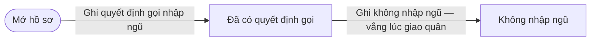
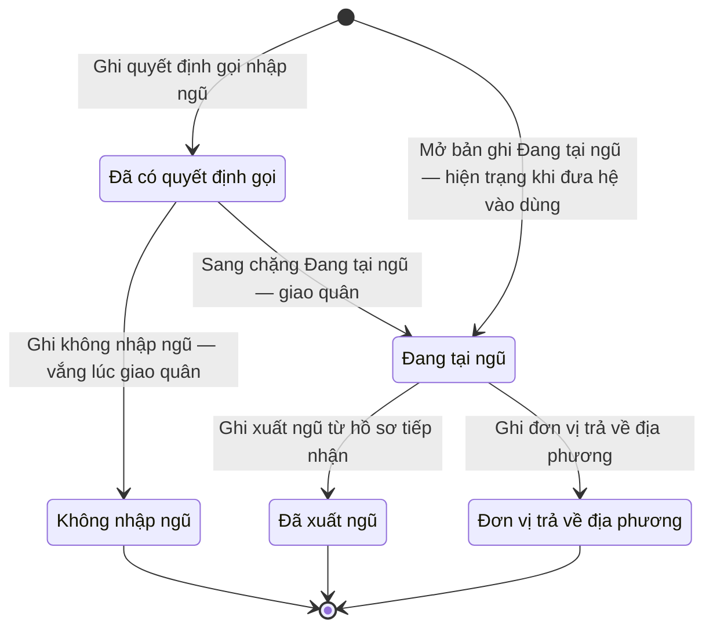

# qt-17.conscription-call · Tuyển quân, giao quân — Quyết định gọi nhập ngũ

<!-- máy sinh: tom-tat -->
> **Hồ sơ:** Quyết định gọi nhập ngũ (`ConscriptionCall`)
>
> **Trong sổ phạm vi:** 17 · Tuyển quân, giao quân — hồ sơ phụ conscription-call (tầng 3)
>
> 6 bước · 5 chặng · 1 vai · 0 bảng quyết định · 0 hạn · 5 khớp nối.
>
> **Nguồn:** sổ nghiệp vụ `qt-17.conscription-call` · khai báo của app: `dqtv-app/core/processes/conscription/workflow/conscription-call.yaml`. Các bảng do máy sinh từ nguồn này.
<!-- hết: tom-tat -->

<!-- viết tay: dien-giai -->
## Diễn giải

*Phần này viết tay, diễn giải lại điều các bảng bên dưới ghi.*

### Quy trình này để làm gì

Mỗi hồ sơ là **một quyết định gọi nhập ngũ của một công dân**, do Trợ lý Quân lực ghi. Hồ sơ cho biết người ấy đang tại ngũ, đã xuất ngũ, hay bị đơn vị nhận quân trả về địa phương. Người đang tại ngũ thì không chảy vào sổ nghĩa vụ dân quân tự vệ; đã xuất ngũ mà còn trong độ tuổi thì tự chảy lại vào sổ.

Hồ sơ có ba chặng: *Đang tại ngũ*, *Đã xuất ngũ*, *Đơn vị trả về địa phương*.

### Khi nào bắt đầu

Trợ lý Quân lực bấm **Ghi quyết định gọi nhập ngũ**. Bắt buộc chọn công dân (chọn từ kho, không gõ tay) và nhập thông tin quyết định: số, trích yếu, người ký, ngày ký, căn cứ, bản quét; ngày có mặt nhập ngũ là ô nhập nếu có. Bước này ghi một quyết định ký ngoài hệ, người ký `commune_chairman`. Hồ sơ mở ra có nối tới **Công dân trong độ tuổi** (quy trình 16) và vào thẳng chặng *Đang tại ngũ*.

### Diễn ra thế nào

Từ chặng *Đang tại ngũ* có ba đường ra, mỗi đường một bước:

1. **Ghi quyết định xuất ngũ** (Trợ lý Quân lực; người làm phải thuộc đơn vị ghi ở ô đơn vị chủ hồ sơ) — nhập số, ngày ký, bản quét quyết định và ngày xuất ngũ; hồ sơ sang *Đã xuất ngũ*. Đây là quyết định ký ngoài hệ, người ký `military_unit_commander`.
2. **Ghi đơn vị trả về địa phương** (Trợ lý Quân lực) — phải có lý do đơn vị trả về; ghi thêm ngày trả về; hồ sơ sang *Đơn vị trả về địa phương*, không còn tính là đang tại ngũ.
3. `dischargeFromIntake` (Hệ thống tự làm) — hệ tự đưa hồ sơ sang *Đã xuất ngũ* và ghi số, ngày, bản quét quyết định xuất ngũ.

Không có bước nào làm tại chặng, không có đường quay lại.

### Kết thúc và để lại gì

*Đã xuất ngũ* là chặng kết thúc. Hồ sơ ở chặng *Đơn vị trả về địa phương* thì dừng tại đó.

Hồ sơ của quy trình khác nối về quyết định gọi nhập ngũ:

- **Dòng quyết định cho thôi, đưa ra khỏi danh sách** (16) — cho thôi vì có lệnh gọi nhập ngũ, chứng cứ là quyết định đã ghi trên hệ.
- **Tiếp nhận quân nhân xuất ngũ** (27) — đợt tiếp nhận nối về quyết định gọi nhập ngũ của quân nhân được tiếp nhận.
- **Thí sinh sơ tuyển vào trường Quân đội** (36) — ở bước `recordAdmission`, người trúng tuyển hệ quân sự được gắn với quyết định gọi nhập ngũ của mình.

### Điều kiện chặn

- Bước ghi xuất ngũ: người làm phải thuộc đơn vị chủ hồ sơ. Bước ghi trả về: phải có lý do.
- Sai chặng hoặc thiếu thứ phải có trước thì bước bị chặn, hồ sơ giữ nguyên.
- Hai quyết định ký ngoài hệ, hệ chỉ ghi lại: gọi nhập ngũ (`commune_chairman`) và xuất ngũ (`military_unit_commander`).
<!-- hết viết tay -->

## 1. Đường đi ngắn nhất qua các chặng

<!-- máy sinh: luong-chinh -->
Đường ít bước nhất từ lúc mở hồ sơ tới chặng kết thúc xa nhất. Máy chọn theo số chặng, không theo ý nghĩa nghiệp vụ — trình tự công việc thật xem phần Diễn giải và bảng "Việc làm ở từng chặng" ở mục 6.

| # | Ai làm | Làm gì | Hồ sơ sang chặng |
|---|---|---|---|
| 1 | Hệ thống tự làm | Ghi quyết định gọi nhập ngũ | Đã có quyết định gọi |
| 2 | Hệ thống tự làm | Ghi không nhập ngũ — vắng lúc giao quân | Không nhập ngũ |

<!-- hết: luong-chinh -->

## 2. Hồ sơ và việc nó để lại

<!-- máy sinh: muc-tieu -->
**App gọi quy trình này là:** Quyết định gọi nhập ngũ.

**Khi mở, hồ sơ này ghi mối nối tới:**
- Công dân trong độ tuổi (16) — bước `openCallFromOnboarding`, khớp nối `callOfCitizen`
- Công dân trong độ tuổi (16) — bước `recordConscriptionCall`, khớp nối `callOfCitizen`

**Hồ sơ này để lại cho quy trình khác** (bước tạo hồ sơ của quy trình kia ghi mối nối về đây):
- Tiếp nhận quân nhân xuất ngũ (27) — bước `addToDischargeNotice`, khớp nối `intakeCoversServiceRecord`
- Tiếp nhận quân nhân xuất ngũ (27) — bước `receiveDischargeNotice`, khớp nối `intakeCoversServiceRecord`
<!-- hết: muc-tieu -->

## 3. Khởi phát và kết thúc

<!-- máy sinh: khoi-phat -->
**2 cửa vào** — bước mở hồ sơ:

| Bước mở | Ai mở | Hồ sơ vào chặng | App bắt buộc nhập |
|---|---|---|---|
| Ghi quyết định gọi nhập ngũ | Hệ thống tự làm | Đã có quyết định gọi | `citizenId`, số quyết định, `subject`, `signedBy`, ngày ký, `legalBasis`, bản quét quyết định |
| Mở bản ghi Đang tại ngũ — hiện trạng khi đưa hệ vào dùng | Hệ thống tự làm | Đang tại ngũ | `citizenId`, số quyết định, ngày ký, bản quét quyết định |

**Kết thúc:** *Không nhập ngũ* (`NOT_ENLISTED`), *Đã xuất ngũ* (`DISCHARGED`), *Đơn vị trả về địa phương* (`RETURNED`)
<!-- hết: khoi-phat -->

## 4. Vai trò

<!-- máy sinh: vai-tro -->
| Vai trong sổ | Tên trong app | Điều kiện | Làm những bước |
|---|---|---|---|
| `system` | Hệ thống tự làm |  | Ghi quyết định gọi nhập ngũ · Ghi đơn vị trả về địa phương · Sang chặng Đang tại ngũ — giao quân · Ghi không nhập ngũ — vắng lúc giao quân · Mở bản ghi Đang tại ngũ — hiện trạng khi đưa hệ vào dùng · Ghi xuất ngũ từ hồ sơ tiếp nhận |

*"Tên trong app" là tên app đặt cho mã chủ thể của vai. Hồ sơ thuộc đơn vị cấp khác thì người làm là người giữ vai ấy ở đơn vị nêu trong cột "Điều kiện" (nếu sổ có ghi) và ở cột "Người làm phải thuộc" của bảng "Theo khai báo của app" (mục 7).*
<!-- hết: vai-tro -->

## 5. Nhánh phụ

<!-- máy sinh: nhanh-phu -->
**Bước khác đưa hồ sơ sang chặng mới** — đường song song, rẽ nhánh hoặc kết thúc sớm:

| Bước | Ai làm | Từ chặng | Sang chặng |
|---|---|---|---|
| Ghi đơn vị trả về địa phương | Hệ thống tự làm | Đang tại ngũ | Đơn vị trả về địa phương |
| Sang chặng Đang tại ngũ — giao quân | Hệ thống tự làm | Đã có quyết định gọi | Đang tại ngũ |
| Ghi xuất ngũ từ hồ sơ tiếp nhận | Hệ thống tự làm | Đang tại ngũ | Đã xuất ngũ |

**Cửa vào khác:** 2 bước cùng mở hồ sơ — xem mục 3.

<!-- hết: nhanh-phu -->

## 6. Các chặng và việc làm ở từng chặng

<!-- máy sinh: chang -->
| Chặng | Tên hiển thị | Vào bằng bước | Kết thúc? |
|---|---|---|---|
| `CALLED` | Đã có quyết định gọi | Ghi quyết định gọi nhập ngũ |  |
| `IN_SERVICE` | Đang tại ngũ | Sang chặng Đang tại ngũ — giao quân · Mở bản ghi Đang tại ngũ — hiện trạng khi đưa hệ vào dùng |  |
| `NOT_ENLISTED` | Không nhập ngũ | Ghi không nhập ngũ — vắng lúc giao quân | **kết thúc** |
| `DISCHARGED` | Đã xuất ngũ | Ghi xuất ngũ từ hồ sơ tiếp nhận | **kết thúc** |
| `RETURNED` | Đơn vị trả về địa phương | Ghi đơn vị trả về địa phương | **kết thúc** |

### Việc làm ở từng chặng

Hồ sơ đang ở chặng nào thì làm được những bước nào.

| Hồ sơ đang ở chặng | Bước làm tại chặng (hồ sơ đứng yên) | Bước đưa hồ sơ sang chặng khác |
|---|---|---|
| **Đã có quyết định gọi** | — | Sang chặng Đang tại ngũ — giao quân — Hệ thống tự làm → *Đang tại ngũ* Ghi không nhập ngũ — vắng lúc giao quân — Hệ thống tự làm → *Không nhập ngũ* |
| **Đang tại ngũ** | — | Ghi đơn vị trả về địa phương — Hệ thống tự làm → *Đơn vị trả về địa phương* Ghi xuất ngũ từ hồ sơ tiếp nhận — Hệ thống tự làm → *Đã xuất ngũ* |
| **Không nhập ngũ** | — | — (kết thúc) |
| **Đã xuất ngũ** | — | — (kết thúc) |
| **Đơn vị trả về địa phương** | — | — (kết thúc) |
<!-- hết: chang -->

## 7. Bảng bước

<!-- máy sinh: buoc -->
| # | Bước | Mã bước | Ai thực hiện | Từ chặng | Sang chặng | Phải có trước | Ghi lại |
|---|---|---|---|---|---|---|---|
| 1 | Ghi quyết định gọi nhập ngũ | `recordConscriptionCall` | Hệ thống tự làm | — (mở hồ sơ) | `CALLED` | `callDecisionRecordedOnDrive` | `id`, nối tới Công dân trong độ tuổi, đơn vị chủ hồ sơ, số quyết định, ngày ký, ngày có mặt nhập ngũ, bản quét quyết định |
| 2 | Ghi đơn vị trả về địa phương | `recordConscriptReturn` | Hệ thống tự làm | `IN_SERVICE` | `RETURNED` | `returnRecordedOnDrive` | lý do đơn vị trả về, ngày ghi trả về |
| 3 | Sang chặng Đang tại ngũ — giao quân | `enterServiceOnHandover` | Hệ thống tự làm | `CALLED` | `IN_SERVICE` | `handedOverOnDrive` | ngày vào tại ngũ |
| 4 | Ghi không nhập ngũ — vắng lúc giao quân | `markNotEnlisted` | Hệ thống tự làm | `CALLED` | `NOT_ENLISTED` | `absentAtHandoverOnDrive` | vắng mặt có lý do chính đáng, ngày ghi không nhập ngũ |
| 5 | Mở bản ghi Đang tại ngũ — hiện trạng khi đưa hệ vào dùng | `openCallFromOnboarding` | Hệ thống tự làm | — (mở hồ sơ) | `IN_SERVICE` | `inServiceOnboardingConfirmed` | `id`, nối tới Công dân trong độ tuổi, đơn vị chủ hồ sơ, số quyết định, ngày ký, bản quét quyết định |
| 6 | Ghi xuất ngũ từ hồ sơ tiếp nhận | `dischargeFromIntake` | Hệ thống tự làm | `IN_SERVICE` | `DISCHARGED` | `dischargeRecordedAtIntake` | số quyết định xuất ngũ, ngày xuất ngũ, bản quét quyết định xuất ngũ |

### Khi không đạt điều kiện

Mặc định: không đúng người, hồ sơ không ở đúng chặng, hoặc thiếu thứ "phải có trước" thì bước bị chặn, hồ sơ giữ nguyên. Bảng dưới chỉ kê những bước có kết quả riêng.

| # | Bước | Kết quả riêng |
|---|---|---|
| 1 | Ghi quyết định gọi nhập ngũ | bước này không do người nào bấm |
| 2 | Ghi đơn vị trả về địa phương | bước này không do người nào bấm |
| 3 | Sang chặng Đang tại ngũ — giao quân | bước này không do người nào bấm |
| 4 | Ghi không nhập ngũ — vắng lúc giao quân | bước này không do người nào bấm |
| 5 | Mở bản ghi Đang tại ngũ — hiện trạng khi đưa hệ vào dùng | bước này không do người nào bấm |
| 6 | Ghi xuất ngũ từ hồ sơ tiếp nhận | bước này không do người nào bấm |

### Điều kiện "phải có trước" bằng lời

Cột "Phải có trước" ở bảng bước có hai loại: ô dữ liệu thường (bước chỉ đòi ô ấy đã có giá trị) và điều kiện hệ tự xét. Bảng này diễn các điều kiện hệ tự xét theo đúng công thức sổ ghi; số ở cột cuối là số thứ tự bước.

Không bước nào đòi điều kiện hệ tự xét — mọi thứ "phải có trước" đều là ô dữ liệu thường.

### Theo khai báo của app

Người làm phải thuộc đơn vị nào, ô người dùng phải nhập, bước có lặp được không, và căn cứ pháp lý — lấy từ khai báo quy trình trong app.

| # | Bước | Người làm phải thuộc | Bắt buộc nhập | Nhập nếu có | Lặp được | Căn cứ |
|---|---|---|---|---|---|---|
| 1 | Ghi quyết định gọi nhập ngũ |  | `citizenId`, số quyết định, `subject`, `signedBy`, ngày ký, `legalBasis`, bản quét quyết định | ngày có mặt nhập ngũ, họ và tên |  | L78/2015/QH13 Đ.34 k6 (sửa bởi L98/2025/QH15 Đ.4 k11 c) · L48/2019/QH14 Đ.12 k1 d |
| 2 | Ghi đơn vị trả về địa phương |  | lý do đơn vị trả về, ngày ghi trả về | — |  | sổ tri thức qt-17 (bù đổi sau giao quân) · L48/2019/QH14 Đ.12 k1 d |
| 3 | Sang chặng Đang tại ngũ — giao quân |  | ngày vào tại ngũ | — |  | L78/2015/QH13 Đ.34 k6 · L48/2019/QH14 Đ.12 k1 d |
| 4 | Ghi không nhập ngũ — vắng lúc giao quân |  | ngày ghi không nhập ngũ | vắng mặt có lý do chính đáng |  | L78/2015/QH13 Đ.35 k5 |
| 5 | Mở bản ghi Đang tại ngũ — hiện trạng khi đưa hệ vào dùng |  | `citizenId`, số quyết định, ngày ký, bản quét quyết định | họ và tên, mã xã, mã tỉnh |  | L48/2019/QH14 Đ.12 k1 d |
| 6 | Ghi xuất ngũ từ hồ sơ tiếp nhận |  | số quyết định, `subject`, `signedBy`, ngày ký, `legalBasis`, bản quét quyết định, ngày xuất ngũ | — |  | L78/2015/QH13 Đ.44 k2 (sửa bởi L14/2026/QH16 Đ.4 k6) |

### Điều kiện và ghi chú app khai cho từng bước

Lấy từ khai báo quy trình trong app. Lời trong ngoặc kép là câu app hiện cho người dùng. Chức danh người ký ngoài hệ app chỉ khai bằng mã.

| # | Bước | Điều kiện, ghi chú |
|---|---|---|
| 1 | Ghi quyết định gọi nhập ngũ | · bước này ghi một quyết định ký NGOÀI hệ (`callAuthorizedBy`), người ký: `commune_chairman` |
| 6 | Ghi xuất ngũ từ hồ sơ tiếp nhận | · bước này ghi một quyết định ký NGOÀI hệ (`callAuthorizedBy`), người ký: `military_unit_commander` |
<!-- hết: buoc -->

## 8. Bảng quyết định, hạn, việc ngoài hệ

<!-- máy sinh: quyet-dinh -->

<!-- hết: quyet-dinh -->

## 9. Dữ liệu của hồ sơ

<!-- máy sinh: du-lieu -->
Các ô mà bước trong sổ ghi hoặc đòi. Số trong hai cột cuối là số thứ tự bước ở bảng bước (mục 7).

| Ô dữ liệu | Mã | Kiểu (app) | Giá trị cho phép | Loại ô (sổ) | Bước ghi | Bước đòi | Mô tả trong app |
|---|---|---|---|---|---|---|---|
| — | `id` |  |  | lưu trên hồ sơ (`stored`) | 1, 5 | — |  |
| đơn vị chủ hồ sơ | `ownerUnit` |  |  | lưu trên hồ sơ (`stored`) | 1, 5 | — |  |
| số quyết định | `decisionNumber` | chữ |  | đưa vào ở bước (`input`) | 1, 5 | — | Số quyết định gọi nhập ngũ của Chủ tịch UBND cấp xã |
| ngày ký | `signedDate` | ngày |  | lưu trên hồ sơ (`stored`) | 1, 5 | — | Ngày ký quyết định gọi nhập ngũ |
| ngày có mặt nhập ngũ | `reportDate` | ngày |  | lưu trên hồ sơ (`stored`) | 1 | — | Thời gian có mặt ghi trong quyết định — L78 Đ.34 k6 |
| bản quét quyết định | `scanPath` | tệp |  | lưu trên hồ sơ (`stored`) | 1, 5 | — | Ảnh chụp quyết định gọi nhập ngũ đã ký |
| lý do đơn vị trả về | `returnReason` | chữ |  | lưu trên hồ sơ (`stored`) | 2 | — | Vì sao đơn vị nhận quân trả về — chép từ lượt gọi người thay thế của đợt tuyển quân |
| ngày ghi trả về | `returnedAt` | ngày |  | lưu trên hồ sơ (`stored`) | 2 | — | Ngày ghi người này bị trả về |
| ngày vào tại ngũ | `enteredServiceAt` | ngày |  | lưu trên hồ sơ (`stored`) | 3 | — | Ngày vào tại ngũ — ngày giao quân của đợt tuyển quân (sổ qt-17.conscription-call, bước hệ enterServiceOnHandover) |
| vắng mặt có lý do chính đáng | `absenceWithReason` | chọn một | Có lý do chính đáng (`yes`), Không có lý do chính đáng (`no`) | lưu trên hồ sơ (`stored`) | 4 | — | Vắng mặt lúc giao quân có lý do hay không — chỉ ghi để tra cứu |
| ngày ghi không nhập ngũ | `notEnlistedAt` | ngày |  | lưu trên hồ sơ (`stored`) | 4 | — | Ngày ghi người vắng lúc giao quân là không nhập ngũ (bước hệ markNotEnlisted) |
| số quyết định xuất ngũ | `dischargeNumber` | chữ |  | lưu trên hồ sơ (`stored`) | 6 | — | Số quyết định xuất ngũ — L78 Đ.44 k2 |
| ngày xuất ngũ | `dischargeDate` | ngày |  | lưu trên hồ sơ (`stored`) | 6 | — | Ngày xuất ngũ ghi trên quyết định |
| bản quét quyết định xuất ngũ | `dischargeScanPath` | tệp |  | lưu trên hồ sơ (`stored`) | 6 | — | Ảnh chụp quyết định xuất ngũ |
| — | `callDecisionRecordedOnDrive` |  |  | đưa vào ở bước (`input`) | — | 1 |  |
| — | `returnRecordedOnDrive` |  |  | đưa vào ở bước (`input`) | — | 2 |  |
| — | `handedOverOnDrive` |  |  | đưa vào ở bước (`input`) | — | 3 |  |
| — | `absentAtHandoverOnDrive` |  |  | đưa vào ở bước (`input`) | — | 4 |  |
| — | `inServiceOnboardingConfirmed` |  |  | đưa vào ở bước (`input`) | — | 5 |  |
| — | `dischargeRecordedAtIntake` |  |  | đưa vào ở bước (`input`) | — | 6 |  |

20 ô. Cột "Loại ô" là cách sổ phân loại ô, in kèm đúng chữ của sổ; ô nào người dùng phải nhập xem bảng "Theo khai báo của app" ở mục 7.
<!-- hết: du-lieu -->

## 10. Khớp nối với quy trình khác

<!-- máy sinh: khop-noi -->
| Quy trình kia | Hồ sơ kia | Quan hệ | Nội dung (mô tả trong app) | Bước ghi mối nối | Tên ô nối |
|---|---|---|---|---|---|
| 16 | Công dân trong độ tuổi | hồ sơ này **mở ra có nối tới** hồ sơ kia | Quyết định gọi nhập ngũ gọi công dân nào — chọn từ kho, không gõ tay | 17.conscription-call·openCallFromOnboarding ⊕, 17.conscription-call·recordConscriptionCall ⊕ | `callOfCitizen` |
| 16.enlistment | Chiến sĩ dân quân tự vệ | có nối | Cờ chờ quyết định cho thôi — quyết định gọi nhập ngũ của người đã giao quân (Luật Đ.12 k1 d) | — | `exitDueSourceConscriptionCall` |
| 16.service-exit-decision | Dòng quyết định cho thôi, đưa ra khỏi danh sách | có nối | Cho thôi vì có lệnh gọi nhập ngũ — chứng cứ là quyết định gọi nhập ngũ đã ghi trên hệ (Luật Đ.12 k1 d) | — | `exitCausedByConscriptionCall` |
| 27 | Tiếp nhận quân nhân xuất ngũ | hồ sơ kia **mở ra từ** hồ sơ này | Quyết định gọi nhập ngũ của quân nhân được tiếp nhận (sổ qt-27) | 27·addToDischargeNotice ⊕, 27·receiveDischargeNotice ⊕ | `intakeCoversServiceRecord` |
| 36 | Thí sinh sơ tuyển vào trường Quân đội | có nối | Người trúng tuyển hệ quân sự được gọi nhập ngũ theo quyết định nào (qt-17) — "đánh dấu sổ NVQS" của sổ qt-36 | — | `candidateCalledBy` |

5 khớp nối. ⊕ là bước tạo hồ sơ.
<!-- hết: khop-noi -->

## 11. Thông tin chung

<!-- máy sinh: thong-tin -->
| | |
|---|---|
| **Mã trong sổ** | `qt-17.conscription-call` |
| **Quy trình trong app** | `conscription` (`workflow/conscription-call.yaml`) — mặt công tác: `personnel` |
| **Hồ sơ** | Quyết định gọi nhập ngũ (`ConscriptionCall`) |
| **Cùng mã quy trình** | [qt-17](qt-17.html) |
| **Căn cứ pháp lý từng bước** | cột "Căn cứ" ở bảng "Theo khai báo của app", mục 7 |
<!-- hết: thong-tin -->
