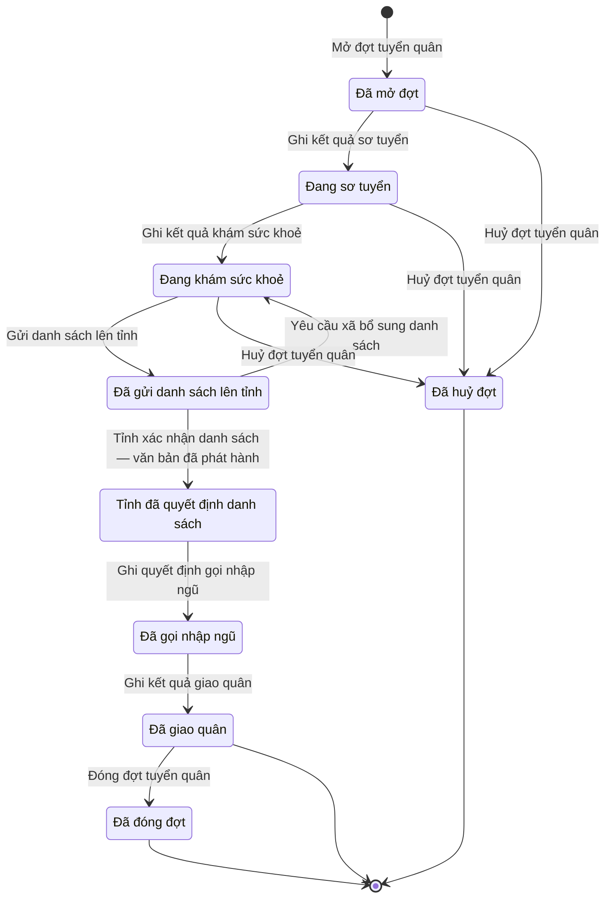

# qt-17 · Tuyển quân, giao quân

<!-- máy sinh: tom-tat -->
> **Hồ sơ:** Đợt tuyển quân (`ConscriptionDrive`)
>
> **Trong sổ phạm vi:** 17 · Tuyển quân, giao quân (tầng 3)
>
> 18 bước · 9 chặng · 4 vai · 4 bảng quyết định · 0 hạn · 17 khớp nối.
>
> **Nguồn:** sổ nghiệp vụ `qt-17` · khai báo của app: `dqtv-app/core/processes/conscription/workflow/conscription-drive.yaml`. Các bảng do máy sinh từ nguồn này.
<!-- hết: tom-tat -->

<!-- viết tay: dien-giai -->
## Diễn giải

*Phần này viết tay, diễn giải lại điều các bảng bên dưới ghi.*

### Quy trình này để làm gì

Ban CHQS xã theo dõi một **đợt tuyển quân** của một năm nhập ngũ, từ lúc mở đợt tới lúc giao quân xong và đóng đợt. Trong đợt, Trợ lý Quân lực ghi kết quả từng người qua sơ tuyển, khám sức khoẻ, đề nghị gọi hay hoãn, miễn; Bộ CHQS cấp tỉnh xác nhận danh sách; rồi xã ghi quyết định gọi nhập ngũ và kết quả giao quân.

Hồ sơ đi qua các chặng: *Đã mở đợt* → *Đang sơ tuyển* → *Đang khám sức khoẻ* → *Đã gửi danh sách lên tỉnh* → *Tỉnh đã quyết định danh sách* → *Đã gọi nhập ngũ* → *Đã giao quân* → *Đã đóng đợt*; ngoài ra có chặng *Đã huỷ đợt*.

### Khi nào bắt đầu

Trợ lý Quân lực bấm **Mở đợt tuyển quân**. Phải nhập năm nhập ngũ, lần gọi trong năm (lần một hoặc lần hai) và chỉ tiêu mà đợt thực hiện. Đợt mở ra có nối tới một **Chỉ tiêu** của quy trình 2 — chỉ tiêu gọi nhập ngũ tỉnh giao cho xã. Lần gọi một hay hai, và quân đội hay công an, chỉ để tra cứu, thống kê.

### Diễn ra thế nào

**Chặng "Đã mở đợt" và "Đang sơ tuyển".** Trợ lý Quân lực bấm **Ghi kết quả sơ tuyển** cho từng người; lần ghi đầu đưa đợt sang *Đang sơ tuyển*, các lần sau làm lặp lại tại chặng. Mỗi lần ghi là chọn một công dân từ kho (không gõ tay), kèm số và bản đã ký của quyết định gọi sơ tuyển của Chủ tịch UBND xã, kết quả sơ tuyển (`pass`, `fail`, `absent`) và có tình nguyện hay không. Mỗi lần ghi tạo một hồ sơ con *Người trong đợt tuyển quân*. Bước này xét bảng điều kiện về tuổi, tại ngũ và đăng ký (xem "Điều kiện chặn"). Kết quả sơ tuyển chỉ để ghi và công khai.

**Chặng "Đang khám sức khoẻ".** Trợ lý Quân lực bấm **Ghi kết quả khám sức khoẻ** — lần đầu đưa đợt sang chặng này, sau đó lặp lại được; ghi số và bản đã ký của quyết định gọi khám, loại sức khoẻ (1 đến 6). Có kết quả khám thì phải ghi, bất kể đạt hay không. Khi xong, Trợ lý Quân lực bấm **Gửi danh sách lên tỉnh**: mỗi người một đề nghị (`call`, `reserve`, `defer`, `exempt`), căn cứ đề nghị tạm hoãn hoặc miễn và giấy tờ căn cứ, kèm văn bản đề nghị đã ký của Chủ tịch UBND xã. Đợt sang *Đã gửi danh sách lên tỉnh*.

**Chặng "Đã gửi danh sách lên tỉnh".** Vai Bộ CHQS cấp tỉnh — người làm phải thuộc một đơn vị nằm trong ô cấp trên của chủ hồ sơ — có hai lựa chọn:

- **Yêu cầu xã bổ sung danh sách**: ghi tỉnh yêu cầu bổ sung gì; đợt quay về *Đang khám sức khoẻ*.
- **Xác nhận danh sách theo quyết định của Chủ tịch UBND tỉnh**: ghi kết quả từng người (`call`, `reserve`, `rejected` — gọi, dự bị hay không chọn), số, ngày ký, người ký và bản quét quyết định danh sách; đợt sang *Tỉnh đã quyết định danh sách*. Bước này ghi một quyết định ký ngoài hệ, người ký `province_chairman`.

**Chặng "Tỉnh đã quyết định danh sách".** Trợ lý Quân lực bấm **Ghi quyết định gọi nhập ngũ**: số quyết định, bản đã ký, ngày có mặt nhập ngũ, ngày giao quyết định cho công dân. Quyết định gọi của từng người do Chủ tịch UBND xã ký. Đợt sang *Đã gọi nhập ngũ*.

**Chặng "Đã gọi nhập ngũ".** Trợ lý Quân lực bấm **Ghi kết quả giao quân**: ai có mặt, ai vắng có lý do, ai vắng không lý do, giấy tờ chứng minh lý do vắng, ngày giao quân. Đợt sang *Đã giao quân*.

**Chặng "Đã giao quân"** — hai việc làm tại chặng, lặp được:

- **Lập biên bản người vắng không lý do** (Chỉ huy trưởng Ban CHQS xã) — gắn một vụ việc vi phạm hành chính của quy trình 10 cho người vắng.
- **Ghi quyết định gọi người thay thế** (Trợ lý Quân lực) — ghi người bị trả về và lý do, người thay thế lấy từ danh sách dự bị, số và bản chụp quyết định gọi.

Sau đó Trợ lý Quân lực bấm **Đóng đợt tuyển quân**; có thể gắn bản kết quả giao việc nếu có.

**Kết thúc sớm.** Chỉ huy trưởng Ban CHQS xã bấm **Huỷ đợt tuyển quân** được khi đợt còn ở ba chặng đầu, tức chưa gửi danh sách lên tỉnh; bắt buộc ghi lý do huỷ.

### Kết thúc và để lại gì

Đợt kết thúc ở một trong ba chặng: *Đã giao quân*, *Đã đóng đợt* và *Đã huỷ đợt*. Đợt tuyển quân gắn với:

- **Chỉ tiêu** (2) — ghi lúc mở đợt.
- **Công dân trong độ tuổi** (16) — người trong đợt, ghi ở bước sơ tuyển.
- **Vụ việc vi phạm hành chính** (10) — ghi ở bước lập biên bản người vắng.
- **Kết quả trả lên cấp trên** (3) — ghi ở bước đóng đợt: kết quả của đợt báo lên bản giao chỉ tiêu.

### Điều kiện chặn

- Các bước của xã, trừ bước mở đợt: người làm phải thuộc đơn vị ghi ở ô đơn vị chủ hồ sơ. Hai bước của tỉnh: người làm phải thuộc một đơn vị nằm trong ô cấp trên của chủ hồ sơ. Sai người, sai chặng thì bước bị chặn, hồ sơ giữ nguyên.
- **Sơ tuyển** (bảng `prescreen-eligibility`): chặn người dưới 18 hoặc trên 27 tuổi, người thiếu thông tin nhóm tuổi, người 26–27 tuổi mà không có quyết định tạm hoãn (không có quyết định nào, chỉ có quyết định miễn, hoặc thiếu thông tin này); chặn người đang tại ngũ; chặn người chưa đăng ký hoặc thiếu thông tin đăng ký.
- **Gửi danh sách lên tỉnh** (bảng `proposal-health-standard`): đề nghị `call` hoặc `reserve` chỉ cho người sức khoẻ loại 1, 2, 3; đề nghị `defer`, `exempt` thì không xét sức khoẻ.
- **Xác nhận danh sách**: bước dừng lại, hồ sơ giữ nguyên khi kết quả xét là `list_decision_missing`.
- **Ghi quyết định gọi nhập ngũ** (bảng `call-decision-gate`), xét theo thứ tự: người đã được công nhận hoàn thành nghĩa vụ thì chặn; người có quyết định hoãn hoặc miễn mà không tình nguyện (hoặc thiếu thông tin có tình nguyện hay không) thì chặn; người có kết quả của tỉnh là `reserve`, `rejected` hoặc thiếu kết quả của tỉnh thì chặn; cuối cùng, `noticeDaysBeforeEnlistment` phải từ 15 trở lên (ngày giao quyết định phải trước ngày có mặt 15 ngày).
- **Biên bản người vắng** (bảng `absentee-violation-ground`): chỉ lập cho người vắng không lý do.
- **Gọi người thay thế** (bảng `replacement-cap`): `replacementShareOfQuota` không quá 2. Hạn `replaceReturnedConscript.deadline`: 15 ngày tính từ lúc đợt vào chặng *Đã giao quân*, quá hạn thì chặn.
<!-- hết viết tay -->

## 1. Đường đi ngắn nhất qua các chặng

<!-- máy sinh: luong-chinh -->
Đường ít bước nhất từ lúc mở hồ sơ tới chặng kết thúc xa nhất. Máy chọn theo số chặng, không theo ý nghĩa nghiệp vụ — trình tự công việc thật xem phần Diễn giải và bảng "Việc làm ở từng chặng" ở mục 6.

| # | Ai làm | Làm gì | Hồ sơ sang chặng |
|---|---|---|---|
| 1 | Trợ lý Quân lực | Mở đợt tuyển quân | Đã mở đợt |
| 2 | Trợ lý Quân lực | Ghi kết quả sơ tuyển | Đang sơ tuyển |
| 3 | Trợ lý Quân lực | Ghi kết quả khám sức khoẻ | Đang khám sức khoẻ |
| 4 | Hệ thống tự làm | Gửi danh sách lên tỉnh | Đã gửi danh sách lên tỉnh |
| 5 | Bộ CHQS cấp tỉnh (thuộc cấp trên của chủ hồ sơ) | Tỉnh xác nhận danh sách — văn bản đã phát hành | Tỉnh đã quyết định danh sách |
| 6 | Trợ lý Quân lực | Ghi quyết định gọi nhập ngũ | Đã gọi nhập ngũ |
| 7 | Trợ lý Quân lực | Ghi kết quả giao quân | Đã giao quân |
| 8 | Trợ lý Quân lực | Đóng đợt tuyển quân | Đã đóng đợt |

<!-- hết: luong-chinh -->

## 2. Hồ sơ và việc nó để lại

<!-- máy sinh: muc-tieu -->
**App gọi quy trình này là:** Đợt tuyển quân.

**Khi mở, hồ sơ này ghi mối nối tới:**
- Chỉ tiêu (2) — bước `openConscriptionDrive`, khớp nối `driveUnderTarget`

**Hồ sơ này để lại cho quy trình khác** (bước tạo hồ sơ của quy trình kia ghi mối nối về đây):
- Vụ việc vi phạm hành chính (10) — bước `openViolationFromSource`, khớp nối `violationFromConscription`
<!-- hết: muc-tieu -->

## 3. Khởi phát và kết thúc

<!-- máy sinh: khoi-phat -->
**1 cửa vào** — bước mở hồ sơ:

| Bước mở | Ai mở | Hồ sơ vào chặng | App bắt buộc nhập |
|---|---|---|---|
| Mở đợt tuyển quân | Trợ lý Quân lực | Đã mở đợt | năm nhập ngũ, lần gọi trong năm, `planTargetIds` |

**Kết thúc:** *Đã giao quân* (`HANDED_OVER`), *Đã đóng đợt* (`CLOSED`), *Đã huỷ đợt* (`CANCELLED`)
<!-- hết: khoi-phat -->

## 4. Vai trò

<!-- máy sinh: vai-tro -->
| Vai trong sổ | Tên trong app | Điều kiện | Làm những bước |
|---|---|---|---|
| `operator` | Trợ lý Quân lực |  | Mở đợt tuyển quân · Ghi kết quả sơ tuyển · Ghi kết quả khám sức khoẻ · Trình ký văn bản gửi danh sách lên tỉnh · Ghi quyết định gọi nhập ngũ · Ghi kết quả giao quân · Đóng đợt tuyển quân · Lập biên bản người vắng không lý do · Ghi người bị trả về · Ghi gọi bổ sung · Ghi niêm yết danh sách tạm hoãn, miễn |
| `system` | Hệ thống tự làm |  | Gửi danh sách lên tỉnh · Yêu cầu xã bổ sung danh sách · Đánh dấu dân quân thường trực thuộc diện tạm hoãn |
| `operator` | Trợ lý Quân lực | thuộc cấp trên của chủ hồ sơ (`actorInSuperiorUnit`, công thức ở mục 7) | Trình ký văn bản yêu cầu xã bổ sung danh sách |
| `provinceStaff` | Bộ CHQS cấp tỉnh | thuộc cấp trên của chủ hồ sơ (`actorInSuperiorUnit`, công thức ở mục 7) | Trình ký văn bản xác nhận danh sách · Tỉnh xác nhận danh sách — văn bản đã phát hành |
| `commander` | Chỉ huy trưởng Ban CHQS xã |  | Huỷ đợt tuyển quân |

*"Tên trong app" là tên app đặt cho mã chủ thể của vai. Hồ sơ thuộc đơn vị cấp khác thì người làm là người giữ vai ấy ở đơn vị nêu trong cột "Điều kiện" (nếu sổ có ghi) và ở cột "Người làm phải thuộc" của bảng "Theo khai báo của app" (mục 7).*
<!-- hết: vai-tro -->

## 5. Nhánh phụ

<!-- máy sinh: nhanh-phu -->
**Bước khác đưa hồ sơ sang chặng mới** — đường song song, rẽ nhánh hoặc kết thúc sớm:

| Bước | Ai làm | Từ chặng | Sang chặng |
|---|---|---|---|
| Huỷ đợt tuyển quân | Chỉ huy trưởng Ban CHQS xã | Đã mở đợt, Đang sơ tuyển, Đang khám sức khoẻ | Đã huỷ đợt |

**Quay lại một chặng hồ sơ đã đi qua** (tính theo đường ngắn nhất từ lúc mở):

| Bước | Ai làm | Từ chặng | Về chặng |
|---|---|---|---|
| Yêu cầu xã bổ sung danh sách | Hệ thống tự làm | Đã gửi danh sách lên tỉnh | Đang khám sức khoẻ |

**Làm trong lúc hồ sơ đứng yên ở một chặng** — ghi nhận, bổ sung:

| Bước | Ai làm | Ở chặng |
|---|---|---|
| Trình ký văn bản gửi danh sách lên tỉnh | Trợ lý Quân lực | Đang khám sức khoẻ |
| Trình ký văn bản yêu cầu xã bổ sung danh sách | Trợ lý Quân lực (thuộc cấp trên của chủ hồ sơ) | Đã gửi danh sách lên tỉnh |
| Trình ký văn bản xác nhận danh sách | Bộ CHQS cấp tỉnh (thuộc cấp trên của chủ hồ sơ) | Đã gửi danh sách lên tỉnh |
| Lập biên bản người vắng không lý do *(lặp được)* | Trợ lý Quân lực | Đã giao quân |
| Ghi người bị trả về *(lặp được)* | Trợ lý Quân lực | Đã giao quân, Đã đóng đợt |
| Ghi gọi bổ sung *(lặp được)* | Trợ lý Quân lực | Đã giao quân, Đã đóng đợt |
| Ghi niêm yết danh sách tạm hoãn, miễn *(lặp được)* | Trợ lý Quân lực | Đã gửi danh sách lên tỉnh, Tỉnh đã quyết định danh sách, Đã gọi nhập ngũ, Đã giao quân, Đã đóng đợt |
| Đánh dấu dân quân thường trực thuộc diện tạm hoãn *(lặp được)* | Hệ thống tự làm | Đã mở đợt, Đang sơ tuyển, Đang khám sức khoẻ |

<!-- hết: nhanh-phu -->

## 6. Các chặng và việc làm ở từng chặng

<!-- máy sinh: chang -->
| Chặng | Tên hiển thị | Vào bằng bước | Kết thúc? |
|---|---|---|---|
| `OPENED` | Đã mở đợt | Mở đợt tuyển quân |  |
| `PRESCREENED` | Đang sơ tuyển | Ghi kết quả sơ tuyển |  |
| `CONSCRIPT_EXAMINED` | Đang khám sức khoẻ | Ghi kết quả khám sức khoẻ · Yêu cầu xã bổ sung danh sách |  |
| `LIST_SUBMITTED` | Đã gửi danh sách lên tỉnh | Gửi danh sách lên tỉnh |  |
| `PROVINCE_APPROVED` | Tỉnh đã quyết định danh sách | Tỉnh xác nhận danh sách — văn bản đã phát hành |  |
| `CALLED` | Đã gọi nhập ngũ | Ghi quyết định gọi nhập ngũ |  |
| `HANDED_OVER` | Đã giao quân | Ghi kết quả giao quân | **kết thúc** — vẫn còn bước làm được |
| `CLOSED` | Đã đóng đợt | Đóng đợt tuyển quân | **kết thúc** — vẫn còn bước làm được |
| `CANCELLED` | Đã huỷ đợt | Huỷ đợt tuyển quân | **kết thúc** |

### Việc làm ở từng chặng

Hồ sơ đang ở chặng nào thì làm được những bước nào.

| Hồ sơ đang ở chặng | Bước làm tại chặng (hồ sơ đứng yên) | Bước đưa hồ sơ sang chặng khác |
|---|---|---|
| **Đã mở đợt** | Đánh dấu dân quân thường trực thuộc diện tạm hoãn (lặp được) — Hệ thống tự làm | Ghi kết quả sơ tuyển — Trợ lý Quân lực → *Đang sơ tuyển* Huỷ đợt tuyển quân — Chỉ huy trưởng Ban CHQS xã → *Đã huỷ đợt* |
| **Đang sơ tuyển** | Ghi kết quả sơ tuyển (lặp được) — Trợ lý Quân lực Đánh dấu dân quân thường trực thuộc diện tạm hoãn (lặp được) — Hệ thống tự làm | Ghi kết quả khám sức khoẻ — Trợ lý Quân lực → *Đang khám sức khoẻ* Huỷ đợt tuyển quân — Chỉ huy trưởng Ban CHQS xã → *Đã huỷ đợt* |
| **Đang khám sức khoẻ** | Ghi kết quả khám sức khoẻ (lặp được) — Trợ lý Quân lực Trình ký văn bản gửi danh sách lên tỉnh — Trợ lý Quân lực Đánh dấu dân quân thường trực thuộc diện tạm hoãn (lặp được) — Hệ thống tự làm | Gửi danh sách lên tỉnh — Hệ thống tự làm → *Đã gửi danh sách lên tỉnh* Huỷ đợt tuyển quân — Chỉ huy trưởng Ban CHQS xã → *Đã huỷ đợt* |
| **Đã gửi danh sách lên tỉnh** | Trình ký văn bản yêu cầu xã bổ sung danh sách — Trợ lý Quân lực (thuộc cấp trên của chủ hồ sơ) Trình ký văn bản xác nhận danh sách — Bộ CHQS cấp tỉnh (thuộc cấp trên của chủ hồ sơ) Ghi niêm yết danh sách tạm hoãn, miễn (lặp được) — Trợ lý Quân lực | Yêu cầu xã bổ sung danh sách — Hệ thống tự làm → *Đang khám sức khoẻ* Tỉnh xác nhận danh sách — văn bản đã phát hành — Bộ CHQS cấp tỉnh (thuộc cấp trên của chủ hồ sơ) → *Tỉnh đã quyết định danh sách* |
| **Tỉnh đã quyết định danh sách** | Ghi niêm yết danh sách tạm hoãn, miễn (lặp được) — Trợ lý Quân lực | Ghi quyết định gọi nhập ngũ — Trợ lý Quân lực → *Đã gọi nhập ngũ* |
| **Đã gọi nhập ngũ** | Ghi niêm yết danh sách tạm hoãn, miễn (lặp được) — Trợ lý Quân lực | Ghi kết quả giao quân — Trợ lý Quân lực → *Đã giao quân* |
| **Đã giao quân** | Lập biên bản người vắng không lý do (lặp được) — Trợ lý Quân lực Ghi người bị trả về (lặp được) — Trợ lý Quân lực Ghi gọi bổ sung (lặp được) — Trợ lý Quân lực Ghi niêm yết danh sách tạm hoãn, miễn (lặp được) — Trợ lý Quân lực | Đóng đợt tuyển quân — Trợ lý Quân lực → *Đã đóng đợt* |
| **Đã đóng đợt** | Ghi người bị trả về (lặp được) — Trợ lý Quân lực Ghi gọi bổ sung (lặp được) — Trợ lý Quân lực Ghi niêm yết danh sách tạm hoãn, miễn (lặp được) — Trợ lý Quân lực | — (kết thúc) |
| **Đã huỷ đợt** | — | — (kết thúc) |
<!-- hết: chang -->

## 7. Bảng bước

<!-- máy sinh: buoc -->
| # | Bước | Mã bước | Ai thực hiện | Từ chặng | Sang chặng | Phải có trước | Ghi lại |
|---|---|---|---|---|---|---|---|
| 1 | Mở đợt tuyển quân | `openConscriptionDrive` | Trợ lý Quân lực | — (mở hồ sơ) | `OPENED` | — | đơn vị chủ hồ sơ, cấp trên của chủ hồ sơ, nối tới Chỉ tiêu, lần gọi trong năm |
| 2 | Ghi kết quả sơ tuyển | `preScreenCitizen` | Trợ lý Quân lực | `OPENED`, `PRESCREENED` | `PRESCREENED` | người làm thuộc đơn vị chủ hồ sơ, `preScreenCitizenFromIncomingDocumentUsable`, nối `driveCitizen` (Người trong đợt tuyển quân → Công dân trong độ tuổi) | nối `driveCitizen` (Người trong đợt tuyển quân → Công dân trong độ tuổi), kết quả sơ tuyển chung (dòng người để trống thì lấy), tình nguyện chung (dòng người để trống thì lấy), nối tới Văn bản đến |
| 3 | Ghi kết quả khám sức khoẻ | `recordConscriptMedicalExam` | Trợ lý Quân lực | `PRESCREENED`, `CONSCRIPT_EXAMINED` | `CONSCRIPT_EXAMINED` | người làm thuộc đơn vị chủ hồ sơ, `recordConscriptMedicalExamFromIncomingDocumentUsable` | loại sức khoẻ chung (dòng người để trống thì lấy), nối tới Văn bản đến |
| 4 | Trình ký văn bản gửi danh sách lên tỉnh | `requestSubmitCandidateListSignature` | Trợ lý Quân lực | `CONSCRIPT_EXAMINED` | giữ nguyên | `noSubmitCandidateListDocumentOpen`, người làm thuộc đơn vị chủ hồ sơ | diện gọi chung (dòng người để trống thì lấy), đề nghị chung (dòng người để trống thì lấy), căn cứ tạm hoãn chung (dòng người để trống thì lấy), căn cứ miễn chung (dòng người để trống thì lấy), giấy tờ căn cứ chung (dòng người để trống thì lấy tệp này), văn bản đề nghị của Chủ tịch UBND xã, nối tới Văn bản đi |
| 5 | Gửi danh sách lên tỉnh | `submitCandidateList` | Hệ thống tự làm | `CONSCRIPT_EXAMINED` | `LIST_SUBMITTED` | `submitCandidateListDocumentIssued` | ngày gửi danh sách lên tỉnh, nối `submissionDeliveredAs` |
| 6 | Trình ký văn bản yêu cầu xã bổ sung danh sách | `requestRequestCandidateListSupplementSignature` | Trợ lý Quân lực (thuộc cấp trên của chủ hồ sơ) | `LIST_SUBMITTED` | giữ nguyên | `noRequestCandidateListSupplementDocumentOpen`, người làm thuộc cấp trên của chủ hồ sơ | cần xã bổ sung gì, nối tới Văn bản đi |
| 7 | Yêu cầu xã bổ sung danh sách | `requestCandidateListSupplement` | Hệ thống tự làm | `LIST_SUBMITTED` | `CONSCRIPT_EXAMINED` | `requestCandidateListSupplementDocumentIssued` | nối `returnDeliveredAs` |
| 8 | Trình ký văn bản xác nhận danh sách | `requestApproveCandidateListSignature` | Bộ CHQS cấp tỉnh (thuộc cấp trên của chủ hồ sơ) | `LIST_SUBMITTED` | giữ nguyên | người làm thuộc cấp trên của chủ hồ sơ, `submissionDistributedAtReceiver`, `noCandidateListApprovedDocumentOpen` | kết quả chung (dòng người để trống thì lấy), nối tới Văn bản đi |
| 9 | Tỉnh xác nhận danh sách — văn bản đã phát hành | `approveCandidateList` | Bộ CHQS cấp tỉnh (thuộc cấp trên của chủ hồ sơ) | `LIST_SUBMITTED` | `PROVINCE_APPROVED` | người làm thuộc cấp trên của chủ hồ sơ, `submissionDistributedAtReceiver`, `candidateListApprovedDocumentIssued` | ngày tỉnh xác nhận danh sách |
| 10 | Ghi quyết định gọi nhập ngũ | `recordConscriptionCallDecision` | Trợ lý Quân lực | `PROVINCE_APPROVED` | `CALLED` | người làm thuộc đơn vị chủ hồ sơ, `recordConscriptionCallDecisionFromIncomingDocumentUsable`, nối tới Văn bản đến | nối `enlistedServiceRecord` (Người trong đợt tuyển quân → Quyết định gọi nhập ngũ), ngày giao quyết định cho công dân, số ngày giao trước ngày có mặt (dòng người để trống thì lấy số này), nối tới Văn bản đến, `receiptSignedBy`, `receiptSignedAt`, `receiptMode`, ngày có mặt nhập ngũ chung (dòng người để trống thì lấy ngày này), địa điểm có mặt chung (dòng người để trống thì lấy địa điểm này) |
| 11 | Ghi kết quả giao quân | `handOverConscripts` | Trợ lý Quân lực | `CALLED` | `HANDED_OVER` | người làm thuộc đơn vị chủ hồ sơ | có mặt, vắng chung (dòng người để trống thì lấy), `absenceProof`, ngày giao quân, số người tính vào chỉ tiêu |
| 12 | Đóng đợt tuyển quân | `closeConscriptionDrive` | Trợ lý Quân lực | `HANDED_OVER` | `CLOSED` | người làm thuộc đơn vị chủ hồ sơ | nối tới Kết quả trả lên cấp trên, ngày đóng đợt |
| 13 | Lập biên bản người vắng không lý do | `openAbsenteeViolation` | Trợ lý Quân lực | `HANDED_OVER` | giữ nguyên | người làm thuộc đơn vị chủ hồ sơ | nối `absenteeViolationCase` (Người trong đợt tuyển quân → Vụ việc vi phạm hành chính) |
| 14 | Ghi người bị trả về | `recordReturnedConscript` | Trợ lý Quân lực | `HANDED_OVER`, `CLOSED` | giữ nguyên | người làm thuộc đơn vị chủ hồ sơ, `returnReason`, nối tới Văn bản đến, `returnNoticeIncomingDocumentUsable` | nối `returnedCitizen` (Lượt trả về, gọi bổ sung → Người trong đợt tuyển quân), `returnReason`, ngày trả về (để trống thì lấy hôm nay), nối tới Văn bản đến, số người tính vào chỉ tiêu |
| 15 | Ghi gọi bổ sung | `callSupplementaryConscript` | Trợ lý Quân lực | `HANDED_OVER`, `CLOSED` | giữ nguyên | người làm thuộc đơn vị chủ hồ sơ, `callSupplementaryConscriptFromIncomingDocumentUsable` | nối `replacementCitizen` (Lượt trả về, gọi bổ sung → Người trong đợt tuyển quân), nối tới Văn bản đến, `countsTowardTarget`, nối `enlistedServiceRecord` (Người trong đợt tuyển quân → Quyết định gọi nhập ngũ), số người tính vào chỉ tiêu |
| 16 | Ghi niêm yết danh sách tạm hoãn, miễn | `recordDefermentListPosted` | Trợ lý Quân lực | `LIST_SUBMITTED`, `PROVINCE_APPROVED`, `CALLED`, `HANDED_OVER`, `CLOSED` | giữ nguyên | người làm thuộc đơn vị chủ hồ sơ, `driveRulingDecided`, ngày niêm yết, nơi niêm yết | ngày niêm yết, nơi niêm yết, nối tới Dòng quyết định về một người |
| 17 | Đánh dấu dân quân thường trực thuộc diện tạm hoãn | `markStandingMilitiaDeferment` | Hệ thống tự làm | `OPENED`, `PRESCREENED`, `CONSCRIPT_EXAMINED` | giữ nguyên | `standingMilitiaDeferment`, `standingMilitiaFlagNotSet` | `standingMilitiaFlag` |
| 18 | Huỷ đợt tuyển quân | `cancelConscriptionDrive` | Chỉ huy trưởng Ban CHQS xã | `OPENED`, `PRESCREENED`, `CONSCRIPT_EXAMINED` | `CANCELLED` | người làm thuộc đơn vị chủ hồ sơ | lý do huỷ đợt |

### Khi không đạt điều kiện

Mặc định: không đúng người, hồ sơ không ở đúng chặng, hoặc thiếu thứ "phải có trước" thì bước bị chặn, hồ sơ giữ nguyên. Bảng dưới chỉ kê những bước có kết quả riêng.

| # | Bước | Kết quả riêng |
|---|---|---|
| 2 | Ghi kết quả sơ tuyển | bước dừng lại, hồ sơ giữ nguyên khi kết quả xét là: `outside_call_age`, `in_service`, `not_registered` |
| 3 | Ghi kết quả khám sức khoẻ | bước dừng lại, hồ sơ giữ nguyên khi kết quả xét là: `prescreen_not_passed` |
| 5 | Gửi danh sách lên tỉnh | bước dừng lại, hồ sơ giữ nguyên khi kết quả xét là: `health_below_standard`; bước này không do người nào bấm |
| 7 | Yêu cầu xã bổ sung danh sách | bước này không do người nào bấm |
| 9 | Tỉnh xác nhận danh sách — văn bản đã phát hành | bước dừng lại, hồ sơ giữ nguyên khi kết quả xét là: `list_decision_missing` |
| 10 | Ghi quyết định gọi nhập ngũ | bước dừng lại, hồ sơ giữ nguyên khi kết quả xét là: `already_recognised_service`, `deferred_or_exempt`, `not_approved_for_call`, `notice_too_late` |
| 13 | Lập biên bản người vắng không lý do | bước dừng lại, hồ sơ giữ nguyên khi kết quả xét là: `absence_not_unexcused` |
| 17 | Đánh dấu dân quân thường trực thuộc diện tạm hoãn | bước này không do người nào bấm |

### Điều kiện "phải có trước" bằng lời

Cột "Phải có trước" ở bảng bước có hai loại: ô dữ liệu thường (bước chỉ đòi ô ấy đã có giá trị) và điều kiện hệ tự xét. Bảng này diễn các điều kiện hệ tự xét theo đúng công thức sổ ghi; số ở cột cuối là số thứ tự bước.

| Điều kiện | Đúng khi | Bước đòi |
|---|---|---|
| `actorInOwnerUnit` | người đang làm là người của đơn vị ghi ở ô đơn vị chủ hồ sơ của hồ sơ này (theo danh mục người của đơn vị, `dm.unit-staff`) | 2, 3, 4, 10, 11, 12, 13, 14, 15, 16, 18 |
| `preScreenCitizenFromIncomingDocumentUsable` | có hồ sơ Việc luật giao kèm văn bản đến, đi — Văn bản đến (qt-1.incoming-document) chính là hồ sơ ghi ở ô nối `preScreenCitizenFromIncomingDocument` của hồ sơ đang làm mà hồ sơ ấy đang ở chặng `RECEIVED` hoặc `DISTRIBUTED` | 2 |
| `recordConscriptMedicalExamFromIncomingDocumentUsable` | có hồ sơ Việc luật giao kèm văn bản đến, đi — Văn bản đến (qt-1.incoming-document) chính là hồ sơ ghi ở ô nối `recordConscriptMedicalExamFromIncomingDocument` của hồ sơ đang làm mà hồ sơ ấy đang ở chặng `RECEIVED` hoặc `DISTRIBUTED` | 3 |
| `noSubmitCandidateListDocumentOpen` | KHÔNG (có hồ sơ Việc luật giao kèm văn bản đến, đi — Văn bản đi (qt-1.outgoing-document) chính là hồ sơ ghi ở ô nối `submitCandidateListByDocument` của hồ sơ đang làm mà hồ sơ ấy đang ở chặng `DRAFT` hoặc `PENDING_SIGNATURE` hoặc `SIGNED`) | 4 |
| `submitCandidateListDocumentIssued` | có hồ sơ Việc luật giao kèm văn bản đến, đi — Văn bản đi (qt-1.outgoing-document) chính là hồ sơ ghi ở ô nối `submitCandidateListByDocument` của hồ sơ đang làm mà hồ sơ ấy đang ở chặng `ISSUED` | 5 |
| `noRequestCandidateListSupplementDocumentOpen` | KHÔNG (có hồ sơ Việc luật giao kèm văn bản đến, đi — Văn bản đi (qt-1.outgoing-document) chính là hồ sơ ghi ở ô nối `requestCandidateListSupplementByDocument` của hồ sơ đang làm mà hồ sơ ấy đang ở chặng `DRAFT` hoặc `PENDING_SIGNATURE` hoặc `SIGNED`) | 6 |
| `actorInSuperiorUnit` | người đang làm là người của một đơn vị nằm trong ô cấp trên của chủ hồ sơ của hồ sơ này (theo danh mục người của đơn vị, `dm.unit-staff`) | 6, 8, 9 |
| `requestCandidateListSupplementDocumentIssued` | có hồ sơ Việc luật giao kèm văn bản đến, đi — Văn bản đi (qt-1.outgoing-document) chính là hồ sơ ghi ở ô nối `requestCandidateListSupplementByDocument` của hồ sơ đang làm mà hồ sơ ấy đang ở chặng `ISSUED` | 7 |
| `submissionDistributedAtReceiver` | có hồ sơ Việc luật giao kèm văn bản đến, đi — Văn bản đến (qt-1.incoming-document) chính là hồ sơ ghi ở ô nối `submissionDeliveredAs` của hồ sơ đang làm mà hồ sơ ấy đang ở chặng `DISTRIBUTED` | 8, 9 |
| `noCandidateListApprovedDocumentOpen` | KHÔNG (có hồ sơ Việc luật giao kèm văn bản đến, đi — Văn bản đi (qt-1.outgoing-document) chính là hồ sơ ghi ở ô nối `candidateListApprovedByDocument` của hồ sơ đang làm mà hồ sơ ấy đang ở chặng `DRAFT` hoặc `PENDING_SIGNATURE` hoặc `SIGNED`) | 8 |
| `candidateListApprovedDocumentIssued` | có hồ sơ Việc luật giao kèm văn bản đến, đi — Văn bản đi (qt-1.outgoing-document) chính là hồ sơ ghi ở ô nối `candidateListApprovedByDocument` của hồ sơ đang làm mà hồ sơ ấy đang ở chặng `ISSUED` | 9 |
| `recordConscriptionCallDecisionFromIncomingDocumentUsable` | có hồ sơ Việc luật giao kèm văn bản đến, đi — Văn bản đến (qt-1.incoming-document) chính là hồ sơ ghi ở ô nối `recordConscriptionCallDecisionFromIncomingDocument` của hồ sơ đang làm mà hồ sơ ấy đang ở chặng `RECEIVED` hoặc `DISTRIBUTED` | 10 |
| `returnNoticeIncomingDocumentUsable` | có hồ sơ Việc luật giao kèm văn bản đến, đi — Văn bản đến (qt-1.incoming-document) chính là hồ sơ ghi ở ô nối `returnNoticeIncomingDocument` của hồ sơ đang làm mà hồ sơ ấy đang ở chặng `RECEIVED` hoặc `DISTRIBUTED` | 14 |
| `callSupplementaryConscriptFromIncomingDocumentUsable` | có hồ sơ Việc luật giao kèm văn bản đến, đi — Văn bản đến (qt-1.incoming-document) chính là hồ sơ ghi ở ô nối `callSupplementaryConscriptFromIncomingDocument` của hồ sơ đang làm mà hồ sơ ấy đang ở chặng `RECEIVED` hoặc `DISTRIBUTED` | 15 |
| `driveRulingDecided` | có hồ sơ Quyết định về một người trong sổ (qt-C1) có ô nối `personDecisionOfDrive` trỏ về chính hồ sơ đang làm mà hồ sơ ấy đang ở chặng `VERIFIED` | 16 |
| `standingMilitiaDeferment` | có hồ sơ Sổ đăng ký người theo diện — Chiến sĩ dân quân tự vệ (qt-16.enlistment) có ô nối `qt-16` trùng với ô nối `driveCitizen` của hồ sơ đang làm mà hồ sơ ấy đang ở chặng `SERVING` VÀ `militiaType` là `standing` | 17 |
| `standingMilitiaFlagNotSet` | KHÔNG (đã có `standingMilitiaFlag`) | 17 |
| `citizenServiceRecognised` | có hồ sơ Sổ đăng ký người theo diện (qt-16) chính là hồ sơ ghi ở ô nối `driveCitizen` của hồ sơ đang làm mà đã có `completedMilitaryService` | đầu vào bảng quyết định (mục 8) |
| `exemptionOnRecord` | có hồ sơ Quyết định về một người trong sổ (qt-C1) có ô nối `personDecisionOfRegistration` trùng với ô nối `driveCitizen` của hồ sơ đang làm mà hồ sơ ấy đang ở chặng `VERIFIED` VÀ `decisionType` là `conscriptionExemption` | đầu vào bảng quyết định (mục 8) |
| `citizenHigherEducationDeferred` | có hồ sơ Quyết định về một người trong sổ (qt-C1) có ô nối `personDecisionOfRegistration` trùng với ô nối `driveCitizen` của hồ sơ đang làm mà hồ sơ ấy đang ở chặng `VERIFIED` VÀ `decisionType` là `conscriptionDeferment` VÀ `defermentGround` là `higher_education` | đầu vào bảng quyết định (mục 8) |

### Theo khai báo của app

Người làm phải thuộc đơn vị nào, ô người dùng phải nhập, bước có lặp được không, và căn cứ pháp lý — lấy từ khai báo quy trình trong app.

| # | Bước | Người làm phải thuộc | Bắt buộc nhập | Nhập nếu có | Lặp được | Căn cứ |
|---|---|---|---|---|---|---|
| 1 | Mở đợt tuyển quân |  | năm nhập ngũ, lần gọi trong năm, `planTargetIds` | — |  | L78/2015/QH13 Đ.33, Đ.34 k3 (sửa bởi L98/2025/QH15 Đ.4 k11 a) · NQ66.12/2026 Đ.4 d |
| 2 | Ghi kết quả sơ tuyển | đơn vị chủ hồ sơ | kết quả sơ tuyển từng người, quyết định gọi sơ tuyển đã ký trong sổ văn bản đến | kết quả sơ tuyển chung (dòng người để trống thì lấy), tình nguyện chung (dòng người để trống thì lấy) | có | L78/2015/QH13 Đ.40 k1, k3 (sửa bởi L98/2025/QH15 Đ.4 k16) |
| 3 | Ghi kết quả khám sức khoẻ | đơn vị chủ hồ sơ | loại sức khoẻ từng người, quyết định gọi khám sức khoẻ đã ký trong sổ văn bản đến | loại sức khoẻ chung (dòng người để trống thì lấy) | có | L78/2015/QH13 Đ.40 k3, k4 (sửa bởi L98/2025/QH15 Đ.4 k16) |
| 4 | Trình ký văn bản gửi danh sách lên tỉnh | đơn vị chủ hồ sơ | đề nghị của xã cho từng người, văn bản đề nghị của Chủ tịch UBND xã | dự thảo văn bản (PDF), đề nghị chung (dòng người để trống thì lấy), diện gọi chung (dòng người để trống thì lấy), căn cứ tạm hoãn chung (dòng người để trống thì lấy), căn cứ miễn chung (dòng người để trống thì lấy), giấy tờ căn cứ chung (dòng người để trống thì lấy tệp này) |  | L78/2015/QH13 Đ.39 k2 (sửa bởi L98/2025/QH15 Đ.4 k15) · NĐ30/2020/NĐ-CP Đ.13 |
| 5 | Gửi danh sách lên tỉnh |  | — | — |  | L78/2015/QH13 Đ.39 k2 (sửa bởi L98/2025/QH15 Đ.4 k15) · NĐ30/2020/NĐ-CP Đ.18 |
| 6 | Trình ký văn bản yêu cầu xã bổ sung danh sách | cấp trên của chủ hồ sơ | cần xã bổ sung gì | dự thảo văn bản (PDF) |  | L78/2015/QH13 Đ.37 k3 (sửa bởi L98/2025/QH15 Đ.4 k14) · NĐ30/2020/NĐ-CP Đ.13 |
| 7 | Yêu cầu xã bổ sung danh sách |  | — | — |  | L78/2015/QH13 Đ.37 k3 (sửa bởi L98/2025/QH15 Đ.4 k14) · NĐ30/2020/NĐ-CP Đ.18 |
| 8 | Trình ký văn bản xác nhận danh sách | cấp trên của chủ hồ sơ | kết quả từng người | dự thảo văn bản xác nhận danh sách (PDF), kết quả chung (dòng người để trống thì lấy) |  | L78/2015/QH13 Đ.34 k3 (sửa bởi L98/2025/QH15 Đ.4 k11 a); NĐ30/2020/NĐ-CP Đ.13 |
| 9 | Tỉnh xác nhận danh sách — văn bản đã phát hành |  | — | — |  | L78/2015/QH13 Đ.34 k3 (sửa bởi L98/2025/QH15 Đ.4 k11 a) |
| 10 | Ghi quyết định gọi nhập ngũ | đơn vị chủ hồ sơ | số quyết định gọi, thời gian, địa điểm có mặt, ký nhận của từng người, văn bản đến là quyết định gọi nhập ngũ đã ký, ngày giao quyết định cho công dân | ngày có mặt nhập ngũ chung (dòng người để trống thì lấy ngày này), địa điểm có mặt chung (dòng người để trống thì lấy địa điểm này), số ngày giao trước ngày có mặt (dòng người để trống thì lấy số này) |  | L78/2015/QH13 Đ.34 k6 (sửa bởi L98/2025/QH15 Đ.4 k11 c) |
| 11 | Ghi kết quả giao quân | đơn vị chủ hồ sơ | có mặt, vắng của từng người, ngày giao quân | có mặt, vắng chung (dòng người để trống thì lấy) |  | L78/2015/QH13 Đ.35 k2 (sửa bởi L14/2026/QH16 Đ.4 k4), Đ.35 k5 (sửa bởi L98/2025/QH15 Đ.4 k12 c) |
| 12 | Đóng đợt tuyển quân | đơn vị chủ hồ sơ | — | bản kết quả giao việc (nếu có) |  | sổ tri thức qt-17 · L78/2015/QH13 Đ.34 k3 |
| 13 | Lập biên bản người vắng không lý do | đơn vị chủ hồ sơ | người vắng không lý do | — | có | NĐ218/2025/NĐ-CP Đ.10 k1 · L78/2015/QH13 Đ.35 k5 (sửa bởi L98/2025/QH15 Đ.4 k12 c) |
| 14 | Ghi người bị trả về | đơn vị chủ hồ sơ | người bị trả về, `returnReason`, công văn trả người về của đơn vị nhận quân (sổ văn bản đến) | ngày trả về (để trống thì lấy hôm nay) | có | sổ tri thức qt-17 (14/10/2026) · L78/2015/QH13 Đ.35 |
| 15 | Ghi gọi bổ sung | đơn vị chủ hồ sơ | người gọi bổ sung (danh sách dự bị), văn bản đến là quyết định gọi bổ sung đã ký, `countsTowardTarget` | — | có | sổ tri thức qt-17 (14/10/2026) · L78/2015/QH13 Đ.34 k6 (sửa bởi L98/2025/QH15 Đ.4 k11 c) |
| 16 | Ghi niêm yết danh sách tạm hoãn, miễn | đơn vị chủ hồ sơ | ngày niêm yết, nơi niêm yết | quyết định tạm hoãn, miễn đã niêm yết (để trống là mọi quyết định đã đối chiếu của đợt) | có | sổ tri thức qt-17 (N12, 17/10/2026) · L78/2015/QH13 Đ.42 k1 |
| 17 | Đánh dấu dân quân thường trực thuộc diện tạm hoãn |  | người đang là dân quân thường trực | — | có | sổ tri thức qt-17 (17/10/2026) · L78/2015/QH13 Đ.41 k1 |
| 18 | Huỷ đợt tuyển quân | đơn vị chủ hồ sơ | lý do huỷ đợt | — |  | sổ tri thức qt-17 |

### Điều kiện và ghi chú app khai cho từng bước

Lấy từ khai báo quy trình trong app. Lời trong ngoặc kép là câu app hiện cho người dùng. Chức danh người ký ngoài hệ app chỉ khai bằng mã.

| # | Bước | Điều kiện, ghi chú |
|---|---|---|
| 2 | Ghi kết quả sơ tuyển | · tạo thêm một hồ sơ con: Người trong đợt tuyển quân (`ConscriptionCandidate`) · không đòi bản chụp — app ghi: "bản số hoá quyết định gọi sơ tuyển lấy từ văn bản đến văn thư đã vào sổ (tầng đọc chép `scanPath`), không tải ảnh ở bước này" |
| 3 | Ghi kết quả khám sức khoẻ | · tạo thêm một hồ sơ con: Lần khám sức khoẻ nghĩa vụ quân sự (`ConscriptMedicalExam`) · không đòi bản chụp — app ghi: "bản số hoá quyết định gọi khám lấy từ văn bản đến văn thư đã vào sổ (tầng đọc chép `scanPath`), không tải ảnh ở bước này" |
| 5 | Gửi danh sách lên tỉnh | · tạo thêm một hồ sơ con: Lần gửi danh sách tuyển quân lên tỉnh (`ConscriptionListSubmission`) |
| 10 | Ghi quyết định gọi nhập ngũ | · không đòi bản chụp — app ghi: "bản số hoá lấy từ văn bản đến văn thư đã vào sổ (tầng đọc chép `scanPath` của văn bản ấy vào `callDecisionScan`), không tải ảnh ở bước này" |
| 14 | Ghi người bị trả về | · tạo thêm một hồ sơ con: Lượt trả về, gọi bổ sung (`ConscriptReplacement`) |
| 15 | Ghi gọi bổ sung | · tạo thêm một hồ sơ con: Lượt trả về, gọi bổ sung (`ConscriptReplacement`) · không đòi bản chụp — app ghi: "bản số hoá lấy từ văn bản đến văn thư đã vào sổ (tầng đọc chép `scanPath` của văn bản ấy vào quyết định gọi), không tải ảnh ở bước này" |
<!-- hết: buoc -->

## 8. Bảng quyết định, hạn, việc ngoài hệ

<!-- máy sinh: quyet-dinh -->
**Bảng `absentee-violation-ground`** — xét ở bước *Lập biên bản người vắng không lý do*; đầu vào: có mặt, vắng chung (dòng người để trống thì lấy). 2 dòng, dò từ trên xuống, dòng đầu tiên khớp thì dừng.

| Thứ tự dò (số sổ ghi) | Dòng | Khi | Thì |
|---|---|---|---|
| 1 | `unexcused` | có mặt, vắng chung (dòng người để trống thì lấy) là `absent_without_reason` | cho qua |
| 2 | `otherwise` | mọi trường hợp còn lại | `absence_not_unexcused` |

**Bảng `call-decision-gate`** — xét ở bước *Ghi quyết định gọi nhập ngũ*; đầu vào: `citizenServiceRecognised`, `defermentOrExemptionDecision`, `exemptionOnRecord`, tình nguyện chung (dòng người để trống thì lấy), kết quả chung (dòng người để trống thì lấy), số ngày giao trước ngày có mặt (dòng người để trống thì lấy số này). 12 dòng, dò từ trên xuống, dòng đầu tiên khớp thì dừng.

| Thứ tự dò (số sổ ghi) | Dòng | Khi | Thì |
|---|---|---|---|
| 1 | `recognised` | đã có `citizenServiceRecognised` | `already_recognised_service` |
| 2 | `deferred-not-volunteer` | `defermentOrExemptionDecision` là `deferment` hoặc `exemption` và tình nguyện chung (dòng người để trống thì lấy) là `no` | `deferred_or_exempt` |
| 3 | `deferred-volunteer-unknown` | `defermentOrExemptionDecision` là `deferment` hoặc `exemption` và chưa có tình nguyện chung (dòng người để trống thì lấy) | `deferred_or_exempt` |
| 4 | `exempt-earlier-not-volunteer` | đã có `exemptionOnRecord` và tình nguyện chung (dòng người để trống thì lấy) là `no` | `deferred_or_exempt` |
| 5 | `exempt-earlier-volunteer-unknown` | đã có `exemptionOnRecord` và chưa có tình nguyện chung (dòng người để trống thì lấy) | `deferred_or_exempt` |
| 6 | `not-in-province-list` | kết quả chung (dòng người để trống thì lấy) là `reserve` hoặc `rejected` | `not_approved_for_call` |
| 7 | `no-province-outcome` | chưa có kết quả chung (dòng người để trống thì lấy) | `not_approved_for_call` |
| 8 | `enough-notice` | số ngày giao trước ngày có mặt (dòng người để trống thì lấy số này) từ 15 | cho qua |
| 9 | `no-ruling-enough-notice` | chưa có `defermentOrExemptionDecision` và số ngày giao trước ngày có mặt (dòng người để trống thì lấy số này) từ 15 | cho qua |
| 10 | `no-ruling-late-notice` | chưa có `defermentOrExemptionDecision` | `notice_too_late` |
| 11 | `notice-not-recorded` | chưa có số ngày giao trước ngày có mặt (dòng người để trống thì lấy số này) | `notice_too_late` |
| 12 | `otherwise` | mọi trường hợp còn lại | `notice_too_late` |

**Bảng `prescreen-eligibility`** — xét ở bước *Ghi kết quả sơ tuyển*; đầu vào: `citizenCallAgeBand`, `citizenHigherEducationDeferred`, `citizenInService`, `militaryRegistrationStanding`. 7 dòng, dò từ trên xuống, dòng đầu tiên khớp thì dừng.

| Thứ tự dò (số sổ ghi) | Dòng | Khi | Thì |
|---|---|---|---|
| 1 | `outside-age` | `citizenCallAgeBand` là `under_18` hoặc `over_27` | `outside_call_age` |
| 2 | `age-unknown` | chưa có `citizenCallAgeBand` | `outside_call_age` |
| 3 | `over-25-without-higher-education` | `citizenCallAgeBand` là `26_to_27` và chưa có `citizenHigherEducationDeferred` | `outside_call_age` |
| 5 | `in-service` | `citizenInService` là `yes` | `in_service` |
| 6 | `not-registered` | `militaryRegistrationStanding` là `not_registered` | `not_registered` |
| 7 | `registration-unknown` | chưa có `militaryRegistrationStanding` | `not_registered` |
| 9 | `otherwise` | mọi trường hợp còn lại | cho qua |

**Bảng `proposal-health-standard`** — xét ở bước *Gửi danh sách lên tỉnh*; đầu vào: đề nghị chung (dòng người để trống thì lấy), loại sức khoẻ chung (dòng người để trống thì lấy). 3 dòng, dò từ trên xuống, dòng đầu tiên khớp thì dừng.

| Thứ tự dò (số sổ ghi) | Dòng | Khi | Thì |
|---|---|---|---|
| 1 | `defer-or-exempt` | đề nghị chung (dòng người để trống thì lấy) là `defer` hoặc `exempt` | cho qua |
| 2 | `fit` | đề nghị chung (dòng người để trống thì lấy) là `call` hoặc `reserve` và loại sức khoẻ chung (dòng người để trống thì lấy) là `1` hoặc `2` hoặc `3` | cho qua |
| 3 | `otherwise` | mọi trường hợp còn lại | `health_below_standard` |

<!-- hết: quyet-dinh -->

## 9. Dữ liệu của hồ sơ

<!-- máy sinh: du-lieu -->
Các ô mà bước trong sổ ghi hoặc đòi. Số trong hai cột cuối là số thứ tự bước ở bảng bước (mục 7).

| Ô dữ liệu | Mã | Kiểu (app) | Giá trị cho phép | Loại ô (sổ) | Bước ghi | Bước đòi | Mô tả trong app |
|---|---|---|---|---|---|---|---|
| đơn vị chủ hồ sơ | `ownerUnit` |  |  | lưu trên hồ sơ (`stored`) | 1 | — |  |
| cấp trên của chủ hồ sơ | `superiorUnits` |  |  | hệ suy ra (`derived`) | 1 | — |  |
| lần gọi trong năm | `driveRound` | chọn một | Lần thứ nhất (tháng hai, tháng ba) (`first`), Lần thứ hai (theo quyết định của Thủ tướng) (`second`) | đưa vào ở bước (`input`) | 1 | — | Lần gọi trong năm — L78 Đ.33: mỗi năm một lần vào tháng hai hoặc tháng ba, lần thứ hai khi cần thiết vì lý do quốc phòng, an ninh |
| kết quả sơ tuyển chung (dòng người để trống thì lấy) | `prescreenResult` | chọn một — ở hồ sơ con Người trong đợt tuyển quân | `pass`, `fail`, `absent` | đưa vào ở bước (`input`) | 2 | — | Kết quả sơ tuyển tại xã |
| tình nguyện chung (dòng người để trống thì lấy) | `volunteered` | chọn một — ở hồ sơ con Người trong đợt tuyển quân | `yes`, `no` | đưa vào ở bước (`input`) | 2 | — | Người này tình nguyện nhập ngũ — người có quyết định tạm hoãn, miễn chỉ được gọi khi tình nguyện (L78 Đ.41 k3) |
| loại sức khoẻ chung (dòng người để trống thì lấy) | `healthClass` | chọn một — ở hồ sơ con Người trong đợt tuyển quân | `1`, `2`, `3`, `4`, `5`, `6` | đưa vào ở bước (`input`) | 3 | — | Loại sức khoẻ do Hội đồng khám sức khoẻ khu vực kết luận — L78 Đ.40 k4 |
| diện gọi chung (dòng người để trống thì lấy) | `serviceBranch` | chọn một — ở hồ sơ con Người trong đợt tuyển quân | `army`, `police` | đưa vào ở bước (`input`) | 4 | — | Gọi nhập ngũ hay gọi thực hiện nghĩa vụ tham gia Công an nhân dân |
| đề nghị chung (dòng người để trống thì lấy) | `candidateProposal` | chọn một — ở hồ sơ con Người trong đợt tuyển quân | `call`, `reserve`, `defer`, `exempt` | đưa vào ở bước (`input`) | 4 | — | Xã đề nghị gì cho người này khi gửi danh sách lên tỉnh — L78 Đ.39 k2 |
| căn cứ tạm hoãn chung (dòng người để trống thì lấy) | `deferralGround` | chọn một — ở hồ sơ con Người trong đợt tuyển quân | `unfit_health`, `sole_breadwinner`, `child_of_sick_veteran`, `sibling_in_service`, `resettled_household`, `posted_to_hardship_area`, `general_school`, `higher_education`, `standing_militia` | đưa vào ở bước (`input`) | 4 | — | Căn cứ đề nghị tạm hoãn gọi nhập ngũ theo điểm của L78 Đ.41 k1 |
| căn cứ miễn chung (dòng người để trống thì lấy) | `exemptionGround` | chọn một — ở hồ sơ con Người trong đợt tuyển quân | `martyr_or_war_invalid_child`, `martyr_sibling`, `war_invalid_grade2_child`, `cipher_staff`, `hardship_area_24_months` | đưa vào ở bước (`input`) | 4 | — | Căn cứ đề nghị miễn gọi nhập ngũ theo điểm của L78 Đ.41 k2 |
| giấy tờ căn cứ chung (dòng người để trống thì lấy tệp này) | `groundProofScan` | tệp — ở hồ sơ con Người trong đợt tuyển quân |  | đưa vào ở bước (`input`) | 4 | — | Giấy tờ căn cứ của đề nghị tạm hoãn, miễn |
| văn bản đề nghị của Chủ tịch UBND xã | `listCoverDocument` | tệp |  | đưa vào ở bước (`input`) | 4 | — | Văn bản đề nghị của Chủ tịch UBND xã, đã ký — gửi kèm danh sách |
| ngày gửi danh sách lên tỉnh | `submittedAt` | ngày |  | lưu trên hồ sơ (`stored`) | 5 | — | Ngày xã gửi danh sách lên Hội đồng nghĩa vụ quân sự tỉnh — L78 Đ.39 k2 |
| tỉnh yêu cầu bổ sung | `supplementReason` | chữ |  | đưa vào ở bước (`input`) | 6 | — | Bộ CHQS tỉnh yêu cầu xã bổ sung gì |
| kết quả chung (dòng người để trống thì lấy) | `approvedOutcome` | chọn một — ở hồ sơ con Người trong đợt tuyển quân | `call`, `reserve`, `rejected` | đưa vào ở bước (`input`) | 8 | — | Kết quả theo danh sách kèm quyết định của Chủ tịch UBND tỉnh — gọi, dự bị hay không chọn |
| ngày tỉnh xác nhận danh sách | `approvedAt` | ngày |  | lưu trên hồ sơ (`stored`) | 9 | — | Ngày cán bộ Bộ CHQS tỉnh xác nhận danh sách trên hệ |
| ngày giao quyết định cho công dân | `callDeliveredAt` | ngày — ở hồ sơ con Người trong đợt tuyển quân |  | đưa vào ở bước (`input`) | 10 | — | Ngày giao quyết định cho công dân — phải trước ngày có mặt 15 ngày (L78 Đ.34 k6) |
| số ngày giao trước ngày có mặt (dòng người để trống thì lấy số này) | `noticeDaysBeforeEnlistment` | số — ở hồ sơ con Người trong đợt tuyển quân |  | đưa vào ở bước (`input`) | 10 | — | Số ngày từ ngày giao quyết định tới ngày có mặt — phải đủ 15 ngày (L78 Đ.34 k6); người ghi nhập (sổ qt-17 30/10/2026), để trống thì hệ tính lúc ghi quyết định gọi |
| — | `receiptSignedBy` | chọn một — ở hồ sơ con Người trong đợt tuyển quân | `self`, `on_behalf` | đưa vào ở bước (`input`) | 10 | — | Công dân tự ký nhận quyết định gọi nhập ngũ hay người khác nhận thay (N11) |
| — | `receiptSignedAt` | ngày — ở hồ sơ con Người trong đợt tuyển quân |  | đưa vào ở bước (`input`) | 10 | — | Ngày ký nhận quyết định gọi nhập ngũ (N11) |
| — | `receiptMode` | chọn một — ở hồ sơ con Người trong đợt tuyển quân | `in_person`, `via_commune`, `via_agency`, `public_service_account` | đưa vào ở bước (`input`) | 10 | — | Quyết định gọi nhập ngũ tới tay công dân bằng cách nào (N11) |
| ngày có mặt nhập ngũ chung (dòng người để trống thì lấy ngày này) | `enlistmentDate` | ngày — ở hồ sơ con Người trong đợt tuyển quân |  | đưa vào ở bước (`input`) | 10 | — | Thời gian có mặt ghi trong quyết định gọi nhập ngũ của người này |
| địa điểm có mặt chung (dòng người để trống thì lấy địa điểm này) | `enlistmentPlace` | chữ — ở hồ sơ con Người trong đợt tuyển quân |  | đưa vào ở bước (`input`) | 10 | — | Địa điểm có mặt ghi trong quyết định gọi nhập ngũ của người này |
| có mặt, vắng chung (dòng người để trống thì lấy) | `handoverAttendance` | chọn một — ở hồ sơ con Người trong đợt tuyển quân | `present`, `absent_with_reason`, `absent_without_reason` | đưa vào ở bước (`input`) | 11 | — | Ngày giao quân người này có mặt, vắng có lý do hay vắng không lý do — L78 Đ.35 k5 |
| — | `absenceProof` | chữ — ở hồ sơ con Người trong đợt tuyển quân |  | đưa vào ở bước (`input`) | 11 | — | Xác nhận lý do chính đáng của Ban CHQS xã khi vắng — L78 Đ.35 k5 |
| ngày giao quân | `handedOverAt` | ngày |  | lưu trên hồ sơ (`stored`) | 11 | — | Ngày giao quân — L78 Đ.35 k2: tỉnh tổ chức giao, xã ghi ai có mặt |
| số người tính vào chỉ tiêu | `countedTowardTargetQty` | số |  | lưu trên hồ sơ (`stored`) | 11, 14, 15 | — | Số công dân của đợt tính vào chỉ tiêu gọi nhập ngũ — giao quân chính thức, trừ người bị trả về, cộng người gọi bổ sung có tính vào chỉ tiêu |
| ngày đóng đợt | `closedAt` | ngày |  | lưu trên hồ sơ (`stored`) | 12 | — | Ngày đóng đợt |
| — | `returnReason` |  |  | đưa vào ở bước (`input`) | 14 | 14 |  |
| ngày trả về (để trống thì lấy hôm nay) | `returnedAt` |  |  | đưa vào ở bước (`input`) | 14 | — |  |
| — | `countsTowardTarget` |  | `yes`, `no` | đưa vào ở bước (`input`) | 15 | — |  |
| ngày niêm yết danh sách tạm hoãn, miễn | `rulingPostedAt` | ngày |  | đưa vào ở bước (`input`) | 16 | 16 | Ngày xã niêm yết danh sách tạm hoãn, miễn gọi nhập ngũ — lần mới nhất |
| nơi niêm yết danh sách tạm hoãn, miễn | `rulingPostedPlaces` | chữ |  | đưa vào ở bước (`input`) | 16 | 16 | Nơi xã niêm yết danh sách tạm hoãn, miễn gọi nhập ngũ — lần mới nhất |
| — | `standingMilitiaFlag` | ngày — ở hồ sơ con Người trong đợt tuyển quân | có hay chưa | lưu trên hồ sơ (`stored`) | 17 | — | Ngày hệ đánh dấu người này đang là dân quân thường trực — thuộc diện tạm hoãn gọi nhập ngũ |
| lý do huỷ đợt | `cancelReason` | chữ |  | đưa vào ở bước (`input`) | 18 | — | Vì sao huỷ đợt |
| người làm thuộc đơn vị chủ hồ sơ | `actorInOwnerUnit` |  | có hay chưa | hệ suy ra (`derived`) | — | 2, 3, 4, 10, 11, 12, 13, 14, 15, 16, 18 |  |
| — | `preScreenCitizenFromIncomingDocumentUsable` |  | có hay chưa | hệ suy ra (`derived`) | — | 2 |  |
| — | `recordConscriptMedicalExamFromIncomingDocumentUsable` |  | có hay chưa | hệ suy ra (`derived`) | — | 3 |  |
| — | `noSubmitCandidateListDocumentOpen` |  | có hay chưa | hệ suy ra (`derived`) | — | 4 |  |
| — | `submitCandidateListDocumentIssued` |  | có hay chưa | hệ suy ra (`derived`) | — | 5 |  |
| — | `noRequestCandidateListSupplementDocumentOpen` |  | có hay chưa | hệ suy ra (`derived`) | — | 6 |  |
| người làm thuộc cấp trên của chủ hồ sơ | `actorInSuperiorUnit` |  | có hay chưa | hệ suy ra (`derived`) | — | 6, 8, 9 |  |
| — | `requestCandidateListSupplementDocumentIssued` |  | có hay chưa | hệ suy ra (`derived`) | — | 7 |  |
| — | `submissionDistributedAtReceiver` |  | có hay chưa | hệ suy ra (`derived`) | — | 8, 9 |  |
| — | `noCandidateListApprovedDocumentOpen` |  | có hay chưa | hệ suy ra (`derived`) | — | 8 |  |
| — | `candidateListApprovedDocumentIssued` |  | có hay chưa | hệ suy ra (`derived`) | — | 9 |  |
| — | `recordConscriptionCallDecisionFromIncomingDocumentUsable` |  | có hay chưa | hệ suy ra (`derived`) | — | 10 |  |
| — | `returnNoticeIncomingDocumentUsable` |  | có hay chưa | hệ suy ra (`derived`) | — | 14 |  |
| — | `callSupplementaryConscriptFromIncomingDocumentUsable` |  | có hay chưa | hệ suy ra (`derived`) | — | 15 |  |
| — | `driveRulingDecided` |  | có hay chưa | hệ suy ra (`derived`) | — | 16 |  |
| — | `standingMilitiaDeferment` |  | có hay chưa | hệ suy ra (`derived`) | — | 17 |  |
| — | `standingMilitiaFlagNotSet` |  | có hay chưa | hệ suy ra (`derived`) | — | 17 |  |
| — | `citizenServiceRecognised` |  | có hay chưa | hệ suy ra (`derived`) | — | — |  |
| — | `defermentOrExemptionDecision` |  | `none`, `deferment`, `exemption` | hệ suy ra (`derived`) | — | — |  |
| — | `exemptionOnRecord` |  | có hay chưa | hệ suy ra (`derived`) | — | — |  |
| — | `citizenCallAgeBand` |  | `under_18`, `18_to_25`, `26_to_27`, `over_27` | đưa vào ở bước (`input`) | — | — |  |
| — | `citizenHigherEducationDeferred` |  | có hay chưa | hệ suy ra (`derived`) | — | — |  |
| — | `citizenInService` |  | `yes`, `no` | đưa vào ở bước (`input`) | — | — |  |
| — | `militaryRegistrationStanding` |  | `registered`, `not_registered` | đưa vào ở bước (`input`) | — | — |  |

59 ô. Cột "Loại ô" là cách sổ phân loại ô, in kèm đúng chữ của sổ; ô nào người dùng phải nhập xem bảng "Theo khai báo của app" ở mục 7.
<!-- hết: du-lieu -->

## 10. Khớp nối với quy trình khác

<!-- máy sinh: khop-noi -->
| Quy trình kia | Hồ sơ kia | Quan hệ | Nội dung (mô tả trong app) | Bước ghi mối nối | Tên ô nối |
|---|---|---|---|---|---|
| 1.incoming-document | Văn bản đến | gắn với nhau ở một bước giữa chừng | Quyết định gọi bổ sung công dân nhập ngũ của Chủ tịch UBND cấp xã — văn bản đến đã vào sổ (L78/2015/QH13 Đ.34… | 17·callSupplementaryConscript | `callSupplementaryConscriptFromIncomingDocument` |
| 1.incoming-document | Văn bản đến | có nối | Văn bản yêu cầu bổ sung ở sổ văn bản đến của Ban CHQS xã — sổ qt-17 link.returnDeliveredAs | — | `conscriptionDriveReturnDeliveredAs` |
| 1.incoming-document | Văn bản đến | có nối | Văn bản gửi danh sách ở sổ văn bản đến của Bộ CHQS tỉnh — sổ qt-17 link.submissionDeliveredAs | — | `conscriptionDriveSubmissionDeliveredAs` |
| 1.incoming-document | Văn bản đến | gắn với nhau ở một bước giữa chừng | Quyết định gọi sơ tuyển sức khoẻ của Chủ tịch UBND xã — văn bản trong sổ văn bản đến (L78/2015/QH13 Đ.40 k3) | 17·preScreenCitizen | `preScreenCitizenFromIncomingDocument` |
| 1.incoming-document | Văn bản đến | gắn với nhau ở một bước giữa chừng | Quyết định gọi khám sức khoẻ của Chủ tịch UBND xã — văn bản trong sổ văn bản đến (L78/2015/QH13 Đ.40 k3) | 17·recordConscriptMedicalExam | `recordConscriptMedicalExamFromIncomingDocument` |
| 1.incoming-document | Văn bản đến | gắn với nhau ở một bước giữa chừng | Quyết định gọi công dân nhập ngũ của Chủ tịch UBND cấp xã — văn bản đến đã vào sổ (L78/2015/QH13 Đ.34 k6) | 17·recordConscriptionCallDecision · đòi: 17·recordConscriptionCallDecision | `recordConscriptionCallDecisionFromIncomingDocument` |
| 1.incoming-document | Văn bản đến | gắn với nhau ở một bước giữa chừng | Công văn của đơn vị nhận quân trả công dân về địa phương — văn bản đến đã vào sổ của Ban CHQS xã | 17·recordReturnedConscript · đòi: 17·recordReturnedConscript | `returnNoticeIncomingDocument` |
| 1.outgoing-document | Văn bản đi | gắn với nhau ở một bước giữa chừng | Văn bản xác nhận danh sách công dân gọi nhập ngũ của Bộ CHQS tỉnh — văn bản đi (khuôn trình ký chung) | 17·requestApproveCandidateListSignature | `candidateListApprovedByDocument` |
| 1.outgoing-document | Văn bản đi | gắn với nhau ở một bước giữa chừng | Văn bản yêu cầu xã bổ sung danh sách — văn bản đi của Bộ CHQS tỉnh (L78/2015/QH13 Đ.37 k3) | 17·requestRequestCandidateListSupplementSignature | `requestCandidateListSupplementByDocument` |
| 1.outgoing-document | Văn bản đi | gắn với nhau ở một bước giữa chừng | Văn bản gửi danh sách tuyển quân lên Hội đồng NVQS tỉnh — văn bản đi của Ban CHQS xã (L78/2015/QH13 Đ.39 k2) | 17·requestSubmitCandidateListSignature | `submitCandidateListByDocument` |
| 10 | Vụ việc vi phạm hành chính | gắn với nhau ở một bước giữa chừng | Vụ vi phạm lập cho người vắng không lý do ngày giao quân | 17·openAbsenteeViolation, 22·openAbsenteeViolation, 35·openAbsenteeViolation | `absenteeViolationCase` |
| 10 | Vụ việc vi phạm hành chính | hồ sơ kia **mở ra từ** hồ sơ này | Vụ vi phạm mở từ người vắng ngày giao quân (qt-17) — NĐ218 Đ.10 k1 | 10·openViolationFromSource ⊕ | `violationFromConscription` |
| 16 | Công dân trong độ tuổi | gắn với nhau ở một bước giữa chừng | Người trong đợt là công dân nào — chọn từ kho, không gõ tay | 17·preScreenCitizen · đòi: 17·preScreenCitizen | `driveCitizen` |
| 2 | Chỉ tiêu | hồ sơ này **mở ra có nối tới** hồ sơ kia | Đợt tuyển quân thực hiện chỉ tiêu gọi nhập ngũ tỉnh giao cho xã — L78 Đ.34 k3 | 17·openConscriptionDrive ⊕ | `driveUnderTarget` |
| 3.assignment-result | Kết quả trả lên cấp trên | gắn với nhau ở một bước giữa chừng | Kết quả của đợt báo lên bản giao chỉ tiêu nào (qt-3) | 17·closeConscriptionDrive | `driveFinalResult` |
| C1 | Dòng quyết định về một người | có nối | Dòng quyết định tạm hoãn, miễn gọi nhập ngũ thuộc đợt tuyển quân nào — danh sách xã gửi lên tỉnh của đợt ấy | — | `personDecisionOfDrive` |
| C1 | Dòng quyết định về một người | gắn với nhau ở một bước giữa chừng | Quyết định tạm hoãn, miễn gọi nhập ngũ của đợt mà xã đã niêm yết — sổ qt-17 link.postedRulingDocument | 17·recordDefermentListPosted | `postedRulingDocument` |

17 khớp nối. ⊕ là bước tạo hồ sơ.

**Ô nối giữa các hồ sơ cùng mã quy trình, hoặc tới danh mục nền:** `enlistedServiceRecord` (Người trong đợt tuyển quân → Quyết định gọi nhập ngũ) — bước Ghi quyết định gọi nhập ngũ, Ghi gọi bổ sung; `replacementCitizen` (Lượt trả về, gọi bổ sung → Người trong đợt tuyển quân) — bước Ghi gọi bổ sung; `returnedCitizen` (Lượt trả về, gọi bổ sung → Người trong đợt tuyển quân) — bước Ghi người bị trả về.
<!-- hết: khop-noi -->

## 11. Thông tin chung

<!-- máy sinh: thong-tin -->
| | |
|---|---|
| **Mã trong sổ** | `qt-17` |
| **Quy trình trong app** | `conscription` (`workflow/conscription-drive.yaml`) — mặt công tác: `personnel` |
| **Hồ sơ** | Đợt tuyển quân (`ConscriptionDrive`) |
| **Cùng mã quy trình** | [qt-17.conscription-call](qt-17.conscription-call.html) |
| **Căn cứ pháp lý từng bước** | cột "Căn cứ" ở bảng "Theo khai báo của app", mục 7 |
<!-- hết: thong-tin -->
