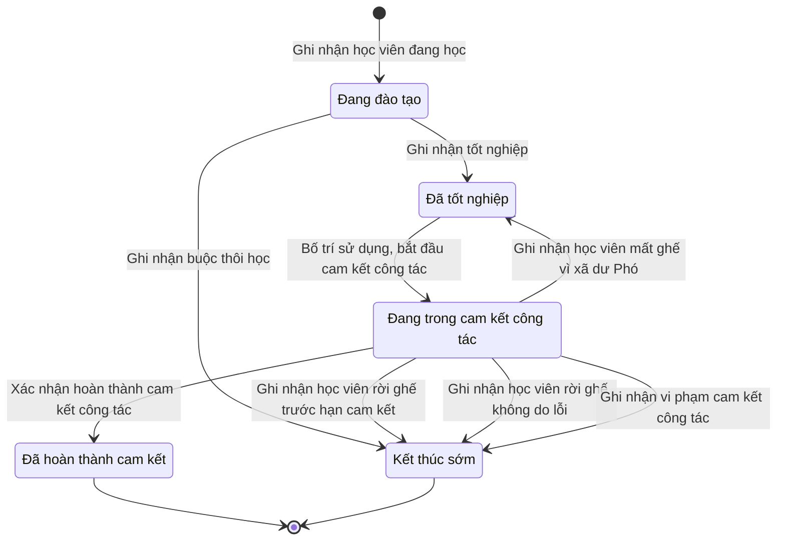

# qt-18 · Đào tạo CHT Ban CHQS xã (chuyển tiếp)

<!-- máy sinh: tom-tat -->
> **Hồ sơ:** Học viên đào tạo Chỉ huy trưởng (`CommandTrainee`)
>
> **Trong sổ phạm vi:** 18 · Đào tạo CHT Ban CHQS xã (chuyển tiếp) (tầng 2)
>
> 15 bước · 5 chặng · 5 vai · 0 bảng quyết định · 0 hạn · 4 khớp nối.
>
> **Nguồn:** sổ nghiệp vụ `qt-18` · khai báo của app: `dqtv-app/core/processes/command-training/workflow/command-trainee.yaml`. Các bảng do máy sinh từ nguồn này.
<!-- hết: tom-tat -->

<!-- viết tay: dien-giai -->
## Diễn giải

*Phần này viết tay, diễn giải lại điều các bảng bên dưới ghi.*

### Quy trình này để làm gì

Ban CHQS xã theo dõi **một học viên đang được đào tạo để giữ chức danh trong Ban chỉ huy quân sự cấp xã**: từ lúc đang học ở nhà trường, qua tốt nghiệp, phong quân hàm, bố trí sử dụng, tới khi đủ thời gian cam kết công tác. Đây là quy trình "chuyển tiếp": chỉ ghi nhận học viên trúng tuyển trước mốc chuyển tiếp.

Hồ sơ đi qua các chặng: *Đang đào tạo* → *Đã tốt nghiệp* → *Đang trong cam kết công tác* → *Đã hoàn thành cam kết*; và có một chặng kết thúc khác là *Kết thúc sớm*.

### Khi nào bắt đầu

Trợ lý Quân lực bấm **Ghi nhận học viên đang học**. Phải nhập học viên, trình độ đào tạo, chỉ tiêu tuyển sinh, nhà trường đào tạo và ngày trúng tuyển; các ô về nguồn đào tạo, chức danh quy hoạch, quyết định cử đi là ô nhập nếu có. Hồ sơ mở ra có nối tới chỉ tiêu (quy trình 2) và vào thẳng chặng *Đang đào tạo*.

Bước mở đòi điều kiện "trúng tuyển trước mốc chuyển tiếp" (`admittedBeforeTransitionCutoff`): mốc là ngày 01/9/2026, tính theo ngày trúng tuyển; trúng tuyển từ mốc trở đi thì hệ không nhận ghi, trước mốc thì ghi nhận bình thường.

### Diễn ra thế nào

1. **Đang đào tạo.** Ba việc ghi nhận, hồ sơ đứng yên:
   - Trợ lý Quân lực **Ghi nhận hợp đồng đào tạo, nhập học** — số hợp đồng, ngày ký, ngày nhập học, bản quét hợp đồng; số tiền theo hợp đồng chép từ văn bản đã ký. Đã có số hợp đồng thì không ghi lần hai được, hệ báo "hồ sơ này đã ghi nhận hợp đồng đào tạo rồi".
   - Nhân viên tài chính kiêm hậu cần **Ghi nhận đã thanh toán cho nhà trường** (lặp được) — mỗi lần là một đợt thanh toán.
   - Trợ lý Quân lực **Ghi nhận kết quả năm học** (lặp được) — năm học và kết quả nhà trường báo về (lên lớp hay lưu ban); bước ghi cả số lần lưu ban.

   Hai lối ra: **Ghi nhận tốt nghiệp** (ngày tốt nghiệp, số bằng, xếp loại) đưa hồ sơ sang *Đã tốt nghiệp*; **Ghi nhận buộc thôi học** (lý do, ngày, diễn giải) đưa hồ sơ sang *Kết thúc sớm*.
2. **Đã tốt nghiệp.** Vai Bộ CHQS cấp tỉnh (người làm phải thuộc một đơn vị nằm trong ô cấp trên của chủ hồ sơ) ghi **Phong quân hàm thiếu úy sĩ quan dự bị** — ngày phong, số quyết định, cơ quan ký, bản quét, và quyết định ấy trong sổ văn bản đến; hồ sơ đứng yên. Trợ lý Quân lực bấm **Bố trí sử dụng, bắt đầu cam kết công tác**: chọn hồ sơ nhân sự Ban chỉ huy quân sự cấp xã mà người này được bố trí vào, nhập ngày bố trí; hồ sơ sang *Đang trong cam kết công tác*. Ngày đủ cam kết do hệ suy từ ngày bố trí; thời gian cam kết là 36 tháng.
3. **Đang trong cam kết công tác.** Trợ lý Quân lực **Xác nhận hoàn thành cam kết công tác** (sang *Đã hoàn thành cam kết*) hoặc **Ghi nhận vi phạm cam kết công tác** (sang *Kết thúc sớm*).
4. **Kết thúc sớm.** Trợ lý Quân lực **Ghi nhận nghĩa vụ bồi hoàn chi phí đào tạo** — ngày ghi nhận và diễn giải; hồ sơ đứng yên. Đã có ngày ghi nhận bồi hoàn thì không ghi lần hai được, hệ báo "ghi lần hai là đòi bồi hoàn hai lượt".

### Kết thúc và để lại gì

Hai chặng kết thúc: *Đã hoàn thành cam kết* và *Kết thúc sớm* (chặng sau vẫn còn bước ghi nhận bồi hoàn). Hồ sơ nối tới chỉ tiêu (2) lúc mở, gắn với nhân sự Ban chỉ huy quân sự cấp xã (30.commune-command) ở bước bố trí sử dụng, và với văn bản đến (1.incoming-document) ở bước phong quân hàm.

### Điều kiện chặn

- Sai người, sai chặng, thiếu thứ phải có trước thì bước bị chặn, hồ sơ giữ nguyên. Bước phong quân hàm: người làm phải thuộc một đơn vị nằm trong ô cấp trên của chủ hồ sơ; chín bước còn lại sau bước mở: người làm phải thuộc đơn vị chủ hồ sơ.
- Bước mở: trúng tuyển từ mốc chuyển tiếp trở đi thì không ghi được.
- Hợp đồng đào tạo và nghĩa vụ bồi hoàn mỗi thứ chỉ ghi được một lần.
- Việc ngoài hệ: ranh giới `training-school`, người làm `trainingSchool`; hệ nhận về kết quả năm học gần nhất. Không được thì chặn, hồ sơ giữ nguyên.
- Quy trình này không có bảng quyết định và không có hạn.
<!-- hết viết tay -->

## 1. Đường đi ngắn nhất qua các chặng

<!-- máy sinh: luong-chinh -->
Đường ít bước nhất từ lúc mở hồ sơ tới chặng kết thúc xa nhất. Máy chọn theo số chặng, không theo ý nghĩa nghiệp vụ — trình tự công việc thật xem phần Diễn giải và bảng "Việc làm ở từng chặng" ở mục 6.

| # | Ai làm | Làm gì | Hồ sơ sang chặng |
|---|---|---|---|
| 1 | Trợ lý Quân lực | Ghi nhận học viên đang học | Đang đào tạo |
| 2 | Trợ lý Quân lực | Ghi nhận tốt nghiệp | Đã tốt nghiệp |
| 3 | Trợ lý Quân lực | Bố trí sử dụng, bắt đầu cam kết công tác | Đang trong cam kết công tác |
| 4 | Trợ lý Quân lực | Xác nhận hoàn thành cam kết công tác | Đã hoàn thành cam kết |

<!-- hết: luong-chinh -->

## 2. Hồ sơ và việc nó để lại

<!-- máy sinh: muc-tieu -->
**App gọi quy trình này là:** Học viên đào tạo Chỉ huy trưởng.

**Khi mở, hồ sơ này ghi mối nối tới:**
- Chỉ tiêu (2) — bước `recordStudyingTrainee`, khớp nối `traineeUnderTarget`
- Công dân trong độ tuổi (16) — bước `recordStudyingTrainee`, khớp nối `traineeIsCitizen`
<!-- hết: muc-tieu -->

## 3. Khởi phát và kết thúc

<!-- máy sinh: khoi-phat -->
**1 cửa vào** — bước mở hồ sơ:

| Bước mở | Ai mở | Hồ sơ vào chặng | App bắt buộc nhập |
|---|---|---|---|
| Ghi nhận học viên đang học | Trợ lý Quân lực | Đang đào tạo | học viên, trình độ đào tạo, `planTargetIds`, nhà trường đào tạo, ngày trúng tuyển |

**Kết thúc:** *Đã hoàn thành cam kết* (`COMPLETED`), *Kết thúc sớm* (`DISMISSED`)
<!-- hết: khoi-phat -->

## 4. Vai trò

<!-- máy sinh: vai-tro -->
| Vai trong sổ | Tên trong app | Điều kiện | Làm những bước |
|---|---|---|---|
| `personnel` | Trợ lý Quân lực |  | Ghi nhận học viên đang học · Ghi nhận hợp đồng đào tạo, nhập học · Ghi nhận kết quả năm học · Ghi nhận buộc thôi học · Ghi nhận tốt nghiệp · Bố trí sử dụng, bắt đầu cam kết công tác · Ghi nhận số căn cước của học viên · Xác nhận hoàn thành cam kết công tác · Ghi nhận vi phạm cam kết công tác · Ghi nhận nghĩa vụ bồi hoàn chi phí đào tạo |
| `finance` | Nhân viên tài chính kiêm hậu cần |  | Ghi nhận đã thanh toán cho nhà trường |
| `province` | Bộ CHQS cấp tỉnh | thuộc cấp trên của chủ hồ sơ (`actorInSuperiorUnit`, công thức ở mục 7) | Phong quân hàm thiếu úy sĩ quan dự bị |
| `system` | Hệ thống tự làm |  | Ghi nhận học viên mất ghế vì xã dư Phó |
| `commander` | Chỉ huy trưởng Ban CHQS xã |  | Ghi nhận học viên rời ghế trước hạn cam kết · Ghi nhận học viên rời ghế không do lỗi |

*"Tên trong app" là tên app đặt cho mã chủ thể của vai. Hồ sơ thuộc đơn vị cấp khác thì người làm là người giữ vai ấy ở đơn vị nêu trong cột "Điều kiện" (nếu sổ có ghi) và ở cột "Người làm phải thuộc" của bảng "Theo khai báo của app" (mục 7).*

**Ngoài hệ** (hệ chỉ ghi kết quả, xem mục 8): `trainingSchool`.
<!-- hết: vai-tro -->

## 5. Nhánh phụ

<!-- máy sinh: nhanh-phu -->
**Bước khác đưa hồ sơ sang chặng mới** — đường song song, rẽ nhánh hoặc kết thúc sớm:

| Bước | Ai làm | Từ chặng | Sang chặng |
|---|---|---|---|
| Ghi nhận buộc thôi học | Trợ lý Quân lực | Đang đào tạo | Kết thúc sớm |
| Ghi nhận học viên rời ghế trước hạn cam kết | Chỉ huy trưởng Ban CHQS xã | Đang trong cam kết công tác | Kết thúc sớm |
| Ghi nhận học viên rời ghế không do lỗi | Chỉ huy trưởng Ban CHQS xã | Đang trong cam kết công tác | Kết thúc sớm |
| Ghi nhận vi phạm cam kết công tác | Trợ lý Quân lực | Đang trong cam kết công tác | Kết thúc sớm |

**Quay lại một chặng hồ sơ đã đi qua** (tính theo đường ngắn nhất từ lúc mở):

| Bước | Ai làm | Từ chặng | Về chặng |
|---|---|---|---|
| Ghi nhận học viên mất ghế vì xã dư Phó | Hệ thống tự làm | Đang trong cam kết công tác | Đã tốt nghiệp |

**Làm trong lúc hồ sơ đứng yên ở một chặng** — ghi nhận, bổ sung:

| Bước | Ai làm | Ở chặng |
|---|---|---|
| Ghi nhận hợp đồng đào tạo, nhập học | Trợ lý Quân lực | Đang đào tạo |
| Ghi nhận đã thanh toán cho nhà trường *(lặp được)* | Nhân viên tài chính kiêm hậu cần | Đang đào tạo |
| Ghi nhận kết quả năm học *(lặp được)* | Trợ lý Quân lực | Đang đào tạo |
| Phong quân hàm thiếu úy sĩ quan dự bị | Bộ CHQS cấp tỉnh (thuộc cấp trên của chủ hồ sơ) | Đã tốt nghiệp |
| Ghi nhận số căn cước của học viên | Trợ lý Quân lực | Đang đào tạo, Đã tốt nghiệp, Đang trong cam kết công tác |
| Ghi nhận nghĩa vụ bồi hoàn chi phí đào tạo | Trợ lý Quân lực | Kết thúc sớm |

<!-- hết: nhanh-phu -->

## 6. Các chặng và việc làm ở từng chặng

<!-- máy sinh: chang -->
| Chặng | Tên hiển thị | Vào bằng bước | Kết thúc? |
|---|---|---|---|
| `STUDYING` | Đang đào tạo | Ghi nhận học viên đang học |  |
| `GRADUATED` | Đã tốt nghiệp | Ghi nhận tốt nghiệp · Ghi nhận học viên mất ghế vì xã dư Phó |  |
| `ASSIGNED` | Đang trong cam kết công tác | Bố trí sử dụng, bắt đầu cam kết công tác |  |
| `COMPLETED` | Đã hoàn thành cam kết | Xác nhận hoàn thành cam kết công tác | **kết thúc** |
| `DISMISSED` | Kết thúc sớm | Ghi nhận buộc thôi học · Ghi nhận học viên rời ghế trước hạn cam kết · Ghi nhận học viên rời ghế không do lỗi · Ghi nhận vi phạm cam kết công tác | **kết thúc** — vẫn còn bước làm được |

### Việc làm ở từng chặng

Hồ sơ đang ở chặng nào thì làm được những bước nào.

| Hồ sơ đang ở chặng | Bước làm tại chặng (hồ sơ đứng yên) | Bước đưa hồ sơ sang chặng khác |
|---|---|---|
| **Đang đào tạo** | Ghi nhận hợp đồng đào tạo, nhập học — Trợ lý Quân lực Ghi nhận đã thanh toán cho nhà trường (lặp được) — Nhân viên tài chính kiêm hậu cần Ghi nhận kết quả năm học (lặp được) — Trợ lý Quân lực Ghi nhận số căn cước của học viên — Trợ lý Quân lực | Ghi nhận buộc thôi học — Trợ lý Quân lực → *Kết thúc sớm* Ghi nhận tốt nghiệp — Trợ lý Quân lực → *Đã tốt nghiệp* |
| **Đã tốt nghiệp** | Phong quân hàm thiếu úy sĩ quan dự bị — Bộ CHQS cấp tỉnh (thuộc cấp trên của chủ hồ sơ) Ghi nhận số căn cước của học viên — Trợ lý Quân lực | Bố trí sử dụng, bắt đầu cam kết công tác — Trợ lý Quân lực → *Đang trong cam kết công tác* |
| **Đang trong cam kết công tác** | Ghi nhận số căn cước của học viên — Trợ lý Quân lực | Ghi nhận học viên mất ghế vì xã dư Phó — Hệ thống tự làm → *Đã tốt nghiệp* Ghi nhận học viên rời ghế trước hạn cam kết — Chỉ huy trưởng Ban CHQS xã → *Kết thúc sớm* Ghi nhận học viên rời ghế không do lỗi — Chỉ huy trưởng Ban CHQS xã → *Kết thúc sớm* Xác nhận hoàn thành cam kết công tác — Trợ lý Quân lực → *Đã hoàn thành cam kết* Ghi nhận vi phạm cam kết công tác — Trợ lý Quân lực → *Kết thúc sớm* |
| **Đã hoàn thành cam kết** | — | — (kết thúc) |
| **Kết thúc sớm** | Ghi nhận nghĩa vụ bồi hoàn chi phí đào tạo — Trợ lý Quân lực | — (kết thúc) |
<!-- hết: chang -->

## 7. Bảng bước

<!-- máy sinh: buoc -->
| # | Bước | Mã bước | Ai thực hiện | Từ chặng | Sang chặng | Phải có trước | Ghi lại |
|---|---|---|---|---|---|---|---|
| 1 | Ghi nhận học viên đang học | `recordStudyingTrainee` | Trợ lý Quân lực | — (mở hồ sơ) | `STUDYING` | `admittedBeforeTransitionCutoff` | học viên, năm sinh, thôn, tổ dân phố, trình độ đào tạo, mã tỉnh, mã xã, đơn vị chủ hồ sơ, cấp trên của chủ hồ sơ, nhà trường đào tạo, ngày trúng tuyển, số quyết định cử đi đào tạo, ngày quyết định cử đi, `planTargetId`, nối tới Chỉ tiêu, chức danh quy hoạch, năm dự kiến cử đi, nhận xét khi đưa vào nguồn, nguồn đào tạo, nối tới Công dân trong độ tuổi, `id` |
| 2 | Ghi nhận hợp đồng đào tạo, nhập học | `signContract` | Trợ lý Quân lực | `STUDYING` | giữ nguyên | người làm thuộc đơn vị chủ hồ sơ, `contractNotYetSigned` | số hợp đồng đào tạo, hợp đồng đào tạo (ảnh/bản quét), ngày ký hợp đồng, số tiền theo hợp đồng, ngày nhập học, `contractRecorded` |
| 3 | Ghi nhận đã thanh toán cho nhà trường | `recordPayment` | Nhân viên tài chính kiêm hậu cần | `STUDYING` | giữ nguyên | người làm thuộc đơn vị chủ hồ sơ | ngày thanh toán gần nhất, nối tới Đợt thanh toán kinh phí đào tạo |
| 4 | Ghi nhận kết quả năm học | `recordSchoolResult` | Trợ lý Quân lực | `STUDYING` | giữ nguyên | người làm thuộc đơn vị chủ hồ sơ | năm học, kết quả năm học gần nhất, đang lưu ban, số lần lưu ban, nối tới Kết quả một năm học |
| 5 | Ghi nhận buộc thôi học | `expelTrainee` | Trợ lý Quân lực | `STUDYING` | `DISMISSED` | người làm thuộc đơn vị chủ hồ sơ | lý do kết thúc sớm, ngày kết thúc sớm, diễn giải việc kết thúc sớm, nghĩa vụ bồi hoàn |
| 6 | Ghi nhận tốt nghiệp | `graduateTrainee` | Trợ lý Quân lực | `STUDYING` | `GRADUATED` | người làm thuộc đơn vị chủ hồ sơ | ngày tốt nghiệp, số bằng tốt nghiệp, xếp loại tốt nghiệp, đang lưu ban |
| 7 | Phong quân hàm thiếu úy sĩ quan dự bị | `commissionTrainee` | Bộ CHQS cấp tỉnh (thuộc cấp trên của chủ hồ sơ) | `GRADUATED` | giữ nguyên | người làm thuộc cấp trên của chủ hồ sơ, `commissionFromIncomingDocumentUsable`, `notYetCommissioned` | ngày phong quân hàm, số quyết định phong quân hàm, cơ quan ký quyết định, nối tới Văn bản đến, `commissionRecorded` |
| 8 | Bố trí sử dụng, bắt đầu cam kết công tác | `assignTrainee` | Trợ lý Quân lực | `GRADUATED` | `ASSIGNED` | người làm thuộc đơn vị chủ hồ sơ, `seatHeldByTrainee`, `seatAppointedAt`, `seatInCommandBoard`, `assignedPostIsPlanned` | nối tới Nhân sự Ban chỉ huy quân sự cấp xã, ngày bố trí sử dụng, chức danh được bố trí, xã được bố trí, ngày đủ cam kết công tác |
| 9 | Ghi nhận học viên mất ghế vì xã dư Phó | `releaseTraineeSeat` | Hệ thống tự làm | `ASSIGNED` | `GRADUATED` | — | ngày mất ghế, lý do mất ghế, nghĩa vụ bồi hoàn, số tháng đã công tác ở ghế cũ, nối tới Nhân sự Ban chỉ huy quân sự cấp xã |
| 10 | Ghi nhận số căn cước của học viên | `linkTraineeCitizen` | Trợ lý Quân lực | `STUDYING`, `GRADUATED`, `ASSIGNED` | giữ nguyên | — | nối tới Công dân trong độ tuổi |
| 11 | Ghi nhận học viên rời ghế trước hạn cam kết | `recordCommitmentBreachOnHandover` | Chỉ huy trưởng Ban CHQS xã | `ASSIGNED` | `DISMISSED` | người làm thuộc đơn vị chủ hồ sơ | lý do kết thúc sớm, ngày kết thúc sớm, diễn giải việc kết thúc sớm, nghĩa vụ bồi hoàn |
| 12 | Ghi nhận học viên rời ghế không do lỗi | `recordNoFaultLeaveOnHandover` | Chỉ huy trưởng Ban CHQS xã | `ASSIGNED` | `DISMISSED` | người làm thuộc đơn vị chủ hồ sơ | lý do kết thúc sớm, ngày kết thúc sớm, diễn giải việc kết thúc sớm, nghĩa vụ bồi hoàn |
| 13 | Xác nhận hoàn thành cam kết công tác | `completeCommitment` | Trợ lý Quân lực | `ASSIGNED` | `COMPLETED` | người làm thuộc đơn vị chủ hồ sơ | ngày hoàn thành cam kết |
| 14 | Ghi nhận vi phạm cam kết công tác | `breachCommitment` | Trợ lý Quân lực | `ASSIGNED` | `DISMISSED` | người làm thuộc đơn vị chủ hồ sơ | lý do kết thúc sớm, ngày kết thúc sớm, diễn giải việc kết thúc sớm, nghĩa vụ bồi hoàn |
| 15 | Ghi nhận nghĩa vụ bồi hoàn chi phí đào tạo | `raiseReimbursement` | Trợ lý Quân lực | `DISMISSED` | giữ nguyên | người làm thuộc đơn vị chủ hồ sơ, `reimbursementNotYetRaised`, `reimbursementOwed` | ngày ghi nhận bồi hoàn, nghĩa vụ bồi hoàn, diễn giải nghĩa vụ bồi hoàn, `reimbursementLogged` |

### Khi không đạt điều kiện

Mặc định: không đúng người, hồ sơ không ở đúng chặng, hoặc thiếu thứ "phải có trước" thì bước bị chặn, hồ sơ giữ nguyên. Bảng dưới chỉ kê những bước có kết quả riêng.

| # | Bước | Kết quả riêng |
|---|---|---|
| 9 | Ghi nhận học viên mất ghế vì xã dư Phó | bước này không do người nào bấm |

### Điều kiện "phải có trước" bằng lời

Cột "Phải có trước" ở bảng bước có hai loại: ô dữ liệu thường (bước chỉ đòi ô ấy đã có giá trị) và điều kiện hệ tự xét. Bảng này diễn các điều kiện hệ tự xét theo đúng công thức sổ ghi; số ở cột cuối là số thứ tự bước.

| Điều kiện | Đúng khi | Bước đòi |
|---|---|---|
| `actorInOwnerUnit` | người đang làm là người của đơn vị ghi ở ô đơn vị chủ hồ sơ của hồ sơ này (theo danh mục người của đơn vị, `dm.unit-staff`) | 2, 3, 4, 5, 6, 8, 11, 12, 13, 14, 15 |
| `contractNotYetSigned` | KHÔNG (đã có `contractRecorded`) | 2 |
| `actorInSuperiorUnit` | người đang làm là người của một đơn vị nằm trong ô cấp trên của chủ hồ sơ của hồ sơ này (theo danh mục người của đơn vị, `dm.unit-staff`) | 7 |
| `commissionFromIncomingDocumentUsable` | có hồ sơ Việc luật giao kèm văn bản đến, đi — Văn bản đến (qt-1.incoming-document) chính là hồ sơ ghi ở ô nối `commissionFromIncomingDocument` của hồ sơ đang làm mà hồ sơ ấy đang ở chặng `RECEIVED` hoặc `DISTRIBUTED` | 7 |
| `notYetCommissioned` | KHÔNG (đã có `commissionRecorded`) | 7 |
| `assignedPostIsPlanned` | `chosenSeatPost` bằng chức danh quy hoạch | 8 |
| `reimbursementNotYetRaised` | KHÔNG (đã có `reimbursementLogged`) | 15 |
| `reimbursementOwed` | đã có lý do kết thúc sớm VÀ nghĩa vụ bồi hoàn là Có (`yes`) | 15 |

### Theo khai báo của app

Người làm phải thuộc đơn vị nào, ô người dùng phải nhập, bước có lặp được không, và căn cứ pháp lý — lấy từ khai báo quy trình trong app.

| # | Bước | Người làm phải thuộc | Bắt buộc nhập | Nhập nếu có | Lặp được | Căn cứ |
|---|---|---|---|---|---|---|
| 1 | Ghi nhận học viên đang học |  | học viên, trình độ đào tạo, `planTargetIds`, nhà trường đào tạo, ngày trúng tuyển | năm sinh, thôn, tổ dân phố, năm dự kiến cử đi, nguồn đào tạo, chức danh quy hoạch, nhận xét khi đưa vào nguồn, số quyết định cử đi đào tạo, ngày quyết định cử đi, số căn cước công dân của học viên |  | L14/2026 Đ.10 k2, Đ.9 k7; TT87/2011/TT-BQP Đ.3 |
| 2 | Ghi nhận hợp đồng đào tạo, nhập học | đơn vị chủ hồ sơ | số hợp đồng đào tạo, ngày ký hợp đồng, ngày nhập học, hợp đồng đào tạo (ảnh/bản quét) | số tiền theo hợp đồng |  | TT87/2011/TT-BQP Đ.12 k1 |
| 3 | Ghi nhận đã thanh toán cho nhà trường | đơn vị chủ hồ sơ | ngày thanh toán gần nhất | — | có | TT87/2011/TT-BQP Đ.12 k2 · QĐ1126/QĐ-TM Đ.16 k2 |
| 4 | Ghi nhận kết quả năm học | đơn vị chủ hồ sơ | năm học, kết quả nhà trường báo về | diễn giải việc kết thúc sớm | có | TT107/2010/TT-BQP |
| 5 | Ghi nhận buộc thôi học | đơn vị chủ hồ sơ | lý do kết thúc sớm, ngày kết thúc sớm, diễn giải việc kết thúc sớm | — |  | TT87/2011/TT-BQP Đ.15 k7 |
| 6 | Ghi nhận tốt nghiệp | đơn vị chủ hồ sơ | ngày tốt nghiệp | số bằng tốt nghiệp, xếp loại tốt nghiệp |  | TT107/2010/TT-BQP |
| 7 | Phong quân hàm thiếu úy sĩ quan dự bị | cấp trên của chủ hồ sơ | ngày phong quân hàm, quyết định trong sổ văn bản đến | số quyết định phong quân hàm, cơ quan ký quyết định |  | L48/2019/QH14 Đ.49 k2 a |
| 8 | Bố trí sử dụng, bắt đầu cam kết công tác | đơn vị chủ hồ sơ | `assignmentId` | — |  | TTLT01/2013/TTLT-BNV-BQP Đ.19 k1, k3 |
| 9 | Ghi nhận học viên mất ghế vì xã dư Phó |  | `assignmentId`, ngày mất ghế, số tháng đã công tác ở ghế cũ | lý do mất ghế |  | sổ qt-18 · step:releaseTraineeSeat · TTLT01/2013 Đ.19 k2 · TT87/2011 Đ.15 k8 |
| 10 | Ghi nhận số căn cước của học viên |  | số căn cước công dân của học viên | — |  | sổ qt-18 · link.traineeIsCitizen |
| 11 | Ghi nhận học viên rời ghế trước hạn cam kết | đơn vị chủ hồ sơ | ngày kết thúc sớm, diễn giải việc kết thúc sớm | lý do kết thúc sớm |  | TTLT01/2013/TTLT-BNV-BQP Đ.19 k2 · TT87/2011/TT-BQP Đ.15 k8 b, c |
| 12 | Ghi nhận học viên rời ghế không do lỗi | đơn vị chủ hồ sơ | ngày kết thúc sớm, diễn giải việc kết thúc sớm | — |  | TTLT01/2013/TTLT-BNV-BQP Đ.20 · TT87/2011/TT-BQP Đ.15 k8 |
| 13 | Xác nhận hoàn thành cam kết công tác | đơn vị chủ hồ sơ | ngày hoàn thành cam kết | — |  | TTLT01/2013/TTLT-BNV-BQP Đ.19 k2 |
| 14 | Ghi nhận vi phạm cam kết công tác | đơn vị chủ hồ sơ | lý do kết thúc sớm, ngày kết thúc sớm, diễn giải việc kết thúc sớm | — |  | TT87/2011/TT-BQP Đ.15 k8 |
| 15 | Ghi nhận nghĩa vụ bồi hoàn chi phí đào tạo | đơn vị chủ hồ sơ | ngày ghi nhận bồi hoàn, diễn giải nghĩa vụ bồi hoàn | — |  | TT87/2011/TT-BQP Đ.15 k8 |
| — | Ghi nhận học viên rời ghế theo diện được miễn 36 tháng (`releaseTraineeSeatOnExemptLeave`) | đơn vị chủ hồ sơ | `assignmentId`, ngày mất ghế, số tháng đã công tác ở ghế cũ | lý do mất ghế |  | TTLT01/2013/TTLT-BNV-BQP Đ.19 k2 · TT87/2011/TT-BQP Đ.15 k8 |

### Điều kiện và ghi chú app khai cho từng bước

Lấy từ khai báo quy trình trong app. Lời trong ngoặc kép là câu app hiện cho người dùng. Chức danh người ký ngoài hệ app chỉ khai bằng mã.

| # | Bước | Điều kiện, ghi chú |
|---|---|---|
| 2 | Ghi nhận hợp đồng đào tạo, nhập học | · không làm được khi đã có ô "số hợp đồng đào tạo" — app báo: "hồ sơ này đã ghi nhận hợp đồng đào tạo rồi" |
| 3 | Ghi nhận đã thanh toán cho nhà trường | · tạo thêm một hồ sơ con: Đợt thanh toán kinh phí đào tạo (`TuitionPayment`) |
| 4 | Ghi nhận kết quả năm học | · tạo thêm một hồ sơ con: Kết quả một năm học (`SchoolYearResult`) |
| 5 | Ghi nhận buộc thôi học | · phải đã có ô "kết quả năm học gần nhất" — thiếu thì app báo: "chưa có kết quả năm học của nhà trường — ghi nhận kết quả năm học trước khi ghi nhận buộc thôi học" |
| 6 | Ghi nhận tốt nghiệp | · phải đã có ô "kết quả năm học gần nhất" — thiếu thì app báo: "chưa có kết quả năm học của nhà trường — ghi nhận kết quả năm học trước khi ghi nhận tốt nghiệp" |
| 7 | Phong quân hàm thiếu úy sĩ quan dự bị | · không đòi bản chụp — app ghi: "bản chụp quyết định phong quân hàm lấy từ văn bản đến văn thư đã vào sổ (tầng đọc chép `scanPath`), không tải ảnh ở bước này" |
| 15 | Ghi nhận nghĩa vụ bồi hoàn chi phí đào tạo | · không làm được khi đã có ô "ngày ghi nhận bồi hoàn" — app báo: "hồ sơ này đã ghi nhận nghĩa vụ bồi hoàn rồi — ghi lần hai là đòi bồi hoàn hai lượt" |
<!-- hết: buoc -->

## 8. Bảng quyết định, hạn, việc ngoài hệ

<!-- máy sinh: quyet-dinh -->
**Việc làm ngoài hệ, hệ chỉ ghi kết quả:**

| Ranh giới | Ai làm | Hệ gửi ra | Hệ nhận về | Không được thì |
|---|---|---|---|---|
| `training-school` | `trainingSchool` | — | kết quả năm học gần nhất | chặn, hồ sơ giữ nguyên |
<!-- hết: quyet-dinh -->

## 9. Dữ liệu của hồ sơ

<!-- máy sinh: du-lieu -->
Các ô mà bước trong sổ ghi hoặc đòi. Số trong hai cột cuối là số thứ tự bước ở bảng bước (mục 7).

| Ô dữ liệu | Mã | Kiểu (app) | Giá trị cho phép | Loại ô (sổ) | Bước ghi | Bước đòi | Mô tả trong app |
|---|---|---|---|---|---|---|---|
| học viên | `traineeName` | chữ |  | đưa vào ở bước (`input`) | 1 | — | Họ tên học viên |
| năm sinh | `birthYear` | số |  | đưa vào ở bước (`input`) | 1 | — | Năm sinh |
| thôn, tổ dân phố | `hamletName` | chữ |  | đưa vào ở bước (`input`) | 1 | — | Thôn, tổ dân phố nơi cư trú |
| trình độ đào tạo | `level` | chọn một | Cao đẳng ngành quân sự cơ sở (`college`), Đại học ngành quân sự cơ sở (`university`) | đưa vào ở bước (`input`) | 1 | — | Trình độ đào tạo — L98/2025 bỏ trung cấp, chỉ còn cao đẳng và đại học ngành quân sự cơ sở |
| mã tỉnh | `provinceCode` | chữ |  | lưu trên hồ sơ (`stored`) | 1 | — | Mã tỉnh — dùng lọc phạm vi theo hàng; rỗng khi hồ sơ thuộc quân khu hoặc Bộ Quốc phòng |
| mã xã | `communeCode` | chữ |  | lưu trên hồ sơ (`stored`) | 1 | — | Mã xã cử đi đào tạo |
| đơn vị chủ hồ sơ | `ownerUnit` |  |  | lưu trên hồ sơ (`stored`) | 1 | — |  |
| cấp trên của chủ hồ sơ | `superiorUnits` |  |  | hệ suy ra (`derived`) | 1 | — |  |
| nhà trường đào tạo | `schoolName` | chữ |  | đưa vào ở bước (`input`) | 1 | — | Nhà trường quân đội đào tạo |
| ngày trúng tuyển | `admittedAt` | ngày |  | đưa vào ở bước (`input`) | 1 | — | Ngày có kết quả trúng tuyển |
| số quyết định cử đi đào tạo | `dispatchDecision` | chữ |  | đưa vào ở bước (`input`) | 1 | — | Số quyết định cử đi đào tạo |
| ngày quyết định cử đi | `dispatchedAt` | ngày |  | đưa vào ở bước (`input`) | 1 | — | Ngày quyết định cử đi đào tạo |
| — | `planTargetId` | chữ |  | lưu trên hồ sơ (`stored`) | 1 | — | id chỉ tiêu tuyển sinh mà người này đi học theo — lọc nhanh, quan hệ thật ở traineeUnderTarget |
| chức danh quy hoạch | `plannedPost` | chọn một | Chỉ huy trưởng Ban chỉ huy quân sự cấp xã (`commander`), Phó Chỉ huy trưởng Ban chỉ huy quân sự cấp xã (`deputy_commander`), Trợ lý Tác huấn Ban chỉ huy quân sự cấp xã (`assistant_training`), Trợ lý Quân lực Ban chỉ huy quân sự cấp xã (`assistant_personnel`) | đưa vào ở bước (`input`) | 1 | — | Chức danh quy hoạch trong Ban chỉ huy quân sự cấp xã — bố trí sau đào tạo phải khớp (TTLT01/2013 Đ.19 k3) |
| năm dự kiến cử đi | `plannedYear` | số |  | đưa vào ở bước (`input`) | 1 | — | Năm dự kiến cử đi đào tạo |
| nhận xét khi đưa vào nguồn | `planNote` | chữ |  | đưa vào ở bước (`input`) | 1 | — | Nhận xét khi đưa vào nguồn |
| nguồn đào tạo | `trainingSource` | chọn một | Cán bộ, chiến sĩ dân quân tự vệ nòng cốt (`core_militia`), Cán bộ, đảng viên đang công tác ở cấp xã (`commune_cadre`), Hạ sĩ quan, chiến sĩ thôi phục vụ Quân đội, Công an (`demobilized`), Chỉ huy trưởng, Phó Chỉ huy trưởng chưa qua đào tạo (`untrained_commander`) | đưa vào ở bước (`input`) | 1 | — | Nguồn, đối tượng đưa vào quy hoạch đào tạo — TT107/2010 Đ.2 |
| — | `id` |  |  | lưu trên hồ sơ (`stored`) | 1 | — |  |
| số hợp đồng đào tạo | `contractNumber` | chữ |  | đưa vào ở bước (`input`) | 2 | — | Số hợp đồng đào tạo |
| hợp đồng đào tạo (ảnh/bản quét) | `contractScanPath` | tệp |  | đưa vào ở bước (`input`) | 2 | — | Ảnh/bản quét hợp đồng đào tạo đã ký |
| ngày ký hợp đồng | `contractSignedAt` | ngày |  | đưa vào ở bước (`input`) | 2 | — | Ngày ký hợp đồng đào tạo |
| số tiền theo hợp đồng | `contractAmount` | số |  | đưa vào ở bước (`input`) | 2 | — | Số tiền ghi trong hợp đồng đào tạo — chép từ văn bản đã ký, không tính từ định mức |
| ngày nhập học | `enrolledAt` | ngày |  | đưa vào ở bước (`input`) | 2 | — | Ngày nhập học — mốc tính hạn thanh toán đợt đầu |
| — | `contractRecorded` |  |  | lưu trên hồ sơ (`stored`) | 2 | — |  |
| ngày thanh toán gần nhất | `lastPaidAt` | ngày |  | đưa vào ở bước (`input`) | 3 | — | Ngày thanh toán gần nhất cho nhà trường |
| năm học đã báo kết quả | `schoolYear` | số |  | đưa vào ở bước (`input`) | 4 | — | Năm học gần nhất nhà trường đã báo kết quả (năm dương lịch) |
| kết quả năm học gần nhất | `schoolResult` | chọn một | Lên lớp (`promoted`), Lưu ban (`repeat`) | lưu trên hồ sơ (`stored`) | 4 | — | Kết quả năm học gần nhất nhà trường báo về — sổ qt-18 |
| đang lưu ban | `repeating` | chọn một | Đang lưu ban (`yes`), Học đúng tiến độ (`no`) | lưu trên hồ sơ (`stored`) | 4, 6 | — | Đang lưu ban, học lại một năm — TT107/2010 |
| số lần lưu ban | `repeatCount` | số |  | lưu trên hồ sơ (`stored`) | 4 | — | Số lần lưu ban |
| lý do kết thúc sớm | `exitReason` | chọn một | Bị kỷ luật buộc thôi học (`expelled`), Tự thôi học không có lý do chính đáng (`quit_no_reason`), Không chấp hành sự phân công công tác (`refused_assignment`), Bị kỷ luật, thôi việc trong thời gian chấp hành phân công (`disciplined_after_graduation`), Rời ghế không do lỗi — không bồi hoàn (`left_without_fault`) | đưa vào ở bước (`input`) | 5, 11, 12, 14 | — | Lý do kết thúc sớm — bốn trường hợp đầu phát sinh nghĩa vụ bồi hoàn (TT87/2011 Đ.15 k8); rời ghế không do lỗi (TTLT01/2013 Đ.20, 13/10/2026) thì không |
| ngày kết thúc sớm | `exitAt` | ngày |  | đưa vào ở bước (`input`) | 5, 11, 12, 14 | — | Ngày kết thúc sớm |
| diễn giải việc kết thúc sớm | `exitNote` | chữ |  | đưa vào ở bước (`input`) | 5, 11, 12, 14 | — | Diễn giải việc kết thúc sớm |
| nghĩa vụ bồi hoàn | `reimbursementDue` | chọn một | Có (`yes`), Không (`no`) | lưu trên hồ sơ (`stored`) | 5, 9, 11, 12, 14, 15 | — | Có phát sinh nghĩa vụ bồi hoàn hay không — TT87/2011 Đ.15 k8 |
| ngày tốt nghiệp | `graduatedAt` | ngày |  | đưa vào ở bước (`input`) | 6 | — | Ngày tốt nghiệp |
| số bằng tốt nghiệp | `diplomaNumber` | chữ |  | đưa vào ở bước (`input`) | 6 | — | Số bằng tốt nghiệp |
| xếp loại tốt nghiệp | `classification` | chọn một | Xuất sắc (`excellent`), Giỏi (`good`), Khá (`fair`), Trung bình (`average`) | đưa vào ở bước (`input`) | 6 | — | Xếp loại tốt nghiệp |
| ngày phong quân hàm | `commissionedAt` | ngày |  | đưa vào ở bước (`input`) | 7 | — | Ngày phong quân hàm thiếu úy sĩ quan dự bị |
| số quyết định phong quân hàm | `commissionDecision` | chữ |  | đưa vào ở bước (`input`) | 7 | — | Số quyết định phong quân hàm |
| cơ quan ký quyết định | `commissionDecisionAuthority` | chữ |  | đưa vào ở bước (`input`) | 7 | — | Cơ quan, người ký quyết định phong quân hàm — sổ qt-18 |
| — | `commissionRecorded` |  |  | lưu trên hồ sơ (`stored`) | 7 | — |  |
| ngày bố trí sử dụng | `assignedAt` | ngày |  | lưu trên hồ sơ (`stored`) | 8 | — | Ngày quyết định bố trí sử dụng — mốc bắt đầu cam kết |
| chức danh được bố trí | `assignedPost` | chọn một | Chỉ huy trưởng Ban chỉ huy quân sự cấp xã (`commander`), Phó Chỉ huy trưởng Ban chỉ huy quân sự cấp xã (`deputy_commander`), Trợ lý Tác huấn Ban chỉ huy quân sự cấp xã (`assistant_training`), Trợ lý Quân lực Ban chỉ huy quân sự cấp xã (`assistant_personnel`) | lưu trên hồ sơ (`stored`) | 8 | — | Chức danh được bố trí trong Ban chỉ huy quân sự cấp xã — L98/2025 Đ.10 k13 thêm Trợ lý vào diện phải đào tạo |
| xã được bố trí | `assignedCommune` | chữ |  | lưu trên hồ sơ (`stored`) | 8 | — | Xã được bố trí công tác |
| ngày đủ cam kết công tác | `commitmentUntil` | ngày |  | lưu trên hồ sơ (`stored`) | 8 | — | Ngày đủ cam kết công tác — suy ra từ ngày bố trí |
| ngày mất ghế | `seatReleasedAt` | ngày |  | đưa vào ở bước (`input`) | 9 | — | Ngày ghế bị miễn nhiệm vì xã dư Phó — học viên về lại chờ bố trí |
| lý do mất ghế | `seatReleasedReason` | chữ |  | lưu trên hồ sơ (`stored`) | 9 | — | Lý do mất ghế — không phải lỗi của học viên |
| số tháng đã công tác ở ghế cũ | `monthsServedBeforeRelease` | số |  | đưa vào ở bước (`input`) | 9 | — | Số tháng đã công tác ở ghế cũ — cộng dồn vào cam kết khi bố trí lại |
| ngày hoàn thành cam kết | `completedAt` | ngày |  | đưa vào ở bước (`input`) | 13 | — | Ngày xác nhận hoàn thành cam kết |
| ngày ghi nhận bồi hoàn | `reimbursementRaisedAt` | ngày |  | đưa vào ở bước (`input`) | 15 | — | Ngày ghi nhận nghĩa vụ bồi hoàn |
| diễn giải nghĩa vụ bồi hoàn | `reimbursementNote` | chữ |  | đưa vào ở bước (`input`) | 15 | — | Diễn giải nghĩa vụ bồi hoàn |
| — | `reimbursementLogged` |  |  | lưu trên hồ sơ (`stored`) | 15 | — |  |
| — | `admittedBeforeTransitionCutoff` |  | có hay chưa | đưa vào ở bước (`input`) | — | 1 |  |
| người làm thuộc đơn vị chủ hồ sơ | `actorInOwnerUnit` |  | có hay chưa | hệ suy ra (`derived`) | — | 2, 3, 4, 5, 6, 8, 11, 12, 13, 14, 15 |  |
| — | `contractNotYetSigned` |  |  | hệ suy ra (`derived`) | — | 2 |  |
| người làm thuộc cấp trên của chủ hồ sơ | `actorInSuperiorUnit` |  | có hay chưa | hệ suy ra (`derived`) | — | 7 |  |
| — | `commissionFromIncomingDocumentUsable` |  | có hay chưa | hệ suy ra (`derived`) | — | 7 |  |
| — | `notYetCommissioned` |  |  | hệ suy ra (`derived`) | — | 7 |  |
| — | `seatHeldByTrainee` |  | có hay chưa | đưa vào ở bước (`input`) | — | 8 |  |
| — | `seatAppointedAt` |  | có hay chưa | đưa vào ở bước (`input`) | — | 8 |  |
| — | `seatInCommandBoard` |  | có hay chưa | đưa vào ở bước (`input`) | — | 8 |  |
| — | `assignedPostIsPlanned` |  | có hay chưa | hệ suy ra (`derived`) | — | 8 |  |
| — | `reimbursementNotYetRaised` |  |  | hệ suy ra (`derived`) | — | 15 |  |
| — | `reimbursementOwed` |  | có hay chưa | hệ suy ra (`derived`) | — | 15 |  |

63 ô. Cột "Loại ô" là cách sổ phân loại ô, in kèm đúng chữ của sổ; ô nào người dùng phải nhập xem bảng "Theo khai báo của app" ở mục 7.
<!-- hết: du-lieu -->

## 10. Khớp nối với quy trình khác

<!-- máy sinh: khop-noi -->
| Quy trình kia | Hồ sơ kia | Quan hệ | Nội dung (mô tả trong app) | Bước ghi mối nối | Tên ô nối |
|---|---|---|---|---|---|
| 1.incoming-document | Văn bản đến | gắn với nhau ở một bước giữa chừng | Quyết định phong quân hàm thiếu úy sĩ quan dự bị trong sổ văn bản đến — sổ qt-18 | 18·commissionTrainee | `commissionFromIncomingDocument` |
| 16 | Công dân trong độ tuổi | hồ sơ này **mở ra có nối tới** hồ sơ kia | Học viên là công dân nào trong dữ liệu dân cư — để nhận ra học viên đang cam kết khi họ rời ghế | 18·linkTraineeCitizen, 18·recordStudyingTrainee ⊕ | `traineeIsCitizen` |
| 2 | Chỉ tiêu | hồ sơ này **mở ra có nối tới** hồ sơ kia | Người này đi học theo chỉ tiêu tuyển sinh ngành quân sự cơ sở được giao — TT87/2011/TT-BQP Đ.6 | 18·recordStudyingTrainee ⊕ | `traineeUnderTarget` |
| 30.commune-command | Nhân sự Ban chỉ huy quân sự cấp xã | gắn với nhau ở một bước giữa chừng | Bố trí sử dụng sau đào tạo — TTLT01/2013 Đ.19 k1, k3 | 18·assignTrainee, 18·releaseTraineeSeat | `traineeAssignedTo` |

4 khớp nối. ⊕ là bước tạo hồ sơ.
<!-- hết: khop-noi -->

## 11. Thông tin chung

<!-- máy sinh: thong-tin -->
| | |
|---|---|
| **Mã trong sổ** | `qt-18` |
| **Quy trình trong app** | `command-training` (`workflow/command-trainee.yaml`) — mặt công tác: `training-education` |
| **Hồ sơ** | Học viên đào tạo Chỉ huy trưởng (`CommandTrainee`) |
| **Căn cứ pháp lý từng bước** | cột "Căn cứ" ở bảng "Theo khai báo của app", mục 7 |
<!-- hết: thong-tin -->
