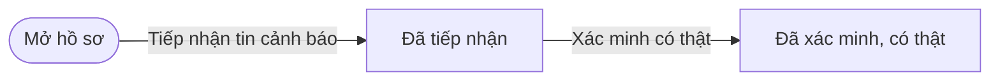
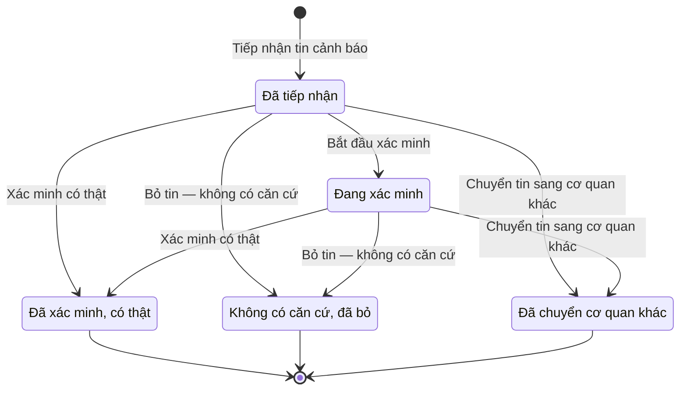

# qt-19 · Tin cảnh báo

<!-- máy sinh: tom-tat -->
> **Hồ sơ:** Tin cảnh báo, báo động (`EmergencyAlert`)
>
> **Trong sổ phạm vi:** 19 · Tin cảnh báo (tầng 3)
>
> 5 bước · 5 chặng · 2 vai · 0 bảng quyết định · 0 hạn · 1 khớp nối.
>
> **Nguồn:** sổ nghiệp vụ `qt-19` · khai báo của app: `dqtv-app/core/processes/alert/workflow/alert.yaml`. Các bảng do máy sinh từ nguồn này.
<!-- hết: tom-tat -->

<!-- viết tay: dien-giai -->
## Diễn giải

*Phần này viết tay, diễn giải lại điều các bảng bên dưới ghi.*

### Quy trình này để làm gì

Ban CHQS xã ghi lại một **tin cảnh báo, báo động** nhận được và theo nó tới khi có kết luận: tin có thật, tin không có căn cứ, hay tin không thuộc việc của dân quân nên chuyển cơ quan khác. Hồ sơ đi qua hai chặng chờ (*Đã tiếp nhận*, *Đang xác minh*) rồi dừng ở một trong ba chặng kết thúc.

### Khi nào bắt đầu

Trợ lý Tác huấn bấm **Tiếp nhận tin cảnh báo**. Phải nhập loại sự cố, nguồn tin, vị trí và nội dung tin; mức độ và người báo tin nhập nếu có. Nguồn tin chọn trong: cơ quan chức năng, người dân báo qua ứng dụng, tuần tra, tổng đài 112 của tỉnh chuyển về, hoặc nguồn khác. Hồ sơ vào chặng *Đã tiếp nhận* — chờ xác minh.

### Diễn ra thế nào

**Chặng "Đã tiếp nhận".** Trợ lý Tác huấn bấm **Bắt đầu xác minh**, nhập giao cho ai xác minh; hồ sơ sang *Đang xác minh* — đang gọi lại, kiểm tra thực địa. Bước này không bắt buộc: ba bước kết luận dưới đây bấm được ngay từ *Đã tiếp nhận*.

**Chặng "Đang xác minh" (hoặc ngay từ "Đã tiếp nhận")** — một trong ba kết luận:

- **Xác minh có thật** (Chỉ huy trưởng Ban CHQS xã): phải nhập xác minh bằng cách nào, thấy gì; đây là một quyết định trong hệ, kết quả đồng ý. Hồ sơ sang *Đã xác minh, có thật*; ở chặng này mở được vụ việc ứng phó.
- **Bỏ tin — không có căn cứ** (Chỉ huy trưởng Ban CHQS xã): đây là một quyết định trong hệ, kết quả từ chối, phải ghi vì sao bỏ tin. Tin sai vẫn để lại dấu vết để rà nguồn hay báo sai. Hồ sơ sang *Không có căn cứ, đã bỏ*.
- **Chuyển tin sang cơ quan khác** (Trợ lý Tác huấn): phải chọn chuyển sang đâu — Công an (113), Cảnh sát PCCC và CNCH (114), Cấp cứu y tế (115) hoặc cơ quan khác; ghi chú chuyển cho ai, qua đường nào là ô nhập nếu có. Bước ghi lại thời điểm chuyển. Hồ sơ sang *Đã chuyển cơ quan khác*.

Cả ba kết luận đều là chặng kết thúc.

### Kết thúc và để lại gì

Hồ sơ kết thúc ở *Đã xác minh, có thật*, *Không có căn cứ, đã bỏ* hoặc *Đã chuyển cơ quan khác*. Vụ việc ứng phó (quy trình 20) ghi nó mở từ tin cảnh báo nào.

### Điều kiện chặn

- Bốn bước sau bước tiếp nhận: người làm phải thuộc đơn vị ghi ở ô đơn vị chủ hồ sơ. Sai người hoặc hồ sơ không ở đúng chặng thì bước bị chặn, hồ sơ giữ nguyên.
- Ba bước kết luận phải nhập ô của mình: xác minh bằng cách nào và thấy gì, vì sao bỏ tin, chuyển sang đâu.
<!-- hết viết tay -->

## 1. Đường đi ngắn nhất qua các chặng

<!-- máy sinh: luong-chinh -->
Đường ít bước nhất từ lúc mở hồ sơ tới chặng kết thúc xa nhất. Máy chọn theo số chặng, không theo ý nghĩa nghiệp vụ — trình tự công việc thật xem phần Diễn giải và bảng "Việc làm ở từng chặng" ở mục 6.

| # | Ai làm | Làm gì | Hồ sơ sang chặng |
|---|---|---|---|
| 1 | Trợ lý Tác huấn | Tiếp nhận tin cảnh báo | Đã tiếp nhận |
| 2 | Chỉ huy trưởng Ban CHQS xã | Xác minh có thật | Đã xác minh, có thật |

<!-- hết: luong-chinh -->

## 2. Hồ sơ và việc nó để lại

<!-- máy sinh: muc-tieu -->
**App gọi quy trình này là:** Chặng 5 — Tin cảnh báo.

**Hồ sơ này để lại cho quy trình khác** (bước tạo hồ sơ của quy trình kia ghi mối nối về đây):
- Vụ việc ứng phó (20) — bước `openCase`, khớp nối `triggeredBy`
<!-- hết: muc-tieu -->

## 3. Khởi phát và kết thúc

<!-- máy sinh: khoi-phat -->
**1 cửa vào** — bước mở hồ sơ:

| Bước mở | Ai mở | Hồ sơ vào chặng | App bắt buộc nhập |
|---|---|---|---|
| Tiếp nhận tin cảnh báo | Trợ lý Tác huấn | Đã tiếp nhận | loại sự cố, nguồn tin, vị trí, nội dung tin |

**Kết thúc:** *Đã xác minh, có thật* (`CONFIRMED`), *Không có căn cứ, đã bỏ* (`DISMISSED`), *Đã chuyển cơ quan khác* (`TRANSFERRED`)
<!-- hết: khoi-phat -->

## 4. Vai trò

<!-- máy sinh: vai-tro -->
| Vai trong sổ | Tên trong app | Điều kiện | Làm những bước |
|---|---|---|---|
| `watch` | Trợ lý Tác huấn |  | Tiếp nhận tin cảnh báo · Bắt đầu xác minh · Chuyển tin sang cơ quan khác |
| `commander` | Chỉ huy trưởng Ban CHQS xã |  | Xác minh có thật · Bỏ tin — không có căn cứ |

*"Tên trong app" là tên app đặt cho mã chủ thể của vai. Hồ sơ thuộc đơn vị cấp khác thì người làm là người giữ vai ấy ở đơn vị nêu trong cột "Điều kiện" (nếu sổ có ghi) và ở cột "Người làm phải thuộc" của bảng "Theo khai báo của app" (mục 7).*
<!-- hết: vai-tro -->

## 5. Nhánh phụ

<!-- máy sinh: nhanh-phu -->
**Bước khác đưa hồ sơ sang chặng mới** — đường song song, rẽ nhánh hoặc kết thúc sớm:

| Bước | Ai làm | Từ chặng | Sang chặng |
|---|---|---|---|
| Bắt đầu xác minh | Trợ lý Tác huấn | Đã tiếp nhận | Đang xác minh |
| Bỏ tin — không có căn cứ | Chỉ huy trưởng Ban CHQS xã | Đã tiếp nhận, Đang xác minh | Không có căn cứ, đã bỏ |
| Chuyển tin sang cơ quan khác | Trợ lý Tác huấn | Đã tiếp nhận, Đang xác minh | Đã chuyển cơ quan khác |

<!-- hết: nhanh-phu -->

## 6. Các chặng và việc làm ở từng chặng

<!-- máy sinh: chang -->
| Chặng | Tên hiển thị | Vào bằng bước | Kết thúc? |
|---|---|---|---|
| `RECEIVED` | Đã tiếp nhận | Tiếp nhận tin cảnh báo |  |
| `VERIFYING` | Đang xác minh | Bắt đầu xác minh |  |
| `CONFIRMED` | Đã xác minh, có thật | Xác minh có thật | **kết thúc** |
| `DISMISSED` | Không có căn cứ, đã bỏ | Bỏ tin — không có căn cứ | **kết thúc** |
| `TRANSFERRED` | Đã chuyển cơ quan khác | Chuyển tin sang cơ quan khác | **kết thúc** |

### Việc làm ở từng chặng

Hồ sơ đang ở chặng nào thì làm được những bước nào.

| Hồ sơ đang ở chặng | Bước làm tại chặng (hồ sơ đứng yên) | Bước đưa hồ sơ sang chặng khác |
|---|---|---|
| **Đã tiếp nhận** | — | Bắt đầu xác minh — Trợ lý Tác huấn → *Đang xác minh* Xác minh có thật — Chỉ huy trưởng Ban CHQS xã → *Đã xác minh, có thật* Bỏ tin — không có căn cứ — Chỉ huy trưởng Ban CHQS xã → *Không có căn cứ, đã bỏ* Chuyển tin sang cơ quan khác — Trợ lý Tác huấn → *Đã chuyển cơ quan khác* |
| **Đang xác minh** | — | Xác minh có thật — Chỉ huy trưởng Ban CHQS xã → *Đã xác minh, có thật* Bỏ tin — không có căn cứ — Chỉ huy trưởng Ban CHQS xã → *Không có căn cứ, đã bỏ* Chuyển tin sang cơ quan khác — Trợ lý Tác huấn → *Đã chuyển cơ quan khác* |
| **Đã xác minh, có thật** | — | — (kết thúc) |
| **Không có căn cứ, đã bỏ** | — | — (kết thúc) |
| **Đã chuyển cơ quan khác** | — | — (kết thúc) |
<!-- hết: chang -->

## 7. Bảng bước

<!-- máy sinh: buoc -->
| # | Bước | Mã bước | Ai thực hiện | Từ chặng | Sang chặng | Phải có trước | Ghi lại |
|---|---|---|---|---|---|---|---|
| 1 | Tiếp nhận tin cảnh báo | `receiveAlert` | Trợ lý Tác huấn | — (mở hồ sơ) | `RECEIVED` | — | mã tỉnh, mã xã, loại sự cố, nguồn tin, mức độ, nhận lúc, vị trí, nội dung tin, người báo tin, đơn vị chủ hồ sơ, `id` |
| 2 | Bắt đầu xác minh | `startVerification` | Trợ lý Tác huấn | `RECEIVED` | `VERIFYING` | người làm thuộc đơn vị chủ hồ sơ | — |
| 3 | Xác minh có thật | `confirmAlert` | Chỉ huy trưởng Ban CHQS xã | `RECEIVED`, `VERIFYING` | `CONFIRMED` | người làm thuộc đơn vị chủ hồ sơ | xác minh bằng cách nào, thấy gì |
| 4 | Bỏ tin — không có căn cứ | `dismissAlert` | Chỉ huy trưởng Ban CHQS xã | `RECEIVED`, `VERIFYING` | `DISMISSED` | người làm thuộc đơn vị chủ hồ sơ | vì sao bỏ tin |
| 5 | Chuyển tin sang cơ quan khác | `transferAlert` | Trợ lý Tác huấn | `RECEIVED`, `VERIFYING` | `TRANSFERRED` | người làm thuộc đơn vị chủ hồ sơ | chuyển sang, chuyển lúc, ghi chú chuyển tin |

### Khi không đạt điều kiện

Mặc định: không đúng người, hồ sơ không ở đúng chặng, hoặc thiếu thứ "phải có trước" thì bước bị chặn, hồ sơ giữ nguyên. Bảng dưới chỉ kê những bước có kết quả riêng.

Không bước nào có kết quả riêng — tất cả theo mặc định.

### Điều kiện "phải có trước" bằng lời

Cột "Phải có trước" ở bảng bước có hai loại: ô dữ liệu thường (bước chỉ đòi ô ấy đã có giá trị) và điều kiện hệ tự xét. Bảng này diễn các điều kiện hệ tự xét theo đúng công thức sổ ghi; số ở cột cuối là số thứ tự bước.

| Điều kiện | Đúng khi | Bước đòi |
|---|---|---|
| `actorInOwnerUnit` | người đang làm là người của đơn vị ghi ở ô đơn vị chủ hồ sơ của hồ sơ này (theo danh mục người của đơn vị, `dm.unit-staff`) | 2, 3, 4, 5 |

### Theo khai báo của app

Người làm phải thuộc đơn vị nào, ô người dùng phải nhập, bước có lặp được không, và căn cứ pháp lý — lấy từ khai báo quy trình trong app.

| # | Bước | Người làm phải thuộc | Bắt buộc nhập | Nhập nếu có | Lặp được | Căn cứ |
|---|---|---|---|---|---|---|
| 1 | Tiếp nhận tin cảnh báo |  | loại sự cố, nguồn tin, vị trí, nội dung tin | mức độ, người báo tin |  | NĐ02/2020/NĐ-CP Đ.20 k1 d |
| 2 | Bắt đầu xác minh | đơn vị chủ hồ sơ | giao cho ai xác minh | — |  | NĐ02/2020/NĐ-CP Đ.20 k1 d |
| 3 | Xác minh có thật | đơn vị chủ hồ sơ | xác minh bằng cách nào, thấy gì | — |  | NĐ02/2020/NĐ-CP Đ.20 k1 d |
| 4 | Bỏ tin — không có căn cứ | đơn vị chủ hồ sơ | vì sao bỏ tin | — |  | NĐ02/2020/NĐ-CP Đ.20 k1 d |
| 5 | Chuyển tin sang cơ quan khác | đơn vị chủ hồ sơ | chuyển sang | ghi chú chuyển tin |  | NĐ02/2020/NĐ-CP Đ.20 k1 d |

### Điều kiện và ghi chú app khai cho từng bước

Lấy từ khai báo quy trình trong app. Lời trong ngoặc kép là câu app hiện cho người dùng. Chức danh người ký ngoài hệ app chỉ khai bằng mã.

| # | Bước | Điều kiện, ghi chú |
|---|---|---|
| 3 | Xác minh có thật | · bước này là một quyết định trong hệ, kết quả: đồng ý |
| 4 | Bỏ tin — không có căn cứ | · bước này là một quyết định trong hệ, kết quả: từ chối, phải ghi ô "vì sao bỏ tin" |
<!-- hết: buoc -->

## 8. Bảng quyết định, hạn, việc ngoài hệ

<!-- máy sinh: quyet-dinh -->

<!-- hết: quyet-dinh -->

## 9. Dữ liệu của hồ sơ

<!-- máy sinh: du-lieu -->
Các ô mà bước trong sổ ghi hoặc đòi. Số trong hai cột cuối là số thứ tự bước ở bảng bước (mục 7).

| Ô dữ liệu | Mã | Kiểu (app) | Giá trị cho phép | Loại ô (sổ) | Bước ghi | Bước đòi | Mô tả trong app |
|---|---|---|---|---|---|---|---|
| mã tỉnh | `provinceCode` | chữ |  | lưu trên hồ sơ (`stored`) | 1 | — | Mã tỉnh — dùng lọc phạm vi theo hàng; rỗng khi hồ sơ thuộc quân khu hoặc Bộ Quốc phòng |
| mã xã | `communeCode` | chữ |  | lưu trên hồ sơ (`stored`) | 1 | — | Mã xã nơi xảy ra, có thể chưa xác định khi mới nhận tin |
| loại sự cố | `alertType` | chọn một | Xả đập, xả lũ (`dam_release`), Cháy rừng (`forest_fire`), Ngập lụt (`flood`), Bão (`storm`), Sạt lở (`landslide`), Cháy nổ (`fire_explosion`), Dịch bệnh (`epidemic`), Khác (`other`) | đưa vào ở bước (`input`) | 1 | — | Loại sự cố — Luật DQTV Đ.31 k1 d; NĐ02/2020 Đ.20, Đ.21 |
| nguồn tin | `alertSource` | chọn một | Cơ quan chức năng (`authority`), Người dân báo (`citizen_app`), Tuần tra (`patrol`), Khác (`other`), Tổng đài 112 tỉnh chuyển về (`provincial_112`) | đưa vào ở bước (`input`) | 1 | — | Nguồn tin: cơ quan chức năng, người dân báo qua ứng dụng, tuần tra, tổng đài 112 của tỉnh chuyển về (sổ qt-19) |
| mức độ | `severity` | chọn một | Thông tin (`info`), Cảnh báo (`warning`), Khẩn cấp (`urgent`) | đưa vào ở bước (`input`) | 1 | — | Mức độ |
| nhận lúc | `receivedAt` | ngày giờ |  | lưu trên hồ sơ (`stored`) | 1 | — | Thời điểm nhận tin |
| vị trí | `location` | chữ |  | đưa vào ở bước (`input`) | 1 | — | Vị trí, địa danh |
| nội dung tin | `content` | chữ |  | đưa vào ở bước (`input`) | 1 | — | Nội dung tin báo |
| người báo tin | `reporterInfo` | chữ |  | đưa vào ở bước (`input`) | 1 | — | Thông tin người báo tin |
| đơn vị chủ hồ sơ | `ownerUnit` |  |  | lưu trên hồ sơ (`stored`) | 1 | — |  |
| — | `id` |  |  | lưu trên hồ sơ (`stored`) | 1 | — |  |
| kết quả xác minh | `verifiedNote` | chữ |  | đưa vào ở bước (`input`) | 3 | — | Xác minh bằng cách nào, thấy gì — NĐ02/2020 Đ.20 k1 d |
| lý do bỏ tin | `dismissReason` | chữ |  | đưa vào ở bước (`input`) | 4 | — | Vì sao bỏ tin — tin sai vẫn để lại dấu vết để rà nguồn hay báo sai |
| chuyển sang | `transferredTo` | chọn một | Công an (113) (`police_113`), Cảnh sát PCCC và CNCH (114) (`fire_rescue_114`), Cấp cứu y tế (115) (`medical_115`), Cơ quan khác (`other_agency`) | đưa vào ở bước (`input`) | 5 | — | Tin chuyển sang cơ quan nào — sổ qt-19 transferAlert |
| chuyển lúc | `transferredAt` | ngày giờ |  | lưu trên hồ sơ (`stored`) | 5 | — | Thời điểm chuyển tin |
| ghi chú chuyển tin | `transferNote` | chữ |  | đưa vào ở bước (`input`) | 5 | — | Chuyển cho ai, qua đường nào — để rà lại về sau |
| người làm thuộc đơn vị chủ hồ sơ | `actorInOwnerUnit` |  | có hay chưa | hệ suy ra (`derived`) | — | 2, 3, 4, 5 |  |

17 ô. Cột "Loại ô" là cách sổ phân loại ô, in kèm đúng chữ của sổ; ô nào người dùng phải nhập xem bảng "Theo khai báo của app" ở mục 7.
<!-- hết: du-lieu -->

## 10. Khớp nối với quy trình khác

<!-- máy sinh: khop-noi -->
| Quy trình kia | Hồ sơ kia | Quan hệ | Nội dung (mô tả trong app) | Bước ghi mối nối | Tên ô nối |
|---|---|---|---|---|---|
| 20 | Vụ việc ứng phó | hồ sơ kia **mở ra từ** hồ sơ này | Vụ việc mở từ tin cảnh báo nào | 20·openCase ⊕ | `triggeredBy` |

1 khớp nối. ⊕ là bước tạo hồ sơ.
<!-- hết: khop-noi -->

## 11. Thông tin chung

<!-- máy sinh: thong-tin -->
| | |
|---|---|
| **Mã trong sổ** | `qt-19` |
| **Quy trình trong app** | `alert` (`workflow/alert.yaml`) — mặt công tác: `operations` |
| **Hồ sơ** | Tin cảnh báo, báo động (`EmergencyAlert`) |
| **Căn cứ pháp lý từng bước** | cột "Căn cứ" ở bảng "Theo khai báo của app", mục 7 |
<!-- hết: thong-tin -->
