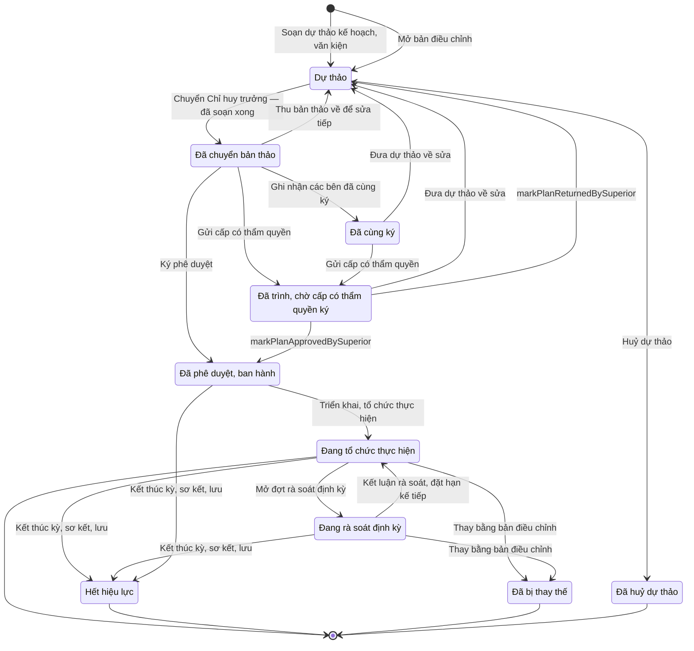

# qt-2 · Kế hoạch lập → thẩm định → phê chuẩn → rà soát

<!-- máy sinh: tom-tat -->
> **Hồ sơ:** Kế hoạch, văn kiện (`PlanDocument`)
>
> **Trong sổ phạm vi:** 2 · Kế hoạch lập → thẩm định → phê chuẩn → rà soát (tầng 1)
>
> 40 bước · 10 chặng · 5 vai · 4 bảng quyết định · 1 hạn · 51 khớp nối.
>
> **Nguồn:** sổ nghiệp vụ `qt-2` · khai báo của app: `dqtv-app/core/processes/planning/workflow/plan-document.yaml`. Các bảng do máy sinh từ nguồn này.
<!-- hết: tom-tat -->

<!-- viết tay: dien-giai -->
## Diễn giải

*Phần này viết tay, diễn giải lại điều các bảng bên dưới ghi.*

### Quy trình này để làm gì

Đơn vị theo dõi một **kế hoạch, văn kiện** từ lúc soạn tới lúc hết hiệu lực: soạn dự thảo, các bên cùng ký (với loại cần cùng ký), trình ký tờ trình, gửi cấp có thẩm quyền, thẩm định, phê duyệt, ban hành, tổ chức thực hiện, rà soát định kỳ, điều chỉnh. Người làm: Trợ lý Tác huấn, Chỉ huy trưởng Ban CHQS xã, Nhân viên văn thư, Bộ CHQS cấp tỉnh (người làm phải thuộc một đơn vị nằm trong ô cấp trên của chủ hồ sơ), và hệ thống tự làm hai bước.

Hồ sơ đi qua mười một chặng: *Dự thảo* → *Đã cùng ký* → *Chờ ký tờ trình* → *Đã ký, chờ gửi* → *Đã trình, chờ cấp có thẩm quyền ký* → *Đã thẩm định, chờ phê duyệt* → *Đã phê duyệt, ban hành* → *Đang tổ chức thực hiện* ⇄ *Đang rà soát định kỳ* → *Hết hiệu lực*; chặng rẽ là *Đã bị thay thế*. Chỉ tiêu của kế hoạch là chỗ rất nhiều quy trình khác bám vào (mục 2).

### Khi nào bắt đầu

Hai cửa vào, đều do Trợ lý Tác huấn mở và đều vào chặng *Dự thảo*:

- **Soạn dự thảo kế hoạch, văn kiện**: phải nhập tên, loại văn kiện, kỳ và nhiệm vụ trên giao mà kế hoạch đáp ứng (`taskingId`).
- **Mở bản điều chỉnh**: phải chọn kế hoạch bị điều chỉnh và ghi lý do điều chỉnh; kế hoạch bị điều chỉnh (ghi ở ô `amendsPlanId` của bản điều chỉnh) phải đang ở chặng *Đang tổ chức thực hiện* hoặc *Đang rà soát định kỳ* (`amendedPlanInForce`). Bản điều chỉnh đi lại trọn đường cùng ký, trình, duyệt, ban hành.

### Diễn ra thế nào

**Chặng "Dự thảo"** — Trợ lý Tác huấn soạn, hồ sơ đứng yên:

- Nội dung chung: **Sửa nội dung dự thảo** (không làm được với kế hoạch bồi dưỡng kiến thức QP&AN hằng năm); **Nối căn cứ nhiệm vụ** (nối tới nhiệm vụ trên giao) và **Nối vào nhiệm vụ và kế hoạch cấp trên** (nối tới nhiệm vụ trên giao, kế hoạch cấp trên, chỉ tiêu). Bước sau chỉ làm được khi `level` không phải cấp xã; với kế hoạch cấp xã hệ báo "kế hoạch cấp xã nối căn cứ ở bước riêng của cấp xã, không ở bước này".
- Các bên và các điều: **Chọn lực lượng phối hợp** ghi mốc "chốt diện các bên" (chỉ làm được với quy chế phối hợp, kế hoạch phối hợp hằng năm, kế hoạch phối hợp đột xuất); phải có mốc này mới **Soạn một điều** được; **Sửa một điều** để chỉnh điều đã soạn.
- Tình huống: **Dự kiến một tình huống**, **Sửa tình huống đã dự kiến**, **Gỡ tình huống khỏi kế hoạch** (ghi lý do gỡ). Ba bước này chỉ làm được với kế hoạch phòng thủ dân sự, và cả ba cũng ghi mốc "chốt diện các bên".
- Số liệu riêng theo loại kế hoạch: **Ghi thời gian chuyển trạng thái** (bảng phút; chỉ làm được với kế hoạch chuyển trạng thái sẵn sàng chiến đấu) và **Ghi quy mô mở rộng** (quân số từng thành phần lực lượng; chỉ làm được với kế hoạch mở rộng lực lượng); hai bước này còn làm được ở các chặng *Đã phê duyệt, ban hành*, *Đang tổ chức thực hiện*, *Đang rà soát định kỳ*, cũng như bước *Nối căn cứ nhiệm vụ*.
- Kế hoạch bồi dưỡng năm: hai bước `setRefresherQuota` (bảng chỉ tiêu theo nhóm đối tượng, cơ quan, số người) và `setRefresherSchedule` (ngày bắt đầu, ngày kết thúc, địa điểm).
- Soạn xong, trợ lý bấm **Chuyển Chỉ huy trưởng — đã soạn xong** (đã chuyển rồi thì không bấm lần hai được); muốn sửa tiếp thì **Thu bản thảo về để sửa tiếp** (phải đã chuyển).

Từ *Dự thảo* có hai lối đi tiếp, cả hai đều đòi đã chuyển Chỉ huy trưởng: Chỉ huy trưởng **Ghi nhận các bên đã cùng ký** (đòi có loại văn kiện và có nối tới lực lượng đóng trên địa bàn; chỉ làm được với quy chế phối hợp và kế hoạch phối hợp hằng năm; hồ sơ sang *Đã cùng ký*), hoặc Trợ lý Tác huấn **Trình ký tờ trình văn kiện** (sang *Chờ ký tờ trình*; bước ghi mối nối tới một văn bản đi của quy trình 1).

**Chặng "Đã cùng ký".** Trợ lý trình ký tờ trình như trên, hoặc Chỉ huy trưởng **Đưa dự thảo về sửa** (ghi lý do; bước này cũng dùng được ở hai chặng *Đã trình* và *Đã thẩm định*).

**Chặng "Chờ ký tờ trình" và "Đã ký, chờ gửi".** Chỉ huy trưởng **Ký tờ trình** (sang *Đã ký, chờ gửi*) hoặc **Trả lại tờ trình** (ghi lý do; về *Dự thảo* từ cả hai chặng). Nhân viên văn thư **Gửi cấp có thẩm quyền** (ghi ngày trình ký; đòi đã có văn bản đi) để sang *Đã trình, chờ cấp có thẩm quyền ký*. Nơi nhận tờ trình của bước này chọn trong 20 mã (`commune_chairman`, `province_chairman`, `province_military_command`…).

**Chặng "Đã trình" và "Đã thẩm định"** — có ba đường tới phê duyệt:

1. *Duyệt ngoài hệ*: Trợ lý Tác huấn **Xác nhận phê duyệt, đính kèm ảnh** (số, trích yếu, người ký, ngày ký, bản chụp; bảng `plan-approver` xét người ký), rồi Chỉ huy trưởng **Đối chiếu bản ký và ban hành** — đòi đã có ngày ghi nhận phê duyệt, có quyết định ký ngoài hệ và "phải có người thứ hai kiểm" — đưa hồ sơ sang *Đã phê duyệt, ban hành*. Chỉ đi đường này khi `approvalOutsideSystem`: không phải kế hoạch `force_expansion` hoặc `militia_training` của cấp xã hoặc Ban chỉ huy quân sự cơ quan, tổ chức. Với ba loại `reserve_force`, `mobilization_plan`, `industrial_mobilization_plan` còn phải khai số và ngày văn bản thẩm định (`appraisalReferenceGiven`).
2. *Duyệt trong hệ*: Bộ CHQS cấp tỉnh **Phê duyệt kế hoạch của xã** hoặc **Trả lại để bổ sung** (phải ghi ý kiến); hồ sơ đứng yên, bước phê duyệt ghi "ngày ghi nhận phê duyệt". Chỉ đi đường này khi `approvalInSystem`: kế hoạch `force_expansion` hoặc `militia_training` của cấp xã hoặc Ban chỉ huy quân sự cơ quan, tổ chức.
3. *Đính bản đã ký*: Nhân viên văn thư **Đính văn bản phê duyệt đã ký** đưa thẳng từ *Đã trình* sang *Đã phê duyệt, ban hành*; đòi có bản chụp văn bản phê duyệt đã ký (`refresherSignedApprovalScan`). Bước này chỉ làm được với kế hoạch bồi dưỡng kiến thức QP&AN hằng năm, người ký ngoài hệ là `commune_chairman`, `province_chairman`, `defence_minister` hoặc `prime_minister`; ngược lại, loại kế hoạch này không đi hai bước của đường 1, hai bước ban hành và hai bước rà soát.

Trước đó, Bộ CHQS cấp tỉnh có thể **Ghi nhận đã thẩm định** (từ *Đã trình* sang *Đã thẩm định, chờ phê duyệt*).

**Chặng "Đã phê duyệt, ban hành".** Nhân viên văn thư **Vào sổ, cấp số và ban hành** (khi ô đường ban hành là Ban chỉ huy quân sự ban hành và loại không phải `militia_organisation_scheme`, `air_defence_scheme`; phải đính bản kế hoạch đã ký) hoặc **Ghi văn bản Uỷ ban nhân dân ban hành** (khi đường ban hành là Uỷ ban nhân dân ban hành, hoặc loại là một trong hai loại trên; đây là một quyết định ký ngoài hệ). Chỉ huy trưởng **Triển khai, tổ chức thực hiện** để sang *Đang tổ chức thực hiện*.

**Chặng "Đang tổ chức thực hiện" và "Đang rà soát định kỳ".** Sau 12 tháng hệ chạy **Nhắc đến hạn rà soát** — chỉ chạy với kế hoạch thuộc diện `annualReviewRequired` (cấp xã: một danh sách loại kế hoạch; cấp khác: một danh sách loại kế hoạch khác, hoặc chu kỳ rà soát là hằng năm — mục 7). Chỉ huy trưởng **Mở đợt rà soát định kỳ**, rồi **Kết luận rà soát, đặt hạn kế tiếp** (bắt chọn giữ nguyên hoặc phải điều chỉnh) để về *Đang tổ chức thực hiện*; hai bước này không làm được với loại `gdqp_refresher_annual` (`reviewsPeriodically`). **Kết thúc kỳ, sơ kết, lưu** (Chỉ huy trưởng, ghi ngày hết hiệu lực) bấm được từ ba chặng *Đã phê duyệt*, *Đang tổ chức thực hiện*, *Đang rà soát*. Khi có một kế hoạch khác ghi hồ sơ này ở ô `amendsPlanId` và kế hoạch ấy đang ở chặng `IN_FORCE` (`amendmentInForce` — bản điều chỉnh đã có hiệu lực), hệ tự chạy **Thay bằng bản điều chỉnh** từ chặng *Đang tổ chức thực hiện* hoặc *Đang rà soát định kỳ*, bản cũ sang *Đã bị thay thế*.

### Kết thúc và để lại gì

Hồ sơ kết thúc ở ba chặng: *Đang tổ chức thực hiện*, *Hết hiệu lực*, *Đã bị thay thế*.

Hồ sơ của quy trình khác mở ra theo kế hoạch hoặc theo chỉ tiêu của kế hoạch (mục 10): đợt tuyên truyền (11), sự kiện huấn luyện (14) và hồ sơ cử người đi huấn luyện, chiến sĩ dân quân tự vệ kết nạp theo chỉ tiêu (16), đợt tuyển quân (17), học viên đào tạo Chỉ huy trưởng (18), công trình quốc phòng (23), đơn vị dân quân tự vệ (29), số đạt đã báo (3), bản sắp xếp đơn vị dự bị động viên (34), đợt gọi quân nhân dự bị (35), phong trào thi đua (7), cuộc thanh tra, kiểm tra (9), kỳ tuyển chọn (D2), đợt mở rộng lực lượng (D5), khoá bồi dưỡng kiến thức QP&AN (G1), đợt khởi tạo hiện trạng. Vụ việc ứng phó (20) gắn với kế hoạch ở một bước giữa chừng.

### Điều kiện chặn

- Không đúng người, sai chặng, thiếu thứ phải có trước thì chặn, hồ sơ giữ nguyên. Ba bước của Bộ CHQS cấp tỉnh đòi người làm thuộc một đơn vị nằm trong ô cấp trên của chủ hồ sơ; 29 bước khác đòi người làm thuộc đơn vị chủ hồ sơ; hai bước mở, bước gửi cấp có thẩm quyền và hai bước hệ tự làm thì không đòi.
- Nhiều bước chỉ làm được với một loại văn kiện, sai loại thì hệ báo lý do: thời gian chuyển trạng thái, quy mô mở rộng, tình huống dự kiến, chọn lực lượng phối hợp, cùng ký, đính văn bản phê duyệt đã ký — nêu ở từng bước phía trên.
- Đường duyệt chia theo loại và cấp: `approvalInSystem` (duyệt trong hệ) và `approvalOutsideSystem` (duyệt ngoài hệ) là hai điều kiện trái nhau.
- Bảng `plan-approver` (xét ở bước *Xác nhận phê duyệt, đính kèm ảnh*; đầu vào là loại kế hoạch theo luật, cấp, cấp người ký, đơn vị lập): 163 dòng — 61 dòng cho qua, 54 dòng chặn vì sai thẩm quyền (`wrong_authority`), 46 dòng chặn vì không có quy định (`no_rule`), 1 dòng chặn vì thiếu loại kế hoạch (`type_unknown`), 1 dòng chặn vì thiếu người ký (`signer_unknown`).
- Bước *Phê duyệt kế hoạch của xã* có thêm hai kết quả riêng: `province_military_command` thì hồ sơ sang *Đã trình, chờ cấp có thẩm quyền ký*, `commune_chairman` thì chặn.
- Hạn: 12 tháng kể từ khi vào *Đang tổ chức thực hiện*; quá hạn thì hệ chạy bước nhắc — chỉ nhắc, không chặn việc khác.
- Việc ngoài hệ: một ranh giới `commune-chairman-approval`, người làm `communeChairman`; hệ nhận về ngày trình ký và mối nối tới quyết định ký ngoài hệ; không được thì chặn, hồ sơ giữ nguyên. Người ký ngoài hệ chọn trong 20 mã ở bước *Xác nhận phê duyệt, đính kèm ảnh*, 4 mã ở bước *Đính văn bản phê duyệt đã ký*, 5 mã ở bước *Ghi văn bản Uỷ ban nhân dân ban hành*.
<!-- hết viết tay -->

## 1. Đường đi ngắn nhất qua các chặng

<!-- máy sinh: luong-chinh -->
Đường ít bước nhất từ lúc mở hồ sơ tới chặng kết thúc xa nhất. Máy chọn theo số chặng, không theo ý nghĩa nghiệp vụ — trình tự công việc thật xem phần Diễn giải và bảng "Việc làm ở từng chặng" ở mục 6.

| # | Ai làm | Làm gì | Hồ sơ sang chặng |
|---|---|---|---|
| 1 | Trợ lý Tác huấn | Soạn dự thảo kế hoạch, văn kiện | Dự thảo |
| 2 | Trợ lý Tác huấn | Chuyển Chỉ huy trưởng — đã soạn xong | Đã chuyển bản thảo |
| 3 | Hệ thống tự làm | Ký phê duyệt | Đã phê duyệt, ban hành |
| 4 | Chỉ huy trưởng Ban CHQS xã | Triển khai, tổ chức thực hiện | Đang tổ chức thực hiện |
| 5 | Hệ thống tự làm | Thay bằng bản điều chỉnh | Đã bị thay thế |

<!-- hết: luong-chinh -->

## 2. Hồ sơ và việc nó để lại

<!-- máy sinh: muc-tieu -->
**App gọi quy trình này là:** Kế hoạch, văn kiện.

**Khi mở, hồ sơ này ghi mối nối tới:**
- Nhiệm vụ trên giao (1) — bước `draftPlan`, khớp nối `answeredBy`
- Nhiệm vụ trên giao (1) — bước `openPlanAmendment`, khớp nối `answeredBy`

**Hồ sơ này để lại cho quy trình khác** (bước tạo hồ sơ của quy trình kia ghi mối nối về đây):
- Bản giao chỉ tiêu, mốc xuống cấp dưới (3) — bước `draftAssignment`, khớp nối `assignsTarget`
- Bản giao chỉ tiêu, mốc xuống cấp dưới (3) — bước `draftAssignment`, khớp nối `assignsTask`
- Bản sắp xếp đơn vị dự bị động viên (34) — bước `openArrangementFromTarget`, khớp nối `arrangementServesTarget`
- Chiến sĩ dân quân tự vệ (16.enlistment) — bước `admitFromPool`, khớp nối `memberUnderTarget`
- Cuộc thanh tra, kiểm tra (9) — bước `openInspection`, khớp nối `inspectionUnderPlan`
- Cuộc thanh tra, kiểm tra (9) — bước `openInspection`, khớp nối `inspectionUnderTarget`
- Công trình, đất đai quốc phòng (23) — bước `proposeLand`, khớp nối `defenceWorkUnderPlan`
- Công trình, đất đai quốc phòng (23) — bước `proposeLand`, khớp nối `defenceWorkUnderTarget`
- Dân quân tham gia huấn luyện do cấp trên tổ chức (14.training-nomination) — bước `nominateForTraining`, khớp nối `nominationUnderTarget`
- Học viên đào tạo Chỉ huy trưởng (18) — bước `recordStudyingTrainee`, khớp nối `traineeUnderTarget`
- Hồ sơ giải thể tổ chức (31) — bước `receiveDissolutionDossier`, khớp nối `dissolutionUnderTarget`
- Hồ sơ giải thể tổ chức (31) — bước `requestDisbandSignature`, khớp nối `dissolutionUnderTarget`
- Hồ sơ thành lập tổ chức (29) — bước `draftUnit`, khớp nối `dossierUnderPlan`
- Hồ sơ thành lập tổ chức (29) — bước `draftUnit`, khớp nối `dossierUnderTarget`
- Hồ sơ thành lập tổ chức (29) — bước `receiveOrganizationDossier`, khớp nối `dossierUnderTarget`
- Khoá bồi dưỡng kiến thức QP&AN (G1) — bước `createCoursePlan`, khớp nối `courseUnderAnnualPlan`
- Kết quả trả lên cấp trên (3.assignment-result) — bước `draftAssignmentResult`, khớp nối `resultCoversTarget`
- Kỳ tuyển chọn (D2) — bước `openSelectionDrive`, khớp nối `selectionUnderTarget`
- Phong trào thi đua (7) — bước `launchCampaign`, khớp nối `campaignUnderPlan`
- Số đạt đã báo (3.target-actual) — bước `reportActual`, khớp nối `actualUnderTarget`
- Sự kiện — huấn luyện, hội thi, diễn tập, hội nghị (14) — bước `createTrainingPlan`, khớp nối `trainingUnderPlan`
- Sự kiện — huấn luyện, hội thi, diễn tập, hội nghị (14) — bước `createTrainingPlan`, khớp nối `trainingUnderTarget`
- Văn bản đến (1.incoming-document) — bước `openSubmissionRound`, khớp nối `submissionDeliveredAs`
- Vụ việc ứng phó (20) — bước `openCase`, khớp nối `caseUnderPlan`
- Vụ việc ứng phó (20) — bước `openCase`, khớp nối `caseUnderSituation`
- Đợt gọi quân nhân dự bị (35) — bước `openReserveCallFromTarget`, khớp nối `reserveCallUnderTarget`
- Đợt khởi tạo hiện trạng (system-onboarding) — bước `openOnboarding`, khớp nối `onboardingUnderTarget`
- Đợt mở rộng lực lượng (D5) — bước `recordExpansionOrder`, khớp nối `expansionUnderPlan`
- Đợt tuyên truyền, vận động (11) — bước `planOutreach`, khớp nối `outreachPlannedBy`
- Đợt tuyển quân (17) — bước `openConscriptionDrive`, khớp nối `driveUnderTarget`
<!-- hết: muc-tieu -->

## 3. Khởi phát và kết thúc

<!-- máy sinh: khoi-phat -->
**2 cửa vào** — bước mở hồ sơ:

| Bước mở | Ai mở | Hồ sơ vào chặng | App bắt buộc nhập |
|---|---|---|---|
| Soạn dự thảo kế hoạch, văn kiện | Trợ lý Tác huấn | Dự thảo | tên kế hoạch, văn kiện, loại văn kiện, kỳ, `taskingId` |
| Mở bản điều chỉnh | Trợ lý Tác huấn | Dự thảo | `amendsPlanId`, lý do điều chỉnh |

**Kết thúc:** *Đang tổ chức thực hiện* (`IN_FORCE`), *Hết hiệu lực* (`EXPIRED`), *Đã bị thay thế* (`SUPERSEDED`), *Đã huỷ dự thảo* (`CANCELLED`)
<!-- hết: khoi-phat -->

## 4. Vai trò

<!-- máy sinh: vai-tro -->
| Vai trong sổ | Tên trong app | Điều kiện | Làm những bước |
|---|---|---|---|
| `operator` | Trợ lý Tác huấn |  | Soạn dự thảo kế hoạch, văn kiện · Sửa nội dung dự thảo · Ghi thời gian chuyển trạng thái · Ghi quy mô mở rộng · Nối căn cứ nhiệm vụ · Nối vào nhiệm vụ và kế hoạch cấp trên · Đưa dự thảo về sửa · Soạn một điều · Sửa một điều · Chọn lực lượng phối hợp · Chuyển Chỉ huy trưởng — đã soạn xong · Huỷ dự thảo · Thu bản thảo về để sửa tiếp · Trình ký tờ trình văn kiện · Ghi văn bản Uỷ ban nhân dân ban hành · Dự kiến một tình huống · Sửa tình huống đã dự kiến · Gỡ tình huống khỏi kế hoạch · Mở bản điều chỉnh · Xem nội dung văn kiện mật (người soạn) · `removeRefresherQuota` · `setRefresherQuota` · `setRefresherSchedule` |
| `commander` | Chỉ huy trưởng Ban CHQS xã |  | Ghi nhận các bên đã cùng ký · Triển khai, tổ chức thực hiện · Mở đợt rà soát định kỳ · Kết luận rà soát, đặt hạn kế tiếp · Kết thúc kỳ, sơ kết, lưu · Giao người được xem văn kiện mật · Xem nội dung văn kiện mật (người ký) |
| `system` | Hệ thống tự làm |  | Ký phê duyệt · Gửi cấp có thẩm quyền · Nhắc đến hạn rà soát · Chốt số đã đạt của chỉ tiêu cuối kỳ · Thay bằng bản điều chỉnh · `markPlanApprovedBySuperior` · `markPlanReturnedBySuperior` |
| `clerk` | Nhân viên văn thư |  | Vào sổ, cấp số và ban hành · Xem nội dung văn kiện mật (văn thư) |
| `reader` | `AC-CHT/AC-CTV/AC-PCHT/AC-CTVP/AC-TLTH/AC-TLQL/AC-NVQK/AC-NVVT/AC-NVTC/AC-BDQt/AC-PDQqk/AC-PCHTcq/AC-PCHTbn/AC-PKH` |  | Xem nội dung văn kiện mật (người được giao) |

*"Tên trong app" là tên app đặt cho mã chủ thể của vai. Hồ sơ thuộc đơn vị cấp khác thì người làm là người giữ vai ấy ở đơn vị nêu trong cột "Điều kiện" (nếu sổ có ghi) và ở cột "Người làm phải thuộc" của bảng "Theo khai báo của app" (mục 7).*

**Ngoài hệ** (hệ chỉ ghi kết quả, xem mục 8): `communeChairman`.
<!-- hết: vai-tro -->

## 5. Nhánh phụ

<!-- máy sinh: nhanh-phu -->
**Bước khác đưa hồ sơ sang chặng mới** — đường song song, rẽ nhánh hoặc kết thúc sớm:

| Bước | Ai làm | Từ chặng | Sang chặng |
|---|---|---|---|
| Ghi nhận các bên đã cùng ký | Chỉ huy trưởng Ban CHQS xã | Đã chuyển bản thảo | Đã cùng ký |
| Huỷ dự thảo | Trợ lý Tác huấn | Dự thảo | Đã huỷ dự thảo |
| Gửi cấp có thẩm quyền | Hệ thống tự làm | Đã chuyển bản thảo, Đã cùng ký | Đã trình, chờ cấp có thẩm quyền ký |
| Mở đợt rà soát định kỳ | Chỉ huy trưởng Ban CHQS xã | Đang tổ chức thực hiện | Đang rà soát định kỳ |
| Kết thúc kỳ, sơ kết, lưu | Chỉ huy trưởng Ban CHQS xã | Đang tổ chức thực hiện, Đang rà soát định kỳ, Đã phê duyệt, ban hành | Hết hiệu lực |
| `markPlanApprovedBySuperior` | Hệ thống tự làm | Đã trình, chờ cấp có thẩm quyền ký | Đã phê duyệt, ban hành |

**Quay lại một chặng hồ sơ đã đi qua** (tính theo đường ngắn nhất từ lúc mở):

| Bước | Ai làm | Từ chặng | Về chặng |
|---|---|---|---|
| Đưa dự thảo về sửa | Trợ lý Tác huấn | Đã cùng ký, Đã trình, chờ cấp có thẩm quyền ký | Dự thảo |
| Thu bản thảo về để sửa tiếp | Trợ lý Tác huấn | Đã chuyển bản thảo | Dự thảo |
| Kết luận rà soát, đặt hạn kế tiếp | Chỉ huy trưởng Ban CHQS xã | Đang rà soát định kỳ | Đang tổ chức thực hiện |
| `markPlanReturnedBySuperior` | Hệ thống tự làm | Đã trình, chờ cấp có thẩm quyền ký | Dự thảo |

**Làm trong lúc hồ sơ đứng yên ở một chặng** — ghi nhận, bổ sung:

| Bước | Ai làm | Ở chặng |
|---|---|---|
| Sửa nội dung dự thảo | Trợ lý Tác huấn | Dự thảo |
| Ghi thời gian chuyển trạng thái *(lặp được)* | Trợ lý Tác huấn | Dự thảo, Đã phê duyệt, ban hành, Đang tổ chức thực hiện, Đang rà soát định kỳ |
| Ghi quy mô mở rộng *(lặp được)* | Trợ lý Tác huấn | Dự thảo, Đã phê duyệt, ban hành, Đang tổ chức thực hiện, Đang rà soát định kỳ |
| Nối căn cứ nhiệm vụ | Trợ lý Tác huấn | Dự thảo, Đã phê duyệt, ban hành, Đang tổ chức thực hiện, Đang rà soát định kỳ |
| Nối vào nhiệm vụ và kế hoạch cấp trên | Trợ lý Tác huấn | Dự thảo |
| Soạn một điều *(lặp được)* | Trợ lý Tác huấn | Dự thảo |
| Sửa một điều | Trợ lý Tác huấn | Dự thảo |
| Chọn lực lượng phối hợp *(lặp được)* | Trợ lý Tác huấn | Dự thảo |
| Trình ký tờ trình văn kiện | Trợ lý Tác huấn | Đã chuyển bản thảo, Đã cùng ký |
| Vào sổ, cấp số và ban hành | Nhân viên văn thư | Đã phê duyệt, ban hành |
| Ghi văn bản Uỷ ban nhân dân ban hành | Trợ lý Tác huấn | Đã phê duyệt, ban hành |
| Nhắc đến hạn rà soát | Hệ thống tự làm | Đang tổ chức thực hiện |
| Chốt số đã đạt của chỉ tiêu cuối kỳ | Hệ thống tự làm | Đã phê duyệt, ban hành, Đang tổ chức thực hiện, Đang rà soát định kỳ, Hết hiệu lực, Đã bị thay thế |
| Dự kiến một tình huống *(lặp được)* | Trợ lý Tác huấn | Dự thảo |
| Sửa tình huống đã dự kiến *(lặp được)* | Trợ lý Tác huấn | Dự thảo |
| Gỡ tình huống khỏi kế hoạch *(lặp được)* | Trợ lý Tác huấn | Dự thảo |
| Giao người được xem văn kiện mật | Chỉ huy trưởng Ban CHQS xã | Dự thảo, Đã chuyển bản thảo, Đã cùng ký, Đã trình, chờ cấp có thẩm quyền ký, Đang rà soát định kỳ, Đã phê duyệt, ban hành, Đang tổ chức thực hiện |
| Xem nội dung văn kiện mật (người soạn) | Trợ lý Tác huấn | Dự thảo, Đã chuyển bản thảo, Đã cùng ký, Đã trình, chờ cấp có thẩm quyền ký, Đang rà soát định kỳ, Đã phê duyệt, ban hành, Đang tổ chức thực hiện |
| Xem nội dung văn kiện mật (người ký) | Chỉ huy trưởng Ban CHQS xã | Dự thảo, Đã chuyển bản thảo, Đã cùng ký, Đã trình, chờ cấp có thẩm quyền ký, Đang rà soát định kỳ, Đã phê duyệt, ban hành, Đang tổ chức thực hiện |
| Xem nội dung văn kiện mật (văn thư) | Nhân viên văn thư | Dự thảo, Đã chuyển bản thảo, Đã cùng ký, Đã trình, chờ cấp có thẩm quyền ký, Đang rà soát định kỳ, Đã phê duyệt, ban hành, Đang tổ chức thực hiện |
| Xem nội dung văn kiện mật (người được giao) | `AC-CHT/AC-CTV/AC-PCHT/AC-CTVP/AC-TLTH/AC-TLQL/AC-NVQK/AC-NVVT/AC-NVTC/AC-BDQt/AC-PDQqk/AC-PCHTcq/AC-PCHTbn/AC-PKH` | Dự thảo, Đã chuyển bản thảo, Đã cùng ký, Đã trình, chờ cấp có thẩm quyền ký, Đang rà soát định kỳ, Đã phê duyệt, ban hành, Đang tổ chức thực hiện |
| `removeRefresherQuota` | Trợ lý Tác huấn | Dự thảo |
| `setRefresherQuota` | Trợ lý Tác huấn | Dự thảo |
| `setRefresherSchedule` | Trợ lý Tác huấn | Dự thảo |

**Cửa vào khác:** 2 bước cùng mở hồ sơ — xem mục 3.

<!-- hết: nhanh-phu -->

## 6. Các chặng và việc làm ở từng chặng

<!-- máy sinh: chang -->
| Chặng | Tên hiển thị | Vào bằng bước | Kết thúc? |
|---|---|---|---|
| `DRAFT` | Dự thảo | Soạn dự thảo kế hoạch, văn kiện · Đưa dự thảo về sửa · Thu bản thảo về để sửa tiếp · Mở bản điều chỉnh · `markPlanReturnedBySuperior` |  |
| `DRAFT_READY` | Đã chuyển bản thảo | Chuyển Chỉ huy trưởng — đã soạn xong |  |
| `CO_SIGNED` | Đã cùng ký | Ghi nhận các bên đã cùng ký |  |
| `SUBMITTED` | Đã trình, chờ cấp có thẩm quyền ký | Gửi cấp có thẩm quyền |  |
| `APPROVED` | Đã phê duyệt, ban hành | Ký phê duyệt · `markPlanApprovedBySuperior` |  |
| `IN_FORCE` | Đang tổ chức thực hiện | Triển khai, tổ chức thực hiện · Kết luận rà soát, đặt hạn kế tiếp | **kết thúc** — vẫn còn bước làm được |
| `UNDER_REVIEW` | Đang rà soát định kỳ | Mở đợt rà soát định kỳ |  |
| `EXPIRED` | Hết hiệu lực | Kết thúc kỳ, sơ kết, lưu | **kết thúc** — vẫn còn bước làm được |
| `SUPERSEDED` | Đã bị thay thế | Thay bằng bản điều chỉnh | **kết thúc** — vẫn còn bước làm được |
| `CANCELLED` | Đã huỷ dự thảo | Huỷ dự thảo | **kết thúc** |

### Việc làm ở từng chặng

Hồ sơ đang ở chặng nào thì làm được những bước nào.

| Hồ sơ đang ở chặng | Bước làm tại chặng (hồ sơ đứng yên) | Bước đưa hồ sơ sang chặng khác |
|---|---|---|
| **Dự thảo** | Sửa nội dung dự thảo — Trợ lý Tác huấn Ghi thời gian chuyển trạng thái (lặp được) — Trợ lý Tác huấn Ghi quy mô mở rộng (lặp được) — Trợ lý Tác huấn Nối căn cứ nhiệm vụ — Trợ lý Tác huấn Nối vào nhiệm vụ và kế hoạch cấp trên — Trợ lý Tác huấn Soạn một điều (lặp được) — Trợ lý Tác huấn Sửa một điều — Trợ lý Tác huấn Chọn lực lượng phối hợp (lặp được) — Trợ lý Tác huấn Dự kiến một tình huống (lặp được) — Trợ lý Tác huấn Sửa tình huống đã dự kiến (lặp được) — Trợ lý Tác huấn Gỡ tình huống khỏi kế hoạch (lặp được) — Trợ lý Tác huấn Giao người được xem văn kiện mật — Chỉ huy trưởng Ban CHQS xã Xem nội dung văn kiện mật (người soạn) — Trợ lý Tác huấn Xem nội dung văn kiện mật (người ký) — Chỉ huy trưởng Ban CHQS xã Xem nội dung văn kiện mật (văn thư) — Nhân viên văn thư Xem nội dung văn kiện mật (người được giao) — `AC-CHT/AC-CTV/AC-PCHT/AC-CTVP/AC-TLTH/AC-TLQL/AC-NVQK/AC-NVVT/AC-NVTC/AC-BDQt/AC-PDQqk/AC-PCHTcq/AC-PCHTbn/AC-PKH` `removeRefresherQuota` — Trợ lý Tác huấn `setRefresherQuota` — Trợ lý Tác huấn `setRefresherSchedule` — Trợ lý Tác huấn | Chuyển Chỉ huy trưởng — đã soạn xong — Trợ lý Tác huấn → *Đã chuyển bản thảo* Huỷ dự thảo — Trợ lý Tác huấn → *Đã huỷ dự thảo* |
| **Đã chuyển bản thảo** | Trình ký tờ trình văn kiện — Trợ lý Tác huấn Giao người được xem văn kiện mật — Chỉ huy trưởng Ban CHQS xã Xem nội dung văn kiện mật (người soạn) — Trợ lý Tác huấn Xem nội dung văn kiện mật (người ký) — Chỉ huy trưởng Ban CHQS xã Xem nội dung văn kiện mật (văn thư) — Nhân viên văn thư Xem nội dung văn kiện mật (người được giao) — `AC-CHT/AC-CTV/AC-PCHT/AC-CTVP/AC-TLTH/AC-TLQL/AC-NVQK/AC-NVVT/AC-NVTC/AC-BDQt/AC-PDQqk/AC-PCHTcq/AC-PCHTbn/AC-PKH` | Ghi nhận các bên đã cùng ký — Chỉ huy trưởng Ban CHQS xã → *Đã cùng ký* Thu bản thảo về để sửa tiếp — Trợ lý Tác huấn → *Dự thảo* Ký phê duyệt — Hệ thống tự làm → *Đã phê duyệt, ban hành* Gửi cấp có thẩm quyền — Hệ thống tự làm → *Đã trình, chờ cấp có thẩm quyền ký* |
| **Đã cùng ký** | Trình ký tờ trình văn kiện — Trợ lý Tác huấn Giao người được xem văn kiện mật — Chỉ huy trưởng Ban CHQS xã Xem nội dung văn kiện mật (người soạn) — Trợ lý Tác huấn Xem nội dung văn kiện mật (người ký) — Chỉ huy trưởng Ban CHQS xã Xem nội dung văn kiện mật (văn thư) — Nhân viên văn thư Xem nội dung văn kiện mật (người được giao) — `AC-CHT/AC-CTV/AC-PCHT/AC-CTVP/AC-TLTH/AC-TLQL/AC-NVQK/AC-NVVT/AC-NVTC/AC-BDQt/AC-PDQqk/AC-PCHTcq/AC-PCHTbn/AC-PKH` | Đưa dự thảo về sửa — Trợ lý Tác huấn → *Dự thảo* Gửi cấp có thẩm quyền — Hệ thống tự làm → *Đã trình, chờ cấp có thẩm quyền ký* |
| **Đã trình, chờ cấp có thẩm quyền ký** | Giao người được xem văn kiện mật — Chỉ huy trưởng Ban CHQS xã Xem nội dung văn kiện mật (người soạn) — Trợ lý Tác huấn Xem nội dung văn kiện mật (người ký) — Chỉ huy trưởng Ban CHQS xã Xem nội dung văn kiện mật (văn thư) — Nhân viên văn thư Xem nội dung văn kiện mật (người được giao) — `AC-CHT/AC-CTV/AC-PCHT/AC-CTVP/AC-TLTH/AC-TLQL/AC-NVQK/AC-NVVT/AC-NVTC/AC-BDQt/AC-PDQqk/AC-PCHTcq/AC-PCHTbn/AC-PKH` | Đưa dự thảo về sửa — Trợ lý Tác huấn → *Dự thảo* `markPlanApprovedBySuperior` — Hệ thống tự làm → *Đã phê duyệt, ban hành* `markPlanReturnedBySuperior` — Hệ thống tự làm → *Dự thảo* |
| **Đã phê duyệt, ban hành** | Ghi thời gian chuyển trạng thái (lặp được) — Trợ lý Tác huấn Ghi quy mô mở rộng (lặp được) — Trợ lý Tác huấn Nối căn cứ nhiệm vụ — Trợ lý Tác huấn Vào sổ, cấp số và ban hành — Nhân viên văn thư Ghi văn bản Uỷ ban nhân dân ban hành — Trợ lý Tác huấn Chốt số đã đạt của chỉ tiêu cuối kỳ — Hệ thống tự làm Giao người được xem văn kiện mật — Chỉ huy trưởng Ban CHQS xã Xem nội dung văn kiện mật (người soạn) — Trợ lý Tác huấn Xem nội dung văn kiện mật (người ký) — Chỉ huy trưởng Ban CHQS xã Xem nội dung văn kiện mật (văn thư) — Nhân viên văn thư Xem nội dung văn kiện mật (người được giao) — `AC-CHT/AC-CTV/AC-PCHT/AC-CTVP/AC-TLTH/AC-TLQL/AC-NVQK/AC-NVVT/AC-NVTC/AC-BDQt/AC-PDQqk/AC-PCHTcq/AC-PCHTbn/AC-PKH` | Triển khai, tổ chức thực hiện — Chỉ huy trưởng Ban CHQS xã → *Đang tổ chức thực hiện* Kết thúc kỳ, sơ kết, lưu — Chỉ huy trưởng Ban CHQS xã → *Hết hiệu lực* |
| **Đang tổ chức thực hiện** | Ghi thời gian chuyển trạng thái (lặp được) — Trợ lý Tác huấn Ghi quy mô mở rộng (lặp được) — Trợ lý Tác huấn Nối căn cứ nhiệm vụ — Trợ lý Tác huấn Nhắc đến hạn rà soát — Hệ thống tự làm Chốt số đã đạt của chỉ tiêu cuối kỳ — Hệ thống tự làm Giao người được xem văn kiện mật — Chỉ huy trưởng Ban CHQS xã Xem nội dung văn kiện mật (người soạn) — Trợ lý Tác huấn Xem nội dung văn kiện mật (người ký) — Chỉ huy trưởng Ban CHQS xã Xem nội dung văn kiện mật (văn thư) — Nhân viên văn thư Xem nội dung văn kiện mật (người được giao) — `AC-CHT/AC-CTV/AC-PCHT/AC-CTVP/AC-TLTH/AC-TLQL/AC-NVQK/AC-NVVT/AC-NVTC/AC-BDQt/AC-PDQqk/AC-PCHTcq/AC-PCHTbn/AC-PKH` | Mở đợt rà soát định kỳ — Chỉ huy trưởng Ban CHQS xã → *Đang rà soát định kỳ* Kết thúc kỳ, sơ kết, lưu — Chỉ huy trưởng Ban CHQS xã → *Hết hiệu lực* Thay bằng bản điều chỉnh — Hệ thống tự làm → *Đã bị thay thế* |
| **Đang rà soát định kỳ** | Ghi thời gian chuyển trạng thái (lặp được) — Trợ lý Tác huấn Ghi quy mô mở rộng (lặp được) — Trợ lý Tác huấn Nối căn cứ nhiệm vụ — Trợ lý Tác huấn Chốt số đã đạt của chỉ tiêu cuối kỳ — Hệ thống tự làm Giao người được xem văn kiện mật — Chỉ huy trưởng Ban CHQS xã Xem nội dung văn kiện mật (người soạn) — Trợ lý Tác huấn Xem nội dung văn kiện mật (người ký) — Chỉ huy trưởng Ban CHQS xã Xem nội dung văn kiện mật (văn thư) — Nhân viên văn thư Xem nội dung văn kiện mật (người được giao) — `AC-CHT/AC-CTV/AC-PCHT/AC-CTVP/AC-TLTH/AC-TLQL/AC-NVQK/AC-NVVT/AC-NVTC/AC-BDQt/AC-PDQqk/AC-PCHTcq/AC-PCHTbn/AC-PKH` | Kết luận rà soát, đặt hạn kế tiếp — Chỉ huy trưởng Ban CHQS xã → *Đang tổ chức thực hiện* Kết thúc kỳ, sơ kết, lưu — Chỉ huy trưởng Ban CHQS xã → *Hết hiệu lực* Thay bằng bản điều chỉnh — Hệ thống tự làm → *Đã bị thay thế* |
| **Hết hiệu lực** | Chốt số đã đạt của chỉ tiêu cuối kỳ — Hệ thống tự làm | — (kết thúc) |
| **Đã bị thay thế** | Chốt số đã đạt của chỉ tiêu cuối kỳ — Hệ thống tự làm | — (kết thúc) |
| **Đã huỷ dự thảo** | — | — (kết thúc) |
<!-- hết: chang -->

## 7. Bảng bước

<!-- máy sinh: buoc -->
| # | Bước | Mã bước | Ai thực hiện | Từ chặng | Sang chặng | Phải có trước | Ghi lại |
|---|---|---|---|---|---|---|---|
| 1 | Soạn dự thảo kế hoạch, văn kiện | `draftPlan` | Trợ lý Tác huấn | — (mở hồ sơ) | `DRAFT` | `taskingAssigned`, `planYearGiven`, `noSecretContentFile`, `civilDefenceDraftWithoutForces`, `refresherDraftWithoutForcesOrSecret`, `emulationScopeGiven` | tên kế hoạch, văn kiện, loại văn kiện, kỳ, nối tới Nhiệm vụ trên giao, `refresherPlanBasisDocument`, diện bảo vệ bí mật, ghi chú, `level`, đường ban hành, chu kỳ rà soát, ngày dự thảo, đơn vị chủ hồ sơ, `id`, năm kế hoạch, `contentFileGiven`, phạm vi phong trào thi đua |
| 2 | Sửa nội dung dự thảo | `editPlan` | Trợ lý Tác huấn | `DRAFT` | giữ nguyên | người làm thuộc đơn vị chủ hồ sơ, `planHeaderEditable` | tên kế hoạch, văn kiện, kỳ, ghi chú, năm kế hoạch |
| 3 | Ghi thời gian chuyển trạng thái | `setPlanTransitionTimes` | Trợ lý Tác huấn | `DRAFT`, `APPROVED`, `IN_FORCE`, `UNDER_REVIEW` | giữ nguyên | người làm thuộc đơn vị chủ hồ sơ, `draftOrTransitionTimesNotYetSet`, `planTypeHasTransitionTimes` | thời gian chuyển trạng thái |
| 4 | Ghi quy mô mở rộng | `setPlanExpansionScale` | Trợ lý Tác huấn | `DRAFT`, `APPROVED`, `IN_FORCE`, `UNDER_REVIEW` | giữ nguyên | người làm thuộc đơn vị chủ hồ sơ, `draftOrExpansionScaleNotYetSet`, `planTypeHasExpansionScale` | kế hoạch lập cho tình huống, quy mô mở rộng |
| 5 | Nối căn cứ nhiệm vụ | `linkPlanBasis` | Trợ lý Tác huấn | `DRAFT`, `APPROVED`, `IN_FORCE`, `UNDER_REVIEW` | giữ nguyên | người làm thuộc đơn vị chủ hồ sơ, `taskingAssigned` | nối tới Nhiệm vụ trên giao |
| 6 | Nối vào nhiệm vụ và kế hoạch cấp trên | `linkProvincePlanBasis` | Trợ lý Tác huấn | `DRAFT` | giữ nguyên | người làm thuộc đơn vị chủ hồ sơ, `taskingAssigned`, `upperPlanBasisLinkable` | nối căn cứ lúc, nối tới Nhiệm vụ trên giao, nối tới Chỉ tiêu |
| 7 | Ghi nhận các bên đã cùng ký | `recordCoSigning` | Chỉ huy trưởng Ban CHQS xã | `DRAFT_READY` | `CO_SIGNED` | `coordinationPartiesChosen`, người làm thuộc đơn vị chủ hồ sơ, `planTypeCoSigned` | ngày các bên cùng ký |
| 8 | Đưa dự thảo về sửa | `returnToDraft` | Trợ lý Tác huấn | `CO_SIGNED`, `SUBMITTED` | `DRAFT` | người làm thuộc đơn vị chủ hồ sơ | lý do đưa về sửa; **xoá:** ngày các bên cùng ký |
| 9 | Soạn một điều | `addPlanArticle` | Trợ lý Tác huấn | `DRAFT` | giữ nguyên | `partiesSettledBeforeArticles`, người làm thuộc đơn vị chủ hồ sơ | nối tới Điều của văn kiện |
| 10 | Sửa một điều | `editPlanArticle` | Trợ lý Tác huấn | `DRAFT` | giữ nguyên | người làm thuộc đơn vị chủ hồ sơ | số điều, tên điều, nội dung, ghi chú soạn thảo |
| 11 | Chọn lực lượng phối hợp | `setPlanForces` | Trợ lý Tác huấn | `DRAFT` | giữ nguyên | người làm thuộc đơn vị chủ hồ sơ, `planTypeListsForces` | chốt diện các bên lúc, nối tới Lực lượng đóng trên địa bàn |
| 12 | Chuyển Chỉ huy trưởng — đã soạn xong | `confirmPlanDraftReady` | Trợ lý Tác huấn | `DRAFT` | `DRAFT_READY` | người làm thuộc đơn vị chủ hồ sơ, `coordinationPartiesChosen` | — |
| 13 | Huỷ dự thảo | `cancelPlanDraft` | Trợ lý Tác huấn | `DRAFT` | `CANCELLED` | người làm thuộc đơn vị chủ hồ sơ, lý do huỷ dự thảo | lý do huỷ dự thảo, ngày huỷ dự thảo |
| 14 | Thu bản thảo về để sửa tiếp | `withdrawPlanDraftReady` | Trợ lý Tác huấn | `DRAFT_READY` | `DRAFT` | người làm thuộc đơn vị chủ hồ sơ | — |
| 15 | Trình ký tờ trình văn kiện | `requestPlanSignature` | Trợ lý Tác huấn | `DRAFT_READY`, `CO_SIGNED` | giữ nguyên | người làm thuộc đơn vị chủ hồ sơ, `noSecretContentFile`, `noPlanDocumentSubmittedDocumentOpen`, `coSignedBeforeSubmission` | nối tới Văn bản đi, `generatedSubmission`, `contentFileGiven` |
| 16 | Ký phê duyệt | `approveOwnPlan` | Hệ thống tự làm | `DRAFT_READY` | `APPROVED` | `approvedByOwnCommander`, `planDocumentSubmittedDocumentIssued` | ngày phê duyệt, hạn rà soát kế tiếp |
| 17 | Gửi cấp có thẩm quyền | `submitPlan` | Hệ thống tự làm | `DRAFT_READY`, `CO_SIGNED` | `SUBMITTED` | nối tới Văn bản đi, `noSecretContentFile`, `planDocumentSubmittedDocumentIssued`, `approvedBeyondOwnCommander` | ngày trình ký, nối tới Văn bản đến, `contentFileGiven` |
| 18 | Vào sổ, cấp số và ban hành | `issueCommunePlan` | Nhân viên văn thư | `APPROVED` | giữ nguyên | người làm thuộc đơn vị chủ hồ sơ, `issuedByCommandBoard`, `noSecretContentFile` | ngày ban hành, nối tới Văn bản đi, `contentFileGiven` |
| 19 | Ghi văn bản Uỷ ban nhân dân ban hành | `recordCommitteeIssuedPlan` | Trợ lý Tác huấn | `APPROVED` | giữ nguyên | người làm thuộc đơn vị chủ hồ sơ, `issuedByCommittee`, `planIssuedByIncomingDocumentUsable`, `noSecretContentFile` | ngày ban hành, nối tới Văn bản đến |
| 20 | Triển khai, tổ chức thực hiện | `startImplementation` | Chỉ huy trưởng Ban CHQS xã | `APPROVED` | `IN_FORCE` | người làm thuộc đơn vị chủ hồ sơ, `planIssued` | — |
| 21 | Mở đợt rà soát định kỳ | `startPlanReview` | Chỉ huy trưởng Ban CHQS xã | `IN_FORCE` | `UNDER_REVIEW` | người làm thuộc đơn vị chủ hồ sơ, `reviewsPeriodically` | — |
| 22 | Nhắc đến hạn rà soát | `flagPlanReviewDue` | Hệ thống tự làm | `IN_FORCE` | giữ nguyên | `annualReviewRequired`, `planReviewNotYetFlagged` | ngày nhắc rà soát |
| 23 | Chốt số đã đạt của chỉ tiêu cuối kỳ | `closeTargetPeriodTally` | Hệ thống tự làm | `APPROVED`, `IN_FORCE`, `UNDER_REVIEW`, `EXPIRED`, `SUPERSEDED` | giữ nguyên | `targetPeriodEnded`, `targetPeriodNotTallied` | số đã đạt chốt cuối kỳ, ngày chốt số cuối kỳ |
| 24 | Kết luận rà soát, đặt hạn kế tiếp | `finishPlanReview` | Chỉ huy trưởng Ban CHQS xã | `UNDER_REVIEW` | `IN_FORCE` | người làm thuộc đơn vị chủ hồ sơ, hướng xử lý sau rà soát, `reviewsPeriodically` | kết luận rà soát, rà soát gần nhất, hạn rà soát kế tiếp, nối tới Đợt rà soát văn kiện, hướng xử lý sau rà soát; **xoá:** ngày nhắc rà soát |
| 25 | Dự kiến một tình huống | `addPlannedSituation` | Trợ lý Tác huấn | `DRAFT` | giữ nguyên | người làm thuộc đơn vị chủ hồ sơ, `situationUnitsActive`, `planTypeHasSituations` | chốt diện các bên lúc, nối tới Tình huống dự kiến, nối `situationUsesUnit` (Tình huống dự kiến → Đơn vị dân quân tự vệ), nối `situationWithForce` (Tình huống dự kiến → Lực lượng đóng trên địa bàn) |
| 26 | Sửa tình huống đã dự kiến | `editPlannedSituation` | Trợ lý Tác huấn | `DRAFT` | giữ nguyên | người làm thuộc đơn vị chủ hồ sơ, `situationUnitsActive`, `planTypeHasSituations` | tên tình huống, loại sự cố, thảm hoạ, dự báo diễn biến, hậu quả, cấp độ phòng thủ dân sự, khu vực dự kiến ảnh hưởng, biện pháp dự kiến, phân công trách nhiệm, quân số dự kiến huy động, ghi chú, chốt diện các bên lúc, nối `situationUsesUnit` (Tình huống dự kiến → Đơn vị dân quân tự vệ), nối `situationWithForce` (Tình huống dự kiến → Lực lượng đóng trên địa bàn) |
| 27 | Gỡ tình huống khỏi kế hoạch | `removePlannedSituation` | Trợ lý Tác huấn | `DRAFT` | giữ nguyên | người làm thuộc đơn vị chủ hồ sơ, `planTypeHasSituations` | — |
| 28 | Kết thúc kỳ, sơ kết, lưu | `expirePlan` | Chỉ huy trưởng Ban CHQS xã | `IN_FORCE`, `UNDER_REVIEW`, `APPROVED` | `EXPIRED` | người làm thuộc đơn vị chủ hồ sơ | ngày hết hiệu lực, ghi chú |
| 29 | Mở bản điều chỉnh | `openPlanAmendment` | Trợ lý Tác huấn | — (mở hồ sơ) | `DRAFT` | lý do điều chỉnh, nối tới Kế hoạch, văn kiện, `amendedPlanInForce`, `amendedPlanOfOwnUnit`, `amendedPlanSameKind` | nối tới Kế hoạch, văn kiện, nối tới Nhiệm vụ trên giao, lý do điều chỉnh, đơn vị chủ hồ sơ, mã tỉnh, mã xã, tên kế hoạch, văn kiện, loại văn kiện, `level`, đường ban hành, chu kỳ rà soát, ngày dự thảo, `id`, cấp trên của chủ hồ sơ, năm kế hoạch |
| 30 | Thay bằng bản điều chỉnh | `supersedePlan` | Hệ thống tự làm | `IN_FORCE`, `UNDER_REVIEW` | `SUPERSEDED` | `amendmentInForce` | nối tới Kế hoạch, văn kiện, ngày bị thay thế |
| 31 | Giao người được xem văn kiện mật | `namePlanSecretReaders` | Chỉ huy trưởng Ban CHQS xã | `DRAFT`, `DRAFT_READY`, `CO_SIGNED`, `SUBMITTED`, `UNDER_REVIEW`, `APPROVED`, `IN_FORCE` | giữ nguyên | người làm thuộc đơn vị chủ hồ sơ | người được giao xem văn kiện mật |
| 32 | Xem nội dung văn kiện mật (người soạn) | `viewPlanSecretContent` | Trợ lý Tác huấn | `DRAFT`, `DRAFT_READY`, `CO_SIGNED`, `SUBMITTED`, `UNDER_REVIEW`, `APPROVED`, `IN_FORCE` | giữ nguyên | người làm thuộc đơn vị chủ hồ sơ | — |
| 33 | Xem nội dung văn kiện mật (người ký) | `viewPlanSecretContentAsSigner` | Chỉ huy trưởng Ban CHQS xã | `DRAFT`, `DRAFT_READY`, `CO_SIGNED`, `SUBMITTED`, `UNDER_REVIEW`, `APPROVED`, `IN_FORCE` | giữ nguyên | người làm thuộc đơn vị chủ hồ sơ | — |
| 34 | Xem nội dung văn kiện mật (văn thư) | `viewPlanSecretContentAsClerk` | Nhân viên văn thư | `DRAFT`, `DRAFT_READY`, `CO_SIGNED`, `SUBMITTED`, `UNDER_REVIEW`, `APPROVED`, `IN_FORCE` | giữ nguyên | người làm thuộc đơn vị chủ hồ sơ | — |
| 35 | Xem nội dung văn kiện mật (người được giao) | `viewPlanSecretContentAsReader` | `AC-CHT/AC-CTV/AC-PCHT/AC-CTVP/AC-TLTH/AC-TLQL/AC-NVQK/AC-NVVT/AC-NVTC/AC-BDQt/AC-PDQqk/AC-PCHTcq/AC-PCHTbn/AC-PKH` | `DRAFT`, `DRAFT_READY`, `CO_SIGNED`, `SUBMITTED`, `UNDER_REVIEW`, `APPROVED`, `IN_FORCE` | giữ nguyên | `actorIsSecretReader` | — |
| 36 | `markPlanApprovedBySuperior` | `markPlanApprovedBySuperior` | Hệ thống tự làm | `SUBMITTED` | `APPROVED` | `submissionApproved` | ngày phê duyệt, ngày hết hiệu lực, hạn rà soát kế tiếp |
| 37 | `markPlanReturnedBySuperior` | `markPlanReturnedBySuperior` | Hệ thống tự làm | `SUBMITTED` | `DRAFT` | `submissionReturned` | lý do đưa về sửa; **xoá:** ngày các bên cùng ký |
| 38 | `removeRefresherQuota` | `removeRefresherQuota` | Trợ lý Tác huấn | `DRAFT` | giữ nguyên | người làm thuộc đơn vị chủ hồ sơ, `planTypeIsRefresherAnnual` | `refresherParticipantsFromQuota` |
| 39 | `setRefresherQuota` | `setRefresherQuota` | Trợ lý Tác huấn | `DRAFT` | giữ nguyên | người làm thuộc đơn vị chủ hồ sơ, `planTypeIsRefresherAnnual` | `quotaTraineeGroup`, `quotaAgency`, `quotaCount`, `refresherParticipantsFromQuota` |
| 40 | `setRefresherSchedule` | `setRefresherSchedule` | Trợ lý Tác huấn | `DRAFT` | giữ nguyên | người làm thuộc đơn vị chủ hồ sơ, `planTypeIsRefresherAnnual` | `refresherStartDate`, `refresherEndDate`, `refresherVenue` |

### Khi không đạt điều kiện

Mặc định: không đúng người, hồ sơ không ở đúng chặng, hoặc thiếu thứ "phải có trước" thì bước bị chặn, hồ sơ giữ nguyên. Bảng dưới chỉ kê những bước có kết quả riêng.

| # | Bước | Kết quả riêng |
|---|---|---|
| 1 | Soạn dự thảo kế hoạch, văn kiện | bước dừng lại, hồ sơ giữ nguyên khi kết quả xét là: `level_unknown`, `type_unknown`, `outside_catalogue`; nhánh `central`: hồ sơ sang *Dự thảo*, ghi thêm `ownerScope`, nối tới Lực lượng đóng trên địa bàn; nhánh `central-refresher`: hồ sơ sang *Dự thảo*, ghi thêm `ownerScope`, chốt diện các bên lúc; nhánh `commune`: hồ sơ sang *Dự thảo*, ghi thêm mã tỉnh, mã xã, cấp trên của chủ hồ sơ, nối tới Lực lượng đóng trên địa bàn; nhánh `commune-coordination`: hồ sơ sang *Dự thảo*, ghi thêm mã tỉnh, mã xã, cấp trên của chủ hồ sơ, nối tới Lực lượng đóng trên địa bàn, chốt diện các bên lúc; nhánh `commune-refresher`: hồ sơ sang *Dự thảo*, ghi thêm mã tỉnh, mã xã, cấp trên của chủ hồ sơ, chốt diện các bên lúc; nhánh `ministry`: hồ sơ sang *Dự thảo*, ghi thêm `ownerScope`, cấp trên của chủ hồ sơ, nối tới Lực lượng đóng trên địa bàn; nhánh `ministry-refresher`: hồ sơ sang *Dự thảo*, ghi thêm `ownerScope`, cấp trên của chủ hồ sơ, chốt diện các bên lúc; nhánh `organization`: hồ sơ sang *Dự thảo*, ghi thêm `ownerScope`, cấp trên của chủ hồ sơ, nối tới Lực lượng đóng trên địa bàn; nhánh `organization-refresher`: hồ sơ sang *Dự thảo*, ghi thêm `ownerScope`, cấp trên của chủ hồ sơ, chốt diện các bên lúc; nhánh `province`: hồ sơ sang *Dự thảo*, ghi thêm mã tỉnh, đơn vị lập, cấp trên của chủ hồ sơ, nối tới Lực lượng đóng trên địa bàn; nhánh `province-coordination`: hồ sơ sang *Dự thảo*, ghi thêm mã tỉnh, đơn vị lập, cấp trên của chủ hồ sơ, nối tới Lực lượng đóng trên địa bàn, chốt diện các bên lúc; nhánh `province-refresher`: hồ sơ sang *Dự thảo*, ghi thêm mã tỉnh, đơn vị lập, cấp trên của chủ hồ sơ, chốt diện các bên lúc; nhánh `region`: hồ sơ sang *Dự thảo*, ghi thêm `ownerScope`, cấp trên của chủ hồ sơ, nối tới Lực lượng đóng trên địa bàn; nhánh `region-refresher`: hồ sơ sang *Dự thảo*, ghi thêm `ownerScope`, cấp trên của chủ hồ sơ, chốt diện các bên lúc |
| 9 | Soạn một điều | nhánh `refresher-section`: hồ sơ giữ nguyên chặng, ghi thêm `refresherPlanSections`; nhánh `refresher-section-prefill`: hồ sơ giữ nguyên chặng, ghi thêm `refresherPlanSections`, `refresherSectionPrefill` |
| 16 | Ký phê duyệt | bước này không do người nào bấm |
| 22 | Nhắc đến hạn rà soát | bước này không do người nào bấm |
| 23 | Chốt số đã đạt của chỉ tiêu cuối kỳ | bước này không do người nào bấm |
| 29 | Mở bản điều chỉnh | nhánh `other`: hồ sơ sang *Dự thảo*; nhánh `province`: hồ sơ sang *Dự thảo*, ghi thêm đơn vị lập |
| 30 | Thay bằng bản điều chỉnh | bước này không do người nào bấm |
| 36 | `markPlanApprovedBySuperior` | bước này không do người nào bấm |
| 37 | `markPlanReturnedBySuperior` | bước này không do người nào bấm |

### Điều kiện "phải có trước" bằng lời

Cột "Phải có trước" ở bảng bước có hai loại: ô dữ liệu thường (bước chỉ đòi ô ấy đã có giá trị) và điều kiện hệ tự xét. Bảng này diễn các điều kiện hệ tự xét theo đúng công thức sổ ghi; số ở cột cuối là số thứ tự bước.

| Điều kiện | Đúng khi | Bước đòi |
|---|---|---|
| `taskingAssigned` | KHÔNG (đã có nối tới Nhiệm vụ trên giao) HOẶC có hồ sơ Việc luật giao kèm văn bản đến, đi (qt-1) chính là hồ sơ ghi ở ô nối `answeredBy` của hồ sơ đang làm mà hồ sơ ấy đang ở chặng `ASSIGNED` hoặc `BROKEN_DOWN` | 1, 5, 6 |
| `planYearGiven` | KHÔNG (loại kế hoạch theo luật là `militia_training`) HOẶC đã có năm kế hoạch | 1 |
| `noSecretContentFile` | KHÔNG (diện bảo vệ bí mật là Có (`yes`) VÀ đã có `contentFileGiven`) | 1, 15, 17, 18, 19 |
| `civilDefenceDraftWithoutForces` | KHÔNG (loại kế hoạch theo luật là `civil_defence_plan` VÀ đã có nối tới Lực lượng đóng trên địa bàn) | 1 |
| `refresherDraftWithoutForcesOrSecret` | KHÔNG (loại kế hoạch theo luật là `gdqp_refresher_annual` VÀ (đã có nối tới Lực lượng đóng trên địa bàn HOẶC diện bảo vệ bí mật là Có (`yes`))) | 1 |
| `emulationScopeGiven` | KHÔNG (loại văn kiện là Kế hoạch thi đua, khen thưởng (`emulation_plan`)) HOẶC đã có phạm vi phong trào thi đua | 1 |
| `actorInOwnerUnit` | người đang làm là người của đơn vị ghi ở ô đơn vị chủ hồ sơ của hồ sơ này (theo danh mục người của đơn vị, `dm.unit-staff`) | 2, 3, 4, 5, 6, 7, 8, 9, 10, 11, 12, 13, 14, 15, 18, 19, 20, 21, 24, 25, 26, 27, 28, 31, 32, 33, 34, 38, 39, 40 |
| `planHeaderEditable` | KHÔNG (loại kế hoạch theo luật là `gdqp_refresher_annual`) | 2 |
| `draftOrTransitionTimesNotYetSet` | hồ sơ đang ở chặng `DRAFT` HOẶC KHÔNG (đã có thời gian chuyển trạng thái) | 3 |
| `planTypeHasTransitionTimes` | loại kế hoạch theo luật là `readiness_transition_plan` | 3 |
| `draftOrExpansionScaleNotYetSet` | hồ sơ đang ở chặng `DRAFT` HOẶC KHÔNG (đã có quy mô mở rộng) | 4 |
| `planTypeHasExpansionScale` | loại kế hoạch theo luật là `force_expansion` | 4 |
| `upperPlanBasisLinkable` | KHÔNG (`level` là Cấp xã (`commune`)) VÀ KHÔNG (loại kế hoạch theo luật là `gdqp_refresher_annual`) | 6 |
| `coordinationPartiesChosen` | KHÔNG (loại kế hoạch theo luật là `coordination_charter` hoặc `coordination_annual`) HOẶC đã có nối tới Lực lượng đóng trên địa bàn | 7, 12 |
| `planTypeCoSigned` | loại kế hoạch theo luật là `coordination_charter` hoặc `coordination_annual` | 7 |
| `partiesSettledBeforeArticles` | KHÔNG (loại kế hoạch theo luật là `coordination_charter` hoặc `coordination_annual` hoặc `civil_defence_plan` HOẶC loại kế hoạch theo luật là `coordination_adhoc`) HOẶC đã có chốt diện các bên lúc | 9 |
| `planTypeListsForces` | loại kế hoạch theo luật là `coordination_charter` hoặc `coordination_annual` hoặc `coordination_adhoc` | 11 |
| `noPlanDocumentSubmittedDocumentOpen` | KHÔNG (có hồ sơ Việc luật giao kèm văn bản đến, đi — Văn bản đi (qt-1.outgoing-document) chính là hồ sơ ghi ở ô nối `planDocumentSubmittedByDocument` của hồ sơ đang làm mà hồ sơ ấy đang ở chặng `DRAFT` hoặc `PENDING_SIGNATURE` hoặc `SIGNED`) | 15 |
| `coSignedBeforeSubmission` | KHÔNG (loại kế hoạch theo luật là `coordination_charter` hoặc `coordination_annual`) HOẶC đã có ngày các bên cùng ký | 15 |
| `approvedByOwnCommander` | (`level` là Cấp tỉnh (`province`) VÀ loại kế hoạch theo luật là `militia_training` hoặc `force_expansion_decision`) HOẶC (`level` là Quân khu (`region`) VÀ loại kế hoạch theo luật là `force_expansion` hoặc `force_expansion_decision`) HOẶC (`level` là Bộ Quốc phòng (`central`) hoặc Quân khu (`region`) hoặc Cấp tỉnh (`province`) hoặc Cấp xã (`commune`) VÀ loại kế hoạch theo luật là `emulation_military`) | 16 |
| `planDocumentSubmittedDocumentIssued` | có hồ sơ Việc luật giao kèm văn bản đến, đi — Văn bản đi (qt-1.outgoing-document) chính là hồ sơ ghi ở ô nối `planDocumentSubmittedByDocument` của hồ sơ đang làm mà hồ sơ ấy đang ở chặng `ISSUED` | 16, 17 |
| `approvedBeyondOwnCommander` | KHÔNG ((`level` là Cấp tỉnh (`province`) VÀ loại kế hoạch theo luật là `militia_training` hoặc `force_expansion_decision`) HOẶC (`level` là Quân khu (`region`) VÀ loại kế hoạch theo luật là `force_expansion` hoặc `force_expansion_decision`) HOẶC (`level` là Bộ Quốc phòng (`central`) hoặc Quân khu (`region`) hoặc Cấp tỉnh (`province`) hoặc Cấp xã (`commune`) VÀ loại kế hoạch theo luật là `emulation_military`)) | 17 |
| `issuedByCommandBoard` | đường ban hành là Ban chỉ huy quân sự ban hành — vào sổ văn bản đi (`command_board`) VÀ KHÔNG (loại kế hoạch theo luật là `militia_organisation_scheme` hoặc `air_defence_scheme`) VÀ KHÔNG (loại kế hoạch theo luật là `civil_defence_plan` VÀ `level` là Cấp xã (`commune`) hoặc Cấp tỉnh (`province`)) | 18 |
| `issuedByCommittee` | đường ban hành là Uỷ ban nhân dân ban hành — ghi vào sổ văn bản đến (`committee`) HOẶC loại kế hoạch theo luật là `militia_organisation_scheme` hoặc `air_defence_scheme` HOẶC (loại kế hoạch theo luật là `civil_defence_plan` VÀ `level` là Cấp xã (`commune`) hoặc Cấp tỉnh (`province`)) | 19 |
| `planIssuedByIncomingDocumentUsable` | có hồ sơ Việc luật giao kèm văn bản đến, đi — Văn bản đến (qt-1.incoming-document) chính là hồ sơ ghi ở ô nối `planIssuedByIncomingDocument` của hồ sơ đang làm mà hồ sơ ấy đang ở chặng `RECEIVED` hoặc `DISTRIBUTED` | 19 |
| `planIssued` | đã có ngày ban hành | 20 |
| `reviewsPeriodically` | KHÔNG (loại kế hoạch theo luật là `gdqp_refresher_annual`) | 21, 24 |
| `annualReviewRequired` | (`level` là Cấp xã (`commune`) VÀ loại kế hoạch theo luật là `force_expansion` hoặc `reserve_force` hoặc `combat_defence_plan` hoặc `readiness_transition_plan` hoặc `target_protection_plan` hoặc `party_political_plan` hoặc `defence_work_plan` hoặc `task_execution_plan` hoặc `supplementary_training_plan` hoặc `combat_service_plan` hoặc `coordination_charter` hoặc `air_defence_plan` hoặc `civil_defence_plan`) HOẶC (KHÔNG (`level` là Cấp xã (`commune`)) VÀ (loại kế hoạch theo luật là `force_expansion` hoặc `reserve_force` hoặc `defence_zone` hoặc `mobilization_plan` hoặc `industrial_mobilization_plan` hoặc `defence_economy_plan` hoặc `coordination_charter` hoặc `air_defence_plan` hoặc `civil_defence_plan` hoặc `force_use_plan` hoặc `info_warfare_plan` hoặc `military_posture_plan` hoặc `department_defence_plan` hoặc `reserve_unit_call_up_plan` hoặc `air_defence_wide_mobilization_plan` hoặc `region_defence_plan` hoặc `defence_economy_charter` hoặc `combat_defence_plan` hoặc `readiness_transition_plan` HOẶC chu kỳ rà soát là Rà soát hằng năm (`annual`))) | 22 |
| `planReviewNotYetFlagged` | KHÔNG (đã có ngày nhắc rà soát) | 22 |
| `planTypeHasSituations` | loại kế hoạch theo luật là `civil_defence_plan` | 25, 26, 27 |
| `amendedPlanInForce` | có hồ sơ Kế hoạch lập → thẩm định → phê chuẩn → rà soát (qt-2) chính là hồ sơ ghi ở ô nối `amendsPlan` của hồ sơ đang làm mà hồ sơ ấy đang ở chặng `IN_FORCE` hoặc `UNDER_REVIEW` | 29 |
| `amendedPlanOfOwnUnit` | có hồ sơ Kế hoạch lập → thẩm định → phê chuẩn → rà soát (qt-2) (gọi là orig) chính là hồ sơ ghi ở ô nối `amendsPlan` của hồ sơ đang làm mà hồ sơ ấy đang ở chặng `IN_FORCE` hoặc `UNDER_REVIEW` VÀ người đang làm là người của đơn vị ghi ở ô đơn vị chủ hồ sơ của hồ sơ orig ấy (theo danh mục người của đơn vị, `dm.unit-staff`) | 29 |
| `amendedPlanSameKind` | có hồ sơ Kế hoạch lập → thẩm định → phê chuẩn → rà soát (qt-2) chính là hồ sơ ghi ở ô nối `amendsPlan` của hồ sơ đang làm mà loại văn kiện của hồ sơ đang xét bằng loại văn kiện của hồ sơ này VÀ loại kế hoạch theo luật của hồ sơ đang xét bằng loại kế hoạch theo luật của hồ sơ này VÀ `level` của hồ sơ đang xét bằng `level` của hồ sơ này | 29 |
| `amendmentInForce` | có hồ sơ Kế hoạch lập → thẩm định → phê chuẩn → rà soát (qt-2) có ô nối `amendsPlan` trỏ về chính hồ sơ đang làm mà hồ sơ ấy đang ở chặng `IN_FORCE` | 30 |
| `actorIsSecretReader` | `"actor"` nằm trong người được giao xem văn kiện mật | 35 |
| `submissionApproved` | có hồ sơ Kế hoạch lập → thẩm định → phê chuẩn → rà soát — Kế hoạch, văn kiện (qt-2.submission) chính là hồ sơ ghi ở ô nối `submissionOfPlan` của hồ sơ đang làm mà hồ sơ ấy đang ở chặng `APPROVED` | 36 |
| `submissionReturned` | có hồ sơ Kế hoạch lập → thẩm định → phê chuẩn → rà soát — Kế hoạch, văn kiện (qt-2.submission) chính là hồ sơ ghi ở ô nối `submissionOfPlan` của hồ sơ đang làm mà hồ sơ ấy đang ở chặng `RETURNED` | 37 |
| `planTypeIsRefresherAnnual` | loại kế hoạch theo luật là `gdqp_refresher_annual` | 38, 39, 40 |

### Theo khai báo của app

Người làm phải thuộc đơn vị nào, ô người dùng phải nhập, bước có lặp được không, và căn cứ pháp lý — lấy từ khai báo quy trình trong app.

| # | Bước | Người làm phải thuộc | Bắt buộc nhập | Nhập nếu có | Lặp được | Căn cứ |
|---|---|---|---|---|---|---|
| 1 | Soạn dự thảo kế hoạch, văn kiện |  | tên kế hoạch, văn kiện, loại văn kiện, kỳ, `taskingId` | năm kế hoạch, `forceIds`, diện bảo vệ bí mật, ghi chú, đường ban hành, chu kỳ rà soát, văn bản căn cứ trong sổ văn bản đến, phạm vi phong trào thi đua |  | L48/2019/QH14 Đ.9 |
| 2 | Sửa nội dung dự thảo | đơn vị chủ hồ sơ | — | tên kế hoạch, văn kiện, kỳ, năm kế hoạch, ghi chú |  | L48/2019/QH14 Đ.9 |
| 3 | Ghi thời gian chuyển trạng thái | đơn vị chủ hồ sơ | — | lên tăng cường · Ban chỉ huy · nhiệm vụ A (phút), lên tăng cường · Ban chỉ huy · nhiệm vụ A2 (phút), lên tăng cường · Ban chỉ huy · nhiệm vụ A3 (phút), lên tăng cường · Ban chỉ huy · nhiệm vụ A4 (phút), lên tăng cường · phân đội · nhiệm vụ A (phút), lên tăng cường · phân đội · nhiệm vụ A2 (phút), lên tăng cường · phân đội · nhiệm vụ A3 (phút), lên tăng cường · phân đội · nhiệm vụ A4 (phút), lên cao, toàn bộ · Ban chỉ huy · nhiệm vụ A (phút), lên cao, toàn bộ · Ban chỉ huy · nhiệm vụ A2 (phút), lên cao, toàn bộ · Ban chỉ huy · nhiệm vụ A3 (phút), lên cao, toàn bộ · Ban chỉ huy · nhiệm vụ A4 (phút), lên cao, toàn bộ · phân đội · nhiệm vụ A (phút), lên cao, toàn bộ · phân đội · nhiệm vụ A2 (phút), lên cao, toàn bộ · phân đội · nhiệm vụ A3 (phút), lên cao, toàn bộ · phân đội · nhiệm vụ A4 (phút) | có | L48/2019/QH14 Đ.29 k1 |
| 4 | Ghi quy mô mở rộng | đơn vị chủ hồ sơ | kế hoạch lập cho tình huống | ban chỉ huy quân sự cấp xã (người), ban chỉ huy quân sự cơ quan, tổ chức (người), dân quân tự vệ cơ động (người), dân quân thường trực (người), dân quân tự vệ tại chỗ (người), dân quân tự vệ phòng không (người), dân quân tự vệ pháo binh (người), dân quân tự vệ trinh sát (người), dân quân tự vệ thông tin (người), dân quân tự vệ công binh (người), dân quân tự vệ phòng hoá (người), dân quân tự vệ y tế (người), dân quân tự vệ biển (người) | có | L48/2019/QH14 Đ.16 k2 · TT77/2020/TT-BQP Đ.10 |
| 5 | Nối căn cứ nhiệm vụ | đơn vị chủ hồ sơ | — | `missionTaskingIds` |  | NQ66.12/2026 Đ.4 k3 c · k4 b, c — xã lập kế hoạch theo nhiệm vụ, chỉ tiêu trên giao |
| 6 | Nối vào nhiệm vụ và kế hoạch cấp trên | đơn vị chủ hồ sơ | — | `taskingIds`, `planDocumentIds` |  | NQ 66.12/2026 Đ.4 k3 c — xây dựng kế hoạch theo kế hoạch huấn luyện chiến đấu của Bộ Chỉ huy quân sự cấp tỉnh |
| 7 | Ghi nhận các bên đã cùng ký | đơn vị chủ hồ sơ | ngày các bên cùng ký | — |  | NĐ02/2020/NĐ-CP Đ.4 k1 c |
| 8 | Đưa dự thảo về sửa | đơn vị chủ hồ sơ | lý do đưa về sửa | — |  | NĐ02/2020/NĐ-CP Đ.4 k1 c |
| 9 | Soạn một điều | đơn vị chủ hồ sơ | tên điều, nội dung | số điều, ghi chú | có | NĐ02/2020/NĐ-CP Đ.4 k2, Đ.5 k2; QĐ1126/QĐ-TM Đ.8 k3 |
| 10 | Sửa một điều | đơn vị chủ hồ sơ | `articleId` | số điều, tên điều, nội dung, ghi chú soạn thảo |  | NĐ02/2020/NĐ-CP Đ.4 k2, Đ.5 k2; QĐ1126/QĐ-TM Đ.8 k3 |
| 11 | Chọn lực lượng phối hợp | đơn vị chủ hồ sơ | `forceIds` | — | có | L18/2023/QH15 Đ.12 k2 e; NĐ02/2020/NĐ-CP Đ.5 k1 a |
| 12 | Chuyển Chỉ huy trưởng — đã soạn xong | đơn vị chủ hồ sơ | — | — |  | QĐ1126/QĐ-TM Đ.8 k3 |
| 13 | Huỷ dự thảo | đơn vị chủ hồ sơ | lý do huỷ dự thảo | — |  | sổ qt-2 — cancelPlanDraft |
| 14 | Thu bản thảo về để sửa tiếp | đơn vị chủ hồ sơ | — | — |  | QĐ1126/QĐ-TM Đ.8 k3 |
| 15 | Trình ký tờ trình văn kiện | đơn vị chủ hồ sơ | — | tờ trình (PDF) |  | NĐ02/2020/NĐ-CP Đ.4 k1 c, Đ.5 k1 a; QĐ1126/QĐ-TM Đ.3 k6; NĐ30/2020/NĐ-CP Đ.10, Đ.13 |
| 16 | Ký phê duyệt | đơn vị chủ hồ sơ | — | — |  | TT69/2020/TT-BQP Đ.7 k2 a (VBHN 78/VBHN-BQP); TT77/2020/TT-BQP Đ.10 k2 b, Đ.11 k2, k5 · N14 người dùng chốt 16/10/2026 |
| 17 | Gửi cấp có thẩm quyền |  | ngày trình ký | tờ trình đã ký, đã ghi số |  | NĐ02/2020/NĐ-CP Đ.4 k1 c, Đ.5 k1 a; L18/2023/QH15 Đ.12 k5; NĐ30/2020/NĐ-CP Đ.18, Đ.19 |
| 18 | Vào sổ, cấp số và ban hành | đơn vị chủ hồ sơ | — | bản kế hoạch đã ký, nơi nhận |  | NĐ30/2020/NĐ-CP Đ.8 k1 a, Đ.18, Đ.19 |
| 19 | Ghi văn bản Uỷ ban nhân dân ban hành | đơn vị chủ hồ sơ | người duyệt, văn bản ban hành trong sổ văn bản đến | `subject`, `legalBasis` |  | L48/2019/QH14 Điều 44 khoản 1 điểm a · L49/2024/QH15 Điều 43 khoản 2 điểm b · L18/2023/QH15 Đ.12 k5 |
| 20 | Triển khai, tổ chức thực hiện | đơn vị chủ hồ sơ | — | — |  | L48/2019/QH14 Đ.30 |
| 21 | Mở đợt rà soát định kỳ | đơn vị chủ hồ sơ | — | — |  | NĐ02/2020/NĐ-CP Đ.4 k1 d |
| 22 | Nhắc đến hạn rà soát |  | — | — |  | NĐ02/2020/NĐ-CP Đ.4 k1 d |
| 23 | Chốt số đã đạt của chỉ tiêu cuối kỳ |  | ngày cuối kỳ, số đã đạt của các dòng chốt kỳ này | — |  | TT77/2020/TT-BQP Đ.7 |
| 24 | Kết luận rà soát, đặt hạn kế tiếp | đơn vị chủ hồ sơ | kết luận rà soát, hướng xử lý sau rà soát | hạn rà soát kế tiếp | có | NĐ02/2020/NĐ-CP Đ.4 k1 d |
| 25 | Dự kiến một tình huống | đơn vị chủ hồ sơ | tên tình huống, loại sự cố, thảm hoạ, dự báo diễn biến, hậu quả | cấp độ phòng thủ dân sự, khu vực dự kiến ảnh hưởng, biện pháp dự kiến, quân số dự kiến huy động, phân công trách nhiệm, `unitIds`, `forceIds`, ghi chú | có | L18/2023/QH15 Đ.12 k2 b |
| 26 | Sửa tình huống đã dự kiến | đơn vị chủ hồ sơ | `situationId`, tên tình huống, loại sự cố, thảm hoạ, dự báo diễn biến, hậu quả | cấp độ phòng thủ dân sự, khu vực dự kiến ảnh hưởng, biện pháp dự kiến, quân số dự kiến huy động, phân công trách nhiệm, `unitIds`, `forceIds`, ghi chú | có | L18/2023/QH15 Đ.12 k1, k2 b |
| 27 | Gỡ tình huống khỏi kế hoạch | đơn vị chủ hồ sơ | `situationId`, lý do gỡ | — | có | L18/2023/QH15 Đ.12 k2 b |
| 28 | Kết thúc kỳ, sơ kết, lưu | đơn vị chủ hồ sơ | ngày hết hiệu lực | ghi chú |  | L48/2019/QH14 Đ.37 |
| 29 | Mở bản điều chỉnh |  | `amendsPlanId`, lý do điều chỉnh | tên kế hoạch, văn kiện, kỳ, năm kế hoạch, ghi chú |  | L48/2019/QH14 Đ.9 |
| 30 | Thay bằng bản điều chỉnh |  | `supersededById` | — |  | L48/2019/QH14 Đ.9 |
| 31 | Giao người được xem văn kiện mật | đơn vị chủ hồ sơ | người được giao xem văn kiện mật | — |  | Luật Bảo vệ bí mật nhà nước 2025 (117/2025/QH15) · sổ qt-2, người dùng "1: B" (justindang 24/10/2026) |
| 32 | Xem nội dung văn kiện mật (người soạn) | đơn vị chủ hồ sơ | — | — |  | sổ qt-2, người dùng "1: B" (justindang 24/10/2026) |
| 33 | Xem nội dung văn kiện mật (người ký) | đơn vị chủ hồ sơ | — | — |  | sổ qt-2, người dùng "1: B" (justindang 24/10/2026) |
| 34 | Xem nội dung văn kiện mật (văn thư) | đơn vị chủ hồ sơ | — | — |  | sổ qt-2, người dùng "1: B" (justindang 24/10/2026) |
| 35 | Xem nội dung văn kiện mật (người được giao) |  | — | — |  | sổ qt-2, người dùng "1: B" (justindang 24/10/2026) |
| — | Cấp trên trả lại tờ trình kế hoạch về dự thảo (`returnPlanByReceiver`) |  | lý do văn thư cấp trên trả lại | — |  | NĐ30/2020/NĐ-CP Đ.21 k2 b |
| — | Ghi nhận đã thẩm định (`appraisePlan`) | cấp trên của chủ hồ sơ | — | — |  | L53/2019/QH14 Điều 10 khoản 8 — cơ quan quân sự cấp trên thẩm định trước khi phê duyệt |
| — | Xác nhận phê duyệt, đính kèm ảnh (`recordPlanApproval`) | đơn vị chủ hồ sơ | người duyệt, văn bản phê duyệt trong sổ văn bản đến | `subject`, `legalBasis`, văn bản thẩm định trong sổ văn bản đến, ngày hết hiệu lực |  | 50_MAU_KY_NGOAI_HE_THONG.md §D · NĐ02/2020/NĐ-CP Đ.4 k1 c |
| — | Phê duyệt kế hoạch của xã (`approveCommunePlan`) | cấp trên của chủ hồ sơ | `approverUnit` | `opinion`, ngày hết hiệu lực, người duyệt |  | TT78/VBHN-BQP Đ.7 k2 c |
| — | Trình ký văn bản trả lại kế hoạch (`requestReturnCommunePlanSignature`) | cấp trên của chủ hồ sơ | lý do trả lại — xã biết sửa gì | dự thảo văn bản trả lại (PDF) |  | TT78/VBHN-BQP Đ.7 k2 c · NĐ30/2020/NĐ-CP Đ.13 |
| — | Trả lại để bổ sung (`returnCommunePlan`) |  | `approverUnit` | `opinion` |  | TT78/VBHN-BQP Đ.7 k2 c · NĐ30/2020/NĐ-CP Đ.18 |

### Điều kiện và ghi chú app khai cho từng bước

Lấy từ khai báo quy trình trong app. Lời trong ngoặc kép là câu app hiện cho người dùng. Chức danh người ký ngoài hệ app chỉ khai bằng mã.

| # | Bước | Điều kiện, ghi chú |
|---|---|---|
| 2 | Sửa nội dung dự thảo | · chỉ làm được khi ô "loại văn kiện" không là Kế hoạch bồi dưỡng kiến thức quốc phòng và an ninh hằng năm (`gdqp_refresher_plan_year`) — ngoài ra app báo: "kế hoạch bồi dưỡng kiến thức QP&AN năm không sửa tên, kỳ, ghi chú sau khi lập" |
| 3 | Ghi thời gian chuyển trạng thái | · chỉ làm được khi ô "loại văn kiện" là Kế hoạch chuyển trạng thái sẵn sàng chiến đấu của Ban chỉ huy quân sự (`readiness_transition_plan`) — ngoài ra app báo: "chỉ kế hoạch chuyển trạng thái sẵn sàng chiến đấu mới có bảng thời gian chuyển trạng thái" |
| 4 | Ghi quy mô mở rộng | · chỉ làm được khi ô "loại văn kiện" là Kế hoạch mở rộng lực lượng (`force_expansion_plan`) — ngoài ra app báo: "chỉ kế hoạch mở rộng lực lượng mới có bảng quy mô mở rộng" |
| 6 | Nối vào nhiệm vụ và kế hoạch cấp trên | · chỉ làm được khi `level` là Cấp tỉnh (`province`) hoặc Quân khu (`region`) hoặc Bộ Quốc phòng (`central`) hoặc Ban chỉ huy quân sự cơ quan, tổ chức (`organization`) hoặc Ban chỉ huy quân sự bộ, ngành trung ương (`ministry`) — ngoài ra app báo: "kế hoạch cấp xã nối căn cứ ở bước riêng của cấp xã, không ở bước này" · chỉ làm được khi ô "loại văn kiện" không là Kế hoạch bồi dưỡng kiến thức quốc phòng và an ninh hằng năm (`gdqp_refresher_plan_year`) — ngoài ra app báo: "kế hoạch bồi dưỡng kiến thức QP&AN năm: căn cứ là văn bản đính lúc soạn — không nối kế hoạch cấp trên" |
| 7 | Ghi nhận các bên đã cùng ký | · chỉ làm được khi ô "loại văn kiện" là Quy chế phối hợp (`coordination_charter`) hoặc Kế hoạch phối hợp hằng năm (`coordination_plan_year`) — ngoài ra app báo: "loại văn kiện này không có bước cùng ký — chỉ quy chế phối hợp và kế hoạch phối hợp hằng năm mới cùng ký chịu trách nhiệm (Nghị định 02/2020 Điều 4 khoản 1 điểm c, Điều 5 khoản 1 điểm a)" |
| 9 | Soạn một điều | · tạo thêm một hồ sơ con: Điều của văn kiện (`PlanArticle`) |
| 11 | Chọn lực lượng phối hợp | · chỉ làm được khi ô "loại văn kiện" là Quy chế phối hợp (`coordination_charter`) hoặc Kế hoạch phối hợp hằng năm (`coordination_plan_year`) hoặc Kế hoạch phối hợp đột xuất (`coordination_plan_adhoc`) — ngoài ra app báo: "loại văn kiện này không chọn lực lượng ở bước này — chỉ quy chế phối hợp, kế hoạch phối hợp mới chọn các bên phối hợp ở đây (Nghị định 02/2020 Điều 4 khoản 1 điểm c, Điều 5 khoản 1 điểm a); kế hoạch phòng thủ dân sự lấy diện phối hợp từ các tình huống dự kiến (Luật Phòng thủ dân sự 18/2023 Điều 12 khoản 2 điểm b, e)" |
| 15 | Trình ký tờ trình văn kiện | · tạo thêm một hồ sơ con: Văn bản đi (`OutgoingDocument`) |
| 17 | Gửi cấp có thẩm quyền | · app khai nơi nhận: `commune_chairman`, `province_chairman`, `province_military_command`, `commune_peoples_council`, `province_peoples_council`, `province_peoples_committee`, `commune_gdqp_council_chair`, `province_gdqp_council_chair`, `region_gdqp_council_chair`, `central_gdqp_council_chair`, `gdqp_council_standing_vice_chair`, `gdqp_council_standing_board`, `prime_minister`, `ministry_head`, `organization_head`, `co_signers`, `defence_minister`, `general_staff_chief`, `military_region_commander`, `commune_military_commander` |
| 18 | Vào sổ, cấp số và ban hành | · không làm được khi đã có ô "ngày ban hành" — app báo: "kế hoạch đã ban hành" · app khai nơi nhận: `subordinate_units` |
| 19 | Ghi văn bản Uỷ ban nhân dân ban hành | · không làm được khi đã có ô "ngày ban hành" — app báo: "kế hoạch đã ban hành" · bước này ghi một quyết định ký NGOÀI hệ (`planIssuedByCommittee`), người ký: `commune_chairman`, `commune_peoples_council`, `province_chairman`, `province_peoples_council`, `province_peoples_committee` · không đòi bản chụp — app ghi: "bản số hoá lấy từ văn bản đến văn thư đã vào sổ (tầng đọc chép `scanPath` của văn bản ấy), không tải ảnh ở bước này" |
| 20 | Triển khai, tổ chức thực hiện | · phải đã có ô "ngày ban hành" — thiếu thì app báo: "kế hoạch chưa ban hành — văn thư cấp số, ban hành (hoặc ghi văn bản ban hành của Uỷ ban) rồi mới triển khai" |
| 21 | Mở đợt rà soát định kỳ | · chỉ làm được khi ô "loại văn kiện" không là Kế hoạch bồi dưỡng kiến thức quốc phòng và an ninh hằng năm (`gdqp_refresher_plan_year`) — ngoài ra app báo: "kế hoạch bồi dưỡng kiến thức QP&AN năm không rà soát định kỳ — hết năm thì kết thúc kỳ, sơ kết" |
| 24 | Kết luận rà soát, đặt hạn kế tiếp | · chỉ làm được khi ô "loại văn kiện" không là Kế hoạch bồi dưỡng kiến thức quốc phòng và an ninh hằng năm (`gdqp_refresher_plan_year`) — ngoài ra app báo: "kế hoạch bồi dưỡng kiến thức QP&AN năm không rà soát định kỳ — hết năm thì kết thúc kỳ, sơ kết" · tạo thêm một hồ sơ con: Đợt rà soát văn kiện (`PlanReview`) |
| 25 | Dự kiến một tình huống | · chỉ làm được khi ô "loại văn kiện" là Kế hoạch phòng thủ dân sự (`civil_defence_plan`) — ngoài ra app báo: "chỉ kế hoạch phòng thủ dân sự mới dự báo tình huống sự cố, thảm hoạ (Luật Phòng thủ dân sự 18/2023 Điều 12 khoản 2 điểm b)" · tạo thêm một hồ sơ con: Tình huống dự kiến (`PlannedSituation`) |
| 26 | Sửa tình huống đã dự kiến | · chỉ làm được khi ô "loại văn kiện" là Kế hoạch phòng thủ dân sự (`civil_defence_plan`) — ngoài ra app báo: "chỉ kế hoạch phòng thủ dân sự mới có tình huống dự kiến để sửa (Luật Phòng thủ dân sự 18/2023 Điều 12 khoản 2 điểm b)" |
| 27 | Gỡ tình huống khỏi kế hoạch | · chỉ làm được khi ô "loại văn kiện" là Kế hoạch phòng thủ dân sự (`civil_defence_plan`) — ngoài ra app báo: "chỉ kế hoạch phòng thủ dân sự mới có tình huống dự kiến để gỡ (Luật Phòng thủ dân sự 18/2023 Điều 12 khoản 2 điểm b)" |
| — | Xác nhận phê duyệt, đính kèm ảnh | · bước này ghi một quyết định ký NGOÀI hệ (`planAuthorizedBy`), người ký: `commune_chairman`, `province_military_command`, `province_chairman`, `commune_peoples_council`, `province_peoples_council`, `province_peoples_committee`, `commune_gdqp_council_chair`, `province_gdqp_council_chair`, `region_gdqp_council_chair`, `central_gdqp_council_chair`, `gdqp_council_standing_vice_chair`, `gdqp_council_standing_board`, `prime_minister`, `ministry_head`, `organization_head`, `co_signers`, `defence_minister`, `general_staff_chief`, `military_region_commander`, `commune_military_commander` · không đòi bản chụp — app ghi: "bản số hoá lấy từ văn bản đến văn thư đã vào sổ (tầng đọc chép `scanPath` của văn bản ấy), không tải ảnh ở bước này" |
| — | Phê duyệt kế hoạch của xã | · bước này là một quyết định trong hệ, kết quả: đồng ý |
| — | Trả lại để bổ sung | · bước này là một quyết định trong hệ, kết quả: từ chối, phải ghi `opinion` |
<!-- hết: buoc -->

## 8. Bảng quyết định, hạn, việc ngoài hệ

<!-- máy sinh: quyet-dinh -->
**Bảng `plan-amendment-level`** — xét ở bước *Mở bản điều chỉnh*; đầu vào: `level`. 2 dòng, dò từ trên xuống, dòng đầu tiên khớp thì dừng.

| Thứ tự dò (số sổ ghi) | Dòng | Khi | Thì |
|---|---|---|---|
| 1 | `province` | `level` là Cấp tỉnh (`province`) | `province` |
| 2 | `other` | mọi trường hợp còn lại | `other` |

**Bảng `plan-type-catalogue`** — xét ở bước *Soạn dự thảo kế hoạch, văn kiện*; đầu vào: `level`, loại kế hoạch theo luật. 17 dòng, dò từ trên xuống, dòng đầu tiên khớp thì dừng.

| Thứ tự dò (số sổ ghi) | Dòng | Khi | Thì |
|---|---|---|---|
| 1 | `level-unknown` | chưa có `level` | `level_unknown` |
| 2 | `type-unknown` | chưa có loại kế hoạch theo luật | `type_unknown` |
| 3 | `central` | `level` là Bộ Quốc phòng (`central`) và loại kế hoạch theo luật là `militia_organisation_scheme` hoặc `defence_work_plan` hoặc `defence_economy_plan` hoặc `reserve_force` hoặc `mobilization_exercise_plan` hoặc `defence_economy_charter` hoặc `gdqp_programme` hoặc `gdqp_centre_network` hoặc `gdqp_refresher_course` hoặc `gdqp_annual` hoặc `council_inspection` hoặc `standing_board_inspection` hoặc `gdqp_council_charter` hoặc `gdqp_scheme` hoặc `mobilization_plan` hoặc `force_expansion` hoặc `force_use_plan` hoặc `force_expansion_decision` hoặc `dqtv_directive` hoặc `emulation_military` | `central` |
| 4 | `region` | `level` là Quân khu (`region`) và loại kế hoạch theo luật là `region_commander_plan` hoặc `gdqp_annual` hoặc `gdqp_refresher_course` hoặc `gdqp_council_charter` hoặc `council_inspection` hoặc `region_defence_plan` hoặc `defence_economy_plan` hoặc `reserve_force` hoặc `force_use_plan` hoặc `force_expansion` hoặc `force_expansion_decision` hoặc `dqtv_directive` hoặc `mobilization_plan` hoặc `emulation_military` | `region` |
| 5 | `province` | `level` là Cấp tỉnh (`province`) và loại kế hoạch theo luật là `defence_work_plan` hoặc `militia_training` hoặc `militia_organisation_scheme` hoặc `info_warfare_plan` hoặc `force_use_plan` hoặc `task_execution_plan` hoặc `defence_zone` hoặc `department_defence_plan` hoặc `military_posture_plan` hoặc `reserve_force` hoặc `reserve_unit_call_up_plan` hoặc `civil_defence_plan` hoặc `air_defence_plan` hoặc `air_defence_wide_mobilization_plan` hoặc `air_defence_scheme` hoặc `industrial_mobilization_plan` hoặc `defence_economy_plan` hoặc `gdqp_annual` hoặc `gdqp_refresher_course` hoặc `gdqp_council_charter` hoặc `mobilization_plan` hoặc `force_expansion` hoặc `force_expansion_decision` hoặc `supplementary_training_plan` hoặc `defence_zone_exercise` hoặc `emulation_military` hoặc `emulation_local` | `province` |
| 6 | `commune` | `level` là Cấp xã (`commune`) và loại kế hoạch theo luật là `defence_work_plan` hoặc `militia_training` hoặc `civil_defence_plan` hoặc `reserve_force` hoặc `gdqp_annual` hoặc `gdqp_refresher_course` hoặc `gdqp_council_charter` hoặc `militia_organisation_scheme` hoặc `air_defence_scheme` hoặc `combat_defence_plan` hoặc `readiness_transition_plan` hoặc `air_defence_plan` hoặc `target_protection_plan` hoặc `party_political_plan` hoặc `task_execution_plan` hoặc `force_expansion` hoặc `supplementary_training_plan` hoặc `combat_service_plan` hoặc `coordination_adhoc` hoặc `defence_zone_exercise` hoặc `emulation_military` hoặc `emulation_local` | `commune` |
| 7 | `organization` | `level` là Ban chỉ huy quân sự cơ quan, tổ chức (`organization`) và loại kế hoạch theo luật là `defence_work_plan` hoặc `militia_training` hoặc `force_expansion` hoặc `readiness_transition_plan` hoặc `combat_defence_plan` hoặc `party_political_plan` hoặc `self_defence_coordination_plan` hoặc `air_defence_plan` hoặc `gdqp_refresher_course` hoặc `industrial_mobilization_plan` hoặc `mobilization_plan` hoặc `reserve_force` hoặc `task_execution_plan` hoặc `supplementary_training_plan` hoặc `combat_service_plan` | `organization` |
| 8 | `ministry` | `level` là Ban chỉ huy quân sự bộ, ngành trung ương (`ministry`) và loại kế hoạch theo luật là `gdqp_refresher_course` hoặc `defence_work_plan` hoặc `command_board_charter` hoặc `civil_defence_plan` hoặc `gdqp_annual` hoặc `militia_organisation_scheme` hoặc `mobilization_plan` hoặc `reserve_force` hoặc `industrial_mobilization_plan` | `ministry` |
| 9 | `central-refresher` | `level` là Bộ Quốc phòng (`central`) và loại kế hoạch theo luật là `gdqp_refresher_annual` | `central-refresher` |
| 10 | `region-refresher` | `level` là Quân khu (`region`) và loại kế hoạch theo luật là `gdqp_refresher_annual` | `region-refresher` |
| 11 | `province-coordination` | `level` là Cấp tỉnh (`province`) và loại kế hoạch theo luật là `coordination_charter` hoặc `coordination_annual` | `province-coordination` |
| 12 | `province-refresher` | `level` là Cấp tỉnh (`province`) và loại kế hoạch theo luật là `gdqp_refresher_annual` | `province-refresher` |
| 13 | `commune-coordination` | `level` là Cấp xã (`commune`) và loại kế hoạch theo luật là `coordination_charter` hoặc `coordination_annual` | `commune-coordination` |
| 14 | `commune-refresher` | `level` là Cấp xã (`commune`) và loại kế hoạch theo luật là `gdqp_refresher_annual` | `commune-refresher` |
| 15 | `organization-refresher` | `level` là Ban chỉ huy quân sự cơ quan, tổ chức (`organization`) và loại kế hoạch theo luật là `gdqp_refresher_annual` | `organization-refresher` |
| 16 | `ministry-refresher` | `level` là Ban chỉ huy quân sự bộ, ngành trung ương (`ministry`) và loại kế hoạch theo luật là `gdqp_refresher_annual` | `ministry-refresher` |
| 30 | `outside-catalogue` | mọi trường hợp còn lại | `outside_catalogue` |

**Bảng `plan-type-of-doc-type`** — xét ở bước *—*; đầu vào: loại văn kiện, phạm vi phong trào thi đua. 48 dòng, dòng đầu tiên khớp thì dừng.

Bảng dài — kê theo kết quả; từng dòng xem trong sổ: `dqa knowledge query "decision:plan-type-of-doc-type" --process qt-2`.

| Kết quả | Số dòng |
|---|---|
| `air_defence_plan` | 1 |
| `air_defence_scheme` | 1 |
| `air_defence_wide_mobilization_plan` | 1 |
| `civil_defence_plan` | 1 |
| `combat_defence_plan` | 1 |
| `combat_service_plan` | 1 |
| `command_board_charter` | 1 |
| `coordination_adhoc` | 1 |
| `coordination_annual` | 1 |
| `coordination_charter` | 1 |
| `council_inspection` | 1 |
| `defence_economy_charter` | 1 |
| `defence_economy_plan` | 1 |
| `defence_work_plan` | 1 |
| `defence_zone` | 1 |
| `department_defence_plan` | 1 |
| `dqtv_directive` | 1 |
| `emulation_local` | 1 |
| `emulation_military` | 1 |
| `defence_zone_exercise` | 1 |
| `force_expansion` | 1 |
| `force_expansion_decision` | 1 |
| `force_use_plan` | 1 |
| `gdqp_annual` | 1 |
| `gdqp_centre_network` | 1 |
| `gdqp_council_charter` | 1 |
| `gdqp_programme` | 1 |
| `gdqp_refresher_annual` | 1 |
| `gdqp_refresher_course` | 1 |
| `gdqp_scheme` | 1 |
| `industrial_mobilization_plan` | 1 |
| `info_warfare_plan` | 1 |
| `military_posture_plan` | 1 |
| `militia_organisation_scheme` | 1 |
| `militia_training` | 1 |
| `mobilization_exercise_plan` | 1 |
| `mobilization_plan` | 1 |
| `party_political_plan` | 1 |
| `readiness_transition_plan` | 1 |
| `region_commander_plan` | 1 |
| `region_defence_plan` | 1 |
| `reserve_force` | 1 |
| `reserve_unit_call_up_plan` | 1 |
| `self_defence_coordination_plan` | 1 |
| `standing_board_inspection` | 1 |
| `supplementary_training_plan` | 1 |
| `target_protection_plan` | 1 |
| `task_execution_plan` | 1 |

**Bảng `refresher-plan-section`** — xét ở bước *Soạn một điều*; đầu vào: loại kế hoạch theo luật, `refresherPlanSections`. 5 dòng, dò từ trên xuống, dòng đầu tiên khớp thì dừng.

| Thứ tự dò (số sổ ghi) | Dòng | Khi | Thì |
|---|---|---|---|
| 1 | `prefill` | loại kế hoạch theo luật là `gdqp_refresher_annual` và `refresherPlanSections` là `programme_content` hoặc `support_conditions` hoặc `implementation` | `refresher-section-prefill` |
| 2 | `section` | loại kế hoạch theo luật là `gdqp_refresher_annual` và `refresherPlanSections` là `purpose_requirements` hoặc `participants` hoặc `time` hoặc `venue` | `refresher-section` |
| 3 | `not-a-section` | chưa có `refresherPlanSections` | cho qua |
| 4 | `type-unset` | chưa có loại kế hoạch theo luật | cho qua |
| 5 | `other-type` | mọi trường hợp còn lại | cho qua |

| Hạn | Tính từ | Thời hạn | Quá hạn thì |
|---|---|---|---|
| `annualReview` | khi hồ sơ vào chặng Đang tổ chức thực hiện | 12 tháng | hệ làm bước Nhắc đến hạn rà soát |

**Việc làm ngoài hệ, hệ chỉ ghi kết quả:**

| Ranh giới | Ai làm | Hệ gửi ra | Hệ nhận về | Không được thì |
|---|---|---|---|---|
| `commune-chairman-approval` | `communeChairman` | — | ngày trình ký, nối tới Quyết định ký ngoài hệ thống | chặn, hồ sơ giữ nguyên |
<!-- hết: quyet-dinh -->

## 9. Dữ liệu của hồ sơ

<!-- máy sinh: du-lieu -->
Các ô mà bước trong sổ ghi hoặc đòi. Số trong hai cột cuối là số thứ tự bước ở bảng bước (mục 7).

| Ô dữ liệu | Mã | Kiểu (app) | Giá trị cho phép | Loại ô (sổ) | Bước ghi | Bước đòi | Mô tả trong app |
|---|---|---|---|---|---|---|---|
| tên kế hoạch, văn kiện | `title` | chữ |  | đưa vào ở bước (`input`) | 1, 2, 29 | — | Tên kế hoạch, văn kiện |
| loại văn kiện | `docType` | chọn một | Quy chế phối hợp (`coordination_charter`), Kế hoạch phối hợp hằng năm (`coordination_plan_year`), Kế hoạch phối hợp đột xuất (`coordination_plan_adhoc`), Kế hoạch hoạt động phối hợp của tự vệ với các lực lượng (`self_defence_coordination_plan`), Kế hoạch phòng thủ dân sự (`civil_defence_plan`), Kế hoạch công tác quốc phòng (`defence_work_plan`), Kế hoạch huấn luyện (`training_plan`), Kế hoạch diễn tập khu vực phòng thủ (`exercise_plan`), Kế hoạch mở rộng lực lượng (`force_expansion_plan`), Kế hoạch động viên quốc phòng (`mobilization_plan`), Đề án về dân quân tự vệ (`dqtv_scheme`), Kế hoạch kiểm tra công tác quốc phòng (`inspection_plan`), Kế hoạch thi đua, khen thưởng (`emulation_plan`), Kế hoạch sử dụng Dân quân tự vệ trong thực hiện nhiệm vụ A, A2, A3, A4 (`force_use_plan`), Kế hoạch tổ chức thực hiện nhiệm vụ được giao (`task_execution_plan`), Kế hoạch chiến đấu phòng thủ (`combat_defence_plan`), Kế hoạch chuyển trạng thái sẵn sàng chiến đấu của Ban chỉ huy quân sự (`readiness_transition_plan`), Kế hoạch phòng không nhân dân (`air_defence_plan`), Kế hoạch bảo vệ mục tiêu được giao cho đơn vị dân quân thuộc quyền (`target_protection_plan`), Kế hoạch công tác đảng, công tác chính trị trong từng nhiệm vụ (`party_political_plan`), Kế hoạch huấn luyện bổ sung (`supplementary_training_plan`), Kế hoạch chiến đấu, phối hợp chiến đấu, phục vụ chiến đấu (`combat_service_plan`), Kế hoạch chiến tranh thông tin, không gian mạng (`info_warfare_plan`), Kế hoạch của Tư lệnh quân khu sử dụng dân quân tự vệ làm nhiệm vụ (`region_commander_plan`), Quyết định mở rộng lực lượng Dân quân tự vệ (`force_expansion_decision`), Chỉ lệnh về công tác Dân quân tự vệ (`dqtv_directive`), Kế hoạch xây dựng, huy động lực lượng dự bị động viên (`reserve_force_plan`), Kế hoạch, đề án giáo dục quốc phòng và an ninh (`gdqp_plan`), Kế hoạch bồi dưỡng kiến thức quốc phòng và an ninh hằng năm (`gdqp_refresher_plan_year`), Kế hoạch bồi dưỡng kiến thức quốc phòng và an ninh từng khoá (`gdqp_refresher_plan_course`), Quy chế hoạt động của Hội đồng giáo dục quốc phòng và an ninh (`gdqp_council_charter`), Đề án, dự toán phòng không nhân dân (`air_defence_scheme`), Kế hoạch khu vực phòng thủ (`defence_zone_plan`), Kế hoạch bảo đảm phòng thủ của sở, ban, ngành (`department_defence_plan`), Kế hoạch xây dựng thế trận quân sự trong khu vực phòng thủ (`military_posture_plan`), Kế hoạch huy động đơn vị dự bị động viên khi chưa đến mức tổng động viên hoặc động viên cục bộ (`reserve_unit_call_up_plan`), Kế hoạch huy động lực lượng rộng rãi làm nhiệm vụ phòng không nhân dân (`air_defence_wide_mobilization_plan`), Kế hoạch động viên công nghiệp của địa phương (`industrial_mobilization_plan`), Kế hoạch chi tiết kết hợp quốc phòng với kinh tế - xã hội (`defence_economy_plan`), Kế hoạch phòng thủ quân khu (`region_defence_plan`), Kế hoạch kiểm tra, sơ kết, tổng kết công tác giáo dục quốc phòng và an ninh của Hội đồng (`gdqp_council_inspection_plan`), Văn bản chỉ đạo, kế hoạch kiểm tra của Ban Thường trực Hội đồng (`gdqp_standing_board_plan`), Chương trình, kế hoạch, đề án về công tác giáo dục quốc phòng và an ninh (`gdqp_programme`), Quy hoạch hệ thống trung tâm giáo dục quốc phòng và an ninh (`gdqp_centre_network`), Đề án về giáo dục quốc phòng và an ninh (`gdqp_scheme`), Kế hoạch huấn luyện, diễn tập, kiểm tra động viên quốc phòng (`mobilization_exercise_plan`), Quy chế kết hợp kinh tế - xã hội với quốc phòng, an ninh (`defence_economy_charter`), Quy chế hoạt động của Ban chỉ huy quân sự bộ, ngành trung ương (`command_board_charter`) | đưa vào ở bước (`input`) | 1, 29 | — | Loại kế hoạch, văn kiện — mỗi loại phải có văn bản bắt xã lập |
| kỳ | `period` | chữ |  | đưa vào ở bước (`input`) | 1, 2 | — | Kỳ — năm hoặc giai đoạn |
| — | `refresherPlanBasisDocument` |  |  | đưa vào ở bước (`input`) | 1 | — |  |
| diện bảo vệ bí mật | `classified` | chọn một | Có (`yes`), Không (`no`) | đưa vào ở bước (`input`) | 1 | — | 🔒 Thuộc diện bảo vệ bí mật nhà nước |
| ghi chú | `note` | chữ |  | đưa vào ở bước (`input`) | 1, 2, 10, 26, 28 | — | Ghi chú |
| — | `level` | chọn một | Bộ Quốc phòng (`central`), Quân khu (`region`), Cấp tỉnh (`province`), Cấp xã (`commune`), Ban chỉ huy quân sự cơ quan, tổ chức (`organization`), Ban chỉ huy quân sự bộ, ngành trung ương (`ministry`) | đưa vào ở bước (`input`) | 1, 29 | — | Cấp ban hành văn kiện — bản ghi cũ suy mặc định là cấp xã |
| đường ban hành | `issuingRoute` | chọn một | Ban chỉ huy quân sự ban hành — vào sổ văn bản đi (`command_board`), Uỷ ban nhân dân ban hành — ghi vào sổ văn bản đến (`committee`) | lưu trên hồ sơ (`stored`) | 1, 29 | — | Đường ban hành — Ban chỉ huy quân sự ban hành (sổ đi) hay Uỷ ban nhân dân ban hành (sổ đến) |
| chu kỳ rà soát | `reviewCycle` | chọn một | Rà soát hằng năm (`annual`), Không rà soát định kỳ (`none`) | lưu trên hồ sơ (`stored`) | 1, 29 | — | Chu kỳ rà soát — hệ tự suy theo loại và cấp |
| ngày dự thảo | `draftedAt` | ngày |  | lưu trên hồ sơ (`stored`) | 1, 29 | — | Ngày dự thảo |
| đơn vị chủ hồ sơ | `ownerUnit` |  |  | lưu trên hồ sơ (`stored`) | 1, 29 | — |  |
| — | `id` |  |  | lưu trên hồ sơ (`stored`) | 1, 29 | — |  |
| năm kế hoạch | `planYear` | số |  | đưa vào ở bước (`input`) | 1, 2, 29 | — | Năm kế hoạch — bắt buộc với kế hoạch huấn luyện, kế hoạch diễn tập (sổ qt-2 `planYearGiven`) |
| — | `contentFileGiven` |  | có hay chưa | đưa vào ở bước (`input`) | 1, 15, 17, 18 | — |  |
| phạm vi phong trào thi đua | `emulationScope` | chọn một | Trong lực lượng quân sự — chỉ huy cấp mình phê chuẩn (`military`), Của địa phương — Chủ tịch Uỷ ban nhân dân cùng cấp duyệt (`local`) | đưa vào ở bước (`input`) | 1 | — | Phạm vi phong trào của kế hoạch thi đua — trong lực lượng quân sự hay của địa phương |
| thời gian chuyển trạng thái | `transitionTimes` | bảng | có hay chưa | lưu trên hồ sơ (`stored`) | 3 | — | Bảng thời gian chuyển trạng thái sẵn sàng chiến đấu, tính bằng phút — theo mức đích, theo Ban chỉ huy hay phân đội, theo loại nhiệm vụ |
| lập cho tình huống | `expansionSituation` | chọn một | Sẵn sàng chiến đấu cao (`high`), Sẵn sàng chiến đấu toàn bộ (`full`), Tình trạng khẩn cấp (`emergency`) | lưu trên hồ sơ (`stored`) | 4 | — | Kế hoạch mở rộng lập cho tình huống nào — mức sẵn sàng chiến đấu cao, toàn bộ, hay tình trạng khẩn cấp |
| quy mô mở rộng | `expansionScale` | bảng | có hay chưa | lưu trên hồ sơ (`stored`) | 4 | — | Quy mô mở rộng theo kế hoạch — quân số từng thành phần lực lượng |
| nối căn cứ lúc | `basisSetAt` | ngày giờ |  | lưu trên hồ sơ (`stored`) | 6 | — | Thời điểm nối kế hoạch vào nhiệm vụ và kế hoạch cấp trên |
| ngày các bên cùng ký | `coSignedAt` | ngày |  | đưa vào ở bước (`input`) | 7 | — | Ngày các bên cùng ký chịu trách nhiệm |
| lý do đưa về sửa | `returnReason` | chữ |  | đưa vào ở bước (`input`) | 8, 37 | — | Lý do đưa dự thảo về sửa |
| số điều | `articleNo` |  |  | đưa vào ở bước (`input`) | 10 | — |  |
| tên điều | `heading` |  |  | đưa vào ở bước (`input`) | 10 | — |  |
| nội dung | `body` |  |  | đưa vào ở bước (`input`) | 10 | — |  |
| chốt diện các bên lúc | `forcesSetAt` | ngày giờ |  | lưu trên hồ sơ (`stored`) | 11, 25, 26 | — | Thời điểm chốt diện các bên phối hợp — trước mốc này chưa soạn điều được, vì soạn quy chế cho một tập người chưa xác định là soạn không căn cứ |
| lý do huỷ dự thảo | `cancelReason` | chữ |  | đưa vào ở bước (`input`) | 13 | 13 | Lý do huỷ dự thảo |
| ngày huỷ dự thảo | `cancelledAt` | ngày |  | lưu trên hồ sơ (`stored`) | 13 | — | Ngày huỷ dự thảo |
| — | `generatedSubmission` |  |  | lưu trên hồ sơ (`stored`) | 15 | — |  |
| ngày phê duyệt | `approvedAt` | ngày |  | lưu trên hồ sơ (`stored`) | 16, 36 | — | Ngày phê duyệt, ban hành |
| hạn rà soát kế tiếp | `nextReviewDate` | ngày |  | lưu trên hồ sơ (`stored`) | 16, 24, 36 | — | Hạn rà soát kế tiếp |
| ngày trình ký | `submittedAt` | ngày |  | đưa vào ở bước (`input`) | 17 | — | Ngày trình Chủ tịch UBND xã ký — NĐ02/2020 Đ.5 k1 a; L18/2023 Đ.12 k5 |
| ngày ban hành | `issuedAt` | ngày |  | lưu trên hồ sơ (`stored`) | 18, 19 | — | Ngày ban hành |
| ngày nhắc rà soát | `reviewDueFlaggedAt` | ngày |  | lưu trên hồ sơ (`stored`) | 22 | — | Ngày hệ nhắc đã đến hạn rà soát 12 tháng |
| số đã đạt chốt cuối kỳ | `targetPeriodTally` | bảng |  | lưu trên hồ sơ (`stored`) | 23 | — | Số đã đạt của từng dòng chỉ tiêu, hệ tự chốt tại ngày cuối kỳ — mỗi dòng một lần cho kỳ của nó |
| ngày chốt số cuối kỳ | `targetPeriodTalliedAt` | ngày |  | lưu trên hồ sơ (`stored`) | 23 | — | Ngày hệ chốt số đã đạt cuối kỳ gần nhất |
| kết luận rà soát | `reviewNote` | chữ |  | đưa vào ở bước (`input`) | 24 | — | Kết luận đợt rà soát |
| rà soát gần nhất | `lastReviewedAt` | ngày |  | lưu trên hồ sơ (`stored`) | 24 | — | Lần rà soát gần nhất |
| hướng xử lý sau rà soát | `reviewConclusion` | chọn một | Giữ nguyên (`unchanged`), Phải điều chỉnh (`needs_amendment`) | đưa vào ở bước (`input`) | 24 | 24 | Kết luận đợt rà soát gần nhất — giữ nguyên, hoặc phải điều chỉnh |
| tên tình huống | `situationName` |  |  | đưa vào ở bước (`input`) | 26 | — |  |
| loại sự cố, thảm hoạ | `hazardType` |  |  | đưa vào ở bước (`input`) | 26 | — |  |
| dự báo diễn biến, hậu quả | `riskForecast` |  |  | đưa vào ở bước (`input`) | 26 | — |  |
| cấp độ phòng thủ dân sự | `defenceLevel` |  |  | đưa vào ở bước (`input`) | 26 | — |  |
| khu vực dự kiến ảnh hưởng | `affectedArea` |  |  | đưa vào ở bước (`input`) | 26 | — |  |
| biện pháp dự kiến | `measures` |  |  | đưa vào ở bước (`input`) | 26 | — |  |
| phân công trách nhiệm | `responsibilities` |  |  | đưa vào ở bước (`input`) | 26 | — |  |
| quân số dự kiến huy động | `requiredForce` |  |  | đưa vào ở bước (`input`) | 26 | — |  |
| ngày hết hiệu lực | `expiresAt` | ngày |  | đưa vào ở bước (`input`) | 28, 36 | — | Ngày hết hiệu lực |
| lý do điều chỉnh | `amendmentReason` | chữ |  | đưa vào ở bước (`input`) | 29 | 29 | Lý do điều chỉnh — chỉ bản điều chỉnh mới có |
| mã tỉnh | `provinceCode` | chữ |  | lưu trên hồ sơ (`stored`) | 29 | — | Mã tỉnh — dùng lọc phạm vi theo hàng; rỗng khi hồ sơ thuộc quân khu hoặc Bộ Quốc phòng |
| mã xã | `communeCode` | chữ |  | lưu trên hồ sơ (`stored`) | 29 | — | Mã xã — bỏ trống khi level=province |
| cấp trên của chủ hồ sơ | `superiorUnits` |  |  | hệ suy ra (`derived`) | 29 | — |  |
| ngày bị thay thế | `supersededAt` | ngày |  | lưu trên hồ sơ (`stored`) | 30 | — | Ngày bị bản điều chỉnh thay thế |
| người được giao xem văn kiện mật | `secretReaders` | bảng |  | đưa vào ở bước (`input`) | 31 | — | Người được giao xem văn kiện mật — tên đăng nhập (sổ qt-2 secretReaders) |
| — | `refresherParticipantsFromQuota` |  |  | lưu trên hồ sơ (`stored`) | 38, 39 | — |  |
| — | `quotaTraineeGroup` |  |  | đưa vào ở bước (`input`) | 39 | — |  |
| — | `quotaAgency` |  |  | đưa vào ở bước (`input`) | 39 | — |  |
| — | `quotaCount` |  |  | đưa vào ở bước (`input`) | 39 | — |  |
| — | `refresherStartDate` |  |  | đưa vào ở bước (`input`) | 40 | — |  |
| — | `refresherEndDate` |  |  | đưa vào ở bước (`input`) | 40 | — |  |
| — | `refresherVenue` |  |  | đưa vào ở bước (`input`) | 40 | — |  |
| — | `taskingAssigned` |  | có hay chưa | hệ suy ra (`derived`) | — | 1, 5, 6 |  |
| — | `planYearGiven` |  | có hay chưa | hệ suy ra (`derived`) | — | 1 |  |
| — | `noSecretContentFile` |  | có hay chưa | hệ suy ra (`derived`) | — | 1, 15, 17, 18, 19 |  |
| — | `civilDefenceDraftWithoutForces` |  | có hay chưa | hệ suy ra (`derived`) | — | 1 |  |
| — | `refresherDraftWithoutForcesOrSecret` |  | có hay chưa | hệ suy ra (`derived`) | — | 1 |  |
| — | `emulationScopeGiven` |  | có hay chưa | hệ suy ra (`derived`) | — | 1 |  |
| người làm thuộc đơn vị chủ hồ sơ | `actorInOwnerUnit` |  | có hay chưa | hệ suy ra (`derived`) | — | 2, 3, 4, 5, 6, 7, 8, 9, 10, 11, 12, 13, 14, 15, 18, 19, 20, 21, 24, 25, 26, 27, 28, 31, 32, 33, 34, 38, 39, 40 |  |
| — | `planHeaderEditable` |  | có hay chưa | hệ suy ra (`derived`) | — | 2 |  |
| — | `draftOrTransitionTimesNotYetSet` |  | có hay chưa | hệ suy ra (`derived`) | — | 3 |  |
| — | `planTypeHasTransitionTimes` |  | có hay chưa | hệ suy ra (`derived`) | — | 3 |  |
| — | `draftOrExpansionScaleNotYetSet` |  | có hay chưa | hệ suy ra (`derived`) | — | 4 |  |
| — | `planTypeHasExpansionScale` |  | có hay chưa | hệ suy ra (`derived`) | — | 4 |  |
| — | `upperPlanBasisLinkable` |  | có hay chưa | hệ suy ra (`derived`) | — | 6 |  |
| — | `coordinationPartiesChosen` |  | có hay chưa | hệ suy ra (`derived`) | — | 7, 12 |  |
| — | `planTypeCoSigned` |  | có hay chưa | hệ suy ra (`derived`) | — | 7 |  |
| — | `partiesSettledBeforeArticles` |  | có hay chưa | hệ suy ra (`derived`) | — | 9 |  |
| — | `planTypeListsForces` |  | có hay chưa | hệ suy ra (`derived`) | — | 11 |  |
| — | `noPlanDocumentSubmittedDocumentOpen` |  | có hay chưa | hệ suy ra (`derived`) | — | 15 |  |
| — | `coSignedBeforeSubmission` |  | có hay chưa | hệ suy ra (`derived`) | — | 15 |  |
| — | `approvedByOwnCommander` |  | có hay chưa | hệ suy ra (`derived`) | — | 16 |  |
| — | `planDocumentSubmittedDocumentIssued` |  | có hay chưa | hệ suy ra (`derived`) | — | 16, 17 |  |
| — | `approvedBeyondOwnCommander` |  | có hay chưa | hệ suy ra (`derived`) | — | 17 |  |
| — | `issuedByCommandBoard` |  | có hay chưa | hệ suy ra (`derived`) | — | 18 |  |
| — | `issuedByCommittee` |  | có hay chưa | hệ suy ra (`derived`) | — | 19 |  |
| — | `planIssuedByIncomingDocumentUsable` |  | có hay chưa | hệ suy ra (`derived`) | — | 19 |  |
| — | `planIssued` |  | có hay chưa | hệ suy ra (`derived`) | — | 20 |  |
| — | `reviewsPeriodically` |  | có hay chưa | hệ suy ra (`derived`) | — | 21, 24 |  |
| — | `annualReviewRequired` |  | có hay chưa | hệ suy ra (`derived`) | — | 22 |  |
| — | `planReviewNotYetFlagged` |  | có hay chưa | hệ suy ra (`derived`) | — | 22 |  |
| — | `targetPeriodEnded` |  | có hay chưa | đưa vào ở bước (`input`) | — | 23 |  |
| — | `targetPeriodNotTallied` |  | có hay chưa | đưa vào ở bước (`input`) | — | 23 |  |
| — | `situationUnitsActive` |  | có hay chưa | đưa vào ở bước (`input`) | — | 25, 26 |  |
| — | `planTypeHasSituations` |  | có hay chưa | hệ suy ra (`derived`) | — | 25, 26, 27 |  |
| — | `amendedPlanInForce` |  | có hay chưa | hệ suy ra (`derived`) | — | 29 |  |
| — | `amendedPlanOfOwnUnit` |  | có hay chưa | hệ suy ra (`derived`) | — | 29 |  |
| — | `amendedPlanSameKind` |  | có hay chưa | hệ suy ra (`derived`) | — | 29 |  |
| — | `amendmentInForce` |  | có hay chưa | hệ suy ra (`derived`) | — | 30 |  |
| — | `actorIsSecretReader` |  | có hay chưa | hệ suy ra (`derived`) | — | 35 |  |
| — | `submissionApproved` |  | có hay chưa | hệ suy ra (`derived`) | — | 36 |  |
| — | `submissionReturned` |  | có hay chưa | hệ suy ra (`derived`) | — | 37 |  |
| — | `planTypeIsRefresherAnnual` |  | có hay chưa | hệ suy ra (`derived`) | — | 38, 39, 40 |  |
| loại kế hoạch theo luật | `planType` | chọn một | `council_inspection`, `gdqp_annual`, `gdqp_programme`, `gdqp_centre_network`, `gdqp_refresher_annual`, `standing_board_inspection`, `coordination_charter`, `coordination_annual`, `defence_zone`, `force_expansion`, `gdqp_scheme`, `reserve_force`, `militia_training`, `combat_defence_plan`, `readiness_transition_plan`, `target_protection_plan`, `party_political_plan`, `defence_work_plan`, `task_execution_plan`, `supplementary_training_plan`, `combat_service_plan`, `air_defence_plan`, `civil_defence_plan`, `gdqp_refresher_course`, `gdqp_council_charter`, `militia_organisation_scheme`, `air_defence_scheme`, `force_expansion_decision`, `force_use_plan`, `info_warfare_plan`, `military_posture_plan`, `mobilization_plan`, `reserve_unit_call_up_plan`, `air_defence_wide_mobilization_plan`, `industrial_mobilization_plan`, `defence_economy_plan`, `department_defence_plan`, `dqtv_directive`, `region_defence_plan`, `mobilization_exercise_plan`, `defence_economy_charter`, `command_board_charter`, `region_commander_plan`, `self_defence_coordination_plan`, `coordination_adhoc`, `defence_zone_exercise`, `emulation_military`, `emulation_local` | hệ suy ra (`derived`) | — | — | Loại kế hoạch theo luật — hệ tự suy từ loại văn kiện lúc lập; bảng người duyệt chấm theo ô này |
| — | `refresherPlanSections` |  | `purpose_requirements`, `programme_content`, `participants`, `time`, `venue`, `support_conditions`, `implementation` | lưu trên hồ sơ (`stored`) | — | — |  |

103 ô. Cột "Loại ô" là cách sổ phân loại ô, in kèm đúng chữ của sổ; ô nào người dùng phải nhập xem bảng "Theo khai báo của app" ở mục 7.
<!-- hết: du-lieu -->

## 10. Khớp nối với quy trình khác

<!-- máy sinh: khop-noi -->
| Quy trình kia | Hồ sơ kia | Quan hệ | Nội dung (mô tả trong app) | Bước ghi mối nối | Tên ô nối |
|---|---|---|---|---|---|
| 1 | Nhiệm vụ trên giao | hồ sơ này **mở ra có nối tới** hồ sơ kia | Kế hoạch này đáp ứng nhiệm vụ nào | 2·draftPlan ⊕, 2·linkPlanBasis, 2·linkProvincePlanBasis, 2·openPlanAmendment ⊕ | `answeredBy` |
| 1 | Nhiệm vụ trên giao | gắn với nhau ở một bước giữa chừng | Chỉ tiêu này bóc ra từ nhiệm vụ nào | 1·addTaskingTarget, 1·splitTargetByPeriod · đòi: 1·editTaskingTarget, 1·splitTargetByPeriod, 1·withdrawTaskingTarget | `hasTarget` |
| 1 | Nhiệm vụ trên giao | gắn với nhau ở một bước giữa chừng | Mốc thời gian này thuộc nhiệm vụ nào | 1·addTaskingTask · đòi: 1·editTaskingTask, 1·withdrawTaskingTask | `hasTask` |
| 1.incoming-document | Văn bản đến | gắn với nhau ở một bước giữa chừng | Văn bản thẩm định kế hoạch của cơ quan có thẩm quyền — chọn trong sổ văn bản đến của đơn vị lập (sổ qt-2 appr… | 2.submission·recordPlanApproval | `planAppraisalFromIncomingDocument` |
| 1.incoming-document | Văn bản đến | gắn với nhau ở một bước giữa chừng | Văn bản phê duyệt kế hoạch của cơ quan có thẩm quyền — chọn trong sổ văn bản đến của đơn vị lập (NĐ30/2020/NĐ… | 2.submission·recordPlanApproval | `planApprovedByIncomingDocument` |
| 1.incoming-document | Văn bản đến | gắn với nhau ở một bước giữa chừng | Văn bản Uỷ ban nhân dân ban hành kế hoạch — chọn trong sổ văn bản đến của đơn vị lập (NĐ30/2020/NĐ-CP Đ.3 k6) | 2·recordCommitteeIssuedPlan | `planIssuedByIncomingDocument` |
| 1.incoming-document | Văn bản đến | gắn với nhau ở một bước giữa chừng | Văn bản trả lại kế hoạch ở sổ văn bản đến của xã | 2.submission·returnCommunePlan | `planReturnDeliveredAs` |
| 1.incoming-document | Văn bản đến | hồ sơ kia **mở ra từ** hồ sơ này | Tờ trình kế hoạch ở sổ văn bản đến của cấp duyệt trong hệ (NĐ30/2020/NĐ-CP Đ.20–22) | 13a·submitDeployment, 15·submitInventoryCheck, 17·submitCandidateList, 2·submitPlan, 2.submission·openSubmissionRound ⊕, 2.submission·returnPlanByReceiver, 23·proposeInvestment, 23·submitLandProposal, 29·submitUnitProposal, 31·submitDisbandProposal, 34·submitArrangement, 35·sendNominationList, 36·sendDossierToProvince, 5·resubmitReport, 5·sendReport, 6·sendAdHocReport, D11.training-allocation·submitTrainingAllocation, D14·submitDisposalBatch, D15.submission·openSubmissionRound ⊕, D4·recordProposalSubmissionSigned | `submissionDeliveredAs` |
| 1.outgoing-document | Văn bản đi | gắn với nhau ở một bước giữa chừng | Tờ trình đi kèm mỗi lượt trình văn kiện — văn bản đi của Ban CHQS, đã ký và vào sổ (NĐ30/2020/NĐ-CP Điều 18,… | 2·requestPlanSignature · đòi: 2·submitPlan | `planDocumentSubmittedByDocument` |
| 1.outgoing-document | Văn bản đi | gắn với nhau ở một bước giữa chừng | Bản kế hoạch Ban chỉ huy quân sự ban hành — văn thư cấp số, vào sổ văn bản đi (NĐ30/2020/NĐ-CP Điều 18) | 2·issueCommunePlan | `planIssuedByDocument` |
| 1.outgoing-document | Văn bản đi | gắn với nhau ở một bước giữa chừng | Văn bản Bộ CHQS tỉnh trả lại kế hoạch của xã — văn bản đi của tỉnh, Chỉ huy tỉnh ký | 2.submission·requestReturnCommunePlanSignature | `returnCommunePlanByDocument` |
| 11 | Đợt tuyên truyền, vận động | hồ sơ kia **mở ra từ** hồ sơ này | Buổi tuyên truyền thuộc chỉ tiêu tuyên truyền năm nào — doc 106 §1; không bắt buộc | 11·planOutreach ⊕ | `outreachPlannedBy` |
| 14 | Sự kiện — huấn luyện, hội thi, diễn tập, hội nghị | hồ sơ kia **mở ra từ** hồ sơ này | Đợt huấn luyện này thực hiện kế hoạch huấn luyện chiến đấu của Bộ Chỉ huy quân sự cấp tỉnh — NQ66.12/2026 Đ.4… | 14·createTrainingPlan ⊕ | `trainingUnderPlan` |
| 14 | Sự kiện — huấn luyện, hội thi, diễn tập, hội nghị | hồ sơ kia **mở ra từ** hồ sơ này | Đợt huấn luyện này thực hiện dòng chỉ tiêu huấn luyện nào của cấp mình — TT78/VBHN-BQP Đ.7 k2; NQ66.12/2026 Đ… | 14·createTrainingPlan ⊕, 14·editTrainingPlan | `trainingUnderTarget` |
| 14.training-nomination | Dân quân tham gia huấn luyện do cấp trên tổ chức | hồ sơ kia **mở ra từ** hồ sơ này | Hồ sơ cử người thực hiện chỉ tiêu cử người đi huấn luyện của xã — TT78/VBHN-BQP Đ.7 k1 b | 14.training-nomination·nominateForTraining ⊕ | `nominationUnderTarget` |
| 16.enlistment | Chiến sĩ dân quân tự vệ | hồ sơ kia **mở ra từ** hồ sơ này | Người này kết nạp theo chỉ tiêu số lượng dân quân được giao — L48/2019/QH14 Đ.38 k2 (tuyển chọn, tổ chức xây… | 16.enlistment·admitFromPool ⊕ | `memberUnderTarget` |
| 17 | Đợt tuyển quân | hồ sơ kia **mở ra từ** hồ sơ này | Đợt tuyển quân thực hiện chỉ tiêu gọi nhập ngũ tỉnh giao cho xã — L78 Đ.34 k3 | 17·openConscriptionDrive ⊕ | `driveUnderTarget` |
| 18 | Học viên đào tạo Chỉ huy trưởng | hồ sơ kia **mở ra từ** hồ sơ này | Người này đi học theo chỉ tiêu tuyển sinh ngành quân sự cơ sở được giao — TT87/2011/TT-BQP Đ.6 | 18·recordStudyingTrainee ⊕ | `traineeUnderTarget` |
| 20 | Vụ việc ứng phó | hồ sơ kia **mở ra từ** hồ sơ này | Vụ việc thực hiện theo quy chế, kế hoạch phối hợp đã phê duyệt — NĐ02/2020 Đ.4 k1 c, Đ.5 k1 a; NĐ72/2020 Đ.11… | 20·draftCasePlan, 20·openCase ⊕ | `caseUnderPlan` |
| 20 | Vụ việc ứng phó | hồ sơ kia **mở ra từ** hồ sơ này | Vụ việc khớp với tình huống đã dự kiến nào — không bắt buộc, không khớp thì phải ghi lý do (ResponseCase.offP… | 20·openCase ⊕ | `caseUnderSituation` |
| 20 | Vụ việc ứng phó | gắn với nhau ở một bước giữa chừng | Phương án hiệp đồng lập cho một vụ việc ứng phó — NĐ02/2020 Đ.5 k1 c; NĐ72/2020 Đ.11 (kế hoạch đã duyệt là că… | 20·draftCasePlan | `planForCase` |
| 23 | Công trình, đất đai quốc phòng | hồ sơ kia **mở ra từ** hồ sơ này | Công trình này nằm trong quy hoạch, kế hoạch đã phê duyệt — L25/2023/QH15 Đ.5 k4 | 23·proposeLand ⊕ | `defenceWorkUnderPlan` |
| 23 | Công trình, đất đai quốc phòng | hồ sơ kia **mở ra từ** hồ sơ này | Công trình quốc phòng thực hiện theo dòng chỉ tiêu được giao — sổ qt-23 link.defenceWorkUnderTarget | 23·proposeLand ⊕, 23·requestSubmitLandProposalSignature | `defenceWorkUnderTarget` |
| 29 | Hồ sơ thành lập tổ chức | hồ sơ kia **mở ra từ** hồ sơ này | Đề án, kế hoạch tổ chức lực lượng mà hồ sơ thực hiện | 29·draftUnit ⊕ | `dossierUnderPlan` |
| 29 | Hồ sơ thành lập tổ chức | hồ sơ kia **mở ra từ** hồ sơ này | Dòng chỉ tiêu mà tổ chức sắp thành lập cộng vào — chép sang đơn vị khi thành lập | 29·draftUnit ⊕, 29·receiveOrganizationDossier ⊕ | `dossierUnderTarget` |
| 29 | Đơn vị dân quân tự vệ | gắn với nhau ở một bước giữa chừng | Đơn vị Dân quân tự vệ dự kiến huy động cho tình huống này — L18/2023 Đ.12 k2 đ | 2·addPlannedSituation, 2·editPlannedSituation | `situationUsesUnit` |
| 29 | Đơn vị dân quân tự vệ | gắn với nhau ở một bước giữa chừng | Đơn vị này tổ chức theo đề án, kế hoạch tổ chức xây dựng lực lượng của địa phương — L48/2019/QH14 Đ.38 k2 | 29·publishEstablishmentDecision, 29·publishEstablishmentDecisionByMilitaryRegion | `unitUnderPlan` |
| 29 | Đơn vị dân quân tự vệ | gắn với nhau ở một bước giữa chừng | Đơn vị dân quân này tổ chức theo chỉ tiêu tổ chức lực lượng được giao — L48/2019/QH14 Đ.15 (tổ chức đơn vị DQ… | 29·publishEstablishmentDecision, 29·publishEstablishmentDecisionByMilitaryRegion | `unitUnderTarget` |
| 3 | Bản giao chỉ tiêu, mốc xuống cấp dưới | hồ sơ kia **mở ra từ** hồ sơ này | Chỉ tiêu được chia xuống — NĐ168/2018/NĐ-CP Đ.3 k3 (giao chỉ tiêu cho địa phương) | 3·draftAssignment ⊕ | `assignsTarget` |
| 3 | Bản giao chỉ tiêu, mốc xuống cấp dưới | hồ sơ kia **mở ra từ** hồ sơ này | Mốc công việc được giao xuống | 3·draftAssignment ⊕ | `assignsTask` |
| 3 | Bản giao chỉ tiêu, mốc xuống cấp dưới | gắn với nhau ở một bước giữa chừng | Chỉ tiêu này lập ra để đáp lần giao nào của cấp trên — rỗng khi cấp mình tự đặt (`selfExecuted`) | 1·addTaskingTarget | `fulfils` |
| 3.assignment-result | Kết quả trả lên cấp trên | hồ sơ kia **mở ra từ** hồ sơ này | Đầu ra (dòng chỉ tiêu cùng thước của cấp mình) được chọn cho lần trả kết quả này — nhiều nhất một | 3.assignment-result·draftAssignmentResult ⊕, 3.assignment-result·editAssignmentResult | `resultCoversTarget` |
| 3.target-actual | Số đạt đã báo | hồ sơ kia **mở ra từ** hồ sơ này | Số đạt này báo cho dòng chỉ tiêu nào — Nghị định 168/2018/NĐ-CP Điều 15 khoản 1 (chế độ báo cáo công tác quốc… | 3.target-actual·reportActual ⊕ | `actualUnderTarget` |
| 31 | Hồ sơ giải thể tổ chức | hồ sơ kia **mở ra từ** hồ sơ này | Dòng chỉ tiêu mà hồ sơ giải thể thực hiện — việc gốc của hồ sơ lấy theo dòng | 31·receiveDissolutionDossier ⊕, 31·requestDisbandSignature ⊕ | `dissolutionUnderTarget` |
| 34 | Bản sắp xếp đơn vị dự bị động viên | hồ sơ kia **mở ra từ** hồ sơ này | Bản sắp xếp thực hiện chỉ tiêu xây dựng lực lượng dự bị động viên tỉnh giao cho xã — L53/2019 Đ.14 k2 c | 34·openArrangementFromTarget ⊕ | `arrangementServesTarget` |
| 35 | Đợt gọi quân nhân dự bị | hồ sơ kia **mở ra từ** hồ sơ này | Đợt gọi thực hiện chỉ tiêu huấn luyện, diễn tập, kiểm tra quân nhân dự bị giao cho xã — L53/2019 Đ.22 k2 | 35·openReserveCallFromTarget ⊕ | `reserveCallUnderTarget` |
| 5 | Dòng chỉ tiêu báo cáo | gắn với nhau ở một bước giữa chừng | Ô số trong báo cáo này báo cho dòng chỉ tiêu nào — không có cạnh thì cấp trên không biết con số ấy thuộc về v… | 5·recordReportFigures | `figureUnderTarget` |
| 7 | Phong trào thi đua | hồ sơ kia **mở ra từ** hồ sơ này | Phong trào này phát động theo kế hoạch thi đua, khen thưởng của cơ quan quân sự — QĐ704/QĐ-DQ ngày 23/6/2025… | 7·launchCampaign ⊕ | `campaignUnderPlan` |
| 9 | Cuộc thanh tra, kiểm tra | hồ sơ kia **mở ra từ** hồ sơ này | Đợt kiểm tra này thực hiện kế hoạch kiểm tra công tác quốc phòng — NĐ168/2018/NĐ-CP Đ.16 k2; QĐ704/QĐ-DQ ngày… | 9·openInspection ⊕ | `inspectionUnderPlan` |
| 9 | Cuộc thanh tra, kiểm tra | hồ sơ kia **mở ra từ** hồ sơ này | Cuộc kiểm tra này thực hiện theo chỉ tiêu kiểm tra được giao — L48/2019/QH14 Đ.44 k2 g, Đ.41 (kiểm tra việc t… | 9·openInspection ⊕ | `inspectionUnderTarget` |
| D16 | Tệp lưu trữ | có nối | Tệp đính kèm của kế hoạch — bản đồ, sơ đồ, thuyết minh; khối ⑤ ở docs/91_ | — | `fileOfPlan` |
| D2 | Kỳ tuyển chọn | hồ sơ kia **mở ra từ** hồ sơ này | Kỳ tuyển chọn thực hiện chỉ tiêu số lượng dân quân trên giao — NQ66.12 Đ.4, Luật Đ.10 k2 b | D2·openSelectionDrive ⊕ | `selectionUnderTarget` |
| D5 | Đợt mở rộng lực lượng | hồ sơ kia **mở ra từ** hồ sơ này | Đợt mở rộng thực hiện kế hoạch mở rộng đã được phê chuẩn — TT77 Đ.10 k3 🔒 | D5·recordExpansionOrder ⊕ | `expansionUnderPlan` |
| G1 | Khoá bồi dưỡng kiến thức QP&AN | hồ sơ kia **mở ra từ** hồ sơ này | Khoá thuộc kế hoạch bồi dưỡng năm nào — sổ link.courseUnderAnnualPlan (VBHN53 Đ.2) | G1·createCoursePlan ⊕ | `courseUnderAnnualPlan` |
| G1 | Chỉ tiêu của kế hoạch bồi dưỡng kiến thức QP&AN năm | có nối | Dòng chỉ tiêu thuộc kế hoạch bồi dưỡng năm nào (người dùng chốt 8/10/2026) | — | `quotaOfPlan` |
| G1 | Thời gian, địa điểm của kế hoạch bồi dưỡng kiến thức QP&AN năm | có nối | Thời gian, địa điểm thuộc kế hoạch bồi dưỡng năm nào (người dùng chốt 8/10/2026) | — | `scheduleOfPlan` |
| stationed-force | Lực lượng đóng trên địa bàn | gắn với nhau ở một bước giữa chừng | Diện phải CÙNG KÝ văn kiện này — chỉ quy chế phối hợp và kế hoạch phối hợp hằng năm, NĐ02/2020 Đ.4 k1 c và Đ.… | stationed-force·enterCharter, 2·setPlanForces | `charterCoversForce` |
| stationed-force | Lực lượng đóng trên địa bàn | có nối | Cơ quan, đơn vị mà văn kiện này giao trách nhiệm — KHÔNG cùng ký. Kế hoạch phòng thủ dân sự (L18/2023 Đ.12 k2… | — | `planAssignsForce` |
| stationed-force | Đợt rà soát lực lượng đứng chân | gắn với nhau ở một bước giữa chừng | Đợt rà soát quy chế phối hợp thuộc dòng chỉ tiêu nào — NĐ02/2020 Đ.4 k1 d | stationed-force·startReview | `reviewUnderTarget` |
| stationed-force | Lực lượng đóng trên địa bàn | gắn với nhau ở một bước giữa chừng | Lực lượng trên địa bàn dự kiến phối hợp trong tình huống này — L18/2023 Đ.12 k2 e; NĐ02/2020 Đ.20 k2 | 2·addPlannedSituation, 2·editPlannedSituation | `situationWithForce` |
| system-onboarding | Đợt khởi tạo hiện trạng | hồ sơ kia **mở ra từ** hồ sơ này | Đợt khởi tạo thực hiện dòng chỉ tiêu của nhiệm vụ đưa hệ thống vào sử dụng — docs/122 §7 | system-onboarding·openOnboarding ⊕ | `onboardingUnderTarget` |

51 khớp nối. ⊕ là bước tạo hồ sơ.

**Ô nối giữa các hồ sơ cùng mã quy trình, hoặc tới danh mục nền:** `amendsPlan` (Kế hoạch, văn kiện → Kế hoạch, văn kiện) — bước Mở bản điều chỉnh; `derivesFrom` (Kế hoạch, văn kiện → Kế hoạch, văn kiện) — bước Nối vào nhiệm vụ và kế hoạch cấp trên; `supersededBy` (Kế hoạch, văn kiện → Kế hoạch, văn kiện) — bước Thay bằng bản điều chỉnh; `targetOfPlan` (Chỉ tiêu → Kế hoạch, văn kiện) — bước Nối vào nhiệm vụ và kế hoạch cấp trên.
<!-- hết: khop-noi -->

## 11. Thông tin chung

<!-- máy sinh: thong-tin -->
| | |
|---|---|
| **Mã trong sổ** | `qt-2` |
| **Quy trình trong app** | `planning` (`workflow/plan-document.yaml`) — mặt công tác: `common` |
| **Hồ sơ** | Kế hoạch, văn kiện (`PlanDocument`) |
| **Cùng mã quy trình** | [qt-2.submission](qt-2.submission.html) |
| **Căn cứ pháp lý từng bước** | cột "Căn cứ" ở bảng "Theo khai báo của app", mục 7 |
<!-- hết: thong-tin -->
