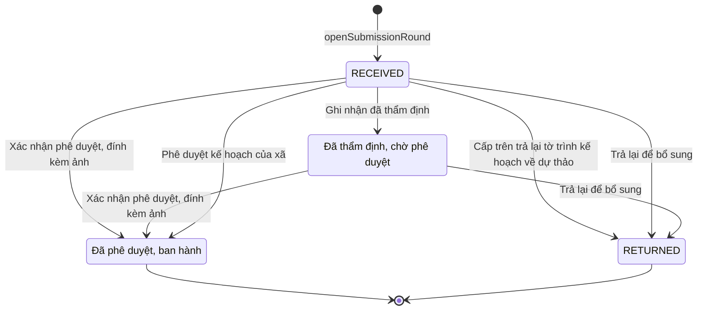

# qt-2.submission · Kế hoạch lập → thẩm định → phê chuẩn → rà soát — Kế hoạch, văn kiện

<!-- máy sinh: tom-tat -->
> **Hồ sơ:** Kế hoạch, văn kiện (`PlanDocument`)
>
> **Trong sổ phạm vi:** 2 · Kế hoạch lập → thẩm định → phê chuẩn → rà soát — hồ sơ phụ submission: một lượt trình kế hoạch lên cấp trên — tiếp nhận, thẩm định, phê duyệt hoặc trả lại (tầng 1)
>
> 7 bước · 4 chặng · 3 vai · 1 bảng quyết định · 0 hạn · 24 khớp nối.
>
> **Nguồn:** sổ nghiệp vụ `qt-2.submission` · khai báo của app: `dqtv-app/core/processes/planning/workflow/plan-document.yaml`. Các bảng do máy sinh từ nguồn này.
<!-- hết: tom-tat -->

## 1. Đường đi ngắn nhất qua các chặng

<!-- máy sinh: luong-chinh -->
Đường ít bước nhất từ lúc mở hồ sơ tới chặng kết thúc xa nhất. Máy chọn theo số chặng, không theo ý nghĩa nghiệp vụ — trình tự công việc thật xem phần Diễn giải và bảng "Việc làm ở từng chặng" ở mục 6.

| # | Ai làm | Làm gì | Hồ sơ sang chặng |
|---|---|---|---|
| 1 | Hệ thống tự làm | `openSubmissionRound` | `RECEIVED` |
| 2 | Trợ lý Tác huấn | Xác nhận phê duyệt, đính kèm ảnh | Đã phê duyệt, ban hành |

<!-- hết: luong-chinh -->

## 2. Hồ sơ và việc nó để lại

<!-- máy sinh: muc-tieu -->
**App gọi quy trình này là:** Kế hoạch, văn kiện.

**Khi mở, hồ sơ này ghi mối nối tới:**
- Văn bản đến (1.incoming-document) — bước `openSubmissionRound`, khớp nối `submissionDeliveredAs`

**Hồ sơ này để lại cho quy trình khác** (bước tạo hồ sơ của quy trình kia ghi mối nối về đây):
- Cuộc thanh tra, kiểm tra (9) — bước `openInspection`, khớp nối `inspectionUnderPlan`
- Công trình, đất đai quốc phòng (23) — bước `proposeLand`, khớp nối `defenceWorkUnderPlan`
- Hồ sơ thành lập tổ chức (29) — bước `draftUnit`, khớp nối `dossierUnderPlan`
- Khoá bồi dưỡng kiến thức QP&AN (G1) — bước `createCoursePlan`, khớp nối `courseUnderAnnualPlan`
- Nhiệm vụ trên giao (1) — bước `draftPlan`, khớp nối `answeredBy`
- Nhiệm vụ trên giao (1) — bước `openPlanAmendment`, khớp nối `answeredBy`
- Phong trào thi đua (7) — bước `launchCampaign`, khớp nối `campaignUnderPlan`
- Sự kiện — huấn luyện, hội thi, diễn tập, hội nghị (14) — bước `createTrainingPlan`, khớp nối `trainingUnderPlan`
- Văn bản đến (1.incoming-document) — bước `openSubmissionRound`, khớp nối `submissionDeliveredAs`
- Vụ việc ứng phó (20) — bước `openCase`, khớp nối `caseUnderPlan`
- Đợt mở rộng lực lượng (D5) — bước `recordExpansionOrder`, khớp nối `expansionUnderPlan`
<!-- hết: muc-tieu -->

## 3. Khởi phát và kết thúc

<!-- máy sinh: khoi-phat -->
**1 cửa vào** — bước mở hồ sơ:

| Bước mở | Ai mở | Hồ sơ vào chặng | App bắt buộc nhập |
|---|---|---|---|
| `openSubmissionRound` | Hệ thống tự làm | `RECEIVED` | — |

**Kết thúc:** *Đã phê duyệt, ban hành* (`APPROVED`), *`RETURNED`* (`RETURNED`)
<!-- hết: khoi-phat -->

## 4. Vai trò

<!-- máy sinh: vai-tro -->
| Vai trong sổ | Tên trong app | Điều kiện | Làm những bước |
|---|---|---|---|
| `system` | Hệ thống tự làm |  | Cấp trên trả lại tờ trình kế hoạch về dự thảo · Trả lại để bổ sung · `openSubmissionRound` |
| `approver` | Bộ CHQS cấp tỉnh | thuộc cấp trên của chủ hồ sơ (`actorInSuperiorUnit`, công thức ở mục 7) | Ghi nhận đã thẩm định · Phê duyệt kế hoạch của xã |
| `operator` | Trợ lý Tác huấn |  | Xác nhận phê duyệt, đính kèm ảnh |
| `operator` | Trợ lý Tác huấn | thuộc cấp trên của chủ hồ sơ (`actorInSuperiorUnit`, công thức ở mục 7) | Trình ký văn bản trả lại kế hoạch |

*"Tên trong app" là tên app đặt cho mã chủ thể của vai. Hồ sơ thuộc đơn vị cấp khác thì người làm là người giữ vai ấy ở đơn vị nêu trong cột "Điều kiện" (nếu sổ có ghi) và ở cột "Người làm phải thuộc" của bảng "Theo khai báo của app" (mục 7).*

**Ngoài hệ** (hệ chỉ ghi kết quả, xem mục 8): `communeChairman`.
<!-- hết: vai-tro -->

## 5. Nhánh phụ

<!-- máy sinh: nhanh-phu -->
**Bước khác đưa hồ sơ sang chặng mới** — đường song song, rẽ nhánh hoặc kết thúc sớm:

| Bước | Ai làm | Từ chặng | Sang chặng |
|---|---|---|---|
| Cấp trên trả lại tờ trình kế hoạch về dự thảo | Hệ thống tự làm | `RECEIVED` | `RETURNED` |
| Ghi nhận đã thẩm định | Bộ CHQS cấp tỉnh (thuộc cấp trên của chủ hồ sơ) | `RECEIVED` | Đã thẩm định, chờ phê duyệt |
| Phê duyệt kế hoạch của xã | Bộ CHQS cấp tỉnh (thuộc cấp trên của chủ hồ sơ) | `RECEIVED` | Đã phê duyệt, ban hành |
| Trả lại để bổ sung | Hệ thống tự làm | `RECEIVED`, Đã thẩm định, chờ phê duyệt | `RETURNED` |

**Làm trong lúc hồ sơ đứng yên ở một chặng** — ghi nhận, bổ sung:

| Bước | Ai làm | Ở chặng |
|---|---|---|
| Trình ký văn bản trả lại kế hoạch | Trợ lý Tác huấn (thuộc cấp trên của chủ hồ sơ) | `RECEIVED`, Đã thẩm định, chờ phê duyệt |

<!-- hết: nhanh-phu -->

## 6. Các chặng và việc làm ở từng chặng

<!-- máy sinh: chang -->
| Chặng | Tên hiển thị | Vào bằng bước | Kết thúc? |
|---|---|---|---|
| `RECEIVED` | — | `openSubmissionRound` |  |
| `APPRAISED` | Đã thẩm định, chờ phê duyệt | Ghi nhận đã thẩm định |  |
| `APPROVED` | Đã phê duyệt, ban hành | Xác nhận phê duyệt, đính kèm ảnh · Phê duyệt kế hoạch của xã | **kết thúc** |
| `RETURNED` | — | Cấp trên trả lại tờ trình kế hoạch về dự thảo · Trả lại để bổ sung | **kết thúc** |

### Việc làm ở từng chặng

Hồ sơ đang ở chặng nào thì làm được những bước nào.

| Hồ sơ đang ở chặng | Bước làm tại chặng (hồ sơ đứng yên) | Bước đưa hồ sơ sang chặng khác |
|---|---|---|
| **`RECEIVED`** | Trình ký văn bản trả lại kế hoạch — Trợ lý Tác huấn (thuộc cấp trên của chủ hồ sơ) | Cấp trên trả lại tờ trình kế hoạch về dự thảo — Hệ thống tự làm → *`RETURNED`* Ghi nhận đã thẩm định — Bộ CHQS cấp tỉnh (thuộc cấp trên của chủ hồ sơ) → *Đã thẩm định, chờ phê duyệt* Xác nhận phê duyệt, đính kèm ảnh — Trợ lý Tác huấn → *Đã phê duyệt, ban hành* Phê duyệt kế hoạch của xã — Bộ CHQS cấp tỉnh (thuộc cấp trên của chủ hồ sơ) → *Đã phê duyệt, ban hành* Trả lại để bổ sung — Hệ thống tự làm → *`RETURNED`* |
| **Đã thẩm định, chờ phê duyệt** | Trình ký văn bản trả lại kế hoạch — Trợ lý Tác huấn (thuộc cấp trên của chủ hồ sơ) | Xác nhận phê duyệt, đính kèm ảnh — Trợ lý Tác huấn → *Đã phê duyệt, ban hành* Trả lại để bổ sung — Hệ thống tự làm → *`RETURNED`* |
| **Đã phê duyệt, ban hành** | — | — (kết thúc) |
| **`RETURNED`** | — | — (kết thúc) |
<!-- hết: chang -->

## 7. Bảng bước

<!-- máy sinh: buoc -->
| # | Bước | Mã bước | Ai thực hiện | Từ chặng | Sang chặng | Phải có trước | Ghi lại |
|---|---|---|---|---|---|---|---|
| 1 | Cấp trên trả lại tờ trình kế hoạch về dự thảo | `returnPlanByReceiver` | Hệ thống tự làm | `RECEIVED` | `RETURNED` | — | lý do văn thư cấp trên trả lại, nối tới Văn bản đến; **xoá:** ngày các bên cùng ký |
| 2 | Ghi nhận đã thẩm định | `appraisePlan` | Bộ CHQS cấp tỉnh (thuộc cấp trên của chủ hồ sơ) | `RECEIVED` | `APPRAISED` | người làm thuộc cấp trên của chủ hồ sơ, `planTypeAppraised`, `submissionDistributedAtReceiver` | ngày thẩm định |
| 3 | Xác nhận phê duyệt, đính kèm ảnh | `recordPlanApproval` | Trợ lý Tác huấn | `RECEIVED`, `APPRAISED` | `APPROVED` | loại kế hoạch theo luật, `level`, người làm thuộc đơn vị chủ hồ sơ, `appraisalReferenceGiven`, `approvalOutsideSystem`, `planApprovedByIncomingDocumentUsable`, `noSecretContentFile` | nối tới Quyết định ký ngoài hệ thống, nối tới Văn bản đến (`link.planApprovedByIncomingDocument`), ngày phê duyệt, ngày hết hiệu lực, nối tới Văn bản đến (`link.planAppraisalFromIncomingDocument`) |
| 4 | Phê duyệt kế hoạch của xã | `approveCommunePlan` | Bộ CHQS cấp tỉnh (thuộc cấp trên của chủ hồ sơ) | `RECEIVED` | `APPROVED` | người làm thuộc cấp trên của chủ hồ sơ, `approvalInSystem`, `submissionDistributedAtReceiver` | nối tới Phê duyệt của cấp trên, ngày phê duyệt, ngày hết hiệu lực, hạn rà soát kế tiếp |
| 5 | Trình ký văn bản trả lại kế hoạch | `requestReturnCommunePlanSignature` | Trợ lý Tác huấn (thuộc cấp trên của chủ hồ sơ) | `RECEIVED`, `APPRAISED` | giữ nguyên | `superiorReviewsInSystem`, `submissionDistributedAtReceiver`, `noReturnCommunePlanDocumentOpen`, người làm thuộc cấp trên của chủ hồ sơ, `noSecretContentFile` | lý do trả lại — xã biết sửa gì, nối tới Văn bản đi, `contentFileGiven` |
| 6 | Trả lại để bổ sung | `returnCommunePlan` | Hệ thống tự làm | `RECEIVED`, `APPRAISED` | `RETURNED` | `returnCommunePlanDocumentIssued` | nối tới Phê duyệt của cấp trên, nối tới Văn bản đến, lý do đưa về sửa; **xoá:** ngày các bên cùng ký |
| 7 | `openSubmissionRound` | `openSubmissionRound` | Hệ thống tự làm | — (mở hồ sơ) | `RECEIVED` | `planAwaitingSuperior`, `noRoundOpen` | `id`, nối `submissionOfPlan`, nối tới Văn bản đến, đơn vị chủ hồ sơ |

### Khi không đạt điều kiện

Mặc định: không đúng người, hồ sơ không ở đúng chặng, hoặc thiếu thứ "phải có trước" thì bước bị chặn, hồ sơ giữ nguyên. Bảng dưới chỉ kê những bước có kết quả riêng.

| # | Bước | Kết quả riêng |
|---|---|---|
| 1 | Cấp trên trả lại tờ trình kế hoạch về dự thảo | bước này không do người nào bấm |
| 3 | Xác nhận phê duyệt, đính kèm ảnh | bước dừng lại, hồ sơ giữ nguyên khi kết quả xét là: `type_unknown`, `signer_unknown`, `wrong_authority`, `no_rule`; nhánh `with-review-date`: hồ sơ sang *Đã phê duyệt, ban hành*, ghi thêm hạn rà soát kế tiếp |
| 4 | Phê duyệt kế hoạch của xã | bước dừng lại, hồ sơ giữ nguyên khi kết quả xét là: `commune_chairman` |
| 6 | Trả lại để bổ sung | bước này không do người nào bấm |
| 7 | `openSubmissionRound` | bước này không do người nào bấm |

### Điều kiện "phải có trước" bằng lời

Cột "Phải có trước" ở bảng bước có hai loại: ô dữ liệu thường (bước chỉ đòi ô ấy đã có giá trị) và điều kiện hệ tự xét. Bảng này diễn các điều kiện hệ tự xét theo đúng công thức sổ ghi; số ở cột cuối là số thứ tự bước.

| Điều kiện | Đúng khi | Bước đòi |
|---|---|---|
| `actorInSuperiorUnit` | người đang làm là người của một đơn vị nằm trong ô cấp trên của chủ hồ sơ của hồ sơ này (theo danh mục người của đơn vị, `dm.unit-staff`) | 2, 4, 5 |
| `planTypeAppraised` | loại kế hoạch theo luật là `reserve_force` hoặc `mobilization_plan` hoặc `industrial_mobilization_plan` VÀ `level` là Cấp xã (`commune`) hoặc Ban chỉ huy quân sự cơ quan, tổ chức (`organization`) | 2 |
| `submissionDistributedAtReceiver` | có hồ sơ Việc luật giao kèm văn bản đến, đi — Văn bản đến (qt-1.incoming-document) chính là hồ sơ ghi ở ô nối `submissionDeliveredAs` của hồ sơ đang làm mà hồ sơ ấy đang ở chặng `DISTRIBUTED` | 2, 4, 5 |
| `planType` | ô hệ tự suy ra | 3 |
| `level` | ô hệ tự suy ra | 3 |
| `actorInOwnerUnit` | người đang làm là người của đơn vị ghi ở ô đơn vị chủ hồ sơ của hồ sơ này (theo danh mục người của đơn vị, `dm.unit-staff`) | 3 |
| `appraisalReferenceGiven` | KHÔNG (loại kế hoạch theo luật là `reserve_force` hoặc `mobilization_plan` hoặc `industrial_mobilization_plan` VÀ `level` là Cấp xã (`commune`) hoặc Ban chỉ huy quân sự cơ quan, tổ chức (`organization`)) HOẶC đã có ngày thẩm định HOẶC (`level` là Ban chỉ huy quân sự cơ quan, tổ chức (`organization`) VÀ có hồ sơ Việc luật giao kèm văn bản đến, đi — Văn bản đến (qt-1.incoming-document) chính là hồ sơ ghi ở ô nối `planAppraisalFromIncomingDocument` của hồ sơ đang làm mà hồ sơ ấy đang ở chặng `RECEIVED` hoặc `DISTRIBUTED`) | 3 |
| `approvalOutsideSystem` | KHÔNG ((`level` là Cấp xã (`commune`) hoặc Ban chỉ huy quân sự cơ quan, tổ chức (`organization`) VÀ loại kế hoạch theo luật là `force_expansion` hoặc `militia_training`) HOẶC (`level` là Cấp xã (`commune`) VÀ loại kế hoạch theo luật là `coordination_adhoc`)) | 3 |
| `planApprovedByIncomingDocumentUsable` | có hồ sơ Việc luật giao kèm văn bản đến, đi — Văn bản đến (qt-1.incoming-document) chính là hồ sơ ghi ở ô nối `planApprovedByIncomingDocument` của hồ sơ đang làm mà hồ sơ ấy đang ở chặng `RECEIVED` hoặc `DISTRIBUTED` | 3 |
| `noSecretContentFile` | KHÔNG (diện bảo vệ bí mật là Có (`yes`) VÀ đã có `contentFileGiven`) | 3, 5 |
| `approvalInSystem` | (`level` là Cấp xã (`commune`) hoặc Ban chỉ huy quân sự cơ quan, tổ chức (`organization`) VÀ loại kế hoạch theo luật là `force_expansion` hoặc `militia_training`) HOẶC (`level` là Cấp xã (`commune`) VÀ loại kế hoạch theo luật là `coordination_adhoc`) | 4 |
| `superiorReviewsInSystem` | (`level` là Cấp xã (`commune`) hoặc Ban chỉ huy quân sự cơ quan, tổ chức (`organization`) VÀ loại kế hoạch theo luật là `force_expansion` hoặc `militia_training`) HOẶC (`level` là Cấp xã (`commune`) VÀ loại kế hoạch theo luật là `reserve_force`) HOẶC (`level` là Cấp xã (`commune`) VÀ loại kế hoạch theo luật là `coordination_adhoc`) | 5 |
| `noReturnCommunePlanDocumentOpen` | KHÔNG (có hồ sơ Việc luật giao kèm văn bản đến, đi — Văn bản đi (qt-1.outgoing-document) chính là hồ sơ ghi ở ô nối `returnCommunePlanByDocument` của hồ sơ đang làm mà hồ sơ ấy đang ở chặng `DRAFT` hoặc `PENDING_SIGNATURE` hoặc `SIGNED`) | 5 |
| `returnCommunePlanDocumentIssued` | có hồ sơ Việc luật giao kèm văn bản đến, đi — Văn bản đi (qt-1.outgoing-document) chính là hồ sơ ghi ở ô nối `returnCommunePlanByDocument` của hồ sơ đang làm mà hồ sơ ấy đang ở chặng `ISSUED` | 6 |
| `planAwaitingSuperior` | có hồ sơ Kế hoạch lập → thẩm định → phê chuẩn → rà soát (qt-2) chính là hồ sơ ghi ở ô nối `submissionOfPlan` của hồ sơ đang làm mà hồ sơ ấy đang ở chặng `SUBMITTED` | 7 |
| `noRoundOpen` | KHÔNG (có hồ sơ Kế hoạch lập → thẩm định → phê chuẩn → rà soát — Kế hoạch, văn kiện (qt-2.submission) có ô nối `submissionOfPlan` trùng với ô nối `submissionOfPlan` của hồ sơ đang làm mà hồ sơ ấy đang ở chặng `RECEIVED` hoặc `APPRAISED`) | 7 |

### Theo khai báo của app

Người làm phải thuộc đơn vị nào, ô người dùng phải nhập, bước có lặp được không, và căn cứ pháp lý — lấy từ khai báo quy trình trong app.

| # | Bước | Người làm phải thuộc | Bắt buộc nhập | Nhập nếu có | Lặp được | Căn cứ |
|---|---|---|---|---|---|---|
| 1 | Cấp trên trả lại tờ trình kế hoạch về dự thảo |  | lý do văn thư cấp trên trả lại | — |  | NĐ30/2020/NĐ-CP Đ.21 k2 b |
| 2 | Ghi nhận đã thẩm định | cấp trên của chủ hồ sơ | — | — |  | L53/2019/QH14 Điều 10 khoản 8 — cơ quan quân sự cấp trên thẩm định trước khi phê duyệt |
| 3 | Xác nhận phê duyệt, đính kèm ảnh | đơn vị chủ hồ sơ | người duyệt, văn bản phê duyệt trong sổ văn bản đến | `subject`, `legalBasis`, văn bản thẩm định trong sổ văn bản đến, ngày hết hiệu lực |  | 50_MAU_KY_NGOAI_HE_THONG.md §D · NĐ02/2020/NĐ-CP Đ.4 k1 c |
| 4 | Phê duyệt kế hoạch của xã | cấp trên của chủ hồ sơ | `approverUnit` | `opinion`, ngày hết hiệu lực, người duyệt |  | TT78/VBHN-BQP Đ.7 k2 c |
| 5 | Trình ký văn bản trả lại kế hoạch | cấp trên của chủ hồ sơ | lý do trả lại — xã biết sửa gì | dự thảo văn bản trả lại (PDF) |  | TT78/VBHN-BQP Đ.7 k2 c · NĐ30/2020/NĐ-CP Đ.13 |
| 6 | Trả lại để bổ sung |  | `approverUnit` | `opinion` |  | TT78/VBHN-BQP Đ.7 k2 c · NĐ30/2020/NĐ-CP Đ.18 |
| — | Soạn dự thảo kế hoạch, văn kiện (`draftPlan`) |  | tên kế hoạch, văn kiện, loại văn kiện, kỳ, `taskingId` | năm kế hoạch, `forceIds`, diện bảo vệ bí mật, ghi chú, đường ban hành, chu kỳ rà soát, văn bản căn cứ trong sổ văn bản đến, phạm vi phong trào thi đua |  | L48/2019/QH14 Đ.9 |
| — | Sửa nội dung dự thảo (`editPlan`) | đơn vị chủ hồ sơ | — | tên kế hoạch, văn kiện, kỳ, năm kế hoạch, ghi chú |  | L48/2019/QH14 Đ.9 |
| — | Ghi thời gian chuyển trạng thái (`setPlanTransitionTimes`) | đơn vị chủ hồ sơ | — | lên tăng cường · Ban chỉ huy · nhiệm vụ A (phút), lên tăng cường · Ban chỉ huy · nhiệm vụ A2 (phút), lên tăng cường · Ban chỉ huy · nhiệm vụ A3 (phút), lên tăng cường · Ban chỉ huy · nhiệm vụ A4 (phút), lên tăng cường · phân đội · nhiệm vụ A (phút), lên tăng cường · phân đội · nhiệm vụ A2 (phút), lên tăng cường · phân đội · nhiệm vụ A3 (phút), lên tăng cường · phân đội · nhiệm vụ A4 (phút), lên cao, toàn bộ · Ban chỉ huy · nhiệm vụ A (phút), lên cao, toàn bộ · Ban chỉ huy · nhiệm vụ A2 (phút), lên cao, toàn bộ · Ban chỉ huy · nhiệm vụ A3 (phút), lên cao, toàn bộ · Ban chỉ huy · nhiệm vụ A4 (phút), lên cao, toàn bộ · phân đội · nhiệm vụ A (phút), lên cao, toàn bộ · phân đội · nhiệm vụ A2 (phút), lên cao, toàn bộ · phân đội · nhiệm vụ A3 (phút), lên cao, toàn bộ · phân đội · nhiệm vụ A4 (phút) | có | L48/2019/QH14 Đ.29 k1 |
| — | Ghi quy mô mở rộng (`setPlanExpansionScale`) | đơn vị chủ hồ sơ | kế hoạch lập cho tình huống | ban chỉ huy quân sự cấp xã (người), ban chỉ huy quân sự cơ quan, tổ chức (người), dân quân tự vệ cơ động (người), dân quân thường trực (người), dân quân tự vệ tại chỗ (người), dân quân tự vệ phòng không (người), dân quân tự vệ pháo binh (người), dân quân tự vệ trinh sát (người), dân quân tự vệ thông tin (người), dân quân tự vệ công binh (người), dân quân tự vệ phòng hoá (người), dân quân tự vệ y tế (người), dân quân tự vệ biển (người) | có | L48/2019/QH14 Đ.16 k2 · TT77/2020/TT-BQP Đ.10 |
| — | Nối căn cứ nhiệm vụ (`linkPlanBasis`) | đơn vị chủ hồ sơ | — | `missionTaskingIds` |  | NQ66.12/2026 Đ.4 k3 c · k4 b, c — xã lập kế hoạch theo nhiệm vụ, chỉ tiêu trên giao |
| — | Nối vào nhiệm vụ và kế hoạch cấp trên (`linkProvincePlanBasis`) | đơn vị chủ hồ sơ | — | `taskingIds`, `planDocumentIds` |  | NQ 66.12/2026 Đ.4 k3 c — xây dựng kế hoạch theo kế hoạch huấn luyện chiến đấu của Bộ Chỉ huy quân sự cấp tỉnh |
| — | Ghi nhận các bên đã cùng ký (`recordCoSigning`) | đơn vị chủ hồ sơ | ngày các bên cùng ký | — |  | NĐ02/2020/NĐ-CP Đ.4 k1 c |
| — | Đưa dự thảo về sửa (`returnToDraft`) | đơn vị chủ hồ sơ | lý do đưa về sửa | — |  | NĐ02/2020/NĐ-CP Đ.4 k1 c |
| — | Soạn một điều (`addPlanArticle`) | đơn vị chủ hồ sơ | tên điều, nội dung | số điều, ghi chú | có | NĐ02/2020/NĐ-CP Đ.4 k2, Đ.5 k2; QĐ1126/QĐ-TM Đ.8 k3 |
| — | Sửa một điều (`editPlanArticle`) | đơn vị chủ hồ sơ | `articleId` | số điều, tên điều, nội dung, ghi chú soạn thảo |  | NĐ02/2020/NĐ-CP Đ.4 k2, Đ.5 k2; QĐ1126/QĐ-TM Đ.8 k3 |
| — | Chọn lực lượng phối hợp (`setPlanForces`) | đơn vị chủ hồ sơ | `forceIds` | — | có | L18/2023/QH15 Đ.12 k2 e; NĐ02/2020/NĐ-CP Đ.5 k1 a |
| — | Chuyển Chỉ huy trưởng — đã soạn xong (`confirmPlanDraftReady`) | đơn vị chủ hồ sơ | — | — |  | QĐ1126/QĐ-TM Đ.8 k3 |
| — | Huỷ dự thảo (`cancelPlanDraft`) | đơn vị chủ hồ sơ | lý do huỷ dự thảo | — |  | sổ qt-2 — cancelPlanDraft |
| — | Thu bản thảo về để sửa tiếp (`withdrawPlanDraftReady`) | đơn vị chủ hồ sơ | — | — |  | QĐ1126/QĐ-TM Đ.8 k3 |
| — | Trình ký tờ trình văn kiện (`requestPlanSignature`) | đơn vị chủ hồ sơ | — | tờ trình (PDF) |  | NĐ02/2020/NĐ-CP Đ.4 k1 c, Đ.5 k1 a; QĐ1126/QĐ-TM Đ.3 k6; NĐ30/2020/NĐ-CP Đ.10, Đ.13 |
| — | Ký phê duyệt (`approveOwnPlan`) | đơn vị chủ hồ sơ | — | — |  | TT69/2020/TT-BQP Đ.7 k2 a (VBHN 78/VBHN-BQP); TT77/2020/TT-BQP Đ.10 k2 b, Đ.11 k2, k5 · N14 người dùng chốt 16/10/2026 |
| — | Gửi cấp có thẩm quyền (`submitPlan`) |  | ngày trình ký | tờ trình đã ký, đã ghi số |  | NĐ02/2020/NĐ-CP Đ.4 k1 c, Đ.5 k1 a; L18/2023/QH15 Đ.12 k5; NĐ30/2020/NĐ-CP Đ.18, Đ.19 |
| — | Vào sổ, cấp số và ban hành (`issueCommunePlan`) | đơn vị chủ hồ sơ | — | bản kế hoạch đã ký, nơi nhận |  | NĐ30/2020/NĐ-CP Đ.8 k1 a, Đ.18, Đ.19 |
| — | Ghi văn bản Uỷ ban nhân dân ban hành (`recordCommitteeIssuedPlan`) | đơn vị chủ hồ sơ | người duyệt, văn bản ban hành trong sổ văn bản đến | `subject`, `legalBasis` |  | L48/2019/QH14 Điều 44 khoản 1 điểm a · L49/2024/QH15 Điều 43 khoản 2 điểm b · L18/2023/QH15 Đ.12 k5 |
| — | Triển khai, tổ chức thực hiện (`startImplementation`) | đơn vị chủ hồ sơ | — | — |  | L48/2019/QH14 Đ.30 |
| — | Mở đợt rà soát định kỳ (`startPlanReview`) | đơn vị chủ hồ sơ | — | — |  | NĐ02/2020/NĐ-CP Đ.4 k1 d |
| — | Nhắc đến hạn rà soát (`flagPlanReviewDue`) |  | — | — |  | NĐ02/2020/NĐ-CP Đ.4 k1 d |
| — | Chốt số đã đạt của chỉ tiêu cuối kỳ (`closeTargetPeriodTally`) |  | ngày cuối kỳ, số đã đạt của các dòng chốt kỳ này | — |  | TT77/2020/TT-BQP Đ.7 |
| — | Kết luận rà soát, đặt hạn kế tiếp (`finishPlanReview`) | đơn vị chủ hồ sơ | kết luận rà soát, hướng xử lý sau rà soát | hạn rà soát kế tiếp | có | NĐ02/2020/NĐ-CP Đ.4 k1 d |
| — | Dự kiến một tình huống (`addPlannedSituation`) | đơn vị chủ hồ sơ | tên tình huống, loại sự cố, thảm hoạ, dự báo diễn biến, hậu quả | cấp độ phòng thủ dân sự, khu vực dự kiến ảnh hưởng, biện pháp dự kiến, quân số dự kiến huy động, phân công trách nhiệm, `unitIds`, `forceIds`, ghi chú | có | L18/2023/QH15 Đ.12 k2 b |
| — | Sửa tình huống đã dự kiến (`editPlannedSituation`) | đơn vị chủ hồ sơ | `situationId`, tên tình huống, loại sự cố, thảm hoạ, dự báo diễn biến, hậu quả | cấp độ phòng thủ dân sự, khu vực dự kiến ảnh hưởng, biện pháp dự kiến, quân số dự kiến huy động, phân công trách nhiệm, `unitIds`, `forceIds`, ghi chú | có | L18/2023/QH15 Đ.12 k1, k2 b |
| — | Gỡ tình huống khỏi kế hoạch (`removePlannedSituation`) | đơn vị chủ hồ sơ | `situationId`, lý do gỡ | — | có | L18/2023/QH15 Đ.12 k2 b |
| — | Kết thúc kỳ, sơ kết, lưu (`expirePlan`) | đơn vị chủ hồ sơ | ngày hết hiệu lực | ghi chú |  | L48/2019/QH14 Đ.37 |
| — | Mở bản điều chỉnh (`openPlanAmendment`) |  | `amendsPlanId`, lý do điều chỉnh | tên kế hoạch, văn kiện, kỳ, năm kế hoạch, ghi chú |  | L48/2019/QH14 Đ.9 |
| — | Thay bằng bản điều chỉnh (`supersedePlan`) |  | `supersededById` | — |  | L48/2019/QH14 Đ.9 |
| — | Giao người được xem văn kiện mật (`namePlanSecretReaders`) | đơn vị chủ hồ sơ | người được giao xem văn kiện mật | — |  | Luật Bảo vệ bí mật nhà nước 2025 (117/2025/QH15) · sổ qt-2, người dùng "1: B" (justindang 24/10/2026) |
| — | Xem nội dung văn kiện mật (người soạn) (`viewPlanSecretContent`) | đơn vị chủ hồ sơ | — | — |  | sổ qt-2, người dùng "1: B" (justindang 24/10/2026) |
| — | Xem nội dung văn kiện mật (người ký) (`viewPlanSecretContentAsSigner`) | đơn vị chủ hồ sơ | — | — |  | sổ qt-2, người dùng "1: B" (justindang 24/10/2026) |
| — | Xem nội dung văn kiện mật (văn thư) (`viewPlanSecretContentAsClerk`) | đơn vị chủ hồ sơ | — | — |  | sổ qt-2, người dùng "1: B" (justindang 24/10/2026) |
| — | Xem nội dung văn kiện mật (người được giao) (`viewPlanSecretContentAsReader`) |  | — | — |  | sổ qt-2, người dùng "1: B" (justindang 24/10/2026) |

### Điều kiện và ghi chú app khai cho từng bước

Lấy từ khai báo quy trình trong app. Lời trong ngoặc kép là câu app hiện cho người dùng. Chức danh người ký ngoài hệ app chỉ khai bằng mã.

| # | Bước | Điều kiện, ghi chú |
|---|---|---|
| 3 | Xác nhận phê duyệt, đính kèm ảnh | · bước này ghi một quyết định ký NGOÀI hệ (`planAuthorizedBy`), người ký: `commune_chairman`, `province_military_command`, `province_chairman`, `commune_peoples_council`, `province_peoples_council`, `province_peoples_committee`, `commune_gdqp_council_chair`, `province_gdqp_council_chair`, `region_gdqp_council_chair`, `central_gdqp_council_chair`, `gdqp_council_standing_vice_chair`, `gdqp_council_standing_board`, `prime_minister`, `ministry_head`, `organization_head`, `co_signers`, `defence_minister`, `general_staff_chief`, `military_region_commander`, `commune_military_commander` · không đòi bản chụp — app ghi: "bản số hoá lấy từ văn bản đến văn thư đã vào sổ (tầng đọc chép `scanPath` của văn bản ấy), không tải ảnh ở bước này" |
| 4 | Phê duyệt kế hoạch của xã | · bước này là một quyết định trong hệ, kết quả: đồng ý |
| 6 | Trả lại để bổ sung | · bước này là một quyết định trong hệ, kết quả: từ chối, phải ghi `opinion` |
| — | Sửa nội dung dự thảo | · chỉ làm được khi ô "loại văn kiện" không là Kế hoạch bồi dưỡng kiến thức quốc phòng và an ninh hằng năm (`gdqp_refresher_plan_year`) — ngoài ra app báo: "kế hoạch bồi dưỡng kiến thức QP&AN năm không sửa tên, kỳ, ghi chú sau khi lập" |
| — | Ghi thời gian chuyển trạng thái | · chỉ làm được khi ô "loại văn kiện" là Kế hoạch chuyển trạng thái sẵn sàng chiến đấu của Ban chỉ huy quân sự (`readiness_transition_plan`) — ngoài ra app báo: "chỉ kế hoạch chuyển trạng thái sẵn sàng chiến đấu mới có bảng thời gian chuyển trạng thái" |
| — | Ghi quy mô mở rộng | · chỉ làm được khi ô "loại văn kiện" là Kế hoạch mở rộng lực lượng (`force_expansion_plan`) — ngoài ra app báo: "chỉ kế hoạch mở rộng lực lượng mới có bảng quy mô mở rộng" |
| — | Nối vào nhiệm vụ và kế hoạch cấp trên | · chỉ làm được khi `level` là Cấp tỉnh (`province`) hoặc Quân khu (`region`) hoặc Bộ Quốc phòng (`central`) hoặc Ban chỉ huy quân sự cơ quan, tổ chức (`organization`) hoặc Ban chỉ huy quân sự bộ, ngành trung ương (`ministry`) — ngoài ra app báo: "kế hoạch cấp xã nối căn cứ ở bước riêng của cấp xã, không ở bước này" · chỉ làm được khi ô "loại văn kiện" không là Kế hoạch bồi dưỡng kiến thức quốc phòng và an ninh hằng năm (`gdqp_refresher_plan_year`) — ngoài ra app báo: "kế hoạch bồi dưỡng kiến thức QP&AN năm: căn cứ là văn bản đính lúc soạn — không nối kế hoạch cấp trên" |
| — | Ghi nhận các bên đã cùng ký | · chỉ làm được khi ô "loại văn kiện" là Quy chế phối hợp (`coordination_charter`) hoặc Kế hoạch phối hợp hằng năm (`coordination_plan_year`) — ngoài ra app báo: "loại văn kiện này không có bước cùng ký — chỉ quy chế phối hợp và kế hoạch phối hợp hằng năm mới cùng ký chịu trách nhiệm (Nghị định 02/2020 Điều 4 khoản 1 điểm c, Điều 5 khoản 1 điểm a)" |
| — | Soạn một điều | · tạo thêm một hồ sơ con: Điều của văn kiện (`PlanArticle`) |
| — | Chọn lực lượng phối hợp | · chỉ làm được khi ô "loại văn kiện" là Quy chế phối hợp (`coordination_charter`) hoặc Kế hoạch phối hợp hằng năm (`coordination_plan_year`) hoặc Kế hoạch phối hợp đột xuất (`coordination_plan_adhoc`) — ngoài ra app báo: "loại văn kiện này không chọn lực lượng ở bước này — chỉ quy chế phối hợp, kế hoạch phối hợp mới chọn các bên phối hợp ở đây (Nghị định 02/2020 Điều 4 khoản 1 điểm c, Điều 5 khoản 1 điểm a); kế hoạch phòng thủ dân sự lấy diện phối hợp từ các tình huống dự kiến (Luật Phòng thủ dân sự 18/2023 Điều 12 khoản 2 điểm b, e)" |
| — | Trình ký tờ trình văn kiện | · tạo thêm một hồ sơ con: Văn bản đi (`OutgoingDocument`) |
| — | Gửi cấp có thẩm quyền | · app khai nơi nhận: `commune_chairman`, `province_chairman`, `province_military_command`, `commune_peoples_council`, `province_peoples_council`, `province_peoples_committee`, `commune_gdqp_council_chair`, `province_gdqp_council_chair`, `region_gdqp_council_chair`, `central_gdqp_council_chair`, `gdqp_council_standing_vice_chair`, `gdqp_council_standing_board`, `prime_minister`, `ministry_head`, `organization_head`, `co_signers`, `defence_minister`, `general_staff_chief`, `military_region_commander`, `commune_military_commander` |
| — | Vào sổ, cấp số và ban hành | · không làm được khi đã có ô "ngày ban hành" — app báo: "kế hoạch đã ban hành" · app khai nơi nhận: `subordinate_units` |
| — | Ghi văn bản Uỷ ban nhân dân ban hành | · không làm được khi đã có ô "ngày ban hành" — app báo: "kế hoạch đã ban hành" · bước này ghi một quyết định ký NGOÀI hệ (`planIssuedByCommittee`), người ký: `commune_chairman`, `commune_peoples_council`, `province_chairman`, `province_peoples_council`, `province_peoples_committee` · không đòi bản chụp — app ghi: "bản số hoá lấy từ văn bản đến văn thư đã vào sổ (tầng đọc chép `scanPath` của văn bản ấy), không tải ảnh ở bước này" |
| — | Triển khai, tổ chức thực hiện | · phải đã có ô "ngày ban hành" — thiếu thì app báo: "kế hoạch chưa ban hành — văn thư cấp số, ban hành (hoặc ghi văn bản ban hành của Uỷ ban) rồi mới triển khai" |
| — | Mở đợt rà soát định kỳ | · chỉ làm được khi ô "loại văn kiện" không là Kế hoạch bồi dưỡng kiến thức quốc phòng và an ninh hằng năm (`gdqp_refresher_plan_year`) — ngoài ra app báo: "kế hoạch bồi dưỡng kiến thức QP&AN năm không rà soát định kỳ — hết năm thì kết thúc kỳ, sơ kết" |
| — | Kết luận rà soát, đặt hạn kế tiếp | · chỉ làm được khi ô "loại văn kiện" không là Kế hoạch bồi dưỡng kiến thức quốc phòng và an ninh hằng năm (`gdqp_refresher_plan_year`) — ngoài ra app báo: "kế hoạch bồi dưỡng kiến thức QP&AN năm không rà soát định kỳ — hết năm thì kết thúc kỳ, sơ kết" · tạo thêm một hồ sơ con: Đợt rà soát văn kiện (`PlanReview`) |
| — | Dự kiến một tình huống | · chỉ làm được khi ô "loại văn kiện" là Kế hoạch phòng thủ dân sự (`civil_defence_plan`) — ngoài ra app báo: "chỉ kế hoạch phòng thủ dân sự mới dự báo tình huống sự cố, thảm hoạ (Luật Phòng thủ dân sự 18/2023 Điều 12 khoản 2 điểm b)" · tạo thêm một hồ sơ con: Tình huống dự kiến (`PlannedSituation`) |
| — | Sửa tình huống đã dự kiến | · chỉ làm được khi ô "loại văn kiện" là Kế hoạch phòng thủ dân sự (`civil_defence_plan`) — ngoài ra app báo: "chỉ kế hoạch phòng thủ dân sự mới có tình huống dự kiến để sửa (Luật Phòng thủ dân sự 18/2023 Điều 12 khoản 2 điểm b)" |
| — | Gỡ tình huống khỏi kế hoạch | · chỉ làm được khi ô "loại văn kiện" là Kế hoạch phòng thủ dân sự (`civil_defence_plan`) — ngoài ra app báo: "chỉ kế hoạch phòng thủ dân sự mới có tình huống dự kiến để gỡ (Luật Phòng thủ dân sự 18/2023 Điều 12 khoản 2 điểm b)" |
<!-- hết: buoc -->

## 8. Bảng quyết định, hạn, việc ngoài hệ

<!-- máy sinh: quyet-dinh -->
**Bảng `plan-approver`** — xét ở bước *Xác nhận phê duyệt, đính kèm ảnh*; đầu vào: loại kế hoạch theo luật, `level`, `approvalSignerLevel`, đơn vị lập. 116 dòng, dò từ trên xuống, dòng đầu tiên khớp thì dừng.

Bảng dài — kê theo kết quả; từng dòng xem trong sổ: `dqa knowledge query "decision:plan-approver" --process qt-2.submission`.

| Kết quả | Số dòng |
|---|---|
| `with-review-date` | 53 |
| `wrong_authority` | 52 |
| cho qua | 6 |
| `no_rule` | 3 |
| `type_unknown` | 1 |
| `signer_unknown` | 1 |

**Việc làm ngoài hệ, hệ chỉ ghi kết quả:**

| Ranh giới | Ai làm | Hệ gửi ra | Hệ nhận về | Không được thì |
|---|---|---|---|---|
| `commune-chairman-approval` | `communeChairman` | — | ngày trình ký, nối tới Quyết định ký ngoài hệ thống | chặn, hồ sơ giữ nguyên |
<!-- hết: quyet-dinh -->

## 9. Dữ liệu của hồ sơ

<!-- máy sinh: du-lieu -->
Các ô mà bước trong sổ ghi hoặc đòi. Số trong hai cột cuối là số thứ tự bước ở bảng bước (mục 7).

| Ô dữ liệu | Mã | Kiểu (app) | Giá trị cho phép | Loại ô (sổ) | Bước ghi | Bước đòi | Mô tả trong app |
|---|---|---|---|---|---|---|---|
| lý do đưa về sửa | `returnReason` | chữ |  | đưa vào ở bước (`input`) | 1, 5, 6 | — | Lý do đưa dự thảo về sửa |
| ngày thẩm định | `appraisedAt` | ngày |  | lưu trên hồ sơ (`stored`) | 2 | — | Ngày cơ quan có thẩm quyền thẩm định xong |
| ngày phê duyệt | `approvedAt` | ngày |  | lưu trên hồ sơ (`stored`) | 3, 4 | — | Ngày phê duyệt, ban hành |
| ngày hết hiệu lực | `expiresAt` | ngày |  | đưa vào ở bước (`input`) | 3, 4 | — | Ngày hết hiệu lực |
| hạn rà soát kế tiếp | `nextReviewDate` | ngày |  | lưu trên hồ sơ (`stored`) | 4 | — | Hạn rà soát kế tiếp |
| — | `contentFileGiven` |  | có hay chưa | đưa vào ở bước (`input`) | 5 | — |  |
| — | `id` |  |  | lưu trên hồ sơ (`stored`) | 7 | — |  |
| đơn vị chủ hồ sơ | `ownerUnit` |  |  | lưu trên hồ sơ (`stored`) | 7 | — |  |
| người làm thuộc cấp trên của chủ hồ sơ | `actorInSuperiorUnit` |  | có hay chưa | hệ suy ra (`derived`) | — | 2, 4, 5 |  |
| — | `planTypeAppraised` |  | có hay chưa | hệ suy ra (`derived`) | — | 2 |  |
| — | `submissionDistributedAtReceiver` |  | có hay chưa | hệ suy ra (`derived`) | — | 2, 4, 5 |  |
| loại kế hoạch theo luật | `planType` | chọn một | `council_inspection`, `gdqp_annual`, `gdqp_programme`, `gdqp_centre_network`, `gdqp_refresher_annual`, `standing_board_inspection`, `coordination_charter`, `coordination_annual`, `defence_zone`, `force_expansion`, `gdqp_scheme`, `reserve_force`, `militia_training`, `combat_defence_plan`, `readiness_transition_plan`, `target_protection_plan`, `party_political_plan`, `defence_work_plan`, `task_execution_plan`, `supplementary_training_plan`, `combat_service_plan`, `air_defence_plan`, `civil_defence_plan`, `gdqp_refresher_course`, `gdqp_council_charter`, `militia_organisation_scheme`, `air_defence_scheme`, `force_expansion_decision`, `force_use_plan`, `info_warfare_plan`, `military_posture_plan`, `mobilization_plan`, `reserve_unit_call_up_plan`, `air_defence_wide_mobilization_plan`, `industrial_mobilization_plan`, `defence_economy_plan`, `department_defence_plan`, `dqtv_directive`, `region_defence_plan`, `mobilization_exercise_plan`, `defence_economy_charter`, `command_board_charter`, `region_commander_plan`, `self_defence_coordination_plan`, `coordination_adhoc`, `defence_zone_exercise`, `emulation_military`, `emulation_local` | hệ suy ra (`derived`) | — | 3 | Loại kế hoạch theo luật — hệ tự suy từ loại văn kiện lúc lập; bảng người duyệt chấm theo ô này |
| — | `level` | chọn một | Bộ Quốc phòng (`central`), Quân khu (`region`), Cấp tỉnh (`province`), Cấp xã (`commune`), Ban chỉ huy quân sự cơ quan, tổ chức (`organization`), Ban chỉ huy quân sự bộ, ngành trung ương (`ministry`) | hệ suy ra (`derived`) | — | 3 | Cấp ban hành văn kiện — bản ghi cũ suy mặc định là cấp xã |
| người làm thuộc đơn vị chủ hồ sơ | `actorInOwnerUnit` |  | có hay chưa | hệ suy ra (`derived`) | — | 3 |  |
| — | `appraisalReferenceGiven` |  | có hay chưa | hệ suy ra (`derived`) | — | 3 |  |
| — | `approvalOutsideSystem` |  | có hay chưa | hệ suy ra (`derived`) | — | 3 |  |
| — | `planApprovedByIncomingDocumentUsable` |  | có hay chưa | hệ suy ra (`derived`) | — | 3 |  |
| — | `noSecretContentFile` |  | có hay chưa | hệ suy ra (`derived`) | — | 3, 5 |  |
| — | `approvalInSystem` |  | có hay chưa | hệ suy ra (`derived`) | — | 4 |  |
| — | `superiorReviewsInSystem` |  | có hay chưa | hệ suy ra (`derived`) | — | 5 |  |
| — | `noReturnCommunePlanDocumentOpen` |  | có hay chưa | hệ suy ra (`derived`) | — | 5 |  |
| — | `returnCommunePlanDocumentIssued` |  | có hay chưa | hệ suy ra (`derived`) | — | 6 |  |
| — | `planAwaitingSuperior` |  | có hay chưa | hệ suy ra (`derived`) | — | 7 |  |
| — | `noRoundOpen` |  | có hay chưa | hệ suy ra (`derived`) | — | 7 |  |
| — | `approvalSignerLevel` |  | `defence_minister`, `council_standing_vice_chair`, `prime_minister`, `council_standing_board`, `commune_chairman`, `province_commander`, `province_chairman`, `ministry_head`, `co_signers`, `region_commander`, `province_peoples_committee`, `commune_commander`, `commune_gdqp_council_chair`, `commune_peoples_council`, `chief_of_general_staff`, `province_gdqp_council_chair`, `province_peoples_council`, `region_gdqp_council_chair`, `central_gdqp_council_chair`, `organization_head` | đưa vào ở bước (`input`) | — | — |  |
| đơn vị lập | `ownerCommandKind` | chọn một | `province_command`, `capital_command` | hệ suy ra (`derived`) | — | — | Đơn vị lập là Bộ chỉ huy quân sự cấp tỉnh hay Bộ Tư lệnh Thủ đô Hà Nội — chỉ ghi ở cấp tỉnh |

26 ô. Cột "Loại ô" là cách sổ phân loại ô, in kèm đúng chữ của sổ; ô nào người dùng phải nhập xem bảng "Theo khai báo của app" ở mục 7.
<!-- hết: du-lieu -->

## 10. Khớp nối với quy trình khác

<!-- máy sinh: khop-noi -->
| Quy trình kia | Hồ sơ kia | Quan hệ | Nội dung (mô tả trong app) | Bước ghi mối nối | Tên ô nối |
|---|---|---|---|---|---|
| 1 | Nhiệm vụ trên giao | hồ sơ kia **mở ra từ** hồ sơ này | Kế hoạch này đáp ứng nhiệm vụ nào | 2·draftPlan ⊕, 2·linkPlanBasis, 2·linkProvincePlanBasis, 2·openPlanAmendment ⊕ | `answeredBy` |
| 1.incoming-document | Văn bản đến | gắn với nhau ở một bước giữa chừng | Văn bản thẩm định kế hoạch của cơ quan có thẩm quyền — chọn trong sổ văn bản đến của đơn vị lập (sổ qt-2 appr… | 2.submission·recordPlanApproval | `planAppraisalFromIncomingDocument` |
| 1.incoming-document | Văn bản đến | gắn với nhau ở một bước giữa chừng | Văn bản phê duyệt kế hoạch của cơ quan có thẩm quyền — chọn trong sổ văn bản đến của đơn vị lập (NĐ30/2020/NĐ… | 2.submission·recordPlanApproval | `planApprovedByIncomingDocument` |
| 1.incoming-document | Văn bản đến | gắn với nhau ở một bước giữa chừng | Văn bản Uỷ ban nhân dân ban hành kế hoạch — chọn trong sổ văn bản đến của đơn vị lập (NĐ30/2020/NĐ-CP Đ.3 k6) | 2·recordCommitteeIssuedPlan | `planIssuedByIncomingDocument` |
| 1.incoming-document | Văn bản đến | gắn với nhau ở một bước giữa chừng | Văn bản trả lại kế hoạch ở sổ văn bản đến của xã | 2.submission·returnCommunePlan | `planReturnDeliveredAs` |
| 1.incoming-document | Văn bản đến | hồ sơ này **mở ra có nối tới** hồ sơ kia | Tờ trình kế hoạch ở sổ văn bản đến của cấp duyệt trong hệ (NĐ30/2020/NĐ-CP Đ.20–22) | 13a·submitDeployment, 15·submitInventoryCheck, 17·submitCandidateList, 2·submitPlan, 2.submission·openSubmissionRound ⊕, 2.submission·returnPlanByReceiver, 23·proposeInvestment, 23·submitLandProposal, 29·submitUnitProposal, 31·submitDisbandProposal, 34·submitArrangement, 35·sendNominationList, 36·sendDossierToProvince, 5·resubmitReport, 5·sendReport, 6·sendAdHocReport, D11.training-allocation·submitTrainingAllocation, D14·submitDisposalBatch, D15.submission·openSubmissionRound ⊕, D4·recordProposalSubmissionSigned | `submissionDeliveredAs` |
| 1.outgoing-document | Văn bản đi | gắn với nhau ở một bước giữa chừng | Tờ trình đi kèm mỗi lượt trình văn kiện — văn bản đi của Ban CHQS, đã ký và vào sổ (NĐ30/2020/NĐ-CP Điều 18,… | 2·requestPlanSignature · đòi: 2·submitPlan | `planDocumentSubmittedByDocument` |
| 1.outgoing-document | Văn bản đi | gắn với nhau ở một bước giữa chừng | Bản kế hoạch Ban chỉ huy quân sự ban hành — văn thư cấp số, vào sổ văn bản đi (NĐ30/2020/NĐ-CP Điều 18) | 2·issueCommunePlan | `planIssuedByDocument` |
| 1.outgoing-document | Văn bản đi | gắn với nhau ở một bước giữa chừng | Văn bản Bộ CHQS tỉnh trả lại kế hoạch của xã — văn bản đi của tỉnh, Chỉ huy tỉnh ký | 2.submission·requestReturnCommunePlanSignature | `returnCommunePlanByDocument` |
| 14 | Sự kiện — huấn luyện, hội thi, diễn tập, hội nghị | hồ sơ kia **mở ra từ** hồ sơ này | Đợt huấn luyện này thực hiện kế hoạch huấn luyện chiến đấu của Bộ Chỉ huy quân sự cấp tỉnh — NQ66.12/2026 Đ.4… | 14·createTrainingPlan ⊕ | `trainingUnderPlan` |
| 20 | Vụ việc ứng phó | hồ sơ kia **mở ra từ** hồ sơ này | Vụ việc thực hiện theo quy chế, kế hoạch phối hợp đã phê duyệt — NĐ02/2020 Đ.4 k1 c, Đ.5 k1 a; NĐ72/2020 Đ.11… | 20·draftCasePlan, 20·openCase ⊕ | `caseUnderPlan` |
| 20 | Vụ việc ứng phó | gắn với nhau ở một bước giữa chừng | Phương án hiệp đồng lập cho một vụ việc ứng phó — NĐ02/2020 Đ.5 k1 c; NĐ72/2020 Đ.11 (kế hoạch đã duyệt là că… | 20·draftCasePlan | `planForCase` |
| 23 | Công trình, đất đai quốc phòng | hồ sơ kia **mở ra từ** hồ sơ này | Công trình này nằm trong quy hoạch, kế hoạch đã phê duyệt — L25/2023/QH15 Đ.5 k4 | 23·proposeLand ⊕ | `defenceWorkUnderPlan` |
| 29 | Hồ sơ thành lập tổ chức | hồ sơ kia **mở ra từ** hồ sơ này | Đề án, kế hoạch tổ chức lực lượng mà hồ sơ thực hiện | 29·draftUnit ⊕ | `dossierUnderPlan` |
| 29 | Đơn vị dân quân tự vệ | gắn với nhau ở một bước giữa chừng | Đơn vị này tổ chức theo đề án, kế hoạch tổ chức xây dựng lực lượng của địa phương — L48/2019/QH14 Đ.38 k2 | 29·publishEstablishmentDecision, 29·publishEstablishmentDecisionByMilitaryRegion | `unitUnderPlan` |
| 7 | Phong trào thi đua | hồ sơ kia **mở ra từ** hồ sơ này | Phong trào này phát động theo kế hoạch thi đua, khen thưởng của cơ quan quân sự — QĐ704/QĐ-DQ ngày 23/6/2025… | 7·launchCampaign ⊕ | `campaignUnderPlan` |
| 9 | Cuộc thanh tra, kiểm tra | hồ sơ kia **mở ra từ** hồ sơ này | Đợt kiểm tra này thực hiện kế hoạch kiểm tra công tác quốc phòng — NĐ168/2018/NĐ-CP Đ.16 k2; QĐ704/QĐ-DQ ngày… | 9·openInspection ⊕ | `inspectionUnderPlan` |
| D16 | Tệp lưu trữ | có nối | Tệp đính kèm của kế hoạch — bản đồ, sơ đồ, thuyết minh; khối ⑤ ở docs/91_ | — | `fileOfPlan` |
| D5 | Đợt mở rộng lực lượng | hồ sơ kia **mở ra từ** hồ sơ này | Đợt mở rộng thực hiện kế hoạch mở rộng đã được phê chuẩn — TT77 Đ.10 k3 🔒 | D5·recordExpansionOrder ⊕ | `expansionUnderPlan` |
| G1 | Khoá bồi dưỡng kiến thức QP&AN | hồ sơ kia **mở ra từ** hồ sơ này | Khoá thuộc kế hoạch bồi dưỡng năm nào — sổ link.courseUnderAnnualPlan (VBHN53 Đ.2) | G1·createCoursePlan ⊕ | `courseUnderAnnualPlan` |
| G1 | Chỉ tiêu của kế hoạch bồi dưỡng kiến thức QP&AN năm | có nối | Dòng chỉ tiêu thuộc kế hoạch bồi dưỡng năm nào (người dùng chốt 8/10/2026) | — | `quotaOfPlan` |
| G1 | Thời gian, địa điểm của kế hoạch bồi dưỡng kiến thức QP&AN năm | có nối | Thời gian, địa điểm thuộc kế hoạch bồi dưỡng năm nào (người dùng chốt 8/10/2026) | — | `scheduleOfPlan` |
| stationed-force | Lực lượng đóng trên địa bàn | gắn với nhau ở một bước giữa chừng | Diện phải CÙNG KÝ văn kiện này — chỉ quy chế phối hợp và kế hoạch phối hợp hằng năm, NĐ02/2020 Đ.4 k1 c và Đ.… | stationed-force·enterCharter, 2·setPlanForces | `charterCoversForce` |
| stationed-force | Lực lượng đóng trên địa bàn | có nối | Cơ quan, đơn vị mà văn kiện này giao trách nhiệm — KHÔNG cùng ký. Kế hoạch phòng thủ dân sự (L18/2023 Đ.12 k2… | — | `planAssignsForce` |

24 khớp nối. ⊕ là bước tạo hồ sơ.

**Ô nối giữa các hồ sơ cùng mã quy trình, hoặc tới danh mục nền:** `amendsPlan` (Kế hoạch, văn kiện → Kế hoạch, văn kiện) — bước Mở bản điều chỉnh; `derivesFrom` (Kế hoạch, văn kiện → Kế hoạch, văn kiện) — bước Nối vào nhiệm vụ và kế hoạch cấp trên; `situationWithForce` (Tình huống dự kiến → Lực lượng đóng trên địa bàn) — bước Dự kiến một tình huống, Sửa tình huống đã dự kiến, Gỡ tình huống khỏi kế hoạch; `supersededBy` (Kế hoạch, văn kiện → Kế hoạch, văn kiện) — bước Thay bằng bản điều chỉnh; `targetOfPlan` (Chỉ tiêu → Kế hoạch, văn kiện) — bước Nối vào nhiệm vụ và kế hoạch cấp trên.
<!-- hết: khop-noi -->

## 11. Thông tin chung

<!-- máy sinh: thong-tin -->
| | |
|---|---|
| **Mã trong sổ** | `qt-2.submission` |
| **Quy trình trong app** | `planning` (`workflow/plan-document.yaml`) — mặt công tác: `common` |
| **Hồ sơ** | Kế hoạch, văn kiện (`PlanDocument`) |
| **Cùng mã quy trình** | [qt-2](qt-2.html) |
| **Căn cứ pháp lý từng bước** | cột "Căn cứ" ở bảng "Theo khai báo của app", mục 7 |
<!-- hết: thong-tin -->
