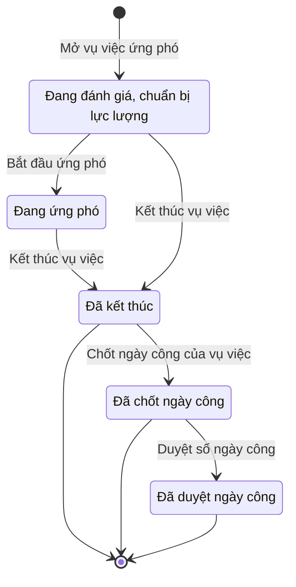

# qt-20 · Vụ việc ứng phó

<!-- máy sinh: tom-tat -->
> **Hồ sơ:** Vụ việc ứng phó (`ResponseCase`)
>
> **Trong sổ phạm vi:** 20 · Vụ việc ứng phó (tầng 3)
>
> 19 bước · 5 chặng · 3 vai · 3 bảng quyết định · 0 hạn · 28 khớp nối.
>
> **Nguồn:** sổ nghiệp vụ `qt-20` · khai báo của app: `dqtv-app/core/processes/incident-response/workflow/response.yaml`. Các bảng do máy sinh từ nguồn này.
<!-- hết: tom-tat -->

<!-- viết tay: dien-giai -->
## Diễn giải

*Phần này viết tay, diễn giải lại điều các bảng bên dưới ghi.*

### Quy trình này để làm gì

Theo dõi một **vụ việc ứng phó** từ lúc mở tới lúc khép: chọn đơn vị và phương tiện, ghi diễn biến, phối hợp với lực lượng khác, đề nghị huy động thêm, thống kê thiệt hại, rồi chốt ngày công. Có ba loại vụ việc: sự cố – thiên tai, thi hành lệnh giới nghiêm, và loại khác.

Hồ sơ đi qua ba chặng: *Đang đánh giá, chuẩn bị lực lượng* → *Đang ứng phó* → *Đã kết thúc*. Phần lớn công việc không đẩy hồ sơ sang chặng mới mà làm trong lúc hồ sơ đứng ở hai chặng đầu.

### Khi nào bắt đầu

Chỉ huy trưởng Ban CHQS xã bấm **Mở vụ việc ứng phó**; hồ sơ vào chặng *Đang đánh giá, chuẩn bị lực lượng*. Phải nhập khu vực ảnh hưởng và lấy lực lượng từ đâu; loại vụ việc, tin cảnh báo (`alertId`), kế hoạch (`planId`), tình huống (`situationId`), biện pháp, phân công trách nhiệm là ô nhập nếu có. Bước dừng lại khi kết quả xét là `ALERT_MISSING`.

### Diễn ra thế nào

**Chặng "Đang đánh giá, chuẩn bị lực lượng" và chặng "Đang ứng phó"** — cùng một nhóm việc làm được ở cả hai chặng:

1. **Chọn đơn vị và cam kết phương tiện** (Chỉ huy trưởng Ban CHQS xã) — tạo một *Lượt có mặt tại vụ việc ứng phó*. Bước dừng lại khi kết quả xét là `BUSY_NEEDS_REASON`; có hai ô nhập nếu có là "người đang vướng việc khác" và "lý do huy động người đang vướng việc". **Rút đơn vị, trả phương tiện về kho** (Chỉ huy trưởng) đòi đã có lượt có mặt ấy.
2. **Ghi diễn biến** (Trợ lý Tác huấn) — phải nhập diễn biến tại hiện trường.
3. **Lập phương án hiệp đồng** (Chỉ huy trưởng) — tạo một *Kế hoạch, văn kiện* nối với vụ việc; lặp được.
4. **Ghi nhận hiệp đồng** (Trợ lý Tác huấn) — tạo một *Lần phối hợp lực lượng*, nối tới lực lượng đóng trên địa bàn; lặp được.
5. **Nâng cấp độ phòng thủ dân sự** (Chỉ huy trưởng) — ghi cấp độ và diễn biến khiến phải nâng.
6. Xin thêm lực lượng:
   - **Ghi nhận đã trình Uỷ ban nhân dân** (Chỉ huy trưởng; lặp được): phải đã có biện pháp dự kiến; bước tạo ra một *Lần đề nghị huy động lực lượng*. Nơi nhận tờ trình là `commune_chairman`, `province_chairman`.
   - **Ghi kết quả huy động** (Trợ lý Tác huấn; lặp được): phải có lần đề nghị ở trên. Kết quả là đã được huy động, không huy động, hoặc chưa trả lời. Bước này ghi một quyết định ký **ngoài hệ**, người ký `commune_chairman`.
   - **Báo vụ việc lên Bộ CHQS tỉnh** (Chỉ huy trưởng): cũng phải có lần đề nghị ở trên, tức trình xã trước rồi mới báo tỉnh; phải nhập vì sao cần lực lượng ngoài xã.
7. **Gắn lệnh giới nghiêm** (Trợ lý Tác huấn; lặp được) — ghi một quyết định ký ngoài hệ, người ký `commune_chairman`; phải nhập số lệnh, ngày ký, hiệu lực từ, hiệu lực đến, bản chụp lệnh đã ký. Chưa có thời hạn, thời hạn đến 0 giờ, hoặc quá 24 giờ thì bước dừng.
8. **Ghi tình trạng khẩn cấp** (Trợ lý Tác huấn; lặp được) — ghi số nghị quyết ban bố hoặc lệnh công bố tình trạng khẩn cấp đang áp dụng.
9. **Thống kê thiệt hại** (Trợ lý Tác huấn; lặp được) — chỉ bắt nhập nguồn số liệu; các con số và tệp kèm là nhập nếu có.

**Chuyển chặng:** Chỉ huy trưởng bấm **Bắt đầu ứng phó** để đưa hồ sơ từ *Đang đánh giá* sang *Đang ứng phó*. **Kết thúc vụ việc** (Chỉ huy trưởng) bấm được từ cả hai chặng; phải có diễn biến – kết quả và ghi chú khép vụ.

**Chặng "Đã kết thúc"** — bốn việc về ngày công:

1. **Chốt ngày công của vụ việc** (Trợ lý Tác huấn) — phải nhập bảng ngày công theo người. Bước dừng lại khi kết quả xét là `NO_ONE_DISPATCHED`. Đã chốt rồi thì không chốt lần hai.
2. **Duyệt số ngày công** (Chỉ huy trưởng) — phải chốt xong mới duyệt được; đã duyệt rồi thì không duyệt lần hai.
3. **Ghi ngày làm nhiệm vụ vào hồ sơ chiến sĩ** và **Lập đề nghị trợ cấp ngày công** (Trợ lý Quân lực) — cả hai phải có bước duyệt ở trên. Đã ghi vào hồ sơ chiến sĩ rồi thì không ghi lần hai.

### Kết thúc và để lại gì

Hồ sơ kết thúc ở chặng *Đã kết thúc*; ở chặng này vẫn còn bốn bước ngày công làm được. Các hồ sơ của quy trình khác mở ra từ vụ việc:

- **Hồ sơ chế độ chính sách** (12b).
- **Báo cáo đột xuất** (6).
- **Cấp độ phòng thủ dân sự của vụ việc** (21).
- **Phiếu cấp phát huấn luyện** (D11).

**Điều động trong tình trạng đặc biệt** (13b) gắn vào vụ việc ở một bước giữa chừng.

### Điều kiện chặn

- Mọi bước trừ bước mở: người làm phải thuộc đơn vị chủ hồ sơ. Điều kiện này đúng khi người làm có dòng biên chế ở đơn vị chủ hồ sơ, hoặc ở đơn vị mang mã tỉnh của hồ sơ, hoặc ở đơn vị cấp `region`, hoặc cấp `central`.
- Sai người, sai chặng, thiếu thứ phải có trước thì bước bị chặn, hồ sơ giữ nguyên.
- Thứ tự bắt buộc: trình Uỷ ban nhân dân → ghi kết quả huy động, báo tỉnh; chốt ngày công → duyệt → ghi hồ sơ chiến sĩ, lập đề nghị trợ cấp.
- Lệnh giới nghiêm: thời hạn phải lớn hơn 0 và không quá 24 giờ (bảng `curfew-order-max-24h`, bốn dòng).
- Quyết định ký ngoài hệ: quyết định huy động và lệnh giới nghiêm, người ký `commune_chairman`. Việc `commune-chair-mobilization-decision` do `communeChairman` làm ngoài hệ, hệ chỉ ghi kết quả; không được thì chặn, hồ sơ giữ nguyên.
<!-- hết viết tay -->

## 1. Đường đi ngắn nhất qua các chặng

<!-- máy sinh: luong-chinh -->
Đường ít bước nhất từ lúc mở hồ sơ tới chặng kết thúc xa nhất. Máy chọn theo số chặng, không theo ý nghĩa nghiệp vụ — trình tự công việc thật xem phần Diễn giải và bảng "Việc làm ở từng chặng" ở mục 6.

| # | Ai làm | Làm gì | Hồ sơ sang chặng |
|---|---|---|---|
| 1 | Chỉ huy trưởng Ban CHQS xã | Mở vụ việc ứng phó | Đang đánh giá, chuẩn bị lực lượng |
| 2 | Chỉ huy trưởng Ban CHQS xã | Kết thúc vụ việc | Đã kết thúc |
| 3 | Trợ lý Tác huấn | Chốt ngày công của vụ việc | Đã chốt ngày công |
| 4 | Chỉ huy trưởng Ban CHQS xã | Duyệt số ngày công | Đã duyệt ngày công |

<!-- hết: luong-chinh -->

## 2. Hồ sơ và việc nó để lại

<!-- máy sinh: muc-tieu -->
**App gọi quy trình này là:** Chặng 5 — Vụ việc ứng phó.

**Khi mở, hồ sơ này ghi mối nối tới:**
- Kế hoạch, văn kiện (2) — bước `openCase`, khớp nối `caseUnderPlan`
- Lực lượng đóng trên địa bàn (stationed-force) — bước `openCase`, khớp nối `caseCoordinatesWith`
- Lực lượng đóng trên địa bàn (stationed-force) — bước `openCase`, khớp nối `caseLedBy`
- Nhiệm vụ trên giao (1) — bước `openCase`, khớp nối `responseCaseServesTasking`
- Tin cảnh báo, báo động (19) — bước `openCase`, khớp nối `triggeredBy`
- Tình huống dự kiến (2) — bước `openCase`, khớp nối `caseUnderSituation`

**Hồ sơ này để lại cho quy trình khác** (bước tạo hồ sơ của quy trình kia ghi mối nối về đây):
- Báo cáo đột xuất (6) — bước `prepareAdHocReport`, khớp nối `raisedFromCase`
- Bảng thanh toán trợ cấp (12a) — bước `openBenefitPaymentBatch`, khớp nối `batchFromCase`
- Cấp độ phòng thủ dân sự của vụ việc (21) — bước `proposeDefenceLevel`, khớp nối `defenceLevelOfCase`
- Cấp độ phòng thủ dân sự của vụ việc (21) — bước `recordDirectedDefenceLevel`, khớp nối `defenceLevelOfCase`
- Hồ sơ chế độ chính sách (12b) — bước `raiseAllowanceFromCase`, khớp nối `claimArisesFromCase`
- Hồ sơ chế độ chính sách (12b) — bước `submitClaim`, khớp nối `claimArisesFromCase`
- Hồ sơ khen thưởng (8) — bước `recordMemberSelection`, khớp nối `awardCaseForIncident`
- Hồ sơ khen thưởng (8) — bước `recordUnitSelection`, khớp nối `awardCaseForIncident`
- Lệnh điều động (13a) — bước `proposeDeployment`, khớp nối `arisesFromCase`
- Phiếu cấp phát huấn luyện (D11.training-allocation) — bước `openTrainingAllocation`, khớp nối `allocationForCase`
- Tệp lưu trữ (D16) — bước `recordArchiveFile`, khớp nối `fileOfResponseCase`
- Vụ việc kỷ luật (D15) — bước `openDisciplineFromSource`, khớp nối `disciplineFromResponse`
- Vụ việc vi phạm hành chính (10) — bước `openViolationFromSource`, khớp nối `violationFromResponse`
- Đề nghị cấp kinh phí (4.funding-request) — bước `estimateCommuneFundingRequest`, khớp nối `fundingRequestFromCase`
- Đề nghị cấp kinh phí (4.funding-request) — bước `estimateProvinceFundingRequest`, khớp nối `fundingRequestFromCase`
<!-- hết: muc-tieu -->

## 3. Khởi phát và kết thúc

<!-- máy sinh: khoi-phat -->
**1 cửa vào** — bước mở hồ sơ:

| Bước mở | Ai mở | Hồ sơ vào chặng | App bắt buộc nhập |
|---|---|---|---|
| Mở vụ việc ứng phó | Chỉ huy trưởng Ban CHQS xã | Đang đánh giá, chuẩn bị lực lượng | khu vực ảnh hưởng, lấy lực lượng từ đâu |

**Kết thúc:** *Đã kết thúc* (`CLOSED`), *Đã chốt ngày công* (`DAYS_LOCKED`), *Đã duyệt ngày công* (`DAYS_APPROVED`)
<!-- hết: khoi-phat -->

## 4. Vai trò

<!-- máy sinh: vai-tro -->
| Vai trong sổ | Tên trong app | Điều kiện | Làm những bước |
|---|---|---|---|
| `commander` | Chỉ huy trưởng Ban CHQS xã |  | Mở vụ việc ứng phó · Chọn đơn vị và cam kết phương tiện · Rút đơn vị, trả phương tiện về kho · Bắt đầu ứng phó · Lập phương án hiệp đồng · Nâng cấp độ phòng thủ dân sự · Báo vụ việc lên Bộ CHQS tỉnh · Duyệt số ngày công · Kết thúc vụ việc |
| `watch` | Trợ lý Tác huấn |  | Ghi diễn biến · Ghi nhận hiệp đồng · Trình ký đề nghị Uỷ ban nhân dân huy động · Ghi kết quả huy động · Gắn lệnh giới nghiêm · Ghi tình trạng khẩn cấp · Thống kê thiệt hại · Chốt ngày công của vụ việc · Đề nghị xử lý vi phạm người không chấp hành điều động ứng phó |
| `system` | Hệ thống tự làm |  | Ghi nhận đã đề nghị Uỷ ban nhân dân huy động |

*"Tên trong app" là tên app đặt cho mã chủ thể của vai. Hồ sơ thuộc đơn vị cấp khác thì người làm là người giữ vai ấy ở đơn vị nêu trong cột "Điều kiện" (nếu sổ có ghi) và ở cột "Người làm phải thuộc" của bảng "Theo khai báo của app" (mục 7).*

**Ngoài hệ** (hệ chỉ ghi kết quả, xem mục 8): `communeChairman`.
<!-- hết: vai-tro -->

## 5. Nhánh phụ

<!-- máy sinh: nhanh-phu -->
**Bước khác đưa hồ sơ sang chặng mới** — đường song song, rẽ nhánh hoặc kết thúc sớm:

| Bước | Ai làm | Từ chặng | Sang chặng |
|---|---|---|---|
| Bắt đầu ứng phó | Chỉ huy trưởng Ban CHQS xã | Đang đánh giá, chuẩn bị lực lượng | Đang ứng phó |

**Làm trong lúc hồ sơ đứng yên ở một chặng** — ghi nhận, bổ sung:

| Bước | Ai làm | Ở chặng |
|---|---|---|
| Chọn đơn vị và cam kết phương tiện | Chỉ huy trưởng Ban CHQS xã | Đang đánh giá, chuẩn bị lực lượng, Đang ứng phó |
| Rút đơn vị, trả phương tiện về kho | Chỉ huy trưởng Ban CHQS xã | Đang đánh giá, chuẩn bị lực lượng, Đang ứng phó |
| Ghi diễn biến | Trợ lý Tác huấn | Đang đánh giá, chuẩn bị lực lượng, Đang ứng phó |
| Lập phương án hiệp đồng *(lặp được)* | Chỉ huy trưởng Ban CHQS xã | Đang đánh giá, chuẩn bị lực lượng, Đang ứng phó |
| Ghi nhận hiệp đồng *(lặp được)* | Trợ lý Tác huấn | Đang đánh giá, chuẩn bị lực lượng, Đang ứng phó |
| Nâng cấp độ phòng thủ dân sự | Chỉ huy trưởng Ban CHQS xã | Đang đánh giá, chuẩn bị lực lượng, Đang ứng phó |
| Báo vụ việc lên Bộ CHQS tỉnh | Chỉ huy trưởng Ban CHQS xã | Đang đánh giá, chuẩn bị lực lượng, Đang ứng phó |
| Trình ký đề nghị Uỷ ban nhân dân huy động *(lặp được)* | Trợ lý Tác huấn | Đang đánh giá, chuẩn bị lực lượng, Đang ứng phó |
| Ghi nhận đã đề nghị Uỷ ban nhân dân huy động *(lặp được)* | Hệ thống tự làm | Đang đánh giá, chuẩn bị lực lượng, Đang ứng phó |
| Ghi kết quả huy động *(lặp được)* | Trợ lý Tác huấn | Đang đánh giá, chuẩn bị lực lượng, Đang ứng phó |
| Gắn lệnh giới nghiêm *(lặp được)* | Trợ lý Tác huấn | Đang đánh giá, chuẩn bị lực lượng, Đang ứng phó |
| Ghi tình trạng khẩn cấp *(lặp được)* | Trợ lý Tác huấn | Đang đánh giá, chuẩn bị lực lượng, Đang ứng phó |
| Thống kê thiệt hại *(lặp được)* | Trợ lý Tác huấn | Đang đánh giá, chuẩn bị lực lượng, Đang ứng phó |
| Đề nghị xử lý vi phạm người không chấp hành điều động ứng phó | Trợ lý Tác huấn | Đang đánh giá, chuẩn bị lực lượng, Đang ứng phó, Đã kết thúc, Đã chốt ngày công, Đã duyệt ngày công |

<!-- hết: nhanh-phu -->

## 6. Các chặng và việc làm ở từng chặng

<!-- máy sinh: chang -->
| Chặng | Tên hiển thị | Vào bằng bước | Kết thúc? |
|---|---|---|---|
| `ASSESSING` | Đang đánh giá, chuẩn bị lực lượng | Mở vụ việc ứng phó |  |
| `RESPONDING` | Đang ứng phó | Bắt đầu ứng phó |  |
| `CLOSED` | Đã kết thúc | Kết thúc vụ việc | **kết thúc** — vẫn còn bước làm được |
| `DAYS_LOCKED` | Đã chốt ngày công | Chốt ngày công của vụ việc | **kết thúc** — vẫn còn bước làm được |
| `DAYS_APPROVED` | Đã duyệt ngày công | Duyệt số ngày công | **kết thúc** — vẫn còn bước làm được |

### Việc làm ở từng chặng

Hồ sơ đang ở chặng nào thì làm được những bước nào.

| Hồ sơ đang ở chặng | Bước làm tại chặng (hồ sơ đứng yên) | Bước đưa hồ sơ sang chặng khác |
|---|---|---|
| **Đang đánh giá, chuẩn bị lực lượng** | Chọn đơn vị và cam kết phương tiện — Chỉ huy trưởng Ban CHQS xã Rút đơn vị, trả phương tiện về kho — Chỉ huy trưởng Ban CHQS xã Ghi diễn biến — Trợ lý Tác huấn Lập phương án hiệp đồng (lặp được) — Chỉ huy trưởng Ban CHQS xã Ghi nhận hiệp đồng (lặp được) — Trợ lý Tác huấn Nâng cấp độ phòng thủ dân sự — Chỉ huy trưởng Ban CHQS xã Báo vụ việc lên Bộ CHQS tỉnh — Chỉ huy trưởng Ban CHQS xã Trình ký đề nghị Uỷ ban nhân dân huy động (lặp được) — Trợ lý Tác huấn Ghi nhận đã đề nghị Uỷ ban nhân dân huy động (lặp được) — Hệ thống tự làm Ghi kết quả huy động (lặp được) — Trợ lý Tác huấn Gắn lệnh giới nghiêm (lặp được) — Trợ lý Tác huấn Ghi tình trạng khẩn cấp (lặp được) — Trợ lý Tác huấn Thống kê thiệt hại (lặp được) — Trợ lý Tác huấn Đề nghị xử lý vi phạm người không chấp hành điều động ứng phó — Trợ lý Tác huấn | Bắt đầu ứng phó — Chỉ huy trưởng Ban CHQS xã → *Đang ứng phó* Kết thúc vụ việc — Chỉ huy trưởng Ban CHQS xã → *Đã kết thúc* |
| **Đang ứng phó** | Chọn đơn vị và cam kết phương tiện — Chỉ huy trưởng Ban CHQS xã Rút đơn vị, trả phương tiện về kho — Chỉ huy trưởng Ban CHQS xã Ghi diễn biến — Trợ lý Tác huấn Lập phương án hiệp đồng (lặp được) — Chỉ huy trưởng Ban CHQS xã Ghi nhận hiệp đồng (lặp được) — Trợ lý Tác huấn Nâng cấp độ phòng thủ dân sự — Chỉ huy trưởng Ban CHQS xã Báo vụ việc lên Bộ CHQS tỉnh — Chỉ huy trưởng Ban CHQS xã Trình ký đề nghị Uỷ ban nhân dân huy động (lặp được) — Trợ lý Tác huấn Ghi nhận đã đề nghị Uỷ ban nhân dân huy động (lặp được) — Hệ thống tự làm Ghi kết quả huy động (lặp được) — Trợ lý Tác huấn Gắn lệnh giới nghiêm (lặp được) — Trợ lý Tác huấn Ghi tình trạng khẩn cấp (lặp được) — Trợ lý Tác huấn Thống kê thiệt hại (lặp được) — Trợ lý Tác huấn Đề nghị xử lý vi phạm người không chấp hành điều động ứng phó — Trợ lý Tác huấn | Kết thúc vụ việc — Chỉ huy trưởng Ban CHQS xã → *Đã kết thúc* |
| **Đã kết thúc** | Đề nghị xử lý vi phạm người không chấp hành điều động ứng phó — Trợ lý Tác huấn | Chốt ngày công của vụ việc — Trợ lý Tác huấn → *Đã chốt ngày công* |
| **Đã chốt ngày công** | Đề nghị xử lý vi phạm người không chấp hành điều động ứng phó — Trợ lý Tác huấn | Duyệt số ngày công — Chỉ huy trưởng Ban CHQS xã → *Đã duyệt ngày công* |
| **Đã duyệt ngày công** | Đề nghị xử lý vi phạm người không chấp hành điều động ứng phó — Trợ lý Tác huấn | — (kết thúc) |
<!-- hết: chang -->

## 7. Bảng bước

<!-- máy sinh: buoc -->
| # | Bước | Mã bước | Ai thực hiện | Từ chặng | Sang chặng | Phải có trước | Ghi lại |
|---|---|---|---|---|---|---|---|
| 1 | Mở vụ việc ứng phó | `openCase` | Chỉ huy trưởng Ban CHQS xã | — (mở hồ sơ) | `ASSESSING` | `alertGateOpen`, `taskingNotDone`, `taskingOfActorUnit` | nối tới Tin cảnh báo, báo động, nối tới Lực lượng đóng trên địa bàn (`link.caseCoordinatesWith`), nối tới Kế hoạch, văn kiện, nối tới Lực lượng đóng trên địa bàn (`link.caseLedBy`), nối tới Nhiệm vụ trên giao, mã tỉnh, mã xã, số vụ việc, mở lúc, khu vực ảnh hưởng, cơ quan chủ trì, quân số cần, lý do ngoài kế hoạch, lấy lực lượng từ đâu, biện pháp dự kiến, phân công trách nhiệm, đơn vị chủ hồ sơ, loại vụ việc, nối tới Tình huống dự kiến, `id` |
| 2 | Chọn đơn vị và cam kết phương tiện | `commitForce` | Chỉ huy trưởng Ban CHQS xã | `ASSESSING`, `RESPONDING` | giữ nguyên | người làm thuộc đơn vị chủ hồ sơ | nối tới Lượt có mặt tại vụ việc ứng phó, nối `caseAttendanceOfMember` (Lượt có mặt tại vụ việc ứng phó → Chiến sĩ dân quân tự vệ), nối tới Đơn vị dân quân tự vệ, nối tới Trang bị, phương tiện, lý do huy động người đang vướng việc, người đang vướng việc khác |
| 3 | Rút đơn vị, trả phương tiện về kho | `releaseForce` | Chỉ huy trưởng Ban CHQS xã | `ASSESSING`, `RESPONDING` | giữ nguyên | người làm thuộc đơn vị chủ hồ sơ, nối tới Lượt có mặt tại vụ việc ứng phó | —; **xoá:** nối tới Đơn vị dân quân tự vệ |
| 4 | Bắt đầu ứng phó | `startResponse` | Chỉ huy trưởng Ban CHQS xã | `ASSESSING` | `RESPONDING` | người làm thuộc đơn vị chủ hồ sơ | — |
| 5 | Ghi diễn biến | `logProgress` | Trợ lý Tác huấn | `ASSESSING`, `RESPONDING` | giữ nguyên | người làm thuộc đơn vị chủ hồ sơ | — |
| 6 | Lập phương án hiệp đồng | `draftCasePlan` | Chỉ huy trưởng Ban CHQS xã | `ASSESSING`, `RESPONDING` | giữ nguyên | người làm thuộc đơn vị chủ hồ sơ | nối tới Kế hoạch, văn kiện (`link.caseUnderPlan`), nối tới Kế hoạch, văn kiện (`link.planForCase`) |
| 7 | Ghi nhận hiệp đồng | `recordCaseCoordination` | Trợ lý Tác huấn | `ASSESSING`, `RESPONDING` | giữ nguyên | người làm thuộc đơn vị chủ hồ sơ | nối tới Lực lượng đóng trên địa bàn, nối tới Lần phối hợp lực lượng |
| 8 | Nâng cấp độ phòng thủ dân sự | `raiseDefenceLevel` | Chỉ huy trưởng Ban CHQS xã | `ASSESSING`, `RESPONDING` | giữ nguyên | người làm thuộc đơn vị chủ hồ sơ | cấp độ phòng thủ dân sự, diễn biến khiến phải nâng cấp độ, nâng cấp độ lúc |
| 9 | Báo vụ việc lên Bộ CHQS tỉnh | `reportCaseToProvince` | Chỉ huy trưởng Ban CHQS xã | `ASSESSING`, `RESPONDING` | giữ nguyên | người làm thuộc đơn vị chủ hồ sơ, nối tới Lần đề nghị huy động lực lượng | đã báo Bộ CHQS tỉnh lúc, vì sao cần lực lượng ngoài xã |
| 10 | Trình ký đề nghị Uỷ ban nhân dân huy động | `requestCaseMobilizationRequestSignature` | Trợ lý Tác huấn | `ASSESSING`, `RESPONDING` | giữ nguyên | người làm thuộc đơn vị chủ hồ sơ, biện pháp dự kiến, `noCaseMobilizationRequestDocumentOpen` | nối tới Lực lượng đóng trên địa bàn, nối `caseMobilizationRequestByDocument` |
| 11 | Ghi nhận đã đề nghị Uỷ ban nhân dân huy động | `requestCaseMobilization` | Hệ thống tự làm | `ASSESSING`, `RESPONDING` | giữ nguyên | `caseMobilizationRequestDocumentIssued` | nối tới Lần đề nghị huy động lực lượng |
| 12 | Ghi kết quả huy động | `recordCaseMobilizationOutcome` | Trợ lý Tác huấn | `ASSESSING`, `RESPONDING` | giữ nguyên | người làm thuộc đơn vị chủ hồ sơ, nối tới Lần đề nghị huy động lực lượng | kết quả đề nghị huy động, ghi chú kết quả huy động |
| 13 | Gắn lệnh giới nghiêm | `attachFollowOnOrder` | Trợ lý Tác huấn | `ASSESSING`, `RESPONDING` | giữ nguyên | người làm thuộc đơn vị chủ hồ sơ | nối tới Quyết định ký ngoài hệ thống, lệnh có hiệu lực từ, lệnh có hiệu lực đến |
| 14 | Ghi tình trạng khẩn cấp | `recordEmergencyDeclaration` | Trợ lý Tác huấn | `ASSESSING`, `RESPONDING` | giữ nguyên | người làm thuộc đơn vị chủ hồ sơ, `recordEmergencyDeclarationFromIncomingDocumentUsable` | đang trong tình trạng khẩn cấp theo, nối tới Văn bản đến |
| 15 | Thống kê thiệt hại | `recordDamageStatistics` | Trợ lý Tác huấn | `ASSESSING`, `RESPONDING` | giữ nguyên | người làm thuộc đơn vị chủ hồ sơ | người chết, người mất tích, người bị thương, nhà sập, hư hỏng, công trình hư hỏng, ước tính thiệt hại (đồng), nguồn số liệu, bảng thống kê, biên bản, ảnh, cập nhật thiệt hại lúc |
| 16 | Chốt ngày công của vụ việc | `lockCaseDays` | Trợ lý Tác huấn | `CLOSED` | `DAYS_LOCKED` | người làm thuộc đơn vị chủ hồ sơ, `someoneDispatched` | nối tới Ngày công của một người trong nhiệm vụ, nối `missionDayOfMember` |
| 17 | Duyệt số ngày công | `approveCaseDays` | Chỉ huy trưởng Ban CHQS xã | `DAYS_LOCKED` | `DAYS_APPROVED` | người làm thuộc đơn vị chủ hồ sơ | — |
| 18 | Kết thúc vụ việc | `closeCase` | Chỉ huy trưởng Ban CHQS xã | `RESPONDING`, `ASSESSING` | `CLOSED` | người làm thuộc đơn vị chủ hồ sơ, diễn biến, kết quả, ghi chú khép vụ | kết thúc lúc, diễn biến, kết quả, tổng hợp thiệt hại, ghi chú khép vụ |
| 19 | Đề nghị xử lý vi phạm người không chấp hành điều động ứng phó | `proposeCaseViolationHandling` | Trợ lý Tác huấn | `ASSESSING`, `RESPONDING`, `CLOSED`, `DAYS_LOCKED`, `DAYS_APPROVED` | giữ nguyên | người làm thuộc đơn vị chủ hồ sơ | nối `violatingMember`, nối `handlingDisciplinaryCase`, nối `handlingViolationCase` |

### Khi không đạt điều kiện

Mặc định: không đúng người, hồ sơ không ở đúng chặng, hoặc thiếu thứ "phải có trước" thì bước bị chặn, hồ sơ giữ nguyên. Bảng dưới chỉ kê những bước có kết quả riêng.

| # | Bước | Kết quả riêng |
|---|---|---|
| 2 | Chọn đơn vị và cam kết phương tiện | bước dừng lại, hồ sơ giữ nguyên khi kết quả xét là: `BUSY_SAME_DAYS`, `BUSY_NEEDS_REASON` |
| 11 | Ghi nhận đã đề nghị Uỷ ban nhân dân huy động | bước này không do người nào bấm |
| 12 | Ghi kết quả huy động | bước dừng lại, hồ sơ giữ nguyên khi kết quả xét là: `REQUEST_MUST_BE_CHOSEN` |
| 13 | Gắn lệnh giới nghiêm | bước dừng lại, hồ sơ giữ nguyên khi kết quả xét là: `ORDER_PERIOD_MISSING`, `ORDER_OVER_24_HOURS`, `ORDER_ENDS_BEFORE_START` |

### Điều kiện "phải có trước" bằng lời

Cột "Phải có trước" ở bảng bước có hai loại: ô dữ liệu thường (bước chỉ đòi ô ấy đã có giá trị) và điều kiện hệ tự xét. Bảng này diễn các điều kiện hệ tự xét theo đúng công thức sổ ghi; số ở cột cuối là số thứ tự bước.

| Điều kiện | Đúng khi | Bước đòi |
|---|---|---|
| `alertGateOpen` | có hồ sơ Tin cảnh báo (qt-19) chính là hồ sơ ghi ở ô nối `triggeredBy` của hồ sơ đang làm mà hồ sơ ấy đang ở chặng `CONFIRMED` HOẶC (loại vụ việc là Thi hành lệnh giới nghiêm (`curfew`) VÀ KHÔNG (đã có nối tới Tin cảnh báo, báo động)) | 1 |
| `taskingNotDone` | KHÔNG (có hồ sơ Việc luật giao kèm văn bản đến, đi (qt-1) chính là hồ sơ ghi ở ô nối `responseCaseServesTasking` của hồ sơ đang làm mà hồ sơ ấy đang ở chặng `DONE` hoặc `REVOKED` hoặc `RETURNED`) | 1 |
| `taskingOfActorUnit` | KHÔNG (đã có nối tới Nhiệm vụ trên giao) HOẶC có hồ sơ Việc luật giao kèm văn bản đến, đi (qt-1) (gọi là t) chính là hồ sơ ghi ở ô nối `responseCaseServesTasking` của hồ sơ đang làm mà người đang làm là người của đơn vị ghi ở ô đơn vị chủ hồ sơ của hồ sơ t ấy (theo danh mục người của đơn vị, `dm.unit-staff`) | 1 |
| `actorInOwnerUnit` | có dòng biên chế đơn vị của chính người đang làm mà `unitCode` của dòng người của đơn vị ấy bằng đơn vị chủ hồ sơ của hồ sơ này HOẶC `unitCode` của dòng người của đơn vị ấy bằng mã tỉnh của hồ sơ này HOẶC `unitLevel` của dòng người của đơn vị ấy bằng `region` HOẶC `unitLevel` của dòng người của đơn vị ấy bằng `central` | 2, 3, 4, 5, 6, 7, 8, 9, 10, 12, 13, 14, 15, 16, 17, 18, 19 |
| `noCaseMobilizationRequestDocumentOpen` | KHÔNG (có hồ sơ Việc luật giao kèm văn bản đến, đi — Văn bản đi (qt-1.outgoing-document) chính là hồ sơ ghi ở ô nối `caseMobilizationRequestByDocument` của hồ sơ đang làm mà hồ sơ ấy đang ở chặng `DRAFT` hoặc `PENDING_SIGNATURE` hoặc `SIGNED`) | 10 |
| `caseMobilizationRequestDocumentIssued` | có hồ sơ Việc luật giao kèm văn bản đến, đi — Văn bản đi (qt-1.outgoing-document) chính là hồ sơ ghi ở ô nối `caseMobilizationRequestByDocument` của hồ sơ đang làm mà hồ sơ ấy đang ở chặng `ISSUED` | 11 |
| `recordEmergencyDeclarationFromIncomingDocumentUsable` | có hồ sơ Việc luật giao kèm văn bản đến, đi — Văn bản đến (qt-1.incoming-document) chính là hồ sơ ghi ở ô nối `recordEmergencyDeclarationFromIncomingDocument` của hồ sơ đang làm mà hồ sơ ấy đang ở chặng `RECEIVED` hoặc `DISTRIBUTED` | 14 |
| `someoneDispatched` | đã có nối tới Lượt có mặt tại vụ việc ứng phó | 16 |
| `busySameDaysOnOrder` | có hồ sơ Điều động lực lượng khi bình thường (qt-13a) (gọi là c) mà hồ sơ ấy đang ở chặng `IN_PROGRESS` VÀ `{"le": [{"fact": "openedAt", "on": "self"}, {"fact": "endDate", "on": "c"}]}` VÀ có hồ sơ `dm.militia-unit` (gọi là u) mà `id` của hồ sơ u ấy nằm trong nối tới Đơn vị dân quân tự vệ của hồ sơ này VÀ `id` của hồ sơ u ấy nằm trong nối `deploysUnit` của hồ sơ c ấy | đầu vào bảng quyết định (mục 8) |
| `busyOnOtherOpenCase` | có hồ sơ Vụ việc ứng phó (qt-20) (gọi là c) mà KHÔNG (hồ sơ ấy đang ở chặng `CLOSED` hoặc `DAYS_LOCKED` hoặc `DAYS_APPROVED`) VÀ có hồ sơ `dm.militia-unit` (gọi là u) mà `id` của hồ sơ u ấy nằm trong nối tới Đơn vị dân quân tự vệ của hồ sơ này VÀ `id` của hồ sơ u ấy nằm trong nối tới Đơn vị dân quân tự vệ của hồ sơ c ấy | đầu vào bảng quyết định (mục 8) |
| `busyInTrainingSameDays` | có hồ sơ Đợt tập trung: huấn luyện, diễn tập, tập huấn, hội thi (qt-14) (gọi là c) mà hồ sơ ấy đang ở chặng `SUMMONED` hoặc `IN_PROGRESS` VÀ `{"le": [{"fact": "openedAt", "on": "self"}, {"fact": "endDate", "on": "c"}]}` VÀ có hồ sơ Sổ đăng ký người theo diện — Chiến sĩ dân quân tự vệ (qt-16.enlistment) (gọi là m) mà `id` của hồ sơ m ấy nằm trong nối `caseAttendanceOfMember` (Lượt có mặt tại vụ việc ứng phó → Chiến sĩ dân quân tự vệ) của hồ sơ này VÀ `id` của hồ sơ m ấy nằm trong nối `summons` của hồ sơ c ấy | đầu vào bảng quyết định (mục 8) |
| `severalMobilizationRequestsAwaitingReply` | `{"counted": "requestCaseMobilization", "atLeast": 2, "resetOn": ["recordCaseMobilizationOutcome"]}` | đầu vào bảng quyết định (mục 8) |

### Theo khai báo của app

Người làm phải thuộc đơn vị nào, ô người dùng phải nhập, bước có lặp được không, và căn cứ pháp lý — lấy từ khai báo quy trình trong app.

| # | Bước | Người làm phải thuộc | Bắt buộc nhập | Nhập nếu có | Lặp được | Căn cứ |
|---|---|---|---|---|---|---|
| 1 | Mở vụ việc ứng phó |  | khu vực ảnh hưởng, lấy lực lượng từ đâu | `alertId`, loại vụ việc, cơ quan chủ trì, quân số cần, `situationId`, lý do ngoài kế hoạch, `forceIds`, `planId`, biện pháp dự kiến, phân công trách nhiệm, quy chế phối hợp đã phê duyệt làm căn cứ, bên chủ trì phối hợp |  | NĐ02/2020/NĐ-CP Đ.20 k1 d · Đ.5 k1 c |
| 2 | Chọn đơn vị và cam kết phương tiện |  | — | lý do huy động người đang vướng việc, người đang vướng việc khác, `unitIds`, `equipmentIds` |  | NĐ02/2020/NĐ-CP Đ.20 k2 |
| 3 | Rút đơn vị, trả phương tiện về kho |  | — | `unitIds`, `equipmentIds` |  | NĐ02/2020/NĐ-CP Đ.20 k2 |
| 4 | Bắt đầu ứng phó |  | — | — |  | NĐ02/2020/NĐ-CP Đ.20 k2 · NĐ72/2020/NĐ-CP Đ.11 |
| 5 | Ghi diễn biến |  | diễn biến tại hiện trường | — |  | NĐ02/2020/NĐ-CP Đ.6 |
| 6 | Lập phương án hiệp đồng |  | `title`, phạm vi, nội dung phối hợp, `approvalLevel` | biện pháp, phân công trách nhiệm, căn cứ — kế hoạch phòng thủ dân sự, quy chế, kế hoạch phối hợp đã phê duyệt (không bắt buộc) | có | NĐ02/2020/NĐ-CP Đ.20 k1 b · Đ.5 k1 c · NĐ200/2025/NĐ-CP Đ.8 k2 c |
| 7 | Ghi nhận hiệp đồng |  | `coordinationField`, `forceIds` | `coordinationNote` | có | L48/2019/QH14 Đ.31; NĐ02/2020/NĐ-CP Đ.9–Đ.22 — 16 lĩnh vực phối hợp |
| 8 | Nâng cấp độ phòng thủ dân sự |  | cấp độ phòng thủ dân sự, diễn biến khiến phải nâng cấp độ | — |  | L18/2023/QH15 Đ.7 k2 · Đ.7 k3 |
| 9 | Báo vụ việc lên Bộ CHQS tỉnh |  | vì sao cần lực lượng ngoài xã | — |  | L18/2023/QH15 Đ.33 k3 d · Đ.21 k2 |
| 10 | Trình ký đề nghị Uỷ ban nhân dân huy động |  | đề nghị cấp, nhu cầu cần huy động, dự thảo văn bản đề nghị (PDF) | `forceIds` | có | L18/2023/QH15 Đ.21 k2 · Đ.33 k2; NĐ30/2020/NĐ-CP Đ.13 |
| 11 | Ghi nhận đã đề nghị Uỷ ban nhân dân huy động |  | — | đề nghị cấp, nhu cầu cần huy động, `forceIds` | có | L18/2023/QH15 Đ.21 k2 · Đ.33 k2 · Đ.3 k4 (bốn tại chỗ) |
| 12 | Ghi kết quả huy động |  | kết quả đề nghị huy động | ghi chú kết quả huy động, số quyết định huy động, trích yếu, người ký, ngày ký, căn cứ pháp lý, bản chụp quyết định đã ký | có | L18/2023/QH15 Đ.21 k2 |
| 13 | Gắn lệnh giới nghiêm |  | số lệnh, ngày ký, lệnh có hiệu lực từ, lệnh có hiệu lực đến, bản chụp lệnh đã ký | trích yếu, người ký, căn cứ pháp lý | có | L22/2018/QH14 Đ.22 · NĐ02/2020/NĐ-CP Đ.16 k2 |
| 14 | Ghi tình trạng khẩn cấp |  | văn bản đến là văn bản ban bố tình trạng khẩn cấp | — | có | L104/2025/QH15 Đ.9 |
| 15 | Thống kê thiệt hại |  | nguồn số liệu | người chết, người mất tích, người bị thương, nhà sập, hư hỏng, công trình hư hỏng, ước tính thiệt hại (đồng), bảng thống kê, biên bản, ảnh | có | L18/2023/QH15 Đ.7 k2 |
| 16 | Chốt ngày công của vụ việc |  | bảng ngày công theo người | — |  | L48/2019/QH14 Đ.34 k1 a, Đ.34 k3; NĐ72/2020/NĐ-CP Đ.11 |
| 17 | Duyệt số ngày công |  | — | — |  | L48/2019/QH14 Đ.34 k3; NĐ72/2020/NĐ-CP Đ.11 |
| 18 | Kết thúc vụ việc |  | diễn biến, kết quả, ghi chú khép vụ | tổng hợp thiệt hại |  | NĐ02/2020/NĐ-CP Đ.6 |
| 19 | Đề nghị xử lý vi phạm người không chấp hành điều động ứng phó | đơn vị chủ hồ sơ | chiến sĩ vi phạm, xử lý bằng, ngày vi phạm, ngày phát hiện, mô tả hành vi vi phạm | hành vi (NĐ218), nhóm hành vi (TT81), thời hiệu, ngày vi phạm mới (nếu có) |  | sổ qt-20 · NĐ218/2025/NĐ-CP Đ.19 k1; TT81/VBHN-BQP Đ.11 |
| — | Ghi ngày làm nhiệm vụ vào hồ sơ chiến sĩ (`recordCaseInProfile`) |  | — | — |  | L48/2019/QH14 Đ.27, Đ.34 k1 a |
| — | Lập đề nghị trợ cấp ngày công (`raiseCaseAllowances`) |  | — | — |  | L48/2019/QH14 Đ.34 k1 a, Đ.34 k3; NĐ72/2020/NĐ-CP Đ.11 |

### Điều kiện và ghi chú app khai cho từng bước

Lấy từ khai báo quy trình trong app. Lời trong ngoặc kép là câu app hiện cho người dùng. Chức danh người ký ngoài hệ app chỉ khai bằng mã.

| # | Bước | Điều kiện, ghi chú |
|---|---|---|
| 2 | Chọn đơn vị và cam kết phương tiện | · tạo thêm một hồ sơ con: Lượt có mặt tại vụ việc ứng phó (`CaseAttendance`) |
| 6 | Lập phương án hiệp đồng | · tạo thêm một hồ sơ con: Kế hoạch, văn kiện (`PlanDocument`) |
| 7 | Ghi nhận hiệp đồng | · tạo thêm một hồ sơ con: Lần phối hợp lực lượng (`CoordinationRecord`) |
| 11 | Ghi nhận đã đề nghị Uỷ ban nhân dân huy động | · tạo thêm một hồ sơ con: Lần đề nghị huy động lực lượng (`MobilizationRequest`) |
| 12 | Ghi kết quả huy động | · bước này ghi một quyết định ký NGOÀI hệ (`mobilizationAuthorizedBy`), người ký: `commune_chairman` |
| 13 | Gắn lệnh giới nghiêm | · bước này ghi một quyết định ký NGOÀI hệ (`followOnOrder`), người ký: `commune_chairman` |
| 14 | Ghi tình trạng khẩn cấp | · không đòi bản chụp — app ghi: "bản số hoá lấy từ văn bản đến văn thư đã vào sổ (tầng đọc chép `scanPath` của văn bản ấy), không tải ảnh ở bước này" |
| 16 | Chốt ngày công của vụ việc | · không làm được khi đã có `daysLockedAt` — app báo: "số ngày của vụ việc này đã chốt rồi — đây là căn cứ chi trả trợ cấp ngày công, chốt lại sẽ cộng dồn sai" · tạo thêm một hồ sơ con: Ngày công của một người trong nhiệm vụ (`MissionDayEntry`) |
| 17 | Duyệt số ngày công | · phải đã có `daysLockedAt` — thiếu thì app báo: "chưa chốt số ngày công thì chưa có gì để duyệt — Trợ lý Tác huấn chốt trước" · không làm được khi đã có `daysApprovedAt` — app báo: "số ngày công của vụ việc này đã duyệt rồi" |
| — | Ghi ngày làm nhiệm vụ vào hồ sơ chiến sĩ | · phải đã có `daysApprovedAt` — thiếu thì app báo: "chưa có chữ ký duyệt của Chỉ huy trưởng thì chưa ghi vào hồ sơ chiến sĩ" · không làm được khi đã có `profileRecordedAt` — app báo: "vụ việc này đã ghi vào hồ sơ chiến sĩ rồi — ghi lần hai sẽ cộng dồn sai số ngày làm nhiệm vụ" |
| — | Lập đề nghị trợ cấp ngày công | · phải đã có `daysApprovedAt` — thiếu thì app báo: "chưa có chữ ký duyệt của Chỉ huy trưởng thì chưa lập được hồ sơ chế độ" |
<!-- hết: buoc -->

## 8. Bảng quyết định, hạn, việc ngoài hệ

<!-- máy sinh: quyet-dinh -->
**Bảng `busy-commit-force`** — xét ở bước *Chọn đơn vị và cam kết phương tiện*; đầu vào: `busySameDaysOnOrder`, `busyOnOtherOpenCase`, `busyInTrainingSameDays`, lý do huy động người đang vướng việc. 9 dòng, dò từ trên xuống, dòng đầu tiên khớp thì dừng.

| Thứ tự dò (số sổ ghi) | Dòng | Khi | Thì |
|---|---|---|---|
| 0 | `same-days` | đã có `busySameDaysOnOrder` và đã có `busyInTrainingSameDays` và đã có lý do huy động người đang vướng việc | `BUSY_SAME_DAYS` |
| 1 | `same-days-t1r0` | đã có `busySameDaysOnOrder` và đã có `busyInTrainingSameDays` và chưa có lý do huy động người đang vướng việc | `BUSY_SAME_DAYS` |
| 2 | `same-days-t0r1` | đã có `busySameDaysOnOrder` và chưa có `busyInTrainingSameDays` và đã có lý do huy động người đang vướng việc | `BUSY_SAME_DAYS` |
| 3 | `same-days-t0r0` | đã có `busySameDaysOnOrder` và chưa có `busyInTrainingSameDays` và chưa có lý do huy động người đang vướng việc | `BUSY_SAME_DAYS` |
| 4 | `training-no-reason` | chưa có `busySameDaysOnOrder` và đã có `busyInTrainingSameDays` và chưa có lý do huy động người đang vướng việc | `BUSY_NEEDS_REASON` |
| 5 | `open-case-no-reason` | chưa có `busySameDaysOnOrder` và chưa có `busyInTrainingSameDays` và đã có `busyOnOtherOpenCase` và chưa có lý do huy động người đang vướng việc | `BUSY_NEEDS_REASON` |
| 6 | `free` | chưa có `busySameDaysOnOrder` và chưa có `busyInTrainingSameDays` và chưa có `busyOnOtherOpenCase` và chưa có lý do huy động người đang vướng việc | cho qua |
| 7 | `reasoned-training` | chưa có `busySameDaysOnOrder` và đã có `busyInTrainingSameDays` và đã có lý do huy động người đang vướng việc | cho qua |
| 8 | `reasoned` | chưa có `busySameDaysOnOrder` và chưa có `busyInTrainingSameDays` và đã có lý do huy động người đang vướng việc | cho qua |

**Bảng `choose-mobilization-request`** — xét ở bước *Ghi kết quả huy động*; đầu vào: `severalMobilizationRequestsAwaitingReply`, `mobilizationRequestChosen`. 3 dòng, dò từ trên xuống, dòng đầu tiên khớp thì dừng.

| Thứ tự dò (số sổ ghi) | Dòng | Khi | Thì |
|---|---|---|---|
| 0 | `single` | chưa có `severalMobilizationRequestsAwaitingReply` và chưa có `mobilizationRequestChosen` | cho qua |
| 1 | `chosen` | đã có `mobilizationRequestChosen` | cho qua |
| 2 | `must-choose` | đã có `severalMobilizationRequestsAwaitingReply` và chưa có `mobilizationRequestChosen` | `REQUEST_MUST_BE_CHOSEN` |

**Bảng `curfew-order-max-24h`** — xét ở bước *Gắn lệnh giới nghiêm*; đầu vào: `orderDurationHours`. 4 dòng, dò từ trên xuống, dòng đầu tiên khớp thì dừng.

| Thứ tự dò (số sổ ghi) | Dòng | Khi | Thì |
|---|---|---|---|
| 0 | `period-unset` | chưa có `orderDurationHours` | `ORDER_PERIOD_MISSING` |
| 1 | `ends-before-start` | `orderDurationHours` đến 0 | `ORDER_ENDS_BEFORE_START` |
| 2 | `over-24h` | `orderDurationHours` lớn hơn 24 | `ORDER_OVER_24_HOURS` |
| 3 | `within` | `orderDurationHours` lớn hơn 0 đến 24 | cho qua |

**Việc làm ngoài hệ, hệ chỉ ghi kết quả:**

| Ranh giới | Ai làm | Hệ gửi ra | Hệ nhận về | Không được thì |
|---|---|---|---|---|
| `commune-chair-mobilization-decision` | `communeChairman` | — | — | chặn, hồ sơ giữ nguyên |
<!-- hết: quyet-dinh -->

## 9. Dữ liệu của hồ sơ

<!-- máy sinh: du-lieu -->
Các ô mà bước trong sổ ghi hoặc đòi. Số trong hai cột cuối là số thứ tự bước ở bảng bước (mục 7).

| Ô dữ liệu | Mã | Kiểu (app) | Giá trị cho phép | Loại ô (sổ) | Bước ghi | Bước đòi | Mô tả trong app |
|---|---|---|---|---|---|---|---|
| mã tỉnh | `provinceCode` | chữ |  | lưu trên hồ sơ (`stored`) | 1 | — | Mã tỉnh — dùng lọc phạm vi theo hàng |
| mã xã | `communeCode` | chữ |  | lưu trên hồ sơ (`stored`) | 1 | — | Mã xã |
| số vụ việc | `caseNumber` | chữ |  | lưu trên hồ sơ (`stored`) | 1 | — | Số vụ việc |
| mở lúc | `openedAt` | ngày giờ |  | lưu trên hồ sơ (`stored`) | 1 | — | Thời điểm mở vụ việc |
| khu vực ảnh hưởng | `affectedArea` | chữ |  | đưa vào ở bước (`input`) | 1 | — | Khu vực ảnh hưởng |
| cơ quan chủ trì | `coordinatingAgency` | chọn một | Kiểm lâm (`forest_ranger`), Cảnh sát phòng cháy chữa cháy (`fire_police`), Ban chỉ huy phòng chống thiên tai (`disaster_committee`), Bộ đội Biên phòng (`border_guard`), Khác (`other`) | đưa vào ở bước (`input`) | 1 | — | 🩹 CŨ — cơ quan chủ trì ghi bằng danh mục gõ tay. Hồ sơ mới dùng cạnh caseLedBy |
| quân số cần | `requiredForce` | số |  | đưa vào ở bước (`input`) | 1 | — | Quân số cần huy động |
| lý do ngoài kế hoạch | `offPlanReason` | chữ |  | đưa vào ở bước (`input`) | 1 | — | Vì sao vụ việc này không theo tình huống dự kiến nào — đầu vào cho đợt rà soát kế hoạch năm sau |
| lấy lực lượng từ đâu | `forceForm` | chọn một | Điều động dân quân thuộc quyền (`deployment`), Huy động nguồn lực của dân, cơ quan (`mobilization`) | đưa vào ở bước (`input`) | 1 | — | Lấy lực lượng từ đâu — điều động người thuộc quyền, hay huy động nguồn lực của dân và cơ quan |
| biện pháp dự kiến | `measures` | chữ |  | lưu trên hồ sơ (`stored`) | 1 | 10 | Biện pháp ứng phó dự kiến — L18/2023 Đ.12 k2 c. Vụ việc theo kế hoạch chép từ tình huống; ngoài kế hoạch thì chỉ huy ghi tại chỗ |
| phân công trách nhiệm | `responsibilities` | chữ |  | đưa vào ở bước (`input`) | 1 | — | Phân công trách nhiệm từng lực lượng — L18/2023 Đ.12 k2 e. Thiếu ô này thì bên nhận đọc được danh sách tên mà không biết ghép ra sao |
| đơn vị chủ hồ sơ | `ownerUnit` |  |  | lưu trên hồ sơ (`stored`) | 1 | — |  |
| loại vụ việc | `caseKind` | chọn một | Sự cố, thiên tai (`incident_disaster`), Thi hành lệnh giới nghiêm (`curfew`), Khác (`other`) | đưa vào ở bước (`input`) | 1 | — | Loại vụ việc — sự cố, thiên tai · thi hành lệnh giới nghiêm (L22/2018 Đ.22, sửa bởi L98/2025) · khác |
| — | `id` |  |  | lưu trên hồ sơ (`stored`) | 1 | — |  |
| lý do huy động người đang vướng việc | `busyReason` | chữ |  | đưa vào ở bước (`input`) | 2 | — | Lý do vẫn huy động người đang vướng việc khác |
| người đang vướng việc khác | `busyWho` | chữ |  | đưa vào ở bước (`input`) | 2 | — | Ai đang vướng việc gì lúc huy động — máy ghi, không gõ tay |
| cấp độ phòng thủ dân sự | `defenceLevel` | chọn một | Chưa tới cấp độ — xã tự ứng phó (`none`), Cấp độ 1 — vượt khả năng xã, phải báo cấp trên (`level_1`), Cấp độ 2 — phạm vi toàn tỉnh (`level_2`), Cấp độ 3 — nhiều tỉnh (`level_3`) | đưa vào ở bước (`input`) | 8 | — | Cấp độ phòng thủ dân sự THỰC TẾ của vụ việc — L18/2023 Đ.7 k2, k3. Rỗng = chưa nâng, đang theo cấp độ của tình huống trong kế hoạch |
| diễn biến khiến phải nâng cấp độ | `defenceLevelReason` | chữ |  | đưa vào ở bước (`input`) | 8 | — | Diễn biến khiến phải nâng cấp độ — L18/2023 Đ.7 k2 c buộc căn cứ vào mức độ thiệt hại thực tế |
| nâng cấp độ lúc | `defenceLevelRaisedAt` | ngày giờ |  | lưu trên hồ sơ (`stored`) | 8 | — | Thời điểm nâng cấp độ |
| đã báo Bộ CHQS tỉnh lúc | `reportedToProvinceAt` | ngày giờ |  | lưu trên hồ sơ (`stored`) | 9 | — | Thời điểm báo vụ việc lên Bộ CHQS tỉnh — L18/2023 Đ.33 k3 d buộc báo cáo khi vượt quá khả năng của địa bàn |
| vì sao cần lực lượng ngoài xã | `provinceReportReason` | chữ |  | đưa vào ở bước (`input`) | 9 | — | Vì sao vượt khả năng của xã, cần lực lượng ngoài xã — người ký ở tỉnh cần căn cứ để quyết |
| kết quả đề nghị huy động | `mobilizationOutcome` | chọn một | Đã được huy động (`granted`), Không huy động (`refused`), Chưa trả lời (`no_reply`) | đưa vào ở bước (`input`) | 12 | — | Kết quả lần đề nghị huy động gần nhất — lịch sử từng lần ở MobilizationRequest |
| ghi chú kết quả huy động | `mobilizationNote` | chữ |  | đưa vào ở bước (`input`) | 12 | — | Lý do không huy động, hoặc nội dung đã được huy động — của lần gần nhất |
| lệnh có hiệu lực từ | `orderValidFrom` | ngày giờ |  | đưa vào ở bước (`input`) | 13 | — | Lệnh gần nhất có hiệu lực từ |
| lệnh có hiệu lực đến | `orderValidTo` | ngày giờ |  | đưa vào ở bước (`input`) | 13 | — | Lệnh gần nhất có hiệu lực đến |
| đang trong tình trạng khẩn cấp theo | `emergencyDeclarationRef` | chữ | có hay chưa | lưu trên hồ sơ (`stored`) | 14 | — | Số nghị quyết ban bố / lệnh công bố tình trạng khẩn cấp áp dụng cho địa bàn vụ việc — L104/2025 Đ.9 (Uỷ ban Thường vụ Quốc hội, Chủ tịch nước) |
| người chết | `damageDeaths` | số |  | đưa vào ở bước (`input`) | 15 | — | Số người chết |
| người mất tích | `damageMissing` | số |  | đưa vào ở bước (`input`) | 15 | — | Số người mất tích |
| người bị thương | `damageInjured` | số |  | đưa vào ở bước (`input`) | 15 | — | Số người bị thương |
| nhà sập, hư hỏng | `damageHouses` | số |  | đưa vào ở bước (`input`) | 15 | — | Số nhà bị sập, hư hỏng |
| công trình hư hỏng | `damageWorks` | số |  | đưa vào ở bước (`input`) | 15 | — | Số công trình bị hư hỏng |
| ước tính thiệt hại (đồng) | `damageEstimatedAmount` | số |  | đưa vào ở bước (`input`) | 15 | — | Ước tính thiệt hại, đồng |
| nguồn số liệu | `damageDataSource` | chọn một | Ban CHQS xã tự ghi (`self_recorded`), Phòng Kinh tế xã (`commune_economic_office`), Nguồn khác (`other`) | đưa vào ở bước (`input`) | 15 | — | Số liệu lấy từ đâu — Ban CHQS tự ghi, hay Phòng Kinh tế xã (giúp việc Ban chỉ huy PTDS xã về thiên tai) |
| bảng thống kê, biên bản, ảnh | `damageAttachment` | tệp |  | đưa vào ở bước (`input`) | 15 | — | Bảng thống kê, biên bản hoặc ảnh hiện trường kèm theo số liệu thiệt hại |
| cập nhật thiệt hại lúc | `damageReportedAt` | ngày giờ |  | lưu trên hồ sơ (`stored`) | 15 | — | Lần ghi số liệu thiệt hại gần nhất |
| kết thúc lúc | `closedAt` | ngày giờ |  | lưu trên hồ sơ (`stored`) | 18 | — | Thời điểm kết thúc |
| diễn biến, kết quả | `summary` | chữ |  | đưa vào ở bước (`input`) | 18 | 18 | Diễn biến, kết quả |
| tổng hợp thiệt hại | `finalDamageSummary` | chữ |  | đưa vào ở bước (`input`) | 18 | — | Tổng hợp thiệt hại khi kết thúc vụ việc |
| ghi chú khép vụ | `noDispatchReason` | chữ |  | đưa vào ở bước (`input`) | 18 | 18 | Ghi chú khép vụ — đã giải quyết xong ra sao, hoặc vì sao khép mà không điều lực lượng |
| — | `alertGateOpen` |  |  | hệ suy ra (`derived`) | — | 1 |  |
| — | `taskingNotDone` |  | có hay chưa | hệ suy ra (`derived`) | — | 1 |  |
| — | `taskingOfActorUnit` |  | có hay chưa | hệ suy ra (`derived`) | — | 1 |  |
| người làm thuộc đơn vị chủ hồ sơ | `actorInOwnerUnit` |  | có hay chưa | hệ suy ra (`derived`) | — | 2, 3, 4, 5, 6, 7, 8, 9, 10, 12, 13, 14, 15, 16, 17, 18, 19 |  |
| — | `noCaseMobilizationRequestDocumentOpen` |  | có hay chưa | hệ suy ra (`derived`) | — | 10 |  |
| — | `caseMobilizationRequestDocumentIssued` |  | có hay chưa | hệ suy ra (`derived`) | — | 11 |  |
| — | `recordEmergencyDeclarationFromIncomingDocumentUsable` |  | có hay chưa | hệ suy ra (`derived`) | — | 14 |  |
| — | `someoneDispatched` |  | có hay chưa | hệ suy ra (`derived`) | — | 16 |  |
| — | `orderDurationHours` |  |  | đưa vào ở bước (`input`) | — | — |  |
| — | `busySameDaysOnOrder` |  | có hay chưa | hệ suy ra (`derived`) | — | — |  |
| — | `busyOnOtherOpenCase` |  | có hay chưa | hệ suy ra (`derived`) | — | — |  |
| — | `busyInTrainingSameDays` |  | có hay chưa | hệ suy ra (`derived`) | — | — |  |
| — | `severalMobilizationRequestsAwaitingReply` |  | có hay chưa | hệ suy ra (`derived`) | — | — |  |
| — | `mobilizationRequestChosen` |  |  | đưa vào ở bước (`input`) | — | — |  |

53 ô. Cột "Loại ô" là cách sổ phân loại ô, in kèm đúng chữ của sổ; ô nào người dùng phải nhập xem bảng "Theo khai báo của app" ở mục 7.
<!-- hết: du-lieu -->

## 10. Khớp nối với quy trình khác

<!-- máy sinh: khop-noi -->
| Quy trình kia | Hồ sơ kia | Quan hệ | Nội dung (mô tả trong app) | Bước ghi mối nối | Tên ô nối |
|---|---|---|---|---|---|
| 1 | Nhiệm vụ trên giao | hồ sơ này **mở ra có nối tới** hồ sơ kia | Nhiệm vụ mà vụ việc ứng phó này thuộc về, NẾU có — mối nối tuỳ chọn; vụ việc là sự việc, tự nó là gốc (chốt 1… | 20·openCase ⊕ | `responseCaseServesTasking` |
| 1.incoming-document | Văn bản đến | gắn với nhau ở một bước giữa chừng | Văn bản ban bố, công bố tình trạng khẩn cấp — văn bản đến đã vào sổ (L104/2025/QH15 Đ.9) | 20·recordEmergencyDeclaration | `recordEmergencyDeclarationFromIncomingDocument` |
| 1.outgoing-document | Văn bản đi | gắn với nhau ở một bước giữa chừng | Văn bản đề nghị Chủ tịch UBND huy động ở Sổ văn bản đi — sổ qt-20 link.caseMobilizationRequestByDocument (L18… | 20·requestCaseMobilizationRequestSignature | `responseCaseMobilizationRequestDocument` |
| 10 | Vụ việc vi phạm hành chính | gắn với nhau ở một bước giữa chừng | Vụ vi phạm hành chính (qt-10) mở từ đề nghị xử lý vi phạm trên hồ sơ này — sổ qt-20 | 20·proposeCaseViolationHandling | `responseCaseHandlingViolationCase` |
| 10 | Vụ việc vi phạm hành chính | hồ sơ kia **mở ra từ** hồ sơ này | Vụ vi phạm mở từ vụ việc ứng phó (qt-20) — NĐ218 Đ.19 | 10·openViolationFromSource ⊕ | `violationFromResponse` |
| 12a | Bảng thanh toán trợ cấp | hồ sơ kia **mở ra từ** hồ sơ này | Bảng thanh toán lập từ một vụ việc ứng phó — NĐ72/2020 Đ.11 căn cứ thứ ba | 12a·openBenefitPaymentBatch ⊕ | `batchFromCase` |
| 12b | Hồ sơ chế độ chính sách | hồ sơ kia **mở ra từ** hồ sơ này | Hồ sơ trợ cấp ngày công phát sinh thẳng từ vụ việc ứng phó — NĐ72/2020 Đ.11 căn cứ thứ ba, nhiệm vụ theo kế h… | 12b·raiseAllowanceFromCase ⊕, 12b·submitClaim ⊕ | `claimArisesFromCase` |
| 13a | Lệnh điều động | hồ sơ kia **mở ra từ** hồ sơ này | Lệnh điều động phát sinh từ vụ việc ứng phó — tái dùng luồng điều động của Chặng 3 | 13a·proposeDeployment ⊕ | `arisesFromCase` |
| 13b | Điều động trong tình trạng đặc biệt | gắn với nhau ở một bước giữa chừng | Điều động gắn vào vụ việc ứng phó qt-20 — người dùng 30/9/2026 phương án (A) | 13b·linkResponseCase | `specialDeploymentForCase` |
| 16.enlistment | Chiến sĩ dân quân tự vệ | gắn với nhau ở một bước giữa chừng | Lượt có mặt của chiến sĩ nào — nền để đếm ngày công của vụ việc | 20·commitForce | `caseAttendanceOfMember` |
| 16.enlistment | Chiến sĩ dân quân tự vệ | gắn với nhau ở một bước giữa chừng | Chiến sĩ bị đề nghị xử lý vi phạm vì không chấp hành điều động ứng phó — sổ qt-20 | 20·proposeCaseViolationHandling | `responseCaseViolatingMember` |
| 19 | Tin cảnh báo, báo động | hồ sơ này **mở ra có nối tới** hồ sơ kia | Vụ việc mở từ tin cảnh báo nào | 20·openCase ⊕ | `triggeredBy` |
| 2 | Kế hoạch, văn kiện | hồ sơ này **mở ra có nối tới** hồ sơ kia | Vụ việc thực hiện theo quy chế, kế hoạch phối hợp đã phê duyệt — NĐ02/2020 Đ.4 k1 c, Đ.5 k1 a; NĐ72/2020 Đ.11… | 20·draftCasePlan, 20·openCase ⊕ | `caseUnderPlan` |
| 2 | Tình huống dự kiến | hồ sơ này **mở ra có nối tới** hồ sơ kia | Vụ việc khớp với tình huống đã dự kiến nào — không bắt buộc, không khớp thì phải ghi lý do (ResponseCase.offP… | 20·openCase ⊕ | `caseUnderSituation` |
| 2 | Kế hoạch, văn kiện | gắn với nhau ở một bước giữa chừng | Phương án hiệp đồng lập cho một vụ việc ứng phó — NĐ02/2020 Đ.5 k1 c; NĐ72/2020 Đ.11 (kế hoạch đã duyệt là că… | 20·draftCasePlan | `planForCase` |
| 21 | Cấp độ phòng thủ dân sự của vụ việc | hồ sơ kia **mở ra từ** hồ sơ này | Hồ sơ cấp độ phòng thủ dân sự của vụ việc ứng phó nào — NĐ200/2025 Đ.14, Đ.15 | 21·proposeDefenceLevel ⊕, 21·recordDirectedDefenceLevel ⊕ | `defenceLevelOfCase` |
| 29 | Đơn vị dân quân tự vệ | gắn với nhau ở một bước giữa chừng | Đơn vị tham gia ứng phó | 20·commitForce | `respondsWithUnit` |
| 4.funding-request | Đề nghị cấp kinh phí | hồ sơ kia **mở ra từ** hồ sơ này | Đề nghị cấp kinh phí phát sinh từ vụ việc ứng phó nào — NĐ72/2020 Đ.11, L48/2019 Đ.38 k4 | 4.funding-request·estimateCommuneFundingRequest ⊕, 4.funding-request·estimateProvinceFundingRequest ⊕ | `fundingRequestFromCase` |
| 6 | Báo cáo đột xuất | hồ sơ kia **mở ra từ** hồ sơ này | Vụ việc ứng phó phát sinh báo cáo đột xuất này | 6·prepareAdHocReport ⊕ | `raisedFromCase` |
| 8 | Hồ sơ khen thưởng | hồ sơ kia **mở ra từ** hồ sơ này | Sự việc của hồ sơ khen đột xuất (achievementKind = sudden) — cùng người hoặc tập thể, cùng sự việc là cùng mộ… | 8·recordMemberSelection ⊕, 8·recordUnitSelection ⊕ | `awardCaseForIncident` |
| D11.training-allocation | Phiếu cấp phát huấn luyện | hồ sơ kia **mở ra từ** hồ sơ này | QT-4: phiếu cấp mượn theo VỤ VIỆC gắn với vụ việc ứng phó nào — để huy động vụ việc cũng có phiếu, có quyết t… | D11.training-allocation·openTrainingAllocation ⊕ | `allocationForCase` |
| D12 | Trang bị, phương tiện | gắn với nhau ở một bước giữa chừng | Trang bị, phương tiện đã huy động cho vụ việc | 20·commitForce | `committedEquipment` |
| D15 | Vụ việc kỷ luật | hồ sơ kia **mở ra từ** hồ sơ này | Vụ việc kỷ luật mở từ vụ việc ứng phó (qt-20) — TT81 Đ.11, Đ.12 | D15·openDisciplineFromSource ⊕ | `disciplineFromResponse` |
| D15 | Vụ việc kỷ luật | gắn với nhau ở một bước giữa chừng | Hồ sơ kỷ luật (qt-D15) mở từ đề nghị xử lý vi phạm trên hồ sơ này — sổ qt-20 | 20·proposeCaseViolationHandling | `responseCaseHandlingDisciplinaryCase` |
| D16 | Tệp lưu trữ | hồ sơ kia **mở ra từ** hồ sơ này | Tệp thống kê thiệt hại thuộc vụ việc ứng phó nào | D16.archive-file·recordArchiveFile ⊕ | `fileOfResponseCase` |
| stationed-force | Lực lượng đóng trên địa bàn | hồ sơ này **mở ra có nối tới** hồ sơ kia | Vụ việc ứng phó có hiệp đồng, hoặc đã đề nghị huy động lực lượng này — NĐ02/2020 Đ.9–Đ.22; L18/2023 Đ.21 k2 | 20·openCase ⊕, 20·recordCaseCoordination, 20·requestCaseMobilizationRequestSignature | `caseCoordinatesWith` |
| stationed-force | Lực lượng đóng trên địa bàn | hồ sơ này **mở ra có nối tới** hồ sơ kia | Bên chủ trì phối hợp trong vụ việc này — NĐ02/2020 Đ.20 k2, Đ.21 k2 (cháy rừng: Kiểm lâm; cháy nổ: Công an) | 20·openCase ⊕ | `caseLedBy` |
| sổ ngày công | Ngày công của một người trong nhiệm vụ | gắn với nhau ở một bước giữa chừng | Ngày công thuộc vụ việc ứng phó nào — cửa thứ hai vào cùng một sổ | 20·lockCaseDays | `missionDayOfCase` |

28 khớp nối. ⊕ là bước tạo hồ sơ.
<!-- hết: khop-noi -->

## 11. Thông tin chung

<!-- máy sinh: thong-tin -->
| | |
|---|---|
| **Mã trong sổ** | `qt-20` |
| **Quy trình trong app** | `incident-response` (`workflow/response.yaml`) — mặt công tác: `operations` |
| **Hồ sơ** | Vụ việc ứng phó (`ResponseCase`) |
| **Cùng mã quy trình** | [qt-20.mobilized-asset](qt-20.mobilized-asset.html) |
| **Căn cứ pháp lý từng bước** | cột "Căn cứ" ở bảng "Theo khai báo của app", mục 7 |
<!-- hết: thong-tin -->
