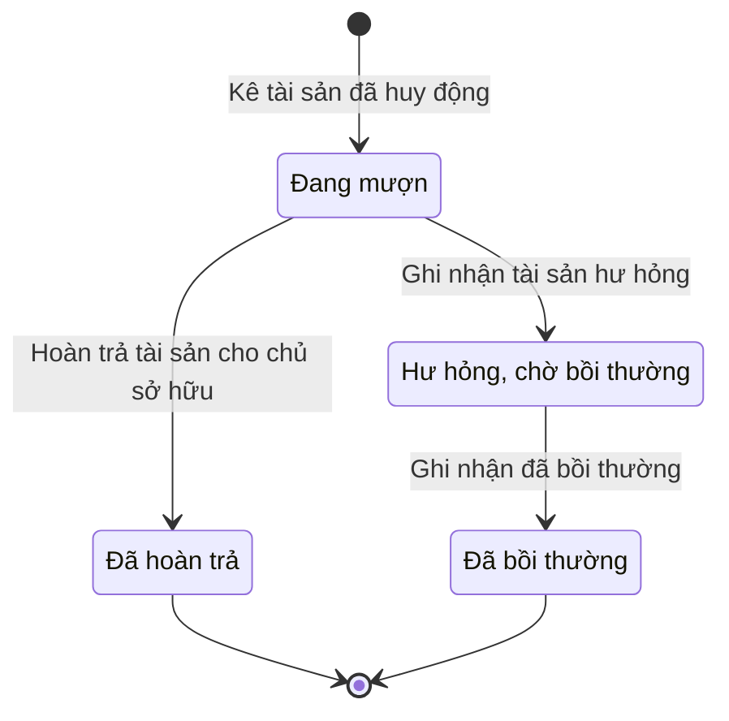

# qt-20.mobilized-asset · Vụ việc ứng phó — Tài sản đã huy động của dân

<!-- máy sinh: tom-tat -->
> **Hồ sơ:** Tài sản đã huy động của dân (`MobilizedAsset`)
>
> **Trong sổ phạm vi:** 20 · Vụ việc ứng phó — hồ sơ phụ mobilized-asset: tài sản mượn khi ứng phó, hoàn trả, bồi thường (tách khỏi 22 ngày 30/9)
>
> 7 bước · 4 chặng · 2 vai · 2 bảng quyết định · 1 hạn · 3 khớp nối.
>
> **Nguồn:** sổ nghiệp vụ `qt-20.mobilized-asset` · khai báo của app: `dqtv-app/core/processes/incident-response/workflow/mobilized-asset.yaml`. Các bảng do máy sinh từ nguồn này.
<!-- hết: tom-tat -->

<!-- viết tay: dien-giai -->
## Diễn giải

*Phần này viết tay, diễn giải lại điều các bảng bên dưới ghi.*

### Quy trình này để làm gì

Theo dõi từng **món tài sản mượn của dân khi ứng phó** một vụ việc — ví dụ xuồng máy, xe tải, máy phát điện — cho tới khi trả lại chủ sở hữu hoặc bồi thường xong. Mỗi hồ sơ là một món tài sản. Cả bốn bước đều do Chỉ huy trưởng Ban CHQS xã làm.

Hồ sơ có bốn chặng: *Đang mượn*, rồi hoặc *Đã hoàn trả*, hoặc *Hư hỏng, chờ bồi thường* → *Đã bồi thường*.

### Khi nào bắt đầu

Chỉ huy trưởng Ban CHQS xã bấm **Kê tài sản đã huy động**, chọn vụ việc ứng phó, nhập tên tài sản và chủ sở hữu; lần đề nghị huy động, số lượng, liên hệ, hiện trạng lúc nhận, thời điểm nhận là ô nhập nếu có. Bước này nối hồ sơ tới Vụ việc ứng phó và tới Lần đề nghị huy động lực lượng. Hồ sơ vào chặng *Đang mượn*.

### Diễn ra thế nào

**Chặng "Đang mượn"** — hai đường ra:

- **Hoàn trả tài sản cho chủ sở hữu**: ghi trả lúc nào và hiện trạng lúc trả, đều là ô nhập nếu có. Hồ sơ sang *Đã hoàn trả*.
- **Ghi nhận tài sản hư hỏng**: phải nhập mô tả hư hỏng. Hồ sơ sang *Hư hỏng, chờ bồi thường*.

**Chặng "Hư hỏng, chờ bồi thường".** Chỉ huy trưởng bấm **Ghi nhận đã bồi thường**: nhập mức bồi thường và phiếu chi đã cấp; số quyết định bồi thường và bản chụp quyết định là ô nhập nếu có. Hồ sơ sang *Đã bồi thường*.

### Kết thúc và để lại gì

Hồ sơ kết thúc ở *Đã hoàn trả* hoặc *Đã bồi thường*. Món tài sản đã bồi thường gắn với **Phiếu chi** (12a) đã cấp để bồi thường nó.

### Điều kiện chặn

- Ba bước sau bước kê: người làm phải thuộc đơn vị chủ hồ sơ — có dòng biên chế ở đơn vị chủ hồ sơ, hoặc ở đơn vị mang mã tỉnh của hồ sơ, hoặc ở đơn vị cấp `region`, hoặc cấp `central`.
- Bước kê tài sản phải chọn vụ việc ứng phó (`caseId`), nhập tên tài sản và chủ sở hữu.
- Ghi nhận đã bồi thường đòi phải có phiếu chi đã cấp.
- Sai người, sai chặng hoặc thiếu điều kiện thì bước bị chặn, hồ sơ giữ nguyên.
<!-- hết viết tay -->

## 1. Đường đi ngắn nhất qua các chặng

<!-- máy sinh: luong-chinh -->
Đường ít bước nhất từ lúc mở hồ sơ tới chặng kết thúc xa nhất. Máy chọn theo số chặng, không theo ý nghĩa nghiệp vụ — trình tự công việc thật xem phần Diễn giải và bảng "Việc làm ở từng chặng" ở mục 6.

| # | Ai làm | Làm gì | Hồ sơ sang chặng |
|---|---|---|---|
| 1 | Chỉ huy trưởng Ban CHQS xã | Kê tài sản đã huy động | Đang mượn |
| 2 | Chỉ huy trưởng Ban CHQS xã | Ghi nhận tài sản hư hỏng | Hư hỏng, chờ bồi thường |
| 3 | Chỉ huy trưởng Ban CHQS xã | Ghi nhận đã bồi thường | Đã bồi thường |

<!-- hết: luong-chinh -->

## 2. Hồ sơ và việc nó để lại

<!-- máy sinh: muc-tieu -->
**App gọi quy trình này là:** Tài sản đã huy động của dân.
<!-- hết: muc-tieu -->

## 3. Khởi phát và kết thúc

<!-- máy sinh: khoi-phat -->
**1 cửa vào** — bước mở hồ sơ:

| Bước mở | Ai mở | Hồ sơ vào chặng | App bắt buộc nhập |
|---|---|---|---|
| Kê tài sản đã huy động | Chỉ huy trưởng Ban CHQS xã | Đang mượn | `caseId`, tên tài sản, chủ sở hữu |

**Kết thúc:** *Đã hoàn trả* (`returned`), *Đã bồi thường* (`compensated`)
<!-- hết: khoi-phat -->

## 4. Vai trò

<!-- máy sinh: vai-tro -->
| Vai trong sổ | Tên trong app | Điều kiện | Làm những bước |
|---|---|---|---|
| `commander` | Chỉ huy trưởng Ban CHQS xã |  | Kê tài sản đã huy động · Hoàn trả tài sản cho chủ sở hữu · Ghi nhận tài sản hư hỏng · Trình ký văn bản thông báo gia hạn · Ghi nhận đã bồi thường |
| `system` | Hệ thống tự làm |  | Gia hạn trả tiền bồi thường · Ghi trễ hạn trả tiền bồi thường |

*"Tên trong app" là tên app đặt cho mã chủ thể của vai. Hồ sơ thuộc đơn vị cấp khác thì người làm là người giữ vai ấy ở đơn vị nêu trong cột "Điều kiện" (nếu sổ có ghi) và ở cột "Người làm phải thuộc" của bảng "Theo khai báo của app" (mục 7).*
<!-- hết: vai-tro -->

## 5. Nhánh phụ

<!-- máy sinh: nhanh-phu -->
**Bước khác đưa hồ sơ sang chặng mới** — đường song song, rẽ nhánh hoặc kết thúc sớm:

| Bước | Ai làm | Từ chặng | Sang chặng |
|---|---|---|---|
| Hoàn trả tài sản cho chủ sở hữu | Chỉ huy trưởng Ban CHQS xã | Đang mượn | Đã hoàn trả |

**Làm trong lúc hồ sơ đứng yên ở một chặng** — ghi nhận, bổ sung:

| Bước | Ai làm | Ở chặng |
|---|---|---|
| Trình ký văn bản thông báo gia hạn | Chỉ huy trưởng Ban CHQS xã | Hư hỏng, chờ bồi thường |
| Gia hạn trả tiền bồi thường | Hệ thống tự làm | Hư hỏng, chờ bồi thường |
| Ghi trễ hạn trả tiền bồi thường | Hệ thống tự làm | Hư hỏng, chờ bồi thường |

<!-- hết: nhanh-phu -->

## 6. Các chặng và việc làm ở từng chặng

<!-- máy sinh: chang -->
| Chặng | Tên hiển thị | Vào bằng bước | Kết thúc? |
|---|---|---|---|
| `in_use` | Đang mượn | Kê tài sản đã huy động |  |
| `returned` | Đã hoàn trả | Hoàn trả tài sản cho chủ sở hữu | **kết thúc** |
| `damaged` | Hư hỏng, chờ bồi thường | Ghi nhận tài sản hư hỏng |  |
| `compensated` | Đã bồi thường | Ghi nhận đã bồi thường | **kết thúc** |

### Việc làm ở từng chặng

Hồ sơ đang ở chặng nào thì làm được những bước nào.

| Hồ sơ đang ở chặng | Bước làm tại chặng (hồ sơ đứng yên) | Bước đưa hồ sơ sang chặng khác |
|---|---|---|
| **Đang mượn** | — | Hoàn trả tài sản cho chủ sở hữu — Chỉ huy trưởng Ban CHQS xã → *Đã hoàn trả* Ghi nhận tài sản hư hỏng — Chỉ huy trưởng Ban CHQS xã → *Hư hỏng, chờ bồi thường* |
| **Đã hoàn trả** | — | — (kết thúc) |
| **Hư hỏng, chờ bồi thường** | Trình ký văn bản thông báo gia hạn — Chỉ huy trưởng Ban CHQS xã Gia hạn trả tiền bồi thường — Hệ thống tự làm Ghi trễ hạn trả tiền bồi thường — Hệ thống tự làm | Ghi nhận đã bồi thường — Chỉ huy trưởng Ban CHQS xã → *Đã bồi thường* |
| **Đã bồi thường** | — | — (kết thúc) |
<!-- hết: chang -->

## 7. Bảng bước

<!-- máy sinh: buoc -->
| # | Bước | Mã bước | Ai thực hiện | Từ chặng | Sang chặng | Phải có trước | Ghi lại |
|---|---|---|---|---|---|---|---|
| 1 | Kê tài sản đã huy động | `recordMobilizedAsset` | Chỉ huy trưởng Ban CHQS xã | — (mở hồ sơ) | `in_use` | `noMobilizationPending` | mã tỉnh, mã xã, tên tài sản, số lượng, chủ sở hữu, liên hệ, hiện trạng lúc nhận, nhận lúc, nối tới Vụ việc ứng phó, nối tới Lần đề nghị huy động lực lượng, đơn vị chủ hồ sơ, nguồn tài sản |
| 2 | Hoàn trả tài sản cho chủ sở hữu | `returnMobilizedAsset` | Chỉ huy trưởng Ban CHQS xã | `in_use` | `returned` | người làm thuộc đơn vị chủ hồ sơ, số lượng trả lại | trả lúc, hiện trạng lúc trả, số lượng trả lại |
| 3 | Ghi nhận tài sản hư hỏng | `reportAssetDamage` | Chỉ huy trưởng Ban CHQS xã | `in_use` | `damaged` | người làm thuộc đơn vị chủ hồ sơ | mô tả hư hỏng, trả lúc, số ngày của hạn trả tiền, hạn trả tiền bồi thường |
| 4 | Trình ký văn bản thông báo gia hạn | `requestCompensationExtensionSignature` | Chỉ huy trưởng Ban CHQS xã | `damaged` | giữ nguyên | người làm thuộc đơn vị chủ hồ sơ, hạn trả tiền bồi thường, `compensationNotExtended`, `compensationNotOverdue`, số ngày gia hạn, `noCompensationExtensionDocumentOpen` | số ngày gia hạn, nối `compensationExtensionByDocument` |
| 5 | Gia hạn trả tiền bồi thường | `extendAssetCompensationDeadline` | Hệ thống tự làm | `damaged` | giữ nguyên | `compensationExtensionDocumentIssued`, `compensationNotExtended` | số ngày của hạn trả tiền, hạn trả tiền bồi thường, gia hạn lúc |
| 6 | Ghi trễ hạn trả tiền bồi thường | `flagAssetCompensationOverdue` | Hệ thống tự làm | `damaged` | giữ nguyên | hạn trả tiền bồi thường, `compensationNotOverdue` | ghi trễ hạn lúc |
| 7 | Ghi nhận đã bồi thường | `markAssetCompensated` | Chỉ huy trưởng Ban CHQS xã | `damaged` | `compensated` | người làm thuộc đơn vị chủ hồ sơ, nối tới Phiếu chi, `compensationVoucherExists`, `voucherAmountMatches`, `markAssetCompensatedFromIncomingDocumentUsable` | mức bồi thường, nối tới Phiếu chi, `compensatedAt`, nối tới Văn bản đến |

### Khi không đạt điều kiện

Mặc định: không đúng người, hồ sơ không ở đúng chặng, hoặc thiếu thứ "phải có trước" thì bước bị chặn, hồ sơ giữ nguyên. Bảng dưới chỉ kê những bước có kết quả riêng.

| # | Bước | Kết quả riêng |
|---|---|---|
| 1 | Kê tài sản đã huy động | bước dừng lại, hồ sơ giữ nguyên khi kết quả xét là: `NOT_MOBILIZED` |
| 2 | Hoàn trả tài sản cho chủ sở hữu | nhánh `full`: hồ sơ sang *Đã hoàn trả*, ghi thêm trả lúc, hiện trạng lúc trả, số lượng trả lại; nhánh `short`: hồ sơ sang *Hư hỏng, chờ bồi thường*, ghi thêm trả lúc, hiện trạng lúc trả, số lượng trả lại, số ngày của hạn trả tiền, hạn trả tiền bồi thường |
| 5 | Gia hạn trả tiền bồi thường | bước này không do người nào bấm |
| 6 | Ghi trễ hạn trả tiền bồi thường | bước này không do người nào bấm |

### Điều kiện "phải có trước" bằng lời

Cột "Phải có trước" ở bảng bước có hai loại: ô dữ liệu thường (bước chỉ đòi ô ấy đã có giá trị) và điều kiện hệ tự xét. Bảng này diễn các điều kiện hệ tự xét theo đúng công thức sổ ghi; số ở cột cuối là số thứ tự bước.

| Điều kiện | Đúng khi | Bước đòi |
|---|---|---|
| `noMobilizationPending` | KHÔNG (có hồ sơ Vụ việc ứng phó (qt-20) chính là hồ sơ ghi ở ô nối `assetOfCase` của hồ sơ đang làm mà đã có nối `mobilizationOfCase` (Lần đề nghị huy động lực lượng → Vụ việc ứng phó) VÀ KHÔNG (`mobilizationOutcome` là `granted` hoặc `refused`)) | 1 |
| `actorInOwnerUnit` | có dòng biên chế đơn vị của chính người đang làm mà `unitCode` của dòng người của đơn vị ấy bằng đơn vị chủ hồ sơ của hồ sơ này HOẶC `unitCode` của dòng người của đơn vị ấy bằng mã tỉnh của hồ sơ này HOẶC `unitLevel` của dòng người của đơn vị ấy bằng `region` HOẶC `unitLevel` của dòng người của đơn vị ấy bằng `central` | 2, 3, 4, 7 |
| `compensationNotExtended` | KHÔNG (đã có gia hạn lúc) | 4, 5 |
| `compensationNotOverdue` | KHÔNG (đã có ghi trễ hạn lúc) | 4, 6 |
| `noCompensationExtensionDocumentOpen` | KHÔNG (có hồ sơ Việc luật giao kèm văn bản đến, đi — Văn bản đi (qt-1.outgoing-document) chính là hồ sơ ghi ở ô nối `compensationExtensionByDocument` của hồ sơ đang làm mà hồ sơ ấy đang ở chặng `DRAFT` hoặc `PENDING_SIGNATURE` hoặc `SIGNED`) | 4 |
| `compensationExtensionDocumentIssued` | có hồ sơ Việc luật giao kèm văn bản đến, đi — Văn bản đi (qt-1.outgoing-document) chính là hồ sơ ghi ở ô nối `compensationExtensionByDocument` của hồ sơ đang làm mà hồ sơ ấy đang ở chặng `ISSUED` | 5 |
| `compensationVoucherExists` | có hồ sơ Chi trả theo đợt — Phiếu chi (qt-12a.payment-voucher) chính là hồ sơ ghi ở ô nối `assetCompensatedBy` của hồ sơ đang làm mà hồ sơ ấy đang ở chặng `settled` | 7 |
| `voucherAmountMatches` | có hồ sơ Chi trả theo đợt — Phiếu chi (qt-12a.payment-voucher) chính là hồ sơ ghi ở ô nối `assetCompensatedBy` của hồ sơ đang làm mà `amount` của hồ sơ đang xét bằng mức bồi thường của hồ sơ này | 7 |
| `markAssetCompensatedFromIncomingDocumentUsable` | có hồ sơ Việc luật giao kèm văn bản đến, đi — Văn bản đến (qt-1.incoming-document) chính là hồ sơ ghi ở ô nối `markAssetCompensatedFromIncomingDocument` của hồ sơ đang làm mà hồ sơ ấy đang ở chặng `RECEIVED` hoặc `DISTRIBUTED` | 7 |
| `mobilizationGranted` | có hồ sơ Vụ việc ứng phó (qt-20) chính là hồ sơ ghi ở ô nối `assetOfCase` của hồ sơ đang làm mà `mobilizationOutcome` là `granted` | đầu vào bảng quyết định (mục 8) |
| `returnedInFull` | số lượng trả lại của hồ sơ này bằng số lượng của hồ sơ này | đầu vào bảng quyết định (mục 8) |

### Theo khai báo của app

Người làm phải thuộc đơn vị nào, ô người dùng phải nhập, bước có lặp được không, và căn cứ pháp lý — lấy từ khai báo quy trình trong app.

| # | Bước | Người làm phải thuộc | Bắt buộc nhập | Nhập nếu có | Lặp được | Căn cứ |
|---|---|---|---|---|---|---|
| 1 | Kê tài sản đã huy động |  | `caseId`, tên tài sản, chủ sở hữu | `requestId`, số lượng, liên hệ, hiện trạng lúc nhận, nhận lúc, nguồn tài sản |  | L18/2023/QH15 Đ.21 k2 · Đ.21 k3 |
| 2 | Hoàn trả tài sản cho chủ sở hữu |  | số lượng trả lại | hiện trạng lúc trả, trả lúc |  | L18/2023/QH15 Đ.21 k3 |
| 3 | Ghi nhận tài sản hư hỏng |  | mô tả hư hỏng | số lượng trả lại, trả lúc, hiện trạng lúc trả |  | L18/2023/QH15 Đ.21 k3 · Đ.41 k3 |
| 4 | Trình ký văn bản thông báo gia hạn |  | số ngày gia hạn, dự thảo văn bản thông báo gia hạn (PDF) | — |  | L15/2008/QH12 Đ.38 k2; NĐ30/2020/NĐ-CP Đ.13 |
| 5 | Gia hạn trả tiền bồi thường |  | — | số ngày gia hạn, văn bản thông báo gia hạn |  | L15/2008/QH12 Đ.38 k2 |
| 6 | Ghi trễ hạn trả tiền bồi thường |  | — | — |  | L15/2008/QH12 Đ.38 k1, k4 |
| 7 | Ghi nhận đã bồi thường |  | mức bồi thường, phiếu chi đã cấp, quyết định bồi thường đã ký trong sổ văn bản đến | — |  | L18/2023/QH15 Đ.21 k3 · Đ.41 k3 |

### Điều kiện và ghi chú app khai cho từng bước

Lấy từ khai báo quy trình trong app. Lời trong ngoặc kép là câu app hiện cho người dùng. Chức danh người ký ngoài hệ app chỉ khai bằng mã.

| # | Bước | Điều kiện, ghi chú |
|---|---|---|
| 4 | Trình ký văn bản thông báo gia hạn | · phải đã có ô "hạn trả tiền bồi thường" — thiếu thì app báo: "món này chưa có hạn trả tiền bồi thường" · không làm được khi đã có ô "gia hạn lúc" — app báo: "đã gia hạn một lần — luật chỉ cho gia hạn một lần, tối đa 30 ngày" · không làm được khi đã có ô "ghi trễ hạn lúc" — app báo: "đã quá hạn trả tiền bồi thường — gia hạn phải báo bằng văn bản trước khi hết hạn" |
| 5 | Gia hạn trả tiền bồi thường | · phải đã có ô "hạn trả tiền bồi thường" — thiếu thì app báo: "món này chưa có hạn trả tiền bồi thường" · không làm được khi đã có ô "gia hạn lúc" — app báo: "đã gia hạn một lần — luật chỉ cho gia hạn một lần, tối đa 30 ngày" · không làm được khi đã có ô "ghi trễ hạn lúc" — app báo: "đã quá hạn trả tiền bồi thường — gia hạn phải báo bằng văn bản trước khi hết hạn" |
| 6 | Ghi trễ hạn trả tiền bồi thường | · phải đã có ô "hạn trả tiền bồi thường" — thiếu thì app báo: "món này không có hạn trả tiền bồi thường nào đang chạy" · không làm được khi đã có ô "ghi trễ hạn lúc" — app báo: "món này đã được ghi trễ hạn trả tiền bồi thường" |
| 7 | Ghi nhận đã bồi thường | · không đòi bản chụp — app ghi: "bản chụp quyết định bồi thường lấy từ văn bản đến văn thư đã vào sổ (tầng đọc chép `scanPath`), không tải ảnh ở bước này" |
<!-- hết: buoc -->

## 8. Bảng quyết định, hạn, việc ngoài hệ

<!-- máy sinh: quyet-dinh -->
**Bảng `asset-source`** — xét ở bước *Kê tài sản đã huy động*; đầu vào: `mobilizationGranted`, nguồn tài sản. 3 dòng, dò từ trên xuống, dòng đầu tiên khớp thì dừng.

| Thứ tự dò (số sổ ghi) | Dòng | Khi | Thì |
|---|---|---|---|
| 1 | `granted` | đã có `mobilizationGranted` | cho qua |
| 2 | `voluntary` | chưa có `mobilizationGranted` và nguồn tài sản là Dân tự nguyện cho mượn (`voluntary_loan`) | cho qua |
| 3 | `not-mobilized` | chưa có `mobilizationGranted` | `NOT_MOBILIZED` |

**Bảng `return-count`** — xét ở bước *Hoàn trả tài sản cho chủ sở hữu*; đầu vào: `returnedInFull`. 2 dòng, dò từ trên xuống, dòng đầu tiên khớp thì dừng.

| Thứ tự dò (số sổ ghi) | Dòng | Khi | Thì |
|---|---|---|---|
| 1 | `full` | đã có `returnedInFull` | `full` |
| 2 | `short` | chưa có `returnedInFull` | `short` |

| Hạn | Tính từ | Thời hạn | Quá hạn thì |
|---|---|---|---|
| `compensationPayment.deadline` | `{"fact": "compensationDueDate"}` | 0 ngày | hệ làm bước Ghi trễ hạn trả tiền bồi thường |

<!-- hết: quyet-dinh -->

## 9. Dữ liệu của hồ sơ

<!-- máy sinh: du-lieu -->
Các ô mà bước trong sổ ghi hoặc đòi. Số trong hai cột cuối là số thứ tự bước ở bảng bước (mục 7).

| Ô dữ liệu | Mã | Kiểu (app) | Giá trị cho phép | Loại ô (sổ) | Bước ghi | Bước đòi | Mô tả trong app |
|---|---|---|---|---|---|---|---|
| mã tỉnh | `provinceCode` | chữ |  | lưu trên hồ sơ (`stored`) | 1 | — | Mã tỉnh — dùng lọc phạm vi theo hàng |
| mã xã | `communeCode` | chữ |  | lưu trên hồ sơ (`stored`) | 1 | — | Mã xã |
| tên tài sản | `assetName` | chữ |  | đưa vào ở bước (`input`) | 1 | — | Tên tài sản — xuồng máy, xe tải, máy phát điện… |
| số lượng | `quantity` | số |  | đưa vào ở bước (`input`) | 1 | — | Số lượng |
| chủ sở hữu | `ownerName` | chữ |  | đưa vào ở bước (`input`) | 1 | — | Chủ sở hữu — hợp tác xã, doanh nghiệp, hộ dân nào |
| liên hệ | `ownerContact` | chữ |  | đưa vào ở bước (`input`) | 1 | — | Số điện thoại, địa chỉ liên hệ của chủ sở hữu |
| hiện trạng lúc nhận | `conditionOnTake` | chữ |  | đưa vào ở bước (`input`) | 1 | — | Hiện trạng lúc nhận — căn cứ đối chiếu khi hoàn trả |
| nhận lúc | `takenAt` | ngày giờ |  | đưa vào ở bước (`input`) | 1 | — | Thời điểm nhận tài sản |
| đơn vị chủ hồ sơ | `ownerUnit` |  |  | lưu trên hồ sơ (`stored`) | 1 | — |  |
| nguồn tài sản | `assetSource` | chọn một | Theo quyết định huy động (`mobilized`), Dân tự nguyện cho mượn (`voluntary_loan`) | đưa vào ở bước (`input`) | 1 | — | Nguồn tài sản — theo quyết định huy động của Chủ tịch UBND, hay dân tự nguyện cho mượn |
| trả lúc | `returnedAt` | ngày giờ |  | đưa vào ở bước (`input`) | 2, 3 | — | Thời điểm hoàn trả — Đ.21 k3 đòi *ngay sau khi kết thúc nhiệm vụ* |
| hiện trạng lúc trả | `conditionOnReturn` | chữ |  | đưa vào ở bước (`input`) | 2 | — | Hiện trạng lúc trả — đối chiếu với hiện trạng lúc nhận, L18/2023 Đ.21 k3 |
| số lượng trả lại | `returnedQuantity` | số |  | đưa vào ở bước (`input`) | 2 | 2 | Số lượng trả lại — đối chiếu với số đã mượn |
| mô tả hư hỏng | `damageNote` | chữ |  | đưa vào ở bước (`input`) | 3 | — | Mô tả hư hỏng — căn cứ lập hồ sơ bồi thường |
| số ngày của hạn trả tiền | `compensationPaymentDays` | số |  | lưu trên hồ sơ (`stored`) | 3, 5 | — | Số ngày của hạn trả tiền bồi thường, tính từ ngày hoàn trả — 30 ngày, gia hạn thêm tối đa 30 (L15/2008 Đ.38) |
| hạn trả tiền bồi thường | `compensationDueDate` | ngày |  | lưu trên hồ sơ (`stored`) | 3, 5 | 4, 6 | Hạn trả tiền bồi thường — ngày hoàn trả cộng số ngày của hạn (L15/2008 Đ.38 k1) |
| số ngày gia hạn | `extensionDays` | số |  | đưa vào ở bước (`input`) | 4 | 4 | Số ngày gia hạn trả tiền bồi thường — một lần, tối đa 30 ngày (L15/2008 Đ.38 k2) |
| gia hạn lúc | `compensationExtendedAt` | ngày giờ |  | lưu trên hồ sơ (`stored`) | 5 | — | Lúc ghi gia hạn trả tiền bồi thường |
| ghi trễ hạn lúc | `compensationOverdueAt` | ngày giờ |  | lưu trên hồ sơ (`stored`) | 6 | — | Lúc hệ ghi đã quá hạn trả tiền bồi thường — trả chậm phải trả thêm lãi (L15/2008 Đ.38 k4) |
| mức bồi thường | `compensationAmount` | số |  | đưa vào ở bước (`input`) | 7 | — | Mức bồi thường đã được duyệt (đồng) — L18/2023 Đ.21 k3 |
| — | `compensatedAt` | ngày giờ |  | lưu trên hồ sơ (`stored`) | 7 | — | Lúc ghi nhận đã bồi thường tài sản |
| — | `noMobilizationPending` |  | có hay chưa | hệ suy ra (`derived`) | — | 1 |  |
| người làm thuộc đơn vị chủ hồ sơ | `actorInOwnerUnit` |  | có hay chưa | hệ suy ra (`derived`) | — | 2, 3, 4, 7 |  |
| — | `compensationNotExtended` |  | có hay chưa | hệ suy ra (`derived`) | — | 4, 5 |  |
| — | `compensationNotOverdue` |  | có hay chưa | hệ suy ra (`derived`) | — | 4, 6 |  |
| — | `noCompensationExtensionDocumentOpen` |  | có hay chưa | hệ suy ra (`derived`) | — | 4 |  |
| — | `compensationExtensionDocumentIssued` |  | có hay chưa | hệ suy ra (`derived`) | — | 5 |  |
| — | `compensationVoucherExists` |  | có hay chưa | hệ suy ra (`derived`) | — | 7 |  |
| — | `voucherAmountMatches` |  | có hay chưa | hệ suy ra (`derived`) | — | 7 |  |
| — | `markAssetCompensatedFromIncomingDocumentUsable` |  | có hay chưa | hệ suy ra (`derived`) | — | 7 |  |
| — | `mobilizationGranted` |  | có hay chưa | hệ suy ra (`derived`) | — | — |  |
| — | `returnedInFull` |  | có hay chưa | hệ suy ra (`derived`) | — | — |  |

32 ô. Cột "Loại ô" là cách sổ phân loại ô, in kèm đúng chữ của sổ; ô nào người dùng phải nhập xem bảng "Theo khai báo của app" ở mục 7.
<!-- hết: du-lieu -->

## 10. Khớp nối với quy trình khác

<!-- máy sinh: khop-noi -->
| Quy trình kia | Hồ sơ kia | Quan hệ | Nội dung (mô tả trong app) | Bước ghi mối nối | Tên ô nối |
|---|---|---|---|---|---|
| 1.incoming-document | Văn bản đến | gắn với nhau ở một bước giữa chừng | Quyết định bồi thường tài sản huy động bị hư hỏng — văn bản trong sổ văn bản đến (L18/2023/QH15 Đ.21 k3, Đ.41… | 20.mobilized-asset·markAssetCompensated | `markAssetCompensatedFromIncomingDocument` |
| 1.outgoing-document | Văn bản đi | gắn với nhau ở một bước giữa chừng | Văn bản thông báo gia hạn trả tiền bồi thường ở Sổ văn bản đi — sổ qt-20.mobilized-asset link.compensationExt… | 20.mobilized-asset·requestCompensationExtensionSignature | `mobilizedAssetCompensationExtensionDocument` |
| 12a.payment-voucher | Phiếu chi | gắn với nhau ở một bước giữa chừng | Phiếu chi đã cấp để bồi thường món tài sản này — L18/2023 Đ.21 k3; tiền đi qua dự trù kinh phí của vụ việc, N… | 20.mobilized-asset·markAssetCompensated · đòi: 20.mobilized-asset·markAssetCompensated | `assetCompensatedBy` |

3 khớp nối. ⊕ là bước tạo hồ sơ.

**Ô nối giữa các hồ sơ cùng mã quy trình, hoặc tới danh mục nền:** `assetOfCase` (Tài sản đã huy động của dân → Vụ việc ứng phó) — bước Kê tài sản đã huy động; `assetOfMobilization` (Tài sản đã huy động của dân → Lần đề nghị huy động lực lượng) — bước Kê tài sản đã huy động.
<!-- hết: khop-noi -->

## 11. Thông tin chung

<!-- máy sinh: thong-tin -->
| | |
|---|---|
| **Mã trong sổ** | `qt-20.mobilized-asset` |
| **Quy trình trong app** | `incident-response` (`workflow/mobilized-asset.yaml`) — mặt công tác: `operations` |
| **Hồ sơ** | Tài sản đã huy động của dân (`MobilizedAsset`) |
| **Cùng mã quy trình** | [qt-20](qt-20.html) |
| **Căn cứ pháp lý từng bước** | cột "Căn cứ" ở bảng "Theo khai báo của app", mục 7 |
<!-- hết: thong-tin -->
